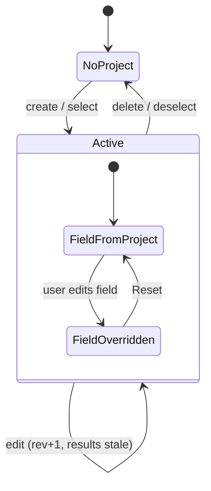
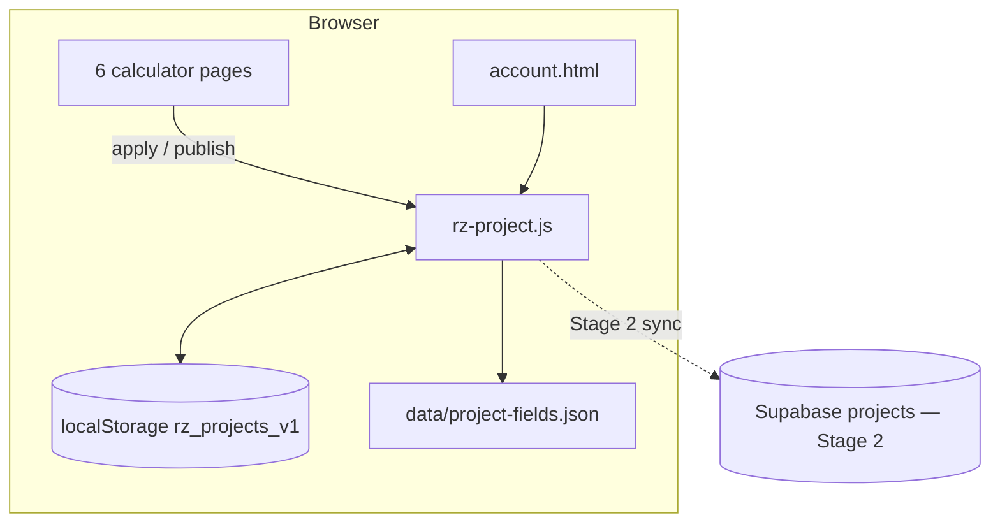

# PRD-P01: One facility project shared by the calculators

## 1. Document control
| Field | Value |
|---|---|
| PRD id | PRD-P01 |
| Version | 1.0, 2026-11-10 |
| Status | **Stage 1** (local-first, this browser) is approved for implementation (directive, no schema change). **Stage 2** (cloud sync: new `projects` table, RLS, `saved_scenarios.project_id`) needs owner approval and must be run by the owner in Supabase; it stays BLOCKED until then. |
| Priority | Wave 2 foundation (rank 2, priority 74.0). P03, P04, P13 and P18 depend on it. |
| Dependencies | P02 (link payload v2 carries the project) |
| Modules | new `js/rz-project.js`; new `data/project-fields.json`; capex, opex, tco, roi, carbon, pue calculators (Stage 1 set); `account.html`; `supabase/schema.sql` (Stage 2) |
| Approval | Stage 1: directive. Stage 2: owner. |

## 2. Executive summary
A facility is described again on every calculator:
- The same IT load is typed into 6 pages, in 3 different units.
- The country goes into 3 different selectors with 2 code formats.
- CAPEX computed on one page is retyped by hand into ROI.

This PRD introduces a **project**: a named facility record (IT load, country, tier, PUE, tariff, horizon, plus the published results of each calculator). The six financial and energy calculators read their defaults from it and write their results back to it.

The user sees, on each calculator:
- which values came from the project;
- which values they overrode on this page;
- which upstream result is out of date.

## 3. Problem statement (measured 2026-11-10)
**Same quantity, different fields and units:**

| Quantity | capex | opex | tco | roi | carbon | pue |
|---|---|---|---|---|---|---|
| IT load | `itLoad` kW (100–100,000) | `itLoad` kW | `tcoItLoad` MW (1–100) | `itCapacity` MW (0.5–500) | `itLoad` kW | `itLoad` kW |
| Location | `cityMarket` | `countrySelect` ISO-2 | `tcoCountry` `country:XX` + `tcoRegion` | — | `countrySelect` ISO-2 | — |
| Tier | — | `tierLevel` 1-4 | `tcoTier` `tier-N` | — | — | — |
| PUE | — | `pueSlider` | `tcoPue` | `pueValue` | `pueValue` | (output) |
| Energy price | `utilityRate` | (derived from country) | — | `electricityRate` $/kWh | `electricityRate` $/kWh | — |
| CAPEX | (output `#totalCost`) | — | — | `totalCapex` $M (input) | — | — |

Further measurements:
- `saved_scenarios` stores each page's inputs separately, with no link between them (schema.sql:280).
- `openInCalc` only reopens a single page.
- No page reads another page's result. TCO and ROI read only the engine's own sub-models (`models.opex.powerCostAnnual`, `models.roi.irr/npv`).

**Consequences:**
- Inconsistent cases (5 MW on TCO, 4,800 kW on OPEX).
- CAPEX retyped into ROI by hand.
- No way to say "this is the Jakarta 20 MW case" across tools.

## 4. Objectives and success metrics
| Objective | Metric | Target |
|---|---|---|
| One source for shared inputs | after "Use project" on each of the 6 pages, the shared fields equal the project values converted to page units | 6/6 pages, every mapped field (gate) |
| Results flow | CAPEX result from capex appears in roi `totalCapex` ($M, rounded per field step) | exact after conversion (gate) |
| Overrides are explicit | an edited field shows "overridden" and keeps its value on reload | yes |
| Staleness visible | after a project input changes, pages whose stored result predates the change show "out of date" | yes |
| No silent overwrite | opening a page never replaces a user's typed value without the project chip being active | gate |

Adoption cannot be measured: there is no analytics, so none is claimed.

## 5. Scope
**In scope, Stage 1:**
- Project CRUD in `localStorage` (this browser): create, rename, duplicate, delete with confirm, select active.
- Header chip on the 6 calculators.
- A field map with unit conversion.
- Result publishing from capex, opex, tco, roi, carbon and pue.
- An override model.
- A staleness model.
- Project export and import as a JSON file.
- Project section on account.html (local projects listed).
- P02 link payload v2 including the project snapshot.

**In scope, Stage 2 (blocked, specified fully here):**
- `projects` table with RLS.
- `saved_scenarios.project_id` foreign key, nullable.
- Sync policy: local is primary, cloud is a backup copy, last-writer-wins on `updated_at` with a conflict prompt.

**Out of scope:**
- Cx, spares, tier, tia and rfs. They join through P13.
- Multi-user shared projects (needs P18-style permissions).
- Currency conversion: the calculators are USD today.

**Reuse:**
- `rzScenario.capture/restore` mechanics (events fire, so pages recompute).
- The `rz-scenario.js` module pattern.
- The account page sections.
- The `friendly()` error mapping (Stage 2).

**Constraints:**
- No per-page refactor of calculation code.
- Pages publish results through one added call in their existing recompute function.
- Zero-build ES5.

**Assumptions:**
- Units and code formats in the table above are stable. The field-map gate pins them.
- The DCMOC app keeps its own projects (`dcmoc_projects`) and is not merged here. The two are deliberately separate, and the name "project" is disambiguated in the UI as "Facility project".

## 6. Personas and use cases
- **Planner** builds one facility case across CAPEX, OPEX, TCO, ROI and carbon, then exports (P04).
- **Analyst** duplicates the project, changes the country, and compares (P03).
- **Returning user** reopens "Jakarta 20 MW" a week later on the same browser (Stage 1) or another device (Stage 2).

## 7. User journey
1. **Entry.** Any of the 6 calculators. The header shows the chip "Facility project: none · Set up".
2. **Create.**
   - Clicking the chip opens a popover form: Name (required, 1–80 characters), IT load (kW, 50–500,000), Country (ISO-2 list, union of the pages' lists), Tier (1–4), Design PUE (1.05–2.5), Energy price ($/kWh, 0.02–0.50), Horizon (years, 5–40).
   - Values are pre-filled from the current page's fields, so nothing is lost.
   - **Create** validates. Errors appear inline under each field.
3. **Apply.** The page's mapped fields are set through the restore mechanism and recompute. Each mapped field gets a small "project" tag after its label. The chip reads "Jakarta 20 MW · 4 fields from project".
4. **Override.** The user edits a mapped field. Its tag changes to "overridden" with a **Reset to project** link. The override is stored per (project, page, field).
5. **Publish.** When the page recomputes with a project active, it publishes its results (for example capex `totalCapexUsd`) with a timestamp and the project revision they were based on.
6. **Navigate.**
   - The chip popover lists the 6 calculators. Each row reads "up to date", "out of date (inputs changed after this result)" or "not run".
   - Each row is a link to that page. It opens with the project applied.
7. **Downstream.**
   - roi opens. `totalCapex` is filled from capex's published result, converted to $M, tagged "from CAPEX · 3 min ago".
   - If capex is out of date, the tag reads "from CAPEX · out of date" in the warning token, with a link "Open CAPEX to refresh".
8. **Edit project.** The chip opens **Edit**. Changing the IT load increments the project revision. All published results become out of date, and the open page re-applies the non-overridden fields.
9. **Delete.** **Delete project** asks "Delete 'Jakarta 20 MW' from this browser? This cannot be undone." Confirm removes it. Pages fall back to their own defaults and keep their current values.
10. **Export / import.** Export downloads `project-<slug>.json`. Import validates against the schema and rejects files with errors listed.
11. **Failures.**
    - localStorage full or blocked: the chip shows "Projects unavailable in this browser (storage blocked)", and all page functions still work.
    - Corrupt store: it is moved to `rz_projects_corrupt_<ts>`, and the user is told once.

## 8. Functional requirements
| ID | Description | Trigger | Pre | Inputs | Processing | Outputs | State change | Exceptions | Acceptance |
|---|---|---|---|---|---|---|---|---|---|
| FR-P01-1 | Project store | module load | — | localStorage `rz_projects_v1` | parse + validate schema; on corruption, quarantine | in-memory list | — | storage blocked: unavailable mode | unit |
| FR-P01-2 | Create | Create click | valid form | form fields | assign `id` (crypto.randomUUID, else a time+counter fallback), rev 1 | project | stored, set active | validation errors | E2E |
| FR-P01-3 | Field map | load | — | `data/project-fields.json` | per page: field id ↔ project key, unit factor, code transform (`ISO→'country:'+ISO` for tco, `N→'tier-N'`) | adapter | — | unknown page: chip hidden | field-map gate |
| FR-P01-4 | Apply | Use project / page load with an active project | page in the map | project, overrides | for each mapped field without an override: convert, clamp to the field min/max (a clamp is reported in the chip as "adjusted to the page range"), set the value, fire input+change | fields set | — | option missing in a select: field left as is, listed as "not applied" | gate T-P01-4 |
| FR-P01-5 | Override tracking | input event on a mapped field by the user (not from apply) | active project | value | store an override `{field, value, at}` | tag "overridden" | override saved | — | E2E |
| FR-P01-6 | Reset field | Reset link | override exists | — | remove override, re-apply the field | — | — | — | E2E |
| FR-P01-7 | Publish results | page recompute | active project | page outputs via `rzProject.publish(page, {key: value})` added in each page's recompute | store `{value, unit, at, rev}` per key | — | results updated | value not finite: not stored, warned | gate |
| FR-P01-8 | Consume upstream | apply on roi | capex published | `totalCapexUsd` | /1e6, round to the field step | roi `totalCapex` | — | none published: field untouched, tag "CAPEX not run" | gate |
| FR-P01-9 | Staleness | render chip/tags | — | result `rev` vs project `rev`, or upstream `at` vs page result `at` | out of date when `result.rev < project.rev` | status labels | — | — | unit |
| FR-P01-10 | Edit project | Save in the edit form | valid | changes | rev+1, re-apply on the current page | — | stored | — | E2E |
| FR-P01-11 | Delete | confirm | — | — | remove the project + its overrides | — | — | — | E2E |
| FR-P01-12 | Export / import | buttons | — | file | JSON schema v1; import rejects unknown version, missing fields, values outside range | file / project | stored on import with a new id if the id collides | invalid file: error list | unit |
| FR-P01-13 | Link v2 | P02 Copy link | active project | — | payload `{v:2, calc, inputs, project}` | link | — | — | unit; the v1 reader still works |
| FR-P01-14 | Account listing | account load | — | local store | list projects with page status | section | — | — | E2E |
| FR-P01-15 (Stage 2) | Cloud backup | Save to cloud | signed in, owner has applied the SQL | project | upsert into `projects` (RLS own rows); size cap 64 KB | cloud copy | `synced_at` | conflict: prompt "Keep this browser's / Keep cloud" | SQL test + E2E stub |

## 9. UI/UX specification
**Chip.** In the tool header, right of the title block on calculators (the `.tool-head` area).
- Mono 12 px, 1 px hairline, 4 px radius, 32 px tall (44 px tap target via padding on touch).
- Text: "Facility project: <name>". When active, a second muted line shows "<n> fields · <m> results".

**Popover.** Anchored to the chip; becomes a bottom sheet under 600 px.
- Sections:
  1. Active project (name, key values as a definition list).
  2. Calculators table (page · status · link).
  3. Actions: Edit · Duplicate · Export · Switch project ▾ · New · Delete (text button in the fault colour at the end, separated by a hairline).
- Focus trap. Esc closes and returns focus to the chip.

**Form.**
- Labels above inputs. Units in the label ("IT load (kW)"). Native inputs with the page's existing input classes.
- Inline errors `aria-describedby`.
- Primary **Create** / **Save**; secondary **Cancel**.

**Field tag.**
- After the field label: "project", or "overridden · Reset", or "from CAPEX · 3 min ago".
- Mono 11 px, muted. Warning token when out of date.
- It is text, not a decorative badge, with no fill.

**States.**
- No projects: the chip reads "Facility project: none · Set up".
- Storage blocked: the chip is disabled with the explanation in `title` and in the popover text. It is the only disabled control, and its reason is visible.

**Accessibility.**
- Popover `role=dialog aria-modal=false` (non-blocking), labelled.
- Tags are inside the label, so screen readers announce provenance.

**Motion.** Popover 120 ms opacity; none under reduced motion.

**Design.** design.md tokens, no gradients or shadows beyond the existing tool-register popover style.

## 10. Data model
**Stage 1 (localStorage `rz_projects_v1`):**
```json
{
  "v": 1,
  "active": "uuid|null",
  "projects": {
    "<uuid>": {
      "id": "uuid", "name": "string 1..80", "rev": 1,
      "created_at": "ISO", "updated_at": "ISO",
      "inputs": { "it_load_kw": 20000, "country": "ID", "tier": 3, "pue_design": 1.35,
                  "energy_price_usd_kwh": 0.09, "horizon_years": 20 },
      "results": { "capex": { "total_capex_usd": { "value": 1.6e8, "unit": "USD", "at": "ISO", "rev": 1 } } },
      "overrides": { "tco": { "tcoPue": { "value": "1.3", "at": "ISO" } } }
    }
  }
}
```
Validation:
- `it_load_kw` 50–500,000.
- `country` matches `^[A-Z]{2}$`.
- `tier` 1–4.
- `pue_design` 1.05–2.5.
- `energy_price_usd_kwh` 0.02–0.5.
- `horizon_years` 5–40.
- Name 1–80 characters.
- Total size cap 256 KB.

**Field map (`data/project-fields.json`):** one entry per page:
```
{ field, key, factor, round?, transform?: 'iso2' | 'tco-country' | 'tier-n' | 'tco-tier' }
```
plus `publish` keys per page.

**Stage 2 (proposed SQL, owner-run):**
```sql
create table public.projects (
  id uuid primary key,
  user_id uuid not null references auth.users(id) on delete cascade,
  name text not null check (char_length(name) between 1 and 80),
  body jsonb not null check (pg_column_size(body) <= 65536),
  rev int not null default 1,
  created_at timestamptz not null default now(),
  updated_at timestamptz not null default now()
);
create index projects_user_idx on public.projects (user_id, updated_at desc);
alter table public.projects enable row level security;
-- four own-row policies identical in shape to saved_scenarios (schema.sql:306-309)
alter table public.saved_scenarios add column project_id uuid references public.projects(id) on delete set null;
-- set_updated_at trigger (existing shared fn)
```
Backward compatible: nullable column, no data change.

## 11. API contracts
**Stage 1 (JS API, `window.rzProject`):**
- `list()`, `get(id)`, `active()`
- `create(fields)`, `update(id, patch)`, `remove(id)`, `setActive(id)`
- `apply(page)`, `publish(page, outputs)`, `status(id)`
- `exportJson(id)`, `importJson(text)`

All return `{ok, data?, errors?}`.

**Stage 2 (supabase-js on the new table):**
- `select` / `upsert` / `delete` scoped by RLS.
- Errors via `friendly()`.
- Rate: user-initiated only, no polling.

## 12. Business rules and state machine

Rules:
- A result is "up to date" if and only if `result.rev === project.rev` and every upstream result it consumed is up to date.
- Apply never touches an overridden field.
- Apply never runs without an active project.
- Delete requires confirmation.
- Import never overwrites an existing id silently; it creates a copy.

## 13. Cross-module integration
| Module | Change propagates as |
|---|---|
| capex | publishes `total_capex_usd`; consumes it_load, (energy price → utilityRate) |
| opex | publishes `annual_opex_usd`, `annual_energy_kwh`; consumes it_load, country, tier, pue |
| tco | publishes `tco_usd`; consumes it_load (kW→MW), country (tco-country), tier (tco-tier), pue |
| roi | publishes `npv_usd`, `irr`; consumes it_load (kW→MW), capex result ($→$M), energy price, pue, horizon |
| carbon | publishes `annual_tco2e`; consumes it_load, country, pue, energy price, horizon |
| pue | publishes `pue_annual`; consumes it_load. Its result can feed the others' PUE only when the user clicks "Use as project PUE" (explicit, never automatic, to avoid loops). |
| P02 links | v2 payload |
| P03 compare | compares projects or scenarios |
| P04 pack | reads `results` for every page |
| P15 | `project_created` / `project_deleted` events (allowlist extension) |
| Basis drawers (P10) | show "value from project" provenance |

**Dependency cycle check:** pue → project PUE → opex/tco/roi/carbon. There is no edge back into pue except it_load, so the graph is acyclic.

**Phase 3 amendment C1:** the per-page map this PRD defines lives in the shared calculator registry `data/calculators.json` (task F1), not in a separate file. The gate is `test-calculator-registry.mjs`. See 03-architecture/ARCHITECTURE-P.md.
**Phase 3 amendment C4:** the link payload schema lives in one file, `data/scenario-link.schema.json`. Readers accept v1 and v2.
**Phase 3 amendment C7:** the SQL is delivered in the single owner-applied bundle `supabase/migrations/2026-11-product-transformation.sql`.

## 14. AI and automation
Not applicable.

## 15. Non-functional requirements
- **Speed.** Apply on a page with fewer than 10 mapped fields completes before the page's second restore tick (900 ms). Measured.
- **Storage.** Under 256 KB per browser for 20 projects (estimate of about 3 KB each; measured in the unit test).
- **Accessibility.** AA in both themes. The popover is keyboard-complete.
- **Integrity.** Writes are whole-object JSON (`setItem` is atomic per key). A version field allows migration.
- **Backup.** Export JSON (Stage 1); cloud (Stage 2).

## 16. Security and access control
- **Stage 1:** data stays in the user's browser. No secrets. The import file is untrusted: schema validation, size cap 256 KB, values written only via `.value` to mapped fields.
- **Stage 2:**
  - RLS own rows (same pattern as saved_scenarios).
  - Size check.
  - No anonymous access.
  - The owner runs the SQL.
  - Shared links include a project snapshot, so they contain no user id.

## 17. Edge cases
- The same project open in two tabs: the `storage` event listener refreshes the other tab's chip and shows "project changed in another tab — re-apply?". It never auto-overwrites typed values.
- A page field renamed in a future release: the field-map gate fails before shipping.
- A select lacks the project's country (for example the opex list is APAC only): the field is not applied, listed, and tagged "country not offered on this page".
- Units out of the page range (tco max 100 MW against a 200 MW project): clamped, tagged "adjusted to page range 100 MW". The status shows that the page result does not represent the project fully.
- Deleting the active project while another tab uses it: the other tab falls back with a notice.
- Import of a v2 file into a v1 reader: rejected with the version message.

## 18. Technical architecture

**Alternative rejected:** making the engine (`rz-engine.js`) compute a full chain from one input set. Rejected because each page's model has page-specific inputs and UI. A thin field map keeps page behaviour intact and is reversible.

## 19. Implementation breakdown
| Task | Description | Depends | Files | Effort | Verify |
|---|---|---|---|---|---|
| T-P01-1 | Store + schema + unit tests | — | js/rz-project.js, tools/test-project-store.mjs | 1 d | unit |
| T-P01-2 | Field map + gate (every mapped id exists, the select contains the transformed codes for 3 sample countries, units consistent) | — | data/project-fields.json, tools/test-project-field-map.mjs | 0.5 d | gate RED on a planted bad id |
| T-P01-3 | Chip + popover + form | 1 | rz-project.js, css/rz-project.css | 1.5 d | E2E + a11y + screenshots |
| T-P01-4 | Apply + overrides + tags | 2,3 | rz-project.js | 1 d | E2E apply gate (6 pages) |
| T-P01-5 | Publish calls on 6 pages | 1 | 6 pages (one line each in recompute) | 0.5 d | gate: results present after apply |
| T-P01-6 | Upstream consume (roi ← capex) + staleness | 4,5 | rz-project.js | 0.5 d | E2E: change it_load, capex result stale, roi tag warns |
| T-P01-7 | Export / import | 1 | rz-project.js | 0.5 d | unit with bad files |
| T-P01-8 | Account section | 1 | account.html | 0.5 d | E2E |
| T-P01-9 | P02 link v2 | P02 | rz-scenario.js | 0.25 d | unit |
| T-P01-10 | Stage 2 SQL + test script (owner) | — | supabase/schema.sql, supabase/tests/projects.sql | 0.5 d | owner run; BLOCKED until then |
| T-P01-11 | Docs, changelog, standards (CALCULATOR standard: field map rule) | all | standarization | 0.25 d | freshness |

## 20. Test strategy
- **Unit:** store CRUD, validation bounds, quarantine, rev and staleness logic, import rejection cases, link v2 round-trip.
- **Field-map gate:** static and headless. Every field exists, and transforms produce existing options.
- **E2E journey:**
  1. Create a project on capex.
  2. Run.
  3. Open roi: `totalCapex` equals the capex total / 1e6 at the field step.
  4. Open tco: `tcoItLoad` = it_load / 1000.
  5. Override tcoPue: reload keeps the override.
  6. Edit the project: tags show out of date.
  7. Delete: pages keep their values.
- **Accessibility:** axe on the popover and form, both themes.
- **Security:** an import file with an extra key containing `` text is rejected or never rendered as HTML.
- **Regression:** all calculator gates with no active project. Behaviour must be byte-identical (no chip interaction means no change).
- **Failure recovery:** blocked storage, the unavailable chip, and the page computes normally.

## 21. Acceptance criteria
- **Given** a project with it_load 20,000 kW, **when** tco is opened with the project active, **then** `tcoItLoad` = 20 and is tagged "project".
- **Given** capex has computed $160 M for the project, **when** roi is opened, **then** `totalCapex` = 160 and is tagged "from CAPEX".
- **Given** the project's IT load is changed, **when** the chip is opened, **then** capex, opex, tco, roi and carbon read "out of date".
- **Given** the user edited `tcoPue`, **when** the project is re-applied, **then** `tcoPue` keeps the user value and shows "overridden".
- **Given** no active project, **when** any calculator loads, **then** its inputs and results equal today's defaults.

## 22. Rollout and migration
- **Stage 1:** one release, additive. Pages behave identically without a project.
- **Feature flag:** `data-rz-project="off"` on body disables the chip per page, for emergency rollback without a revert.
- **Stage 2:**
  1. The owner reviews the SQL and applies it.
  2. Then a release enables the sync buttons, gated on `rzSupa.configured` and a probe `select` on `projects` that returns without error. Missing table means the buttons are hidden, so nothing is dead.
- **Rollback:** revert. Local data stays in the browser, harmless.

## 23. Risks
| Risk | Mitigation |
|---|---|
| Pages mutate fields after init and erase the apply | Apply uses the existing double-tick restore. The E2E gate catches regressions. |
| Field ids change in page edits | Field-map gate in the ship gate |
| Units confusion (kW vs MW, $ vs $M) | Single conversion table; tag shows the source value with its unit in `title` |
| Feedback loop via PUE | PUE feed is explicit only |
| Scope creep into the Cx/spares pages | Explicitly P13 |

## 24. Definition of done
- Stage 1 FRs are implemented.
- Unit, field-map, journey, a11y and regression gates are green in the ship gate.
- Screenshots of the chip, popover, tags and sheet at 390/1440 in both themes have been reviewed.
- Docs are updated.
- The change is live and verified by running the journey gate against production.
- Stage 2 is written and handed to the owner, with status BLOCKED (owner SQL) stated in the tracker.
