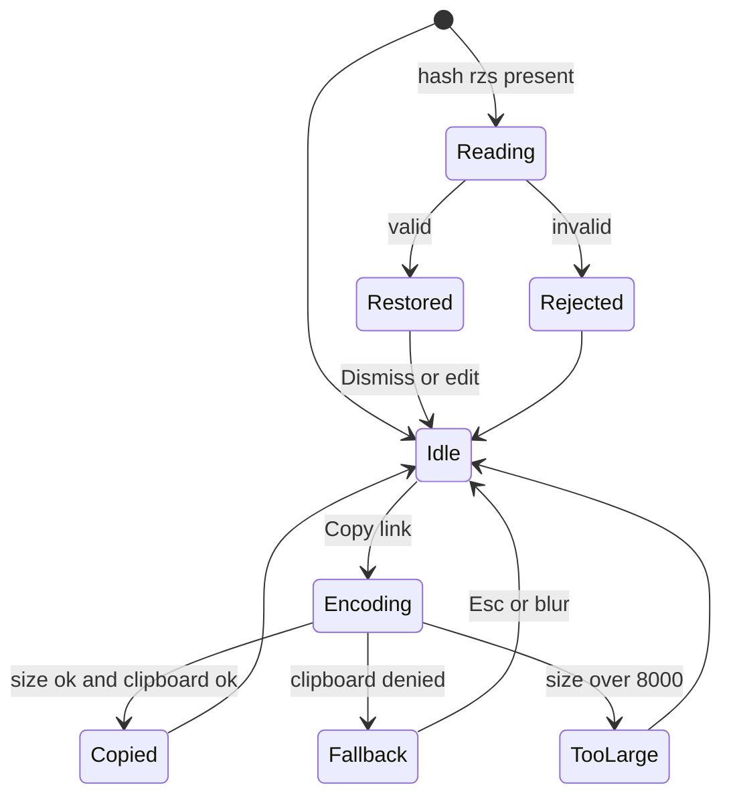
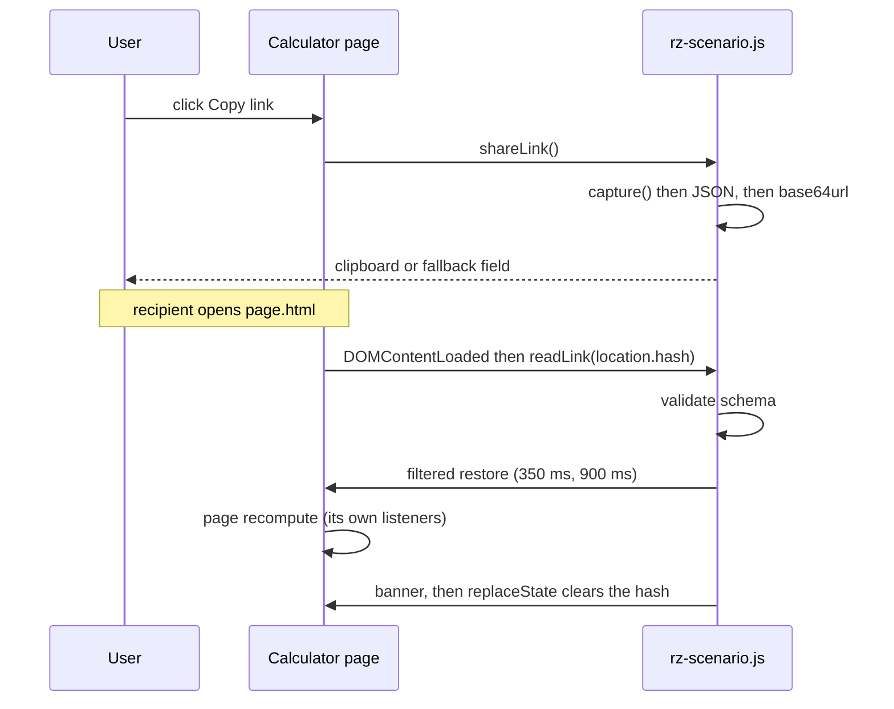

# PRD-P02: Shareable scenario links and Open for every calculator

## 1. Document control
| Field | Value |
|---|---|
| PRD id | PRD-P02 |
| Feature | Shareable scenario links, plus `openInCalc` for every calculator |
| Version | 1.0 (2026-11-10) |
| Status | Approved for implementation (directive 2026-11-10). No schema change, no security-boundary change. |
| Priority | Wave 1 (register rank 1, priority 74.5) |
| Audit finding | Assessment P2. Addendum X2 (carbon 404). Baseline: INCOMPLETE, now IN-PROGRESS. |
| Dependencies | None. P1 (project) and P3 (compare) consume these links later. |
| Modules | `js/rz-scenario.js`, the 11 `data-rz-calc` pages, `account.html` |
| Target | Part 1 (Open routes) = v3.35.10. Part 2 (share links) = next minor. |
| Change history | 1.0 initial |
| Approval | Owner directive covers non-disruptive implementation. |

## 2. Executive summary
A calculator result can be saved but not handed to someone else. "Open" from the account page was broken for 5 of 11 calculators.

This PRD makes every calculator reachable from a saved scenario. It also adds a **Copy link** action. The link encodes the current inputs, so anyone who opens it sees the same inputs and the same results. No login and no server storage are needed.

## 3. Problem statement
- **Wrong routes (fixed in v3.35.10).** `openInCalc` built `<id>-calculator.html` for every calculator outside 5 known ids. That gave carbon, rfs, spares, tia and tier a 404. `tools/test-scenario-open-routes.mjs` failed on the old code (5 wrong routes, 2 guessed navigations).
- **No sharing.** The only way to pass a result on today is a screenshot, or retyping 10–60 inputs. Inputs travel only through `localStorage.rz_open_scenario`, and only within one browser.
- **Restore is unfiltered.** `restore()` writes any element by id. That is harmless for the user's own saves. It is unsafe for links from other people, because a link could pre-fill a login field.

If nothing changes, results stay unreviewable by colleagues, and the account page keeps sending some users to dead pages.

## 4. Objectives and success metrics
| Objective | Metric | Target | How measured |
|---|---|---|---|
| Every calculator opens from a saved scenario | routes correct | 11/11 | `test-scenario-open-routes.mjs` |
| A link reproduces inputs exactly | fields equal after open | 100 % of capturable fields, all 11 calculators | headless round-trip gate (T-P02-4) |
| A link reproduces results | headline result text equal | 11/11 | same gate compares the result element text |
| Links are safe | non-capturable fields written | 0 | fixture with an email/password key |
| Links are bounded | max link length | ≤ 8,000 characters. Above that the button says why and offers Save instead. | unit test |

Usage cannot be measured: the site has no analytics. That is stated here rather than inventing an adoption target.

## 5. Scope
**In scope:**
- The explicit route map (done).
- A Copy-link button on the 11 calculators.
- A `#rzs=` hash reader.
- A filter on restore.
- A "Shared scenario" banner with a Dismiss control.
- Versioned payload.
- A link copy from saved scenarios on `account.html`.

**Out of scope:**
- Short links, which need a server.
- Server-side storage of shared scenarios (P1/P3 later).
- Link expiry.
- Analytics.

**Reuse:**
- `capture()`, `isCapturable()`, `restore()`.
- The existing toast or message element on each page (`msgEl` pattern in `saveToAccount`).

**Constraints:**
- Zero-build, ES5-compatible module, as the file already is.
- Must not break auto-restore from account.
- No personal data in the URL. `capture()` already excludes email, password, hidden and file inputs.

**Assumptions:**
- Users open links in the same site version, or a later one.
- An unknown field id in a link is ignored, not an error.

## 6. Personas and use cases
Personas are limited to roles the site already serves (the account page, calculator copy):
- **Engineer / planner** runs a calculator and sends the case to a colleague or manager for review.
- **Reviewer** (may be signed out) opens the link, checks the inputs, and changes one value to test it.
- **Signed-in user** opens a saved scenario from `account.html`.

## 7. User journey
1. **Entry.** A user on any calculator with inputs filled.
2. **Action.** Clicks **Copy link** in the action toolbar beside Save.
3. **System.** Captures inputs and builds `{v:1, calc, inputs}`. Encodes base64url UTF-8 and checks the length. Writes the link to the clipboard with `navigator.clipboard.writeText`. Shows "Link copied" in the page message element for 4 s.
4. **Failures.**
   - Clipboard denied: the link is shown in a read-only text field, selected, with "Copy it manually".
   - Over 8,000 characters: "This scenario is too large for a link. Save it to your account instead." The Save button gets focus.
5. **Recipient.** Opens `page.html#rzs=...`. After the page's own init, the reader validates the payload:
   - The version is known.
   - The `calc` equals the body `data-rz-calc`.
   - Inputs is an object of `{t, v}` with string or boolean v, at most 500 entries.
6. **Success.** Filtered restore runs twice (350 ms and 900 ms, the existing pattern). A banner appears: "Shared scenario: inputs loaded from a link. Results recalculated on this page." It has a Dismiss button. The hash is removed with `history.replaceState`, so a reload does not reapply over the user's own edits.
7. **Failure.** Bad base64, bad JSON, wrong calc or unknown version shows "This link could not be read. The calculator kept its defaults." Nothing is restored.
8. **Exit.** The user edits freely. Save works as before.
9. **Account path.** Each saved scenario row gets **Copy link** next to Open. It builds the same link from the stored `payload.inputs`.

## 8. Functional requirements
| ID | Description | Trigger | Preconditions | Inputs | Processing | Outputs | State change | Exceptions | Acceptance |
|---|---|---|---|---|---|---|---|---|---|
| FR-P02-1 | Route map covers every `data-rz-calc` page | `openInCalc(calc, inputs)` | calc matches `^[a-z0-9-]{1,40}$` | calc id, inputs | Look up the explicit map. On a miss, return without navigating. | `location.href` = page | `localStorage.rz_open_scenario` set only on a hit | unknown id: no-op | T-P02-1 |
| FR-P02-2 | Encode a share link | Copy link click | page has `data-rz-calc` | `capture()` | JSON `{v:1,calc,inputs}`, UTF-8, then base64url | link string | none | size over 8,000 → FR-P02-6 | T-P02-2 |
| FR-P02-3 | Decode and validate | page load with `#rzs=` | body `data-rz-calc` | hash | base64url decode, then JSON.parse, then schema check (v===1, calc equal, ≤500 keys, each key matches `^[A-Za-z0-9_:-]{1,80}$`, t in the allowed set, v string ≤2,000 chars or boolean) | validated map or error | none | any failure: FR-P02-7 | T-P02-3 |
| FR-P02-4 | Filtered restore | validated map | — | map | For each id, the element must exist and pass `isCapturable`. Otherwise skip and count. | fields set, input/change fired | page recomputes | — | T-P02-4, T-P02-5 |
| FR-P02-5 | Shared banner | successful restore | — | count restored, count skipped | Insert a `role=status` banner at the top of main. Dismiss removes it and returns focus to main. | banner | hash cleared by replaceState | — | T-P02-6 |
| FR-P02-6 | Oversize handling | link length > 8,000 | — | — | Message plus focus on Save | message | none | — | T-P02-2 |
| FR-P02-7 | Unreadable link | decode or validate fails | — | — | Message, no restore, hash cleared | message | none | — | T-P02-3 |
| FR-P02-8 | Clipboard fallback | writeText rejects or is missing | — | link | Show a read-only input with the link, selected | input | none | — | T-P02-7 |
| FR-P02-9 | Account copy link | row button | signed in, row has `payload.inputs` | row | Same encoder | clipboard | none | missing inputs: button disabled with title | T-P02-8 |
| FR-P02-10 | Coexist with auto-restore | page load with both a pending local scenario and a hash | — | — | The hash wins. The pending local scenario is cleared, with a note in the banner. | — | — | — | T-P02-9 |

## 9. UI/UX specification
- **Placement.** **Copy link** is a secondary `tool-btn`, placed directly after the existing Save button (`#btnSaveAccount`) on all 11 pages. Icon is a 12 px link glyph, inline SVG, `aria-hidden`. Label is visible text, never icon-only.
- **Behaviour.** The click always does something: copies, shows the fallback field, or shows the oversize message. There is no disabled state on calculators.
- **Messages.**
  - Reuse the page's message element where it exists.
  - Otherwise create `#rzScenarioMsg` (mono, 12 px, hairline 1 px, 4 px radius), `role=status aria-live=polite`.
  - Colours use the page's signal tokens: success = instrument cyan, error = fault red. Never green neon or a gradient (design.md, ANTI_VIBECODE).
- **Banner.** Full content width. 1 px hairline. Left text, right **Dismiss** button (44 px tap target). No icon wash and no shadow.
- **Fallback field.** `readonly` input, monospace, full width, auto-selected, with label "Link". Esc closes it.
- **Responsive.**
  - At 390 px the buttons wrap; the toolbar already wraps.
  - The banner text wraps.
  - No horizontal overflow (gated by the existing responsive audit).
- **Keyboard.** Every new control is reachable by Tab and has a visible focus ring. The banner Dismiss button is reachable.
- **Motion.** No animation, except the message fade the page already uses. Reduced motion is respected by default.
- **Empty / loading.** Not applicable. Encoding is synchronous.

## 10. Data model
No schema change.
- **Payload, client only.** `{ v: 1, calc: string(1..40), inputs: { [id]: { t: 'text'|'number'|'range'|'select'|'checkbox'|'radio'|'date'|'textarea'|..., v: string|boolean } } }`.
- **Compatibility.** Unknown ids are skipped. A future `v:2` must keep a v1 reader.
- **Storage.** Retention: none. The link lives only where the user pastes it. The existing `saved_scenarios.payload.inputs` is read as-is for FR-P02-9.

## 11. API and integration contracts
- No network API. Internal JS API extension:
  - `rzScenario.shareLink(): {ok:true, url} | {ok:false, reason:'too-large'|'no-calc'}`.
  - `rzScenario.readLink(hash): {ok:true, map} | {ok:false, reason}`.
- No new endpoints. The Supabase calls are unchanged.

## 12. Business rules and state machine

Rules:
- A link never navigates to another page.
- A link never writes a non-capturable field.
- The hash is cleared after one read.

## 13. Cross-module integration
| Module | Effect |
|---|---|
| account.html | Gains a Copy link button per saved scenario |
| 11 calculators | Gain a button. Restore triggers the page's own recompute, so results, charts, tornado and PDF reflect the shared inputs with no extra code. |
| P1 | Project links later add `project` to the payload (v2). |
| P3 | Compare can accept two links. |
| Basis drawers, sensitivity, PDF | Unaffected (they read the DOM state) |
| Audit | P15 later calls `logEvent('scenario_link_copied')` for signed-in users |

**Phase 3 amendment C4:** the link payload schema lives in one file, `data/scenario-link.schema.json`. Readers accept v1 and v2.

## 14. AI and automation
Not applicable. Deterministic encoding is more reliable than any model here.

## 15. Non-functional requirements
- **Performance.** Encoding and decoding take under 5 ms for 500 fields. That is a measured assumption from JSON plus btoa on a mid-range laptop, to be confirmed in T-P02-10.
- **Accessibility.** WCAG 2.1 AA on new controls; `audit-a11y` stays green.
- **Reliability.** No exception escapes: everything is in try/catch, failures surface as messages.
- **Maintainability.** One module; the route-map gate keeps routes complete.
- **Privacy.** Excluded input types are never captured, so they are never in the URL.

## 16. Security and access control
- **Authentication.** Not required to create or open a link.
- **Untrusted input.** The hash is untrusted. It goes through a strict schema, size caps, and an id pattern, and is written only into capturable elements.
- **No HTML injection.** Values are assigned through `.value` and `.checked`, never `innerHTML`.
- **Navigation.** The banner text is static, and links cannot navigate (no URL fields are followed).
- **Secrets.** None involved.

## 17. Edge cases
- Hash present but the page has no `data-rz-calc`: ignore.
- Calc mismatch, i.e. a link opened on another calculator: reject with the message.
- Field removed in a newer page version: skipped. The banner says "n fields could not be applied".
- A select value that is not among the options: the browser leaves the selection. Counted as skipped by comparing after set.
- Duplicate opens: idempotent restore.
- Both a local pending scenario and a hash: the hash wins (FR-P02-10).
- Very long text inputs: the per-value 2,000-character cap rejects the link.
- Clipboard API absent (http, older browsers): fallback field.

## 18. Technical architecture

Alternative rejected: query string, because it is sent to the server in logs. Hash fragments are not.

## 19. Implementation breakdown
| Task | Description | Depends | Files | Effort | Verification | Done when |
|---|---|---|---|---|---|---|
| T-P02-A | Route map + gate | — | rz-scenario.js, tools/test-scenario-open-routes.mjs | done | gate RED to GREEN | shipped v3.35.10 |
| T-P02-B | `shareLink` / `readLink` + filtered restore | A | rz-scenario.js | 0.5 d | Node unit tests | T-P02-2/3/5 green |
| T-P02-C | Button injection on 11 pages (module-injected after `#btnSaveAccount`, so no per-page HTML edits) | B | rz-scenario.js | 0.5 d | headless | button present on 11 |
| T-P02-D | Banner, messages, fallback | B | rz-scenario.js | 0.5 d | headless + a11y | T-P02-6/7 |
| T-P02-E | account.html Copy link | B | account.html | 0.25 d | headless with fixture | T-P02-8 |
| T-P02-F | Round-trip E2E gate on all 11 | C | tools/test-scenario-share-links.mjs | 0.5 d | gate | T-P02-4 green |
| T-P02-G | Docs + changelog + tokens | all | CHANGELOG, standards | 0.25 d | freshness gate | released |

Note, verified: spares, tier, tia and rfs do not load `js/rz-scenario.js` at all, so today they cannot be saved, opened or shared. T-P02-C adds the script tag to these 4 pages. On these pages Copy link is appended to the primary action toolbar; Save to account on them is in scope of P1, not here. Each page's anchor selector is declared in one table in the module.

## 20. Test strategy
- **Unit (Node vm, like the route test):**
  - encode/decode round-trip
  - oversize
  - bad base64
  - wrong version
  - wrong calc
  - key pattern
  - value cap
- **Security:** a fixture link containing `rzLoginEmail` and `password` keys. Assert they are not written.
- **E2E (headless, rz-lane):** for each of the 11 pages:
  1. set three inputs to non-default values
  2. call shareLink
  3. open the link in a fresh page
  4. compare captured maps and the headline result text
- **Accessibility:** `audit-a11y` on a page with the banner shown.
- **Regression:** the existing calculator gates and the account-page Open path.
- **Recovery:** a corrupted hash gives the message and defaults unchanged.

## 21. Acceptance criteria
- **Given** any of the 11 calculators with edited inputs, **when** the user clicks Copy link and the link is opened in a fresh browser context, **then** every capturable input equals the original and the headline result text is identical.
- **Given** a link containing ids of non-capturable fields, **when** opened, **then** those fields remain unchanged.
- **Given** a malformed link, **when** opened, **then** the page shows "This link could not be read" and keeps its defaults.
- **Given** a saved scenario on account.html, **when** Copy link is clicked, **then** the link reproduces that scenario.
- **Given** an unknown calculator id, **when** `openInCalc` runs, **then** location does not change.

## 22. Rollout and migration
- One release. No feature flag: the button is additive.
- Rollback = revert the module commit. Old links keep working, because the reader ships with the writer.
- Post-deploy: live byte-compare of `js/rz-scenario.js`, then run the E2E gate against the live URL.

## 23. Risks
| Risk | Mitigation |
|---|---|
| Pages re-render inputs after 900 ms, so the restore is lost | Already handled by the double restore. The E2E gate catches regressions. |
| Field ids renamed later break old links | Skipped-count message. Ids are stable in practice; the gate pins nothing beyond the round trip. |
| Long URLs truncated by chat apps | The 8,000-character cap. Save suggested above it. |

## 24. Definition of done
All FR-P02 requirements are implemented, and the tests below pass on the local tree and against the live site after push:
- Route gate and share-link E2E gate are in `ship-gate.sh` and green.
- Unit tests and the security fixture pass.
- a11y passes.
- CHANGELOG and `standarization/` docs updated in the same release.
