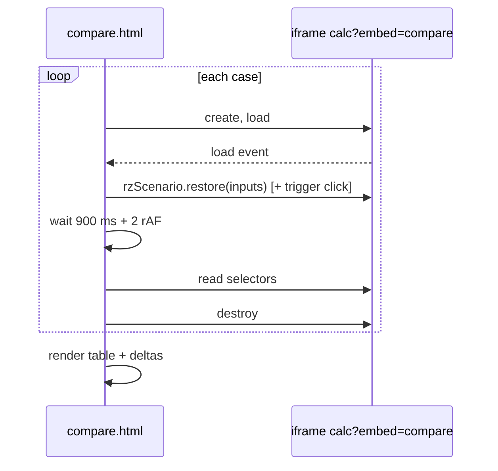

# PRD-P03: Scenario compare

## 1. Document control
| Field | Value |
|---|---|
| PRD id | PRD-P03 |
| Version | 1.0, 2026-11-10 |
| Status | Approved (directive). No schema change. |
| Priority | Wave 3 (rank 3, priority 73.0) |
| Dependencies | P02 (link payloads as an input source), P01 (projects as an input source). Saved scenarios already exist. |
| Modules | new `js/rz-compare.js`; `account.html`; the 11 calculators (an "Add to compare" action) |
| Approval | Directive |

## 2. Executive summary
The question people ask of a calculator is "what changes if…". Today the only way to answer it is two browser tabs and a notepad.

This PRD adds a compare view for 2 to 4 cases of the same calculator. A case can be:
- a saved scenario;
- a link;
- the current page state.

The view shows the inputs and the results side by side. Changed inputs are highlighted. Each result shows its difference from the first case.

The results are **recomputed**, never copied. Each case is loaded into the calculator page in an isolated frame and computed fresh, so the comparison reflects the current model.

## 3. Problem statement
- `account.html` lists saved scenarios with Open and Delete only. There are 0 compare references in the repository (measured 2026-11-10).
- Saved payloads store `summary` (page-chosen outputs) and `inputs`. `summary` reflects the model at save time, which can be stale after a model change. A compare built on `summary` would mix model versions silently.

## 4. Objectives and success metrics
| Objective | Metric | Target |
|---|---|---|
| Same-calculator compare | 2–4 cases rendered with inputs + results | all 11 calculators |
| Correct deltas | compare A against A | all deltas exactly 0 |
| Correct attribution | change one input | only results depending on it change (perturbation gate on capex, tco, roi) |
| Freshness | results computed by the current page code | the page version is shown per column; it is the same for all columns by construction |

## 5. Scope
**In scope:**
- Compare tray: an "Add current to compare" action on calculators, and checkboxes on the account scenario list.
- Compare page `compare.html?calc=…`, which loads each case into a hidden same-origin iframe of the calculator, applies its inputs with the restore mechanism, then reads results through each page's declared result selectors.
- Table rendering.
- CSV export of the table.

**Out of scope:**
- Cross-calculator compare: that is P01 project status.
- More than 4 cases.
- Charts overlay (a later enhancement).

**Reuse:** `rzScenario.restore`, P02 decoding, the project result keys (P01 `publish` list = the result selectors).

**Constraints:**
- Same-origin iframes only.
- The calculators must not detect the iframe or change behaviour in it. The cookie banner and account pill are suppressed with a `?embed=compare` flag.

**Assumption:** each page's results can be read from DOM selectors declared in `data/compare-results.json`. It is verified per page by the gate.

## 6. Personas
- **Planner:** tariff A against B.
- **Reviewer:** "your case vs mine" from two links.

## 7. User journey
1. On a calculator, the palette or toolbar action "Add to compare" stores the current inputs in `sessionStorage rz_compare_<calc>` (max 4). A message shows "2 of 4 cases in compare · Open compare".
2. On account.html the user ticks 2–4 saved scenarios of the same calculator, then clicks **Compare**. Ticking a different calculator disables Compare, and the reason is shown inline.
3. `compare.html?calc=tco` loads.
   - **Loading:** columns show skeletons, and one line reads "Computing case 2 of 3…".
   - Each case gets a hidden iframe, then restore, then a settle (900 ms + two animation frames), then the result read, then the frame is destroyed.
4. **Table.**
   - Rows are grouped: Inputs (only inputs that differ between cases, plus a "show all inputs" toggle), then Results.
   - Delta columns show the value and the difference from case 1 (absolute and %).
5. **Actions:** Remove case · Reorder (set as baseline) · Export CSV · Open case in the calculator.
6. **Failure.**
   - A case whose page cannot compute (an engine failure in the iframe) shows "Could not compute this case" in its column. The others are still shown.
   - A link of another calculator is rejected with a message.

## 8. Functional requirements
| ID | Description | Acceptance |
|---|---|---|
| FR-P03-1 | Add current to compare (sessionStorage, max 4, deduplicated by an inputs hash) | E2E |
| FR-P03-2 | Account multi-select of the same calculator → compare URL (`ids=` uuids; the page fetches its own rows via `listScenarios`, so RLS applies) | E2E stub |
| FR-P03-3 | Link cases: `compare.html?calc=tco&links=<rzs1>,<rzs2>` | unit |
| FR-P03-4 | Isolated compute in an iframe with `?embed=compare` | gate: the iframe count returns to 0 |
| FR-P03-5 | Result read via `data/compare-results.json` selectors with a parse rule (number with unit); unparseable → "—" with the reason | per-page gate |
| FR-P03-6 | Delta: abs and % from the baseline column; % hidden when the baseline is 0 | unit |
| FR-P03-7 | Differing-inputs filter | unit |
| FR-P03-8 | CSV export (RFC 4180, UTF-8 BOM for Excel) | unit |
| FR-P03-9 | Timeout of 15 s per case → failure state | E2E with a stalled stub |

## 9. UI/UX specification
**Layout.**
- Tool register page: header "Compare · TCO calculator".
- The case header row has the case name, source (saved / link / current) and a column menu (Set as baseline · Remove · Open).

**Table.**
- Mono, tabular numerals, right-aligned numbers, no zebra.
- The baseline column is marked with a 2 px top rule in the accent colour.
- Deltas use the semantic colours only when the direction has meaning, as declared per result (lower-is-better for cost). Otherwise they are neutral.

**Mobile.**
- Under 700 px: the first column is sticky and the cases scroll horizontally within the table container (not the page).
- The responsive audit enforces no page-level horizontal scroll.

**Empty state.** "Add at least two cases. Use 'Add to compare' on a calculator, or select saved scenarios in your account."

**Keyboard.** Table headers have `scope`; column menus are buttons with menus (ARIA menu pattern).

## 10. Data model
- `sessionStorage rz_compare_<calc>`: `[{name, source, inputs, added_at}]`, max 4.
- `data/compare-results.json`: per calc `[{key, label, selector, unit, better:'lower'|'higher'|'none', parse:'number'|'text'}]`.
- No database change.

## 11. API contracts
- No new endpoints.
- Existing: `rzSupa.listScenarios(calc)` (RLS own rows).

## 12. Business rules
- Same calculator only.
- 2–4 cases.
- Results are always recomputed.
- The baseline is the first column.

## 13. Cross-module integration
| Module | Effect |
|---|---|
| P01 | Project cases add a source type "project" (Stage 1 local) |
| P02 | Link decoding reused |
| P04 | The pack can include a compare table |
| P14 | Palette action "Add to compare" |
| P15 | Event `scenario_compared` (allowlist extension) |

**Phase 3 amendment C1:** the per-page map this PRD defines lives in the shared calculator registry `data/calculators.json` (task F1), not in a separate file. The gate is `test-calculator-registry.mjs`. See 03-architecture/ARCHITECTURE-P.md.
**Phase 3 amendment C2:** the hidden-iframe compute loop is the shared `js/rz-embed-compute.js` (task F2). It is driven by `?embed=<mode>`.
**Phase 3 amendment C4:** the link payload schema lives in one file, `data/scenario-link.schema.json`. Readers accept v1 and v2.

## 14. AI and automation
Not applicable.

## 15. Non-functional requirements
- **Compute time.** About 1.5 s per case, sequential (iframe load + settle). Four cases take about 6 s. This is an assumption from page load times and is measured in the gate; the progress line covers it.
- **Memory.** One iframe at a time.
- **Accessibility.** AA.

## 16. Security
- Iframes are same-origin and created by the page itself.
- No cross-origin input.
- Link inputs pass P02 validation.
- Account ids are fetched under RLS.

## 17. Edge cases
- A page needs user interaction to compute (some calculators compute on a button press): the selectors table declares a `trigger` selector, which is clicked after restore.
- A case with an engine error: column failure.
- Identical cases: deltas are 0; a message suggests changing an input.
- More than 4: the add action replaces nothing; the message says "Compare holds 4 cases".

## 18. Technical architecture

## 19. Implementation breakdown
| Task | Files | Effort | Verify |
|---|---|---|---|
| T-P03-1 `compare-results.json` for 11 calculators + gate (selectors resolve to numbers at defaults) | data/, tools/test-compare-selectors.mjs | 1 d | gate |
| T-P03-2 Embed flag handling (suppress pill, banner) | rz-scenario.js, cookie consent | 0.25 d | E2E |
| T-P03-3 `compare.html` + `rz-compare.js` engine | new | 1.5 d | E2E |
| T-P03-4 Add-to-compare action + account multi-select | rz-scenario.js, account.html | 0.5 d | E2E |
| T-P03-5 CSV + delta unit tests | rz-compare.js | 0.25 d | unit |
| T-P03-6 a11y, screenshots, docs | — | 0.5 d | gates |

## 20. Test strategy
- **Unit:** delta math, CSV, input diff.
- **Selector gate:** all 11 at defaults.
- **E2E:** A vs A → zero deltas; A vs (A with tco tariff +10 %) → energy cost changes, capex-like results do not. Perturbation is done on 3 pages.
- **Failure:** stalled iframe → timeout state.
- **Accessibility:** axe on the table.
- **Regression:** calculators behave the same without `?embed`.

## 21. Acceptance criteria
- **Given** two identical cases, **then** every delta reads 0.
- **Given** case 2 differs only in the electricity price, **then** only results declared as energy-dependent change.
- **Given** a case whose page fails, **then** that column shows the failure and the others render.

## 22. Rollout
- New page, additive.
- Rollback by revert.
- Live: run the A vs A gate against production.

## 23. Risks
| Risk | Mitigation |
|---|---|
| Selector drift on page edits | Selector gate in the ship gate |
| Slow pages | Sequential compute + progress; timeout |

## 24. Definition of done
- FRs are implemented.
- The selector, unit and E2E gates are green in the ship gate.
- Screenshots of 2/4 cases at 390/1440 in both themes reviewed.
- Docs are updated.
- The change is live and verified.
