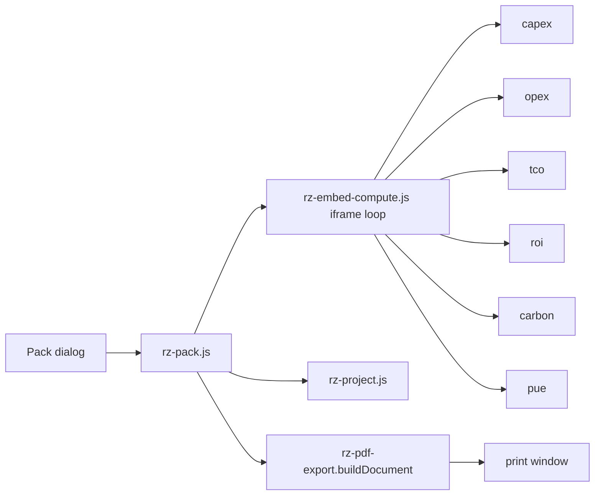

# PRD-P04: Project report pack (one PDF across calculators)

## 1. Document control
| Field | Value |
|---|---|
| PRD id | PRD-P04 |
| Version | 1.0, 2026-11-10 |
| Status | Approved (directive). No schema change. |
| Priority | Wave 3 (rank 5, priority 68.5) |
| Dependencies | P01 (project + results), P03 (iframe compute pattern, reused) |
| Modules | `js/rz-pdf-export.js` (shared shell, 11 adopters today, 0 of them calculators); 6 project calculators; `account.html`; new `js/rz-pack.js` |
| Approval | Directive |

## 2. Executive summary
A planner who has run CAPEX, OPEX, TCO, ROI, carbon and PUE for one facility needs a single document to hand over. Today each calculator prints its own window.

This PRD builds one PDF for a project. It contains:
- a cover;
- the project assumptions register (every input, with its source: project, override or page default);
- one section per chosen calculator, generated by that calculator in its current state;
- a basis appendix;
- page "n of m" numbering.

It uses the site's shared document shell, which already exists and enforces `PDF_EXPORT_STANDARD.md`.

## 3. Problem statement (measured 2026-11-10)
- The 6 calculators build PDFs by `window.open()` plus a print template (each page has 1 print call). None uses `js/rz-pdf-export.js`, whose `buildDocument(spec)`, `discoverSections()` and `adopt()` are used by 11 other pages.
- No document spans calculators.
- Assumptions live only in the input fields. A printed result without its inputs cannot be reviewed.

## 4. Objectives and success metrics
| Objective | Metric | Target |
|---|---|---|
| One document | sections = chosen calculators | exact |
| Numbers match the screen | every numeral in a section equals the on-page text at generation time | 100 % (text-compare gate) |
| Assumptions complete | every mapped project field and every override is listed with its source | 100 % |
| Pagination | footer "Page n of m" correct | gate reads the printed PDF |
| Standard conformance | escape rule, palette, footer line per PDF_EXPORT_STANDARD | existing PDF gates pass |

## 5. Scope
**In scope:**
- **Pack builder.** For each chosen calculator, load it in a hidden iframe with the project applied (P01) and `?embed=pack`, wait for settle, then collect its declared sections via `discoverSections(doc, '[data-rz-pdf-section]')`.
- **Annotations.** Declare 2–4 sections per calculator page: the results summary, key tables and charts. Charts are rasterized via `canvas.toDataURL`.
- **Assumptions register** from the P01 project + overrides.
- **Cover** with project name, date, site version and engine version.
- **Basis appendix** (formula notes already present on the pages' methodology sections).
- **Section picker UI.**

**Out of scope:**
- Server PDF rendering (the browser print-to-PDF stays the mechanism, as for every other shell user).
- Word export.
- Branding options beyond the shell's accent.

**Reuse:** `rz-pdf-export.js` `buildDocument` and `open`, its @page counters and escape rule; P03's iframe compute loop.

**Constraints:** the standard's escape rule (`<\/script>` incident); printing is user-initiated, so popups need a click.

**Assumption:** each calculator's methodology text can serve as basis notes. If a page has none, the appendix says "No method notes on this calculator" (no invented text).

## 6. Personas
- **Planner:** issues the pack to a client or committee.
- **Reviewer:** reads the assumptions first.

## 7. User journey
1. From the P01 chip popover or the account project row: **Export pack**.
2. A dialog lists the 6 calculators. Each row has a checkbox and a status (up to date / out of date / not run). Not run is unchecked by default, and the reason is shown.
   - Options: include the assumptions register (on), the basis appendix (on), and an issue note (free text, 500 characters).
3. **Build:** a progress line reads "Building section 2 of 5: OPEX…". Calculators are computed sequentially in iframes.
4. The shell opens the print window with the composed document. The user prints or saves the PDF.
5. **Failures.**
   - A calculator fails: its section is replaced by "Section not available: the calculator could not compute this project (reason)", and the pack still builds.
   - Popup blocked: the message says "Allow pop-ups for this site to open the pack", with a retry button.

## 8. Functional requirements
| ID | Description | Acceptance |
|---|---|---|
| FR-P04-1 | Section annotation `data-rz-pdf-section="label"` on the 6 pages (2–4 each) | annotation gate: each page exposes ≥ 2 sections at defaults |
| FR-P04-2 | Pack builder: iframe per page with the project applied, settle, collect section HTML; canvases converted to `` data URLs | E2E |
| FR-P04-3 | Assumptions register table: field label, value with unit, source (project / override / page default / from CAPEX), page | unit from a fixture project |
| FR-P04-4 | Cover: project name, generated date (local + ISO), `RZ_VERSION`, engine version (`RZEngine.version` if exposed), issue note | E2E |
| FR-P04-5 | `buildDocument({sections:[...]})` via the shell; escape rule applied to every injected HTML (shell does it) | existing escape gate |
| FR-P04-6 | Stale warning: an out-of-date section gets a red "computed from out-of-date inputs" line, unless the user re-runs | E2E |
| FR-P04-7 | Text-compare gate: for each section, every numeral token in the pack equals the numeral in the source page section | gate |
| FR-P04-8 | 20 s timeout per page → failure section | E2E |

## 9. UI/UX specification
**Dialog.**
- Modal following the site's dialog pattern: title "Export project pack".
- The calculator list is a checkbox list with a status text column.
- Option checkboxes, the note textarea with a counter, then the **Build pack** primary and **Cancel** buttons.
- Focus trap; Esc cancels.
- Under 600 px it becomes a bottom sheet.

**Progress.** The line sits inside the dialog with `aria-live=polite`. A Cancel during the build stops it after the current page.

**Document.** The shell's standard look: cover, contents, sections with headings, tables mono with tabular numerals, footer standard line + page n of m.

## 10. Data model
No storage. The pack is generated on demand. Input sources: the P01 project, the overrides and results.

## 11. API contracts
**Internal:** `rzPack.build({projectId, calcs:[...], options}) → Promise<{ok, html, failures:[]}>`.

Shell API unchanged.

## 12. Business rules
- The pack never includes a section whose numbers were not recomputed in this build.
- Out-of-date status is computed before the build; recomputing updates the project results (publish), which then makes them up to date.

## 13. Cross-module integration
| Module | Effect |
|---|---|
| P01 | Reads the project; publishing during the build refreshes results |
| P03 | Shares the iframe loop (extracted to `js/rz-embed-compute.js`) |
| P08 | Bands print with their basis line |
| P10 | The basis appendix later links registry ids |
| P15 | Event `pdf_exported` with `{format: 'pack'}` |

**Phase 3 amendment C1:** the per-page map this PRD defines lives in the shared calculator registry `data/calculators.json` (task F1), not in a separate file. The gate is `test-calculator-registry.mjs`. See 03-architecture/ARCHITECTURE-P.md.
**Phase 3 amendment C2:** the hidden-iframe compute loop is the shared `js/rz-embed-compute.js` (task F2). It is driven by `?embed=<mode>`.

## 14. AI and automation
Not applicable.

## 15. Non-functional requirements
- **Build time.** About 2 s per calculator (assumption: load + settle + raster). Measured in E2E; the progress line covers it.
- **Size.** Chart images use PNG at 2× device pixel ratio. The pack is expected under 5 MB for 6 sections (measured).
- **Accessibility.** Dialog AA. The document headings are structured.

## 16. Security
- Same-origin iframes.
- The note is escaped (shell `esc`).
- No external fetch.

## 17. Edge cases
- No active project: the action is hidden, with a "Create a project first" hint in its place in the chip. Not a dead control.
- Canvas tainted (cross-origin image): not possible after P25 self-hosting. Otherwise the canvas is replaced with "chart not exportable".
- Very long tables: the shell's page-break rules apply.
- User cancels mid-build: no window opens.

## 18. Technical architecture

## 19. Implementation breakdown
| Task | Files | Effort | Verify |
|---|---|---|---|
| T-P04-1 Extract the iframe loop (shared with P03) | js/rz-embed-compute.js | 0.5 d | unit with a fixture page |
| T-P04-2 Section annotations on 6 pages + gate | 6 pages, tools/test-pdf-sections.mjs | 0.5 d | gate |
| T-P04-3 rz-pack.js + dialog | new | 1.5 d | E2E |
| T-P04-4 Assumptions register | rz-pack.js | 0.5 d | unit |
| T-P04-5 Text-compare gate | tools/test-pack-numbers.mjs | 0.5 d | gate |
| T-P04-6 Screenshots + docs | — | 0.25 d | review |

## 20. Test strategy
- **Unit:** register rows from a fixture project.
- **E2E:** build a pack for a fixture project with 6 calculators; assert section count, cover text, the footer counter in the print document (shell), numbers matching the source pages.
- **Failure:** one page forced to fail → failure section; the pack still builds.
- **Regression:** existing PDF gates for the 11 shell adopters.

## 21. Acceptance criteria
- **Given** a project with all 6 results up to date, **when** Export pack runs with all checked, **then** the document has a cover, a register, 6 sections and an appendix, and every numeral in each section equals its page.
- **Given** an out-of-date result, **then** its section shows the stale line unless it is recomputed in the build.
- **Given** one calculator fails, **then** its section shows the reason and the others are present.

## 22. Rollout
- Additive. The annotations are harmless.
- Rollback by revert.
- Live check: the E2E build against production with a fixture project injected into localStorage.

## 23. Risks
| Risk | Mitigation |
|---|---|
| Print engines differ (Safari) | The shell already handles this; the standard documents it |
| Page section markup changes | The annotation gate |

## 24. Definition of done
- FRs implemented.
- The annotation, number and E2E gates are green.
- A sample pack has been reviewed visually (PDF screenshot pages 1, 2 and the last).
- Docs are updated.
- The change is live and verified.
