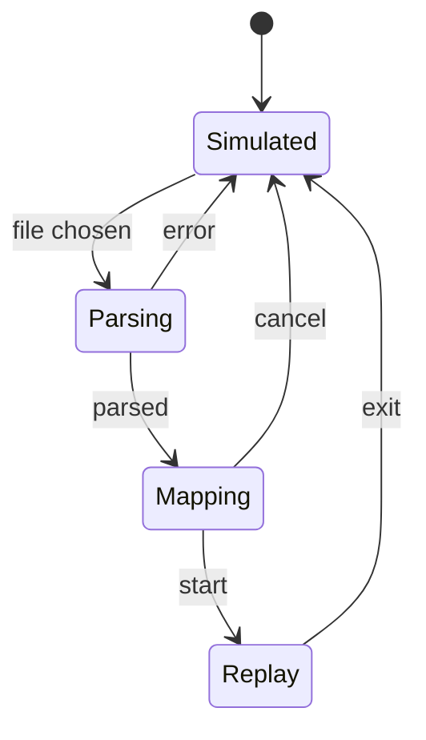
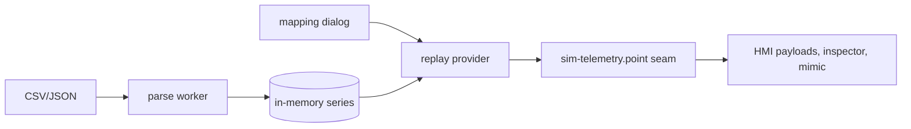

# PRD-P05: Replay recorded telemetry in the DC AI cockpit

## 1. Document control
| Field | Value |
|---|---|
| PRD id | PRD-P05 |
| Version | 1.0, 2026-11-10 |
| Status | **Stage 1 VERIFIED COMPLETE — v3.55.0 live 3a08a7588 (2026-11-14).** Approved (directive) for **stage 1**: the datahallAI page, client-side file replay, no network, no new infrastructure. Stage 2 (Conventional cockpits) is planned and depends on LTC Q7, because those cockpits do not use `sim-telemetry.js`. |
| Priority | Wave 4 (rank 7, priority 66.0) |
| Dependencies | Existing `js/datahall-ai/sim-telemetry.js` (the single source of simulated readings, seeded, tick-based) and `js/datahall-ai/hmi-points.js` (point manifest). |
| Ownership | datahallAI is a shared page. LTC's Q6 (simulation honesty layer) and Q7 (scripted faults) touch the same cockpits. Coordination: this PRD adds a provider seam to sim-telemetry, and Q6/Q7 consume that seam. A message is sent before any edit. |

## 2. Executive summary
The DC AI cockpit is a declared simulation (`data-rz-data-mode="simulated"`). It is honest, but it cannot show what happened at a real site.

This PRD lets a user load a recorded trend file (CSV or JSON exported from a BMS) and map its columns to the cockpit's points. The cockpit then replays that history in place of the seeded simulation, with a scrubber.

The page states REPLAY and the file name everywhere the SIMULATED label appears today. Nothing is uploaded: the file stays in the browser.

## 3. Problem statement (measured)
- 6 cockpits declare `data-rz-data-mode="simulated"`.
- The site has no ingest path: no WebSocket, EventSource or MQTT; the only fetches are ipapi and Cx demo records.
- On datahallAI every simulated reading flows through one seam: `RZ_SIM` (datahallAI.html:1893) and `RZDatahallAISimTelemetry.point()` (46 references on the page).
- The Conventional cockpits do not use that module (0 references), so they need separate work (stage 2).

**Consequence:** an operator cannot review an incident on the tool that explains the plant.

## 4. Objectives and success metrics
| Objective | Metric | Target |
|---|---|---|
| Exact replay | values shown at tick t equal the file values at the mapped timestamp | 100 % of mapped points (fixture gate) |
| Honest labelling | the mode label reads REPLAY · <file> wherever SIMULATED appears | 100 % of mode-label sites (gate counts them) |
| Unmapped points | shown as "—" with a "not in file" title; never simulated silently during replay | gate |
| Privacy | network requests during replay | 0 new requests (gate) |
| Exit | leaving replay restores the seeded simulation exactly | deep-equal at a pinned tick |

## 5. Scope
**In, stage 1:**
- Provider seam in `sim-telemetry.js`: `setProvider(fn|null)`, where the provider returns `{value, quality: 'replay'}` or null.
- Replay UI: file input, mapping dialog, scrubber, play/pause, speed 1×/10×/60×.
- CSV and JSON parsers.
- Mapping persistence per file signature (localStorage).
- Gates.

**Out:**
- Live streaming.
- Server upload.
- Conventional cockpits (stage 2).
- Alarm evaluation on replayed values beyond what the page already derives from point values. Scenario state machines stay as they are and are labelled "scenario: simulated" during replay.

**Constraints:**
- Files up to 20 MB, parsed in a Web Worker to keep the UI responsive.
- ES5 module style is kept for sim-telemetry.

**Assumption:** BMS exports are long format (timestamp, point, value) or wide format (timestamp + one column per point). Both are supported. Units are assumed equal to the cockpit units unless the mapping sets a factor.

## 6. Personas
- **Operations engineer:** reviews an incident.
- **Trainer:** replays a recorded event to students.

## 7. User journey
1. On datahallAI, the mode strip shows "SIMULATED · Replay a file".
2. The file picker accepts `.csv` and `.json`. Parsing shows a progress percentage.
3. The mapping dialog lists the file columns (or point names) next to cockpit points.
   - Automatic match by normalised name.
   - Unmatched file columns are listed.
   - Unmapped cockpit points are counted.
   - Per row: unit factor, default 1.
4. **Start replay.** The mode strip reads "REPLAY · trend-2026-11-03.csv · 2026-11-03 14:00–18:00". A scrubber appears with play/pause and speed controls.
5. Values update by the file. Points with no data show "—".
6. **Exit replay** restores the simulation.
7. **Failures.**
   - Unparseable file: the error names the line.
   - No timestamp column: the user is asked to pick one.
   - Over 20 MB: refused with the limit stated.

## 8. Functional requirements
| ID | Description | Acceptance |
|---|---|---|
| FR-P05-1 | Provider seam: `RZDatahallAISimTelemetry.setProvider(fn)`; `point()` asks the provider first; null provider means today's behaviour (byte-identical) | existing payload gate unchanged + unit |
| FR-P05-2 | Parsers: CSV (RFC 4180, comma or semicolon, ISO or epoch timestamps) and JSON (array of `{t, point, value}` or `{t, ...}`) in a Worker | unit with fixtures incl. quoted commas (memory: dataset parsing traps) |
| FR-P05-3 | Mapping dialog + automatic match + manual edit; persisted by `sha256(header line + first timestamp)` | E2E |
| FR-P05-4 | Time model: replay tick → file time = start + tick × speed × 4 s; value = last sample ≤ time (sample-and-hold), no interpolation | unit |
| FR-P05-5 | Mode label sites switch to REPLAY with the file name; `data-rz-data-mode="replay"` on body | gate |
| FR-P05-6 | Unmapped points show "—" | gate |
| FR-P05-7 | No network during replay | gate (request interception) |
| FR-P05-8 | Exit restores the simulation | gate deep-equal at a pinned tick |

## 9. UI/UX specification
- **Mode strip.** The existing strip, extended with the replay controls inline. At 390 px the controls wrap to a second row.
- **Mapping dialog.**
  - DHModal panel type (the existing modal system).
  - Table with columns: File column · Cockpit point · Unit factor · Sample.
  - Search filter.
  - Buttons: **Start replay** (primary), Cancel.
  - Focus trap; Esc closes.
- **Scrubber.**
  - Native `input[type=range]` with a time label.
  - Keyboard: arrows step one sample, PageUp/PageDown step 10.
  - Play and pause are buttons with visible text.
- **States.**
  - Parsing: progress.
  - Error: message with the line number.
  - Empty mapping: Start is disabled, with the reason shown ("map at least one point").

## 10. Data model
- Client memory: `{times: Float64Array, points: {id: Float64Array}}`.
- localStorage `rz_replay_maps`: `{signature: {column: {point, factor}}}`, with the 20 most recent kept.
- No database.

## 11. API contracts
- **Internal:** `setProvider`; Worker messages `{type: 'parse', text} → {type: 'parsed', header, rows} | {type: 'error', line, message}`.
- No network.

## 12. Business rules

- During replay, state machines (scenario engines) keep running on simulated inputs and are labelled as such.
- A replayed value never crosses into an engine-hooked (registry) cell. Those cells stay engine values (Rule 2 kept).

## 13. Cross-module integration
| Module | Effect |
|---|---|
| Equipment inspector and HMI payloads | Read `point()`, so they show replay values automatically |
| Coverage gates | Run in simulated mode, unaffected |
| LTC Q6 honesty layer | Shows replay as a third mode |
| LTC Q7 scripted faults | Disabled during replay (mutually exclusive), with a message |

## 14. AI and automation
Not applicable. Name matching is deterministic (normalised string distance).

## 15. Non-functional requirements
- Parse of a 20 MB CSV in under 10 s in a Worker (estimate, measured with a generated fixture).
- UI frame time unaffected during parsing.
- Accessibility AA.

## 16. Security
- The file is untrusted.
- Values are parsed as numbers only.
- Strings are never rendered as HTML (`textContent`).
- No eval.
- The size cap applies.
- Nothing leaves the browser.

## 17. Edge cases
- Duplicate timestamps: the last one wins.
- Non-monotonic time: sorted on parse.
- Mixed units: per-mapping factor.
- Time zone: timestamps without a zone are treated as local and stated in the strip.
- A huge number of columns (over 5,000): the mapping table is virtualised (render 200 rows, with search).

## 18. Technical architecture

## 19. Implementation breakdown
| Task | Effort | Verify |
|---|---|---|
| Seam + unit (no-provider identity) | 0.5 d | existing gates + unit |
| Worker parsers + fixtures | 1 d | unit |
| Mapping dialog | 1 d | E2E + a11y |
| Scrubber + time model | 0.75 d | unit + E2E |
| Label sites + gates (value equality, no-network, exit) | 1 d | gates |
| Message to LTC on the seam | — | ack |

## 20. Test strategy
- **Unit:** parsers with edge cases; time model.
- **E2E fixture:** a file with 3 mapped points at known values; at 3 scrub positions the inspector shows those exact values.
- **No-network gate.**
- **Accessibility:** axe on the dialog and controls.
- **Regression:** the full datahallAI gate set in simulated mode.

## 21. Acceptance criteria
- **Given** a fixture CSV mapping `CDU-01 supply temp` to 35.2 at t0, **when** replay starts at t0, **then** the CDU-01 inspector shows 35.2 °C and the mode strip reads REPLAY.
- **Given** replay is exited, **then** the values equal the seeded simulation at the pinned tick.

## 22. Rollout
- Additive (an inert seam by default).
- Feature flag: `data-rz-replay="off"` hides the entry.
- Rollback by revert.

## 23. Risks
| Risk | Mitigation |
|---|---|
| A 1.37 MB page gets heavier | Replay code lazy-loaded on first click |
| Collision with LTC edits | Seam-only change to the module + message |

## 24. Definition of done
- Stage 1 FRs are done.
- The gates are green in the ship gate.
- Screenshots of the dialog, scrubber and strip reviewed.
- The change is live and verified with the fixture against production.
- Stage 2 is listed in the tracker as planned.
