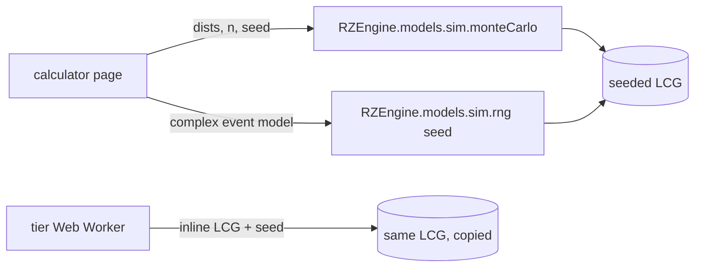

# PRD-P08: Reproducible uncertainty — one seeded random source for every Monte Carlo (merges Q5 and X5)

## 1. Document control
| Field | Value |
|---|---|
| PRD id | PRD-P08 (absorbs addendum Q5 "Seeded engine Monte Carlo replaces random noise" and X5 "Fake confidence bands") |
| Version | 1.0, 2026-11-10 |
| Status | Approved for implementation (directive). No schema, no security boundary. |
| Priority | Wave 1 (P8 63.5; Q5 70.5) |
| Dependencies | None. `RZEngine.models.sim.monteCarlo` already exists. |
| Modules | `rz-engine.js` (sim, commissioning), carbon-footprint, tier-advisor, tia-942-checklist, spares-readiness-calculator, cx-calculator, tco-calculator, roi-calculator |
| Target | Next minor release after v3.35.10 |
| Approval | Directive covers it |

## 2. Executive summary
Seven calculators show uncertainty bands (P10/P50/P90, P5/P95, confidence %). These bands come from simulation.

Today the result changes every time the page recalculates, on 6 of them, because they draw from `Math.random`. The same inputs then give a different "P90" on each click. On two pages (tier, tia) the "uncertainty" is noise added to a finished score with no stated basis.

After this change, every simulation draws from one seeded generator. The same inputs always give the same band. The seed and the assumed spread are shown next to each band.

## 3. Problem statement (measured 2026-11-10)
| Page | Line(s) | What draws random | Consequence |
|---|---|---|---|
| carbon-footprint | 1619-1621 | PUE ±10 %, grid ±15 %, generator ±30 % uniform | carbon band changes per recalculation |
| tier-advisor | 786 (worker), 810, 1166 | score × (1 ± 12.5 %) | "confidence" band is noise on the answer itself, basis unstated |
| tia-942-checklist | 967 | score × (1 ± 15 %) | same |
| spares-readiness | 4802, 8965-9019 | normal draws + 6 Bernoulli event draws | supply-risk P-values change per run |
| cx-calculator | 1847 `cxRandNorm` | normal noise | cost band changes per run |
| tco-calculator | 1086, 1095, 1813-1815 | correlated normals, scenario pick, fallback loop | inconsistent with its own seeded path |
| roi-calculator | 1162-1164 fallback | runs only if the engine is missing | silent non-reproducible fallback |
| rz-engine commissioning | `_randNorm`, `monteCarlo` default `rng || Math.random` | engine default is unseeded | engine itself is non-deterministic unless the caller passes rng |

The shared simulator `RZEngine.models.sim.monteCarlo(fn, dists, n, seed)` (rz-engine.js:12182) is already seeded with an LCG. roi and tco already use it. The defect is that the other paths never moved to it.

Unresolved consequences:
- Two engineers comparing the same case see different P90s.
- A screenshot cannot be reproduced.
- Tests cannot pin a band.
- The tier/tia bands present an invented spread as confidence.

## 4. Objectives and success metrics
| Objective | Metric | Target |
|---|---|---|
| Determinism | identical band text on two recalculations with the same inputs | 7/7 pages |
| No unseeded randomness in simulation paths | `Math.random` calls during a recalculation, counted by an instrumented page load | 0 on all 7 pages (ID generation in rfs is out of scope and not on these pages) |
| Honest basis | every band displays its assumed spread and seed | 7/7 |
| Behaviour preserved | median (P50) shift versus the old model at default inputs | within ±1 % for continuous models. The exact sampled values legitimately change, so this is checked against a 20,000-draw reference of the old model. |

## 5. Scope
**In scope:**
- A seeded generator API in the engine.
- Migration of every listed site.
- Removal of the unseeded fallbacks.
- A visible basis line under each band.
- Tier and tia bands relabelled as an assumption and made reproducible.
- A gate.

**Out of scope:**
- Changing the uncertainty models themselves (spreads, distributions). Exception: tier and tia, where the spread only becomes declared, not re-derived.
- A user-editable seed (possible later; the seed is shown).

**Reuse:** `sim.monteCarlo` (distribution sampling) and its LCG.

**Constraints:**
- `sim.monteCarlo`'s byte-identical fast path must not change. Existing roi and tco outputs stay identical.
- The tier Web Worker string must also get the seeded generator (workers cannot see `window.RZEngine`).

**Assumptions:**
- An LCG is adequate for teaching-grade Monte Carlo at n ≤ 20,000. The 32-bit period of 2^32 far exceeds the draw counts.

## 6. Personas and use cases
- **Planner** compares two cases and needs the band to move only because of the input change.
- **Reviewer** reproduces a band from a screenshot (seed shown).
- **Maintainer** pins a band in a gate.

## 7. User journey
1. The user changes an input.
2. The page recomputes and the band renders. Below it, a mono basis line reads, for example: "Uncertainty: PUE ±10 %, grid factor ±15 %, generator ±30 % (uniform, assumed) · 10,000 draws · seed 20261110".
3. The user changes the input back. The band returns to exactly the previous text.
4. Failure: if `RZEngine` is unavailable, the band area shows "Uncertainty unavailable: engine not loaded". No numbers are shown and no hidden fallback runs.
5. Exit: none needed.

## 8. Functional requirements
| ID | Description | Trigger | Pre | Inputs | Processing | Output | State | Exceptions | Acceptance |
|---|---|---|---|---|---|---|---|---|---|
| FR-P08-1 | `RZEngine.models.sim.rng(seed)` returns a seeded uniform generator in [0,1), plus `rng.normal(mu, sd)` | engine call | engine loaded | uint32 seed | LCG identical to `sim.monteCarlo`'s | function | none | seed null: default 123456789 | unit: same seed gives the same first 1,000 values; differs across seeds |
| FR-P08-2 | `sim.monteCarlo` and the commissioning MC default to a seeded rng when none is passed | MC call | — | — | `rng = opts.rng || sim.rng(DEFAULT_SEED)` | same API | none | — | two calls, identical output |
| FR-P08-3 | carbon MC uses `sim.monteCarlo` with uniform dists for pue, grid, gen | recalculation | — | page inputs | replaces lines 1619-1621 loop | P10/P50/P90 | — | engine missing: FR-P08-8 | T-P08-3 |
| FR-P08-4 | tier and tia bands use `sim.monteCarlo` with `uniform(±12.5 %)` / `uniform(±15 %)` on the score, labelled "assumed score spread, not derived from your answers" | recalculation | — | composite score | MC on the seeded rng. The worker receives a serialized seed and an inline LCG. | band | — | — | T-P08-4 |
| FR-P08-5 | spares supply-risk MC draws every normal and Bernoulli from one `sim.rng(seed)` instance, passed into its per-iteration function | run | — | page inputs | replace the 8 `Math.random` calls | P-values | — | — | T-P08-5 |
| FR-P08-6 | cx `cxRandNorm` takes an rng argument; the cx MC builds one seeded rng per run | run | — | — | — | band | — | — | T-P08-6 |
| FR-P08-7 | tco: `correlatedRandom` and `selectScenario` take the rng; the inline fallback loop is removed | run | — | — | — | band | — | — | T-P08-7 |
| FR-P08-8 | Fail closed: when the engine or `sim.rng` is missing, show the unavailable message; never compute with `Math.random` | engine missing | — | — | — | message | — | — | T-P08-8 |
| FR-P08-9 | Basis line under each band: spreads, distribution, draws, seed | render | — | model metadata | text from the same dists object used for sampling (single source) | line | — | — | T-P08-9 |

## 9. UI/UX specification
- **Basis line.**
  - Mono, 12 px, muted text token, directly under each band.
  - No icon and no colour coding.
  - Wraps at 390 px.
  - It is plain text, so it adds no new interactive control.
- **Unavailable state.** Same location, same style. Band numerals are replaced by an em dash.
- **No layout shift.** The line occupies the slot the existing caption uses, where there is one.

## 10. Data model
None persisted. The model metadata object is `{dists, n, seed}`, in-page.

## 11. API contracts
**New:**
- `RZEngine.models.sim.rng(seed?: number): () => number`
- `.normal(mu: number, sd: number): number`
- `.seed: number`

**Changed:**
- `commissioning.monteCarlo(input, opts)`: when `opts.rng` is omitted, the default becomes seeded. Documented as a behavioural change.
- `commissioning._randNorm(mu, sigma, rng)`: same rule.

No HTTP APIs.

## 12. Business rules
- One generator per run, created at run start from a seed constant declared on the page (`20261110` unless the page already declares one: roi uses 20260705 and keeps it).
- The same inputs must give the same band.
- A band shown without its basis line is a defect.
- No simulation path may call `Math.random`.

## 13. Cross-module integration
| Module | Effect |
|---|---|
| PDF exports on these pages | They print the band from the DOM, so they inherit determinism. The basis line is added to the PDF where the band is printed. |
| Scenario links (P02) | A shared link now reproduces the band exactly (previously only the inputs). |
| Gates | New `test-mc-determinism.mjs`. Existing cx and engine tests may pin values; any pinned value change is re-derived and recorded, never loosened. |
| LTC Q-series | None. Q7 cockpit scenarios use `sim-telemetry`, which is already seeded. |

## 14. AI and automation
Not applicable.

## 15. Non-functional requirements
- **Performance:** a seeded LCG is as fast as `Math.random`. Run time must not regress by more than 10 % at the existing draw counts. Measured before and after with `performance.now()` in the gate.
- **Accessibility:** basis-line contrast AA in both themes.
- **Maintainability:** one generator source.

## 16. Security
No new inputs or network. Not security-relevant.

## 17. Edge cases
- `u1 = 0` in Box-Muller: guard with `u || 1e-9` (as the engine does).
- Worker unavailable in tier: the existing main-thread path is used with the same seeded rng.
- n changed by the user (where a page allows it): seed unchanged, so the band is still deterministic per (inputs, n).
- Engine loaded late: the band waits for the existing engine-ready hook; otherwise FR-P08-8 applies.

## 18. Technical architecture

**Alternative rejected:** a per-page seeded generator. It duplicates logic, which is exactly the defect being fixed.

## 19. Implementation breakdown
| Task | Description | Depends | Files | Effort | Verify |
|---|---|---|---|---|---|
| T-P08-1 | `sim.rng` + default seeding in commissioning | — | rz-engine.js (+ .min twin) | 0.5 d | Node unit |
| T-P08-2 | Gate `tools/test-mc-determinism.mjs`: for each of the 7 pages, load in headless, wrap `Math.random` with a counter, trigger recalculation twice, assert counter 0 and band text equal; proven RED first | — | new | 0.5 d | RED on today's tree |
| T-P08-3 | carbon | 1,2 | carbon-footprint.html | 0.25 d | gate row |
| T-P08-4 | tier (main + worker) and tia, plus labels | 1,2 | 2 pages | 0.5 d | gate row |
| T-P08-5 | spares | 1,2 | spares page | 0.5 d | gate row |
| T-P08-6 | cx | 1,2 | cx page | 0.25 d | gate row + existing cx gates |
| T-P08-7 | tco and roi fallback removal | 1,2 | 2 pages | 0.25 d | gate row |
| T-P08-8 | Basis lines + PDF line | 3-7 | 7 pages | 0.5 d | screenshots both themes |
| T-P08-9 | Docs: ACCURACY_VALIDATION Rule 2 extended to calculators, CHANGELOG | all | standards | 0.25 d | freshness |

## 20. Test strategy
- **Unit (Node):**
  - The rng sequence is pinned for seed 1 (first 5 values).
  - `sim.monteCarlo` output for the existing roi call is unchanged.
- **E2E:** the determinism gate covers 7 pages × 2 recalculations.
- **Regression:** the full ship gate (calculator gates, probe).
- **Statistical sanity:** for carbon, the P50 of the new path versus 20,000 draws of the old formula is within ±1 %.
- **Failure:** load a page with `rz-engine.js` blocked. Expect the unavailable message and 0 band numerals.

## 21. Acceptance criteria
- **Given** any of the 7 pages at default inputs, **when** the user recalculates twice, **then** the band text is identical and `Math.random` was called 0 times.
- **Given** tier-advisor, **when** a result is shown, **then** the band carries the text "assumed score spread" with its percentage.
- **Given** `rz-engine.js` fails to load, **when** the page renders, **then** no band numerals are shown and the unavailable message is present.
- **Given** the roi page, **then** its P5/P50/P95 equal the pre-change values (same seed, same model).

## 22. Rollout
- One release.
- **Rollback:** revert. Data is unaffected.
- **Post-deploy:** live byte-compare of `rz-engine.min.js` and the 7 pages, then run the determinism gate against the live origin.

## 23. Risks
| Risk | Mitigation |
|---|---|
| Existing gates pin random-path outputs | Re-derive with the seeded path; record old and new in the commit; never widen a tolerance to pass. |
| Worker string escaping in tier (inline JS) | Syntax audit + gate row on the worker path. |
| Users read the stable band as more certain | The basis line states the spread is assumed. |

## 24. Definition of done
- All FR-P08 requirements are implemented.
- The determinism gate is in `ship-gate.sh`, RED on v3.35.10 and GREEN after.
- The full ship gate and probe are green.
- Basis lines are visible in both themes at 390 and 1440 (screenshots reviewed).
- Docs are updated in the same release.
- The change is live and byte-verified.
