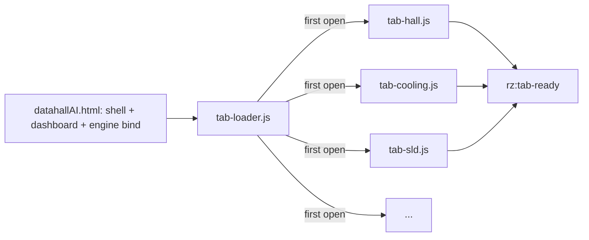

# PRD-P09: DC AI cockpit loads what the visitor looks at (SEO #8, mobile LCP)

## 1. Document control
| Field | Value |
|---|---|
| PRD id | PRD-P09 |
| Version | 1.0, 2026-11-10 |
| Status | Approved under the directive as a performance refactor of one page. It is not a breaking API or architecture migration, and the page keeps its URL, DOM ids and behaviour. Every existing datahallAI gate must stay green, and the work ships in stages, each separately revertible. |
| Priority | Wave 5 (rank 9, priority ~60). Existing commitment: SEO ledger #8. |
| Ownership | datahallAI.html is shared with the LTC session (its Q6/Q7 touch cockpit behaviour). Each stage is announced by message before the edit, and each stage must merge cleanly. |
| Modules | datahallAI.html, new `js/datahall-ai/tab-*.js` modules, `js/datahall-ai/tab-loader.js`, ~20 datahallAI gates |

## 2. Executive summary
`datahallAI.html` is 1,366,717 bytes, of which 1,188,233 characters are inline script in 9 blocks. The largest single block is 915,354 characters.

Every visitor downloads, parses and compiles the drawing builders for all 13 diagrams and 11 modals before the dashboard is interactive. The SEO ledger records a mobile LCP of 6.7 s.

This PRD moves each tab's builder code into a separate module that loads when that tab is first opened. The dashboard ships first.

## 3. Problem statement (measured 2026-11-10)
- File: 1,366,717 B.
- Inline JS: 1,188,233 characters in 9 blocks; the top two are 915,354 and 238,550.
- SEO ledger #8: mobile LCP 6.7 s, 88 % inline JS.
- 47 `<script` tags in total.
- Default tab: `dash` (no SVG). Diagrams are built for hidden panels.

**Consequence:** slow first view on phones. The engine/registry work is invisible to users who bounce.

## 4. Objectives and success metrics
| Objective | Metric | Target | Method |
|---|---|---|---|
| Lighter first load | HTML bytes | ≤ 400 KB (assumption: the dashboard + shell + engine bindings remain inline; measured after stage 1) | file size |
| Faster LCP | mobile LCP, controlled A/B: same machine, same server (not `python -m http.server` single-threaded; memory: perf A/B traps), Lighthouse mobile preset, median of 5 | ≤ 2.5 s, or a 50 % reduction if 2.5 s proves unreachable. The result is reported, not rounded. | Lighthouse CLI |
| Behaviour preserved | all datahallAI gates (coverage strict, inspector runtime, fire runtime, basis hooks, legibility, geometry monitors) | green, unchanged counts | ship gate |
| First tab switch | time from click to diagram drawn (cold) | ≤ 1 s on desktop (estimate), measured | Puppeteer timing |

## 5. Scope
- **In:**
  - Extract per-tab builder IIFEs (hall, room, rack, cooling, electrical SLD + sub-panels, network ×3, fire, BMS, building) into modules.
  - Loader with a promise per tab.
  - Skeleton while loading.
  - Gates adapted to wait for the tab-ready event. The existing `activateTab` in `tools/lib/cockpit-tabs.mjs` already waits for a non-zero text box.
- **Out:**
  - Rewriting builders.
  - Changing engine or registry.
  - The PDF builders (they move too, but load on first export).

**Constraints:**
- No build step (zero-build site).
- Modules are plain deferred scripts with `?v=` tokens.
- The global names used across blocks must keep working (an audit of cross-block references is the first task).

**Assumption:** builders communicate through globals declared in the large blocks. T-P09-1 maps them before any move.

## 6. Personas
- **Mobile visitor from search** gets a fast dashboard.
- **Desktop engineer** sees no visible change except a short first-switch skeleton.

## 7. User journey
1. The page loads. The dashboard renders.
2. The user clicks "Cooling". The panel shows a skeleton line "Loading cooling diagram…" (`aria-busy=true`). The module loads, the builder runs, and the diagram is drawn.
3. Subsequent switches are instant (cached module).
4. **Failure.** A module fails to load: the panel shows "This view could not load. Retry". Retry re-requests the module. Other tabs are unaffected.

## 8. Functional requirements
| ID | Description | Acceptance |
|---|---|---|
| FR-P09-1 | Cross-block global map (which function and variable each block defines and uses) | report; no move before it |
| FR-P09-2 | `tab-loader.js`: `ensureTab(id) → Promise`, single flight, retry | unit |
| FR-P09-3 | Stage 1: move the 3 heaviest tab builders | gates green; bytes measured |
| FR-P09-4 | Stage 2: the remaining tabs + modals (modals load with their tab) | gates green |
| FR-P09-5 | Skeleton and error states | E2E |
| FR-P09-6 | Gates wait for the `rz:tab-ready` event (added to `cockpit-tabs.mjs` `activateTab`) | all gates green |
| FR-P09-7 | A/B measurement script and report | evidence file |

## 9. UI/UX specification
- The skeleton is a hairline box with a single mono status line. No spinner animation; a static three-dot text under reduced motion.
- The error state has a Retry button (44 px).
- No other visual change: screenshot diff of each tab against the pre-change version.

## 10. Data model
None.

## 11. API contracts
- Window event `rz:tab-ready {detail: {tab}}`.
- `window.RZDatahallTabs.ensure(id)`.

## 12. Business rules
- The dashboard never waits for a tab module.
- Engine authority checks run before any builder (unchanged).

## 13. Cross-module integration
| Module | Effect |
|---|---|
| Inspector, payloads, fire workstation | Their modules are already separate files and stay deferred |
| LTC Q6/Q7 | Their edits land in the moved modules after each stage. The coordination message lists the new file per tab. |
| P05 replay | Its seam is in sim-telemetry (unaffected) |
| Service worker (P25) | Caches the modules after first use |

## 14. AI and automation
Not applicable.

## 15. Non-functional requirements
- Each module's `?v=` token is managed by `test-asset-cache-tokens`.
- No eval.
- A11y unchanged.

## 16. Security
None new. Same-origin scripts.

## 17. Edge cases
- A deep link to a tab (`#cooling`): the loader runs on load for that tab.
- PDF export touching several tabs: it ensures all needed tabs first, with a progress line.
- Print stylesheet: unchanged.

## 18. Technical architecture

## 19. Implementation breakdown
| Task | Effort | Verify |
|---|---|---|
| T-P09-1 Global map | 1 d | report |
| T-P09-2 Loader + event + gate lib change | 0.5 d | unit; gates green with no moves |
| T-P09-3 Stage 1 (3 tabs) | 1.5 d | full datahallAI gates + screenshots |
| T-P09-4 Stage 2 (rest) | 2 d | same |
| T-P09-5 A/B LCP | 0.5 d | report |

## 20. Test strategy
- The full datahallAI gate set after each stage.
- Screenshot diff per tab.
- Controlled A/B Lighthouse.
- Failure test with a blocked module URL.

## 21. Acceptance criteria
- **Given** a cold mobile load (Lighthouse mobile), **then** the median LCP over 5 runs ≤ 2.5 s, or the measured figure is reported with the reason.
- **Given** any tab, **when** it is opened first time, **then** its diagram is identical to the pre-change screenshot.

## 22. Rollout
- Two releases (stage 1, stage 2), each revertible.
- Live check: Lighthouse against production.

## 23. Risks
| Risk | Mitigation |
|---|---|
| Hidden cross-block coupling | T-P09-1 map first; moves are mechanical |
| Gate timing flakes | The tab-ready event, not timers |
| Concurrent LTC edits | Message before each stage |

## 24. Definition of done
- Both stages are shipped.
- All gates are green.
- The A/B report is in 07-performance-review.
- The SEO ledger #8 row is updated with the measured figure.
