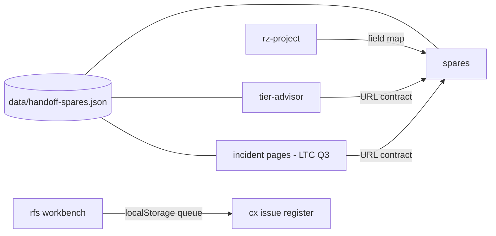

# PRD-P13: Lifecycle hand-offs between tier, readiness, commissioning and spares (merges Q13, closes X9)

## 1. Document control
| Field | Value |
|---|---|
| PRD id | PRD-P13 (absorbs Q13 "Spares deep links" and X9 "receiver with no sender") |
| Version | 1.1, 2026-11-10 (revised after review: Cx intake API verified) |
| Status | Part A (tier→spares, project→spares, deep links) approved (directive). Part B (readiness gap → Cx issue) depends on PRD-P06 records persistence for the cloud; the local half is approved. |
| Priority | Wave 3 (Q13 66.0, P13 52) |
| Dependencies | P01 (project country, tier) for Part A2; P06 for the persistent half of Part B |
| Modules | tier-advisor.html, spares-readiness-calculator.html, rfs-readiness-workbench.html, cx-calculator.html, js/rz-project.js |
| Ownership | The incident → calculator hand-off (Q3) is LTC's. This PRD reuses the same spares receiver, so both sessions must keep the parameter contract in §11 stable. |

## 2. Executive summary
The lifecycle tools answer connected questions that do not talk to each other:
- what tier the design targets (tier advisor);
- whether the site is ready to operate (RFS workbench);
- how it is commissioned (Cx);
- which spares it must stock (spares).

The spares calculator already accepts a deep link with six parameters, but no page sends one.

This PRD wires the senders. It also lets an RFS readiness gap become a Cx issue in one action. Both hand-offs are visible and reversible, and they are never automatic.

## 3. Problem statement (measured 2026-11-10)
- `spares-readiness-calculator.html:5123` parses `redundancy`, `tier`, `mtbf`, `mttr`, `commodity` and `country`. It writes them into `c1_redundancy`, `c1_lambda`, `mc_mttr` and others, and records them in `carrierParams` for display.
- 5 pages link to spares, all without a query string. The receiver is dead code from the user's point of view.
- tier-advisor computes a target tier and a cooling redundancy (`coolRedundancy` n / n1 / 2n / 2n1). The user must retype them on spares.
- rfs-readiness-workbench produces gaps with evidence. The Cx issue register cannot receive them.

## 4. Objectives and success metrics
| Objective | Metric | Target |
|---|---|---|
| tier → spares | after "Size spares for this design", spares shows the redundancy and tier from tier-advisor | exact mapping (gate) |
| project → spares | with an active project, country and tier come from P01 | gate |
| Parameter contract stable | parse table = send table | contract gate |
| rfs gap → Cx issue | one action creates one issue with a back-link, without duplicates | E2E (local) |

## 5. Scope
**In scope:**
- A "Size spares for this design" action on tier-advisor results.
- A spares adapter in the P01 field map (country, tier).
- A shared contract file `data/handoff-spares.json` (param, type, range, target field), used by the receiver and all senders, including LTC's incident links.
- rfs "Send to Cx" per gap.
- Cx accepts a hand-off payload into its issue register (local state today).

**Out of scope:**
- Spares → procurement.
- Bidirectional sync.
- Cloud persistence of Cx issues (P06).

**Reuse:** the spares receiver (kept; it is refactored to read the contract), the Cx issue register model, the rfs gap objects.

**Constraints:**
- Query parameters carry no personal data.
- The spares receiver validates ranges (today it only checks `> 0`).

**Verified 2026-11-10 (revision 1.1):** the Cx Tier 1 register is `RZCxIssues.store(localStorage)`, key `rz-cx-issues`, with `add({title ≤120, severity A|B|C, system ∈ RZCxPlan.SYSTEMS, gate L1–L5, owner ∈ CxM|CxA|GC|OEM|EoR|Owner})` returning `{ok, code}`. Intake calls this API; it never writes the key directly.

## 6. Personas
- **Design engineer:** tier result to spares sizing.
- **Operations readiness lead:** RFS gap to Cx punch item.

## 7. User journey
**A. tier → spares**
1. The tier-advisor result card shows a button **Size spares for this design**.
2. It opens `spares-readiness-calculator.html?tier=3&redundancy=n1&country=ID`. Country is included only if a project is active.
3. Spares shows a provenance line: "Loaded from Tier Advisor: tier 3, redundancy N+1. Edit any field to override." The fields are tagged.
4. Invalid values (for example `tier=7`) are ignored. The line lists "ignored: tier=7 (out of range 1–4)".

**B. RFS → Cx**
1. Each open gap row in rfs gets **Send to Cx**.
2. The gap is written to `localStorage rz_handoff_cx` (queue: title, system, severity, evidence ids, source url) and the button changes to "Sent · Open Cx".
3. On load, Cx reads the queue and shows the banner "2 readiness gaps waiting · Add to issue register | Dismiss".
4. Add creates issues with a source link back to the RFS gap anchor, and clears the queue. Dismiss clears the queue without adding.
5. Duplicates are detected by gap id: the second send of the same gap is refused with "Already sent".

## 8. Functional requirements
| ID | Description | Acceptance |
|---|---|---|
| FR-P13-1 | `data/handoff-spares.json` contract: {param, type: int / float / enum, range or enum values, target field, transform} | contract gate: the receiver parse table equals the contract |
| FR-P13-2 | The receiver reads the contract, validates ranges, applies, and records applied and ignored params | unit + E2E |
| FR-P13-3 | tier-advisor sender: maps `coolRedundancy` {n→n, n1→n1, 2n→2n, 2n1→2n} and the computed tier 1–4 | E2E |
| FR-P13-4 | Provenance line + field tags on spares | E2E |
| FR-P13-5 | The P01 adapter for spares (country, tier) reuses the contract transforms | field-map gate |
| FR-P13-6 | rfs Send to Cx: queue entry schema {gap_id, title ≤120, system (a `RZCxPlan.SYSTEMS` id chosen by the user in the send dialog, pre-selected by an rfs-system → Cx-system map in the contract file), gate L1–L5 (user-chosen, default L3), severity A/B/C (rfs high→A, medium→B, low→C), evidence_ids[], source_url}, max 100 | unit |
| FR-P13-7 | Cx intake banner, Add / Dismiss; Add calls `RZCxIssues.store(localStorage).add()` per item; a refused item (code TITLE/SEVERITY/SYSTEM/GATE) is listed with its code and kept in the queue; the issue title carries the suffix "(RFS)", and the gap url is kept in a side map `rz-cx-issue-sources` {issueId: url}, because the Tier 1 issue schema has no source field | E2E |
| FR-P13-8 | Duplicate guard by gap_id across the queue and existing issues | unit |

## 9. UI/UX specification
- **tier-advisor.** A secondary button in the result actions row: label "Size spares for this design". It is a link styled as a button (navigation, not an action). It opens in the same tab.
- **spares.** A provenance line under the page header: mono 12 px, hairline, with a "Clear hand-off" text button that removes the tags. The user's values stay.
- **rfs.** A row action "Send to Cx", 32 px button with a 44 px touch target. The sent state is text, not a disabled grey control.
- **Cx.** An intake banner at the top of the issue register tab: `role=status`, two buttons, keyboard reachable.
- Both themes, at 390 and 1440 px.

## 10. Data model
- Contract JSON (repo).
- `localStorage rz_handoff_cx`: `{v: 1, items: [...]}`.
- No database.

## 11. API contracts
**URL contract (public, stable):**
```
spares-readiness-calculator.html?
  tier=1..4
  &redundancy=n|n1|2n
  &mtbf=hours>0
  &mttr=hours>0
  &commodity=<enum from the page>
  &country=<ISO-2 in the page list>
```
Unknown params are ignored. Breaking this contract needs a version param (`hv=2`).

## 12. Business rules
- Hand-offs prefill and never lock.
- Every applied value is tagged with its source.
- Queue items expire after 7 days (stale hand-offs are discarded with a note).

## 13. Cross-module integration
| Module | Effect |
|---|---|
| LTC Q3 (incident → calculator) | Uses the same contract. A message is sent to LTC when the contract file lands. |
| P01 | Country and tier |
| P06 | Persists Cx issues later; intake works on local state now |
| P15 | Events `handoff_sent` |

**Phase 3 amendment C1:** the per-page map this PRD defines lives in the shared calculator registry `data/calculators.json` (task F1), not in a separate file. The gate is `test-calculator-registry.mjs`. See 03-architecture/ARCHITECTURE-P.md.
**Phase 3 amendment C3:** new issues go to the active Cx tier. With no Tier 3 record set active, intake writes Tier 1 `RZCxIssues`. With a Tier 3 set active, intake writes Tier 3 `issues`, and the Tier 1 register is read-only. Conversion between tiers is explicit (`RZCxRecords.issueFromTier1`); nothing is mirrored silently.

## 14. AI and automation
Not applicable.

## 15. Non-functional requirements
- Receiver parse is under 5 ms.
- AA contrast.
- No layout shift above the fold beyond the provenance line, which has a reserved height.

## 16. Security
- Query params are untrusted. Each is validated against the contract and assigned via `.value`.
- The queue is local only.
- `source_url` is validated as same-origin before it is rendered as a link.

## 17. Edge cases
- Param present but the target field is missing in a future page version: the contract gate fails at ship time.
- Two senders in a row: the last navigation wins, since a URL is stateless.
- Cx page not yet visited: the queue waits until Cx loads; expiry applies.
- Gap deleted in rfs after sending: the issue keeps its link, and the link anchors to the rfs page top if the gap anchor is missing.

## 18. Technical architecture


## 19. Implementation breakdown
| Task | Files | Effort | Verify |
|---|---|---|---|
| T-P13-1 Contract + gate | data/handoff-spares.json, tools/test-handoff-contract.mjs | 0.5 d | RED: receiver accepts tier=7 today |
| T-P13-2 Receiver refactor + provenance UI | spares page | 0.5 d | E2E |
| T-P13-3 tier sender | tier-advisor.html | 0.25 d | E2E |
| T-P13-4 rfs send + queue | rfs page | 0.5 d | unit + E2E |
| T-P13-5 Cx intake | cx page / rz-cx-*.js | 0.75 d | E2E |
| T-P13-6 Message LTC with the contract | — | — | ack |

## 20. Test strategy
- **Contract gate:** static + headless. Each param in valid and invalid form.
- **E2E:**
  - tier → spares fields;
  - rfs → Cx issue count +1;
  - duplicate refused.
- **Accessibility:** axe on the new controls.
- **Regression:** spares, cx and rfs gates.

## 21. Acceptance criteria
- **Given** a tier-advisor result of tier 3, N+1, **when** the user clicks Size spares, **then** spares opens with `c1_redundancy=n1` and the provenance line names Tier Advisor.
- **Given** `?tier=7`, **then** no field changes and the line lists it as ignored.
- **Given** a gap sent twice, **then** the second send reports "Already sent" and Cx shows one issue.

## 22. Rollout
- Additive, one release.
- Rollback by revert.
- The contract change is announced to LTC.

## 23. Risks
| Risk | Mitigation |
|---|---|
| Cx internal state API unclear | T-P13-5 discovery first, timeboxed |
| LTC sender diverges | Shared contract + gate |

## 24. Definition of done
- FRs are implemented.
- The contract gate, unit tests and E2E tests are green in the ship gate.
- Screenshots reviewed.
- LTC is informed of the contract.
- The change is live and verified.
