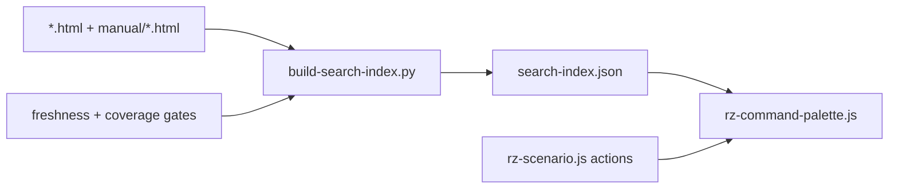

# PRD-P14: Search and command palette that cover the whole site (merges Q2)

## 1. Document control
| Field | Value |
|---|---|
| PRD id | PRD-P14 (absorbs addendum Q2 "Search covers incidents, labs and tools; palette everywhere") |
| Version | 1.0, 2026-11-10 |
| Status | Approved for implementation (directive). No schema change. |
| Priority | Wave 2 (Q2 73.0, P14 64.5) |
| Dependencies | None. P01 later adds "open project" actions. |
| Modules | `js/rz-command-palette.js`, `search-index.json`, a new generator `tools/build-search-index.py`, every public HTML page (script tag), `tools/test-generator-freshness.py` |
| Ownership note | The incident library and `dc-incidents.html` belong to the LTC session (Q1, Q9, Q18). This PRD only indexes those pages and adds the palette tag. It does not change their content. Coordinated by message before the tag sweep. |

## 2. Executive summary
The site has a good palette, opened with Ctrl/Cmd+K: fuzzy search, recents, category chips, deep section search, and theme and navigation commands. Two gaps limit it:
- It is loaded on 48 of 181 pages.
- Its index is a hand-maintained list of 140 entries that omits 97 pages, including all 43 incident reports, every cockpit, the PLN monitors and the LTC labs.

This PRD does three things:
1. Generates the index from the pages themselves, so it cannot fall behind.
2. Loads the palette on every public page.
3. Adds a small set of actions that do real work.

## 3. Problem statement (measured 2026-11-10)
- **Palette coverage.** `js/rz-command-palette.js` is referenced by 48 of 181 root pages. capex, tco and cx do not load it, among others.
- **Index coverage.** `search-index.json` has 140 entries.
  - 97 root pages are absent.
  - By family: incident 43, rz-* 10, ltc 6, pln 6, plan 5, network 2.
  - Single pages: chiller-plant, datahall, fire-system, fuel-system, water-system, ict, EPMS_Telemetry, tools.html, dc-incidents, spares and others.
- **Maintenance.** Entries are appended by `tools/assemble-article.py` for articles only. No generator exists for other families, and no freshness gate covers the index.
- **Effect.** A visitor typing "OVHcloud fire" or "chiller plant" in the palette finds nothing, although the pages exist.

## 4. Objectives and success metrics
| Objective | Metric | Target |
|---|---|---|
| Index completeness | public indexable root pages with an entry | 100 %. Excluded: noindex pages, 404, google verification, account, index1 (mockup). |
| Index freshness | generator output equals the committed file | freshness gate green |
| Palette reach | public pages loading the palette | 100 % of indexable pages + calculators + cockpits |
| Findability | 10 fixed queries return the expected page in the top 3 | 10/10 (query list in §20) |
| Actions work | each palette action executes in a headless test | 100 % |

## 5. Scope
**In scope:**
- The generator: title, meta description, keywords meta if present, category by filename family, date from JSON-LD `datePublished` where present.
- An exclusion list: noindex pages, and anything `robots` disallows.
- Palette script tags on all public pages.
- New actions:
  - "Copy link to this scenario" (calculators only; calls P02's `shareLink`).
  - "Save scenario" (calculators with Save).
  - "Export PDF" (calculators: calls the page's existing export function).
  - "Open my account".
  - "Go to section…", which already exists as deep search.
- The freshness gate.

**Out of scope:**
- Full-text body search (deep section search already covers headings).
- Server search.
- Indonesian query synonyms (LTC Q15).

**Reuse:** Fuse.js lazy load, chips, recents, `search-sections.json`, and `build-search-sections.py` as the model for the new generator.

**Constraints:**
- The palette guard `window.__rzPalette`: pages with an inline copy must not load the file. Verified per page during the sweep.
- LTC-owned files (index.html, styles-index.css) are touched only for the mechanical script tag, after a message.

**Assumption:** each page's `<title>` and meta description are good search text. The SEO work makes them so; the meta-description-fit gate exists.

## 6. Personas
- **Reader** looking for an incident or topic.
- **Engineer** jumping between calculators by keyboard.
- **Returning user** using recents.

## 7. User journey
1. On any public page the user presses Ctrl/Cmd+K, or "/" outside inputs, or clicks the search button where the nav has one.
2. The palette opens with recents and commands.
3. The user types "ovh". Results include "OVHcloud SBG2 fire 2021" under an **Incident** chip, with the description as preview.
4. Enter navigates.
5. On a calculator the user types "link". The action "Copy link to this scenario" runs P02's `shareLink`, and the palette shows its result message inline.
6. **Failure.** The index fails to load (offline, not cached): the palette shows "Search index unavailable offline. Commands still work.", and commands remain.
7. **Exit.** Esc returns focus to the element that opened it (already implemented; asserted).

## 8. Functional requirements
| ID | Description | Trigger | Processing | Output | Exceptions | Acceptance |
|---|---|---|---|---|---|---|
| FR-P14-1 | `tools/build-search-index.py --apply` builds `search-index.json` from root HTML | release step | parse title, meta description, keywords, canonical, JSON-LD date. Category from a family map (article→Article / FF→Future Forward / pillar→Pillar / pln→Grid monitor / incident→Incident / manual→Manual / ltc→Lab / cockpit list→Cockpit / calculator list→Calculator / else Page). Exclude noindex. Keep the existing `id` for urls already present, so recents stay valid. | JSON array, same schema | page without title: fail with the file name | unit + freshness |
| FR-P14-2 | Manual pages stay indexed (44 today) | build | include `manual/*.html` as today | — | — | count ≥ 44 |
| FR-P14-3 | Freshness gate entry | ship gate | `test-generator-freshness.py` adds the generator | pass/fail | — | RED if the file is stale |
| FR-P14-4 | Palette tag on all public pages | sweep script | insert `<script src="js/rz-command-palette.js?v=…" defer>` before `</body>` where absent and no inline palette exists | tags | page with an inline copy: listed, not tagged | coverage gate |
| FR-P14-5 | Coverage gate | ship gate | every indexable page loads the palette or carries `__rzPalette` inline | pass/fail | — | RED today (48/181) |
| FR-P14-6 | Calculator actions | palette open on a `data-rz-calc` page | register commands that call existing functions: `rzScenario.shareLink`, `#btnSaveAccount.click()`, the page export button `.click()` (selector table per page) | action result message in the palette footer | function missing: action not listed (never a dead entry) | E2E per action |
| FR-P14-7 | Query quality fixture | ship gate | 10 queries, expected url in top 3 using the same Fuse options | pass/fail | — | 10/10 |

## 9. UI/UX specification
- The existing palette UI is unchanged: modal, input, chips, results, preview.
- **New chips:** Incident, Cockpit, Lab, Grid monitor. Chips are generated from the categories present in the index, so a chip can never lead to zero results.
- **Actions** appear in the existing "commands" group. Each shows its keyboard hint text (e.g. "link"). The action result shows in the footer status line (`role=status`).
- No new buttons on pages. The palette is the entry point.
- **Responsive.** The existing styles in `styles.css` / `styles-index.css`. Verify at 390 px that the modal fits and results scroll.
- **Accessibility.**
  - The existing `role=dialog` and focus return are kept.
  - Results get `role=option` and `aria-selected`, if missing (to be audited during implementation).
  - The palette is added to the axe audit page set by opening it.

## 10. Data model
`search-index.json` entry, existing schema:
```
{id:int, title:str, url:str, description:str, category:str, keywords:str[], image?:str, date?:str, readingTime?:int}
```
- Generator rules: the `id` is stable per url (existing ids preserved; new ids appended from max+1).
- No database.

## 11. API contracts
None over the network. A static JSON fetch as today.

**Internal:** the palette reads `window.rzPaletteActions = [{title, kbd, available(): bool, run(): Promise<string>}]`, registered by pages or by `rz-scenario.js`.

## 12. Business rules
- A page is indexed if and only if it is indexable (no `noindex`) and not on the exclusion list.
- An action is listed only if its target function exists.

## 13. Cross-module integration
| Module | Effect |
|---|---|
| P02 | Link action |
| P15 | Actions fire through the same functions, so tracking comes for free |
| LTC Q1 relation file | Can later enrich the index (related pages). Format compatible. |
| sitemap/indexing generators | Share the noindex exclusion logic. LTC's X7 fixes the sitemap; the same rule is used here. |

## 14. AI and automation
Not applicable. Fuzzy search is deterministic.

## 15. Non-functional requirements
- **Index size.** Expected about 140 + 97 entries at roughly 350 bytes each, about 80 KB. Measured after the build; it must stay under 150 KB (assumption: the existing lazy fetch is acceptable at that size).
- **Palette script.** Deferred, with no effect on LCP (measured on one calculator before and after).
- **Accessibility.** AA.

## 16. Security
- Index content is site-authored.
- Results render titles and descriptions via `textContent`. The existing code highlights matches; this must be audited so it does not use `innerHTML` with unescaped text. Fix if it does.

## 17. Edge cases
- Duplicate titles: disambiguated by category in the preview.
- A page removed: the generator drops it, and the freshness gate forces a rebuild.
- Recents pointing to a removed page: filtered on open.
- Offline: commands still work (FR in §7).

## 18. Technical architecture


## 19. Implementation breakdown
| Task | Files | Effort | Verify |
|---|---|---|---|
| T-P14-1 Generator with id preservation | tools/build-search-index.py | 0.5 d | unit: ids of the existing 140 unchanged |
| T-P14-2 Freshness gate wiring | tools/test-generator-freshness.py | 0.1 d | RED/GREEN |
| T-P14-3 Coverage gate (RED first) | tools/test-palette-coverage.mjs | 0.25 d | RED 48/181 |
| T-P14-4 Tag sweep (message LTC first for index.html) | ~130 pages | 0.25 d | coverage GREEN |
| T-P14-5 Actions registry + 3 calculator actions | rz-command-palette.js, rz-scenario.js | 0.5 d | E2E |
| T-P14-6 Query fixture gate | tools/test-search-quality.mjs | 0.25 d | 10/10 |
| T-P14-7 a11y pass with the palette open | audit-a11y | 0.25 d | green |
| T-P14-8 Cache tokens, docs, changelog | — | 0.1 d | gates |

## 20. Test strategy
**Query fixture:**

| Query | Expected page |
|---|---|
| "ovh" | incident-ovhcloud-sbg2-fire-2021.html |
| "crowdstrike" | incident-crowdstrike-falcon-global-outage-2024.html |
| "chiller plant" | chiller-plant.html |
| "pue" | pue-calculator.html |
| "tco" | tco-calculator.html |
| "tier advisor" | tier-advisor.html |
| "jawa bali" or "java grid" | pln-java-grid.html |
| "fuel" | fuel-system.html |
| "commissioning" | cx-calculator.html |
| "spares" | spares-readiness-calculator.html |

- **E2E:** open the palette with Ctrl+K on 5 pages of different families; run each action.
- **Regression:** the existing palette tests (`test-site-root-paths`, `audit-interactions`).
- **Accessibility:** axe with the modal open.

## 21. Acceptance criteria
- **Given** any indexable page, **when** the user presses Ctrl/Cmd+K, **then** the palette opens.
- **Given** the query "ovh", **then** the OVHcloud incident is in the top 3.
- **Given** a calculator, **when** the action "Copy link" runs, **then** the clipboard (stubbed) receives a `#rzs=` link.
- **Given** a stale `search-index.json`, **then** the freshness gate fails.

## 22. Rollout
- One release.
- Rollback by revert. The index and the tags are independent.
- Post-deploy: run the query fixture against live.

## 23. Risks
| Risk | Mitigation |
|---|---|
| Pages with an inline palette load the shared one too, giving a double modal | Guard + sweep skips + gate |
| LTC page edits collide | Message first; mechanical tag only |
| Index size growth | Measured, with a cap |

## 24. Definition of done
- Generator, freshness gate, coverage gate and query gate are all green.
- Actions are E2E-tested.
- a11y passes.
- Screenshots of the palette at 390/1440 in both themes reviewed.
- The change is live and verified.
