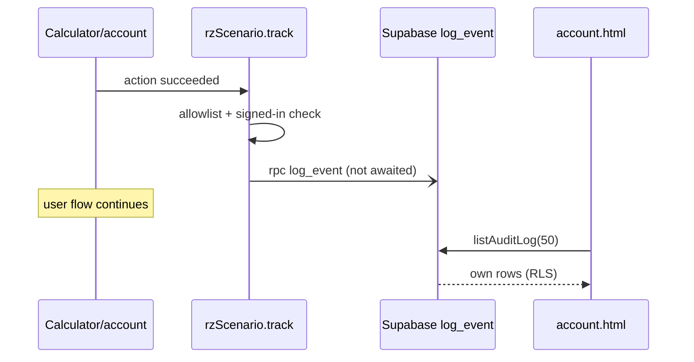

# PRD-P15: Activity history the user can see (wire the existing audit log)

## 1. Document control
| Field | Value |
|---|---|
| PRD id | PRD-P15 |
| Version | 1.0, 2026-11-10 |
| Status | Part A (client wiring + account view) approved for implementation: it uses the existing RPC and RLS, with no schema change. Part B (a server-side rate limit and action allowlist in `log_event`) needs owner approval and owner execution of the SQL, so it is BLOCKED until applied. |
| Priority | Wave 2 (P15 52) |
| Dependencies | None for A; owner SQL run for B |
| Modules | `js/rz-supabase.js` (unchanged API), `js/rz-scenario.js`, `account.html`, `supabase/schema.sql` (B) |
| Approval | A: directive. B: owner, because it changes a security function. |

## 2. Executive summary
The database already has an audit log with correct row-level security: a user reads their own events and root reads all. It also has a controlled write function, `log_event`. The website never calls that function.

This PRD:
- records the user's own meaningful actions (scenario saved, deleted, opened, link copied, PDF exported);
- shows them on the account page as a short history;
- proposes, for owner approval, a server-side guard against flooding.

## 3. Problem statement (measured 2026-11-10)
- `rzSupa.logEvent()` (`js/rz-supabase.js:413`) has 0 callers in the repository.
- `rzSupa.listAuditLog()` (`:420`) has 0 callers.
- So `audit_log` holds only `tier_change` / `role_change` rows from the profile trigger.
- The user has no record of what they saved or deleted. A deleted scenario leaves no trace even for its owner.
- `log_event` (schema.sql:728) accepts any action string and up to 32 KB of meta, with no rate limit. Anonymous execute is revoked (`:965`), so the exposure is limited to an authenticated user flooding their own rows. This is noted for Part B.

## 4. Objectives and success metrics
| Objective | Metric | Target |
|---|---|---|
| Actions recorded | events written for save, delete, open, link copy, PDF export when signed in | 5 action types, each verified in a test with a mocked client |
| History visible | account shows the latest 50 own events, newest first | yes |
| No impact on the action itself | the user action succeeds even when logging fails | logging failures are invisible to the flow (caught) |
| No sensitive data | meta never contains inputs or personal data, only calc id, scenario id, name length | schema check in the unit test |

## 5. Scope
**In scope:**
- A `track(action, targetType, targetId, meta)` helper (fire-and-forget, signed-in only).
- Calls at the 5 points.
- An account "Recent activity" section.
- Part B SQL written for the owner.

**Out of scope:**
- Root-wide audit dashboard (LTC Q10 covers admin).
- Retention jobs (Part B proposes 400 days as a comment only).
- Anonymous tracking.

**Reuse:** `logEvent`, `listAuditLog`, the account page layout (`fs-chip`, section pattern).

**Constraints:**
- No schema change in Part A.
- Never block or slow the user action.

**Assumption:** the live database matches `supabase/schema.sql`. **UNVERIFIED**: I cannot query production. The Part A test runs against a mocked client; the live check needs a signed-in session, so it is done by the owner or by me with the test account the owner provides.

## 6. Personas
- **Signed-in user:** "what did I save last week, and did I delete the 20 MW case?"
- **Root:** already reads all rows through RLS (no UI here).

## 7. User journey
1. The user saves a scenario on a calculator. The save completes as today. `track('scenario_saved', 'scenario', id, {calc})` runs without awaiting.
2. On account.html the user scrolls to **Recent activity**: a table with time (local), action label, item (scenario name if it still exists, else "deleted scenario"), calculator.
3. **Empty state:** "No activity recorded yet. Saving or opening a scenario adds an entry."
4. **Error:** "Activity could not be loaded." Retry button re-runs the fetch.
5. **Signed out:** the section is hidden, because the account page already shows sign-in.

## 8. Functional requirements
| ID | Description | Trigger | Pre | Processing | Output | Exceptions | Acceptance |
|---|---|---|---|---|---|---|---|
| FR-P15-1 | `rzScenario.track(action, type, id, meta)` | called by flows | `rzSupa.configured` and a user present (cached `getUser`) | validate action in the allowlist {scenario_saved, scenario_deleted, scenario_opened, scenario_link_copied, pdf_exported}; meta keys in {calc, format}; call `logEvent` | promise ignored | any error is swallowed after one `console.warn` in debug mode only | unit: disallowed action is not sent |
| FR-P15-2 | Save hook | `saveToAccount` success | — | track saved with the new row id | — | — | unit with mock |
| FR-P15-3 | Delete hook | account delete success | — | track deleted | — | — | unit |
| FR-P15-4 | Open hook | account Open click | — | track opened | — | — | unit |
| FR-P15-5 | Link hook | P02 copy success | — | track link_copied | — | — | unit |
| FR-P15-6 | PDF hook | each calculator's PDF export success (11 builders; hooked through one `rzScenario.track` call added after each builder's `.save()` / download) | — | track pdf_exported {calc} | — | — | E2E on 2 pages, source scan on 11 |
| FR-P15-7 | Account Recent activity | account load, signed in | — | `listAuditLog(50)`; map scenario ids to names from the already-loaded scenario list | table | error: retry state | E2E with a stubbed `rzSupa` |
| FR-P15-8 (B) | Server guard | `log_event` call | owner applied the SQL | reject actions not matching `^[a-z_]{3,40}$`; rate limit of 60 events per actor per 10 minutes, enforced with a count on `audit_log_actor_idx`; meta ≤ 2 KB | exception | — | SQL test script run by the owner |

## 9. UI/UX specification
- **Section placement.** Below "Saved scenarios" on account.html. Heading: h2 "Recent activity" with a count chip, the same pattern as `#scnCount`.
- **Table.**
  - Columns: Time · Action · Item · Calculator.
  - Mono, tabular numbers, no zebra, 1 px hairline rows (design.md).
  - Time is relative for under 24 h ("3 h ago"), absolute after that. The `title` attribute carries the full ISO time.
- **Responsive.** Under 600 px each row stacks as two lines (time + action, then item + calculator). No horizontal scroll.
- **States.**
  - Loading: skeleton of 3 hairline rows.
  - Empty: text as in §7.
  - Error: text + Retry button.
- **Controls.** Retry only. No dead buttons.
- **Keyboard.** The table is static. Retry is focusable.
- **Motion.** None.

## 10. Data model
**Existing, unchanged in A:**
- `audit_log(id uuid, actor_id uuid → profiles, action text, target_type text, target_id text, meta jsonb ≤32 KB, ip inet, ua text, created_at timestamptz)`.
- Indexes: `created_at desc`, `(actor_id, created_at desc)`.
- RLS: read own, root all; no client write.

**Used values:**
- action ∈ the allowlist.
- target_type `'scenario'` or `'calculator'`.
- target_id = scenario uuid or calc id.
- meta `{calc, format?}`.

**B (proposed):** function body change only. No table change. Retention: a comment proposing a 400-day delete job; not implemented.

## 11. API contracts
**Existing RPC:**
- `POST /rest/v1/rpc/log_event {p_action, p_target_type, p_target_id, p_meta}` → uuid. Authenticated only.

**Existing select:**
- `GET /rest/v1/audit_log?select=id,actor_id,action,target_type,target_id,meta,created_at&order=created_at.desc&limit=50` via supabase-js.

No new endpoints. Errors are mapped by the existing `friendly()`.

## 12. Business rules
- Only signed-in actions are recorded.
- Logging is best-effort and never blocks.
- Users see their own rows only, enforced by RLS. The client also filters `actor_id = user.id` for defence in depth, matching the scenario code's pattern.

## 13. Cross-module integration
| Module | Effect |
|---|---|
| P02 | Fires link_copied |
| 11 calculators' PDF builders | One call each |
| account.html | New section; Open and Delete fire events |
| LTC Q10 admin console | Can read the same table as root later |

**Phase 3 amendment C7:** the SQL is delivered in the single owner-applied bundle `supabase/migrations/2026-11-product-transformation.sql`.

## 14. AI and automation
Not applicable.

## 15. Non-functional requirements
- **Latency.** Zero added latency on user actions (no await).
- **Account section.** Loads in parallel with scenarios. Assumed under 500 ms on broadband; measured in E2E with the stub. The live number depends on Supabase and is reported, not promised.
- **Accessibility.** AA in both themes.

## 16. Security
- No new grants.
- The client allowlist prevents arbitrary strings from the UI. Part B enforces it server-side, because a client allowlist alone is not a security control.
- No inputs or personal data in meta.
- ip and ua are not set by the client (null). Stated so nobody assumes they are populated.

## 17. Edge cases
- Signed out mid-session: `track` checks the cached user and no-ops.
- Supabase down: the event is lost; accepted and stated.
- Deleted scenario referenced in history: shown as "deleted scenario".
- More than 50 events: only the latest 50; a "Show 50 more" button pages with an offset (limit capped at 500 by the existing function).
- Clock skew: times come from the server `created_at`.

## 18. Technical architecture

## 19. Implementation breakdown
| Task | Files | Effort | Verify |
|---|---|---|---|
| T-P15-1 `track` helper + unit test (Node vm, mock rzSupa) | rz-scenario.js, tools/test-activity-track.mjs | 0.25 d | unit |
| T-P15-2 hooks: save, delete, open, link | rz-scenario.js, account.html | 0.25 d | unit + E2E stub |
| T-P15-3 PDF hooks on 11 builders | 11 pages | 0.5 d | source scan gate + 2 E2E |
| T-P15-4 account section | account.html | 0.5 d | E2E stub: empty / error / rows; screenshots both themes 390/1440 |
| T-P15-5 Part B SQL + test script, owner-run | supabase/schema.sql, supabase/tests/log_event_guard.sql | 0.25 d | owner runs |

## 20. Test strategy
- **Unit:** allowlist; signed-out no-op; error swallowed.
- **E2E:** account page with an injected `rzSupa` stub returning fixtures.
- **Security:** assert meta contains only allowed keys (unit). Part B SQL test: 61st event within 10 minutes raises.
- **Regression:** account and calculator gates.
- **Live:** requires an authenticated session, which I cannot create (no account creation, no credentials). Marked IMPLEMENTED, NOT VERIFIED LIVE until the owner signs in once and the history shows the save.

## 21. Acceptance criteria
- **Given** a signed-in user (stubbed client), **when** a scenario is saved, **then** `log_event` is called once with `scenario_saved` and `{calc}`, and the save message appears regardless of the logging result.
- **Given** five events, **when** account loads, **then** five rows show newest first, with the scenario names resolved.
- **Given** the RPC rejects, **when** a scenario is saved, **then** the save still reports success.

## 22. Rollout
- **A:** normal release. Rollback by revert. No data migration.
- **B:** the owner runs the SQL in the Supabase SQL editor. Rollback = re-run the previous function body (kept in the file history).

## 23. Risks
| Risk | Mitigation |
|---|---|
| The live schema differs from the repo file | First owner sign-in check |
| Event volume | Allowlist of 5 low-frequency actions; B rate limit |

## 24. Definition of done
- A is implemented.
- Unit and stub E2E are green in the ship gate.
- Screenshots reviewed.
- B's SQL is written and handed to the owner.
- The status reports A as IMPLEMENTED, NOT VERIFIED LIVE until the owner's sign-in check confirms a row.
