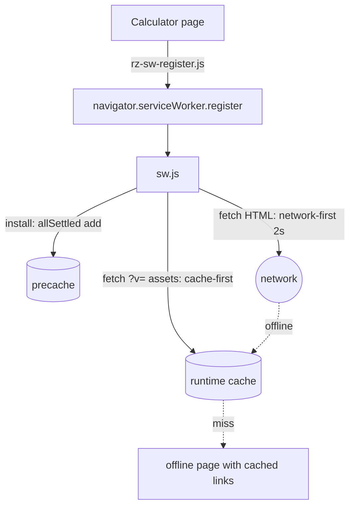

# PRD-P25: Calculators work offline after one visit (merges Q16 "site-wide service worker with a lean precache")

## 1. Document control
| Field | Value |
|---|---|
| PRD id | PRD-P25 (absorbs addendum Q16) |
| Version | 1.1, 2026-11-10 (Phase 3: Chart.js scope corrected to 9 calculators) |
| Status | Approved for implementation (directive). No schema or auth change. A service worker change is a material production change; the mitigation is that rollback ships a self-unregistering kill switch (§22). |
| Priority | Wave 2 (P25 51; Q16 58.5) |
| Dependencies | None |
| Modules | `sw.js`, `index.html` (LTC-owned: only the registration snippet is moved, mechanically; the change is coordinated by message first), a new `js/rz-sw-register.js`, the 11 calculator pages |
| Target | Minor release |
| Approval | Directive; coordinate the index.html touch with the LTC session |

## 2. Executive summary
The site has a service worker. Today it helps almost nobody offline:
- Only `index.html` registers it. A visitor who lands directly on a calculator from search never gets one.
- Its install step hides failures (`addAll(...).catch(() => {})`).
- Calculators depend on Chart.js from a CDN, which the worker deliberately skips, so they cannot draw offline.

This PRD makes the following true: once a visitor has opened a calculator online, that calculator loads and computes offline, and its charts render.

## 3. Problem statement (measured 2026-11-10)
- **Single registration point.** `navigator.serviceWorker.register('/sw.js')` appears in exactly one HTML file (`index.html:1536`). Pages reached from search or a link never install the worker, unless the visitor opens the homepage first.
- **Silent atomic precache.** `sw.js:56` `cache.addAll(PRE_CACHE_URLS).catch(() => {})`. `addAll` is atomic: one 404 among the 21 URLs leaves the precache **empty**, and the catch hides it. The project memory records this exact trap ("cache.addAll is ATOMIC and precached NOTHING while reporting a clean install").
- **Cross-origin skipped.** `sw.js:84` returns early for other origins. 9 of the 11 calculators load `cdn.jsdelivr.net/npm/chart.js@4.4.x` (4.4.0 on 29 site pages, 4.4.1 on 16). Offline, the chart library is missing, chart code throws, and the results area may not render.
- **No calculator in precache.** The HTML runtime cache fills only on visit, which is acceptable. The engine `rz-engine.js` is precached, but at `/rz-engine.js`, while pages request `rz-engine.min.js?v=…`. A query-string mismatch means a cache miss. **UNVERIFIED**: to be measured in T-P25-1.

Consequence: field engineers on sites without signal, the site's own stated audience, lose the tools exactly when they need them.

## 4. Objectives and success metrics
| Objective | Metric | Target | Measured by |
|---|---|---|---|
| Worker installs from any calculator entry | registration on direct load of each of the 11 calculators | 11/11 | headless: `navigator.serviceWorker.controller` after reload |
| Precache never silently empty | install reports per-URL failures; the precache count equals the list length when all URLs exist | gate fails on any missing URL | unit gate over `PRE_CACHE_URLS` versus files on disk |
| Offline compute | with the network disabled after one online visit, the page loads, a changed input recomputes the headline result, and charts render | 11/11 | headless offline E2E |
| No staleness regression | HTML stays network-first with the 2 s timeout | unchanged | existing behaviour + gate |

## 5. Scope
**In scope:**
- A shared registration module loaded on all calculator pages; other pages may adopt it later, and Q16 asks for site-wide.
- Per-URL precache with reporting.
- Self-hosting Chart.js: same pinned version, local file under `js/vendor/`, `?v=` token. This removes the CDN dependency, so offline needs no cross-origin caching.
- Cache of engine assets by full URL including the `?v=` token.
- An offline gate.
- A kill switch.

**Out of scope:**
- Background sync of saved scenarios.
- Push notifications.
- Install prompts (manifest exists).
- Cockpit pages: same mechanism, later adoption.
- Font Awesome and Google Fonts offline. The pages already fall back to system fonts; icons may be missing offline, which is accepted and stated.

**Reuse:**
- The existing `sw.js` strategies: network-first HTML with timeout, cache-first static, inline offline page.
- `tools/sync-sw-version.py`.

**Constraints:**
- `index.html` is owned by the LTC session; touching it requires a message first.
- Never precache large media.
- The `CACHE_NAME` bump on each release must keep invalidating.

**Assumptions:**
- GitHub Pages serves `sw.js` at the root, so the scope `/` covers all pages. Verified: it is served from root today.

## 6. Personas and use cases
- **Field engineer** opens the TCO calculator in the office. Later, in a plant room with no signal, opens it again and runs a case.
- **Returning visitor on a flaky network** gets the cached page within 2 s instead of waiting.

## 7. User journey
1. **Online visit.** The page loads. `rz-sw-register.js` registers `/sw.js` after `load` (idle), and the worker installs. Precache is reported to the console only when a URL fails (one `console.warn` naming the URL). The runtime cache stores this page and its same-origin assets.
2. **Offline later.** The navigation request goes network-first, times out or fails, and is served from cache. Scripts and CSS are served cache-first. Chart.js now comes from the same origin, so it is cached.
3. **The user computes.** Charts render.
4. **Failure: page never visited online.** The worker serves the inline offline page. It already exists (graphite, one amber accent); it lists the pages available offline, i.e. the cache keys that are HTML.
5. **Recovery.** Back online, the next navigation fetches fresh HTML.

## 8. Functional requirements
| ID | Description | Trigger | Pre | Processing | Output | Exceptions | Acceptance |
|---|---|---|---|---|---|---|---|
| FR-P25-1 | `js/rz-sw-register.js` registers `/sw.js` after window load, guarded by `'serviceWorker' in navigator` and an https/localhost check | page load | — | `requestIdleCallback` fallback `setTimeout(…, 1)` | registration | errors swallowed into one `console.warn` with the reason | T-P25-2 |
| FR-P25-2 | Precache adds each URL individually with `Promise.allSettled(cache.add(url))`; failures are collected and posted to clients as `{type:'rz-sw-precache', failed:[…]}` | install | — | — | partial precache, never empty when some URLs exist | — | T-P25-3 |
| FR-P25-3 | Gate: every `PRE_CACHE_URLS` path exists on disk | ship gate | — | — | pass/fail | — | T-P25-1 |
| FR-P25-4 | Chart.js self-hosted at `js/vendor/chart.umd.min.js` (4.4.1, identical bytes from the npm tarball, sha256 recorded). The **9 calculators** that load it from the CDN today are repointed: cx, opex, roi, tia, tco, tier, carbon, pue and spares (measured 2026-11-10; capex and rfs do not use it). Those still on 4.4.0 move to 4.4.1 after a visual check. The 36 article and other pages keep the CDN (out of scope, listed in the tracker). | — | — | — | same-origin script | visual regression on charts per page | T-P25-4 |
| FR-P25-5 | Offline navigation fallback page lists cached HTML pages as links | offline navigate, cache miss | — | `caches.keys` + `match` | offline page with links | none cached: "No pages saved yet. Open a calculator online once." | T-P25-5 |
| FR-P25-6 | Kill switch: if `/sw-kill.json` returns `{kill:true}`, the worker unregisters itself and clears its caches | worker activate and each navigation, at most hourly | — | fetch with no-store | unregister | fetch error: ignore | T-P25-6 |

## 9. UI/UX specification
- No new controls on calculator pages: registration is invisible.
- **Offline page.** Existing graphite design. Heading "You are offline". A list of saved pages as plain links, at least 44 px rows. A muted note: "Pages you open while online are kept for offline use."
- No toasts and no install banner.
- **Accessibility.** The offline page carries `lang`, a heading, and a landmark, and links have their page titles as text.

## 10. Data model
Cache Storage only:
- One cache named by `CACHE_NAME`.
- Keys are full request URLs, including `?v=`.
- Retention: deleted on the next version bump, in activate.

No database.

## 11. API contracts
- **Worker to client message:** `{type: 'rz-sw-precache', failed: string[]}`.
- **Kill file:** `GET /sw-kill.json` → `{ "kill": false }`, committed with `kill:false`.

No new server endpoints. Both are static files.

## 12. Business rules
- HTML: network-first, with the 2 s timeout (unchanged).
- Static assets with a `?v=` token: cache-first. The token changes with content, so cache-first is safe.
- `NETWORK_FIRST_PATHS` keeps priority.
- Cross-origin requests stay unhandled.

## 13. Cross-module integration
| Module | Effect |
|---|---|
| Release steps | `sync-sw-version.py` unchanged. New gate T-P25-1 added to `ship-gate.sh`. |
| Cache-bust tokens | `js/vendor/chart.umd.min.js` gets a hash token via `test-asset-cache-tokens.mjs --fix`. |
| index.html (LTC) | Its inline registration is replaced by the shared module tag. Coordinated. |
| P02 links | They work offline when the page is cached; the hash is client-side. |
| Cockpits | Unchanged in this PRD. |

## 14. AI and automation
Not applicable.

## 15. Non-functional requirements
- **First-load cost.** Registration is deferred to idle and the precache is 21 small files (they already exist). The size added to the first visit's background fetch is measured in T-P25-3 and reported, not assumed.
- **Freshness.** No HTML may be served stale while online. The network-first path is unchanged; the gate asserts that a changed page is seen on the next online load.
- **Availability.** Offline compute 11/11.

## 16. Security
- Same-origin only.
- No credentials cached: `auth.js` stays network-first, and Supabase calls are cross-origin, so the worker does not handle them.
- The kill switch is a static file under repo control.
- Self-hosting Chart.js removes a third-party script dependency, a supply-chain improvement. The vendored file's sha256 is recorded in `js/vendor/README.md`.

## 17. Edge cases
- Safari private mode (no worker): the pages work online as today.
- Storage quota exceeded: `cache.put` rejects. Caught and warned; the page still works online.
- Two tabs on different versions: activate cleans old caches, and the existing `clients.claim()` flow is unchanged.
- A precache URL renamed in a future release: the T-P25-1 gate fails before shipping.

## 18. Technical architecture

**Alternative rejected:** caching the jsDelivr response cross-origin. Opaque responses bloat quota, and the CDN stays a runtime dependency.

## 19. Implementation breakdown
| Task | Description | Depends | Files | Effort | Verify |
|---|---|---|---|---|---|
| T-P25-1 | Precache-paths gate (RED if any path is missing today) | — | tools/test-sw-precache.mjs | 0.25 d | run |
| T-P25-2 | `rz-sw-register.js` + tags on 11 calculators; index.html swap after the LTC ack | — | js/, 11 pages | 0.5 d | headless controller check |
| T-P25-3 | allSettled precache + message | — | sw.js | 0.25 d | unit (fake cache) + headless |
| T-P25-4 | Vendor Chart.js, repoint 3 pages, cx 4.4.0 to 4.4.1 visual check | — | js/vendor, 3 pages | 0.5 d | screenshots both themes |
| T-P25-5 | Offline page lists cached pages | 3 | sw.js | 0.25 d | headless offline |
| T-P25-6 | Kill switch | 3 | sw.js, sw-kill.json | 0.25 d | unit |
| T-P25-7 | Offline E2E gate: 11 calculators, visit online, set offline, reload, change input, result changes, canvas non-blank | 2-5 | tools/test-offline-calculators.mjs | 0.5 d | gate |

## 20. Test strategy
- **Unit:** precache paths exist; kill-switch logic; message shape.
- **E2E (puppeteer `page.setOfflineMode(true)`):** the 11 offline runs; pixel check that each chart canvas has more than 1 % non-background pixels.
- **Regression:** the existing gates; the asset-token gate.
- **Failure:** precache with one injected bad URL. The other 20 are still cached, and the failure is reported.
- **Security:** assert no response from a supabase.co or other cross-origin URL is in Cache Storage after a session.

## 21. Acceptance criteria
- **Given** a fresh browser that opens `tco-calculator.html` directly, **when** the page has loaded and is reloaded, **then** a service worker controls it.
- **Given** that state, **when** the network is disabled and the page is reloaded, **then** it renders, an input change updates the headline result, and the chart canvas is drawn.
- **Given** a `PRE_CACHE_URLS` entry that does not exist, **when** the ship gate runs, **then** it fails and names the path.
- **Given** `sw-kill.json` set to `{kill:true}`, **when** a controlled page navigates online, **then** the worker unregisters and its caches are deleted.

## 22. Rollout
- Ship normally. The kill switch is the rollback for a bad worker, because a plain revert cannot evict an installed worker.
- Post-deploy: run the offline E2E against the live origin, and byte-compare `sw.js`.

## 23. Risks
| Risk | Mitigation |
|---|---|
| A bad worker strands users on old HTML | HTML network-first unchanged; kill switch; `CACHE_NAME` per version |
| Vendored Chart.js drifts from upstream security fixes | Version pinned and recorded; same pin as today's CDN, so no change in exposure |
| LTC-owned index.html | Message before the edit; mechanical swap only |

## 24. Definition of done
- FR-P25-1 to FR-P25-6 are implemented.
- The precache gate and the offline E2E gate are in the ship gate: precache RED first, then GREEN; offline 11/11.
- Charts are screenshot-checked both themes.
- The kill switch is tested.
- Live verification is passed.
- Docs are updated: CHANGELOG, plus the PWA notes in standarization.
