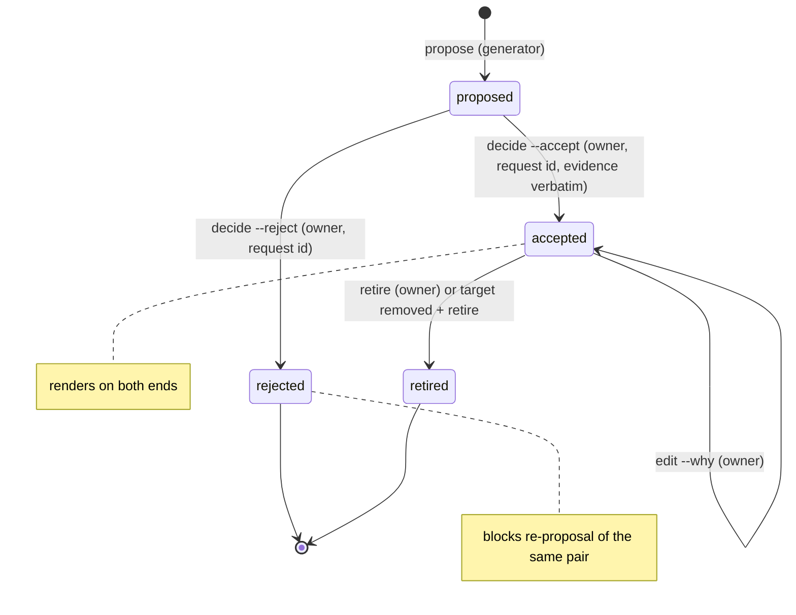
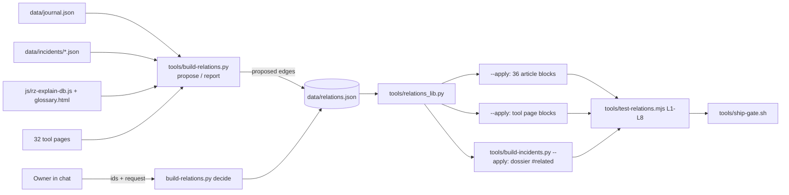

# PRD-Q01 — One relation file that links articles, tools, incidents and terms

## 1. Document control

| Field | Value |
|---|---|
| PRD id | PRD-Q01 |
| Feature | Relation file (`data/relations.json`) linking journal articles, tool pages, incident dossiers and glossary terms, rendered as static HTML on both ends of every link |
| Version | 1.0 |
| Status | Draft |
| Author | Opus 5.5 (Fable quota exhausted) |
| Date | 2026-11-10 |
| Owner requests | R110 (PRD per idea), R111 (24-section structure) |
| Priority | 74.5 (addendum rank 2: I 8, N 6, C 8, E 4; `PRODUCT_INNOVATION_ASSESSMENT_2026-11_ADDENDUM.md:77`) |
| Related findings | Addendum Q1 (`…_ADDENDUM.md:117-142`), maturity row "Cross-linking of content: 1" (`:29`). New findings from this PRD: N1 (auth.js cannot match dossier URLs, §3 F6), C1–C4 (addendum corrections, §3.3) |
| Dependencies | None blocking. Consumers: Q3 (incident reproduce), Q17 (learning paths). Coordinate: P14 (palette, peer), X11 (tool inventory) |
| Related modules | `tools/build-journal.py`, `tools/build-incidents.py`, `tools/assemble-article.py`, `auth.js` + `auth.min.js`, `js/rz-explain-db.js`, `glossary.html`, `tools/test-generator-freshness.py`, `tools/ship-gate.sh`, 36 journal pages, 32 tool pages, 43 dossier pages |
| Target wave | "Connected reference, weeks 9–16" (addendum Deliverable 4, `…_ADDENDUM.md:557`) |
| Approval status | Approved by owner R110/R111 2026-11-10 (the PRD set). Each individual relation still needs owner acceptance (§12). FR-13 changes `auth.js`, an auth boundary, so it needs the owner's explicit yes before T-7 ships (`documentation/product-transformation/STATE.md`: "Approval is still required for … auth or security boundary changes") |

Change history

| Version | Date | Author | Change |
|---|---|---|---|
| 1.0 | 2026-11-10 | Opus 5.5 | First complete draft, 24 sections. Facts verified against `wt-hub3` at `803253314` and re-checked at `1cb6dd292` (the only commit between them adds the product-transformation docs) |

## 2. Executive summary

The site has 36 journal articles, 43 incident dossiers, 32 public tool pages and 1,020 explained terms, and almost none of them link to each other: one article links a tool from its body, and zero links run between articles and incidents. This PRD adds one committed file, `data/relations.json`, that holds every link as an edge with a status, an evidence quote and an owner decision. A deterministic generator proposes edges from text matches, the owner accepts or rejects them in batches, and the build writes static HTML blocks into both pages of every accepted edge, so crawlers and readers without JavaScript see them. A new gate proves every edge renders on both ends, every link resolves, nothing unaccepted renders, and dossier links behave correctly for visitors who are not root. No runtime JavaScript, backend or database is added.

## 3. Problem statement

### 3.1 Verified facts (commands run 2026-11-10 on `wt-hub3` at `803253314`, re-checked at `1cb6dd292`)

| # | Fact | Evidence | Command |
|---|---|---|---|
| F1 | 36 journal pages, generated list | `data/journal.json` `count: 36`; page list `tools/build-journal.py:64` | `node -e "console.log(require('./data/journal.json').articles.length)"` → 36 |
| F2 | All 36 carry the same 6 tool links, and they are site navigation, not a topic block | "DC Solutions" dropdown, `article-1.html:1548-1554` (DC AI/HPC, DC Conventional, TCO, CAPEX, OPEX, ROI); same first `ul.dropdown-menu` on 36/36 | node scan of the first `ul.dropdown-menu` per page for the 6 hrefs → 36/36 |
| F3 | 1 of 36 journal pages links a tool from its body | `article-19.html:1008` links CAPEX and OPEX ("To compare Singapore, Batam…") | strip `<nav>`, `<header>`, `<footer>`, `<script>`, `<style>`, then match tool hrefs → `article-19` only |
| F4 | 0 links between articles and incidents | 0 article bodies link `incident-*.html` or `dc-incidents.html`; dossier template links only `dc-incidents.html` (`tools/build-incidents.py:1567`) and nav (`:506-508`) | same scan; `grep -no 'href="' tools/build-incidents.py` |
| F5 | Dossiers are root-only and not indexed | `<meta name="robots" content="noindex, nofollow">` (`tools/build-incidents.py:489`); `<body class="locked">` + root gate (`:501`, `:519-528`, `:424`); `'dc-incidents'` page-access root only (`js/rz-feature-flags.js:233-235`); `ROOT_ONLY_PATHS` lists `/dc-incidents.html` and `/incident-` (`auth.js:332-338`); 2 root accounts (`auth.js:246`) | `grep -n` on each file |
| F6 (N1) | Links to single dossiers never get the root lock | `isRootOnlyHref()` (`auth.js:339-347`) tests `path === p`, `p + '/'` or prefix `p + '/'`; `/incident-ovhcloud-sbg2-fire-2021.html` returns `false` | reproduced in node with the exact function body → `false` |
| F7 | Operators with dossiers are named in articles, unlinked | Visible body text: Equinix 6 pages, Digital Realty 4, Cloudflare 3 | node regex over visible text (head, nav, footer, scripts removed). The addendum's 7 for Equinix includes `article-14.html:2971`, a JavaScript comment |
| F8 | No relation data exists anywhere | No relation fields in `data/journal.json` keys (`id,url,number,title,excerpt,date,dateLabel,section,series,topic,tags,readMin,image,alt`) or in dossier top-level keys | key-frequency scan of both |
| F9 | Terms are ready to link | `js/rz-explain-db.js`: 1,020 entries (`counts.glossary 449, curated 590, total 1020`); 430 carry `link: glossary.html#term-…`; all 430 resolve to one of the 449 `id="term-…"` anchors in `glossary.html` | node eval of the DB + anchor set |
| F10 | Tool pages share one anchor | 33 pages declare `data-rz-register="tool"` and carry `section.tool-ref` with hand-curated "Read further" links (e.g. `fire-calculator.html:166-189`) | `grep -l 'class="tool-ref"' *.html \| wc -l` → 33 |
| F11 | Articles already have an article→article block | `<div class="related-articles">` on 36/36; the editorial runtime builds its "Related" rail from it (`js/rz-article-editorial.js:29-73`) | node count |
| F12 | A plain row idiom already exists | `.jrow` (`css/rz-article-dark.css:1515-1518, 1581`), used at `articles.html:482` ("Case library … Root access.") | `grep -n '\.jrow'` |
| F13 | Generators that read article bodies | `tools/build-search-sections.py:33` indexes only `<h2 id>`; `js/rz-article-toc.js:19-25` builds the TOC from `.article-body h2`; `tools/build-llms-full.py` unwraps sections into text (`:91-93`) | `grep -n` |
| F14 | The assembler copies the previous article's tail | `tools/assemble-article.py:133` takes everything from `.author-bio` on; `:143-150` rewrites only `.related-articles` | read |
| F15 | Incident pages have a freshness gate | `tools/build-incidents.py --check` (`:1663-1686`), wired at `tools/ship-gate.sh:67` | read |
| F16 | Generator freshness list | `tools/test-generator-freshness.py:56-73`, wired at `tools/ship-gate.sh:257` | read |
| F17 | Text matching alone is noisy | Operator-name matching proposes 193 article×incident pairs; a proximity rule (operator + city, or operator + year + failure word within ±200 chars) leaves 17, of which several are coincidences (`article-24` and `article-25` each propose the same four AWS us-east-1 dossiers because the operator and the city appear together). Terms with ≥2 mentions: 515 article×term pairs, median 13 per article | node dry run, §20 appendix command C7 |
| F18 | "47 tools" is not reproducible | `tools.html` has 23 `.tool-card`; `tools.html` + `datacenter-solutions.html` link 29 distinct tool-like pages; 33 pages declare the tool register | node scans |
| F19 | The restricted-link colour token is not on tool pages | `--rz-restricted` lives in `styles.css:7832-7833`; tool pages load only `css/rz-hub.css` + `css/rz-tool.css` | `grep -rn` |
| F20 | `auth.js` runs on every family | loaded by articles, tool pages, dossiers and `glossary.html` (≥1 match each); `auth.min.js` is a twin loaded by `index.html` and `index1.html` (a third match, `changelog.html`, is prose) | `grep -c`; `grep -ho '<script[^>]*auth\.min\.js[^>]*>' *.html` → 2 |

### 3.2 Consequence of leaving it

- A reader who finishes an article on power distribution cannot reach the calculator, the dossier or the terms for that topic except through the generic menu. The 36 articles, the tools and the 43 dossiers behave as three separate libraries.
- Q3 (reproduce an incident in a calculator) and Q17 (learning paths) have no data to stand on; both need accepted article/tool/incident links.
- Without a single source, any cross-link added by hand (like `article-19.html:1008`) drifts silently when a page is renamed. Nothing checks it.

### 3.3 Addendum corrections

| Id | Addendum says | Verified | Effect on this PRD |
|---|---|---|---|
| C1 | "0 of 36 journal pages link to a tool for their own topic" (`:29`, `:118`) | 1 of 36 (F3, `article-19.html:1008`) | Baseline is 1, not 0 |
| C2 | "the template set is gone" (acceptance, `:139`) | The 6 template links are the site-wide nav dropdown (F2). Removing them removes navigation from 36 pages | Acceptance changed to "a topic block exists"; nav untouched |
| C3 | "47 tools" (`:126`) | Not reproducible (F18) | v1 tool nodes = 32 tool-register pages (§10.4) |
| C4 | Not stated | Dossiers are root-only and noindex (F5); dossier links never get the lock (F6) | FR-13 adds the word "Root access" to dossier rows and fixes `isRootOnlyHref()` |
| C5 | "Equinix appears in 7 articles" (`:118`) | 6 by visible body text (article-12, -13, -15, -18, -24, -27); the seventh match is a JavaScript comment (`article-14.html:2971`) | Counts in this PRD use visible body text (F7) |

## 4. Objectives and success metrics

| # | Objective | Metric | Target | Measurement | Assumption |
|---|---|---|---|---|---|
| O1 | Every article points to its tools | Journal pages with ≥1 accepted Tool row, or an owner-recorded exemption | 36/36 | `node tools/test-relations.mjs --law L1` | Some articles (workforce, policy) have no matching tool; the owner records an exemption instead of a forced link |
| O2 | Links work in both directions | Accepted page-to-page edges rendered on both ends | 100 % | `--law L2` | — |
| O3 | No broken link | Dangling hrefs or glossary anchors inside relation blocks | 0 | `--law L3` | — |
| O4 | Crawlers see the links | Live article pages whose HTML (no JS) contains ≥1 relation row | 36/36 of those with accepted rows | `--law L4 --live` (curl) | GitHub Pages serves the committed HTML |
| O5 | Nothing unreviewed is published | Rendered edge ids minus accepted edge ids | empty set | `--law L5` | — |
| O6 | Every proposal is decided | Proposals still `proposed` at release time for articles in scope | 0 | `python3 tools/build-relations.py report --status proposed --count` | The owner reviews in batches (T-10) |
| O7 | Dossier links behave for non-root | Dossier rows carrying "Root access" and matched by `isRootOnlyHref()` | 100 % | `--law L6` | Root-only stays the owner's choice (§16) |
| O8 | No page gets slower | Bytes added per page; added requests | Block HTML UNKNOWN — measure in T-4 (budget ≤ 2,048 B per page); 1 cached CSS request ≤ 2,048 B | `curl -s … \| wc -c` before/after; `wc -c css/rz-related.css` | No JS is added |

No target above is an invented user-behaviour figure. Usage counts (clicks on rows) are not measured, because the site has no consented analytics path for it (`log_event` has 0 callers, addendum `:36`).

## 5. Scope

### 5.1 In scope

- `data/relations.json`: tool registry, edges (article→tool, article→incident, article→term, tool→incident), owner exemptions.
- `tools/relations_lib.py` (load, validate, render) and `tools/build-relations.py` (propose, report, decide, edit, retire, exempt, fmt, `--apply`, `--check`).
- Static blocks on 36 journal pages, 32 tool pages and 43 dossier pages; one stylesheet `css/rz-related.css`.
- `auth.js` matcher fix for dossier URLs (+ `auth.min.js` rebuild).
- `tools/assemble-article.py`: strip an inherited relation block.
- Gates: `tools/test-relations.mjs`, `tools/test-relations-lib.py`, freshness entry.
- Docs: `standarization/RELATIONS_STANDARD.md` (new), content linkage playbook rows, article production §6, incidents QA §1, UI features entry.

### 5.2 Out of scope (non-goals)

- Removing or changing the nav dropdown (C2).
- Opening the incident library to non-root tiers (owner decision, §16, OQ1).
- Search and palette coverage (peer P14). Relations may feed the palette later; not specified here.
- Article→article links (already `.related-articles`).
- Reverse rows on `glossary.html` (term→article). 449 term entries with reverse lists would be noise; v2 option.
- Cockpits, LTC labs, `datahallAI.html`, `dc-conventional.html` as tool nodes (no shared anchor, most are gated). Phase 2 candidate.
- `cx-calculator.html` as a tool node in v1: peer-owned file. Added only after the peer session agrees (coordinate with the peer session).
- Click analytics.
- Any LLM in the build or runtime path.

### 5.3 Existing capabilities reused

| Capability | Where | Use |
|---|---|---|
| Journal registry | `data/journal.json` (built by `tools/build-journal.py:128-141`) | Article nodes (id, url, title, topic) |
| Marker-pair splicing pattern | `tools/build-journal.py:217-228` (`<!-- journal:grid … -->`) | Same pattern for `<!-- rz:related -->` |
| Dossier builder and freshness | `tools/build-incidents.py:1507-1640`, `:1663-1686` | Render the dossier-side block; stays the only writer of dossier pages |
| Evidence resolver | `tools/incidents_fmea.py:143-172` `resolve_evidence()` | Verify dossier-side evidence quotes |
| Short dossier label | `tools/incidents_fmea.py:515-516` `_short()` | Fallback label "OVHcloud 2021" |
| Asset cache tokens | `tools/build-incidents.py:439-474` `_asset_token()`; `tools/test-asset-cache-tokens.mjs --fix` | Token for `css/rz-related.css` |
| Explain DB + glossary anchors | `js/rz-explain-db.js` (`entries[key].link`), `glossary.html` `id="term-…"` | Term rows |
| Row idiom | `.jrow` (`css/rz-article-dark.css:1515-1518`) | Visual model for rows |
| Root link lock | `auth.js:387-404` `updateRootOnlyLinksUI()` + `handleRootOnlyLinkClick()` (`:360-386`) | Lock icon and root prompt on dossier links, once N1 is fixed |
| Register tokens | `css/rz-hub.css:12-37`, `css/rz-tool.css` `--rzt-*`, `--rz-art-*`, dossier vars in `tools/build-incidents.py` CSS | Colours, fonts, lines per register |
| Freshness gate runner | `tools/test-generator-freshness.py:56-73` | Add one builder line |

### 5.4 Dependencies

| Dependency | Type | Status |
|---|---|---|
| Owner acceptance of edges | Human | Needed per batch (T-10) |
| Owner approval of FR-13 (`auth.js`, auth boundary) | Human | Needed before phase 2 (§22) |
| Peer agreement for `cx-calculator.html` | Coordination | Not needed for v1 (excluded) |
| P14 palette | Coordination only | No change required by this PRD |
| Q3, Q17 | Downstream consumers | They read `data/relations.json`; schema `rz-relations/1` is their contract |

### 5.5 Constraints

- Static site, no page build step for hand-written pages; the generator edits committed HTML (like `build-journal.py`).
- Vanilla ES5 in any shipped JS; this PRD ships none except the `auth.js` fix.
- Design register: graphite, one amber accent, IBM Plex Sans + JetBrains Mono, 1 px hairlines, radius ≤ 4 px, no badges or pills for state, no transform on hover, no `transition: all`, both themes, 390 and 1440 px.
- Every changed page gets its cache tokens repaired (`tools/test-asset-cache-tokens.mjs --fix <asset>`).

### 5.6 Assumptions

- A1: The owner keeps the incident library root-only in v1 (OQ1 default).
- A2: The owner accepts edges in chat by id; the session records the decision with the request id (OQ2 default).
- A3: Article ids, dossier slugs, tool page names and explain-db keys are stable identifiers. Renames are handled by `retire` + re-propose (§17).

## 6. User personas and use cases

Tiers verified: `free | demo | pro | root` (`js/rz-feature-flags.js:6`); educator is a role on a `pro` session (CLAUDE.md "Auth tiers"); root = 2 accounts (`auth.js:246`).

| Persona (real site role) | Tier | Goal | What they get from Q1 | Permission on targets |
|---|---|---|---|---|
| Signed-out visitor (most traffic, arrives from search on an article) | none | Understand a topic, then act on it | Tool and Terms rows under the article; Incident rows labelled "Root access" | Tools: open. Dossiers: root prompt (after N1 fix) |
| DC / facility design engineer | free or pro | Size or check a design after reading | "Tool" row straight to the calculator; on the tool page, "Article" rows back to the reasoning | Same as above |
| Operations engineer / operator | free or pro | Learn from failures in their area | Incident rows on articles and tool pages (root only today) | Dossiers need root |
| Student or educator | free / pro (educator role) | Follow a topic across article, terms and tools | Terms row with 3–8 linked glossary entries | Same as visitor |
| Owner (root, admin) | root | Keep the reference connected and correct | Proposal report, accept/reject in batches, gate tells what is missing | Full; the only role that accepts edges |
| Main session (implementer agent) | n/a | Build, propose, record decisions | CLI | May propose, may never accept without an owner message naming the ids |

Use cases: UC1 read article → open its tool; UC2 on a tool page → read the article that explains it; UC3 root on a dossier → read the article and open the tool; UC4 owner reviews a batch; UC5 author ships a new article and its relations in the same release.

## 7. Complete user journey

### J1 Visitor on an article (UC1)

| Step | Detail |
|---|---|
| Entry | Search result, journal hub card, series page, social link → `article-N.html` |
| Initial state | Static HTML. The relation block sits after the share block and before "Continue Reading" |
| Action | Scrolls to the block; reads rows; activates the "Tool" link |
| System response | Plain navigation to the tool page (no script involved) |
| Validation | None at runtime; links were validated at build time (L3) |
| Success | Tool page opens at its top |
| Failure | Target missing → impossible at release (L3 blocks the push). On a stale browser cache the old block may show for one visit; the next load fetches the new HTML |
| Recovery | Back button returns to the article at the same scroll position (browser default) |
| Exit | Tool page or next article |

### J2 Visitor activates an Incident row (UC1 variant, non-root)

| Step | Detail |
|---|---|
| Initial state | Row reads `Incident · OVHcloud SBG2 Strasbourg Data-Center Fire, 2021 · No automatic suppression in the energy rooms · Root access`; `auth.js` has added the lock icon and `rz-root-locked` class (after N1 fix) |
| Action | Click / Enter on the link |
| System response | `handleRootOnlyLinkClick()` (`auth.js:360-386`) prevents navigation and opens the root sign-in prompt with "Please sign in with a root account to access this module." |
| Failure | `auth.js` failed to load → navigation proceeds and the dossier's own gate shows "Root access required" (`tools/build-incidents.py:521-526`). No content is lost either way |
| Exit | Prompt closed → stays on the article |

### J3 Engineer on a tool page (UC2)

Entry: `fire-calculator.html` (any route). Initial: the "Related" section after "02 / Reference" lists Article rows and Incident rows. Action: open an article. Response: navigation. Failure: none at runtime. Exit: article.

### J4 Root on a dossier (UC3)

Entry: `dc-incidents.html` → dossier. Initial: section nav gains "Related" (only when the dossier has accepted edges). Action: jump to Related, open an article or a tool. Response: navigation. Exit: article or tool.

### J5 Owner reviews a batch (UC4)

| Step | Detail |
|---|---|
| Entry | Session runs `python3 tools/build-relations.py propose --scope article-13` then `report --status proposed --format md` and pastes the table in chat |
| Initial state | N proposals, each with id, from, to, evidence quote, draft "why" (may be empty) |
| Action | Owner replies, e.g. "terima rel-0004 rel-0007, tolak rel-0005, why rel-0004: A and B UPS from one source" |
| System response | Session runs `decide --accept rel-0004,rel-0007 --reject rel-0005 --by owner --request R1nn` and `edit rel-0004 --why "…"`; then `--apply` |
| Validation | `decide` refuses: ids not in `proposed`; missing `--request`; evidence quote no longer found verbatim |
| Success | `report` shows the decided rows; `--check` passes; diff shows the new blocks |
| Failure | Refusal message names the id and reason; nothing is written (atomic write) |
| Recovery | Fix the cause (re-propose, add request id) and rerun |
| Exit | Release chain (§22) |

### J6 Author ships a new article (UC5)

New `article-31.html` → `build-journal.py --apply` → `build-relations.py propose --scope article-31` → owner decision → `--apply` → gates. If the owner has not decided, L1 fails for `article-31` and names it; the release waits or the owner records an exemption.

## 8. Functional requirements

Each FR lists: description, trigger, preconditions, inputs, processing, outputs, state change, dependencies, exceptions, acceptance.

**FR-1 Relation file and validation**
- Description: `data/relations.json` is the single source of truth; `tools/relations_lib.py` loads and validates it.
- Trigger: every `build-relations.py` command, `build-incidents.py` run, every gate run.
- Preconditions: file exists (T-1 commits the empty skeleton `{"schema":"rz-relations/1","nodes":{"tools":[]},"edges":[],"exemptions":[]}`).
- Inputs: `data/relations.json`, `data/journal.json`, `data/incidents/*.json` (names not starting `_`), `js/rz-explain-db.js`, `glossary.html`, tool pages.
- Processing: parse; check rules V1–V14 (§10.3); collect errors and warnings.
- Outputs: `(errors: list[str], warnings: list[str])`.
- State change: none.
- Dependencies: Python 3 standard library only.
- Exceptions: malformed JSON → exit 2 with line and column; unknown `schema` → exit 2.
- Acceptance: `python3 tools/test-relations-lib.py` passes U1–U16; each planted invalid fixture yields exactly its named error.

**FR-2 Tool registry**
- Description: `nodes.tools[]` lists tool pages that may carry relations.
- Trigger: `build-relations.py seed-tools` (once in T-1; later by hand when a tool ships).
- Preconditions: tool page exists and contains `<section class="tool-ref"`.
- Inputs: the 33 tool-register pages (Appendix A).
- Processing: for each page except `cx-calculator.html`, create `{id, url, label, access, keywords, incidentCategories}`. `label` = text of the page `<h1>` with the muted clause removed; `access` computed from `js/rz-feature-flags.js` page-access and `auth.js` `ROOT_ONLY_PATHS`; `keywords` seeded from the page `<title>`, `<h1>` and the `.tool-ref` "Computed against" spans, then curated by hand; `incidentCategories` empty until curated.
- Outputs: registry written in `data/relations.json`.
- State change: registry entries added; never removed automatically.
- Exceptions: page without `.tool-ref` → skipped with a warning.
- Acceptance: 32 entries; V13 passes; `cx-calculator` absent with reason in `RELATIONS_STANDARD.md`.

**FR-3 Propose article→tool (rule A2T)**
- Trigger: `build-relations.py propose [--scope <article-id>|all]`.
- Inputs: article visible text (see "visible text" definition below), tool keywords.
- Processing: for each tool, score = Σ over keywords of min(hits, 3) × weight, where weight = 3 for a standard id (regex `^(NFPA|IEC|IEEE|TIA|ASHRAE|ISO|UL|EN|BS)\b`), 2 for a multi-word phrase, 1 for a single word; matches are case-insensitive and word-bounded. Keep tools with score ≥ 4; take the top 3. Skip any (from,to) already present in any status.
- Outputs: new edges `status: proposed`, `proposedBy: "build-relations.py@1 rule=A2T score=<n> keyword=<strongest>"`, `evidence: [{page, quote}]` where quote = the first sentence (≤ 200 chars) holding the strongest keyword.
- State change: edges appended with the next free id.
- Exceptions: no tool reaches 4 → nothing proposed (the owner may exempt the article, FR-8).
- Acceptance: on a fixture article containing "NFPA 2001" ×2 and "clean agent" ×1, `fire-calculator` is proposed with score 3×2 + 2×1 = 8 and the quote contains "NFPA 2001".

Visible text (all propose rules): page HTML from `<body` to the first `<div class="related-articles"`, with `<script>`, `<style>`, `<nav>`, `<header class=…navbar…>`, `<footer>` and any existing `<!-- rz:related -->` block removed, tags stripped, entities decoded, whitespace collapsed.

**FR-4 Propose article→incident (rule A2I)**
- Inputs: article visible text; per dossier: `operator`, `operatorShort`, `dcName`, `location.city`, `date` year, `title`.
- Processing, ranked: (a) a site token from `dcName` or `title` that is not a common word (≥ 3 chars, contains a digit or is capitalised and not in the operator name, e.g. "SBG2", "LD8", "Pangyo") appears in the text → score 10; (b) operator name and city within ±200 chars → score 6; (c) operator name, the year and a failure word (`outage|fire|failure|incident|blackout|offline`) within ±200 chars → score 3. Operator name alone never proposes (F17: 193 noisy pairs). Top 3 per article with score ≥ 3.
- Outputs: proposed edges with the window text (≤ 200 chars, trimmed to sentence bounds) as evidence and `proposedBy … rule=A2I-a|b|c`.
- Exceptions: seed dossiers (`sourcing.lastVerified` contains "seed") are proposed with `proposedBy … seed=1` so the report shows it; the owner decides.
- Acceptance: fixture text "the LD8 outage in London" proposes `equinix-ld8-london-ups-2020` via rule (a); "Equinix grew revenue" proposes nothing.

**FR-5 Propose tool→incident (rule T2I)**
- Inputs: tool `incidentCategories` and `keywords`; dossier `category[]`, `fmea.modes[].item`, `fmea.modes[].failureMode`.
- Processing: candidate when the dossier shares a category with the tool AND at least one tool keyword occurs in an FMEA `item` or `failureMode`. Score = number of distinct matching keywords. Top 6 per tool.
- Outputs: proposed edges with evidence `{dossier: slug, field: "fmea.modes[i].failureMode", quote}`; the quote is checked with `resolve_evidence()` semantics (verbatim substring).
- Acceptance: a tool with `incidentCategories: ["fire"]` and keyword "suppression" proposes `ovhcloud-sbg2-fire-2021` only if one of its FMEA texts contains "suppression".

**FR-6 Propose article→term (rule A2W)**
- Inputs: explain-db entries with `link`; names = `t` plus `aliases`, each ≥ 4 chars.
- Processing: count word-bounded case-insensitive hits; keep terms with ≥ 2 hits; drop terms present in more than 18 of 36 articles (generic); rank by document frequency ascending, then hits descending; top 8.
- Outputs: proposed edges `to: term:<key>`, evidence = first sentence with the term.
- Acceptance: median proposals per article ≤ 8 (cap); generic-term drop verified on a fixture where a term appears in 19 articles.

**FR-7 Review report**
- Trigger: `build-relations.py report [--status proposed|accepted|rejected|retired|all] [--scope <node>] [--format md|json] [--count]`.
- Outputs: Markdown table `id | from | to | rule/score | why | evidence quote | seed` sorted by `from` then score; `--count` prints one integer.
- Acceptance: the report of a fixture with 3 proposals prints 3 rows and the header.

**FR-8 Decide, edit, retire, exempt (owner acceptance step)**
- Trigger: `decide --accept <ids> --reject <ids> --by owner --request R<nnn>`; `edit <id> --why "<text>"`; `retire <id> --request R<nnn> --reason "<text>"`; `exempt <node> --kind compute --reason "<text>" --request R<nnn>`.
- Preconditions: ids exist; `decide` ids are `proposed`; `retire` ids are `accepted`.
- Processing: `decide` re-verifies each evidence quote verbatim in the current text (article visible text or dossier field); on any failure writes nothing. Sets `status`, `decidedBy: "owner"`, `decidedOn: <today>`, `request`. `edit` validates `why` (V10). `retire` sets `status: retired`, keeps the record. `exempt` adds an exemption (V14).
- Outputs: summary line per id; file rewritten atomically (write temp, `os.replace`).
- Exceptions: `--by` other than `owner` → exit 2 ("only the owner accepts relations"); missing `--request` → exit 2.
- Acceptance: U9–U12; the file is byte-identical after a refused command.

**FR-9 Article block**
- Trigger: `build-relations.py --apply` (and `--check` compares).
- Processing: for each journal page, collect accepted edges where `from = article:<id>`; if any, render the block (§9.3) between `<!-- rz:related -->` and `<!-- /rz:related -->` placed immediately before `<div class="related-articles">`; insert the marker pair on first run; if no accepted edge, write an empty marker pair (no block). Add `<link rel="stylesheet" href="css/rz-related.css?v=<token>">` between `<!-- rz:related-css -->` markers placed before `</head>`, only on pages that render a block.
- Outputs: changed article pages.
- Exceptions: page without `<div class="related-articles">` → error naming the page (no guessing).
- Acceptance: L1, L2, L4, L5; byte-stable second run (idempotent).

**FR-10 Tool page block**
- Processing: accepted edges where `to = tool:<id>` (Article rows) and `from = tool:<id>` (Incident rows); block placed right after the closing `</section>` of `section.tool-ref`; eyebrow number = the `.tool-ref` eyebrow number + 1 when it reads `NN / …`, else no number.
- Acceptance: L2 on every tool with an accepted edge; L8 render checks.

**FR-11 Dossier block**
- Processing: `tools/build-incidents.py` imports `relations_lib.render_incident_block(slug)`; adds a section `id="related"` after `#sources` and before the share bar, and adds `("related", "Related")` to the section nav (`_SECTIONS`, `tools/build-incidents.py:1493`) only when the dossier has accepted edges. Rows: Article (from article→incident edges), Tool (from tool→incident edges). Head gets the stylesheet via `head_extra` with `_asset_token("css/rz-related.css")`.
- Acceptance: `python3 tools/build-incidents.py --check` stays green after `--apply`; L2 on dossier ends.

**FR-12 Freshness**
- `build-relations.py --check` re-renders all blocks in memory and exits 1 naming any page whose block differs; `tools/test-generator-freshness.py` gains `("data/relations.json -> relation blocks", ["python3", "tools/build-relations.py", "--check"])`.
- Acceptance: L7; a hand edit inside a block turns `--check` red naming the page.

**FR-13 Root-gated rows and the matcher fix (N1)**
- Description: every row whose target is root-only shows the word "Root access"; `isRootOnlyHref()` matches dossier URLs.
- Processing: in `auth.js` change the loop so an entry ending in `-` is a prefix: `if (p.charAt(p.length - 1) === '-' ? path.indexOf(p) === 0 : (path === p || path === p + '/' || path.indexOf(p + '/') === 0)) return true;`; rebuild `auth.min.js` with `terser auth.js -c -m -o auth.min.js`; repair tokens with `node tools/test-asset-cache-tokens.mjs --fix auth.js auth.min.js`.
- Acceptance: L6; `node tools/audit-min-twins.mjs --strict` green.

**FR-14 Assembler strip**
- `tools/assemble-article.py`: after taking `tail` (`:133`), remove `<!-- rz:related -->…<!-- /rz:related -->` and `<!-- rz:related-css -->…<!-- /rz:related-css -->` from both `tail` and `head`.
- Acceptance: fixture assembly from a shell that carries a block produces a page with no block; `build-relations.py --apply` then adds the new article's own block.

**FR-15 Gate**
- `tools/test-relations.mjs` implements L1–L8 (§20.4) with `--law`, `--live`, `--strict` and `--phase 0|1` (§22); `tools/test-relations-lib.py` runs unit tests; both wired in `tools/ship-gate.sh` (§20.3).

**FR-16 Content linkage process**
- The playbook (`standarization/CONTENT_LINKAGE_PLAYBOOK.md` §1, §2 and a new incident row) gains: "propose → owner decision → `--apply` → `test-relations`". L1 enforces it for every journal page.

### 8.1 FR field matrix (every FR, all fields)

| FR | Trigger | Preconditions | Inputs | Outputs | State change | Dependencies | Exceptions | Acceptance |
|---|---|---|---|---|---|---|---|---|
| FR-1 | Any CLI command, build or gate run | `data/relations.json` exists (T-1 skeleton) | relations file, `journal.json`, dossiers, explain DB, `glossary.html`, tool pages | `(errors, warnings)` | None | Python stdlib | Bad JSON or unknown schema → exit 2 | U1–U16 |
| FR-2 | `seed-tools` | Page has `section.tool-ref` | 33 tool-register pages | 32 registry entries | Entries added, never removed automatically | FR-1 | No `.tool-ref` → warning, skipped | V13; 32 entries |
| FR-3 | `propose` | Registry keywords curated (T-2) | Article visible text, tool keywords | `proposed` edges with score and quote | Edges appended | FR-1, FR-2 | No tool scores ≥ 4 → nothing proposed | U9, AC1 |
| FR-4 | `propose` | Dossiers readable | Visible text; operator, site, city, year | `proposed` edges | Edges appended | FR-1 | Operator name alone → nothing | U10, AC12 |
| FR-5 | `propose` | `incidentCategories` curated | Registry, dossier `category`, FMEA texts | `proposed` edges | Edges appended | FR-2 | Quote not verbatim → skipped | U11 |
| FR-6 | `propose` | Explain DB loads | Visible text, explain DB names | ≤ 8 `proposed` term edges per article | Edges appended | FR-1 | Term in > 18 articles → dropped | U11, AC11 |
| FR-7 | `report` | — | relations file | Markdown or JSON sheet, or a count | None | FR-1 | Unknown status → exit 2 | U9 |
| FR-8 | `decide`, `edit`, `retire`, `exempt` | Ids exist; status fits; `--request` given | Ids, request id, why text | Summary per id | Status and audit fields; atomic write | FR-1 | `--by` not owner or no request → exit 2; quote drift → exit 1; nothing written | U12, U15, U16, AC4, AC5 |
| FR-9 | `--apply` / `--check` | `.related-articles` present | Accepted edges, labels | 36 article pages | HTML between markers; CSS link | FR-1, renderers | Anchor missing → error naming the page | L1, L2, L4, L5, AC1, AC6 |
| FR-10 | `--apply` / `--check` | `section.tool-ref` present | Accepted edges | Tool pages | HTML after `.tool-ref` | FR-9 | Anchor missing → error | L2, AC2 |
| FR-11 | `build-incidents.py --apply` | Relations valid | Accepted edges | Dossier `#related` + nav | Dossier HTML | `tools/build-incidents.py` | Invalid relations → that build fails | L2, AC3 |
| FR-12 | `--check`; freshness gate | — | Relations file + pages | Exit code, stale page names | None | FR-9, FR-10, FR-11 | Stale → exit 1 | L7, AC9 |
| FR-13 | Page load (`auth.js`) | Owner approval of the change | Link hrefs | Lock icon, title, root prompt | DOM class and title | `auth.js`, `auth.min.js` | `auth.js` absent → dossier's own gate | L6, AC7 |
| FR-14 | `assemble-article.py` | Shell page | Shell head and tail | New page without inherited block | — | FR-9 | — | AC8 |
| FR-15 | `ship-gate.sh` | — | Tree | Per-law result | None | FR-1…FR-14 | Port bind failure → exit 2 with reason | Red/green log |
| FR-16 | New article | — | Playbook | Updated docs | Docs | FR-3…FR-8 | — | L1 on the new article |

## 9. UI/UX specification

### 9.1 Placement and information architecture

| Page family | Position | Heading | Rows (order) |
|---|---|---|---|
| Journal page (36) | After the share block, before "Continue Reading" (`.related-articles`) | `h3` "Related tools, incidents and terms" (words for absent kinds are dropped: "Related tools and terms") | Tool (≤3), Incident (≤3), Terms (1 row, ≤8 links) |
| Tool page (32) | After `section.tool-ref` | Eyebrow "03 / Related" (number = tool-ref + 1), `h2` "Articles and incidents that use this tool" | Article (all accepted, newest first), Incident (≤6) |
| Dossier (43) | After "References and provenance", before the share bar; nav entry "Related" | `h2` "Related articles and tools" | Article, Tool |

Why these headings: `h3` on articles keeps the block out of the TOC (`.article-body h2`, `js/rz-article-toc.js:19`) and out of `search-sections.json` (only `<h2 id>`, `tools/build-search-sections.py:33`). Tool pages and dossiers use `h2` because their other sections do, and neither family is in `search-sections.json`.

### 9.2 Layout (ASCII)

Journal page, 1440 px (reading column):

```
──────────────────────────────────────────────────────────────────── 1px line
Related tools, incidents and terms                                   (h3, Plex Sans 600)
──────────────────────────────────────────────────────────────────── 1px line
TOOL        Tier advisor                                             
            Classify a design against Tier III and IV topology       (why, 14px secondary)
──────────────────────────────────────────────────────────────────── 
INCIDENT    Equinix LD8 London UPS failure, 2020        Root access  
            A and B feeds from one UPS                               
──────────────────────────────────────────────────────────────────── 
TERMS       2N redundancy, N+1, Static transfer switch, Busway       
──────────────────────────────────────────────────────────────────── 
Continue Reading … (existing block, unchanged)
```

Journal page, 390 px:

```
──────────────────────────────
Related tools, incidents
and terms
──────────────────────────────
TOOL
Tier advisor                    ← block link, min-height 44px
Classify a design against
Tier III and IV topology
──────────────────────────────
INCIDENT
Equinix LD8 London UPS
failure, 2020
A and B feeds from one UPS
Root access
──────────────────────────────
TERMS
2N redundancy, N+1, Static
transfer switch, Busway
──────────────────────────────
```

Tool page, 1440 px (tool register, inside `.wrap`):

```
03 / RELATED                                                    (existing eyebrow style)
Articles and incidents that use this tool                       (h2)
──────────────────────────────────────────────────────────────────
ARTICLE     When Nothing Happens, Engineering Is Working
ARTICLE     From Reliability to Resilience: Why Tier Ratings Stop at Design
INCIDENT    OVHcloud SBG2 Strasbourg Data-Center Fire, 2021      Root access
──────────────────────────────────────────────────────────────────
```

Dossier, section "Related":

```
Related articles and tools                                      (h2, dossier register)
ARTICLE     Data Center Power Distribution Design: Hyperscaler Architecture
TOOL        Tier advisor
```

The "why" line is optional; rows without it are one line on desktop.

### 9.3 Component hierarchy (exact HTML contract)

```html
<!-- rz:related -->
<section class="rz-rel" data-rz-rel="1" aria-label="Related tools, incidents and terms">
  <h3 class="rz-rel-h">Related tools, incidents and terms</h3>
  <ul class="rz-rel-list">
    <li class="rz-rel-row" data-kind="tool">
      <span class="rz-rel-k">Tool</span>
      <span class="rz-rel-body">
        <a class="rz-rel-a" href="tier-advisor.html" data-edge="rel-0001">Tier advisor</a>
        <span class="rz-rel-why">Classify a design against Tier III and IV topology</span>
      </span>
    </li>
    <li class="rz-rel-row" data-kind="incident">
      <span class="rz-rel-k">Incident</span>
      <span class="rz-rel-body">
        <a class="rz-rel-a" href="incident-equinix-ld8-london-ups-2020.html" data-edge="rel-0002">Equinix LD8 London UPS failure, 2020</a>
        <span class="rz-rel-why">A and B feeds from one UPS</span>
      </span>
      <span class="rz-rel-access">Root access</span>
    </li>
    <li class="rz-rel-row" data-kind="terms">
      <span class="rz-rel-k">Terms</span>
      <span class="rz-rel-body rz-rel-terms">
        <a href="glossary.html#term-2n" data-edge="rel-0003">2N redundancy</a>, <a href="glossary.html#term-n1" data-edge="rel-0004">N+1</a>
      </span>
    </li>
  </ul>
</section>
<!-- /rz:related -->
```

(Labels, slugs and term keys above are illustrative of the format; real rows exist only after owner acceptance.)

Tool pages wrap the same `<ul>` in `<section class="tool-ref rz-rel rz-rel--tool" data-rz-rel="1" aria-labelledby="rz-rel-h"><div class="wrap"><p class="eyebrow">03 / Related</p><h2 id="rz-rel-h" class="rz-rel-h">…</h2>…</div></section>`. Dossiers use `<section class="inc-sec rz-rel rz-rel--inc" id="related" aria-labelledby="h-related" data-rz-rel="1"><h2 id="h-related">Related articles and tools</h2>…`.

Text sources: incident label = dossier `title` with a trailing parenthetical removed, plus ", <year>"; if empty, `_short()`. Article label = `journal.json` `title`. Tool label = registry `label`. Term label = explain-db `t`. All text HTML-escaped (`html.escape(..., quote=True)`).

### 9.4 Controls and behaviour

| Control | Behaviour | Keyboard | No-JS |
|---|---|---|---|
| Row link (`.rz-rel-a`) | Navigates to the target | Tab focus, Enter activates | Works |
| Root-only row link | `auth.js` adds lock icon, `rz-root-locked`, title "Root account required"; non-root click opens the root prompt; root navigates | Enter triggers the same capture-phase handler | Navigates; the dossier's own gate shows |
| Term link | Navigates to `glossary.html#term-<key>` | Tab, Enter | Works |

There are no buttons, toggles, filters, forms, dialogs or toasts in this feature. No control is dead: every rendered element is either text or a working link.

### 9.5 States

| State | What renders |
|---|---|
| Accepted edges exist | The block, rows in the order of §9.1 |
| No accepted edge (or only exemptions) | Empty marker pair; no block, no heading (a block with nothing is noise, ANTI_VIBECODE §D18) |
| Signed out / free / pro | Same HTML; dossier rows show "Root access" and get the lock |
| Root | Same HTML; links navigate; `auth.js` sets title "Root access enabled" |
| JavaScript off | Same HTML; dossier links reach the dossier gate |
| Loading / error | None at runtime (static). Build-time errors stop the build (§17) |
| Long label (> 70 chars) | Wraps; no truncation, no ellipsis |
| Many terms (8) | Comma-separated, wraps |

### 9.6 Exact copy strings

| Key | String |
|---|---|
| Article block heading (all kinds) | `Related tools, incidents and terms` |
| Variants | `Related tools and terms`, `Related tools and incidents`, `Related tools`, `Related incidents and terms`, `Related incidents`, `Related terms` |
| Tool page heading | `Articles and incidents that use this tool` (variants `Articles that use this tool`, `Incidents that involve this tool`) |
| Tool page eyebrow | `NN / Related` |
| Dossier heading / nav | `Related articles and tools` / `Related` |
| Row keys | `Tool`, `Incident`, `Terms`, `Article` |
| Access word | `Root access` |
| `aria-label` on article block | equals the visible heading |

The addendum's keys "Compute" and "See it fail" (`…_ADDENDUM.md:119-120`) are replaced by nouns: the register asks for plain copy, and a key names what the link opens.

### 9.7 Styling contract (`css/rz-related.css`, budget ≤ 2,048 B)

- Tokens by fallback chain, so one file serves three registers: line `var(--rz-art-line, var(--rzt-line, var(--line, rgba(127,127,127,.25))))`; text `var(--rz-art-text, var(--rzt-text, var(--text)))`; secondary `var(--rz-art-muted, var(--rzt-text-2, var(--muted)))`; key and access word `var(--rz-art-muted, var(--rzt-muted, var(--muted)))`; link `var(--rz-art-accent, var(--rzt-accent-text, var(--amber)))`; sans `var(--rz-art-sans, var(--rzt-sans, 'IBM Plex Sans', system-ui, sans-serif))`; mono `var(--rz-art-mono, var(--rzt-mono, 'JetBrains Mono', monospace))`.
- Section: `margin: 32px 0 0; border-top: 1px solid <line>`; no background, no shadow, no radius (panels on these pages already carry ≤ 4 px).
- Row: grid `7.5rem minmax(0,1fr) auto`, `gap: 6px 18px`, `padding: 12px 0`, `border-bottom: 1px solid <line>`.
- Key: mono 11px/1.5, `letter-spacing: .06em`, uppercase (the `.jrow-k` idiom, `css/rz-article-dark.css:1516`; mono stays on numbers, eyebrows, chips and figure labels per CLAUDE.md "Canonical patterns").
- Link: sans 16px/1.45, `text-decoration: none; border-bottom: 1px solid currentColor`; hover and focus change `color` to the strong text token; no transition; `:focus-visible { outline: 2px solid currentColor; outline-offset: 2px }`.
- Why: sans 14px/1.5 secondary, block below the link.
- Access word: mono 11px muted, right column; no background, no border (a state is a word).
- ≤ 768 px: grid becomes one column; link `display: block; min-height: 44px; padding: 10px 0`; access word inline after the why.
- `@media print { .rz-rel { display: none } }`.
- Forbidden in this file (checked by L8): `transition`, `transform`, `animation`, `box-shadow`, `gradient`, `backdrop-filter`, `border-radius` > 4px, `border-left` wider than 1px.

### 9.8 Motion

None. The block does not use `data-rz-enter`, so the editorial entrance stagger (`js/rz-article-editorial.js:359-367`) does not select it. Hover and focus change colour instantly (MOTION_STANDARD §1: tens-per-day actions get "near-imperceptible or nothing").

### 9.9 Accessibility

- Landmark: `section` with an accessible name (aria-label or aria-labelledby).
- List semantics `ul > li`; link text names the target; the key is visible text read before the link.
- Contrast ≥ 4.5:1 for text, ≥ 3:1 for the 1px underline against the background, both themes (checked by axe, L8).
- Targets: ≥ 44 px tall on phones (Fitts, ANTI_VIBECODE §D2); inline term links fall under the WCAG 2.5.8 inline exception.
- No information by colour alone: access is the words "Root access".

## 10. Data model

### 10.1 Existing state

No relation data. Article metadata lives in `data/journal.json` (generated, overwritten on every `build-journal.py --apply`, so it cannot host relations). Dossiers are per-incident files; putting edges there would store each article↔incident link twice. A separate edge file is the only design where "both ends" is true by construction.

### 10.2 Schema (`data/relations.json`, JSON Schema draft 2020-12)

```json
{
  "$schema": "https://json-schema.org/draft/2020-12/schema",
  "$id": "rz-relations/1",
  "type": "object",
  "required": ["schema", "nodes", "edges", "exemptions"],
  "additionalProperties": false,
  "properties": {
    "schema": { "const": "rz-relations/1" },
    "note": { "type": "string" },
    "nodes": {
      "type": "object", "required": ["tools"], "additionalProperties": false,
      "properties": { "tools": { "type": "array", "items": { "$ref": "#/$defs/tool" } } }
    },
    "edges": { "type": "array", "items": { "$ref": "#/$defs/edge" } },
    "exemptions": { "type": "array", "items": { "$ref": "#/$defs/exemption" } }
  },
  "$defs": {
    "nodeRef": { "type": "string", "pattern": "^(article|tool|incident|term):[A-Za-z0-9-]{1,80}$" },
    "tool": {
      "type": "object", "required": ["id", "url", "label", "access", "keywords", "incidentCategories"],
      "additionalProperties": false,
      "properties": {
        "id": { "type": "string", "pattern": "^[a-z0-9-]{2,60}$" },
        "url": { "type": "string", "pattern": "^[a-z0-9-]{2,60}\\.html$" },
        "label": { "type": "string", "minLength": 2, "maxLength": 80 },
        "access": { "enum": ["public", "pro", "root"] },
        "keywords": { "type": "array", "minItems": 1, "maxItems": 20, "items": { "type": "string", "minLength": 2, "maxLength": 40 } },
        "incidentCategories": { "type": "array", "items": { "type": "string" } }
      }
    },
    "evidence": {
      "type": "object", "additionalProperties": false, "required": ["quote"],
      "properties": {
        "page": { "type": "string", "pattern": "^[A-Za-z0-9-]+\\.html$" },
        "dossier": { "type": "string" },
        "field": { "type": "string" },
        "quote": { "type": "string", "minLength": 20, "maxLength": 200 }
      }
    },
    "edge": {
      "type": "object", "additionalProperties": false,
      "required": ["id", "from", "to", "kind", "status", "proposedBy", "proposedOn", "evidence"],
      "properties": {
        "id": { "type": "string", "pattern": "^rel-[0-9]{4}$" },
        "from": { "$ref": "#/$defs/nodeRef" },
        "to": { "$ref": "#/$defs/nodeRef" },
        "kind": { "enum": ["tool", "incident", "term"] },
        "why": { "type": "string", "maxLength": 90 },
        "status": { "enum": ["proposed", "accepted", "rejected", "retired"] },
        "proposedBy": { "type": "string" },
        "proposedOn": { "type": "string", "format": "date" },
        "evidence": { "type": "array", "minItems": 1, "items": { "$ref": "#/$defs/evidence" } },
        "decidedBy": { "const": "owner" },
        "decidedOn": { "type": "string", "format": "date" },
        "request": { "type": "string", "pattern": "^R[0-9]{2,4}$" },
        "retiredReason": { "type": "string", "maxLength": 140 }
      }
    },
    "exemption": {
      "type": "object", "additionalProperties": false,
      "required": ["node", "kind", "reason", "decidedBy", "decidedOn", "request"],
      "properties": {
        "node": { "$ref": "#/$defs/nodeRef" },
        "kind": { "enum": ["tool"] },
        "reason": { "type": "string", "minLength": 10, "maxLength": 140 },
        "decidedBy": { "const": "owner" },
        "decidedOn": { "type": "string", "format": "date" },
        "request": { "type": "string", "pattern": "^R[0-9]{2,4}$" }
      }
    }
  }
}
```

`kind` is the kind of the `to` node, which is also the row key on the `from` page: `tool` for article→tool, `incident` for article→incident and tool→incident, `term` for article→term. The reverse rows (`Article` on tool pages and dossiers, `Tool` on dossiers) are derived at build time and never stored.

### 10.3 Validation rules (in `relations_lib.validate`)

| Rule | Check | Error text (prefix) |
|---|---|---|
| V1 | `schema == "rz-relations/1"` | `V1 unknown schema` |
| V2 | edge `id` unique, pattern `rel-NNNN` | `V2 duplicate id` |
| V3 | `from`/`to` parse as `kind:id` | `V3 bad node ref` |
| V4 | node exists: article in `journal.json`; tool in registry and file exists; incident has `data/incidents/<slug>.json`; term key in explain-db with `link` | `V4 unknown node` |
| V5 | allowed pairs only: article→tool, article→incident, article→term, tool→incident; `kind` equals the `to` kind | `V5 pair not allowed` |
| V6 | `(from, to)` unique across all statuses | `V6 duplicate pair` |
| V7 | `status` in the enum | `V7 bad status` |
| V8 | non-proposed records carry `decidedBy: owner`, `decidedOn`, `request` | `V8 decision without owner record` |
| V9 | proposed records carry no decision fields | `V9 proposed record carries a decision` |
| V10 | `why` ≤ 90 chars, single line, no `!`, no character of Unicode category `So` (emoji) | `V10 why text` |
| V11 | accepted records: every evidence quote verified at decide time (stored flag not needed); later drift = warning `W1 evidence no longer verbatim` | — |
| V12 | accepted per `from`: article ≤ 3 tool, ≤ 3 incident, ≤ 8 term; tool ≤ 6 incident | `V12 over cap` |
| V13 | registry: `url == id + ".html"`, file has `section.tool-ref`, `access` equals the site gate for that page, `incidentCategories` ⊆ `CATEGORY_LABEL` keys (`tools/build-incidents.py:30`) | `V13 registry` |
| V14 | exemption node has 0 accepted edges of that kind | `V14 exemption contradicts an accepted edge` |

### 10.4 Tool registry v1

32 entries: the 33 tool-register pages (Appendix A) minus `cx-calculator.html` (peer-owned). `access` for all 32 is expected `public`; V13 proves it against `js/rz-feature-flags.js` and `auth.js`.

### 10.5 Example records

Proposed (real quote from `article-7.html`; tool keywords illustrative, curated in T-2):

```json
{
  "id": "rel-0001",
  "from": "article:article-7",
  "to": "tool:tier-advisor",
  "kind": "tool",
  "status": "proposed",
  "proposedBy": "build-relations.py@1 rule=A2T score=9 keyword=\"Tier III\"",
  "proposedOn": "2026-11-12",
  "evidence": [
    { "page": "article-7.html",
      "quote": "Two Tier III data centers, both validated against the same topology standard, can respond to the same category of disturbance with entirely divergent outcomes." }
  ]
}
```

The same record after the owner accepts it (decision fields are placeholders until a real decision exists):

```json
{
  "id": "rel-0001", "from": "article:article-7", "to": "tool:tier-advisor", "kind": "tool",
  "why": "Classify a design against Tier III and IV topology",
  "status": "accepted",
  "proposedBy": "build-relations.py@1 rule=A2T score=9 keyword=\"Tier III\"", "proposedOn": "2026-11-12",
  "evidence": [ { "page": "article-7.html", "quote": "Two Tier III data centers, both validated against the same topology standard, can respond to the same category of disturbance with entirely divergent outcomes." } ],
  "decidedBy": "owner", "decidedOn": "<YYYY-MM-DD>", "request": "<R1nn>"
}
```

Exemption:

```json
{ "node": "article:FF-3", "kind": "tool", "reason": "Inference economics; no tool on the site models it",
  "decidedBy": "owner", "decidedOn": "<YYYY-MM-DD>", "request": "<R1nn>" }
```

### 10.6 Versioning, migration, compatibility, retention

- Versioning: `schema: "rz-relations/1"`. A breaking change creates `rz-relations/2` and a one-shot migration in `build-relations.py migrate`; readers (Q3, Q17) must check `schema`.
- Migration from today: none exists; T-1 commits the empty skeleton. The hand link in `article-19.html:1008` stays as prose; the generator will propose the same tools for the owner to accept as rows.
- Compatibility: pages without accepted edges get only an empty marker pair, so nothing visible changes until the owner accepts.
- Retention: records are never deleted. Rejected records stop re-proposal; retired records keep history. Git history is the audit log (`git log -p data/relations.json`).
- Formatting: `json.dumps(obj, ensure_ascii=False, indent=1)` + newline, edges sorted by id, tools sorted by id; `fmt` rewrites to this form so merges between sessions stay line-based.

## 11. API and integration contracts

There is no backend: no Supabase table, no RPC, no Worker endpoint (verified: none is needed; the feature is static). The contracts are the file, the CLI, the Python module and the HTML.

### 11.1 CLI `tools/build-relations.py`

| Command | Effect | Exit codes |
|---|---|---|
| `--check` | Validate + re-render in memory; list stale pages | 0 fresh, 1 stale or invalid, 2 IO/schema error |
| `--apply` | Validate; write all blocks and CSS links | 0 written, 1 invalid (nothing written), 2 IO error |
| `validate` | Rules V1–V14 only | 0 / 1 / 2 |
| `seed-tools` | Create registry entries for tool pages not yet listed | 0 / 2 |
| `propose [--scope <node>\|all] [--rules A2T,A2I,T2I,A2W]` | Append proposals | 0 (prints count) / 2 |
| `report [--status …] [--scope …] [--format md\|json] [--count]` | Print review sheet | 0 |
| `decide --accept <ids> --reject <ids> --by owner --request R<n>` | Record owner decisions | 0 / 1 refused (nothing written) / 2 usage |
| `edit <id> --why "<text>"` | Set the visible why line | 0 / 1 |
| `retire <id> --request R<n> --reason "<text>"` | Stop rendering an accepted edge | 0 / 1 |
| `exempt <node> --kind tool --reason "<text>" --request R<n>` | Record "no tool" for an article | 0 / 1 |
| `fmt` | Normalise formatting | 0 |

All writes are atomic (temp file + `os.replace`). Output is plain text; `--format json` emits `{"ok": bool, "data": …, "errors": [...]}`.

### 11.2 Python module `tools/relations_lib.py`

```python
SCHEMA = "rz-relations/1"
def load(path: str = "data/relations.json") -> dict: ...
def validate(rel: dict, *, root: str) -> tuple[list[str], list[str]]: ...   # (errors, warnings)
def accepted_edges(rel: dict) -> list[dict]: ...
def edges_for_page(rel: dict, node: str) -> dict[str, list[dict]]: ...      # {"tool": [...], "incident": [...], "term": [...], "article": [...]}
def render_article_block(rel: dict, article_id: str, *, labels: "Labels") -> str: ...
def render_tool_block(rel: dict, tool_id: str, *, labels: "Labels", eyebrow_n: int | None) -> str: ...
def render_incident_block(rel: dict, slug: str, *, labels: "Labels") -> str: ...
def visible_text(html: str) -> str: ...                                      # FR-3 definition
```

`build-incidents.py` imports only `load`, `validate` (fails its own build on errors) and `render_incident_block`.

### 11.3 HTML contract

| Item | Contract |
|---|---|
| Markers | `<!-- rz:related -->` … `<!-- /rz:related -->` (body); `<!-- rz:related-css -->` … `<!-- /rz:related-css -->` (head). Generator-owned; never hand-edited |
| Root element | `section.rz-rel[data-rz-rel="1"]` |
| Row | `li.rz-rel-row[data-kind="tool|incident|terms|article"]` |
| Link | `a[data-edge="rel-NNNN"]`; the same id appears on the reverse page (two-way check) |
| Access | `span.rz-rel-access` with text `Root access` |

### 11.4 Consumers' contract (Q3, Q17)

Read `data/relations.json`, check `schema`, use only `status == "accepted"`. Never write to it except through the CLI.

## 12. Business rules and state machines

- BR1: Only `accepted` edges render.
- BR2: Only the owner accepts, rejects, retires or exempts. The session may propose and may draft `why` text; it records a decision only from an owner message that names the ids, and stores that message's request id.
- BR3: One `(from, to)` pair has one record forever; a rejected pair is never re-proposed automatically (`reopen` is a v2 option).
- BR4: Caps per page (V12). Excess proposals stay `proposed` until the owner retires another edge.
- BR5: Evidence must be verbatim at decision time.
- BR6: A dossier row always carries "Root access" while `dc-incidents` page-access is root-only.
- BR7: Seed dossiers may be linked; the report marks them so the owner sees it.



## 13. Cross-module integration

| Module | Change | How changes propagate |
|---|---|---|
| `data/journal.json` / `build-journal.py` | Read only | New article → `propose --scope <id>`; renamed article → V4 error names the dangling edges |
| `tools/build-incidents.py` | Imports `relations_lib`; adds `#related` section and nav entry | Edge accepted/retired → `build-incidents.py --apply` (its `--check` turns red until then) |
| Dossier JSON | Read only | Slug rename → V4 error |
| `js/rz-explain-db.js` / `glossary.html` | Read only | Term removed from the glossary → V4 error; anchor change → L3 error |
| Tool pages (32) | Block spliced after `.tool-ref` | Tool page rewrite that drops `.tool-ref` → FR-10 error names the page |
| `tools/assemble-article.py` | Strips inherited block (FR-14) | New article never inherits another's rows |
| `auth.js`, `auth.min.js` | Matcher fix | Every page with a dossier link gets lock + prompt |
| `tools/build-llms-full.py` | None; its output changes because article text gains rows | Rerun `--apply` in the release; freshness gate catches it |
| `tools/build-search-sections.py` | None (h3 on articles) | Unchanged output (L8 asserts no new section ids) |
| `sitemap.xml`, `llms.txt` | None | Dossiers stay out of both (noindex) |
| Service worker `sw.js` | None | Registered by `index.html` only (addendum `:38`); article HTML is not precached |
| Cache tokens | New asset `css/rz-related.css`; changed `auth.js`, `auth.min.js` | `node tools/test-asset-cache-tokens.mjs --fix css/rz-related.css auth.js auth.min.js` |
| Scenarios (`js/rz-scenario.js`), account page | None | — |
| Engine (`rz-engine.js`), manuals | None | — |
| Second Brain graph (`Apps/second brain/sync-graph.py`) | None in v1 | v2 option: import accepted edges as graph links |
| Q3 | Reads accepted tool→incident edges to cross-check its `reproduce[]` entries | Contract §11.4 |

## 14. AI and automation requirements

- The proposal generator is deterministic: same inputs, same proposals, same ids (ids allocated in sorted order of `(from, to)`). No LLM, no embeddings, no network.
- Human approval points: every edge (BR2); every exemption; every `why` text that renders.
- An agent may pre-screen proposals and suggest accept/reject with reasons in chat, labelled as suggestions. It may never run `decide`, `retire` or `exempt` without an owner message naming the ids.
- No scheduled job in v1. A weekly "proposals waiting" report could be added to the homelab timers later; not specified.

## 15. Non-functional requirements

| Area | Requirement | Measurement |
|---|---|---|
| Performance, bytes | Block HTML per page ≤ 2,048 B (UNKNOWN today — measure in T-4); `css/rz-related.css` ≤ 2,048 B; 0 bytes of JS added | `wc -c`; curl before/after on 3 pages |
| Performance, requests | +1 request (CSS, cached by token) on pages with a block; 0 on others | network log in the L8 render run |
| Performance, rendering | Block is below the fold, static, no layout shift after load (no script inserts it) | L8 records `layout-shift` entries inside `.rz-rel` = 0 |
| Build time | `--apply` and `--check` each finish < 10 s on 36 + 32 + 43 pages (UNKNOWN — measure in T-4) | `time python3 tools/build-relations.py --check` |
| Scalability | Edges grow O(articles × caps); 36 articles × 14 max rows ≈ 504 edges plus tool→incident ≤ 192. File stays < 400 KB | `wc -c data/relations.json` |
| Availability | GitHub Pages static; no runtime dependency beyond the page itself | — |
| Reliability | Generator idempotent (second `--apply` writes nothing); atomic writes | L7 + unit U15 |
| Accessibility | axe 0 serious/critical in `.rz-rel`, proven by a planted failing line that axe must report first; keyboard reachable; focus visible; nothing to reduce for reduced motion | L8 |
| Both themes, 390/1440 | No horizontal overflow; contrast holds | L8 |
| Security | All text escaped; hrefs only from registry ids, slugs, keys (no free URLs) | U13, L3 |
| Privacy | No user data stored or sent; no analytics | Code review |
| Maintainability | One file, one CLI, one module; docs in `RELATIONS_STANDARD.md` | — |
| Observability | `report --count` per status; gate prints per-law counts | Gate log |
| Data integrity | V1–V14 on every build; freshness gate | L7 |
| Backup / recovery | Git; `git revert` restores any prior state | §22 |

## 16. Security and access control

- Roles: owner (decides), session (proposes, records), readers (read). Enforcement of "only the owner decides" is procedural (BR2) plus audit fields (V8). The gate cannot prove a human said it; the request id makes every decision traceable to a chat request.
- Access to targets: tool pages public in v1 (V13). Dossiers root-only (F5). Q1 does not change who can read a dossier.
- Approval: FR-13 widens which links `auth.js` locks. That is an auth-boundary change, so it ships only after the owner approves it by name (STATE.md approval list). Until then no dossier row is rendered (phase 2 waits, §22), so no public page links a dossier without the lock.
- Observation (not introduced by Q1): the dossier gate is presentational. The full dossier is in the page HTML and in `data/incidents/*.json`, both served publicly; `noindex` keeps it out of search. Linking dossiers from public articles makes their URLs easier to find, not their content more exposed. If the owner treats the library as confidential, the gate itself needs a server-side change, independent of Q1 (OQ1).
- Input validation: the CLI validates every argument (ids pattern, request pattern, why rules); the generator never builds an href from free text.
- XSS: every label, why and quote passes `html.escape(…, quote=True)`; unit U13 plants `<script>` in a why line and expects escaped output.
- Secrets: none involved. No key, token or credential is read or written.
- Audit logging: decision fields + git history.
- Abuse prevention: not applicable (no input from visitors).

## 17. Edge cases and failure scenarios

| Case | Behaviour |
|---|---|
| Malformed `relations.json` | Every command exits 2 with line/column; no page written |
| Edge points to a deleted article / renamed slug / removed term | V4 error names edge ids; `--apply` refuses; fix by `retire` (owner) or correcting the id |
| Page lost its anchor (`.related-articles` or `.tool-ref`) | FR-9/FR-10 error names the page |
| Hand edit inside a block | `--check` red naming the page; `--apply` restores |
| Assembler copies a block into a new article | FR-14 strips it; if missed, L2/L7 catch the foreign edge ids |
| Two sessions edit `relations.json` | Line-based JSON + sorted ids keep merges simple; after merge run `validate` + `fmt`; duplicate ids → V2 |
| Evidence text edited after acceptance | Warning W1 only; the edge stays (the owner accepted a topic link, not a sentence) |
| Over cap after acceptance | `decide` refuses the extra accept (V12) and says which to retire |
| Dossier slug changes | V4 error on edges; retire + re-propose |
| `auth.js` not loaded | Dossier links navigate to the dossier gate (no data exposure beyond today) |
| Stale browser/CDN cache | Old HTML for one visit; CSS has a content-hash token so it never mismatches |
| Service worker | Not involved (index-only registration) |
| Partial apply (crash mid-run) | Each page written atomically; rerun `--apply` converges; `--check` proves it |
| Proposal on a seed dossier | Marked `seed=1` in the report; owner decides |
| Article with no tool | Owner exemption; L1 passes with "exempt" count printed |

## 18. Technical architecture



```mermaid
sequenceDiagram
  participant S as Session
  participant B as build-relations.py
  participant R as relations.json
  participant O as Owner
  participant P as Pages
  participant G as Gates
  S->>B: propose --scope all
  B->>R: append proposed edges
  S->>B: report --status proposed --format md
  S->>O: review table
  O->>S: accept / reject ids (request R1nn)
  S->>B: decide ... --by owner --request R1nn
  B->>R: decision fields (atomic)
  S->>B: --apply
  B->>P: article + tool blocks
  S->>P: build-incidents.py --apply
  S->>G: test-relations.mjs --strict; freshness; ship-gate
  G-->>S: pass / named failures
```

Technology decisions:

| Decision | Choice | Alternatives rejected and why |
|---|---|---|
| Where links live | One edge file | In `journal.json` (regenerated, would be overwritten); in each dossier (each link stored twice, "both ends" not guaranteed) |
| Rendering | Build-time static HTML | `js/rz-related.js` at runtime (the addendum's idea, `:130`): invisible to crawlers that skip JS, adds a request and layout shift, and duplicates what the build already knows |
| Acceptance | Owner per edge | Score threshold auto-accept: wrong links are worse than none (addendum `:137`); F17 shows coincidences at high scores |
| Stylesheet | One shared file with token fallbacks | Rules copied into three register files: three copies to keep in step |
| Language | Python generator (like `build-journal.py`), node gate (like `test-journal.mjs`) | — |

Deployment: commit → push → GitHub Pages serves the HTML. No Supabase or Worker change.

## 19. Implementation breakdown

| T | Description | Depends | Files | Approach | Effort | Verify | DoD |
|---|---|---|---|---|---|---|---|
| T-1 | Skeleton file, schema, `relations_lib.load/validate`, unit tests U1–U8 | — | `data/relations.json`, `tools/relations_lib.py`, `tools/test-relations-lib.py` | stdlib only | 1.5 d | `python3 tools/test-relations-lib.py` → all pass; planted fixtures fail with named rule | V1–V14 implemented |
| T-2 | `seed-tools` + curate keywords and categories for 32 tools | T-1 | `tools/build-relations.py`, `data/relations.json` | read `<h1>`, `<title>`, `.tool-ref` | 1 d | `validate` → 0 errors; 32 tools | Registry reviewed in chat |
| T-3 | `propose` rules A2T, A2I, T2I, A2W + `report` | T-2 | `tools/build-relations.py` | rules in §8 | 2 d | fixtures in U9–U11; `report --count` printed | Counts recorded in the evidence folder |
| T-4 | Renderers + `--apply`/`--check` for articles and tool pages; CSS | T-1 | `tools/relations_lib.py`, `tools/build-relations.py`, `css/rz-related.css`, 36 + 32 pages (markers only while 0 accepted) | marker splice | 1.5 d | second `--apply` writes 0 files; byte and time budgets measured | Budgets recorded |
| T-5 | Dossier block in `build-incidents.py` | T-4 | `tools/build-incidents.py`, 43 dossier pages | import lib | 1 d | `python3 tools/build-incidents.py --check` → CURRENT | Nav entry only with edges |
| T-6 | `decide`, `edit`, `retire`, `exempt`, `fmt` | T-1 | `tools/build-relations.py` | atomic writes | 1 d | U12, U15, U16 | Refusals leave file byte-identical |
| T-7 | N1 matcher fix + twin + tokens | Owner approval (auth boundary) | `auth.js`, `auth.min.js`, pages loading them | one-line change | 0.5 d | `node -e` check of `isRootOnlyHref('/incident-x.html') === true`; `node tools/audit-min-twins.mjs --strict` | L6 green |
| T-8 | Assembler strip | T-4 | `tools/assemble-article.py` | regex on head and tail | 0.5 d | fixture assembly without block | — |
| T-9 | Gate `test-relations.mjs` L1–L8, red-first proofs, wiring | T-4..T-8 | `tools/test-relations.mjs`, `tools/ship-gate.sh`, `tools/test-generator-freshness.py` | own HTTP server on port 0, identity check | 2 d | red on `803253314`; red on planted mutations; green after T-11 | Red/green log in `05-test-evidence/Q01/` |
| T-10 | Owner review, batch 1 (all 36 articles) and batch 2 (tools→incidents) | T-3, T-6 | `data/relations.json` | report → chat → decide | 0.5 d session + owner time | `report --status proposed --count` → 0 for scope | Every article decided or exempt |
| T-11 | `--apply`, `build-incidents.py --apply`, `build-llms-full.py --apply`, docs | T-10 | pages, `llms-full.txt`, standards docs | — | 1 d | all gates green locally | Docs per §22 |
| T-12 | Release + live verification | T-11 | `js/rz-version.js`, `CHANGELOG.md`, `changelog.html` | release chain | 0.5 d | live `--law L4 --live` 36/36 (with rows or exempt) | Live proof in evidence folder |

Total ≈ 13 working days (addendum estimate 3 weeks).

## 20. Test strategy

### 20.1 Test levels

| Level | What | File |
|---|---|---|
| Unit | V1–V14, renderers escape text, id allocation, idempotence, atomic writes (U1–U16) | `tools/test-relations-lib.py` (plain asserts, exit 1 on failure) |
| Integration | `propose → decide → --apply → build-incidents --apply` on a temp copy of the repo with fixtures | `tools/test-relations.mjs --fixture` |
| Contract | `schema` check; Q3/Q17 reader stub reads accepted edges only | `tools/test-relations-lib.py` U14 |
| E2E (puppeteer, run under `rz-lane`) | 3 pages × 2 widths × 2 themes: article-7, tier-advisor, one dossier (as root via a seeded `rz_premium_session` with a root role) | `tools/test-relations.mjs` L8 |
| UI interaction | Non-root click on a dossier row opens the root prompt and does not navigate; root click navigates | L6 browser part |
| Accessibility | axe-core on `.rz-rel`, planted-line method (insert a span with 2:1 contrast inside the block, require axe to report it, remove it, require 0 serious/critical) | L8 |
| Security | Escaping (U13); no `javascript:`/external hrefs in blocks | L3 |
| Performance | Bytes, request count, layout shift inside block | L8 + T-4 measurement |
| Regression | `build-incidents --check`, `test-journal.mjs`, `test-incidents-fmea.py`, `build-search-sections --check`, `audit-min-twins --strict`, `test-asset-cache-tokens.mjs` | existing gates |
| Failure recovery | Kill `--apply` after 10 files (fixture), rerun, `--check` green | integration |

### 20.2 Visual check (screenshots, looked at, stored in `documentation/product-transformation/05-test-evidence/Q01/`)

`article-7.html`, `tier-advisor.html`, one dossier with edges; each at 1440 and 390, light and dark (12 images), plus a 390 dark close-up of a row with "Root access".

### 20.3 Gate wiring in `tools/ship-gate.sh`

- After line 71 (incident gates):
  `gate "relations — owner-accepted links render on both ends, resolve, and are static" node tools/test-relations.mjs --strict --phase 0` (the `--phase` value follows the shipped phase, §22, and is removed when phase 2 ships so every law runs)
  `gate "relations — data rules and renderers (unit)" python3 tools/test-relations-lib.py`
- In `tools/test-generator-freshness.py` `BUILDERS` (`:56-73`): `("data/relations.json -> relation blocks", ["python3", "tools/build-relations.py", "--check"])` (already run by `ship-gate.sh:257`).

### 20.4 LAWS

| Law | Claim | Command | How it fails on today's tree |
|---|---|---|---|
| L1 | Each of the 36 journal pages has ≥1 accepted Tool row in its static HTML, or an owner exemption | `node tools/test-relations.mjs --law L1` | `data/relations.json` does not exist and 0 of 36 pages contain `data-rz-rel` → `L1 FAIL 0/36`, exit 1 |
| L2 | Every accepted page-to-page edge id appears as `data-edge` on exactly its two pages | `--law L2` | No file → exit 1. After build, red proof: delete the block from `tier-advisor.html` in a temp copy → `L2 FAIL rel-NNNN missing on tier-advisor.html` |
| L3 | Every href inside `.rz-rel` resolves to a committed file, and every `#term-` anchor exists in `glossary.html` | `--law L3` | Precondition fails today (no file). Red proof: fixture edge to `tool:no-such-page` → `L3 FAIL dangling` |
| L4 | Pages with accepted rows show them without JS, live | `node tools/test-relations.mjs --law L4 --live` (fetches `https://resistancezero.com/<page>` with plain HTTP) | Live HTML has 0 `data-edge="rel-` today → `L4 FAIL 0/36` |
| L5 | Rendered edge ids equal accepted edge ids, and each accepted edge has `decidedBy: owner`, `decidedOn`, `request` | `--law L5` | No file → exit 1. Red proof: a `proposed` fixture edge rendered by a mutated renderer → `L5 FAIL unaccepted edge rendered` |
| L6 | Every link to `incident-*.html` in a relation block has the text "Root access" in its row, and `isRootOnlyHref()` from `auth.js` (loaded in a node `vm`) returns true for it | `--law L6` | Today `isRootOnlyHref('/incident-ovhcloud-sbg2-fire-2021.html')` returns false (F6) → `L6 FAIL matcher` |
| L7 | Every block equals a fresh render | `python3 tools/build-relations.py --check` | Script does not exist → exit 2 |
| L8 | At 390 and 1440 px, both themes: no horizontal overflow in `.rz-rel`; axe 0 serious/critical after the planted line is caught; computed `transition-property` is not `all`; no `transform`; radius ≤ 4 px; fonts are IBM Plex Sans / JetBrains Mono; no new `search-sections` id | `--law L8` | No `.rz-rel` element on any page → `L8 FAIL no block` |

## 21. Acceptance criteria

- AC1 (FR-9, L1): Given `article-7` has an accepted edge to `tier-advisor`, when `--apply` runs, then `article-7.html` contains one `section.rz-rel` before `.related-articles` with a Tool row linking `tier-advisor.html`.
- AC2 (FR-10, L2): Given the same edge, then `tier-advisor.html` contains an Article row linking `article-7.html` with the same `data-edge`.
- AC3 (FR-11): Given an accepted article→incident edge, when `build-incidents.py --apply` runs, then the dossier has `#related`, the nav has "Related", and `--check` is CURRENT.
- AC4 (FR-8): Given `rel-0005` is `proposed`, when `decide --accept rel-0005 --by owner` runs without `--request`, then exit 2 and the file is unchanged.
- AC5 (FR-8): Given an evidence quote no longer present verbatim, when `decide --accept` runs, then exit 1 naming the id and nothing is written.
- AC6 (BR1, L5): Given a `proposed` edge, when `--apply` runs, then no page contains its id.
- AC7 (FR-13, L6): Given a signed-out visitor on an article with a dossier row, when they activate the link, then the root prompt opens and the URL does not change.
- AC8 (FR-14): Given a shell article that carries a block, when `assemble-article.py` builds a new article from it, then the new page has no block before `--apply`.
- AC9 (FR-12, L7): Given a hand edit inside a block, when `--check` runs, then it exits 1 naming the page.
- AC10 (L8): Given any page with a block, at 390 px dark, then `scrollWidth <= clientWidth` for `.rz-rel` and axe reports 0 serious/critical.
- AC11 (FR-6): Given a term present in 19 of 36 articles, then `propose` does not propose it.
- AC12 (FR-4): Given an article that names Equinix only as a company, then no Equinix dossier is proposed.

| FR | Tests |
|---|---|
| FR-1 | U1–U8, U14 |
| FR-2 | U8 (V13), T-2 verify |
| FR-3 | U9, AC1 |
| FR-4 | U10, AC12 |
| FR-5 | U11 |
| FR-6 | U11, AC11 |
| FR-7 | U9 (report output) |
| FR-8 | U12, U15, U16, AC4, AC5 |
| FR-9 | L1, L4, L5, AC1, AC6 |
| FR-10 | L2, AC2 |
| FR-11 | L2, AC3, `build-incidents --check` |
| FR-12 | L7, AC9 |
| FR-13 | L6, AC7, `audit-min-twins --strict` |
| FR-14 | AC8 |
| FR-15 | L1–L8 red/green log |
| FR-16 | Docs review in T-11; L1 for new articles |

## 22. Rollout and migration

| Phase | Content | Visible change | Gate state |
|---|---|---|---|
| 0 | T-1..T-6, T-8, T-9: tooling, empty markers, gate in place | None (empty marker pairs only) | `test-relations.mjs --strict --phase 0` runs L2, L3, L5, L7, L8. L1 and L4 wait for phase 1, L6 for phase 2 |
| 1 | Article↔tool and term rows after owner batch 1 | Blocks on articles and tool pages | `--phase 1` adds L1 and L4 |
| 2 | T-7 after the owner approves the `auth.js` change, then article↔incident and tool↔incident rows after owner batch 2 | Incident rows, dossier `#related`, lock on dossier links | `--strict` with no phase: all eight laws |

- Flags: none at runtime. The "flag" is the `status` of each edge; retiring edges is the off switch.
- Data migration: none (new file).
- Compatibility: pages without accepted edges are unchanged except two empty comment markers.
- Rollback: `retire` the edges and `--apply` (content rollback), or `git revert <release commit>` (full rollback). The `auth.js` fix is independent and safe to keep.
- Monitoring: `report --count` per status in each release note; gate logs.
- Post-deploy live validation: `node tools/test-relations.mjs --law L4 --live`; `curl -s https://resistancezero.com/article-7.html | grep -c 'data-edge="rel-'`; `curl -s https://resistancezero.com/css/rz-related.css?v=<token> | wc -c`; check the deploy actually ran (GitHub Pages deploys are flaky, addendum `:576`) by comparing the live `js/rz-version.js` to the release.
- Release chain: next free version, claimed with the peer (MINOR: new feature); `js/rz-version.js`; `CHANGELOG.md` entry; `python3 tools/build-changelog-html.py --apply`; `node tools/test-asset-cache-tokens.mjs --fix css/rz-related.css auth.js auth.min.js`; generators: `build-relations.py --apply`, `build-incidents.py --apply`, `build-llms-full.py --apply`; `bash tools/ship-gate.sh`; push; `python3 tools/indexnow-submit.py --since HEAD~1`.
- Standards docs in the same release (R089): new `standarization/RELATIONS_STANDARD.md`; `standarization/CONTENT_LINKAGE_PLAYBOOK.md` §1 row "Relations", §2 row "Relations (tool registry entry + propose)", new row for dossiers; `standarization/ARTICLE_PRODUCTION_STANDARD.md` §6 step "relations proposed and decided"; `standarization/DC_INCIDENTS_QA_STANDARD.md` §1 "Related section is generated, never hand-written"; `standarization/UI_FEATURES_STANDARD.md` component entry; `CLAUDE.md` tooling table row for `build-relations.py`.
- Peer coordination: claim the version; tell the peer that `auth.js`/`auth.min.js` change; confirm `cx-calculator.html` stays out of v1.

## 23. Risks and dependencies

| Risk | Likelihood | Impact | Mitigation |
|---|---|---|---|
| Wrong relations published | Medium | High (credibility) | Owner accepts every edge; evidence quote shown in review; caps |
| Owner review backlog blocks L1 | Medium | Medium | Batches by topic; exemptions; phase 0 ships without L1 |
| Generator noise (F17) wastes review time | High | Low | Operator-only never proposes; caps; generic-term drop; report sorted by score |
| Public rows advertise a locked library | Medium | Low | "Root access" word, root prompt (FR-13); OQ1 lets the owner hide dossier rows instead |
| Assembler or hand edits break blocks | Medium | Low | FR-14, L7, L2 |
| Parallel sessions edit `relations.json` | Medium | Low | Line-based JSON, `fmt`, V2/V6 |
| `auth.js` change regresses login flows | Low | High | One-line change; `audit-min-twins`, existing auth gates, L6 browser check |
| Owner declines the `auth.js` change | Low | Medium | Phase 2 (incident rows) does not ship; phase 1 rows (tools, terms) are unaffected |
| CSS fallback chains miss a register token | Low | Medium | L8 renders all three families in both themes |
| Peer changes `rz-scenario.js`/P14 in parallel | Low | Low | No shared file except `auth.js`; announce |

## 24. Definition of done

- [ ] `data/relations.json` committed with 32 tools, every journal article decided (accepted Tool row or exemption), dossier edges decided.
- [ ] Every accepted edge renders on both ends in static HTML (L2), resolves (L3), and nothing else renders (L5).
- [ ] Owner approval for the `auth.js` change recorded with its request id before phase 2 ships.
- [ ] Dossier rows carry "Root access"; non-root click opens the root prompt; root navigates (L6, browser-checked).
- [ ] `build-relations.py --check`, `build-incidents.py --check`, `test-generator-freshness.py` green.
- [ ] `test-relations.mjs --strict` and `test-relations-lib.py` wired in `ship-gate.sh` and green; red-first log stored.
- [ ] 12 screenshots looked at and stored; L8 green at 390/1440 in both themes.
- [ ] Byte and time budgets measured and inside limits (T-4 numbers in the evidence folder).
- [ ] Release chain complete; standards docs updated in the same release.
- [ ] Live: `test-relations.mjs --law L4 --live` green against `https://resistancezero.com`; live `js/rz-version.js` equals the release.

## Appendix A — tool-register pages (verified 2026-11-10, `grep -l 'class="tool-ref"' *.html`)

ai-engineering-maintenance, capex-calculator, carbon-footprint, cdu-checklist, cdu-comparison, cdu-hub, cdu-selection-guide, compare-air-vs-liquid-cooling, compare-ashrae-vs-uptime, compare-diesel-vs-gas-generator, compare-fm200-vs-novec, compare-n1-vs-2n, compare-pue-vs-dcie, compare-raised-floor-vs-slab, compare-tier-3-vs-tier-4, compare-ups-online-vs-offline, compare-wet-vs-preaction, cx-calculator (excluded in v1, peer-owned), fire-calculator, fire-checklist, infographic-dc-cost-breakdown, infographic-dc-sustainability, infographic-pue-global, network-visualization-hub, opex-calculator, pln-sumatra-grid, pue-calculator, rfs-readiness-workbench, roi-calculator, spares-readiness-calculator, tco-calculator, tia-942-checklist, tier-advisor (each `.html`).

## Appendix B — commands behind §3

| Id | Command (run from `/home/baguspermana7/wt-hub3`) |
|---|---|
| C1 | `grep -n 'capex-calculator.html' article-1.html` → `:1552`, inside `ul.dropdown-menu` `:1545-1558` |
| C2 | node: for each `journal.json` page, remove `<nav>…</nav>`, `<header>…</header>`, `<footer>…</footer>`, `<script>`, `<style>`, then collect `href="<tool>.html"` → only `article-19` |
| C3 | `grep -n 'robots\|class="locked"\|Root access required' tools/build-incidents.py` |
| C4 | `node -e` with the body of `isRootOnlyHref` from `auth.js:339-347` on `/incident-ovhcloud-sbg2-fire-2021.html` → `false` |
| C5 | `grep -c 'incident-' sitemap.xml llms.txt search-index.json search-sections.json` → 0 each |
| C6 | node eval of `js/rz-explain-db.js`, count `entries[*].link`, intersect with `id="term-…"` in `glossary.html` → 430/430 |
| C7 | node dry run of operator matching over visible text → 193 pairs; proximity rule → 17 |
