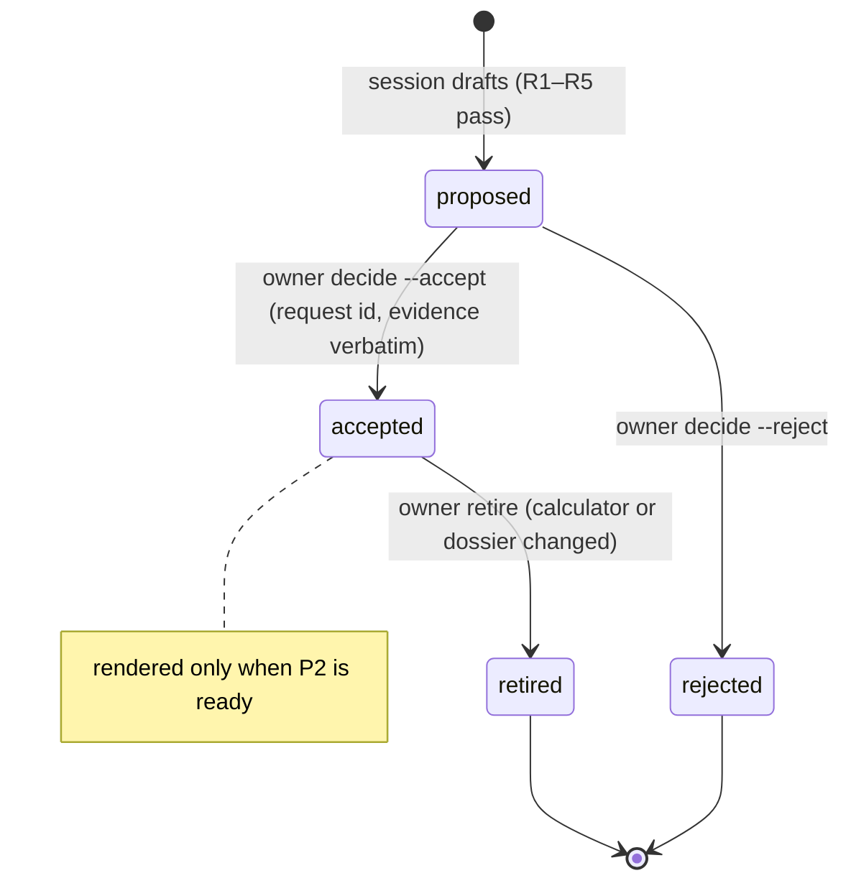
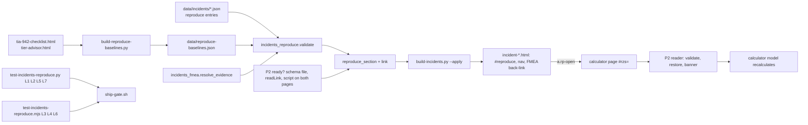

# PRD-Q03 — Reproduce an incident's stated conditions in a calculator

## 1. Document control

| Field | Value |
|---|---|
| PRD id | PRD-Q03 |
| Feature | `reproduce[]` entries in incident dossiers, rendered as a "Reproduce" section whose links open a site calculator with exactly the conditions the dossier states |
| Version | 1.1 |
| Status | Draft |
| Author | Opus 5.5 (Fable quota exhausted) |
| Date | 2026-11-10 |
| Owner requests | R110 (PRD per idea), R111 (24-section structure) |
| Priority | 71.0 (addendum Q3: I 8, N 8, C 6, E 5; `documentation/PRODUCT_INNOVATION_ASSESSMENT_2026-11_ADDENDUM.md:201-220`; register row `documentation/product-transformation/01-improvement-register/REGISTER.md:15`) |
| Related findings | Addendum Q3. Corrections D1–D6 in §3.3. Cross-link with Q1 (`02-prds/PRD-Q01/PRD.md`) |
| Dependencies | **P2 Part 2** (peer session, hard): the `#rzs=` reader on `tia-942-checklist.html` and `tier-advisor.html`. Contract = peer PRD-P02 (path in §11.3) plus the interface agreed with the peer on 2026-11-11 (`documentation/product-transformation/STATE.md`, "Interface agreements with the peer": `origin` string, mirror inputs `#tiaTier`/`#tiaDcType`); not re-specified here. Q1 (soft, one direction only: Q3 → Q1 through rule R2I, FR-12; Q1 never reads Q3 data). Owner decisions D-Q03-1…4 in `documentation/product-transformation/DECISIONS.md` |
| Related modules | `tools/build-incidents.py`, `tools/incidents_fmea.py` (evidence resolver), new `tools/incidents_reproduce.py`, new `tools/build-reproduce-baselines.py`, `data/incidents/{ovhcloud-sbg2-fire-2021,equinix-ld8-london-ups-2020,delta-atlanta-switchgear-2016}.json`, new `data/reproduce-baselines.json`, new `data/incidents/_reproduce-review.json`, `tia-942-checklist.html`, `tier-advisor.html`, `js/rz-scenario.js` (changed by P2, peer) |
| Target wave | "Connected reference, weeks 9–16: Q1 relation file, then Q3 (needs P2)" (`…_ADDENDUM.md:557`) |
| Approval status | Approved by owner R110/R111 2026-11-10 (the PRD set). The addendum marks Q3 "Needs owner approval" (`…_ADDENDUM.md:217`): implementation starts only after the owner says yes to the feature (D-Q03-1), to business rule BR-2 (the named baseline, §12; D-Q03-2) and to the entries (D-Q03-3, with D-Q03-4 on Delta's non-postmortem source); each accepted entry is then recorded by `decide` with the request id |

Change history

| Version | Date | Author | Change |
|---|---|---|---|
| 1.0 | 2026-11-10 | Opus 5.5 | First complete draft. Facts verified on `wt-hub3` (branch `hub-r3`) at `803253314` and re-checked at `1cb6dd292` (docs-only commit between them); peer state read from `~/.cache/rz-k28` at `b80fd7bca` and the peer PRD-P02 |
| 1.1 | 2026-11-11 | Opus 5.5 | QA batch 1 revisions (D1–D8). D2: `origin` is the agreed string `incident:<slug>:<entry>` (≤ 80 characters, `^[A-Za-z0-9_.:/-]+$`, optional, never used for navigation, never inserted as HTML; new RV17); the stale object shape and its `set[]` are removed (FR-6, FR-13, §5.4, §9.6, §11.3, §16, §23); the TIA baseline includes P2's capturable mirror inputs `tiaTier`/`tiaDcType`, so it holds 64 inputs (FR-2, §10.4, A1, L3, AC1, AC3, T-2). D5: owner decisions D-Q03-1…4 in `DECISIONS.md`. D8: the Q3 → Q1 direction is the only one |

## 2. Executive summary

Of the 43 incident dossiers, **3 qualify** for reproduction in a site calculator, giving **4 entries**. That is fewer than 10, and this PRD says so instead of padding the list. A dossier qualifies only when it states the failure condition in a field the existing evidence resolver can verify word for word, from a cited source, and a calculator on the site already has an input that expresses that condition. The three are OVHcloud SBG2 (no automatic extinguishing system: TIA-942 checklist and tier advisor), Equinix LD8 (A and B feeds from one UPS: TIA-942 checklist) and Delta Atlanta (300 of 7,000 servers with no alternate power source: TIA-942 checklist). Kakao Pangyo is blocked because its sprinkler statement has no source. None of the four examples the addendum names (clean-agent hold time, battery runaway, generator start failure, spares stock-out) can be reproduced today.

Each entry becomes a static link in a new "Reproduce" section of the dossier. The link carries the calculator's inputs in the peer's P2 `#rzs=` format: a named baseline plus the inputs the dossier states, nothing else. The calculator recalculates on its own model. The dossier states which inputs came from the record and quotes the evidence. Two findings come with it: the checklist's overall score stays at A+ (98 %) with LD8's shared-UPS defect present, and the tier advisor gives fire suppression 3.5 % of its composite. Today the audience is the two root accounts, because the library is root-only.

## 3. Problem statement

### 3.1 Verified facts (2026-11-10, `wt-hub3` at `803253314`, re-checked at `1cb6dd292`)

| # | Fact | Evidence | Command |
|---|---|---|---|
| F1 | 43 dossiers; 15 seed-only; 30 with an official postmortem | `data/incidents/*.json` (names without `_`) | node: count files, `"seed — pending"` and `sourcing.officialPostmortem` → `seed: 15 PM: 30 total: 43` |
| F2 | No dossier carries reproduction data | — | `grep -l '"reproduce"' data/incidents/*.json \| wc -l` → `0` |
| F3 | Dossier pages link to no calculator | Body links: backlink `dc-incidents.html` (`tools/build-incidents.py:1567`) and the nav (`:506-508`) | `grep -n 'href=' tools/build-incidents.py` |
| F4 | 11 calculator pages declare `<body … data-rz-calc>`; `js/rz-scenario.js` is loaded by a script tag on 8 pages (7 calculators and `account.html`), not on `tia-942-checklist.html`, `tier-advisor.html`, `spares-readiness-calculator.html` or `rfs-readiness-workbench.html` | `tia-942-checklist.html:147` (`data-rz-calc="tia"`), `tier-advisor.html` (`data-rz-calc="tier"`) | `grep -l '<body[^>]*data-rz-calc' *.html \| wc -l` → 11; `grep -l '<script[^>]*src="js/rz-scenario.js' *.html` → 8 (a bare `grep -l 'js/rz-scenario.js'` also matches prose in `changelog.html`, which is how a count of 9 arises) |
| F5 | `openInCalc` on `hub-r3` maps 5 calculators; the peer's v3.35.10 maps 11 including `tia` and `tier`, committed as `b80fd7bca` on the peer's local branch `feat/p-wave1`, not on a remote | `js/rz-scenario.js:79-88`; `~/.cache/rz-k28/js/rz-scenario.js:84-90` | `git branch -a --contains b80fd7bca` → `feat/k29-schematic`, `feat/p-wave1`; `git branch -r --contains` → none |
| F6 | `capture()` takes only `INPUT`, `SELECT`, `TEXTAREA` with an id, excluding hidden, button and similar types | `js/rz-scenario.js:18-44` | read |
| F7 | TIA checklist items are capturable checkboxes `chk-<id>`; Tier and DC type are `<button>`s (not capturable); the page starts at Tier 3, Enterprise on every load and stores no checklist state | checkbox `tia-942-checklist.html:633`; buttons `:231-242`; defaults `:584-585`; only session and consent reads from `localStorage` (`:9`, `:1038-1047`) | `grep -n` |
| F8 | TIA scoring: category weights site 1.0, elec 1.5, mech 1.3, tel 1.0, fire 1.1, sec 0.9; overall = weighted mean of category percentages; free mode shows the overall score, category bars and the top 3 unchecked items | `:375-382`, `:654-700`, `:733-742` (`#recCards`); the full gap table is a Pro panel filled only `if (isPremiumUser)` (`:746`, `:845-854`) | read |
| F9 | 62 checklist items apply at Tier 3, Enterprise (67 at Tier 3, Colocation) of 88 | `ITEMS` (`:391-581`), filter `:599-604`, `DC_ALL` `:390` | Appendix D, C3 |
| F10 | Tier advisor: 22 controls with ids; `fireSuppression` select with `none 0, wet 50, preaction 65, clean 85, vesda_clean 100`, default `preaction`; Physical = fire × 0.35 + access × 0.35 + monitoring × 0.30; Physical weight 0.10; composite rounded | `tier-advisor.html:357-364`, `:567`, `:586`, `:552`, `:601`; default reset `:1583-1606` (`:1601`) | read |
| F11 | Tier advisor switches premium users (root included) to Pro mode, where the regional term depends on region inputs; free mode uses 50 | `:1487`, `:588-589`, `calcRegional()` `:648` | read |
| F12 | The fire calculator has no hold-time input; "hold ≥10 min (door-fan test)" is fixed text inside a KPI card | `fire-calculator.html:316` | `grep -n -i hold fire-calculator.html` |
| F13 | Evidence pointers `{src, i, quote}` resolve only when the quote is a verbatim substring of the named field | `tools/incidents_fmea.py:79-88` (field maps), `:122-140` (`_item_text`), `:143-172` (`resolve_evidence`) | read |
| F14 | No dossier states a generator failing to start | — | `grep -liE 'generators? (failed\|did not\|didn.t) (to )?start\|failed to start' data/incidents/[a-z]*.json \| wc -l` → `0` |
| F15 | Kakao's "no large-area water sprinkler system existed in the battery room" appears only in unattributed analysis; none of its 22 references or its sourced timeline entries states it | `kakao-sk-cc-pangyo-fire-2022.json` `contributingFactors[2]`, `[6]` | node scan of `references[].quote` and `sequenceOfEvents[].event` for sprinkler terms → none states absence |
| F16 | The library is root-only and not indexed | `tools/build-incidents.py:489` (noindex), `:501` (`body.locked`), `:519-528` (root gate); `js/rz-feature-flags.js:233-235` (page-access root only); 2 root accounts (`auth.js:246`) | `grep -n` |
| F17 | The spares page already uses `#s=` for its own share links | `spares-readiness-calculator.html:3986`, `:5195-5196` | `grep -n "#s=" spares-readiness-calculator.html` |

### 3.2 Consequence of leaving it

A dossier explains what failed, and a calculator lets a reader test a design, but nothing joins the two. A reader cannot check "would my checklist or tier rating have flagged this?" without re-entering inputs by hand and guessing which ones the incident fixes. Guessing is the larger risk: an input set from memory or from a "typical" value is an invented condition, which the addendum forbids (`…_ADDENDUM.md:217`).

### 3.3 Addendum corrections

| Id | Addendum says | Verified | Effect |
|---|---|---|---|
| D1 | OVH: "fire-calculator with no room-integrity hold … shows the failed hold time" (`:204`) | No hold input exists (F12) | Replaced by a TIA entry and a tier advisor entry, both from the stated absence of an automatic system |
| D2 | "the calculators can reproduce some of them (clean-agent hold time, battery runaway, generator start failure, spares stock-out)" (`:202`) | Hold time: no input (F12). Battery runaway: no calculator models cell chemistry. Generator start failure: 0 dossiers state one (F14). Spares stock-out: no non-seed dossier states a stocked part running out (`red-sea-subsea-cables-2024` is a repair-ship access problem) | None of the four ships in v1. They are listed as capability gaps (Appendix C) |
| D3 | `reproduce[]` holds `{calc, inputs, violatedInput, source}` (`:208`) | OVH has three absent items, so one `violatedInput` cannot hold it. A checklist with only the stated inputs equals the page default (all unticked) and shows nothing | Schema becomes `{calc, baseline, set[{input, value, role, evidence[]}]}`; the link carries baseline ⊕ set (§10). The baseline needs owner approval (BR-2) |
| D4 | "Opened through the P2 scenario-link format" (`:210`); the main assessment's P2 text names `#s=` (`PRODUCT_INNOVATION_ASSESSMENT_2026-11.md:87`) | The peer PRD-P02 uses `#rzs=` (its `:45`, `:83`), which avoids the spares page's existing `#s=` (F17) | Q3 emits `#rzs=` links per PRD-P02 |
| D5 | Integration points "fire, spares, tier, the CDU calculators" (`:211`) | v1 entries use `tia` and `tier` only | Fire, spares and CDU stay out until a dossier qualifies |
| D6 | Not stated | The library is root-only (F16) | Audience is 2 accounts until the owner opens the library; value claims in §4 are scoped to that |

## 4. Objectives and success metrics

| # | Objective | Metric | Target | Measurement | Assumption |
|---|---|---|---|---|---|
| O1 | Every qualifying condition becomes an accepted entry | Accepted entries | 4 of the 4 in Appendix A | `python3 tools/test-incidents-reproduce.py --law L1` | Owner accepts them (T-8). A rejected entry lowers the target and is recorded |
| O2 | A link opens its calculator with exactly the stored inputs | Entries whose restored inputs equal the stored map | 4/4 | `node tools/test-incidents-reproduce.mjs --law L3` | P2 Part 2 is live |
| O3 | The calculator shows the difference at the stated inputs and nowhere else | Entries whose outputs match the expected model outputs (Appendix A) | 4/4 | `--law L4` | Model code unchanged since this PRD; a model change updates Appendix A in the same release |
| O4 | No entry rests on an unverifiable statement | Evidence pointers that fail `resolve_evidence`; entries on seed dossiers | 0; 0 | `--law L1` | — |
| O5 | Every facility dossier has a recorded verdict | Non-seed dossiers in power, cooling or fire with entries or a review record | 11/11 | `--law L7` | — |
| O6 | No runtime cost on dossiers | JS bytes added to dossier pages | 0 | diff of `<script` tags in a regenerated dossier | — |
| O7 | Dossier page weight stays small | Bytes added per dossier with entries | UNKNOWN — measure in T-3; budget ≤ 8,192 B per dossier (the TIA link alone is 3,914 characters) | `wc -c` before/after on the 3 pages | — |
| O8 | Restore is quick | Time from navigation to restored state on TIA, free and premium sessions | UNKNOWN — measure in T-6; budget ≤ 1,500 ms after `DOMContentLoaded` | performance marks in the browser gate | Premium sessions run `runMonteCarlo(10000)` on every recalculation (`tia-942-checklist.html:746`, `:857`) |

No usage target is set. The site has no consented click analytics, and the audience is 2 accounts (D6).

## 5. Scope

### 5.1 In scope

- The `reproduce[]` schema in dossier JSON, its validator and owner-decision CLI (`tools/incidents_reproduce.py`).
- `data/reproduce-baselines.json` and its generator `tools/build-reproduce-baselines.py` (`--apply` / `--check`).
- `data/incidents/_reproduce-review.json`: a verdict and reason for every non-seed facility dossier without entries, plus a `report` command over all 43.
- The 4 entries of Appendix A, as `proposed`, for the owner to decide.
- A "Reproduce" section in the dossier page, a nav entry and a back-link from the matching FMEA row.
- Gates `tools/test-incidents-reproduce.py` and `tools/test-incidents-reproduce.mjs`, freshness wiring, docs.
- Coordination requests to the peer for P2 (§13, FR-13).

### 5.2 Out of scope

- The `#rzs=` reader, its banner, its schema file and the Copy-link button: peer P2 (coordinate with the peer session).
- New calculator inputs (hold time, battery chemistry, UPS autonomy in minutes, protection coordination). Each is a Phase 2 candidate in Appendix C, with its own PRD.
- Entries for fire, spares, rfs, CDU or Cx calculators (no dossier qualifies; `cx-calculator.html` is peer-owned anyway).
- Changing any dossier fact, quote or FMEA score.
- Opening the incident library to non-root tiers.
- Showing calculator numbers on the dossier (they would need a second copy of each model; §18).
- A "reproducible" marker on the library hub `dc-incidents.html` (v2 option).

### 5.3 Existing capabilities reused

| Capability | Where | Use |
|---|---|---|
| Evidence resolver | `tools/incidents_fmea.py:143-172` | Every set input's evidence must resolve |
| Evidence list HTML | `tools/incidents_fmea.py:339-345` (`_ev_html`), CSS `:728-733` | Same markup and classes in the Reproduce rows |
| Incident module pattern | `tools/incidents_response.py` (`validate_response` `:106`, `response_section` `:269`, `CSS` `:338`), imported at `tools/build-incidents.py:23-24` | `incidents_reproduce.py` follows it |
| Conditional section nav | `tools/build-incidents.py:1564-1565` | Same rule for `reproduce` |
| FMEA row anchors | `<details class="fm-row" id="FM-nn">` (`tools/incidents_fmea.py:373`) | Links from the section to its FMEA mode |
| Scenario capture/restore | `js/rz-scenario.js:31-76` | The P2 reader restores with it; the gate reads state with `capture()` |
| P2 link format | peer PRD-P02 FR-P02-2/-3 | Link encoding |
| Generator freshness runner | `tools/test-generator-freshness.py:56-73` | Add the baselines builder |
| Browser gates with their own server | `tools/test-fmea-sim.mjs:21-28` (puppeteer) | Same harness; run locally under `rz-lane` |

### 5.4 Dependencies

| Dependency | Type | Status (2026-11-10) | If missing |
|---|---|---|---|
| P2 Part 1: `openInCalc` routes `tia`, `tier` | Peer, soft | Committed `b80fd7bca` on `feat/p-wave1`, not on `hub-r3` | Saving and re-opening a reproduced scenario from `account.html` would not reach TIA or tier |
| P2 Part 2: `#rzs=` reader + `js/rz-scenario.js` loaded on `tia-942-checklist.html` and `tier-advisor.html` + `data/scenario-link.schema.json` | Peer, hard | Specified in PRD-P02, "next minor" (its `:14`) | The section is not rendered (FR-6 precondition); phase 0 only |
| P2 optional `origin` field | Peer, soft | Agreed 2026-11-11 (`STATE.md`, "Interface agreements with the peer"): part of the P2 **v1** schema, a string of at most 80 characters matching `^[A-Za-z0-9_.:/-]+$`, optional, never used for navigation, never inserted as HTML | Q3 omits `origin`; the link still restores. Whether and how the banner shows anything for it is the peer's choice |
| P2 hidden mirror inputs `#tiaTier`, `#tiaDcType` on `tia-942-checklist.html` | Peer, soft for Q3 | Agreed 2026-11-11 (`STATE.md`): "kept in step by the setters", round trip asserted by P2's E2E test. A round trip through `capture()` requires the mirrors to be capturable, i.e. not `type="hidden"`, which `EXCLUDE_TYPES` drops (`js/rz-scenario.js:18`); so `capture()` includes them | T-2 reads P2's committed page; if the mirrors are absent or not capturable, the baseline keeps 62 inputs and the peer's answer is recorded in this row |
| Q1 | Soft | Draft | FR-12 is skipped until Q1 ships |
| Owner | Human | D-Q03-1…4 PROPOSED in `DECISIONS.md` | Feature yes (D-Q03-1), BR-2 yes (D-Q03-2), the 4 entries (D-Q03-3, D-Q03-4), then each entry recorded by `decide` |

### 5.5 Constraints

Static site; Python generators; vanilla ES5 in pages; no runtime JS on dossiers; dossier pages are generated only by `tools/build-incidents.py` (never hand-edited); dossier register colours from the dossier variables (`--text`, `--text-body`, `--muted`, `--line`, `--amber`, `--cyan` in `tools/build-incidents.py`); radius ≤ 4 px; no badges or pills for state; no transform on hover; no `transition: all`; both themes; 390 and 1440 px.

### 5.6 Assumptions

- A1: TIA starts at Tier 3, Enterprise on every load (F7). The gate checks it on every run, so a change to the default fails loudly. With P2's mirror inputs the link also carries the tier and DC type explicitly (`tiaTier` = `"3"`, `tiaDcType` = `"ent"`), so a reproduction no longer depends on the load default alone.
- A2: PRD-P02's reader restores after the page's own init, twice, at 350 ms and 900 ms (its `:87`).
- A3: The library stays root-only in v1.
- A4: Calculator item ids (`chk-<id>`, `fireSuppression`) stay stable. A rename fails RV6 and L3.

## 6. User personas and use cases

Tiers verified: `free | demo | pro | root` (`js/rz-feature-flags.js:6`); educator is a role on a `pro` session (CLAUDE.md, "Auth tiers"); dossiers are root-only (F16).

| Persona | Tier | Goal | Sees | Outcome |
|---|---|---|---|---|
| Owner (root, admin) | root | Keep entries correct and sourced | Dossier section; `report`; gate output | Accepts or rejects entries; reads the model findings |
| DC / facility engineer with the second root account | root | Test whether a checklist or tier rating flags the condition that failed | Section + links | Calculator opens with the record's conditions; varies them; saves |
| Operator | root today | Learn which design item would have caught the failure | Same | Same |
| Student or educator | free / pro | — | No dossier access in v1 | A root user may share the calculator link; it opens on the public calculator with P2's banner |
| Signed-out visitor | none | — | No dossier access | Same as above |
| Session (implementer agent) | n/a | Draft entries, keep the review file current | CLI | Drafts only; records a decision only from an owner message naming the entries |

Use cases: UC1 root opens a reproduction from a dossier; UC2 root starts from an FMEA row; UC3 owner reviews entries; UC4 a new dossier is added and reviewed for qualification; UC5 a calculator changes and the gate catches it.

## 7. Complete user journey

### J1 Root reproduces OVH on the checklist (UC1)

| Step | Detail |
|---|---|
| Entry | `dc-incidents.html` → `incident-ovhcloud-sbg2-fire-2021.html`, or the dossier nav entry "Reproduce" |
| Initial state | Static section after FMEA: two entries (TIA-942 checklist, Tier advisor), each with its input rows, evidence and link |
| Action | Activates "Open the checklist with these inputs" |
| System response | Plain navigation to `tia-942-checklist.html#rzs=<payload>`. On the calculator, P2's reader validates the payload, restores 62 checkboxes, removes the hash and shows its banner (PRD-P02 `:87`) |
| Validation | P2: version, `calc === "tia"`, ≤ 500 keys, key pattern, value caps (PRD-P02 FR-P02-3, its `:97`) |
| Success | Score shows 92 %; "Top gaps" lists Automatic fire suppression, Clean agent (FM-200/Novec 1230), Pre-action sprinkler system (model output, Appendix A) |
| User action | Ticks "Automatic fire suppression" back; score rises; may Save to account (existing) |
| Failure | Link unreadable: P2 shows "This link could not be read. The calculator kept its defaults." (PRD-P02 `:88`). A renamed field: P2 skips it and says "n fields could not be applied" (its `:190`). Both are blocked before release by L2/L3 |
| Recovery | Back button returns to the dossier section; the dossier still carries the evidence |
| Exit | Calculator, account page, or back to the dossier |

### J2 Root starts from the FMEA row (UC2)

FM-02 row → "Reproduce: TIA-942 checklist · Tier advisor" → jumps to `#rp-tia` / `#rp-tier` in the section → J1.

### J3 Root reproduces OVH on the tier advisor

Same as J1 with `tier-advisor.html#rzs=…`: 22 controls restored, Fire Suppression = None. In a free session, Physical shows 34 (from 56) and the composite 56 (from 58), Tier II both ways (model output). A root session is in Pro mode (F11): the composite differs by the regional term, the fall is the same 2.275 before rounding.

### J4 Owner reviews entries (UC3)

| Step | Detail |
|---|---|
| Entry | Session runs `python3 tools/incidents_reproduce.py report --entries --format md` and pastes it into chat |
| Initial state | 4 entries `proposed`: per set input the value, the baseline value, the evidence label and quote |
| Action | Owner replies, e.g. "terima rp OVH tia, OVH tier, LD8, Delta; BR-2 ok" |
| System | Session runs `decide --accept ovhcloud-sbg2-fire-2021:rp-tia,… --by owner --request R1nn` |
| Validation | Refuses: unknown entry, not `proposed`, missing request id, any evidence no longer verbatim |
| Success | Entries `accepted` with decision fields; `build-incidents.py --apply` renders them (once P2 is ready) |
| Failure | Refusal names the entry and rule; file unchanged |
| Exit | Release chain (§22) |

### J5 New dossier (UC4)

A new dossier in power, cooling or fire → L7 fails until either entries or a review record exist → session reads it against R1–R5 (§12) → drafts entries (owner decides) or records verdict B/C with a reason.

### J6 A calculator changes (UC5)

A checklist item is renamed → `build-reproduce-baselines.py --check` goes stale and RV6 names the entry → the release stops until the entry or baseline is fixed and the owner re-accepts if a set input changed.

## 8. Functional requirements

**FR-1 Schema and validation**
- Description: `reproduce` is an optional array on a dossier; `incidents_reproduce.validate_reproduce(inc, baselines, pages)` returns a list of errors.
- Trigger: every `build-incidents.py` run, every gate run, every CLI write.
- Preconditions: `data/reproduce-baselines.json` exists.
- Inputs: dossier JSON, baselines, `js/rz-scenario.js` route map.
- Processing: rules RV1–RV17 (§10.3).
- Outputs: list of `"<slug>:<entry> RVn <message>"`.
- State change: none.
- Dependencies: `incidents_fmea.resolve_evidence`.
- Exceptions: malformed baselines file → exit 2.
- Acceptance: unit fixtures U1–U16 each fail with their named rule; the 4 Appendix A entries pass.

**FR-2 Baselines file and generator**
- Description: `tools/build-reproduce-baselines.py --apply|--check` derives the two v1 baselines from the calculator pages.
- Processing: `tia-t3-ent-all`: parse `ITEMS` in `tia-942-checklist.html` (regex on `{id:'…',cat:'…',label:'…',tiers:[…],w:n,ref:'…',dcTypes:…}`, `DC_ALL` from `:390`), keep items with tier 3 and `ent`, emit `chk-<id>: {t:"checkbox", v:true}` and `labels[chk-<id>] = label`. Then add P2's two mirror inputs (§5.4, `STATE.md` agreement), which `capture()` includes: `tiaTier: {t: <type>, v: "3"}` and `tiaDcType: {t: <type>, v: "ent"}`, where `<type>` is what `capture()` records for the element P2 commits (`select` for a `<select>`, else the input's `type`, `js/rz-scenario.js:38-41`), read from P2's committed `tia-942-checklist.html`; labels "Tier" and "Facility type". The baseline then holds 64 inputs. If P2's committed page has no capturable mirrors, the generator emits the 62 checkboxes only and exits 1 on `--check` with `mirrors missing: tiaTier, tiaDcType` until the peer's answer is recorded in §5.4. `tier-defaults`: parse every `<select id>` (the `selected` option, else the first) and `<input id>` (its `value`) in `tier-advisor.html`, skipping types `capture()` excludes (F6); emit `labels` from the `aria-label` and `options` from option text.
- Outputs: canonical JSON (`sort_keys=True`, `indent=1`, trailing newline).
- Exceptions: item count at Tier 3, Enterprise ≠ the previous file's count → still written by `--apply`, and `--check` fails until it is re-applied (so a checklist change is visible in the diff).
- Acceptance: `tia-t3-ent-all` has 64 inputs (62 checkboxes + `tiaTier` + `tiaDcType`); `tier-defaults` has 22; `--check` passes after `--apply`. L3 confirms in a browser on a fresh load: for TIA, the key set of `rzScenario.capture()` equals the 64 baseline keys and `#tiaTier`/`#tiaDcType` read `3`/`ent` (checkbox values differ by design: the page loads unticked, the baseline ticks them); for tier, `capture()` equals `tier-defaults` key for key and value for value.

**FR-3 Review records and report**
- Description: `data/incidents/_reproduce-review.json` holds a verdict per non-seed dossier whose `category` includes `power`, `cooling` or `fire` and which has no accepted entry. `python3 tools/incidents_reproduce.py report [--entries] [--format md|json]` lists all 43 with a code.
- Codes: Q (has accepted entries), B (blocked on sourcing), C (no calculator input expresses the stated condition), S (seed-only, automatic), N (no facility category, automatic).
- Acceptance: L7; `report` prints 43 rows; v1 counts Q 3, B 1, C 7, S 15, N 17 (Appendix B).

**FR-4 Draft entries**
- Description: the session writes the Appendix A entries with `status: "proposed"`, `draftedBy`, `draftedOn`.
- Preconditions: dossier passes R1–R5.
- Acceptance: `validate_reproduce` passes; `report --entries` shows them.

**FR-5 Owner decision**
- Trigger: `decide --accept <slug>:<id>[,…] --reject <slug>:<id>[,…] --by owner --request R<n>`; `retire <slug>:<id> --request R<n> --reason "<text>"`.
- Processing: re-run RV10 (evidence verbatim) on each entry; on any failure write nothing; set `status`, `decidedBy: "owner"`, `decidedOn`, `request`. Atomic write (temp + `os.replace`). Dossier JSON key order preserved (`json.load(object_pairs_hook=OrderedDict)`, dump with the file's existing indent).
- Exceptions: `--by` other than `owner` → exit 2 "only the owner accepts reproduce entries"; missing `--request` → exit 2.
- Acceptance: AC4, AC5; the file is byte-identical after a refused command.

**FR-6 Link encoding**
- Preconditions (P2 ready): `data/scenario-link.schema.json` exists; `js/rz-scenario.js` defines `readLink`; both target pages load `js/rz-scenario.js`. If any is false, no section is rendered and the static gate reports `P2 not ready` (phase 0, §22).
- Processing: `payload = {"v": 1, "calc": calc, "origin": "incident:<slug>:<entry id>", "inputs": baseline.inputs ⊕ {s.input: {t: baseline t, v: s.value}}}`. `origin` is the string agreed with the peer (FR-13 (2)), e.g. `incident:ovhcloud-sbg2-fire-2021:rp-tia`; the build checks it against RV17 and omits it if P2's committed schema has no `origin` property; `json.dumps(payload, sort_keys=True, separators=(",", ":"), ensure_ascii=False)` → UTF-8 → base64url without padding; `href = PAGE[calc] + "#rzs=" + b64`. `PAGE = {"tia": "tia-942-checklist.html", "tier": "tier-advisor.html"}`, cross-checked against the `openInCalc` map in `js/rz-scenario.js`.
- Exceptions: link > 8,000 characters (PRD-P02 FR-P02-6) or payload invalid against the schema → build error naming the entry.
- Acceptance: L2.

**FR-7 Dossier section**
- Processing: `incidents_reproduce.reproduce_section(inc, baselines)` renders accepted entries only; `build-incidents.py` inserts `<section class="inc-sec" id="reproduce" aria-labelledby="h-reproduce">` right after the FMEA section (`tools/build-incidents.py:1604`), adds `("reproduce", "Reproduce")` after `("fmea", "FMEA")` in `_SECTIONS` (`:1493`), and extends the nav condition (`:1564-1565`) to show it only when the dossier has accepted entries. CSS is inline (`incidents_reproduce.CSS`), like the FMEA and response modules (`:1635-1637`).
- Acceptance: L5; `python3 tools/build-incidents.py --check` CURRENT after `--apply`; the 40 dossiers without entries regenerate byte-identical.

**FR-8 FMEA back-link**
- Processing: `incidents_fmea.fmea_section` adds, inside the `details` body of the mode named by an accepted entry's `mode`, one line `Reproduce: <a href="#rp-tia">TIA-942 checklist</a> · <a href="#rp-tier">Tier advisor</a>`. It reads entries through `incidents_reproduce.entries_for_mode(inc, mode_id)`; no change to scores, rows or the simulator.
- Acceptance: `python3 tools/test-incidents-fmea.py --strict --require-all` and `node tools/test-fmea-sim.mjs --strict` stay green; L5 checks the link.

**FR-9 Static gate** `tools/test-incidents-reproduce.py [--strict] [--law Ln] [--phase 0]`: L1, L2, L5, L7 (and RV1–RV17 on every dossier).

**FR-10 Browser gate** `tools/test-incidents-reproduce.mjs [--strict] [--law Ln] [--live]`: L3, L4, L6. Own HTTP server on port 0 serving the tree it is run from, with an identity check (a marker file it writes and reads back).

**FR-11 Freshness**: `tools/test-generator-freshness.py` `BUILDERS` gains `("data/reproduce-baselines.json", ["python3", "tools/build-reproduce-baselines.py", "--check"])`. Dossier freshness stays with `build-incidents.py --check`.

**FR-12 Q1 integration**: when Q1's `tools/build-relations.py` exists, its `propose` gains rule `R2I`: every accepted reproduce entry proposes `tool:<calc page id> → incident:<slug>` with the entry's first evidence quote. The owner still decides each edge (PRD-Q01 BR2).

**FR-13 P2 interface (agreed with the peer 2026-11-11, `documentation/product-transformation/STATE.md` "Interface agreements with the peer")**:
1. P2 task T-P02-C loads `js/rz-scenario.js` and the `#rzs=` reader on `tia-942-checklist.html` and `tier-advisor.html` (required, §5.4).
2. `origin` (optional, P2 v1 schema) is a **string** of at most 80 characters matching `^[A-Za-z0-9_.:/-]+$`. Q3 writes `incident:<slug>:<entry id>`, e.g. `incident:ovhcloud-sbg2-fire-2021:rp-tia` (39 characters). Measured with `wc -c`: the 4 entries give 39, 40, 43 and 45 characters (the longest is `incident:delta-atlanta-switchgear-2016:rp-tia`); the longest slug in the library (43 characters, `cloudflare-bot-management-feature-file-2025`) would give 60 with `rp-tier`, under the cap. `origin` is never used for navigation and never inserted as HTML (the agreement); Q3 does not ask for a back link, field markers or a `set` list. A build error is raised when the string exceeds 80 characters or fails the pattern (RV17).
3. TIA Tier and DC type: P2 adds the hidden mirror inputs `#tiaTier` and `#tiaDcType`, kept in step by the setters, and `capture()` includes them (FR-2). Q3's TIA links therefore carry `tiaTier = "3"` and `tiaDcType = "ent"` explicitly, and L3 asserts both after restore.

### 8.1 FR field matrix (every FR, all fields)

| FR | Trigger | Preconditions | Inputs | Outputs | State change | Dependencies | Exceptions | Acceptance |
|---|---|---|---|---|---|---|---|---|
| FR-1 | Build, gate, CLI write | Baselines file exists | Dossier JSON, baselines, `openInCalc` map | Error list | None | `incidents_fmea.resolve_evidence` | Bad baselines file → exit 2 | U1–U16, L1, AC6, AC7 |
| FR-2 | `--apply` / `--check`; freshness gate | Both calculator pages exist | `tia-942-checklist.html`, `tier-advisor.html` | `data/reproduce-baselines.json` | File written (`--apply`) | — | Count change → `--check` fails until re-applied; mirrors missing → `--check` exit 1 naming them | 64 / 22 inputs; L3 key set = live capture, mirrors `3`/`ent` |
| FR-3 | `report`, `review`; L7 | — | Dossiers, review file | 43-row table; review records | Review file (`review`) | FR-1 | Unknown verdict code → exit 1 | L7, AC11 |
| FR-4 | Session drafting | R1–R5 hold | Dossier evidence | `proposed` entries | Dossier JSON | FR-1 | Any RV failure → not written | L1 |
| FR-5 | `decide`, `retire` | Entry exists; status fits; `--request` given | Entry ids, request id | Summary per entry | Status and audit fields; atomic write | FR-1 | `--by` not owner or no request → exit 2; quote drift → exit 1; nothing written | U15, U16, AC4, AC5 |
| FR-6 | Build | P2 ready (schema file, `readLink`, script on both pages) | Entry, baseline | `href` with `#rzs=` | None | PRD-P02 schema, `js/rz-scenario.js` map | Over 8,000 characters or schema failure → build error; P2 not ready → no render | L2, AC1, AC8 |
| FR-7 | `build-incidents.py --apply` | Accepted entries; P2 ready | Entries, baselines | `#reproduce`, nav entry | Dossier HTML | FR-6 | Any validation error → no page written | L5, AC2 |
| FR-8 | Build | Accepted entry names a mode | `entries_for_mode` | Back-link line in `details#FM-nn` | Dossier HTML | `tools/incidents_fmea.py` | Unknown mode → RV5 | AC10 |
| FR-9 | `ship-gate.sh` | — | Tree | L1, L2, L5, L7 results | None | FR-1…FR-8 | — | Red/green log |
| FR-10 | `ship-gate.sh` (phase 1) | P2 live; puppeteer | Pages served from the tree under test | L3, L4, L6 results | None | Own server on port 0; `rz-lane` locally | Port bind failure or identity mismatch → exit 2 with reason | Red/green log |
| FR-11 | Freshness gate | — | Baselines builder | Exit code | None | FR-2 | Stale → exit 1 | `test-generator-freshness.py` |
| FR-12 | Q1 `propose` | Q1 shipped; entry accepted | Accepted entries | `proposed` tool → incident edges | `data/relations.json` | PRD-Q01 | — | Q1 report lists R2I proposals |
| FR-13 | Peer interface (agreed 2026-11-11) | P2 on main | `origin` string, mirror inputs | Q3 links that validate against P2 v1 | None in Q3 (P2 files are the peer's) | Peer session, `STATE.md` | P2 lands without `origin` or mirrors → omitted / 62 inputs (§23) | Peer's P2 tests; Q3 RV15, RV17, L2 schema check, L3 mirrors |

## 9. UI/UX specification

### 9.1 Placement and information architecture

| Surface | Position | Content |
|---|---|---|
| Dossier section `#reproduce` | After `#fmea`, before `#causes` | `h2` "Reproduce in a calculator", one intro paragraph, one block per accepted entry |
| Dossier nav | After "FMEA" | "Reproduce" (only when entries exist) |
| FMEA row | Inside the `details` body of the named mode, after the evidence list | "Reproduce:" + one link per entry for that mode |
| Calculator | P2's banner (peer); whatever P2 does with the `origin` string is the peer's (FR-13) | — |

### 9.2 Layout

Dossier, 1440 px (reading column):

```
Reproduce in a calculator                                                   (h2)
The links below open a calculator with the conditions this record states.
Only the inputs listed here come from the record. Every other input is the
baseline named under each link.

TIA-942 checklist                                                           (h3)
FMEA mode FM-02 · Tier 3 list, Enterprise
──────────────────────────────────────────────────────────────────────────────
Automatic fire suppression         In the record: not present   Baseline: ticked
   Reference #3 · regulatory
   "equipped with fire detection but had no automatic extinguishing system"
──────────────────────────────────────────────────────────────────────────────
Clean agent (FM-200/Novec 1230)    In the record: not present   Baseline: ticked
   Reference #3 · regulatory  …
──────────────────────────────────────────────────────────────────────────────
Pre-action sprinkler system        In the record: not present   Baseline: ticked
──────────────────────────────────────────────────────────────────────────────
VESDA/smoke detection system       In the record: present       Baseline: ticked
──────────────────────────────────────────────────────────────────────────────
Baseline: every other item on the Tier 3, Enterprise list is ticked, so the
gaps the checklist shows are the ones the record states. The baseline is part
of this reproduction, not a claim about the site.
Open the checklist with these inputs

Tier advisor                                                                (h3)
FMEA mode FM-02 · the advisor's own defaults
──────────────────────────────────────────────────────────────────────────────
Fire Suppression                   In the record: None          Baseline: Pre-Action
   Reference #3 · regulatory  …
──────────────────────────────────────────────────────────────────────────────
Baseline: every other input keeps the tier advisor's default.
Open the tier advisor with these inputs
```

Dossier, 390 px:

```
Reproduce in a calculator
The links below open …
TIA-942 checklist
FMEA mode FM-02 · Tier 3 list,
Enterprise
──────────────────────────────
Automatic fire suppression
In the record: not present
Baseline: ticked
Reference #3 · regulatory
"equipped with fire detection
but had no automatic
extinguishing system"
──────────────────────────────
…
Open the checklist with these
inputs                           ← block link, min-height 44px
```

### 9.3 Component hierarchy (HTML contract)

```html
<section class="inc-sec" id="reproduce" aria-labelledby="h-reproduce">
  <h2 id="h-reproduce">Reproduce in a calculator</h2>
  <p class="rp-intro">The links below open a calculator with the conditions this record states. Only the inputs listed here come from the record. Every other input is the baseline named under each link.</p>
  <div class="rp-entry" id="rp-tia" data-calc="tia">
    <h3 class="rp-h">TIA-942 checklist</h3>
    <p class="rp-meta"><a href="#FM-02">FMEA mode FM-02</a> · Tier 3 list, Enterprise</p>
    <ul class="rp-rows">
      <li class="rp-row" data-role="violated" data-input="chk-fire_suppression">
        <span class="rp-in">Automatic fire suppression</span>
        <span class="rp-rec">In the record: not present</span>
        <span class="rp-base">Baseline: ticked</span>
        <ul class="fm-ev"><li><span class="fm-ev-src"><a href="https://regmedia.co.uk/2022/06/10/ovh_report.pdf">Reference #3 · regulatory</a></span><span class="fm-ev-txt">"equipped with fire detection but had no automatic extinguishing system"</span></li></ul>
      </li>
    </ul>
    <p class="rp-basenote">Baseline: every other item on the Tier 3, Enterprise list is ticked, so the gaps the checklist shows are the ones the record states. The baseline is part of this reproduction, not a claim about the site.</p>
    <p class="rp-go"><a class="rp-open" href="tia-942-checklist.html#rzs=…">Open the checklist with these inputs</a></p>
  </div>
</section>
```

Evidence `li` markup is the existing `_ev_html` output (`tools/incidents_fmea.py:339-345`), so the label and link rules (http(s) only) are the resolver's. All text passes `html.escape`.

### 9.4 Controls

| Control | Behaviour | Keyboard | No-JS |
|---|---|---|---|
| `a.rp-open` | Navigates to the calculator with the payload in the hash | Tab, Enter | Works (static href); the calculator needs its own JS to restore, as every calculator does |
| `a[href="#FM-02"]` | Jumps to the FMEA row (a `details` element; it stays closed) | Tab, Enter | Works |
| FMEA back-link `a[href="#rp-tia"]` | Jumps to the entry | Tab, Enter | Works |
| Evidence link | Opens the reference URL (existing behaviour) | Tab, Enter | Works |
| Nav "Reproduce" | Jumps to `#reproduce` (existing `NAV_JS` handles active state) | Tab, Enter | Works |

No buttons, forms, filters, dialogs or toasts are added; nothing is dead.

### 9.5 States

| State | Render |
|---|---|
| Dossier with accepted entries, P2 ready | Section, nav entry, FMEA back-links |
| Dossier without accepted entries (40 of 43 in v1) | Nothing new; page byte-identical to today |
| Entries accepted, P2 not ready | Nothing rendered (FR-6); gate reports phase 0 |
| Non-root visitor | Existing root gate covers the whole dossier (F16) |
| Print | Section prints; `.rp-go` hidden (`@media print`), because a hash link is useless on paper |
| Build error | Build stops with the named rule; no partial page (pages are written only after every dossier validates) |

### 9.6 Exact copy strings

| Key | String |
|---|---|
| Section heading | `Reproduce in a calculator` |
| Intro | `The links below open a calculator with the conditions this record states. Only the inputs listed here come from the record. Every other input is the baseline named under each link.` |
| Entry heading | `TIA-942 checklist` / `Tier advisor` |
| Entry meta | `FMEA mode FM-02 · Tier 3 list, Enterprise` / `FMEA mode FM-02 · the advisor's own defaults` |
| Row prefixes | `In the record:` / `Baseline:` |
| Checkbox words | `present` / `not present` (record); `ticked` / `not ticked` (baseline) |
| Select words | The calculator's option text (`None`, `Pre-Action`) |
| Baseline note, TIA | `Baseline: every other item on the Tier 3, Enterprise list is ticked, so the gaps the checklist shows are the ones the record states. The baseline is part of this reproduction, not a claim about the site.` |
| Baseline note, tier | `Baseline: every other input keeps the tier advisor's default.` |
| Link text | `Open the checklist with these inputs` / `Open the tier advisor with these inputs` |
| FMEA back-link | `Reproduce:` followed by entry headings joined by ` · ` |
| Nav | `Reproduce` |
| `origin` value (P2 v1, agreed) | `incident:<slug>:<entry id>`, e.g. `incident:ovhcloud-sbg2-fire-2021:rp-tia`. Q3 requests no banner copy, link or field marker: `origin` is never used for navigation or inserted as HTML, and any banner wording is the peer's. The dossier row carries the full explanation (baseline note above) |

### 9.7 Styling contract (`incidents_reproduce.CSS`, inline)

- `.rp-entry { margin: 1.4rem 0 0; }` `.rp-h { font: 600 1.02rem/1.35 'IBM Plex Sans', system-ui, sans-serif; color: var(--text); margin: 0; }`
- `.rp-meta { font-family: 'JetBrains Mono', monospace; font-size: .74rem; color: var(--muted); margin: .2rem 0 .6rem; }` (mono for an eyebrow-like label, as `.fm-ev-src` at `tools/incidents_fmea.py:732`)
- `.rp-rows { list-style: none; margin: 0; padding: 0; border-top: 1px solid var(--line); }`
- `.rp-row { display: grid; grid-template-columns: minmax(0, 1.4fr) 11rem 9rem; gap: .25rem 1rem; padding: .7rem 0; border-bottom: 1px solid var(--line); }` `.rp-row .fm-ev { grid-column: 1 / -1; }`
- `.rp-in { color: var(--text); font-size: .92rem; }` `.rp-rec, .rp-base { color: var(--text-body); font-size: .86rem; }`
- `.rp-row[data-role="violated"] .rp-rec { color: var(--text); font-weight: 600; }` (weight, not colour, marks the stated condition)
- `.rp-basenote, .rp-intro { color: var(--text-body); font-size: .88rem; }`
- `.rp-open { color: var(--amber); text-decoration: none; border-bottom: 1px solid currentColor; }` `.rp-open:focus-visible { outline: 2px solid currentColor; outline-offset: 2px; }` hover changes `color` to `var(--text)`; no transition.
- `@media (max-width: 600px) { .rp-row { grid-template-columns: 1fr; } .rp-open { display: inline-block; min-height: 44px; padding: .6rem 0; } }`
- `@media print { .rp-go { display: none; } }`
- Not allowed (checked by L6): `transition`, `transform`, `animation`, `box-shadow`, gradients, `backdrop-filter`, radius > 4 px, coloured stripes.

### 9.8 Motion

None. Anchor jumps use the browser default; MOTION_STANDARD §1 puts navigation used many times a day at "near-imperceptible or nothing" (`standarization/MOTION_STANDARD.md:35`).

### 9.9 Accessibility

`section` labelled by its `h2`; one `h3` per entry; list semantics; link text names the calculator; states are words; contrast from the dossier tokens in both themes, checked by axe with the planted-line method (L6); 44 px link target on phones (ANTI_VIBECODE §D2).

## 10. Data model

### 10.1 Existing (read only)

Dossier fields used: `slug`, `title`, `category[]`, `sourcing.lastVerified`, `sourcing.officialPostmortem`, `references[]` (`type`, `title`, `url`, `quote`), `contributingFactors[]`, `sequenceOfEvents[]` (`t`, `event`, `source`), `metrics[]` (`label`, `value`, `source`), `fmea.modes[].id`. Evidence resolution follows `tools/incidents_fmea.py:79-172`.

### 10.2 New: `reproduce[]` in a dossier (JSON Schema draft 2020-12)

```json
{
  "$id": "rz-incident-reproduce/1",
  "type": "array",
  "items": {
    "type": "object",
    "additionalProperties": false,
    "required": ["id", "calc", "baseline", "mode", "set", "status", "draftedBy", "draftedOn"],
    "properties": {
      "id": { "type": "string", "pattern": "^rp-[a-z0-9-]{1,30}$" },
      "calc": { "enum": ["tia", "tier"] },
      "baseline": { "type": "string", "pattern": "^[a-z0-9-]{3,40}$" },
      "mode": { "type": "string", "pattern": "^FM-[0-9]{2}$" },
      "set": {
        "type": "array", "minItems": 1, "maxItems": 20,
        "items": {
          "type": "object", "additionalProperties": false,
          "required": ["input", "value", "role", "evidence"],
          "properties": {
            "input": { "type": "string", "pattern": "^[A-Za-z0-9_:-]{1,80}$" },
            "value": { "type": ["boolean", "string"] },
            "role": { "enum": ["violated", "stated"] },
            "evidence": {
              "type": "array", "minItems": 1, "maxItems": 4,
              "items": {
                "type": "object", "additionalProperties": false, "required": ["src", "quote"],
                "properties": {
                  "src": { "enum": ["soe", "metric", "coe", "improvement", "ref", "factor", "lesson", "rootCause", "tech"] },
                  "i": { "type": "integer", "minimum": 0 },
                  "quote": { "type": "string", "minLength": 12, "maxLength": 300 }
                }
              }
            }
          }
        }
      },
      "status": { "enum": ["proposed", "accepted", "rejected", "retired"] },
      "draftedBy": { "type": "string", "maxLength": 60 },
      "draftedOn": { "type": "string", "format": "date" },
      "decidedBy": { "const": "owner" },
      "decidedOn": { "type": "string", "format": "date" },
      "request": { "type": "string", "pattern": "^R[0-9]{2,4}$" },
      "retiredReason": { "type": "string", "maxLength": 140 }
    }
  }
}
```

Mapping to the addendum's shape: `calc` = calc; `inputs` = baseline ⊕ set (computed, never stored twice); `violatedInput` = the `set` items with `role: "violated"`; `source` = each item's `evidence` (a reference id that exists in the dossier, checked by the resolver).

`role: "stated"` records a condition the dossier states that equals the baseline (OVH's detection was present). It is shown and evidenced, and it does not change the calculator.

### 10.3 Validation rules

| Rule | Check |
|---|---|
| RV1 | `reproduce` absent or an array matching §10.2 |
| RV2 | Entry `id` unique in the dossier |
| RV3 | `calc` in `PAGE`; `PAGE[calc]` equals the `openInCalc` map entry in `js/rz-scenario.js` |
| RV4 | `baseline` exists in `data/reproduce-baselines.json` with the same `calc` |
| RV5 | `mode` is an id in `fmea.modes[]` |
| RV6 | Every `set[].input` exists in the baseline's `inputs`; no duplicates |
| RV7 | Value type follows the baseline's `t`: checkbox → boolean; select → a string in the baseline's `options`; number → a numeric string |
| RV8 | `violated` ⇒ value ≠ baseline value; `stated` ⇒ value = baseline value |
| RV9 | At least one `violated` item per entry |
| RV10 | Every evidence pointer resolves through `incidents_fmea.resolve_evidence` (quote verbatim) |
| RV11 | Every `violated` item has at least one pointer that is a `ref`, or a `soe`/`metric` whose item has a non-empty `source`. A `factor` alone is not enough (Kakao fails here, F15) |
| RV12 | No entry on a seed dossier (`sourcing.lastVerified` contains "seed", case-insensitive) |
| RV13 | `accepted`/`rejected`/`retired` carry `decidedBy: "owner"`, `decidedOn`, `request`; `proposed` carries none of them |
| RV14 | The built link is ≤ 8,000 characters (PRD-P02 FR-P02-6) |
| RV15 | The payload validates against `data/scenario-link.schema.json` (once P2 ships it) |
| RV16 | At most one entry per `(dossier, calc)` |
| RV17 | The built `origin` equals `incident:<slug>:<entry id>`, is at most 80 characters and matches the P2 v1 pattern `^[A-Za-z0-9_.:/-]+$` (`STATE.md` agreement) |

### 10.4 New: `data/reproduce-baselines.json` (generated)

```json
{
  "schema": "rz-reproduce-baselines/1",
  "generatedBy": "tools/build-reproduce-baselines.py",
  "baselines": {
    "tia-t3-ent-all": {
      "calc": "tia",
      "page": "tia-942-checklist.html",
      "describe": "Every item on the Tier 3, Enterprise list ticked",
      "context": { "tier": 3, "dcType": "ent", "basis": "page defaults tia-942-checklist.html:584-585" },
      "derivedFrom": "ITEMS where tiers include 3 and dcTypes include 'ent' (tia-942-checklist.html:599-604)",
      "count": 64,
      "inputs": { "chk-elec_dual_pdu": { "t": "checkbox", "v": true }, "chk-fire_suppression": { "t": "checkbox", "v": true }, "tiaTier": { "t": "<as captured>", "v": "3" }, "tiaDcType": { "t": "<as captured>", "v": "ent" } },
      "labels": { "chk-elec_dual_pdu": "Dual A+B PDU feeds per rack", "chk-fire_suppression": "Automatic fire suppression", "tiaTier": "Tier", "tiaDcType": "Facility type" }
    },
    "tier-defaults": {
      "calc": "tier",
      "page": "tier-advisor.html",
      "describe": "The tier advisor's own defaults",
      "derivedFrom": "selected option or value attribute of each capturable control (tier-advisor.html)",
      "count": 22,
      "inputs": { "fireSuppression": { "t": "select", "v": "preaction" } },
      "labels": { "fireSuppression": "Fire Suppression" },
      "options": { "fireSuppression": { "none": "None", "wet": "Wet Sprinkler", "preaction": "Pre-Action", "clean": "Clean Agent (FM-200/Novec)", "vesda_clean": "VESDA + Clean Agent" } }
    }
  }
}
```

(`inputs` and `labels` are shortened here; the file holds all 64 (62 checkboxes + the 2 P2 mirrors) and 22. `<as captured>` is filled by T-2 from P2's committed page.)

### 10.5 New: `data/incidents/_reproduce-review.json`

```json
{
  "schema": "rz-reproduce-review/1",
  "reviews": {
    "kakao-sk-cc-pangyo-fire-2022": {
      "verdict": "B",
      "closestInput": "tia:chk-fire_preaction",
      "reason": "Sprinkler absence is stated only in contributingFactors[2] and [6], with no reference or sourced timeline entry; gas suppression existed and discharged (sequenceOfEvents[4]).",
      "reviewedBy": "session",
      "reviewedOn": "<YYYY-MM-DD>"
    }
  }
}
```

The file starts with `_`, so the builders skip it as they skip `_master-list.json` (`tools/build-incidents.py:1650`, `tools/test-incidents-fmea.py:41-42` and `tools/test-incidents-response.py:42-43` skip names starting with `_`; `tools/build-incident-diagrams.mjs` is checked in T-5).

### 10.6 Example record (OVH, as accepted)

```json
"reproduce": [
  {
    "id": "rp-tia",
    "calc": "tia",
    "baseline": "tia-t3-ent-all",
    "mode": "FM-02",
    "set": [
      { "input": "chk-fire_suppression", "value": false, "role": "violated",
        "evidence": [
          { "src": "ref", "i": 2, "quote": "equipped with fire detection but had no automatic extinguishing system" },
          { "src": "ref", "i": 6, "quote": "OVH has chosen not to equip any of the five buildings in its Strasbourg data center with an automatic fire protection system." } ] },
      { "input": "chk-fire_clean_agent", "value": false, "role": "violated",
        "evidence": [ { "src": "ref", "i": 2, "quote": "equipped with fire detection but had no automatic extinguishing system" } ] },
      { "input": "chk-fire_preaction", "value": false, "role": "violated",
        "evidence": [ { "src": "ref", "i": 2, "quote": "equipped with fire detection but had no automatic extinguishing system" } ] },
      { "input": "chk-fire_detection", "value": true, "role": "stated",
        "evidence": [ { "src": "ref", "i": 2, "quote": "equipped with fire detection" } ] }
    ],
    "status": "accepted",
    "draftedBy": "session", "draftedOn": "<YYYY-MM-DD>",
    "decidedBy": "owner", "decidedOn": "<YYYY-MM-DD>", "request": "<R1nn>"
  }
]
```

### 10.7 Indexes, retention, audit, migration, compatibility

- No SQL; no index. Lookup is by slug and entry id.
- Retention: entries are never deleted; `retired` keeps history; git is the audit log.
- Audit fields: `draftedBy`, `draftedOn`, `decidedBy`, `decidedOn`, `request`, `retiredReason`.
- Migration: additive. Dossiers without the key are untouched; their pages regenerate byte-identical (L5 checks it).
- Other readers of dossier JSON: `tools/build-incidents-vectors.py` reads named fields (`:46`), so `incidents-chunks.jsonl` does not change; the FMEA and response validators ignore unknown top-level keys (verify in T-1 with `test-incidents-fmea.py --strict --require-all` and `test-incidents-response.py --strict --require-all` on a dossier carrying `reproduce`).
- Version: `rz-incident-reproduce/1`. A breaking change adds `/2` and a migration in `incidents_reproduce.py migrate`.

## 11. API and integration contracts

There is no backend: no Supabase table, RPC or Worker is involved. The contracts are files, a Python module, a CLI, an HTML fragment and the peer's link format.

### 11.1 Python module `tools/incidents_reproduce.py`

```python
SCHEMA = "rz-incident-reproduce/1"
PAGE = {"tia": "tia-942-checklist.html", "tier": "tier-advisor.html"}
def load_baselines(path="data/reproduce-baselines.json") -> dict: ...
def validate_reproduce(inc: dict, baselines: dict, root: str = ".") -> list[str]: ...   # RV1–RV17
def accepted(inc: dict) -> list[dict]: ...
def payload(entry: dict, baselines: dict) -> dict: ...            # {"v":1,"calc":…,"inputs":…}
def link(entry: dict, baselines: dict) -> str: ...                # "<page>#rzs=<base64url>"
def entries_for_mode(inc: dict, mode_id: str) -> list[dict]: ...
def reproduce_section(inc: dict, baselines: dict) -> str: ...     # "" when nothing accepted or P2 not ready
def p2_ready(root: str = ".") -> tuple[bool, str]: ...
def report(incidents: list[dict], reviews: dict) -> list[dict]: ...
CSS: str
```

### 11.2 CLI

| Command | Effect | Exit |
|---|---|---|
| `python3 tools/incidents_reproduce.py validate` | RV1–RV17 on all dossiers | 0 / 1 |
| `… report [--entries] [--format md\|json]` | 43-row verdict table, or entry review sheet | 0 |
| `… decide --accept <slug:id,…> --reject <slug:id,…> --by owner --request R<n>` | Record owner decisions | 0 / 1 refused / 2 usage |
| `… retire <slug:id> --request R<n> --reason "<text>"` | Stop rendering an entry | 0 / 1 |
| `… review <slug> --verdict B\|C --closest "<calc:input>" --reason "<text>"` | Write a review record | 0 / 1 |
| `python3 tools/build-reproduce-baselines.py --apply \| --check` | Generate or check baselines | 0 / 1 |

`--format json` returns `{"ok": bool, "data": …, "errors": [...]}`.

### 11.3 Link contract (peer PRD-P02, referenced, not re-specified)

Source: `/home/baguspermana7/.local/state/rzharness/projects/PRJ-RZ-WEB/work-items/WI-PRODUCT-TRANSFORM-001/repo/documentation/product-transformation/02-prds/PRD-P02/PRD.md`.

| Item | PRD-P02 location | Q3 use |
|---|---|---|
| Hash key `#rzs=` | `:45`, `:83` | Every Q3 link |
| Payload `{v:1, calc, inputs}`, base64url UTF-8 | FR-P02-2 `:96` | FR-6 |
| Validation (version, calc, ≤ 500 keys, key pattern, type set, value caps) | FR-P02-3 `:97` | RV14, RV15 |
| Filtered restore of capturable elements | FR-P02-4 `:98` | L3 |
| Link ≤ 8,000 characters | `:37`, FR-P02-6 `:100` | RV14 |
| Hash wins over a pending local scenario | FR-P02-10 `:104` | J1 on a page with a pending `rz_open_scenario` |
| `rzScenario.readLink(hash)` | `:132` | FR-6 readiness check; gate decode cross-check |
| Schema file `data/scenario-link.schema.json`, readers accept v1 and v2 | `:168` | RV15 |
| Messages "This link could not be read…", "n fields could not be applied" | `:88`, `:190` | J1 failure path |

Agreed with the peer on 2026-11-11 (`documentation/product-transformation/STATE.md`, "Interface agreements with the peer"), and the only contract Q3 builds against (FR-13):

| Item | Contract | Q3 use |
|---|---|---|
| `origin` | Optional string in the P2 **v1** schema, ≤ 80 characters, `^[A-Za-z0-9_.:/-]+$`; never used for navigation, never inserted as HTML | `incident:<slug>:<entry id>`; RV17; omitted if P2's committed schema lacks it |
| TIA mirrors | Hidden mirror inputs `#tiaTier`, `#tiaDcType` kept in step by the setters; P2's E2E asserts the round trip; capturable, so `capture()` includes them | Part of `tia-t3-ent-all` (64 inputs); L3 asserts `3`/`ent` |
| Loader | P2 task T-P02-C loads `js/rz-scenario.js` and the reader on tia, tier, spares and rfs | FR-6 precondition |

Version 1.0 of this PRD asked for an `origin` object `{kind, slug, entry, set[]}`, a banner variant and field markers. That request is withdrawn: the peer's v1 schema would reject the object.

### 11.4 HTML contract

`section#reproduce.inc-sec`, `div.rp-entry#rp-<calc>[data-calc]`, `li.rp-row[data-role][data-input]`, `a.rp-open[href^="<page>#rzs="]`, FMEA back-link `p.rp-fm-link` inside `details.fm-row#FM-nn`. Generator-owned; never hand-edited.

## 12. Business rules and state machines

Qualification rules (a dossier qualifies only if all hold):

- **R1 Stated.** The condition is stated in the dossier, and an evidence pointer resolves to it verbatim (RV10).
- **R2 Sourced.** At least one pointer is a reference quote, or a timeline or metric entry with a named source (RV11).
- **R3 Expressible.** An existing calculator input expresses the condition with one of its existing values, without changing the page (RV6, RV7).
- **R4 Visible.** Changing that input from the baseline changes an output a free session sees (L4).
- **R5 Verified dossier.** The dossier is not seed-only (RV12).

Absence of evidence is not evidence of absence: "no source describes the suppression" (`gcp-stt-gdc-delhi-fire-2026`) fails R1.

Business rules:

- BR-1 Only `accepted` entries render.
- BR-2 (needs owner approval) Every input the dossier does not state comes from a named, generated baseline. The dossier shows which inputs are the record's and which are the baseline's, and the baseline is never presented as a fact about the site. This replaces the addendum's "every prefilled input must be sourced from the dossier" (`:217`), which a checklist cannot meet without showing nothing (D3).
- BR-3 Only the owner accepts, rejects or retires an entry; the session drafts and records (request id stored).
- BR-4 A dangling or edited quote blocks the build (RV10); the owner re-accepts a fixed entry.
- BR-5 One entry per dossier and calculator (RV16).
- BR-6 No calculator number is printed on the dossier (§18 alternative 3).



## 13. Cross-module integration

| Module | Effect | Propagation |
|---|---|---|
| `tools/build-incidents.py` | Imports `incidents_reproduce`; section, nav, CSS | Entry accepted or retired → `--apply`; `--check` red until then |
| `tools/incidents_fmea.py` | Resolver reused; FMEA back-link line (FR-8) | FMEA gates must stay green |
| `tools/test-incidents-fmea.py`, `tools/test-fmea-sim.mjs` | Unchanged; must stay green | Ship gate |
| `tools/incidents_response.py`, `tools/test-incidents-response.py`, `tools/build-incident-diagrams.mjs` | Unaffected | — |
| `tools/build-incidents-vectors.py` / `incidents-chunks.jsonl` | Unaffected (reads named fields, `:46`) | — |
| `dc-incidents.html` (hub) | Unchanged in v1 | v2 option: a "Reproduce" word in the row |
| Q1 relations | Rule R2I proposes tool → incident edges (FR-12) | Owner decides edges |
| P2 / `js/rz-scenario.js` (peer) | Reader on tia and tier; schema file; optional origin | Q3 renders nothing until P2 is ready (FR-6) |
| `tia-942-checklist.html`, `tier-advisor.html` | No change by Q3 in v1 (P2 adds its script tag and button) | Item rename → RV6 + baselines `--check` |
| `account.html` | A reproduced scenario saved by the user opens again through `openInCalc` (P2 Part 1 routes) | — |
| Search, sitemap, `llms*.txt` | None: dossiers are noindex and absent from these files (`grep -c incident- sitemap.xml llms.txt` → 0 each, PRD-Q01 Appendix B C5) | — |
| Service worker | None (`sw.js` registered by `index.html` only, `…_ADDENDUM.md:38`) | — |
| Explain DB, journal, engine, manuals | None | — |
| Cache tokens | No new asset (inline CSS); dossier HTML regenerates | — |

## 14. AI and automation requirements

- Deterministic only: generators parse pages; the report applies fixed codes (S and N automatic; Q from accepted entries; B and C from review records).
- `report --candidates` prints, for review only, the regex hits used in this PRD (Appendix D, C4–C6) so a reviewer sees where a stated condition might be. It never drafts entries.
- No LLM in the build or runtime path.
- Human approval points: the feature (addendum `:217`), BR-2, each entry, each retirement.

## 15. Non-functional requirements

| Area | Requirement | Measurement |
|---|---|---|
| Dossier bytes | ≤ 8,192 B added per dossier with entries (UNKNOWN today; TIA link = 3,914 characters by computation, Appendix D C3) | `wc -c` before/after, T-3 |
| Dossier JS | 0 bytes added | diff of `<script` tags |
| Calculator restore time | ≤ 1,500 ms after `DOMContentLoaded`, free and premium (UNKNOWN — measure in T-6). TIA restore fires 62 change events; each recalculation runs the Pro panels and `runMonteCarlo(10000)` for premium users (`tia-942-checklist.html:746`, `:857`) | `performance.now()` marks in the browser gate |
| Build time | `build-incidents.py --apply` grows by < 1 s (UNKNOWN — measure in T-3) | `time` |
| Availability | Static on GitHub Pages; links work whenever the calculator page works | — |
| Reliability | Generators idempotent; atomic CLI writes; whole build fails rather than writing a partial page | L5, U15 |
| Accessibility | axe 0 serious/critical in `#reproduce`, proven by a planted low-contrast line axe must catch first; keyboard order; 44 px links on phones; no motion | L6 |
| Themes, widths | 390 and 1440, light and dark: no horizontal overflow in `#reproduce` | L6 |
| Security | Text escaped; links built only from validated ids and values; evidence links http(s) only (resolver rule) | U13, L2 |
| Privacy | Links carry checklist and select states only; no personal data | L2 decodes and lists keys |
| Maintainability | One module, one generator, one review file; rules in `standarization/DC_INCIDENTS_QA_STANDARD.md` §4c | — |
| Observability | `report` counts per code; gate prints per-law counts | Gate log |
| Data integrity | RV1–RV17 on every build; baselines freshness | L1, L7, freshness |
| Backup and recovery | Git; `retire` or `git revert` | §22 |

## 16. Security and access control

- Roles: owner decides; session drafts; root reads dossiers; anyone reads calculators.
- Authorization: unchanged. The dossier root gate is client-side and presentational (F16); dossier content, including these links, is in the page HTML as it is today. Q3 adds no data more sensitive than what the dossier already shows.
- Input validation: entries validated at build (RV1–RV17); links decoded and validated again by P2 on the calculator (untrusted hash, PRD-P02 `:182`).
- Link spoofing: anyone can craft a `#rzs=` link, including any `origin` string. Under the agreed contract (`STATE.md`) `origin` is length- and pattern-limited (≤ 80, `^[A-Za-z0-9_.:/-]+$`), never used for navigation and never inserted as HTML, so a forged value can at most be shown as plain text by P2 or ignored. Q3 builds no link from it and asks for no markers (FR-13); RV17 keeps Q3's own values inside the pattern.
- XSS: every label, quote and option text passes `html.escape(…, quote=True)`; U13 plants `<script>` in a quote fixture.
- Secrets: none.
- Audit: decision fields + git history.
- Approval: feature, BR-2 and each entry need the owner's yes (§1). No auth or security boundary changes, so the STATE.md approval list (`documentation/product-transformation/STATE.md`) adds nothing beyond that.

## 17. Edge cases and failure scenarios

| Case | Behaviour |
|---|---|
| Evidence quote edited in a dossier | RV10 fails, build stops naming the entry; fix the quote pointer and the owner re-accepts |
| Calculator item renamed or removed | Baselines `--check` stale; RV6 fails; L3 fails |
| Checklist weights or scoring changed | L4 fails with old vs new values; Appendix A and the expected values updated in the same release (owner told) |
| TIA default tier or DC type changed | L3 context check fails (A1) |
| Tier advisor default changed | Baselines regenerate; RV8 re-checked (a `violated` value could equal a new default) |
| P2 not shipped, or its schema bumps to v3 | FR-6 renders nothing; RV15 names the schema problem |
| Link over 8,000 characters | Build error (RV14) |
| Premium session on the tier advisor | Pro mode changes the regional term; the fall is still 2.275 before rounding; L4 runs signed-out for exact values |
| User arrives with a pending `rz_open_scenario` | P2: hash wins, pending scenario cleared, noted in the banner (FR-P02-10) |
| Stale dossier HTML in a browser cache | Old link opens the calculator with the old payload; P2 skips unknown fields and says how many; next load fetches the new page |
| Two sessions edit one dossier JSON | Git merge; `validate` after merge; RV2/RV16 catch duplicates |
| Seed dossier gets an entry | RV12 blocks it |
| Partial build | Pages are written after all dossiers validate; rerun converges; `--check` proves it |
| Kakao gets a sourced quote later | Session drafts an entry; it still needs R3 and R4 (the TIA pre-action item is facility-wide, the record is about one battery room: the review must say so) |

## 18. Technical architecture



```mermaid
sequenceDiagram
  participant U as Root reader
  participant DP as Dossier page
  participant CP as tia-942-checklist.html
  participant SC as rz-scenario.js (P2)
  U->>DP: Open the checklist with these inputs
  DP->>CP: navigate to #rzs=<payload>
  CP->>CP: page init (renderChecklist, Tier 3 / Enterprise)
  SC->>SC: readLink: base64url, JSON, schema, calc == "tia"
  SC->>CP: restore 62 checkboxes at 350 ms (no-op pass at 900 ms)
  CP->>CP: onCheck → calculate() per change
  SC->>CP: banner; history.replaceState clears the hash
  CP-->>U: 92 %, Top gaps = 3 stated items
```

Technology decisions:

| Decision | Choice | Rejected alternative and why |
|---|---|---|
| How the dossier opens a calculator | Static `href` with the P2 hash | Runtime `rzScenario.openInCalc` on the dossier: needs a script on a generated page, uses `localStorage` with a 60-minute TTL (`js/rz-scenario.js:101`), fails without JS |
| Where the non-stated inputs live | Generated baselines file | Storing all 62 checkbox states in each entry: copies drift when the checklist changes |
| Numbers on the dossier | None; the calculator computes them | A Python copy of the TIA and tier models: a second model that drifts (BR-6) |
| OVH via the fire calculator (addendum) | Not built | No hold-time input (F12); adding one is a modelling change (NFPA 2001 hold time) for its own PRD |
| Tier and DC type restoration on TIA | Not needed (load defaults = baseline context) | Converting the buttons to radios: a UI change the peer may make for P2's own promise (FR-13 note 3) |

Deployment: GitHub Pages serves the regenerated dossier pages; calculators unchanged by Q3; no Supabase or Cloudflare Worker change.

## 19. Implementation breakdown

| T | Description | Depends | Files | Approach | Effort | Verify | DoD |
|---|---|---|---|---|---|---|---|
| T-1 | Schema, `validate_reproduce`, unit tests U1–U16 | — | `tools/incidents_reproduce.py`, `tools/test-incidents-reproduce.py` (unit part), fixtures under `tools/fixtures/reproduce/` | follow `incidents_response.py` | 1.5 d | each planted fixture fails with its RV; existing FMEA and response gates green on a dossier carrying `reproduce` | RV1–RV17 implemented |
| T-2 | Baselines generator | — | `tools/build-reproduce-baselines.py`, `data/reproduce-baselines.json` | regex parse (FR-2); read the mirror elements `#tiaTier`/`#tiaDcType` and their captured type from P2's committed `tia-942-checklist.html` | 1 d | counts 64 and 22 (or 62 with the peer's answer recorded in §5.4); `--check` green after `--apply`; a unit fixture with a 81-character `origin` and one with a space fails RV17 | File committed |
| T-3 | Section, nav, CSS, link encoder, P2-ready check | T-1, T-2 | `tools/incidents_reproduce.py`, `tools/build-incidents.py` | FR-6, FR-7 | 1.5 d | 40 dossiers byte-identical; bytes and build time measured | Budgets recorded |
| T-4 | FMEA back-link | T-3 | `tools/incidents_fmea.py` | FR-8 | 0.5 d | FMEA gates green | — |
| T-5 | Review records for 11 dossiers + `report` | T-1 | `data/incidents/_reproduce-review.json`, `tools/incidents_reproduce.py` | Appendix B, C | 1 d | `report` counts Q3 B1 C7 S15 N17 | L7 green |
| T-6 | Browser gate L3, L4, L6 + restore timing | T-3, P2 Part 2 | `tools/test-incidents-reproduce.mjs` | puppeteer, own server on port 0, identity check | 2 d | red on today's tree; green after P2 + T-9 | Red/green log in `documentation/product-transformation/05-test-evidence/Q03/` |
| T-6b | Only if T-6 measures > 1,500 ms: coalesce TIA recalculation during restore | T-6 | `tia-942-checklist.html` (coordinate with the peer: P2 touches this page) | `onCheck` schedules one `calculate()` per frame | 0.5 d | timing under budget | — |
| T-7 | Static gate laws L1, L2, L5, L7, phase flag, wiring | T-3, T-5 | `tools/test-incidents-reproduce.py`, `tools/ship-gate.sh`, `tools/test-generator-freshness.py` | — | 1 d | red-first proofs | Wired |
| T-8 | Owner review: D-Q03-1 (feature), D-Q03-2 (BR-2), D-Q03-3 and D-Q03-4 (entries); rows updated in `DECISIONS.md` | T-1, T-5 | dossier JSON (3 files) | `report --entries` → chat → `decide` | 0.5 d + owner time | L1 green | Decisions recorded |
| T-9 | Apply and render once P2 is live | T-8, P2 Part 2 | 3 dossier pages | `build-incidents.py --apply` | 0.5 d | L3–L6 green | — |
| T-10 | Q1 rule R2I | Q1 shipped | `tools/build-relations.py` | FR-12 | 0.5 d | proposals appear in Q1 report | — |
| T-11 | Docs and release, live validation | T-9 | standards docs, `js/rz-version.js`, `CHANGELOG.md`, `changelog.html` | §22 | 1 d | live checks green | §24 |

Total ≈ 11.5 days plus the wait for P2 Part 2 (addendum estimate 4 weeks).

## 20. Test strategy

### 20.1 Levels

| Level | Content | File |
|---|---|---|
| Unit | RV1–RV17 fixtures; canonical encoding round-trip; escaping (U13); atomic decide (U15); refusal leaves file byte-identical (U16) | `tools/test-incidents-reproduce.py --unit` |
| Integration | Temp copy of the repo: draft → decide → `build-incidents.py --apply` → section present, 40 pages unchanged | `tools/test-incidents-reproduce.py --integration` |
| Contract | Payload validates against `data/scenario-link.schema.json`; decode with the same algorithm as `rzScenario.readLink` (run in node `vm` on `js/rz-scenario.js`) equals the stored map | L2 |
| E2E (puppeteer via `rz-lane` locally) | Each link on its calculator, signed-out; plus one premium run (seeded `rz_premium_session`) for timing | L3, L4 |
| UI interaction | Anchor links (FM row ↔ entry), keyboard order, `rp-open` navigation | L6 |
| Accessibility | axe on `#reproduce`, planted-line method, both themes | L6 |
| Security | Escaping fixture; decoded payload keys ⊆ page capturable ids; no `javascript:` hrefs | U13, L2 |
| Performance | Restore timing; dossier bytes | T-6, T-3 |
| Regression | `build-incidents.py --check`, `test-incidents-fmea.py --strict --require-all`, `test-fmea-sim.mjs --strict`, `test-incidents-response.py --strict --require-all`, `build-incident-diagrams.mjs --check`, `test-generator-freshness.py` | existing gates |
| Failure recovery | Kill the build mid-run (fixture), rerun, `--check` green | integration |

### 20.2 Visual evidence

Screenshots, looked at, stored in `documentation/product-transformation/05-test-evidence/Q03/`: the OVH dossier section at 1440 and 390, light and dark (4); each calculator after restore at 1440 (4); the FMEA row back-link (1).

### 20.3 Wiring in `tools/ship-gate.sh`

After the line `gate "incident response by role — …" python3 tools/test-incidents-response.py --strict --require-all` (`tools/ship-gate.sh:70`):

```
gate "incident reproduce — stated conditions only, evidence verbatim, links carry exactly the stored inputs" python3 tools/test-incidents-reproduce.py --strict --phase 0
gate "incident reproduce — links restore on the calculator and show the stated gap" node tools/test-incidents-reproduce.mjs --strict
```

The second line is added in phase 1, when P2 Part 2 is live; `--phase 0` is removed at the same time. `tools/test-generator-freshness.py` gains the baselines builder (FR-11; already run by `tools/ship-gate.sh:257`).

### 20.4 LAWS

| Law | Claim | Command | How it fails on today's tree |
|---|---|---|---|
| L1 | The 3 qualifying dossiers carry the 4 Appendix A entries, all accepted with owner decision fields; every evidence pointer resolves verbatim; RV1–RV17 pass; no entry sits on a seed dossier | `python3 tools/test-incidents-reproduce.py --law L1` | 0 dossiers have `reproduce` (F2) → `L1 FAIL 0/4 entries` |
| L2 | Each entry's link decodes to exactly `{v:1, calc, inputs: baseline ⊕ set}` (sorted-key JSON equality), is ≤ 8,000 characters, validates against `data/scenario-link.schema.json`, and its page equals `openInCalc`'s route | `--law L2` | No section and no link exist; the schema file does not exist → `L2 FAIL 0/4 links; P2 schema missing` |
| L3 | Opening each link restores every stored input: on the calculator, `rzScenario.capture()` restricted to the stored keys equals the stored map, and on TIA `#tiaTier`/`#tiaDcType` read `3`/`ent` and the Tier 3 and Enterprise buttons are pressed | `node tools/test-incidents-reproduce.mjs --law L3` | `window.rzScenario` is undefined on both pages (F4) → `L3 FAIL 0/4 restored` |
| L4 | The output changes exactly at the stated inputs (signed-out): TIA "Top gaps" headings equal the violated labels and `#scoreValue` reads `92%` (OVH) or `98%` (LD8, Delta) against `100%` for the baseline-only link; tier advisor `#physicalVal` 56 → 34 and `#scoreValue` 58 → 56 | `--law L4` | Nothing restores (as L3) → TIA shows `0%` and no gaps list → `L4 FAIL 0/4` |
| L5 | Exactly the 3 dossiers render `#reproduce` after `#fmea`, the nav entry and the FMEA back-link; one row per set item with its evidence label and quote; the other 40 dossiers are byte-identical to a build without Q3; `build-incidents.py --check` is CURRENT | `python3 tools/test-incidents-reproduce.py --law L5` | 0 sections → `L5 FAIL 0/3 dossiers` |
| L6 | At 390 and 1440 px in both themes: no horizontal overflow in `#reproduce`; axe reports 0 serious/critical after first catching a planted 2:1 line; computed styles: no `transition: all`, no transform, radius ≤ 4 px, IBM Plex Sans / JetBrains Mono | `node tools/test-incidents-reproduce.mjs --law L6` | No `#reproduce` element → `L6 FAIL no section` |
| L7 | Each of the 11 non-seed dossiers in power, cooling or fire has accepted entries or a review record with verdict B or C and a reason | `python3 tools/test-incidents-reproduce.py --law L7` | `_reproduce-review.json` does not exist → `L7 FAIL 3/11` once entries exist, `0/11` today |

Red-first proofs beyond today's tree, recorded in the evidence folder: L1 with one quote character changed; L2 with one checkbox flipped in a built link; L4 with the TIA fire weight changed in a temp copy; L5 with a hand edit in a dossier page.

## 21. Acceptance criteria

- AC1 (FR-6, L2): Given the OVH TIA entry is accepted and P2 is ready, when `build-incidents.py --apply` runs, then the dossier contains `a.rp-open` whose `#rzs=` payload decodes to 64 inputs (62 checkboxes, 59 true and 3 false, plus `tiaTier` `"3"` and `tiaDcType` `"ent"`) and `origin` `incident:ovhcloud-sbg2-fire-2021:rp-tia`.
- AC2 (FR-7, L5): Given the same, then `#reproduce` follows `#fmea`, the nav shows "Reproduce", and `incident-cloudflare-flexential-pdx-power-2023.html` is byte-identical to its build without Q3.
- AC3 (L3, L4): Given a signed-out browser, when the OVH TIA link opens, then all 62 checkboxes match, `#tiaTier`/`#tiaDcType` read `3`/`ent`, Tier 3 and Enterprise are pressed, `#scoreValue` reads `92%`, and Top gaps lists the 3 stated items.
- AC4 (FR-5): Given an entry `proposed`, when `decide --accept … --by owner` runs without `--request`, then exit 2 and the dossier file is byte-identical.
- AC5 (FR-5, RV10): Given a quote no longer verbatim, when `decide --accept` runs, then exit 1 naming the entry and RV10, and nothing is written.
- AC6 (RV11): Given a Kakao entry whose only evidence is `contributingFactors[2]`, when validated, then RV11 fails.
- AC7 (RV12): Given an entry on `x-twitter-oregon-fire-2025`, when validated, then RV12 fails.
- AC8 (FR-6): Given P2's schema file is absent, when the builder runs, then no section renders and the static gate prints `P2 not ready`.
- AC9 (L4): Given a signed-out browser, when the OVH tier advisor link opens, then `#physicalVal` reads 34 and `#scoreValue` 56, and with the baseline-only link 56 and 58.
- AC10 (FR-8): Given the OVH entries, then `details#FM-02` contains `Reproduce: TIA-942 checklist · Tier advisor` with working anchors, and `test-incidents-fmea.py --strict --require-all` passes.
- AC11 (L7): Given a new non-seed fire dossier with neither entries nor a review record, then L7 fails naming it.
- AC12 (L6): Given the OVH dossier at 390 px dark, then `#reproduce` has `scrollWidth <= clientWidth` and axe reports 0 serious/critical.

| FR | Tests |
|---|---|
| FR-1 | U1–U16, L1, AC6, AC7 |
| FR-2 | T-2 verify, freshness, L3 (parsed defaults = live capture) |
| FR-3 | L7, AC11 |
| FR-4 | L1 |
| FR-5 | U15, U16, AC4, AC5 |
| FR-6 | L2, AC1, AC8 |
| FR-7 | L5, AC2 |
| FR-8 | AC10, FMEA gates |
| FR-9 | L1, L2, L5, L7 red/green log |
| FR-10 | L3, L4, L6 red/green log |
| FR-11 | `test-generator-freshness.py` |
| FR-12 | Q1 report shows R2I proposals |
| FR-13 | Peer's P2 tests (their FR-P02 set); Q3's L2 schema check |

## 22. Rollout and migration

| Phase | Content | Visible change | Gate |
|---|---|---|---|
| 0 | T-1, T-2, T-5, T-7, T-8: data, review file, owner decisions, gates | None (FR-6 renders nothing until P2 is ready) | `test-incidents-reproduce.py --strict --phase 0` runs L1 and L7 |
| 1 | After P2 Part 2 is live on `main`: T-3, T-4, T-6, T-9 | Section on 3 dossiers, FMEA back-links | Both gates, all seven laws |
| 2 | Q1 shipped: T-10 | Tool pages list the 3 incidents through Q1 | Q1 laws |

- Flags: none at runtime; entry `status` and P2 readiness gate the render.
- Data migration: additive (§10.7).
- Rollback: `retire` the entries and rebuild (content), or `git revert` the release commit (full). Retiring is the owner's call.
- Monitoring: `report` counts in each release note; gate logs.
- Post-deploy live validation:
  - `curl -s https://resistancezero.com/incident-ovhcloud-sbg2-fire-2021.html | grep -c 'class="rp-open"'` → `2`
  - `python3 tools/test-incidents-reproduce.py --law L2 --live` (fetches the 3 live dossiers, decodes each link, compares to the committed entries)
  - `node tools/test-incidents-reproduce.mjs --law L3 --live` and `--law L4 --live` against `https://resistancezero.com` (the calculators are public)
  - Compare live `js/rz-version.js` with the release (GitHub Pages deploys have failed before, `…_ADDENDUM.md:576`).
- Release chain: next free version, claimed with the peer (MINOR: new feature); `js/rz-version.js`; `CHANGELOG.md`; `python3 tools/build-changelog-html.py --apply`; generators: `python3 tools/build-reproduce-baselines.py --apply`, `python3 tools/build-incidents.py --apply`; gates: `bash tools/ship-gate.sh`; no new asset, so no cache-token repair beyond what the version bump needs (`node tools/test-asset-cache-tokens.mjs --fix js/rz-version.js`); after push, `python3 tools/indexnow-submit.py --since HEAD~1` (dossiers are noindex, so it submits nothing new for them).
- Standards docs in the same release (R089): `standarization/DC_INCIDENTS_QA_STANDARD.md` new §4c "Reproduce entries" (R1–R5, BR-2, RV list, review file); `standarization/CONTENT_LINKAGE_PLAYBOOK.md` incident row ("new dossier → reproduce review record or entries"); `standarization/UI_FEATURES_STANDARD.md` (Reproduce section component); `CLAUDE.md` audit list (the two new gates).
- Peer coordination before phase 1: confirm P2 Part 2 is live; send the FR-13 requests; claim the version.

## 23. Risks and dependencies

| Risk | Likelihood | Impact | Mitigation |
|---|---|---|---|
| P2 Part 2 slips or changes format | Medium | High (phase 1 blocked) | FR-6 renders nothing until ready; phase 0 ships data and gates; link format read from P2's schema file |
| Readers take the baseline as a fact about the site | Medium | High | BR-2 copy on every entry; "In the record" vs "Baseline" on every row; owner approves BR-2 |
| The checklist barely moves (98 %, A+) for LD8's defect and readers dismiss it | Medium | Medium | The "Top gaps" list names the item; the finding is reported to the owner as a scoring observation, not hidden |
| Calculator model change breaks L4 | Medium | Low | L4 names old and new values; Appendix A updated in the same release |
| TIA restore slow for premium users (62 recalculations with Monte Carlo) | Medium | Medium | Measure in T-6; T-6b coalesces recalculation |
| A quote changes in a dossier refresh | Medium | Low | RV10 blocks; owner re-accepts |
| Audience of 2 accounts makes the work low-yield | High | Medium | Stated in §2 and D6; work is small (~11.5 d); the data also feeds Q1 |
| Mapping disputes (Delta's server wiring vs a per-rack checklist item) | Low | Medium | Row text quotes the record; owner decides; `retire` available |
| P2 lands without `origin` or without capturable mirrors, despite the 2026-11-11 agreement | Low | Low | `origin` omitted (FR-6) and the link still restores; without mirrors the baseline keeps 62 inputs and relies on the load default (A1), the peer's answer recorded in §5.4 |

## 24. Definition of done

- [ ] Owner has decided D-Q03-1…4 in `DECISIONS.md` (ACCEPTED or DEFAULTED, request ids recorded), and each accepted entry carries its `decide` record.
- [ ] `data/reproduce-baselines.json` generated and fresh; `_reproduce-review.json` covers the 8 non-qualifying facility dossiers (B 1, C 7).
- [ ] L1, L2, L5, L7 green in `tools/test-incidents-reproduce.py --strict`; L3, L4, L6 green in `tools/test-incidents-reproduce.mjs --strict`; both wired in `tools/ship-gate.sh`; red-first log stored.
- [ ] FMEA, FMEA simulator, response and diagram gates still green; the 40 other dossiers byte-identical.
- [ ] Restore time and dossier bytes measured and inside budget.
- [ ] 9 screenshots looked at and stored.
- [ ] Standards docs updated in the same release; version, CHANGELOG and changelog page done.
- [ ] Live: both OVH links, the LD8 link and the Delta link decode to the committed inputs and restore on `https://resistancezero.com` calculators with the Appendix A outputs (L2, L3, L4 `--live`).

## Appendix A — qualifying entries (3 dossiers, 4 entries)

Model outputs are computed from the calculators' own code (TIA `tia-942-checklist.html:375-382`, `:654-700`; tier advisor `tier-advisor.html:552-601`) with the baselines of §10.4, signed-out. They are model outputs, not facts about the sites, and L4 re-checks them in a browser.

| Entry | Dossier | Calculator | Stored inputs | Set inputs (role → value) | Evidence (resolver label; file:line) | FMEA mode | Expected output (model) |
|---|---|---|---|---|---|---|---|
| `rp-tia` | `ovhcloud-sbg2-fire-2021` (official postmortem: yes) | `tia-942-checklist.html` | 64 (baseline `tia-t3-ent-all`: 62 checkboxes + the 2 P2 mirrors) | violated: `chk-fire_suppression` → false; `chk-fire_clean_agent` → false; `chk-fire_preaction` → false. stated: `chk-fire_detection` → true | references[2] "Reference #3 · regulatory" (BEA-RI report): "equipped with fire detection but had no automatic extinguishing system" (`data/incidents/ovhcloud-sbg2-fire-2021.json:349`); references[6] "Reference #7 · news" (DCD): "OVH has chosen not to equip any of the five buildings in its Strasbourg data center with an automatic fire protection system." (`:377`) | FM-02 | Overall 100 % → 92 % (91.9 before rounding); Fire Protection 100 → 50; Top gaps: Automatic fire suppression, Clean agent (FM-200/Novec 1230), Pre-action sprinkler system |
| `rp-tier` | same | `tier-advisor.html` | 22 (baseline `tier-defaults`) | violated: `fireSuppression` → `none` (default `preaction`) | same two references | FM-02 | Physical 56 → 34 (56.25 → 33.5); composite 58 → 56; tier label Tier II both. Fire suppression carries 0.35 × 0.10 = 3.5 % of the composite (`tier-advisor.html:586`, `:552`) |
| `rp-tia` | `equinix-ld8-london-ups-2020` (official postmortem: yes) | `tia-942-checklist.html` | 64 | violated: `chk-elec_dual_pdu` → false | sequenceOfEvents[8] "Sequence of events #9" (source: Tech Monitor (Giganet)): "Customer A/B redundancy is defeated because the affected feeds derived from the same UPS"; contributingFactors[1] "Contributing factor #2": "previously A+B went to a single UPS" (`data/incidents/equinix-ld8-london-ups-2020.json:204`); references[4] "Reference #5 · news": "We lost both A+B feeds to 1 of our 2 Equinix LD8 racks" (`:307`) | FM-02 | Overall 100 % → 98 % (97.995), grade A+ unchanged; Electrical 100 → 90.9; Top gaps: Dual A+B PDU feeds per rack |
| `rp-tia` | `delta-atlanta-switchgear-2016` (official postmortem: no; source Availability Digest) | `tia-942-checklist.html` | 64 | violated: `chk-elec_dual_pdu` → false | references[6] "Reference #7 · other" (Availability Digest): "300 of Delta's 7,000 servers were not linked to an alternate power source" (`data/incidents/delta-atlanta-switchgear-2016.json:333`); metrics[1] "Metric #2" (source: Availability Digest): "~300 of 7,000 (~4.3%)" | FM-04 | Same as LD8: 98 %, A+; Top gaps: Dual A+B PDU feeds per rack |

Notes for the owner's review:
- LD8 is a colocation site; the checklist's default list is Enterprise. The item is on both lists (Tier 3 has 62 Enterprise items and 67 Colocation items). The row says "Tier 3 list, Enterprise".
- Delta: the item covers dual feeds per rack powering both supplies of dual-corded equipment (`tia-942-checklist.html` item tip). The record says 300 servers had no alternate source, so the item is not met for those racks. The other 6,700 are not claimed either way.
- Delta's FM-02 (fire protection in the power-control room) does not qualify: the record says no system "is documented", which is absence of evidence.

## Appendix B — verdict for all 43 dossiers

| Code | Count | Dossiers |
|---|---|---|
| Q (qualifies) | 3 | ovhcloud-sbg2-fire-2021, equinix-ld8-london-ups-2020, delta-atlanta-switchgear-2016 |
| B (blocked on sourcing) | 1 | kakao-sk-cc-pangyo-fire-2022 |
| C (no calculator input expresses the stated condition) | 7 | aws-us-east-1-thermal-2025, azure-south-central-us-texas-cooling-2018, british-airways-heathrow-power-2017, cloudflare-flexential-pdx-power-2023, gcp-stt-gdc-delhi-fire-2026, nirs-daejeon-battery-fire-2025, northc-almere-fire-2026 |
| S (seed-only) | 15 | att-nationwide-outage-2024, azure-china-north3-regional-2024, azure-west-us2-thermal-2026, cloudflare-june-2022-config-19dc, cyrusone-cme-chicago-cooling-2025, digital-realty-la-el-segundo-fire-2023, digital-realty-singapore-liion-fire-2024, fastly-global-cdn-2021, google-council-bluffs-arcflash-2022, london-heatwave-cooling-2022, optus-australia-nationwide-2023, psn-outage-2025, rogers-canada-nationwide-2022, virginia-dc-alley-heatdome-2022, x-twitter-oregon-fire-2025 |
| N (no power, cooling or fire category) | 17 | alibaba-cloud-global-2023, aws-ebs-ec2-rds-us-east-1-2011, aws-kinesis-thread-limit-outage-2020, aws-s3-us-east-1-2017, aws-us-east-1-dynamodb-dns-2025, aws-us-east-1-network-outage-2021, azure-active-directory-2020, azure-front-door-config-change-2025, azure-wan-router-global-2023, cloudflare-bot-management-feature-file-2025, crowdstrike-falcon-global-outage-2024, dyn-mirai-ddos-2016, facebook-meta-bgp-dns-2021, gcp-global-auth-quota-2020, gcp-global-service-control-2025, red-sea-subsea-cables-2024, unisuper-gcp-account-deletion-2024 |

## Appendix C — near misses and what would make each qualify

| Dossier | Stated condition (field) | Closest input | Why not | What would qualify it |
|---|---|---|---|---|
| kakao-sk-cc-pangyo-fire-2022 | Battery room had gas suppression only, no water sprinkler (`contributingFactors[2]`, `[6]`) | TIA `chk-fire_preaction` | R2: no reference or sourced timeline entry states it (F15). Also R3: the gas system existed and discharged (`sequenceOfEvents[4]`); the failure is gas against Li-ion, which no calculator models | A sourced quote, and a battery-chemistry input on a fire tool |
| gcp-stt-gdc-delhi-fire-2026 | No description of the battery room's fixed suppression (`contributingFactors[2]`, `sequenceOfEvents[2]`) | TIA `chk-fire_suppression` | R1: absence of evidence | A source stating what was installed |
| northc-almere-fire-2026 | "Absence (or non-disclosure) of effective automatic suppression" (`contributingFactors[1]`) | TIA `chk-fire_suppression` | R1: not stated as absent | Same |
| nirs-daejeon-battery-fire-2025 | Li-ion runaway; water-cautious firefighting (`contributingFactors[6]`) | Fire calculator | R3: no chemistry or firefighting-regime input | A battery-hazard model |
| cloudflare-flexential-pdx-power-2023 | Ground-fault protection shut down all generators; UPS failed at ~4 of ~10 minutes; access control not on battery (`contributingFactors[1]`, `[2]`, `[5]`) | Tier advisor `genConfig`, `upsConfig` | R3: configurations were not at fault; no input for protection coordination or UPS autonomy minutes | A UPS autonomy input |
| aws-us-east-1-thermal-2025 | Several cooling units reportedly failed together (`contributingFactors[0]`) | Tier advisor `coolRedundancy` | R1: no redundancy level stated; temperatures not disclosed (`metrics[7]`) | A stated design redundancy |
| azure-south-central-us-texas-cooling-2018 | Voltage swells tripped mechanical cooling despite surge suppressors (`sequenceOfEvents[3]`) | — | R3: no input for cooling ride-through on utility transients | A ride-through input |
| british-airways-heathrow-power-2017 | Manual UPS override and uncontrolled reconnection (`contributingFactors[0]`, `[1]`) | Tier advisor `upsConfig` | R3: a procedure breach, not a configuration | — |
| delta-atlanta-switchgear-2016 FM-02 | No detection or fixed suppression "is documented" | TIA `chk-fire_suppression` | R1: absence of evidence | A source on the room's protection |
| x-twitter-oregon-fire-2025 | Only handheld extinguishers used; no fixed discharge evidenced (`contributingFactors[1]`, `metrics[4]`) | TIA `chk-fire_clean_agent` | R5 seed-only; R1 absence of evidence | Verification and a statement of what was installed |
| Addendum examples | Hold time; battery runaway; generator start failure; spares stock-out | Fire calculator; —; tier advisor `genConfig`; spares calculator | F12; no model; F14 (0 dossiers); no dossier states a stocked part running out | New inputs and dossiers that state them |

## Appendix D — commands behind the numbers (run from `/home/baguspermana7/wt-hub3`)

| Id | Command | Result |
|---|---|---|
| C1 | node: count `data/incidents/[a-z]*.json`, `"seed — pending"`, `sourcing.officialPostmortem` | 43, 15, 30 |
| C2 | `grep -l '"reproduce"' data/incidents/*.json \| wc -l` | 0 |
| C3 | node: parse `ITEMS` (regex `{id:'…',cat:'…',label:'…',tiers:[…],w:n,ref:'…',dcTypes:…}`), `CATEGORIES`, `DC_ALL`; filter tier 3 and `ent`; build `{v:1,calc:"tia",inputs}` with 62 checkboxes; base64url | 88 items; 62 (Enterprise), 67 (Colocation); JSON 2,895, base64url 3,860, full URL 3,914 characters; overall 100 / 91.912 (OVH) / 97.995 (A+B) |
| C4 | node: scan `contributingFactors`, `sequenceOfEvents`, `references[].quote`, `metrics` of the 43 dossiers for suppression, redundancy, utility, fuel, transfer-switch and monitoring patterns | Only OVH, LD8 and Delta carry a sourced, expressible condition |
| C5 | `grep -liE 'generators? (failed\|did not\|didn.t) (to )?start\|failed to start' data/incidents/[a-z]*.json \| wc -l` | 0 |
| C6 | node: Kakao `references[].quote` and `sequenceOfEvents[].event` for `sprinkler\|스프링클러` | no statement of absence |
| C7 | parse `tier-advisor.html` selects and inputs; apply `SCORE_MAPS`, `WEIGHTS`, `fuelScore` with regional 50 | defaults composite 57.97 → 58; with `fireSuppression=none` 55.69 → 56; Physical 56.25 → 33.5 |
| C8 | `grep -o '<body[^>]*data-rz-calc="[a-z-]*"' tier-advisor.html tia-942-checklist.html` | `tier`, `tia` |
