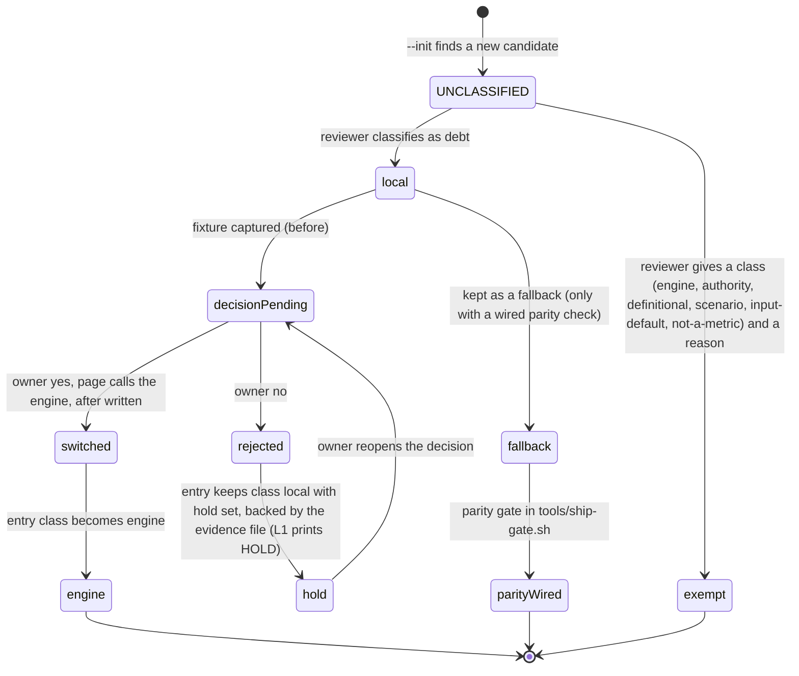
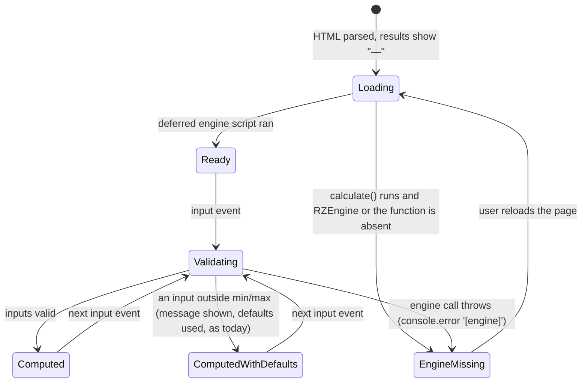
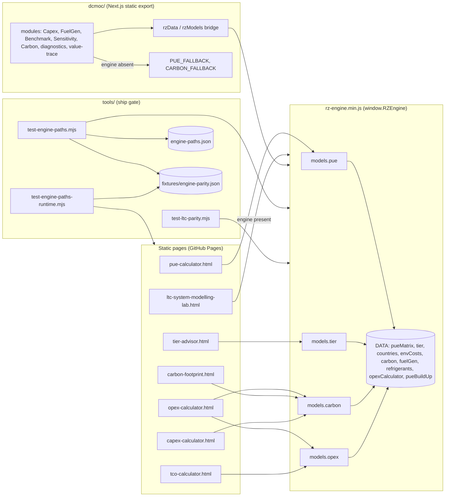
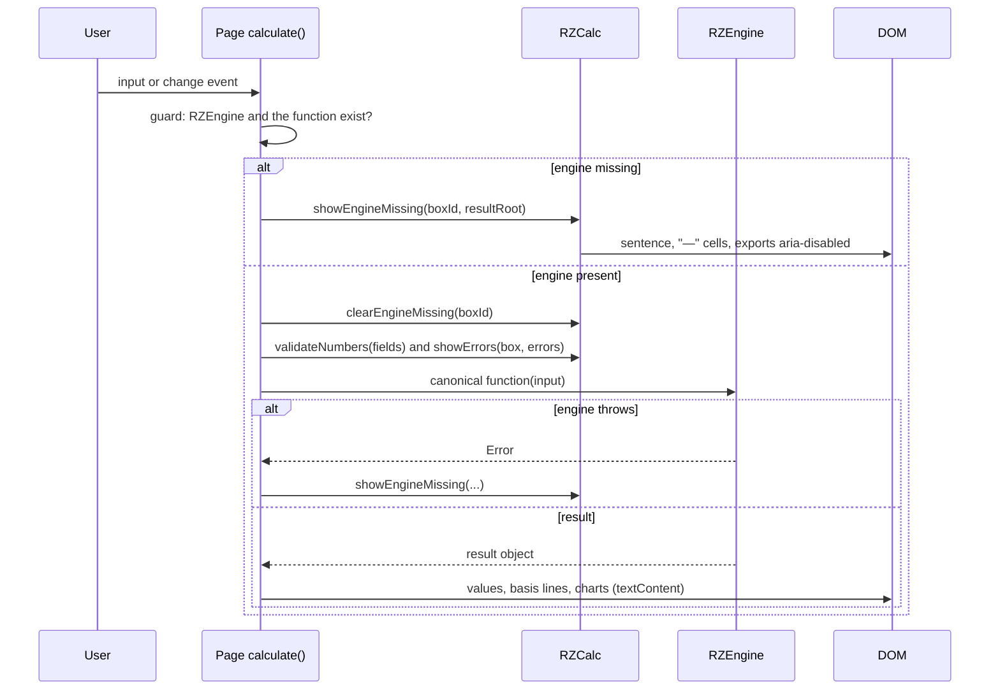

# PRD-Q04 — One engine path per metric: PUE, tier rating, carbon and OPEX energy come from `rz-engine.js` only

## 1. Document control

| Field | Value |
|---|---|
| PRD id | PRD-Q04 |
| Feature | Every calculator page and every DCMOC module gets PUE, the tier rating, carbon (grid factor, carbon price, Scope 1/2/3) and OPEX energy from one engine function per metric. Before a page is switched, a parity fixture records the local result and the engine result. Where they differ, a decision record says which is right, and the change ships with its evidence. A registry and two gates keep the rule after this release |
| Version | 1.0 |
| Status | Draft |
| Author | Opus 5.5; Fable quota exhausted |
| Date | 2026-11-11 |
| Owner requests | R110 (a PRD per idea), R111 (24-section structure) |
| Priority | 67.5 (addendum rank 8: impact 8, innovation 3, confidence 8, effort score 5 = 4 weeks; `documentation/PRODUCT_INNOVATION_ASSESSMENT_2026-11_ADDENDUM.md:83`, section `:262-282`) |
| Related findings | Q4 (`…_ADDENDUM.md:262-282`); maturity row "Engine consistency across tools: 2" (`:32`); X5 (`:51`, owned by the peer session, a dependency only). New findings N1–N12 (§3.3). Corrections to the addendum C1–C6 (§3.4) |
| Dependencies | **X5** (peer): the three `Math.random()` noise lines in `tier-advisor.html` (`:786`, `:810`, `:1166`) are not touched here; both changes keep the variable `composite` (§13). **P8** (peer, Q5 merged into it): the Monte Carlo panels on opex, pue, carbon and tier read the values this PRD makes canonical. **P16** (peer): engine version manifest; named by the addendum as an integration point (`:272`); this PRD does not change any pinned cockpit engine. **PRD-Q06** (this program): the LTC and DCMOC fallback lines; Q4 relies on them for the two fallbacks it keeps. **`standarization/ENGINE_UNIFICATION.md`**: the charter this PRD finishes for the root calculators (`:85` "Root-calculator consumers still to migrate") |
| Related modules | `rz-engine.js` (+ `rz-engine.min.js`); `tier-advisor.html`; `carbon-footprint.html`; `opex-calculator.html`; `pue-calculator.html`; `tco-calculator.html`; `capex-calculator.html` (grid table only); `js/rz-calc-utils.js`; `js/ltc-system-modelling-lab.js` (no code change, parity wiring only); DCMOC: `dcmoc/src/constants/pue.ts`, `state/adapters/arch-adapter.ts`, `state/adapters/capex-adapter.ts`, `lib/CapexEngine.ts`, `lib/decision/deterministicProvider.ts`, `lib/diagnostics.ts`, `lib/value-trace.ts`, `modules/analytics/CarbonEngine.ts`, `modules/analytics/BenchmarkEngine.ts`, `modules/analytics/SensitivityEngine.ts`, `modules/infrastructure/FuelGenEngine.ts`, `components/modules/StrategicPlanningDashboard.tsx`, `components/modules/CapexDashboard.tsx`, `components/modules/DesignToolsDashboards.tsx`, `components/modules/sustainability/EnergyAuditPage.tsx`; manuals `manual/opex.html`, `manual/pue.html`, `manual/carbon.html`, `manual/tier.html`, `manual/tco.html`, `manual/dcmoc.html`; NEW `tools/engine-paths.json`, `tools/fixtures/engine-parity.json`, `tools/test-engine-paths.mjs`, `tools/test-engine-paths-runtime.mjs`; `tools/ship-gate.sh`; `CLAUDE.md`; standards docs (§22.4) |
| Target wave | Addendum roadmap "Foundations, weeks 3–8" (`…_ADDENDUM.md:556`). The implementation wave is set in `04-implementation-plan/PROGRAM.md` (to be written by the main session) |
| Approval status | Approved by owner R110/R111 2026-11-10. Approval class "ordinary; any change in output needs evidence" (`01-improvement-register/REGISTER.md:17`). Decisions D-1 to D-9 (§12.3) change visible numbers; each one ships only with its evidence table and the owner's yes. D-8 removes a silent local fallback on five pages; the main session should confirm with the owner that this is not a "feature removal" in the sense of `STATE.md` ("Approval is still required for: … feature removal") |
| Facts verified at | `wt-hub3` commit `2f458f7c5` (2026-11-11, "docs: record P2 interface agreement for Q3"), working tree clean |

Change history

| Version | Date | Author | Change |
|---|---|---|---|
| 1.0 | 2026-11-11 | Opus 5.5 | First complete draft, all 24 sections. Every fact re-verified on `2f458f7c5` with the commands quoted in §3 |

## 2. Executive summary

The site computes the same metric in many places, and the places disagree. This was verified on `2f458f7c5`:

- `tier-advisor.html` scores tiers with its own copy of the engine's tables. It does not load the engine at all: the only
  `rz-engine.min.js` tag in the file is inside the print-window HTML string (`:1457`). Today the copy is exact
  (5,000 seeded input sets, 0 mismatches). Nothing keeps it exact.
- `opex-calculator.html` shows a PUE of base + cooling delta (`:1687`), but its energy cost uses a different PUE
  (`:1691`). The two differ in 41 of the 42 cooling × climate combinations, by up to 16.0 %. One facility gets three
  annual-energy figures on one page: 10.716, 10.118 and 9.198 GWh (air-cooled chiller, tropical humid, base PUE 1.5).
- The engine's own carbon functions use the US grid factor and the US carbon price for 34 of the 40 countries in
  `DATA.countries`. DCMOC's "Carbon Levy" line reads $194,472 a year for a 1 MW facility in the United States, France,
  Sweden, South Africa and Thailand alike. The United States has no compliance carbon price in the engine's own
  carbon-price table (`DATA.envCosts`, `US: 0`).
- DCMOC gives a Tier 2 or Tier 4 scenario two PUEs: the summary reads the tier column, while Capex, FuelGen,
  Benchmark, Sensitivity and diagnostics read the Tier 3 column. 8 of the 12 cooling × tier combinations disagree.
- The EU carbon price appears as 61, 65, 68 and 85 USD/t in four places. Scope 3 has three methods: 0.15 t per kW
  of IT a year, 3,200 t per MW spread over the life, and 12 % of Scope 1 + 2.
- The addendum says PUE is computed by "9 code paths". A scan of the scoped code finds 74 PUE statements in 29 files
  outside the engine; 22 of them are local formulas or tables that should be engine calls.

This PRD:

1. Names one canonical engine function per metric (§11.1) and lists every other occurrence in a registry,
   `tools/engine-paths.json`, with a class: engine call, physical cockpit engine ("authority"), parity-proven fallback,
   definitional ratio, labelled scenario, input default, or not a metric. The class `local` is the debt; it must
   reach 0.
2. Fixes four engine defects first: the rear-door PUE key, the carbon country resolution, the carbon price basis and
   the missing inputs on `models.carbon.scopes`.
3. Moves three page models into the engine verbatim (opex energy, the pue-calculator build-up, the DCMOC climate
   penalty), so the switch changes no number by itself.
4. Switches `tier-advisor`, `carbon-footprint`, `opex-calculator`, `pue-calculator`, the capex grid factor and the
   DCMOC modules to engine calls, keeping their DOM ids. Deletes the dead PUE tables in `tco-calculator` and the PUE
   numbers its cooling labels print but never use.
5. Removes the silent local fallback on the five calculator pages. If the engine does not load, the page says so and
   shows "—". It keeps two fallbacks that are parity-proven and labelled: DCMOC's PUE table and the LTC lab's inline
   model.
6. Records every changed number before it changes: a fixture with the old value, the engine value, the decision and
   its source (§12.3, §22.8).

| Measure | Today (`2f458f7c5`) | After |
|---|---|---|
| Registry entries of class `local` (PUE, tier, carbon, OPEX energy) | 60 (prototype scan, §3.2 F1) | 0, or owner holds (§22.1) |
| `RZEngine` calls in `tier-advisor.html` | 0 (engine not loaded) | 1 per calculation |
| Countries for which `models.carbon.gridFactor(code)` returns that country's own value | 0 of 40 | 40 of 40 |
| opex cooling × climate combinations where the shown PUE is the PUE the energy cost uses | 1 of 42 | 42 of 42 |
| DCMOC cooling × tier combinations where every PUE consumer agrees | 4 of 12 (Tier 3 only) | 12 of 12 |
| Registry fallbacks with a wired, passing parity check | 0 of 6 | 6 of 6 |
| Calculator pages that show numbers computed without the engine when the engine is blocked | 5 | 0 |

## 3. Problem statement

### 3.1 Method

All facts below were read on `wt-hub3` at `2f458f7c5`. Numbers were computed in Node 24 against `rz-engine.js`
loaded with `require` (the file is UMD, `module.exports` at `rz-engine.js:15959`). Two throwaway scripts were used
for the counts in F1 and F2; T-1 and T-2 turn them into the gate and the fixture generator, so the counts are
reproducible from the repo after this PRD ships. No server, no browser and no file outside this PRD was touched.

### 3.2 Verified facts

**F1. Inventory: PUE is produced in far more than nine places.**
Scope scanned: root `*.html` (except `article-*.html`, `changelog.html`, `rz-ops-*.html`), `js/*.js` (except
`*.min.js` and the generated data file `js/spares-parts-catalog.js`) and `dcmoc/src/**/*.{ts,tsx}`. `embed/` is
out of scope (§5.2). Rule: inside executable code only (inline `<script>` without `src` and not `ld+json`, or a JS/TS
file), after blanking comments and string contents, a statement is a candidate when a name containing `pue`
(any case, not a derivative such as `…Gap`, `…Delta`, `target…`, `…Label`) is assigned (a) a division whose
denominator names IT power or energy, (b) an arithmetic adjustment of another PUE name, (c) an object literal of
numbers, or (d) a literal fallback `|| 1.x` / `?? 1.x`; or a function is named `pue…`.

Result: **74 candidate statements in 29 files.** Classified by hand (the full list is the registry seed, §10.2):

| Class | Count | Examples (file:line) |
|---|---|---|
| `local` (a page or module formula or table that should be an engine call) | 22 | `opex-calculator.html:1687` and the `pueImpact` table `:1314-1356`, `:1569`; `pue-calculator.html:887` (local fallback branch `:889`), `:1156`, `:1209`; `tco-calculator.html:966`, `:1021`; `dcmoc/…/arch-adapter.ts:59`, `:74`; `dcmoc/…/deterministicProvider.ts:29`; `dcmoc/…/StrategicPlanningDashboard.tsx:53`, `:102`; `dcmoc/…/value-trace.ts:1900`; `dcmoc/…/EnergyAuditPage.tsx:32`; `dcmoc/…/CapexDashboard.tsx:68`; `dcmoc/…/DesignToolsDashboards.tsx:371` |
| `authority` (a physical cockpit engine with its own validation gate) | 9 | `js/dcai-engine.js:172`, `:354`; `js/datahall-calculations.js:78`, `:257`, `:279` (locked); `js/conv-engine.js:504` (locked); `js/conv-design-basis.js:382`; `js/ltc-plant.js:357`, `:416` |
| `fallback` (runs only without the engine) | 6 | `js/ltc-system-modelling-lab.js:2814`; `dcmoc/src/constants/pue.ts:9`, `:18`; `dcmoc/…/deterministicProvider.ts:103`; `dcmoc/…/diagnostics.ts:236`; `dcmoc/…/DesignToolsDashboards.tsx:385` |
| `engine` (reads `DATA.pueMatrix` or calls `models.pue.*`) | 5 | `dcmoc/src/lib/scenarioSummary.ts:27`; `dcmoc/…/arch-adapter.ts:62`; `dcmoc/…/value-trace.ts:1565`, `:1646`, `:1803` |
| `definitional` (a ratio or average of values that already came from an engine or the user) | 5 | `datahallAI.html:7739`; `js/ltc-iso.js:21` (×3, ISO/IEC 30134-2 categories); `dcmoc/…/PortfolioEngine.ts:165` |
| `scenario` (a labelled what-if that perturbs an engine value) | 6 | `opex-calculator.html:2125`, `:2126` (tornado); `carbon-footprint.html:1676`; `datahallAI.html:14586` (COP sweep); `dcmoc/…/CapacityPlanningEngine.ts:187`, `:253` |
| `input-default` (the default of a user input) | 8 | `opex-calculator.html:1673`, `:2651`; `carbon-footprint.html:1244`, `:1683`; `roi-calculator.html:852`; `capex-calculator.html:1337`; `js/ltc-system-modelling-lab.js:147`, `:151` |
| `not-a-metric` (formatting, sorting, a UI handler, an example) | 13 | `pue-calculator.html:749`; `opex-calculator.html:2539`; `dcmoc/…/ReportDashboard.tsx:683`; `js/ltc-system-modelling-lab.js:6150`, `:6318`, `:6425`, `:7752` |

The scanner misses statements that span several lines or hide in a callback. Two such local PUE models were found by
reading: `pue-calculator.html:1490` (monthly PUE, `pue × (1 + (t − 20) × 0.008)`, floor 1.02) and
`opex-calculator.html:1691` (the PUE implied by the energy cost). Carbon and tier have their own patterns (§20.1);
the same prototype found 23 carbon statements in 8 files (18 local) and 7 tier statements, all local, in
`tier-advisor.html`. Two more local carbon tables are not matched by name and were found by reading
(`opex-calculator.html:1510`, `carbon-footprint.html:845`). Ten OPEX-energy statements on the four Q4 pages are
registered by anchor (§10.2). **Total `local` today: 23 PUE + 20 carbon + 7 tier + 10 OPEX energy = 60.**

Commands: the scan rule above, implemented in T-1 as `node tools/test-engine-paths.mjs --scan`; the same rule as a
throwaway Python script printed "FILES 31 CANDIDATES 81" before the two exclusions (1 `embed/` statement, 6 matches
inside the generated `js/spares-parts-catalog.js`).

**F2. tier-advisor does not load the engine; its local copy is exact today.**
- `grep -n -E '<script[^>]*src=' tier-advisor.html` → `:88` rz-version, `:89` mobile-nav, `:90` cookie-consent,
  `:1456`/`:1457` `html+='<script src="auth.js…'` and `html+='<script src="rz-engine.min.js?v=20261107-df30269e"…'`
  (inside the print-report string), `:1660`/`:1661` Chart.js. No `RZEngine` reference anywhere else in the file.
- Local scoring: `WEIGHTS` `:552`, `SCORE_MAPS` `:554`, `gv`/`gs` `:572-573`, `fuelScore` `:575-581`,
  `calculate()` `:582`, composite `:591`, Tier III/IV floors `:596-601`, bands `:603-609`, confidence `:612-615`.
- The engine has the same model: `models.tier.advise` at `rz-engine.js:14060-14095` with `DATA.tier.scoreMaps`
  (`:7331`), `DATA.tier.adviseWeights` (`:7329`) and `DATA.tier.gradeBands`.
- Parity: a Node harness evaluated `tier-advisor.html:552-609` with `gv(id)` bound to an input object and compared it
  with `models.tier.advise` on 5,000 seeded random input sets (all 15 selects, fuel 0–720 h, free and pro regional
  score): **0 mismatches** on composite, tier, grade, tierNum, canT3, canT4. Red check of the harness: changing the
  page weight `power: 0.35` to `0.30` gave **4,999 of 5,000 mismatches**.
- Page defaults (every select has an explicit `selected`; fuel `value="48"` at `:279`): engine result composite 58,
  "Tier II", grade C, canT3 true, canT4 false.
- The engine adds no `confidence`; the page computes it locally (`:612-615`) from unrounded scores.

**F3. opex shows one PUE and charges for another; three annual-energy formulas on one page.**
- `opex-calculator.html:1687` `const effectivePue = basePue + cooling.pueImpact;` (`pueImpact` table `:1314-1356`).
- `:1691` `coolingPowerKW = itLoadKW * (effectivePue - 1) * cooling.efficiencyMult * climate.coolingEnergyMult;`
  `:1692` adjusted total; `:1693` `annualKWh = adjustedTotalPowerKW * 8760 * utilization;` `:1694` energy cost.
- `:1552` (derived metrics) `annualKWh = itKW * pue * 8760 * util` with `pue = result.effectivePue` (`:1547`).
- `:2653` (per-kWh metric) `annualKWh = itLoadKW * basePue * 8760 * utilization`.
- Computed for base PUE 1.5, 1,000 kW, 70 % utilisation, all 7 cooling types × 6 climate zones (tables `:1254-1300`,
  `:1308-1357`): shown PUE ≠ energy PUE in **41 of 42** combinations, largest relative gap **16.0 %**. Examples:

| Cooling / climate | Shown PUE (`:1687`) | PUE the cost uses (`:1691`) | kWh behind the cost (`:1693`) | kWh in derived metrics (`:1552`) | kWh in the per-kWh metric (`:2653`) |
|---|---|---|---|---|---|
| water_chiller / tropical_humid (page default) | 1.50 | 1.5000 | 9.198 GWh | 9.198 GWh | 9.198 GWh |
| air_chiller / tropical_humid | 1.65 | 1.7475 | 10.716 GWh | 10.118 GWh | 9.198 GWh |
| immersion / cold | 1.25 | 1.0825 | 6.638 GWh | 7.665 GWh | 9.198 GWh |
| dlc / temperate | 1.35 | 1.1838 | 7.259 GWh | 8.278 GWh | 9.198 GWh |

- `manual/opex.html:118` says "Annual energy cost = IT_load_kW × effectivePUE × 8760 h/yr × utilization ×
  energyRate"; the code also multiplies the overhead by `efficiencyMult`, which the manual does not mention.
- The page header claims "engine opex model + RZEngine sim" (`:290`). Only the Monte Carlo and tornado call the engine
  (`:2103-2126`); the OPEX itself is computed by the page (`calculateOPEX`, `:1669-1905`).

**F4. opex carbon uses a page price table.**
`gridEmissionFactorOpex` `:1510` (patched from `DATA.countries` at `:1518-1528`) and `carbonPriceByRegion` `:1529`
(`ID: 5`, `US: 15`, `SG: 25`, `JP: 5`), used at `:1581-1585`. For Indonesia the site now has three carbon prices:
page 5, `DATA.carbon.carbonPrice.ID` 12 (`rz-engine.js:5829`), `DATA.envCosts.carbonPriceUsdPerT.ID` 1.8 (`:8373`).

**F5. carbon-footprint computes its own scopes with other factors.**
- Scope 2 `:1250-1255` (IT × PUE × 8760 × grid × (1 − renewable)); Scope 1 `:1258-1270` (IT kW × 0.3 L/kW/h ×
  generator hours × 2.68 + refrigerant from `COOLING_DATA` `:973-978`); Scope 3 `:1273` `itLoad * 0.15` ("Rough
  estimate"). Constants `:964-968`: offset 35, `CARBON_TAX_RATE = 65` "EU ETS 2025", diesel 2.68, HVO 0.54, 0.3 L/kW/h.
- Fixture F-CO2-01 (page defaults: US `:340`, 1,000 kW `:293`, PUE 1.52 `:303`, 200 generator hours `:408`, diesel,
  `air_crac`, leak 5 % `:392`, renewable 0): page Scope 1 **192.1 t** (160.8 genset + 31.3 refrigerant), Scope 2
  **5,326.1 t** (grid 0.40), Scope 3 **150.0 t**. Engine `models.carbon.scopes({mw:1, pue:1.52, region:'US',
  genTestHours:200})` → Scope 1 **116.5**, Scope 2 **4,926.6** (grid 0.37), Scope 3 **213.3** (3,200 t/MW over 15
  years). Scope 2 differs by +8.11 %.
- The "Carbon Tax" tooltip (`:741`) says "based on the jurisdiction's mandatory carbon pricing mechanism … Applies to
  Scope 1 and applicable Scope 2 emissions". The code charges the EU price 65 to every country and to the total
  including Scope 3 (`:1289`).
- HVO: page 0.54 kg CO₂/L (`:967`); engine `DATA.fuelGen.fuelTypeModel.hvo.co2PerUnit` 0.268 (`rz-engine.js:8898`).
- Refrigerant at the default: page 31.3 t (0.3 kg/kW, 5 %, GWP 2088); engine `scopes` flat 8 t/MW; engine
  `DATA.refrigerants.R410A` (charge 0.15 kg/kWth, GWP 2088) gives 15.7 t at 5 % leak.

**F6. The engine's carbon functions fall back to the United States for 34 of 40 countries.**
- `DATA.carbon.gridFactor` (`rz-engine.js:5823-5826`) has 9 codes: US, EU, APAC, LATAM, ID, SG, JP, IN, MY.
  `DATA.countries` has 40 countries, each with `environment.gridCarbonIntensity` (generated from
  `dcmoc/src/constants/countries.ts`, source row `rz-engine.js:9324`).
- `models.carbon.gridFactor` (`:12285-12288`) returns `DATA.carbon.gridFactor[c]` or the US value.
  `node -e "…gridFactor('TH'), gridFactor('DE')"` → `0.37 0.37` (Thailand 0.5, Germany 0.35 in `DATA.countries`).
  The 6 countries present in both tables also differ: US 0.37 vs 0.40, ID 0.68 vs 0.70, SG 0.41 vs 0.40, JP 0.47 vs
  0.50, IN 0.63 vs 0.72, MY 0.55 vs 0.60.
- Two carbon price tables: `DATA.carbon.carbonPrice` (`:5827-5830`, "compliance/voluntary blended", 9 codes) and
  `DATA.envCosts.carbonPriceUsdPerT` (`:8367-8376`, per-country compliance, 40 countries; source row `:9351`
  "World Bank Carbon Pricing Dashboard + OECD Effective Carbon Rates 2025 + NCCS Singapore"). The charter names
  `DATA.envCosts` the canonical carbon price (`standarization/ENGINE_UNIFICATION.md:37`). The engine's own cost
  functions read the other table: `models.carbon.annualCost` (`:12298-12302`), `models.opex` (`:11877-11878`,
  `:11942-11943`), the refrigerant model (`:9973`), renewables (`:10132`).
- `models.opex.fullBreakdown` "Carbon Levy" line, 1 MW, PUE 1.5: US, FR, SE, ZA and TH all return
  `{"annual":194472,"basis":"4862 tCO₂ × grid price","perCountry":true}`; ID returns 107,222. DCMOC shows this line as
  the "per-country sourced SSOT" (`dcmoc/src/lib/value-trace.ts:265`, `:803`).
- `models.carbon.annualCost(1, 1.52, 'US')` → $197,064 at $40/t, while `DATA.envCosts.carbonPriceUsdPerT.US` is 0.

**F7. DCMOC's CarbonEngine derives a country code from the country name and averages two sources.**
- `dcmoc/src/modules/analytics/CarbonEngine.ts:135`
  `carbonModel.annualTonnes(itLoadMw, pue, inputs.countryName.substring(0, 2).toUpperCase(), hoursPerYear)`;
  callers pass the display name (`diagnostics.ts:349` `countryName: c.name`). "Indonesia" becomes `IN` (India);
  "Singapore", "Malaysia", "Japan" and "United States" become codes the engine does not know, so they get the US value.
- `:140-142`: if the engine and the local value are within 30 %, the module shows their average; otherwise the local
  value. Effective Scope 2 grid factors: Indonesia 0.665, Singapore 0.385, United States 0.385, Japan 0.435,
  India 0.675, Malaysia 0.600. None equals either source for that country.
- Local constants `:83-85`: EU ETS 68 USD/t, diesel 2.68, 0.3 L per kW per hour; Scope 3 `:180` = 12 % of
  Scope 1 + 2.

**F8. Four EU carbon prices.** 61 (`DATA.envCosts`, EU ETS members, `rz-engine.js:8369`), 65
(`carbon-footprint.html:965`), 68 (`CarbonEngine.ts:83`), 85 (`DATA.carbon.carbonPrice.EU`, `rz-engine.js:5828`).

**F9. DCMOC uses two PUEs for one Tier 2 or Tier 4 scenario.**
- `getPUE(coolingType)` (`dcmoc/src/constants/pue.ts:18-23`) returns the Tier 3 column only.
- Tier-blind consumers: `lib/CapexEngine.ts:355`, `modules/infrastructure/FuelGenEngine.ts:163`,
  `modules/analytics/BenchmarkEngine.ts:58`, `modules/analytics/SensitivityEngine.ts:63`, `lib/diagnostics.ts:485`,
  `:494`, `lib/value-trace.ts:715`, `:791`, `:1648`, `:1804`.
- Tier-aware consumers read `pueMatrix[cooling]['tier' + tier]`: `lib/scenarioSummary.ts:30`,
  `state/adapters/capacity-adapter.ts:50`, `state/adapters/arch-adapter.ts:64`, `lib/value-trace.ts:1565`,
  `components/modules/operations/OperationsDashboard.tsx:47`, `…/OpexBreakdown.tsx:81`, `…/FinancialPage.tsx:79`,
  `…/SustainabilityEnginePage.tsx:47`, `…/ResultsEnginePage.tsx:96`, `components/dashboard/useDashboardData.ts:78`,
  `components/modules/FinancialDashboard.tsx:1211`.
- DCMOC has 4 cooling types × 3 tiers (`dcmoc/src/store/simulation.ts:9`, `:17`; default Tier 3 at `:126`). For
  8 of 12 combinations the two groups disagree:

| Cooling | Tier 2 (matrix / Tier 3 column) | Tier 4 (matrix / Tier 3 column) |
|---|---|---|
| air | 1.62 / 1.50 (+8.0 %) | 1.44 / 1.50 (−4.0 %) |
| inrow | 1.34 / 1.27 (+5.5 %) | 1.22 / 1.27 (−3.9 %) |
| rdhx | 1.24 / 1.18 (+5.1 %) | 1.14 / 1.18 (−3.4 %) |
| liquid | 1.22 / 1.15 (+6.1 %) | 1.10 / 1.15 (−4.3 %) |

  FuelGen sizes generator load from this PUE (`FuelGenEngine.ts:164`); Capex prints "Annual Energy" from it
  (`lib/CapexEngine.ts:356`, `components/modules/CapexDashboard.tsx:485`, `modules/reporting/pdf/CapexPdf.ts:108`).

**F10. DCMOC re-declares engine PUE data and keeps a dead table with wrong values.**
- `state/adapters/arch-adapter.ts:59` `LOCAL_PUE = { air: 1.5, inrow: 1.35, rdhx: 1.25, liquid: 1.15 }` (engine Tier 3:
  1.50, 1.27, 1.18, 1.15). It is reached only if `getPUE` throws (`:74`), which it cannot: `rzData()` returns `{}`
  when the engine is absent (`dcmoc/src/lib/rz-engine.ts:12`, `:61`), so `getPUE` falls to its own table.
- `:60` maps `inrow → 'air'` and `rdhx → 'rearDoor'` for `defaultFor` (`:66-72`). This branch is dead while the matrix
  read at `:64` succeeds, and DCMOC tiers are clamped to 2–4 (`:46`), which the matrix always has.
- `lib/decision/deterministicProvider.ts:29` `PUE_TARGET` = `{ air: 1.5, inrow: 1.4, rdhx: 1.35, liquid: 1.2,
  immersion: 1.1 }` duplicates `DATA.decision.pueTarget` (`rz-engine.js:8457`), same values.
- `components/modules/StrategicPlanningDashboard.tsx:53-59` `CLIMATE_PUE_PENALTY` (polar 0 … tropical 0.12) and
  `:102` `effectivePUE = Math.max(m.basePUE, m.targetPUE + climatePenalty)`: a local PUE model.
- Literal PUE defaults that differ from the scenario: `lib/value-trace.ts:1900` `susPueLive() ?? 1.3`;
  `components/modules/sustainability/EnergyAuditPage.tsx:32` `?? 1.4`.
- `components/modules/CapexDashboard.tsx:68` and `components/modules/DesignToolsDashboards.tsx:371` pass
  `pueTarget: 1.15`, which duplicates the engine's own default (`rz-engine.js:9843` `a.pueTarget || 1.15`).

**F11. The engine maps "rear-door" cooling to the liquid PUE row.**
`DATA.coolingTypes.rearDoor.pueKey` is `'liquid'` (`rz-engine.js:5856`); the `rdhx` row exists since v2.3.0
(`:94`, `:100`). `models.pue.defaultFor('rearDoor', 2|3|4)` → 1.22, 1.15, 1.10; the rdhx row is 1.24, 1.18, 1.14. The
only caller outside the engine is the dead DCMOC branch (`arch-adapter.ts:69`), so no screen shows the error today.

**F12. pue-calculator: the engine does the division only; two different build-up models on one page.**
- Tables `pue-calculator.html:701-718`, UPS interpolation `:731-743`, build-up `:834-883`; the engine is used for the
  ratio and DCiE with a local fallback (`:887-892`); energy and cost are local (`:893-894`).
- `estimatePue()` (`:1209-1228`) is a second build-up used for the what-if cards (`:1172-1180`). It fixes PDU loss and
  transformer loss at 1.5 %, while `calculate()` uses the pro inputs (`:852-856`, `:873`, `:876`). For a pro user who
  changes the PDU type or transformer loss, the what-if baseline is not the PUE shown above it.
- What-if `:1156` (`max(1.02, PUE − delta)`) and monthly PUE `:1490` are local models.
- Default PUE (free user), hand-computed from `:834-893` with the defaults read from the HTML (1,000 kW, 8 kW/rack,
  CRAH, cold containment, subtropical, double-conversion UPS at 50 %, N+1, 8 W/m², 0.5 and 0.1 kW per rack):
  125 racks, cooling 260.0 kW, UPS loss 95.65 kW, transformer 15.0, PDU 15.0, facility 78.0 kW → **PUE 1.4637**.
  T-2 captures the page's own value in the browser.
- The climate multipliers differ from opex for the same six zone keys: pue-calculator `tropical_humid 1.15 …
  cold 0.78` (`:704-709`); opex `tropical_humid 1.00 … cold 0.55` (`:1257-1297`).

**F13. tco keeps a stale cooling PUE table and its own industry average; neither is read, but the labels print them.**
`tco-calculator.html:966` `COOLING_PUE = { air: 1.4, 'chilled-water': 1.25, evaporative: 1.15, dlc: 1.08 }`; only `air`
is patched from the engine (`:968-974`). `dlc` 1.08 vs engine liquid Tier 3 1.15; DCMOC already reconciled the same
fact ("engine liquid tier3 = 1.15 (was 1.08 local)", `dcmoc/src/constants/pue.ts:4`). `chilled-water` and `evaporative`
have no engine row. `:1021` `globalAvgPUE: { 2025: 1.55, target2030: 1.30 }` vs `DATA.pueBenchmark.industryAvg` 1.52
(2026, `rz-engine.js:84`).
- `grep -n 'COOLING_PUE\|BENCHMARKS' tco-calculator.html` → only the declarations (`:966`, `:1019`) and the patch
  (`:972`). Both tables are dead code. The TCO uses the PUE input `#tcoPue` (`:382`, default 1.3, read at `:1224`).
- The cooling choice enters no calculation: `tcoCooling` is read at `:1226`, stored at `:1381` and echoed in the CSV
  at `:1131`. Yet its option labels print PUE values (`:399-402`: "Air Cooled (PUE ~1.40)", "Chilled Water (PUE
  ~1.25)", "Evaporative (PUE ~1.15)", "Direct Liquid Cooling (PUE ~1.08)"). The air label says 1.40 while the
  engine's air Tier 3 value is 1.50; none of the four is used.
- `tcoPowerAnnual` (`:1189-1194`) calls `models.opex.powerCostAnnual` and falls back to the same formula inline
  (`:1193`) when the engine is missing.

**F14. The LTC lab is already on one path; its fallback parity check exists but is not wired.**
- `computeModelLegacy` delegates to `RZEngine.models.ltc.compute` when the engine is loaded
  (`js/ltc-system-modelling-lab.js:2708-2711`); the inline tables run only without the engine.
- With comments and whitespace removed and the delegation guard taken out, the inline body equals the frozen
  `computeModel` in `tools/test-ltc-parity.mjs`; that test passes **15,750 / 15,750** checks against
  `models.ltc.compute` ("max relative drift: 0.000e+0").
- `grep -rn 'test-ltc-parity' tools/*.sh CLAUDE.md` → nothing. The only mention is a comment in
  `tools/test-ltc-lab-golden.mjs:5`. The three tables the inline body reads (`CLIMATE_FACTORS` `:44`,
  `RACK_PROFILES` `:51`, `COOLANTS` `:59`) are not compared with the test's copies.

**F15. OPEX energy: 52 facility-energy products outside the engine.**
Statements that multiply a PUE-like quantity by 8,760 outside the engine: 52 in 24 files (capex 11, tco 6, opex 5,
DCMOC `SimulationDashboard.tsx` 4, carbon-footprint 3, …). Most are products of an engine PUE and a user input. Q4
moves the ones on its four pages that embed a page model (10 anchors, §10.2); the rest is follow-up FU-1 (§5.2).

**F16. Two engine tier functions answer different questions.**
`models.tier.classify` (`rz-engine.js:14046`, five 0–100 sub-scores, redundancy cap) is used by DCMOC Design Tools
with sub-scores mapped from cooling and redundancy (`dcmoc/src/components/modules/DesignToolsDashboards.tsx:190-197`,
labelled "screening"). `models.tier.advise` (`:14060`) scores component selections. They take different inputs, so
they stay two functions; the registry documents which surface uses which (§11.1).

### 3.3 New findings (not in the addendum)

| Id | Finding | Evidence |
|---|---|---|
| N1 | Engine carbon functions use the US grid factor for 34 of 40 countries | F6 |
| N2 | Engine cost functions read the carbon price table the charter does not name; the US is charged $40/t | F6 |
| N3 | DCMOC Scope 2 uses a code made from the country name and averages two sources | F7 |
| N4 | Four EU carbon prices; three Scope 3 methods | F5, F7, F8 |
| N5 | opex shows one PUE and charges for another; three kWh formulas | F3 |
| N6 | opex header claims "engine opex model" | F3 |
| N7 | DCMOC Tier 2/4 scenarios carry two PUEs | F9 |
| N8 | Engine maps rear-door cooling to the liquid PUE row | F11 |
| N9 | pue-calculator what-ifs use a second, different build-up | F12 |
| N10 | carbon-footprint "Carbon Tax" applies the EU price to every country and to Scope 3, against its own tooltip | F5 |
| N11 | The LTC parity test exists but is not in the ship gate | F14 |
| N12 | Two climate multiplier tables for the same six zone keys (pue-calculator, opex) | F12 |
| N13 | tco cooling labels print four PUE values that no calculation uses (air 1.40 vs engine 1.50); the tables behind them are dead code | F13 |
| N14 | `tools/test-reference-parity.mjs` (DATA.countries = `countries.ts`, 155/0 today) runs in no gate: `grep -c test-reference-parity tools/ship-gate.sh` → 0 and `.github/workflows/` holds only `supabase-keepalive.yml`, although `ENGINE_UNIFICATION.md:74` says it "fails CI" | §20.4 |

### 3.4 Corrections to the addendum

| Id | Addendum says | Verified |
|---|---|---|
| C1 | "PUE is computed by 9 code paths" (`:263`, `:32`) | No list is given, so "9" cannot be reproduced. Under the rule in F1: 74 statements in 29 files outside the engine, 22 of them local, plus 2 multi-line local models found by reading |
| C2 | "tier-advisor ignores `models.tier.advise`" (`:263`) | True, and the page does not load the engine at all (F2). The local copy is exact today, so the switch changes no number |
| C3 | `models.tier.advise` at `rz-engine.js:14058` (`:32`) | `:14058` is its doc comment; the function starts at `:14060` |
| C4 | "carbon-footprint duplicates `models.carbon`" (`:263`) | It duplicates the arithmetic with different factors (F5). The engine's carbon functions are themselves wrong for 34 of 40 countries (F6). Switching the page to `models.carbon` as it stands would make the page worse; the engine is fixed first (FR-4) |
| C5 | "OPEX computes PUE locally (line 1687)" (`:263`) | True; the larger defect is that the energy cost does not use that PUE (F3) |
| C6 | Integration point "the cockpits" (`:272`) | The cockpit engines are physical models with their own inputs and gates; they are registered as authorities, not rewritten (§5.2). The LTC lab already calls the engine (F14) |

### 3.5 Consequence of leaving it

A user who opens two tools with the same inputs gets two answers, and nothing on screen says why. A fix in the
engine reaches only some pages. Carbon costs shown to DCMOC users outside the six covered countries are the US
numbers. A Tier 4 DCMOC scenario sizes generators and prints energy on a Tier 3 PUE. The site's own charter
("rz-engine.js is the single brain", `ENGINE_UNIFICATION.md:8`) and accuracy rule ("One source of truth",
`standarization/ACCURACY_VALIDATION.md:10`) are not true for the root calculators, and no gate notices when the next
copy is added.

## 4. Objectives and success metrics

| # | Objective | Metric | Method | Baseline | Target | Assumption |
|---|---|---|---|---|---|---|
| O1 | One registered path for every PUE, tier, carbon and OPEX-energy statement in scope | `local` entries; unregistered candidates; stale entries | `node tools/test-engine-paths.mjs --law L1` | 60 / not measured / — | 0 (or owner holds, §22.1) / 0 / 0 | The scanner rule in §20.1 is the definition; misses are caught by anchors and by L2–L6 |
| O2 | tier-advisor shows the engine's result | static checks + 200 seeded browser cases | L2 | 0 engine calls | 200 / 200 equal | — |
| O3 | Every DCMOC PUE consumer agrees with the engine for every cooling × tier | combinations agreeing | L3 | 4 / 12 | 12 / 12 | DCMOC keeps 4 cooling types and Tiers 2–4 |
| O4 | One grid factor and one carbon price per country | countries resolving to their own grid value; page price tables | L4 | 0 / 40; 3 page tables | 40 / 40; 0 | D-1 and D-2 approved as recommended |
| O5 | carbon-footprint shows the engine's scopes | fixtures equal (5) | L5 | 0 / 5 | 5 / 5 | D-4 approved |
| O6 | opex shows the PUE it charges for; one kWh figure | combinations consistent (42) | L6 | 1 / 42 | 42 / 42; energy cost unchanged in 42 / 42 | D-3 option A approved |
| O7 | Every kept fallback is parity-proven and wired | fallbacks with wired passing check | L7 | 0 / 6 | 6 / 6 | — |
| O8 | No calculator shows numbers without the engine | pages showing the missing-engine line and "—" with the engine blocked | L8 | 0 / 5 | 5 / 5 | — |
| O9 | No output changes silently | changed fixtures with a `before` value, a decision id and a CHANGELOG row | review of `tools/fixtures/engine-parity.json` against CHANGELOG at T-18 | — | 100 % | — |

No user-count, traffic or revenue target is set; the site has no measurement of how many people compare tools, and
none is invented here.

## 5. Scope

### 5.1 In scope

1. Engine: `models.pue.defaultFor` key resolution and the rear-door key (FR-3); carbon country resolution and price
   basis (FR-4); `models.carbon.scopes` inputs (FR-5); `models.tier.advise` additive outputs (FR-6); the opex energy
   model moved into the engine (FR-7); the pue-calculator build-up, monthly and improvement models moved into the
   engine (FR-8); the DCMOC climate penalty moved into the engine (FR-14).
2. Pages: tier-advisor (FR-9), carbon-footprint (FR-10), opex (FR-11), pue-calculator (FR-12), tco and the capex grid
   table (FR-13), the missing-engine state on all five (FR-16).
3. DCMOC: tier-aware PUE everywhere, one fallback table equal to the engine, dead table removed, engine data instead of
   copies (FR-14); carbon through the engine (FR-15); rebuild.
4. LTC lab: wire the existing parity test and add a freshness check of the inline copy (FR-17).
5. Registry, fixtures, two gates, wiring (FR-1, FR-2, §20).
6. Decision records and evidence for every changed number (FR-18); manuals, standards, catalog (FR-19).

### 5.2 Out of scope

| Item | Why | Nearest real contract / follow-up |
|---|---|---|
| The cockpit physical engines (`js/dcai-engine.js`, `js/datahall-calculations.js`, `js/datahall-model.js`, `js/conv-engine.js`, `js/conv-design-basis.js`, `js/ltc-plant.js`) | Different models with their own inputs and validation gates; three are byte-locked (`tools/ship-gate.sh:349-361`) and `dcai-engine.js` is version-pinned (`tools/test-dcai-engine-version-pin.mjs`, gate `:88`) | Registered as `authority` with their gate (§10.2) |
| tier-advisor and tia-942 noise bands (X5) | Owned by the peer session | Coordination in §13 |
| Monte Carlo panels | P8 (peer) | They read the values this PRD makes canonical |
| The non-energy OPEX lines on opex-calculator (staffing, maintenance, spares, software, insurance, compliance) and `models.opex.totalAnnual` vs the page's total | Different model structures; every OPEX number would change; needs its own study | FU-2: parity report + owner decision |
| The 42 facility-energy products outside the four Q4 pages (F15) | Products of an engine PUE and a user input; no model to move | FU-1; T-1 prints them with `--report energy` |
| `embed/pue-widget.html`, `embed/carbon-widget.html` | Stand-alone widgets that do not load the 168 KB (gzip) engine by design; `embed/carbon-widget.html:379` has its own grid table | FU-3: generate the widget table from `DATA.countries` at build time |
| Merging the two climate multiplier tables (N12) | A modelling choice that needs a source | FU-4; after this PRD both live in the engine under separate names, labelled |
| `models.tier.classify` vs `advise` (F16) | Different inputs | Documented in the registry `canonical` block |
| pue-calculator percentile bands (`:1140-1145`) | A classification of the PUE, not a PUE value; no engine source exists | FU-5 (Q6-style provenance) |
| Article calculators (`article-*.html`) | The charter's article program already bound them (`ENGINE_UNIFICATION.md:100-116`) with an inline fallback; not in the addendum's Q4 scope | Left as is |
| `.rz-calc-validation` red tint (`js/rz-calc-utils.js:21-24`) | Existing component used by every calculator; tool pages override part of it (`css/rz-tool.css:102-104`). Q4 changes only its radius, 8 → 4 px, because the box now carries the missing-engine state (FR-16) | Tint logged OPEN in `UIUX_AUDIT_LEDGER.md` (§22.4) |
| The rest of tco's unused `BENCHMARKS` object (`tco-calculator.html:1019-1033`) | Not a Q4 metric; dead code outside the request | Reported in the T-13 notes, not deleted |
| Explain-DB text "Industry average sits around 1.55" (`js/rz-explain-db.js`, entry `pue`) vs `DATA.pueBenchmark.industryAvg` 1.52 | Tooltip text, not a computed path | FU-6 |

### 5.3 Existing capabilities reused

| Capability | Where |
|---|---|
| Canonical PUE data | `DATA.pueMatrix` `rz-engine.js:93-107`; `DATA.pueBenchmark` `:84`; `DATA.pueDefaults` `:88-92` |
| PUE functions | `models.pue.pueFromInputs` `:12115`, `dcie` `:12121`, `defaultFor` `:12130`, `partialLoadPUE` `:12137`, `annualEnergyCost` `:12155` |
| Tier model | `models.tier.advise` `:14060-14095`, `DATA.tier.scoreMaps` `:7331`, `adviseWeights` `:7329` |
| Carbon data and models | `DATA.carbon` `:5822-5837`; `DATA.envCosts` `:8366-8384`; `DATA.countries` `:234…`; `DATA.fuelGen.fuelTypeModel` `:8896-8903`; `DATA.refrigerants` `:6762`; `models.carbon` `:12283-12324` |
| Opex power model | `models.opex.powerCostAnnual` `:11767-11778` |
| LTC engine and parity test | `models.ltc.compute` `:15274-15376`; `tools/test-ltc-parity.mjs` |
| Calculator utilities | `RZCalc.showErrors(boxId, errors)` `js/rz-calc-utils.js:54-60`; validation boxes `#opexValidation` `opex-calculator.html:835`, `#carbonValidation` `carbon-footprint.html:264`, `#pueValidation` `pue-calculator.html:288`, `#tcoValidation` `tco-calculator.html:504`; tool styling `css/rz-tool.css:95-104` (`.res-head .basis`, `.tool-valid`) |
| DCMOC engine bridge | `rzData()` / `rzModels()` `dcmoc/src/lib/rz-engine.ts:61-66`, `useEngineReady()` `:88` |
| Engine catalog, value bindings, trace parity | `tools/build-engine-catalog.mjs`, `tools/test-value-bindings.mjs`, `tools/_dcmoc_trace_parity_probe.mjs` (`CLAUDE.md:92`) |
| Served-tree block for browser gates | `tools/ship-gate.sh:312-347` |
| Saved scenarios (inputs only) | `js/rz-scenario.js:1-12`; table `saved_scenarios` `supabase/schema.sql:280` |

### 5.4 Dependencies

X5 and P8 (peer), P16 (peer), PRD-Q06 (FR-13/FR-14 there: LTC and DCMOC fallback lines). None blocks the start: T-1
to T-8 touch only the engine and new tool files.

### 5.5 Constraints

- Static site, no build for pages; vanilla ES5 in `rz-engine.js` (UMD); DCMOC is a Next.js static export rebuilt with
  `cd dcmoc && npx next build --webpack` and copied with `rm -rf _next _not-found && cp -r out/. .`.
- Locked engines stay byte-identical (`tools/ship-gate.sh:349-361`).
- Engine changes are additive where possible ("Engine additive-only", `ENGINE_UNIFICATION.md:127`); a default that
  changes is a decision with evidence (§12.3).
- Design register (§9.14); no new colours, no motion.

### 5.6 Assumptions

| Id | Assumption | If wrong |
|---|---|---|
| A1 | The five calculator pages can require the engine: it is a same-origin static file already loaded by four of them | D-8 is reversed and each page keeps a parity-proven fallback with a visible line (the LTC pattern) |
| A2 | `DATA.countries` grid values are at least as good as `DATA.carbon.gridFactor` for the six overlapping countries | T-4 checks both against the primary source both cite (Ember); the table that matches wins; the other is corrected |
| A3 | Users accept that some numbers change, given the evidence table | The owner rejects a decision; that page keeps its local path and its registry entries stay `local` with a `hold` (§22.1); L1 reports them as HOLD and the CHANGELOG lists them |

## 6. User personas and use cases

Tiers as the site has them: `free | demo | pro | root` (`js/rz-feature-flags.js:5`); a signed-out visitor resolves to
`free` (`auth.js:1026`, `:1036`); `educator` is a role on tier `pro` (`js/rz-feature-flags.js:8-11`).

| Persona | Real role | Goal on these pages | Tier |
|---|---|---|---|
| P1 Facility / DC engineer | Sizes a design, checks a vendor claim, compares tools | The same inputs give the same PUE, tier and carbon on every tool | free or pro |
| P2 Energy or sustainability analyst | Prepares a carbon or energy figure for a report | Know which grid factor and carbon price a number used, for the selected country | pro (carbon pro mode, opex advanced) |
| P3 Student or educator | Coursework on PUE, tiers and carbon | Numbers that agree between the calculator, the manual and the LTC lab | free; LTC lab needs pro |
| P4 Owner (root) | Runs DCMOC; approves decisions D-1 to D-9 | DCMOC modules agree with each other and with the calculators; every changed number has evidence | root |
| P5 Signed-out visitor | Arrives from search | Results that are either the engine's or plainly absent | free |
| P6 Contributor (the main session today; any later engineer) | Adds or edits a calculator | Told by the gate, at the line, when a formula should be an engine call | n/a |

Access on the pages this PRD touches (unchanged by this PRD; no page has a `page-access` gate):

| Page | free (= signed-out) | demo | pro / educator | root | Evidence |
|---|---|---|---|---|---|
| tier-advisor | basic scoring | + regional scoring, recommendations, Monte Carlo, tornado | same as demo + PDF without watermark | all | `js/rz-feature-flags.js:170-179` |
| carbon-footprint | operational and lifecycle tabs | + pro mode (compliance panel, Monte Carlo, tornado) | same + PDF without watermark | all | `:145-155` |
| opex-calculator | basic | + advanced mode, staffing model, Monte Carlo | same + multi-scenario | all | `:84-96` |
| pue-calculator | basic | + advanced mode, economizer inputs, Monte Carlo | same + multi-scenario | all | `:54-66` |
| tco-calculator | basic | + advanced inputs, Monte Carlo | same + multi-scenario | all | `:112-125` |
| DCMOC (`dcmoc/`) | locked | locked | locked | view (email allowlist) | `:251-254`; `auth.js:332-338` |
| LTC lab | locked | locked | view | view | `:313-314` |

Use cases:

| Id | Actor | Use case | Expected outcome after this PRD |
|---|---|---|---|
| UC1 | P1 | Scores a facility in tier-advisor at the page defaults | Composite 58, "Tier II", grade C, computed by `models.tier.advise`; the header basis line names the engine function |
| UC2 | P1 | Picks "Air-Cooled Chiller" and "Tropical Humid" in opex at base PUE 1.50 | A line under the PUE control reads "Effective PUE used for energy: 1.75 (base 1.50 · Air-Cooled Chiller · Tropical Humid)"; the energy cost is unchanged; the derived metrics and the per-kWh figure use the same 10.716 GWh |
| UC3 | P2 | Runs carbon-footprint for France | Scope 2 uses France's grid factor from `DATA.countries`; "Carbon Tax" uses France's compliance price from `DATA.envCosts` and applies it to Scope 1 + 2; the basis line names both |
| UC4 | P4 | Sets a DCMOC scenario to Tier 4, liquid cooling | Summary, Capex energy, FuelGen load, Benchmark and Sensitivity all use PUE 1.10 |
| UC5 | P4 | Opens DCMOC Financial for a facility in Sweden | "Carbon Levy" shows Sweden's compliance price × Sweden's grid factor, with the basis text, not the US figures |
| UC6 | P5 | Opens any of the five calculators while `rz-engine.min.js` fails to load | The validation box reads "The calculation engine did not load, so no results are shown. Reload the page to try again."; result cells show "—" |
| UC7 | P3 | Opens the LTC lab without the engine | As today plus Q6: the inline model runs, labelled; Q4 guarantees it equals the engine (parity gate) |
| UC8 | P6 | Adds `const pue = facilityKw / itKw;` to a page | `tools/test-engine-paths.mjs --strict` fails with "L1 FAIL unregistered pue <file>:<line> - (-, -) — call RZEngine.models.pue.pueFromInputs or register the statement with a class and a reason" (grammar in §11.4) |

## 7. Complete user journey

### 7.1 A calculator page (P1, P2, P5): tier-advisor, opex, carbon-footprint, pue-calculator, tco

| Step | What happens |
|---|---|
| Entry points | `tools.html` cards; search results; links from articles and manuals; account page "Open" on a saved scenario (`js/rz-scenario.js:9-12`, auto-restore via `localStorage.rz_open_scenario`) |
| Initial state | Static HTML shows "—" in every result cell (tier-advisor's static numbers `:425-434` are replaced, FR-9). `rz-engine.min.js` loads with `defer` before `DOMContentLoaded` |
| Engine ready | The page's existing init calls `calculate()` (tier-advisor `:1646-1658`; carbon `:2121-2146`; others unchanged). `calculate()` reads the DOM inputs, validates them with the page's existing `RZCalc.validateNumbers` call, builds one input object and calls the canonical engine function (§11.1) |
| Success | Result cells, bars, charts and the PDF builder read the engine result. The header basis line (`.res-head .basis`) names the engine function and the data sources (copy in §9.10) |
| Input change | `oninput`/`onchange` handlers are unchanged; each recomputes through the engine; no local path remains |
| Validation failure | As today: the validation box lists the bad inputs ("Check 1 input: IT load must be 50–100000"); the engine is called with the page's existing defaults, as today |
| Engine missing | `window.RZEngine` (or the needed function) is absent when `calculate()` runs: the validation box shows the missing-engine line (FR-16), every result cell shows "—", charts are not drawn, PDF export is disabled with the same line as its tooltip. No exception escapes to the console |
| Recovery | The user reloads; the service worker serves the token-addressed engine file (cache-first for static assets, `sw.js:2`); a new release changes the `?v=` token, so a stale copy is never mixed with new page code |
| Exit | PDF export, scenario save (inputs only, `supabase/schema.sql:280` `payload jsonb`), navigation away. Nothing new is persisted |

### 7.2 Same inputs across tools (P1)

1. P1 sets 1,000 kW and PUE 1.52 in carbon-footprint (US). Scope 2 = 1,000 × 1.52 × 8,760 × grid(US) / 10⁶ t.
2. P1 opens opex with 1,000 kW, base PUE 1.50, water-cooled chiller, tropical humid: effective PUE 1.50 (no adjustment
   for this pair), energy from `models.opex.energyAnnual`.
3. P1 opens pue-calculator at its defaults: PUE from `models.pue.buildUp` (1.4637 by hand, §3.2 F12).
4. The three PUEs differ because the inputs differ, and each page's basis line says which inputs and which function.
   Where two pages take the same inputs (DCMOC modules; the pue-calculator main result and its what-if baseline;
   opex's shown and charged PUE), they now give the same number.

### 7.3 DCMOC (P4)

1. Owner signs in; DCMOC loads; until `useEngineReady()` is true the modules render with the fallback table, which
   now equals the engine for all 12 cooling × tier pairs (FR-14), so nothing jumps when the engine arrives.
2. Owner sets Tier 4 + liquid: every module reads 1.10.
3. Financial → "Carbon Levy" for the US case of F6 (1 MW, PUE 1.5) after D-1/D-2: the line reads $0 and its basis
   reads "5256 tCO₂ × $0/t compliance (no scheme)" (1 MW × 1.5 × 8,760 h × 0.40 t/MWh, the US value in
   `DATA.countries`; T-4 may correct that value, and the tonnes follow it). Exact grammar in §9.10.
4. Engine blocked: Q6's notice appears (PRD-Q06 FR-14); PUE values still equal the engine's because the fallback is
   verbatim.

### 7.4 Owner decision (P4)

1. T-2 writes the evidence table per decision into `documentation/product-transformation/05-test-evidence/Q4/`
   (`D-<n>.md`: fixtures, old value, engine value, delta, sources).
2. The main session sends the owner the table and the recommended option (§12.3).
3. Yes → the switch task runs; the fixture's `after` is set; the CHANGELOG gets the row (§22.8).
4. No → the page keeps its local path; its registry entries keep class `local` with `"hold": "D-n rejected
   <date>"`. L1 prints them as HOLD (not FAIL) because the evidence file records the owner's no; the CHANGELOG lists
   them. The rest of the release proceeds.

### 7.5 Contributor (P6)

1. Writes a formula that computes a metric on a page.
2. `node tools/test-engine-paths.mjs --strict` prints the L1 line (UC8) with the canonical function for that metric.
3. Either calls the engine function, or, if the statement is a scenario, a definitional ratio or an input default,
   adds a registry entry with that class and a one-line reason. `local` is never a valid final class.
4. Reviewer sees the registry diff in the same commit.

## 8. Functional requirements

Each FR lists: description, trigger, preconditions, inputs, processing, outputs, state changes, dependencies,
exceptions, acceptance.

**FR-1 Registry and scanner.**
- Description: a JSON registry of every metric statement outside the engine, and a scanner that finds candidates.
- Trigger: `node tools/test-engine-paths.mjs` (any mode); the ship gate runs `--strict`.
- Preconditions: Node 24; repo root as working directory.
- Inputs: `tools/engine-paths.json` (§10.2); the scoped files.
- Processing: (1) list files from `scope.include` minus `scope.exclude`; skip a JS file whose first 400 characters
  contain `"generated"` or `AUTO-GENERATED`; (2) take executable code only (inline `<script>` without `src` and not
  `type="application/ld+json"`; whole JS/TS files); (3) blank comments and string contents, keeping bare object keys;
  (4) split into statements (on `;`, `{`, `}`, top-level `,`, and newlines unless the next line continues an
  expression); (5) apply the candidate rules per metric (§20.1); (6) match each candidate to registry entries by `file`
  and normalised `anchor` substring; (7) check anchor-only entries (`"kind": "anchor"`) by searching the file;
  (8) evaluate class rules.
- Outputs: stdout lines `L1 FAIL <reason> <metric> <file>:<line> <entry id or "-"> (<task>, <decision>)` and one
  summary line `L1 candidates=<n> anchors=<n> local=<n> unregistered=<n> stale=<n> unclassified=<n>`; exit 0/1/2
  (§11.4). `--scan` prints candidates as JSON lines; `--init` appends missing candidates with class `UNCLASSIFIED`
  (never edits existing entries); `--report energy` prints the F15 list and exits 0.
- State changes: `--init` writes `tools/engine-paths.json`; no other mode writes.
- Dependencies: none beyond Node built-ins.
- Exceptions: registry missing or invalid JSON → exit 2 with `E_REGISTRY <message>`; a scoped file unreadable →
  exit 2 `E_READ <file>`.
- Acceptance: AC-1; on today's tree `--strict` exits 1 with `local=60` (± the T-1 recount, recorded in the registry
  header `verifiedCount`).

**FR-2 Parity fixtures and evidence capture.**
- Description: fixtures that hold, for each switch, the inputs, the local result before the switch, the engine result
  and the decision.
- Trigger: T-2 (`--capture-before`), then every gate run (`--law L5`, `L6` read `after`).
- Preconditions: FR-1.
- Inputs: `tools/fixtures/engine-parity.json` (§10.3); the pages (browser) for page values; the engine (Node).
- Processing: Node part evaluates engine functions and, where a page formula can be evaluated from source
  (tier-advisor `:552-609`, opex tables), the page formula, exactly as in F2/F3. Browser part
  (`test-engine-paths-runtime.mjs --capture-before`) sets each fixture's inputs on the live page, waits for the
  calculation, reads the result cells and writes `before`. `after` is filled from the engine once the decision is
  recorded.
- Outputs: fixture file; `documentation/product-transformation/05-test-evidence/Q4/D-<n>.md` evidence tables.
- State changes: fixture file and evidence files (written by the implementing session, committed).
- Dependencies: the served tree (`LTC_BASE`) for the browser part.
- Exceptions: a fixture whose page cell cannot be found → capture fails with `E_CELL <fixture> <selector>`.
- Acceptance: AC-2; every fixture that changes value has `before`, `after`, `decision` and `source` (O9).

**FR-3 Engine: one function for the design PUE by cooling and tier.**
- Description: `models.pue.defaultFor(cooling, tier)` accepts both a `DATA.pueMatrix` key (`air`, `inrow`, `rdhx`,
  `liquid`, `immersion`, `immersion_1p`, `immersion_2p`, `microfluidic`) and a `DATA.coolingTypes` key (`air`,
  `rearDoor`, `directToChip`, `immersion`); the rear-door key points at the rdhx row.
- Trigger: any caller.
- Preconditions: none.
- Inputs: `cooling` string, `tier` 2|3|4 (others → Tier 3, as today).
- Processing: `key = DATA.pueMatrix[cooling] ? cooling : (DATA.coolingTypes[cooling] || DATA.coolingTypes.air).pueKey`;
  `row = DATA.pueMatrix[key] || DATA.pueMatrix.air`; return `row['tier' + (tier || 3)] || row.tier3`. Change
  `DATA.coolingTypes.rearDoor.pueKey` from `'liquid'` to `'rdhx'` (`rz-engine.js:5856`).
- Outputs: a number.
- State changes: none at runtime; engine data change (output change for `defaultFor('rearDoor', t)` only, whose only
  caller outside the engine is dead, F11).
- Dependencies: none.
- Exceptions: unknown key → air row (unchanged behaviour).
- Acceptance: AC-3 (`defaultFor('rearDoor', 2|3|4)` = 1.24, 1.18, 1.14; `defaultFor('inrow', 2)` = 1.34;
  `defaultFor('air', 3)` = 1.50 unchanged; `test-rz-engine.mjs:171-172` still pass).

**FR-4 Engine: one grid factor and one carbon price per country (D-1, D-2).**
- Description: country resolution for the grid factor; an explicit price basis for every carbon cost.
- Trigger: any carbon or OPEX call.
- Preconditions: D-1 and D-2 approved (§12.3).
- Inputs: ISO-2 code or aggregate code (`EU`, `APAC`, `LATAM`); `basis` `'compliance' | 'shadow'`.
- Processing:
  - NEW `models.carbon.resolveGrid(code)` → `{ value, code, source, asOf }`: (1) `DATA.countries[c].environment
    .gridCarbonIntensity` → source `'DATA.countries'`; (2) `DATA.carbon.gridFactor[c]` (aggregates) → source
    `'DATA.carbon.gridFactor'`; (3) else the US country value with source `'fallback-US'`.
  - `models.carbon.gridFactor(code)` returns `resolveGrid(code).value`.
  - NEW `models.carbon.price(code, basis)` → `{ usdPerT, basis, source, note }`: `'compliance'` reads
    `DATA.envCosts.carbonPriceUsdPerT[c]` (0 → note `'no compliance scheme'`; missing → `usdPerT: null`,
    note `'no data'`); `'shadow'` reads `DATA.carbon.carbonPrice[c]`, else the US row, note `'shadow price,
    regional blend'`.
  - `models.carbon.annualCost(mw, pue, region, hoursPerYear, basis)`: new 5th argument, default `'compliance'`;
    a `null` price returns `null`.
  - `models.opex.totalAnnual` carbon (`:11877-11878`) and `models.opex.fullBreakdown` "Carbon Levy"
    (`:11942-11943`) use `resolveGrid(code)` and `price(code, 'compliance')`; the line's `basis` string becomes
    `"<t> tCO₂ × $<p>/t compliance (DATA.envCosts)"`, or `"<t> tCO₂ × $0/t compliance (no scheme)"`.
  - `models.cooling.refrigerant` cost (`:9973`) → `price(region, 'compliance')`.
  - `models.energy.renewableProject` avoided-carbon fallback (`:10132`) → `price(region, 'shadow')`; its output label
    gains `carbonPriceBasis: 'shadow'`.
  - T-4 checks the six overlapping grid values against the primary source both tables cite (Ember) and corrects the
    one that does not match; a `DATA.countries` correction is made in `dcmoc/src/constants/countries.ts` and
    regenerated with `node tools/build-countries-data.mjs` (`CLAUDE.md:394`).
- Outputs: numbers and basis objects; `DATA.sources['carbon']` row text updated ("regional aggregates and shadow
  prices; country values live in DATA.countries and DATA.envCosts").
- State changes: engine data only.
- Dependencies: D-1, D-2.
- Exceptions: unknown code → fallback-US with `source: 'fallback-US'`; callers that show a figure must show the
  source word when it is `fallback-US` (FR-10, FR-15).
- Acceptance: AC-4 (40 / 40 countries resolve to their own value; "Carbon Levy" for US, FR, SE, ZA, TH no longer
  equal; `annualCost(1, 1.52, 'US')` = 0).

**FR-5 Engine: `models.carbon.scopes` takes what the pages need (D-4).**
- Description: additive inputs; defaults give today's numbers except where D-2 changes the grid value.
- Trigger: carbon-footprint, DCMOC CarbonEngine, value-trace, SustainabilityEnginePage.
- Preconditions: FR-4.
- Inputs: `{ mw, pue, region, lifeYears = 15, genTestHours | genHours = DATA.carbon.genTestHoursPerYear (52),
  fuelType = 'diesel', genLoadFactor = DATA.fuelGen.loadFactor (0.75), renewablePct = 0, refrigerant = null |
  { key, leakPct?, chargeKgPerKw? }, embodiedTonnes = null }`.
- Processing: Scope 1 genset = hours × mw × 1000 × loadFactor × `fuelTypeModel[fuelType].effLPerKwh` ×
  `co2PerUnit` / 1000; Scope 1 refrigerant = `refrigerant` ? itKw × charge × leak% / 100 × `DATA.refrigerants[key].gwp`
  / 1000 : mw × `refrigerantLeakTco2ePerMwYr` (today's flat factor); Scope 2 location-based = `annualTonnes(mw, pue,
  region)`; Scope 2 = location-based × (1 − renewablePct / 100); Scope 3 = (`embodiedTonnes` ?? mw ×
  `embodiedPerMw`) / lifeYears; rounding as today (`toFixed(1)`).
- Outputs: `{ scope1, scope1Genset, scope1Refrigerant, scope2, scope2LocationBased, scope3Annual, totalAnnual,
  scope2Pct, basis }` (§11.1).
- State changes: none.
- Dependencies: FR-4; `DATA.fuelGen.fuelTypeModel`, `DATA.refrigerants`.
- Exceptions: unknown `fuelType` → diesel with `basis.fuelType = 'diesel (unknown key <k>)'`; unknown refrigerant
  key → flat factor with `basis.refrigerant = 'flat (unknown key <k>)'`.
- Acceptance: AC-5; `test-rz-engine.mjs:966-970` pass unchanged; `scopes({mw:1, pue:1.52, region:'US'})`
  Scope 1 = 36.2 as today.

**FR-6 Engine: `models.tier.advise` returns what the page shows.**
- Description: additive outputs so the page needs no local maths.
- Processing: add `scoresRaw` (the six unrounded scores), `confidence` = `max(min, min(max, round(base −
  sqrt(variance(five raw subsystem scores)) × k)))` with `DATA.tier.confidence = { base: 95, k: 0.5, min: 60, max: 98 }`
  (from `tier-advisor.html:612-615`), and NEW `models.tier.contributions(input)` → per factor `{ key, category,
  score, subWeight, categoryWeight, impact }` with `impact = score × categoryWeight × subWeight`. Move the
  sub-weights now written inside `advise` (`rz-engine.js:14071-14074`) to `DATA.tier.subWeights`; `advise` reads them
  (bit-identical). `DATA.sources['tier.confidence']`: "Screening heuristic carried from tier-advisor.html (spread of
  the five subsystem scores); not a statistical confidence interval".
- Trigger / inputs / outputs: as `advise` (§11.1).
- Exceptions: none new.
- Acceptance: AC-6 (5,000 seeded cases: page values before = engine after, including confidence and the eight
  tornado impacts).

**FR-7 Engine: the opex energy model moves into the engine verbatim (D-3).**
- Description: the page's cooling and climate tables and its energy formula become engine data and functions.
- Processing: NEW `DATA.opexCalculator = { coolingTypes, climateZones }` copied field for field from
  `opex-calculator.html:1254-1300` and `:1308-1357` (labels, multipliers, maintenance and water fields), with a
  `DATA.sources` row "Carried verbatim from opex-calculator.html (2f458f7c5); the page cites no source for these
  multipliers; screening values". NEW `models.opex.effectivePue({ basePue, cooling, climate })` and
  `models.opex.energyAnnual({ itKw, basePue, cooling, climate, utilization, ratePerKwh, hoursPerYear = 8760 })`.
  Under D-3 option A, `facilityKw = itKw + itKw × (basePue + pueImpact − 1) × efficiencyMult × coolingEnergyMult`
  (same operation order as `:1691-1694`), `effectivePue = facilityKw / itKw`, `annualKwh = facilityKw × hours ×
  utilization`, `energyCost = annualKwh × ratePerKwh`, `overheadKwh = annualKwh − itKw × hours × utilization`.
- Outputs: §11.1.
- Exceptions: unknown cooling or climate key → `E_OPEX_KEY` thrown (the page validates its selects; a throw is a
  programming error, caught by FR-16's guard and shown as the missing-engine line with the key in the console).
- Acceptance: AC-7 (energy cost bit-identical to `:1694` for 42 / 42 combinations; shown PUE = `effectivePue`).

**FR-8 Engine: the pue-calculator build-up moves into the engine verbatim.**
- Processing: NEW `DATA.pueBuildUp` = the tables at `pue-calculator.html:701-718` plus the constants inside the code
  (`txLossFrac 0.015`, `coolingFloorFrac 0.02`, `floorAreaPerRackM2 3`, `econFactor { none: 1, airside: 0.85,
  waterside: 0.75 }`, `tempCoeffPerC 0.03`, `refTempC 20`, `seasonal { coeffPerC 0.008, refTempC 20, floorPue 1.02 }`,
  `improvedFloorPue 1.02`), with a `DATA.sources` row "Carried verbatim from pue-calculator.html (2f458f7c5); page
  basis ASHRAE TC 9.9, The Green Grid (header :269); individual multipliers carry no citation; screening values".
  NEW `models.pue.upsEfficiency(type, loadPct)` (`:731-743` verbatim), `models.pue.buildUp(input)` (`:858-892`
  verbatim, the temperature factor applied whenever `supplyTempC` is given; the page passes 20 for free users, which
  is the identity), `models.pue.monthly(pue, climateKey)` (`:1490`), `models.pue.improved(pue, delta)` (`:1156`).
- Acceptance: AC-8 (`buildUp` at the page defaults equals the page's captured value; 200 seeded input sets equal the
  page's `calculate()` before the switch).

**FR-9 tier-advisor uses `models.tier.advise`.**
- Description: the page loads the engine and calls it; the local tables go.
- Trigger: page init (`:1646-1658`) and every input change (`debouncedCalculate`, `:1615`).
- Preconditions: FR-6.
- Inputs: the 15 selects of `DATA.tier.scoreMaps`, `#fuelAutonomy`, the regional score (`calcRegional()` `:648`
  for pro mode, else 50, as `:588-589`).
- Processing: add `<script src="js/rz-calc-utils.js?v=<token>" defer></script>` and
  `<script src="rz-engine.min.js?v=<token>" defer></script>` after `js/rz-version.js` (`:88`); add
  `<div class="rz-calc-validation tool-valid" id="tierValidation" role="alert" aria-live="polite" hidden></div>` as the
  first child of `.results-panel` (`:422`); in `calculate()` build `input` from the DOM, call
  `RZEngine.models.tier.advise(input)`, map the result to the existing variables (`powerScore = r.scoresRaw.power`,
  …, `composite`, `tier`, `grade`, `tierNum`, `tierDesc = r.desc`, `canT3`, `canT4`, `confidence`), keep `tierColor`
  as a presentation map keyed by grade with the values of `:604-609`; `renderTornado` (`:922-932`) and the PDF tornado
  (`:1172-1180`) read `RZEngine.models.tier.contributions(input)` and keep their labels; delete `WEIGHTS`, `SCORE_MAPS`,
  `gs`, `fuelScore`; keep `gv`. Static result text in `.results-panel` (`:425-434` and any other number, grade or tier
  label there) becomes "—". The 4 s init fallback (`:1657`) runs `calculate()` even when Chart.js did not load (today it
  requires `chartJsReady`, so a blocked chart CDN leaves the panel without results); chart drawing already returns
  early without Chart.js (`:718`), and `renderHistogram` (`:890`) and `renderTornado` (`:923`) get the same guard
  where T-9 finds it missing. `#fuelAutonomy` is checked with
  `RZCalc.validateNumbers([{ id: 'fuelAutonomy', label: 'Fuel autonomy' }])` and `RZCalc.showErrors('tierValidation', …)`
  (its own `min="0" max="720"`, `:279`); an invalid value is shown and replaced by 48 h for the call. Header basis
  (`:154`) per §9.10; the formula basis (`:423`) is unchanged.
- Outputs: the same DOM ids and values as today for every input (F2: 0 / 5,000 mismatches).
- State changes: none persisted.
- Dependencies: FR-6, FR-16; X5 (peer) — the lines `:786`, `:810`, `:1166` are not edited; they keep reading
  `composite`.
- Exceptions: engine missing → FR-16.
- Acceptance: AC-9, L2.

**FR-10 carbon-footprint uses `models.carbon.scopes` (D-1, D-2, D-4).**
- Processing: `calculate()` builds `{ mw: itLoad / 1000, pue, region: country, renewablePct, genHours, fuelType:
  genType, refrigerant: { key, leakPct: leakRate }, embodiedTonnes: totalLifecycle, lifeYears: projectLife }` where
  `key` maps `COOLING_DATA` names to `DATA.refrigerants` keys (`R-410A → R410A`, `R-134a → R134a`, `R-1234ze →
  R1234ze`) and `totalLifecycle` is the page's own lifecycle total (`:1366`, computed before the UI update); calls
  `scopes()`; Scope 1/2/3 cells (`:1429-1431`) read it. Grid factor shown in `#gridIntensity` comes from
  `models.carbon.resolveGrid(country)` (display only; the restored scenario value of this read-only field is ignored).
  "Carbon Tax" (`#metTax`) = (Scope 1 + Scope 2) × `price(country, 'compliance').usdPerT`; when the price is 0 the
  cell reads "$0 (no scheme)". "Offset Cost" = total × `DATA.carbon.offsetPrice` (35, same value as today's page
  constant `:964`). Delete `CARBON_TAX_RATE`, `DIESEL_EMISSION_FACTOR`, `HVO_EMISSION_FACTOR`,
  `DIESEL_CONSUMPTION_RATE`, `CARBON_OFFSET_PRICE` and the `grid` field of `COUNTRIES` (names and rates stay; rates
  are already patched from `DATA.countries`, `:881-891`). `COOLING_DATA` keeps `name`, `defaultLeak` and the key map;
  `charge` and `gwp` come from `DATA.refrigerants` under D-4. The generator options print emission factors
  (`:403` "Diesel (2.68 kgCO₂/L)", `:404` "HVO Biodiesel (0.54 kgCO₂/L)"); their numbers are written at init from
  `DATA.fuelGen.fuelTypeModel[<value>].co2PerUnit`, so the label always shows the factor the calculation uses
  (diesel 2.68, HVO 0.268 under D-4).
- Outputs: same cells; basis line (§9.10).
- Acceptance: AC-10, L5.

**FR-11 opex uses the engine for PUE, energy and carbon (D-1, D-3).**
- Processing: `calculateOPEX()` calls `models.opex.energyAnnual` with the page inputs; `effectivePue` (`:1687`),
  `coolingPowerKW` and `annualKWh` (`:1690-1694`) come from it; `computeDerivedMetrics()` (`:1545`) and the per-kWh
  metric (`:2650-2654`) use the same `annualKwh`; `pueOverhead` (`:1569`) uses `overheadKwh × energyRate`; carbon
  (`:1581-1585`) uses `models.carbon.resolveGrid(cc).value` and `models.carbon.price(cc, 'compliance')`. The page's
  `coolingTypes` and `climateFactors` objects are replaced by reads of `RZEngine.data.opexCalculator` (same field
  names, so `maintCostPerKw`, `waterUsage`, `coolingMaintMult`, `waterMult`, `freeCoolingHours`, `frequency` keep
  working). Delete `gridEmissionFactorOpex` (`:1510`, with its patch `:1518-1528`) and `carbonPriceByRegion`
  (`:1529`). Add the effective-PUE line under the PUE control (§9.2, §9.10). Header basis (`:290`) per §9.10.
- Acceptance: AC-11, L6.

**FR-12 pue-calculator uses `models.pue.buildUp`.**
- Processing: `calculate()` builds the input from the DOM exactly as `:834-856` does today and calls
  `models.pue.buildUp`; the component kW values for the breakdown chart come from `components`; PUE and DCiE from
  the result (no local fallback branch, `:887-892`); annual energy and cost from
  `models.pue.annualEnergyCost(itLoad, pue, rate)` (rounded to the dollar, as the engine does); the what-if cards
  (`:1172-1180`) call `buildUp` with the same input and one field changed (`cooling: 'dlc'`, `containment: 'cold'`,
  `economizer: 'airside'`); the savings rows (`:1150-1158`) use `models.pue.improved` and `annualEnergyCost`; the
  monthly chart (`:1486-1490`) uses `models.pue.monthly(pue, zone)`. Delete `estimatePue`, `interpolateUPS` and the
  tables `:701-718` (the climate labels and monthly temperatures are read from `RZEngine.data.pueBuildUp.climate`).
- Acceptance: AC-12 (free-user outputs unchanged; pro what-if baselines equal the main PUE).

**FR-13 tco: dead PUE tables go and the cooling labels stop printing unused PUEs; capex: grid factor from the
engine (D-5).**
- Description: remove the PUE numbers that tco shows but never uses; give capex's sustainability block the engine's
  grid factor.
- Trigger: page load and every recalculation (unchanged triggers).
- Preconditions: FR-4 (for capex).
- Processing (tco): delete `COOLING_PUE` (`:966`) and the two lines that patch it (`:970-972`), keeping the
  `DOMContentLoaded` handler and its `syncMarketRatesFromEngine()` call (`:973`); delete the `globalAvgPUE` entry
  (`:1020-1021`) of the unused `BENCHMARKS` object (the rest of `BENCHMARKS` is unused too and is reported, not
  deleted: §5.2). Under D-5 option A the four option labels (`:399-402`) become "Air Cooled", "Chilled Water",
  "Evaporative" and "Direct Liquid Cooling"; the option values do not change, so saved scenarios restore as before.
  `tcoPowerAnnual` loses its inline fallback (`:1193`) under D-8; the engine call stays (`:1191`).
- Processing (capex): NEW page function `capexGridCode(region)` with the map `{ usa: 'US', europe: 'EU', india: 'IN',
  japan: 'JP', sea: 'ID', china: 'CN', australia: 'AU', mena: 'SA' }` (`usa`, `europe`, `india`, `japan` and `sea`
  follow the page's own existing map at `capex-calculator.html:1956`; `china`, `australia` and `mena` are mapped to a
  country here because the grid factor needs one, and that map is part of D-5). The four reads
  `gridEmissionFactor[…] || 0.4` (`:1976`, `:2235`, `:2236`, `:3139`) become
  `RZEngine.models.carbon.resolveGrid(capexGridCode(r)).value`; the table `:1110-1114` is deleted.
- Outputs (capex, grid factor per region, today → after D-2/D-5, `node` against `DATA`): usa 0.39 → 0.40, europe
  0.23 → 0.23 (EU aggregate), india 0.71 → 0.72, japan 0.47 → 0.50, sea 0.72 → 0.70, china 0.56 → 0.58,
  australia 0.65 → 0.60, mena 0.55 → 0.55. The CO₂ figure in the sustainability block moves by the same ratio.
- State changes: none persisted.
- Dependencies: FR-4, FR-16 (tco engine guard).
- Exceptions: an unknown region key → `resolveGrid` returns the US value with `source: 'fallback-US'`; the
  sustainability block then prints "grid factor: US value used, no data for this region" under the CO₂ figure.
- Acceptance: AC-13 (`grep -c 'COOLING_PUE\|globalAvgPUE\|PUE ~' tco-calculator.html` = 0; capex CO₂ for the eight
  regions equals `annualMWh × resolveGrid(code).value`).

**FR-14 DCMOC: one PUE per scenario (D-6).**
- Processing:
  - `dcmoc/src/constants/pue.ts`: `PUE_FALLBACK: Record<'air'|'inrow'|'rdhx'|'liquid', { tier2: number; tier3:
    number; tier4: number }>` with the engine values verbatim; `getPUE(coolingType: string, tier: 2 | 3 | 4 = 3)` →
    `rzModels().pue?.defaultFor` result when the engine is present, else `PUE_FALLBACK[cooling]['tier' + tier]`, else
    the air row; `PUE_BY_COOLING` stays exported, derived from the tier3 column (no separate literals);
    `DEFAULT_PUE` derived from `PUE_FALLBACK.air.tier3`.
  - Callers pass the scenario tier: `FuelGenEngine.ts:163`, `BenchmarkEngine.ts:58`, `SensitivityEngine.ts:63`,
    `diagnostics.ts:485`, `:494`, `value-trace.ts:715`, `:791`, `:1648`, `:1804` (their inputs already carry
    `tierLevel`: `FuelGenEngine.ts:15`, `BenchmarkEngine.ts:35`, `SensitivityEngine.ts:23`, `diagnostics.ts:354`,
    `value-trace.ts:95`). `CapexInput` (`lib/CapexEngine.ts:47`) gains `tierLevel?: 2 | 3 | 4` (default 3);
    `state/adapters/capex-adapter.ts` passes the simulation tier when it builds `base` from the scenario (checked in
    T-14); a standalone capex run keeps Tier 3 and its KPI note reads "PUE at the Tier III design point".
  - `state/adapters/arch-adapter.ts`: delete `LOCAL_PUE` (`:59`), `COOLING_TO_ENGINE_KEY` (`:60`) and the
    `defaultFor` branch (`:66-72`); the fallback is `getPUE(i.coolingType, i.tier)`; `source` stays
    `'engine-matrix' | 'fallback'`.
  - `lib/decision/deterministicProvider.ts:29`: read `rzData().decision?.pueTarget` with a verbatim fallback copy kept
    in the same file and parity-checked (L7).
  - `components/modules/StrategicPlanningDashboard.tsx:53-59`, `:102`: NEW `DATA.feasibility.climatePuePenalty`
    (verbatim) + NEW `models.pue.climateAdjusted(basePue, targetPue, climateZone)`; the component calls it through
    `rzModels()` with the verbatim local copy as the parity-checked fallback.
  - `lib/value-trace.ts:1900` and `components/modules/sustainability/EnergyAuditPage.tsx:32`: replace the literals
    `1.3` and `1.4` with `designPue()` (`lib/scenarioSummary.ts:27`).
  - Literal fallbacks after a matrix read go through `getPUE`, so the fallback is the one parity-checked table:
    `lib/diagnostics.ts:236-237` (`?? 1.4`) → `getPUE(ctx.inputs.coolingType, ctx.inputs.tierLevel)`;
    `components/modules/DesignToolsDashboards.tsx:384-386` (`?? 1.15`, `?? 1.5`, and the `directToChip` key the
    matrix does not have) → `getPUE('liquid', t)`, `getPUE('air', t)`, `getPUE(inputs.coolingType, t)`;
    `lib/decision/deterministicProvider.ts:103` (`?? 1.5`) → the verbatim `PUE_TARGET` fallback copy's `air` value.
  - `components/modules/CapexDashboard.tsx:68`, `components/modules/DesignToolsDashboards.tsx:371`: drop
    `pueTarget: 1.15` so the engine default applies (no output change).
  - Rebuild (§22.3).
- Acceptance: AC-14, L3.

**FR-15 DCMOC: carbon through the engine (D-1, D-2, D-4).**
- Processing: `modules/analytics/CarbonEngine.ts` takes `countryCode` (ISO-2) in its input (callers already hold
  `c.id`: `diagnostics.ts:341-350` passes `c.name` today); Scope 2 = `rzModels().carbon.scopes(...)`'s `scope2` with
  the module's renewable option mapped to `renewablePct`; no blend (`:139-142` deleted) and no `substring(0, 2)`
  (`:135` deleted); Scope 1 genset uses the module's own run-hours model (topology-dependent, `:144-168`) but reads
  `DATA.fuelGen.fuelTypeModel` for L/kWh and CO₂/L (`DIESEL_CONSUMPTION_RATE` and `DIESEL_EMISSION_FACTOR` at
  `:84-85` deleted); refrigerant uses `DATA.refrigerants` (it already does, `:107`); Scope 3 follows D-4 (engine
  amortisation, `:180` deleted); EU-ETS exposure uses `price(code, 'compliance')` (`CARBON_TAX_RATE_USD` `:83`
  deleted). The local fallback when the engine is absent returns the same structure computed from the verbatim
  constants kept in one `CARBON_FALLBACK` object, parity-checked (L7).
- Acceptance: AC-15, L4.

**FR-16 Missing-engine state on the five calculator pages (D-8).**
- Description: no page computes a metric without the engine; it says so instead.
- Trigger: `calculate()` (or the page's equivalent) runs and `window.RZEngine` or the needed function is missing, or
  the engine call throws.
- Processing: a guard at the top of each page's calculation: `var E = window.RZEngine; if (!E || !E.models ||
  !E.models.<ns> || typeof E.models.<ns>.<fn> !== 'function') { showEngineMissing(); return; }`; the engine call is
  wrapped in `try { … } catch (e) { console.error('[engine]', e); showEngineMissing(); return; }`.
  NEW `RZCalc.showEngineMissing(boxId, resultRoot)` in `js/rz-calc-utils.js`: writes the line (§9.10) into the
  validation box, adds the class `is-engine`, sets `hidden = false`, sets the text of every `[data-rz-result]` cell
  inside `resultRoot` to "—", sets `aria-disabled="true"` and `title` (the same line) on the page's PDF button.
  `RZCalc.clearEngineMissing(boxId)` reverses it when a later calculation succeeds. Result cells get the attribute
  `data-rz-result` in each page (T-9 to T-13). The injected style's `border-radius:8px` (`js/rz-calc-utils.js:21`)
  becomes `4px` (design rule: panels ≤ 4 px); colours do not change.
- Outputs: the line, "—" cells, disabled PDF button.
- State changes: none persisted.
- Exceptions: the validation box missing → the function logs `[engine] missing box <id>` and still blanks the cells.
- Acceptance: AC-16, L8.

**FR-17 LTC: the kept fallback is parity-proven in the gate.**
- Processing: wire `node tools/test-ltc-parity.mjs` into `tools/ship-gate.sh` after the LTC plant gate (`:62`);
  `test-engine-paths.mjs --law L7` checks that the normalised body of `computeModelLegacy` without its delegation
  guard equals the frozen `computeModel` in `tools/test-ltc-parity.mjs`, and that `CLIMATE_FACTORS`, `RACK_PROFILES`
  and `COOLANTS` (`js/ltc-system-modelling-lab.js:44`, `:51`, `:59`) deep-equal the test's copies (each object
  literal extracted by brace matching and evaluated with `new Function('return ' + text)`).
- Acceptance: AC-17.

**FR-18 Decisions and evidence: never switch silently.**
- Processing: for each decision in §12.3, T-2 writes `05-test-evidence/Q4/D-<n>.md` (fixture ids, old value, engine
  value, delta %, sources, recommendation); the owner's answer is recorded in the file and in the fixture
  (`decision`); the switch task does not start without it; the CHANGELOG entry lists every changed figure class
  (§22.8).
- Acceptance: AC-18 (every fixture whose `before` differs from `after` has a decision id whose evidence file shows
  the owner's yes).

**FR-19 Manuals, standards and generated docs follow.**
- Processing: manuals (`manual/opex.html:118` formula text; `manual/pue.html`, `manual/carbon.html`,
  `manual/tier.html`, `manual/tco.html`, `manual/dcmoc.html`: name the engine functions and the bases); standards
  (§22.4); `node tools/build-engine-catalog.mjs` and `node tools/test-value-bindings.mjs`; value-trace formula
  templates that name the old basis (`dcmoc/src/lib/value-trace.ts:265`, `:803`) updated; the DCMOC trace parity probe.
- Acceptance: AC-19 (generator freshness gate green; `grep -c 'engine opex model' opex-calculator.html` = 0;
  `manual/opex.html` formula equals FR-7's).

## 9. UI/UX specification

This PRD changes where numbers come from, not how pages look. The visible changes are small and listed exactly.

### 9.1 What changes on screen

| Page | Visible change | Everything else |
|---|---|---|
| tier-advisor | Static numbers in the results panel (`:425-436` and the rest of `.results-panel`) become "—" until the engine answers; a validation line at the top of the results panel; header basis names the engine function | Same ids, layout, charts, PDF, Monte Carlo (X5 is the peer's) |
| opex-calculator | One line under the PUE slider: the effective PUE the energy cost uses; header basis corrected; results' PUE and derived energy metrics use one kWh (D-3) | Same layout and controls |
| carbon-footprint | Carbon Tax = Scope 1 + 2 × the country's compliance price, "$0 (no scheme)" where there is none; tooltip and panel basis rewritten; header basis names the engine | Same layout and controls |
| pue-calculator | Header basis names the engine function; pro what-if baselines equal the main PUE (D-7) | Same layout |
| tco-calculator | Cooling option labels lose their unused PUE numbers (D-5) | Same layout |
| capex-calculator | CO₂ figure in the sustainability block uses the engine grid factor (D-5) | Same layout |
| All five calculators | Missing-engine line and "—" when the engine is not loaded (FR-16) | — |
| DCMOC | Tier-aware PUE everywhere (D-6); "Carbon Levy" per country with its basis in the line's tooltip (D-1, D-2); Carbon module per country (FR-15) | No new controls |

### 9.2 Layout (ASCII)

tier-advisor at 1440 px, engine present (values for the page defaults, F2):

```
┌─ Inputs (unchanged) ─────────────────────────┐  ┌─ Results ──────── score = Σ subsystem score · weight, capped by … ┐
│ Utility feeds        [ …               ▾ ]   │  │ (validation line, hidden while there is nothing to say)          │
│ Generator config     [ …               ▾ ]   │  │ HEADLINE                                                         │
│ … 15 selects                                 │  │   Classification      Tier II                                     │
│ Fuel autonomy        [ 48 ] h                │  │ SCORE                                                            │
│                                              │  │   Composite score     58   of 100                                 │
│                                              │  │   Grade               C                                           │
│                                              │  │   Confidence          <engine value> %                            │
│                                              │  │ FRAMEWORK MAPPING     (unchanged rows, values from the result)    │
└──────────────────────────────────────────────┘  └──────────────────────────────────────────────────────────────────┘
```

Any calculator, engine missing (FR-16), 390 px:

```
┌─ Results ───────────────────────────┐
│ score = Σ subsystem score · weight… │   ← basis wraps to its own line under 600 px (css/rz-tool.css:96)
├─────────────────────────────────────┤
│ The calculation engine did not      │   ← .tool-valid line, role="alert", text in --rzt-text-2
│ load, so no results are shown.      │
│ Reload the page to try again.       │
├─────────────────────────────────────┤
│ HEADLINE                            │
│   Classification            —       │
│ SCORE                               │
│   Composite score           —       │
│   Grade                     —       │
└─────────────────────────────────────┘
[ Export PDF ]  ← aria-disabled="true", title = the same sentence
```

opex PUE control (inputs column, both widths):

```
Power Usage Effectiveness (?)                                   1.50
[────────────●─────────────────────────────────────────────────────]
1.1 (Best)                                               2.0 (Legacy)
Effective PUE used for energy: 1.75 (base 1.50 · Air-Cooled Chiller · Tropical Humid)
```

carbon-footprint "Cost and compliance" panel, France selected (`DATA.envCosts.carbonPriceUsdPerT.FR` = 61):

```
┌─ Cost and compliance ──────────── offset $35/t · compliance price France $61/t ┐
│ Offset Cost (?)   $…                     Carbon Tax (?)   $…                    │
└──────────────────────────────────────────────────────────────────────────────────┘
```

### 9.3 Component hierarchy (all existing)

`.results-panel.tool-results` → `.res-head` (`h2` + `.basis`) → `.rz-calc-validation.tool-valid` (new on tier-advisor
only) → `.res-group` (`h3`) → `[data-rz-fact-list]` → `.metric-box` → `.metric-value[data-rz-result]`. The opex line
is a `p.field-note` inside the existing slider group. No new component type.

### 9.4 Navigation and information architecture

Unchanged. No new page, menu entry, route or URL. `tools.html`, the search palette, the sitemap and the manuals
keep their links.

### 9.5 Controls and exact behaviour

No control is added or removed. Existing controls behave as follows after the change:

| Page | Control | Behaviour |
|---|---|---|
| tier-advisor | 15 selects (`onchange`), `#fuelAutonomy` (`oninput`, debounced `:1615`) | Recompute through `models.tier.advise`; `#fuelAutonomy` is validated against its own `min="0" max="720"` (`:279`); an invalid value shows "Check 1 input: Fuel autonomy must be 0–720" and the page uses 48 h (the field default), as the other four pages do with their defaults |
| tier-advisor | pro regional inputs | Unchanged; `calcRegional()` result is passed as `regionalScore` |
| tier-advisor | `#btnExportPDF` | Engine present: as today. Engine missing: `aria-disabled="true"`, `title` = the missing-engine sentence, click does nothing (the handler returns first) |
| opex | `#pueSlider` (`onchange`), `#coolingType`, `#climateZone` (`onchange="updateCalculation()"`) | Recompute; the effective-PUE line updates in the same pass |
| opex | PDF, CSV (`#btnExportOpexCSV`), scenario save buttons | PDF and CSV disabled with the sentence when the engine is missing; scenario save stays enabled (it stores inputs only) |
| carbon-footprint | `#country` and every input | Recompute through `models.carbon.scopes`; `#gridIntensity` (read-only) shows `resolveGrid(country).value` |
| carbon-footprint | `#btnExportPDF`, `#btnExportCSV` | Disabled with the sentence when the engine is missing |
| pue-calculator | every input; `#btnExportPDF`, `#btnExportCSV` | Recompute through `models.pue.buildUp`; exports disabled with the sentence when the engine is missing |
| tco | `#tcoCooling` | Labels without PUE numbers; values unchanged, so restore and CSV still work |
| tco | `#tcoExportPdf`, CSV | Disabled with the sentence when the engine is missing |
| All | "Save" to account | Unchanged; works with or without the engine |

A disabled export button uses `aria-disabled`, not the `disabled` attribute, so it stays focusable and its `title`
can be read; the handler checks `aria-disabled` and returns. No dead button: when the engine is present every
button does what it does today.

### 9.6 Forms, validation and precedence

1. The engine guard runs first. If the engine is missing, the box shows the missing-engine sentence and nothing
   else, and the calculation stops.
2. If the engine is present, `RZCalc.clearEngineMissing(box)` removes the `is-engine` class, then the page's
   existing `RZCalc.validateNumbers` / `RZCalc.showErrors` run exactly as today (messages unchanged, e.g. "Check 1
   input: IT load must be 50–100000"), then the engine is called.
3. The two messages never show at once.

### 9.7 Tables, charts, dialogs

No new table, chart or dialog. Charts that draw from result variables draw from the engine result; with the engine
missing they are not drawn (the canvas keeps its last state on a page that had results, and is empty on first load;
no chart is shown as if it were current: the results panel above it reads "—").

### 9.8 Notifications

No RZToast. The missing-engine state lasts as long as the engine is missing; a toast would disappear
(`js/rz-toast.js`), and the state must stay visible next to the "—" cells. The existing `role="alert"
aria-live="polite"` on the validation box announces the sentence once.

### 9.9 Loading, empty and error states

| State | Trigger | Shown |
|---|---|---|
| Loading | Page parsed, engine script not yet run (`defer`) | "—" in result cells; no spinner (the engine is a same-origin cached file; measured load time is UNKNOWN — measure in T-9) |
| Success | Engine call returned | Values, basis lines |
| Validation error | Input outside its `min`/`max` | Existing message; calculation continues with the field default (existing behaviour) |
| Engine missing | `window.RZEngine` or the function absent | The sentence, "—", exports disabled |
| Engine threw | Exception inside the engine call | Same as engine missing; `console.error('[engine]', e)` |
| Country without data | `resolveGrid` source `fallback-US`, or `price` returns `null` | Grid: "grid factor: US value used, no data for <code>" under the figure; price: Carbon Tax "— (no price data)" |
| No compliance scheme | `price(code,'compliance').usdPerT === 0` | "$0 (no scheme)" |

### 9.10 Exact copy

| Where | Today | After |
|---|---|---|
| tier-advisor header basis (`:154`) | "model weighted subsystem scores with Tier III / IV floor rules · basis Uptime Institute, TIA-942-B, EN 50600, BICSI 002 · updated 2026-10" | "engine models.tier.advise · weighted subsystem scores with Tier III / IV floor rules · basis Uptime Institute, TIA-942-B, EN 50600, BICSI 002 · updated <yyyy-mm of the release>" |
| opex header basis (`:290`) | "engine opex model + RZEngine sim · basis Uptime Institute, US EIA, BLS, JLL, CBRE benchmarks · 30+ countries · updated 2026-10" | "engine models.opex.energyAnnual and models.carbon for energy and carbon; staffing, maintenance and other lines are page models · basis Uptime Institute, US EIA, BLS, JLL, CBRE benchmarks · 30+ countries · updated <yyyy-mm>" |
| opex effective-PUE line (new, under `:436-438`) | — | "Effective PUE used for energy: <x.xx> (base <x.xx> · <cooling name> · <climate name>)"; names from `DATA.opexCalculator` `name` fields, e.g. "Air-Cooled Chiller", "Tropical Humid" |
| carbon header basis (`:240`) | "model v1.0 · basis GHG Protocol, EN 15978, ICE v4.1, IEA 2026 and Ember grid factors · updated 2026-10" | "engine models.carbon.scopes · grid factors DATA.countries · carbon prices DATA.envCosts · basis GHG Protocol, EN 15978, ICE v4.1, IEA 2026 and Ember · updated <yyyy-mm>" |
| carbon "Cost and compliance" basis (`:776`) | "offset $35/t · EU ETS $65/t" | "offset $35/t · compliance price <Country> $<p>/t"; "offset $35/t · no compliance price in <Country>"; "offset $35/t · compliance price unknown for <Country>" |
| carbon "Carbon Tax" tooltip (`:741`) | "Annual carbon price liability based on the jurisdiction's mandatory carbon pricing mechanism. Applies to Scope 1 and applicable Scope 2 emissions. EU ETS price currently $60-80/tCO2e; Singapore $25/tCO2e; many regions have no mandatory carbon price yet." | "Scope 1 + Scope 2 × the selected country's compliance carbon price (DATA.envCosts: World Bank Carbon Pricing Dashboard, OECD Effective Carbon Rates 2025, NCCS Singapore). $0 where the country has no compliance scheme." |
| carbon `#metTax` | "$<n>" | "$<n>", "$0 (no scheme)", or "— (no price data)" |
| carbon generator options (`:403-404`) | "Diesel (2.68 kgCO₂/L)", "HVO Biodiesel (0.54 kgCO₂/L)" | "Diesel (<co2PerUnit> kgCO₂/L)", "HVO Biodiesel (<co2PerUnit> kgCO₂/L)", numbers from `DATA.fuelGen.fuelTypeModel` (2.68 and 0.268 today) |
| pue header basis (`:269`) | "engine RZEngine · basis ASHRAE TC 9.9, The Green Grid · updated 2026-10" | "engine models.pue.buildUp · basis ASHRAE TC 9.9, The Green Grid; component factors are screening values · updated <yyyy-mm>" |
| tco cooling options (`:399-402`) | "Air Cooled (PUE ~1.40)", "Chilled Water (PUE ~1.25)", "Evaporative (PUE ~1.15)", "Direct Liquid Cooling (PUE ~1.08)" | "Air Cooled", "Chilled Water", "Evaporative", "Direct Liquid Cooling" |
| capex grid fallback (new) | — | "grid factor: US value used, no data for this region" |
| Missing engine (all five) | — | "The calculation engine did not load, so no results are shown. Reload the page to try again." |
| Export buttons when the engine is missing (`title`) | — | the same sentence |
| DCMOC "Carbon Levy" basis (engine `:11988`, shown as the line's tooltip, `OpexBreakdown.tsx:157`) | "<t> tCO₂ × grid price" | "<t> tCO₂ × $<p>/t compliance (DATA.envCosts)"; "<t> tCO₂ × $0/t compliance (no scheme)"; "<t> tCO₂ × no compliance price data" |
| DCMOC stand-alone capex KPI note (FR-14) | — | "PUE at the Tier III design point" |

Copy rules: plain sentences, no headline wording, no "Open to" / "Let's Talk" / "Contact Us" / hire copy; numbers
in the copy come from the engine at run time, never typed into HTML.

### 9.11 Responsive (390 and 1440)

- 1440: two-column tool layout unchanged; basis lines right-aligned in `.res-head` (`css/rz-tool.css:95`).
- 390: basis wraps to a full-width line (`css/rz-tool.css:96`); the effective-PUE line and the validation line wrap;
  no horizontal scroll (checked by `tools/audit-responsive-layout.mjs --strict`, already in the audit list
  `CLAUDE.md:48`).
- No input is added. Existing inputs keep their sizes; the 16 px phone input rule is checked by the existing mobile
  gates, and this PRD does not touch input styles.

### 9.12 Keyboard and focus

No new focusable element on four pages. tier-advisor gains a validation box that is not focusable (it is announced by
`role="alert"`). Disabled export buttons stay in the tab order with `aria-disabled="true"`; Enter or Space does
nothing and the `title` explains why. Focus never moves on recalculation.

### 9.13 Motion

None. No transition, animation or count-up is added; values replace in place. `prefers-reduced-motion` is
unaffected. MOTION_STANDARD tokens (`standarization/MOTION_STANDARD.md:60-65`) are not used because nothing moves.

### 9.14 Design-register compliance

- Tokens only: the effective-PUE line uses `font: 400 12px var(--rzt-mono); color: var(--rzt-text-2)` in a new rule
  `body.tool .tool-inputs .field-note` in `css/rz-tool.css` (next to `.range-ends`, `:368`).
- A state is a word: "The calculation engine did not load…", "no scheme", "no price data". No badge, pill, dot or
  icon.
- `.rz-calc-validation` radius 8 → 4 px (FR-16). No glass, gradient, aurora, hover transform or `transition: all`.
- Both themes: the line and the box use theme tokens (`--rzt-text-2`, `--rzt-line`); the existing dark rule for
  `.rz-calc-validation` (`js/rz-calc-utils.js:24`) still applies.

## 10. Data model

### 10.1 Persisted data (Supabase)

No table, column, index or policy changes. `saved_scenarios` (`supabase/schema.sql:278-286`) stores a page's inputs
by element id (`js/rz-scenario.js:1-12`, `:34`); it never stored results, so no saved scenario needs migration.
Two notes:

- carbon-footprint's read-only `#gridIntensity` is an `input[id]`, so old payloads contain it. After restore the page
  overwrites it from `resolveGrid(country)` (FR-10). Old stored values are ignored, never shown as current.
- tco option values are unchanged (only labels change), so restored selections map to the same options.

### 10.2 Registry `tools/engine-paths.json` (NEW)

```json
{
  "schemaVersion": 1,
  "verifiedAt": "<commit>",
  "verifiedCount": { "pue": 74, "carbon": 23, "tier": 7, "energy": 52 },
  "scope": {
    "include": ["*.html", "js/*.js", "dcmoc/src/**/*.ts", "dcmoc/src/**/*.tsx"],
    "exclude": ["article-*.html", "changelog.html", "rz-ops-*.html", "*.min.js", "js/spares-parts-catalog.js", "embed/**"]
  },
  "canonical": {
    "pue": ["models.pue.pueFromInputs", "models.pue.dcie", "models.pue.defaultFor", "models.pue.buildUp", "models.pue.monthly", "models.pue.improved", "models.pue.climateAdjusted"],
    "tier": ["models.tier.advise", "models.tier.contributions", "models.tier.classify"],
    "carbon": ["models.carbon.resolveGrid", "models.carbon.price", "models.carbon.annualTonnes", "models.carbon.annualCost", "models.carbon.scopes"],
    "energy": ["models.opex.effectivePue", "models.opex.energyAnnual", "models.opex.powerCostAnnual", "models.pue.annualEnergyCost"]
  },
  "entries": [
    {
      "id": "opex-effective-pue",
      "metric": "pue",
      "file": "opex-calculator.html",
      "anchor": "const effectivePue = basePue + cooling.pueImpact",
      "kind": "statement",
      "class": "local",
      "target": "models.opex.effectivePue",
      "task": "T-11",
      "decision": "D-3",
      "reason": "page model of PUE by cooling type; moved into the engine verbatim"
    }
  ]
}
```

Field rules:

| Field | Type | Rule |
|---|---|---|
| `id` | string | unique, kebab-case |
| `metric` | `pue` \| `tier` \| `carbon` \| `energy` | — |
| `file` | string | repo-relative path that exists |
| `anchor` | string | normalised substring (whitespace collapsed) that occurs exactly once in the file's executable code; line numbers are never stored, so edits elsewhere do not break entries |
| `kind` | `statement` \| `anchor` | `statement` entries are matched to scanner candidates; `anchor` entries cover what the scanner cannot see (multi-line models, tables) and are checked by text search |
| `class` | `engine` \| `authority` \| `fallback` \| `definitional` \| `scenario` \| `input-default` \| `not-a-metric` \| `local` \| `UNCLASSIFIED` | `local` and `UNCLASSIFIED` fail L1 |
| `target` | string | required for `local`, `fallback`: a `canonical` function |
| `parity` | string | required for `fallback` and `authority`: the gate command that proves it (e.g. `node tools/test-ltc-parity.mjs`) and that `tools/ship-gate.sh` runs |
| `task`, `decision` | string | required for `local` |
| `hold` | string | optional, only on `local`: `"D-<n> rejected <yyyy-mm-dd>"`; valid only if `05-test-evidence/Q4/D-<n>.md` records the owner's no |
| `reason` | string | required for every class except `engine` |

Seed (written by T-1 from the F1 scan plus the reading finds; the counts are the acceptance numbers for T-1):

| Metric | Class counts at `2f458f7c5` | `local` entries (file:anchor line today) |
|---|---|---|
| pue (74 statements + 1 anchor) | local 23 (22 + `pue-calculator.html:1490` anchor; `opex:1691` is carried by the energy anchors), authority 9, fallback 6, engine 5, definitional 5, scenario 6, input-default 8, not-a-metric 13 | as F1 |
| tier (7) | local 7 | `tier-advisor.html:552`, `:554`, `:591`, `:596`, `:597`, `:599`, `:600` |
| carbon (23 + 2 anchors) | local 20, engine 4 (`value-trace.ts:1900` engine call, `SustainabilityEnginePage.tsx:101`, and the two `?? 0.50` guards `SimulationPdf.ts:178`, `SimulationDashboard.tsx:706`, each with the reason "guard; field present for 40/40 countries, checked by L4"), not-a-metric 1 (`value-trace.ts:1897`) | `capex-calculator.html:1111`; `carbon-footprint.html:845` (anchor), `:965`, `:966`, `:967`, `:968`, `:1246`, `:1255`, `:1270`, `:1273`; `opex-calculator.html:1510` (anchor), `:1529`; `CarbonEngine.ts:83`, `:84`, `:85`, `:140`, `:168`, `:175`, `:177`, `:180` |
| energy (10 anchors on the Q4 pages) | local 10 | `opex-calculator.html:1552`, `:1569`, `:1691`, `:1693`, `:1694`, `:2653`; `pue-calculator.html:893`, `:894`; `carbon-footprint.html:1251`; `tco-calculator.html:1193` |

The carbon row lists 5 non-local statements for 25 scanned and read items: T-1 confirms the split (the prototype
classified 18 + 2 = 20 local). `opex-calculator.html:1571` (`pueSavings`, the value of a 0.1 PUE improvement) is
registered as `scenario`. The 42 other facility-energy products (F15) are not registered in this release:
`--report energy` lists them, L1 does not count them, and FU-1 classifies them.

### 10.3 Parity fixtures `tools/fixtures/engine-parity.json` (NEW)

```json
{
  "schemaVersion": 1,
  "fixtures": [
    {
      "id": "F-CO2-01",
      "page": "carbon-footprint.html",
      "inputs": { "country": "US", "itLoad": 1000, "pue": 1.52, "genHours": 200, "genType": "diesel",
                  "coolingType": "air_crac", "leakRate": 5, "renewablePct": 0 },
      "engineCall": "models.carbon.scopes",
      "outputs": ["scope1", "scope2", "scope3Annual", "metTax"],
      "before": { "scope1": 192.1, "scope2": 5326.1, "scope3Annual": 150.0, "metTax": null },
      "after": null,
      "tolerance": { "abs": 0.05 },
      "decision": "D-4",
      "source": "page defaults carbon-footprint.html:293, :303, :340, :392, :408; engine DATA.fuelGen.fuelTypeModel, DATA.refrigerants.R410A, DATA.countries.US",
      "capturedAt": "<commit>"
    }
  ]
}
```

Rules: `before` is captured from the page before any switch (`--capture-before`, FR-2) and never edited by hand;
`after` is written from the engine once the decision is recorded; `metTax` `before` is captured in T-2 (UNKNOWN today
— the value depends on the page's lifecycle total, measure in T-2). A fixture whose `before` ≠ `after` must have a
`decision`. Fixture sets: F-TIER-001…200 (seeded random tier inputs, seed recorded), F-OPEX-01…42 (7 cooling × 6
climates at base PUE 1.5, 1,000 kW, 70 %), F-CO2-01…05 (US, FR, SE, ZA, TH at page defaults), F-PUE-01…200 (seeded
pue-calculator inputs, free and pro), F-DCMOC-PUE-01…12 (4 cooling × 3 tiers), F-LEVY-01…40 (fullBreakdown carbon
line, 40 countries, 1 MW, PUE 1.5), F-CAPEX-GRID-01…08 (8 regions).

### 10.4 Engine data additions and changes

| Key | Kind | Content | `DATA.sources` row |
|---|---|---|---|
| `DATA.coolingTypes.rearDoor.pueKey` | change | `'liquid'` → `'rdhx'` (D-9) | existing row; note the correction |
| `DATA.opexCalculator` | NEW | `coolingTypes`, `climateZones` verbatim from `opex-calculator.html:1254-1300`, `:1308-1357` | "Carried verbatim from opex-calculator.html (2f458f7c5); the page cites no source for these multipliers; screening values" |
| `DATA.pueBuildUp` | NEW | tables `pue-calculator.html:701-718` + constants (FR-8) | "Carried verbatim from pue-calculator.html (2f458f7c5); page basis ASHRAE TC 9.9, The Green Grid; individual multipliers carry no citation; screening values" |
| `DATA.tier.subWeights` | NEW | the sub-weights inside `advise` (`rz-engine.js:14071-14074`), same numbers | existing `tier` row |
| `DATA.tier.confidence` | NEW | `{ base: 95, k: 0.5, min: 60, max: 98 }` | "Screening heuristic carried from tier-advisor.html (spread of the five subsystem scores); not a statistical confidence interval" |
| `DATA.feasibility.climatePuePenalty` | NEW | `StrategicPlanningDashboard.tsx:53-59` verbatim | "Carried verbatim from DCMOC Strategic Planning (2f458f7c5); no published source; screening" |
| `DATA.decision.pueTarget` | existing (`:8457`) | becomes the only copy; DCMOC keeps a parity-checked fallback | unchanged |
| `DATA.carbon` source row | text change | "regional aggregates and shadow prices; country values live in DATA.countries and DATA.envCosts" | updated |
| `DATA.countries[*].environment.gridCarbonIntensity` | possible correction | only if T-4's Ember check finds a mismatch; edit `dcmoc/src/constants/countries.ts`, regenerate | `:9324` row cites the check date |

Backward compatibility: every existing `models.*` signature keeps working with its old arguments; new arguments are
optional with defaults (`annualCost` 5th argument, `scopes` new fields, `defaultFor` accepts both key sets).
`advise` gains fields; none is removed. The only removed engine behaviour is the US fallback for countries that
have their own value (D-2).

### 10.5 Retention, audit and integrity

Nothing user-related is stored. The audit trail is git: the registry, the fixtures and the evidence files are
committed with the change that uses them. Fixture `before` values are immutable once committed (a gate check
compares them with the first committed version: `git show <first-commit>:tools/fixtures/engine-parity.json`).

## 11. API and integration contracts

No HTTP endpoint is added or changed. Saved scenarios keep using `saved_scenarios` through the existing client
(`js/rz-supabase.js`); no Worker (`worker/`, `cf-worker/`) is involved. The contracts are the engine's JavaScript API,
the DCMOC TypeScript functions, the two JSON files and the gate CLIs.

### 11.1 Engine API (canonical function per metric)

| Function | Signature | Returns | Status |
|---|---|---|---|
| `models.pue.pueFromInputs` | `(itLoad, totalLoad)` | number | existing `rz-engine.js:12115` |
| `models.pue.dcie` | `(pue)` | number (0–1) | existing `:12121` |
| `models.pue.defaultFor` | `(cooling, tier)` | number | existing `:12130`; accepts both key sets (FR-3) |
| `models.pue.annualEnergyCost` | `(itKw, pue, kwhRate, hoursPerYear)` | number (USD) | existing `:12155` |
| `models.pue.upsEfficiency` | `(upsType, loadPct)` | number (0–1) | NEW |
| `models.pue.buildUp` | `({ itLoad, rackDensity, coolingType, containment, climateZone, upsType, upsLoad, redundancy, lightWm2, secKW, fireKW, economizer = 'none', supplyTempC = 20, txLoss = 0.015, pduType = 'metered' })` | `{ pue, dcie, totalKw, components: { coolingKw, upsLossKw, transformerKw, pduLossKw, facilityKw }, racks }` | NEW |
| `models.pue.monthly` | `(pue, climateKey)` | number[12] | NEW |
| `models.pue.improved` | `(pue, delta)` | number, floor `DATA.pueBuildUp.improvedFloorPue` | NEW |
| `models.pue.climateAdjusted` | `(basePue, targetPue, climateZone)` | number | NEW |
| `models.tier.advise` | `({ <15 select keys>, fuelAutonomyHrs, regionalScore })` | `{ composite, tier, grade, tierNum, desc, scores, scoresRaw, confidence, canT3, canT4, floorApplied }` | existing `:14060`, fields added |
| `models.tier.contributions` | same input | `[{ key, category, score, subWeight, categoryWeight, impact }]` (8 factors used by the tornado) | NEW |
| `models.tier.classify` | `(subScores)` | `{ tier, label, score, capped }` | existing `:14046`, unchanged |
| `models.carbon.resolveGrid` | `(code)` | `{ value, code, source: 'DATA.countries' \| 'DATA.carbon.gridFactor' \| 'fallback-US', asOf }` | NEW |
| `models.carbon.gridFactor` | `(code)` | number | existing `:12285`, resolution changed (D-2) |
| `models.carbon.price` | `(code, basis)` | `{ usdPerT: number \| null, basis, source, note }` | NEW |
| `models.carbon.annualTonnes` | `(mw, pue, region, hoursPerYear)` | number (t) | existing, uses `resolveGrid` |
| `models.carbon.annualCost` | `(mw, pue, region, hoursPerYear, basis = 'compliance')` | number \| null | existing, 5th argument added (D-1) |
| `models.carbon.scopes` | FR-5 input | `{ scope1, scope1Genset, scope1Refrigerant, scope2, scope2LocationBased, scope3Annual, totalAnnual, scope2Pct, basis: { grid, price, fuelType, refrigerant, scope3 } }` | existing, fields added |
| `models.opex.effectivePue` | `({ basePue, cooling, climate })` | number | NEW |
| `models.opex.energyAnnual` | `({ itKw, basePue, cooling, climate, utilization, ratePerKwh, hoursPerYear = 8760 })` | `{ effectivePue, facilityKw, coolingKw, annualKwh, energyCost, overheadKwh }` | NEW |
| `models.opex.powerCostAnnual` | `(mw, pue, rate, hrs)` | number | existing `:11767`, unchanged |

Errors: functions return numbers or `null` (price unknown); they never return `NaN` for valid keys. `energyAnnual`
throws `Error('E_OPEX_KEY <key>')` for an unknown cooling or climate key. Every NEW function is listed in the engine
catalog by `tools/build-engine-catalog.mjs` (`CLAUDE.md:92`).

### 11.2 DCMOC TypeScript API

| Function | Signature | Notes |
|---|---|---|
| `getPUE` (`constants/pue.ts`) | `(coolingType: string, tier: 2 \| 3 \| 4 = 3) => number` | engine first, `PUE_FALLBACK` second, air row last |
| `PUE_FALLBACK` | `Record<'air' \| 'inrow' \| 'rdhx' \| 'liquid', { tier2: number; tier3: number; tier4: number }>` | verbatim engine values, L3/L7 check |
| `computePue` (`state/adapters/arch-adapter.ts:62`) | `(i: ArchInputs) => { pue: number; source: 'engine-matrix' \| 'fallback' }` | the `'engine-default'` member is removed; `grep -rn "engine-default" dcmoc/src` → only `:62` and `:70` today, so no consumer breaks |
| `CapexInput.tierLevel` (`lib/CapexEngine.ts:47`) | `tierLevel?: 2 \| 3 \| 4` | default 3 |
| `CarbonEngine` input (`modules/analytics/CarbonEngine.ts`) | adds `countryCode: string` (ISO-2) | callers pass `c.id` |

### 11.3 JSON file contracts

`tools/engine-paths.json` (§10.2) and `tools/fixtures/engine-parity.json` (§10.3). Both are read only by the gates;
no page loads them.

### 11.4 Gate CLIs

| Command | Purpose | Exit codes |
|---|---|---|
| `node tools/test-engine-paths.mjs --strict` | L1, L2 (static), L3, L4, L5 (engine part), L6 (engine part), L7 | 0 pass; 1 a law failed; 2 the registry or fixtures are missing or invalid, or a scoped file is unreadable |
| `node tools/test-engine-paths.mjs --law L<n>` | one law | same |
| `node tools/test-engine-paths.mjs --scan` | candidates as JSON lines | 0 |
| `node tools/test-engine-paths.mjs --init` | append unregistered candidates as `UNCLASSIFIED` | 0 |
| `node tools/test-engine-paths.mjs --report energy` | list the F15 products | 0 |
| `env RZ_BASE=<url> node tools/test-engine-paths-runtime.mjs --strict` | L2 (runtime), L5, L6 (DOM), L8 | 0 / 1 / 2 (server or browser could not start) |
| `env RZ_BASE=<url> node tools/test-engine-paths-runtime.mjs --capture-before` | writes `before` into the fixtures | 0 / 2 |
| `node tools/test-ltc-parity.mjs` | existing; 15,750 checks | 0 / 1 |

Output grammar (one line per failure, then one summary line):

```
L<n> FAIL <reason> <metric> <file>:<line> <entry-id|-> (<task>, <decision>) — <hint>
L<n> PASS <summary>
```

Reasons: `unregistered`, `local`, `unclassified`, `stale-anchor`, `duplicate-anchor`, `missing-target`,
`missing-parity`, `parity-unwired`, `value-mismatch`. Example for UC8:
`L1 FAIL unregistered pue new-page.html:120 - (-, -) — call RZEngine.models.pue.pueFromInputs or register the statement with a class and a reason`.

Timeouts: the static gate has no network and finishes in seconds (UNKNOWN exact time — measure in T-1); the runtime
gate is wrapped in `timeout 900` in the ship gate.

## 12. Business rules and state machines

### 12.1 Rules

| Id | Rule |
|---|---|
| R1 | Each metric has the canonical functions in §11.1. Any other statement that produces the metric has a registry entry with a class and a reason |
| R2 | `local` is debt. L1 fails while one exists, except an entry with a `hold` that its evidence file backs with the owner's recorded no (§22.1); L1 prints that entry as HOLD |
| R3 | A fallback exists only with a parity check that the ship gate runs (L7). DCMOC's PUE table and the LTC inline model are the only fallbacks after this PRD |
| R4 | No number changes without a fixture holding `before`, `after`, `decision` and `source`, and a CHANGELOG row ("never switch silently") |
| R5 | Cost, levy and tax lines use the compliance price (`DATA.envCosts`, D-1). The shadow price (`DATA.carbon.carbonPrice`) is used only for an avoided-carbon value and is labelled "shadow" |
| R6 | Grid factor: the country's own value (`DATA.countries`); aggregates only for aggregate codes (`EU`, `APAC`, `LATAM`); any other code uses the US value and the screen says so (D-2) |
| R7 | Scope 2 is location-based (IT × PUE × hours × grid); the renewable share reduces it as the page does today; the location-based value is returned too |
| R8 | Refrigerant charge is per kW of heat (`chargeKgPerKwth`); the cooling load is taken equal to the IT load, as the page does today |
| R9 | Tier: weights, maps, Tier III/IV floors and grade bands from `DATA.tier`; composite rounded as today; confidence is a screening heuristic and says so |
| R10 | Design PUE by cooling × tier from `DATA.pueMatrix`; DCMOC tiers are 2–4 (`arch-adapter.ts:46`) |
| R11 | opex: the PUE shown is `facilityKw / itKw` of the energy model (D-3 option A) |
| R12 | Moved models keep the page's operation order, so results are bit-identical (`===`) before the switch; pages keep their display rounding |
| R13 | Without the engine the five calculators show no numbers (D-8). DCMOC PUE uses the verbatim table; the LTC lab uses its parity-proven inline model with Q6's line |

### 12.2 State machines

Registry entry lifecycle:



Calculator page, engine state:



### 12.3 Decisions (each ships only with its evidence file and the owner's yes)

| Id | Question | Options | Evidence (computed on `2f458f7c5`) | Recommendation | FRs |
|---|---|---|---|---|---|
| D-1 | Which carbon price do cost lines use? | A compliance per country (`DATA.envCosts`, the charter's canonical table, `ENGINE_UNIFICATION.md:37`); shadow only for avoided-carbon values, labelled. B keep the blended table for costs | DCMOC "Carbon Levy", 1 MW, PUE 1.5, today → A (with D-2): US 194,472 → 0; FR 194,472 → 48,092; SE 194,472 → 63,072; ZA 194,472 → 106,434; TH 194,472 → 0; DE 194,472 → 280,539; ID 107,222 → 16,556; SG 96,973 → 173,448; IN 82,782 → 0 (USD/yr). `annualCost(1, 1.52, 'US')` 197,064 → 0. carbon-footprint Carbon Tax: captured in T-2 | A | FR-4, FR-10, FR-11, FR-15 |
| D-2 | Which grid factor? | A `DATA.countries` per country (40), aggregates for aggregate codes. B `DATA.carbon.gridFactor` (9 codes, US for the rest) | Today 34 of 40 countries get US 0.37. The 6 overlapping differ (US 0.37/0.40, ID 0.68/0.70, SG 0.41/0.40, JP 0.47/0.50, IN 0.63/0.72, MY 0.55/0.60). T-4 checks these six against Ember | A, after the T-4 check | FR-4, FR-10, FR-11, FR-13, FR-15 |
| D-3 | opex: which PUE is shown and charged? | A show the PUE the energy model implies (energy cost unchanged). B charge the shown PUE (energy cost changes) | A: energy cost unchanged in 42/42; shown PUE changes in 41/42 (e.g. air chiller / tropical humid 1.65 → 1.75); derived-metrics kWh and the per-kWh metric move to the cost's kWh (10.716 GWh in that example). B: energy cost changes in 41/42, by up to 16.0 % | A (it keeps the climate effect the cost already contains) | FR-7, FR-11 |
| D-4 | carbon-footprint and DCMOC Scope 1 and 3 method | A engine data: genset 0.27 L/kWh at 75 % load (`DATA.fuelGen`, "EPA Tier 4 Final … ~0.27 L/kWh @ 75%"), refrigerant from `DATA.refrigerants` (R-410A 0.15 kg/kWth, GWP 2088, IPCC AR4), HVO 0.268 kg/L; Scope 3 = the page's own life-cycle total ÷ life, else 3,200 t/MW ÷ life. B keep page factors | F-CO2-01: genset 160.8 → 108.5 t; refrigerant 31.3 → 15.7 t; Scope 3 150.0 → life-cycle total ÷ 15 (value captured in T-2); Scope 2 5,326.1 → 5,326.1 (page and `DATA.countries` both use 0.40). Refrigerant charge is per cooling type on the page (0.3 / 0.2 / 0.15 / 0.05 kg/kW, `:974-977`, no source) and per refrigerant in the engine (sourced row); T-2 computes all four cooling types. DCMOC Scope 3 12 % of S1+S2 → same rule | A | FR-5, FR-10, FR-15 |
| D-5 | tco labels and capex grid factor | A tco labels without numbers; capex `resolveGrid` with the map in FR-13 (mena → SA, china → CN, australia → AU). B tco labels with engine values for air and DLC only | tco: no calculation changes (the labels are unused). capex grid per region: usa 0.39 → 0.40, europe 0.23 → 0.23, india 0.71 → 0.72, japan 0.47 → 0.50, sea 0.72 → 0.70, china 0.56 → 0.58, australia 0.65 → 0.60, mena 0.55 → 0.55 | A | FR-13 |
| D-6 | DCMOC: tier-aware PUE everywhere | A yes. B keep Tier 3 everywhere (then the summary must change instead) | 8 of 12 cooling × tier pairs change in Capex energy, FuelGen load, Benchmark, Sensitivity and diagnostics, by −4.3 % to +8.0 % (F9 table); Tier 3 unchanged | A | FR-14 |
| D-7 | pue-calculator what-if baselines use the main build-up | A yes. B keep `estimatePue` | Free users: unchanged if the free defaults equal `estimatePue`'s fixed losses (checked by F-PUE fixtures in T-2). Pro users who change PDU type, transformer loss or supply temperature: the what-if baseline equals the main PUE | A | FR-8, FR-12 |
| D-8 | Calculators without the engine | A no numbers, the sentence and "—". B a parity-proven fallback per page with a visible line (the LTC pattern) | The engine is a same-origin static file already loaded by four of the five pages; tier-advisor adds 172,650 B gzip (level 6; 535,843 B raw). The five local copies are the paths that drifted (F2–F5, F12, F13) | A; the main session confirms with the owner that this is not a "feature removal" (`STATE.md`) | FR-16 |
| D-9 | Rear-door PUE key | A point `rearDoor` at the `rdhx` row. B leave it | `defaultFor('rearDoor', 2/3/4)` 1.22/1.15/1.10 → 1.24/1.18/1.14; no screen uses it today (F11) | A | FR-3 |

## 13. Cross-module integration

| Module | Effect | How the change propagates |
|---|---|---|
| `rz-engine.js` / `.min.js` | New functions and data (§10.4, §11.1); D-1, D-2, D-9 data changes | `terser rz-engine.js -c -m -o rz-engine.min.js` (`CLAUDE.md:88`); `node tools/test-asset-cache-tokens.mjs --fix rz-engine.min.js` updates every page that loads it, including the token inside tier-advisor's print string (`:1457`) and `pdf.scriptTagsHTML()` (`CLAUDE.md:90`) |
| Engine version | `DATA.version` (`rz-engine.js:33`, '2.5.1') | Next minor engine version, claimed with the peer (P16 owns the version manifest). Printed copies: `manual/capex.html:332`, `:597`, `manual/dcmoc.html:88`, `:334`, `:602` |
| `/calc` Worker (`cf-worker/src/calc.js`) | Bundles `rz-engine.js` at `wrangler deploy` (`:12`) and allows the `carbon`, `opex` and `tier` models (`:17-23`); no page calls it today (`grep` finds only `setup-supabase.html`) | `node cf-worker/test/calc.test.mjs` after the engine change; redeploy by the owner if it is deployed (UNKNOWN, asked in T-18) |
| Engine tests | `tools/test-rz-engine.mjs:218` pins `annualTonnes('US')` to `DATA.carbon.gridFactor.US`; `:219` asserts `annualCost(10, 1.5, 'US') > 0` | T-4 changes them to `resolveGrid('US').value` and to `=== 0` (compliance) plus `> 0` with `'shadow'`; every other carbon and opex assertion is relational and passes unchanged (`:124-126`, `:966-970`, `:1309-1321`) |
| Engine catalog and bindings | New functions and keys | `node tools/build-engine-catalog.mjs`; `node tools/test-value-bindings.mjs` (`ENGINE_UNIFICATION.md:94-98`) |
| Country data | Possible grid correction (T-4) | Edit `dcmoc/src/constants/countries.ts` → `node tools/build-countries-data.mjs` → `node tools/test-reference-parity.mjs` (`ENGINE_UNIFICATION.md:70-79`) |
| DCMOC | FR-14, FR-15; trace templates `value-trace.ts:265`, `:803` name the old basis | Rebuild and copy (§22.3); `node tools/_dcmoc_trace_parity_probe.mjs` (popover = KPI) |
| Manuals | `manual/opex.html` (formula in 3 places, incl. FAQ JSON-LD `:118`), `manual/pue.html`, `manual/carbon.html`, `manual/tier.html`, `manual/tco.html`, `manual/dcmoc.html` | Hand edits in T-17; `python3 tools/sweep-site-register.py --check` (`test-generator-freshness.py:65`) |
| `llms-full.txt` | Contains calculator page text (the opex header basis is at `llms-full.txt:6125`) | `python3 tools/build-llms-full.py`, `build-llms-txt.py`; freshness gate |
| Search palette | `search-sections.json` has no entry for these pages | Re-run `build-search-sections.py`; expected no diff |
| Sitemap, OG cards | No URL or title change | None |
| Service worker | Static assets cache-first, HTML network-first (`sw.js:2`) | `python3 tools/sync-sw-version.py`; new `?v=` tokens make the browser fetch the new engine |
| Saved scenarios / account page | Inputs only (§10.1) | None; restore works; T-10 checks a restored carbon scenario |
| Explain DB (`js/rz-explain-db.js`) | `pue` entry text says "Industry average sits around 1.55"; the engine has 1.52 (2026, `rz-engine.js:84`) | Text, not a computed path: FU-6 (§22.9) |
| P8 Monte Carlo (peer) | Panels take base values from the page; after the switch the base values are the engine's | Coordinate with the peer session; no change to the simulation code here |
| X5 (peer) | tier-advisor `:786`, `:810`, `:1166` | Q4 does not edit these lines; both keep the variable `composite` |
| PRD-Q06 | LTC and DCMOC fallback lines; its runtime gate sits in the same served-tree block | Order the two runtime gates after the LTC step-thread gate; whichever ships second rebases on the first |
| Incidents, journal, glossary | No metric path | None |

## 14. AI and automation requirements

- No LLM in the runtime path or in the gates. Every check is deterministic code over the repo and the engine.
- Automation added: the static gate and the runtime gate (§20), the `--capture-before` fixture writer and the
  `--init` registry helper. None runs on a schedule; both gates run in `tools/ship-gate.sh`.
- Human approval points: each decision D-1 to D-9 (the owner); each `UNCLASSIFIED` entry that `--init` adds (the
  implementing engineer classifies it, a reviewer sees it in the commit diff); any fixture `before` value (written
  once by the tool, never by hand).
- Generators re-run in the release chain (§22.8); none is new.

## 15. Non-functional requirements

| Area | Requirement | Measurement |
|---|---|---|
| Bytes, tier-advisor | +`rz-engine.min.js` 535,843 B raw / 172,650 B gzip (level 6) / 171,612 B (level 9); +`js/rz-calc-utils.js` 4,036 B raw | `wc -c`, `gzip -c … \| wc -c` at T-9; cached by the service worker after the first visit to any engine page (assumption: the visitor has opened another tool; first-visit cost is the full file) |
| Bytes, engine growth | Moved tables and functions (§10.4) | gzip delta of `rz-engine.min.js` before/after T-3 to T-8, recorded in `05-test-evidence/Q4/bytes.md`. Expected under 5 KB gzip (basis: about 250 moved source lines); UNKNOWN until measured |
| CPU | One engine call per input event | `performance.now()` around 200 calls per page in the runtime gate; UNKNOWN today — measure in T-9 to T-12; no budget is invented |
| Parity | tier: exact (`===`) on composite, tier, grade, tierNum, canT3, canT4, confidence; opex energy cost and pue build-up: `===` (operation order kept, R12); carbon: 0.05 t (display is 1 dp); DCMOC PUE: exact | Fixture tolerances (§10.3) |
| Availability | GitHub Pages static hosting; the engine is a same-origin file; no new third-party dependency | — |
| Reliability | No uncaught exception on any of the five pages with the engine present or blocked | Runtime gate counts `pageerror` events: 0 |
| Accessibility | axe-core (vendored `tools/vendor/axe.min.js` 4.10.2): 0 critical/serious on the five pages × light/dark × engine present/missing. Planted-line method: before scanning the missing-engine state, the gate inserts a line with `color` equal to the box background into the validation box, runs axe, and requires a `color-contrast` violation on it (proves the region is scanned); it then removes the line and requires 0. The gate waits for finite animations to end before scanning | Runtime gate (L8 part) |
| Keyboard | Disabled exports reachable and inert; no focus jumps on recalculation | Runtime gate: Tab through the results panel, press Enter on a disabled export, assert no download and no navigation |
| Reduced motion | Nothing animates (§9.13) | — |
| Maintainability | One function per metric; registry diff visible in review | L1 |
| Observability | `console.error('[engine]', e)` on engine exceptions; gate output lines name file:line and task | — |
| Data integrity | Fixture `before` values immutable after first commit | Static gate compares with the first committed version |
| Backup/recovery | Git is the record; rollback is a revert (§22.5) | — |
| Privacy | No personal data read, stored or sent | — |

## 16. Security and access control

- Roles and tiers unchanged: `js/rz-feature-flags.js` keys for these pages (§6) and the DCMOC root allowlist
  (`auth.js:332-338`) are not edited. A free user still gets the free features; pro features stay pro.
- No secret, key or token is added to client code. The gates run locally and in the ship gate; they read only repo
  files and a local server.
- Input validation: unchanged page validation (`RZCalc.validateNumbers`); the engine validates option keys
  (`energyAnnual` throws on an unknown key; `resolveGrid` falls back with a labelled source).
- Output encoding: every new string written to the DOM (the sentence, basis lines, country names from `DATA`) is set
  with `textContent`, never `innerHTML`. `RZCalc.showErrors` keeps its existing `innerHTML` of fixed page labels; Q4
  passes it no new text.
- The LTC freshness check evaluates object literals from `js/ltc-system-modelling-lab.js` with `new Function` inside
  the Node gate only; it reads repo code, never user input, and never runs in a page.
- Abuse: nothing to abuse; no network endpoint.
- Approval: the decisions in §12.3 are the approval requirements; D-8 needs the explicit owner confirmation noted
  in §1.

## 17. Edge cases and failure scenarios

| Case | Behaviour |
|---|---|
| Engine blocked (extension, network error, CSP) | FR-16 state on the five calculators; DCMOC uses the verbatim PUE table and Q6's notice; LTC uses its inline model |
| Chart.js CDN blocked on tier-advisor | Results still compute (FR-9 init fallback); charts are not drawn. Today the same block leaves the static demo numbers on screen |
| Old engine cached with new HTML | Cannot happen through tokens: new HTML names a new `?v=` token, which misses the cache-first store and is fetched. If it did happen, the guard checks the specific function (`typeof RZEngine.models.opex.energyAnnual === 'function'`) and shows the missing-engine state instead of throwing |
| Offline, engine never cached | Missing-engine state |
| Engine throws for a valid page input | Caught; missing-engine state; `console.error('[engine]', …)`; the runtime gate fails on any `[engine]` error line in a normal run |
| Unknown country code | `resolveGrid` → US value, `source: 'fallback-US'`; the screen prints "grid factor: US value used, no data for <code>" |
| Compliance price missing (`null`) | Carbon Tax "— (no price data)"; DCMOC basis "<t> tCO₂ × no compliance price data", annual 0 is not shown as a price |
| Compliance price 0 | "$0 (no scheme)" |
| DCMOC tier outside 2–4 | Clamped by `arch-adapter.ts:46`; `getPUE` treats any other value as Tier 3 |
| Validation error and engine missing | Only the engine sentence (§9.6) |
| Restored carbon scenario with an old `gridIntensity` | Overwritten from the engine on restore (§10.1) |
| Restored tco scenario | Option values unchanged; restores |
| Float differences after moving code | Operation order kept (R12); fixtures use `===`; a mismatch fails L2/L6 with the fixture id |
| An anchor becomes non-unique after an unrelated edit | `duplicate-anchor` failure with the hint "lengthen the anchor" |
| An anchor disappears | `stale-anchor` failure: the entry must be updated or removed in the same commit |
| `--init` run by mistake | Adds `UNCLASSIFIED` entries; L1 fails until they are classified (it cannot pass silently) |
| Peer session edits tier-advisor (X5) at the same time | Q4 does not touch `:786`, `:810`, `:1166`; conflicts resolve by keeping both; stage by hunk, commit only own files |
| DCMOC built against an old engine | The prerender reads `rz-engine.js` at build time; T-14 rebuilds after the engine tasks; the trace probe catches popover/KPI drift |
| `dcmoc/node_modules` missing in a worktree | Link or install before the build; use `--webpack` (Turbopack fails on a symlinked `node_modules`) |
| Ship gate port taken | The served-tree block takes a free port and proves the tree identity (`tools/ship-gate.sh:316-325`) |
| Headless flake under concurrent sessions | Run under `rz-lane`; retry once only on a navigation timeout, never on an assertion |
| Locked engine files | Not edited; byte guard (`tools/ship-gate.sh:349-361`) |
| `DATA.countries` hand-edited | Forbidden (`ENGINE_UNIFICATION.md:70-74`); `test-reference-parity.mjs` fails |
| Owner rejects a decision | That page keeps its path; its entries stay `local` with a `hold` backed by the evidence file; L1 prints HOLD, the CHANGELOG lists it, and the release ships the rest (§22.1) |

## 18. Technical architecture

### 18.1 Components and data flow



### 18.2 Sequence: one calculation on a calculator page



### 18.3 Technology decisions and alternatives

| Decision | Chosen | Alternatives | Why |
|---|---|---|---|
| Where models live | Moved into `rz-engine.js` verbatim, then called | Keep page models and add parity tests | The charter makes the engine the single brain (`ENGINE_UNIFICATION.md:8`); a parity test on five pages repeats the LTC cost five times |
| Engine missing on calculators | No numbers (D-8) | Parity-proven fallback per page | The local copies are the paths that drifted; a fallback needs its own gate forever |
| Two carbon price tables | Keep both, add an explicit basis (`price(code, basis)`) | Merge into one table | They answer different questions (compliance cost vs shadow value); merging loses one |
| Scanner | Statement scanner + anchor entries, no new dependency | AST parser (acorn, typescript) | No parser is installed (`node_modules` has `puppeteer` only); anchors cover the multi-line cases; L2–L7 test values, not text |
| Registry format | JSON in `tools/` | Data inside the engine | Read only by gates; pages never need it |
| Rounding | Engine returns unrounded values where pages round; pages keep their display rounding | Engine rounds | Keeps today's text for unchanged values (R12) |
| DCMOC fallback | Verbatim engine table with parity check | Remove the fallback | The DCMOC shell must render before the engine arrives (`useEngineReady`), and the fallback equal to the engine makes that invisible |

### 18.4 Deployment

GitHub Pages serves the static site from `main` after push; DCMOC is a Next.js static export committed into
`dcmoc/`. Supabase (accounts, `saved_scenarios`) and the Cloudflare Workers are untouched. A green push is not a
deploy: the release checks the Pages build and curls the live files (§22.7).

## 19. Implementation breakdown

Order: T-1 and T-2 first (gates red on today's tree), then the engine tasks T-3 to T-8 (no page changes, every
engine test green), then the page and DCMOC switches T-9 to T-16, each after its decision, then T-17 and T-18.
Total 22.5 engineer-days against the addendum's 4 weeks (20 d): the extra 2.5 d are T-2 (fixtures and evidence) and
T-15 (DCMOC carbon), which the addendum did not count.

| Id | Description | Depends | Files | Approach | Effort | Verification | DoD |
|---|---|---|---|---|---|---|---|
| T-1 | Registry and static gate (FR-1; L1, L3, L4, L7 checks; L2/L5/L6 static parts) | — | NEW `tools/engine-paths.json`, NEW `tools/test-engine-paths.mjs` | Port the statement scanner (§20.1); seed the registry from `--init` plus the reading finds (§10.2); classify by hand | 1.5 d | On today's tree `--law L1` prints `local=60` (± recount recorded in `verifiedCount`) and exits 1; output saved to `05-test-evidence/Q4/L1-red.txt` | Every law prints a FAIL line on today's tree (`--strict` exit 1) |
| T-2 | Fixtures, runtime gate, evidence (FR-2, FR-18) | T-1 | NEW `tools/fixtures/engine-parity.json`, NEW `tools/test-engine-paths-runtime.mjs`, NEW `documentation/product-transformation/05-test-evidence/Q4/D-1.md` … `D-9.md` | Seeded fixture sets (§10.3); `--capture-before` on the served tree; Node part computes engine values; evidence tables per decision; runtime L2/L5/L6/L8 assertions written now | 1.5 d | `--capture-before` fills every `before`; runtime `--strict` exits 1 on today's tree (L2, L5, L6, L8 FAIL lines) | Nine evidence files sent to the owner by the main session |
| T-3 | Engine: `defaultFor` key sets, rear-door key (FR-3, D-9) | T-1 | `rz-engine.js`, `tools/test-rz-engine.mjs` | Key resolution per FR-3; `rearDoor.pueKey = 'rdhx'` | 0.5 d | U-1, U-2; `test-rz-engine.mjs:171-172` pass | Engine gate green |
| T-4 | Engine: carbon resolution and price basis (FR-4, D-1, D-2); Ember check of six overlapping countries | T-2 evidence approved | `rz-engine.js`, `tools/test-rz-engine.mjs` (`:218`, `:219`), possibly `dcmoc/src/constants/countries.ts` + `node tools/build-countries-data.mjs` | `resolveGrid`, `price`, `annualCost` basis, opex carbon lines, refrigerant and renewables price basis; source row text | 1.5 d | U-3 to U-5; L4 (a)-(c) pass; `node tools/test-reference-parity.mjs` 155/0 | Evidence D-1/D-2 shows owner yes |
| T-5 | Engine: `scopes` inputs (FR-5, D-4) | T-4 | `rz-engine.js`, tests | Additive inputs and outputs | 1 d | U-6; `:966-970` pass; default Scope 1 = 36.2 | Engine gate green |
| T-6 | Engine: `advise` raw scores, confidence, contributions, sub-weights (FR-6) | T-1 | `rz-engine.js`, tests | Move sub-weights to `DATA.tier.subWeights`; add fields | 0.5 d | U-7; 5,000-case parity with the page formula (F2 harness, now in the gate) | Bit-identical composites |
| T-7 | Engine: opex energy model (FR-7, D-3) | T-2 | `rz-engine.js`, tests | Copy tables verbatim; same operation order as `opex-calculator.html:1691-1694` | 1 d | U-8; 42/42 `energyCost` `===` fixture `before` | Source row added |
| T-8 | Engine: pue build-up, UPS, monthly, improved, climate-adjusted (FR-8, FR-14 data) | T-2 | `rz-engine.js`, tests | Copy `pue-calculator.html:701-743`, `:858-892`, `:1156`, `:1490`; DCMOC penalty table | 1.5 d | U-9 to U-11; 200 F-PUE fixtures `===` | Engine gzip delta recorded (§15) |
| T-9 | tier-advisor switch (FR-9) + `RZCalc.showEngineMissing` / `clearEngineMissing` and the radius fix (FR-16) | T-6, D-8 | `tier-advisor.html`, `js/rz-calc-utils.js` | Script tags, validation box, engine call, tornado and PDF tornado from `contributions`, static numbers → "—", basis copy | 1.5 d | L2 static + runtime; L8 for tier-advisor; X5 lines untouched (`git diff` shows no change at the three lines) | Screenshots 1440/390 × light/dark looked at |
| T-10 | carbon-footprint switch (FR-10, FR-16) | T-5, D-1, D-2, D-4 | `carbon-footprint.html` | Engine call, tax rule, tooltip and basis copy, constants deleted, `data-rz-result` | 1.5 d | L5; L8; restored-scenario check (UC3) | Screenshots looked at |
| T-11 | opex switch (FR-11, FR-16) | T-7, D-3 | `opex-calculator.html`, `css/rz-tool.css` (`.field-note`) | Engine energy and carbon; tables read from `RZEngine.data.opexCalculator`; delete unused `totalPowerKW` (`:1690`); effective-PUE line | 1.5 d | L6 (Node + DOM); L8 | Screenshots looked at |
| T-12 | pue-calculator switch (FR-12, FR-16, D-7) | T-8, D-7 | `pue-calculator.html` | `buildUp` for main, what-ifs and monthly; tables deleted | 1 d | 200 F-PUE fixtures on the page; L8 | Free-user outputs unchanged |
| T-13 | tco labels and dead tables; capex grid factor (FR-13, FR-16 tco, D-5) | T-4, D-5 | `tco-calculator.html`, `capex-calculator.html` | Per FR-13 | 1 d | AC-13 greps; 8 F-CAPEX-GRID fixtures; L8 for tco | Unused `BENCHMARKS` reported in the task notes |
| T-14 | DCMOC PUE (FR-14, D-6) + rebuild | T-8, D-6 | `dcmoc/src/constants/pue.ts`, `state/adapters/arch-adapter.ts`, `state/adapters/capex-adapter.ts`, `lib/CapexEngine.ts`, `lib/decision/deterministicProvider.ts`, `lib/diagnostics.ts`, `lib/value-trace.ts`, `modules/analytics/BenchmarkEngine.ts`, `modules/analytics/SensitivityEngine.ts`, `modules/infrastructure/FuelGenEngine.ts`, `components/modules/StrategicPlanningDashboard.tsx`, `CapexDashboard.tsx`, `DesignToolsDashboards.tsx`, `sustainability/EnergyAuditPage.tsx`; export under `dcmoc/` | Per FR-14; link or install `dcmoc/node_modules`; `npx next build --webpack`; copy | 2 d | L3 incl. the bundle check; `_dcmoc_trace_parity_probe.mjs` | 12 F-DCMOC-PUE fixtures equal |
| T-15 | DCMOC carbon (FR-15) | T-5, T-14 | `modules/analytics/CarbonEngine.ts`, `lib/diagnostics.ts` (`:341-350` input), `lib/value-trace.ts` (`:265`, `:803`, `:1897-1900`) | ISO code input, engine scopes, `CARBON_FALLBACK` | 1.5 d | L4, L7 (e); trace probe | Rebuild copied |
| T-16 | LTC parity wiring and freshness (FR-17) | T-1 | `tools/ship-gate.sh`, `tools/test-engine-paths.mjs` | Gate line after `:62`; body and table equality in L7 | 0.5 d | L7 (a), (b) | — |
| T-17 | Manuals, standards, catalog, generators (FR-19, §22.4) | T-9 to T-15 | manuals, `standarization/*.md`, `CLAUDE.md`, `dcmoc/src/lib/engine-catalog.json` | Hand edits; `build-engine-catalog.mjs`; generators | 1.5 d | `test-value-bindings.mjs`; `test-generator-freshness.py`; `test-gate-wiring.mjs` | R089 list complete |
| T-18 | Gate wiring, release, live validation (§20.3, §22) | all | `tools/ship-gate.sh`, `CLAUDE.md`, `js/rz-version.js`, `CHANGELOG.md`, `changelog.html`, `sw.js`, tokens | Wire four gates; release chain; push; live checks | 1.5 d | Full ship gate under `rz-lane`; §22.7 output saved to `05-test-evidence/Q4/live.txt` | Live checks pass; owner informed |

## 20. Test strategy

### 20.1 Scanner rules (the definition the static gate implements)

Code regions: inline `<script>` without `src` and not `type="application/ld+json"`; whole `.js`, `.ts`, `.tsx`
files. Comments and string contents are blanked (object keys kept, so `{ air: 1.5 }` still reads as a table); a
`'` or `"` literal never spans a line (regex literals with quotes cannot desynchronise the blanking). Statements are
split on `;`, `{`, `}`, a top-level `,`, and a newline at depth 0 unless the line ends in an operator or the next
line starts with one (`=([,?:+-*/&|` / `?:.+-*/&|=,`). Lines longer than 2,000 characters are skipped (minified
code).

| Metric | Candidate rule |
|---|---|
| pue | A name matching `[\w$]*(pue\|PUE\|Pue)[\w$]*` that is not a derivative (prefix `target`, `bench`, `avg`, `industry`, `min`, `max`, `best`, `worst`, `goal`, `old`, `prev`; suffix such as `gap`, `delta`, `range`, `diff`, `improvement`, `gain`, `label`, `text`, `fmt`, `el`, `id`, `key`, `chart`, `color`, `class`, `band`, `tip`, `note`, `unit`) is assigned (R) a division whose denominator names IT power or energy (`it`, `itKw`, `itLoad`, `itPower`, `itKwh`, `itMW`, …), (A) an arithmetic expression of another PUE name not read from the engine (`rzData`, `D?`, `m?`), (T) an object literal of numbers or a bare decimal, or (D) a literal fallback `\|\| 1.x` / `?? 1.x`; or (F) a function is named like a PUE |
| tier | `\b(var\|const\|let)\s+(WEIGHTS\|SCORE_MAPS\|compositeRaw\|canT3\|canT4)\b` or `\bcompositeRaw\s*=(?!=)` |
| carbon | `\b(var\|const\|let)\s+\w*(grid\w*(Factor\|Emission\|Intensity)\|carbonPrice\w*\|CARBON_(TAX\|PRICE)\w*\|DIESEL_(EMISSION\|CONSUMPTION)\w*\|HVO_EMISSION\w*)\b` or `\bscope[123]\w*\s*=(?!=)` |
| energy | A statement containing `8760` and a name matching `(?i)\b\w*(pue\|facilitykw\|totalpower\|adjustedtotalpower)\w*\b` (reported by `--report energy`; the 10 Q4 anchors are registry entries) |

What the rules cannot see (multi-line models, tables named without the metric word) is covered by `kind: "anchor"`
entries. The value laws (L2–L7) test numbers, so a missed text pattern cannot hide a wrong number on the five pages.

### 20.2 Layers

| Layer | What | Where |
|---|---|---|
| Unit (Node) | U-1 `defaultFor` accepts both key sets; U-2 rear-door 1.24/1.18/1.14; U-3 `resolveGrid` 40/40 own values, aggregates, `fallback-US` with source; U-4 `price` compliance/shadow/null/0; U-5 `annualCost` basis default and `'shadow'`; U-6 `scopes` new inputs and defaults (Scope 1 default 36.2); U-7 `advise` raw scores, confidence, `contributions` impact sum; U-8 `energyAnnual` 42 combinations `===` fixtures; U-9 `buildUp` default and 200 fixtures `===`; U-10 `monthly`, `improved`; U-11 `climateAdjusted` vs the DCMOC copy; U-12 every new `DATA` key has a `DATA.sources` row | `tools/test-rz-engine.mjs` (gate `:258`) |
| Contract | Registry and fixture schemas (§10.2, §10.3); engine signatures (§11.1) as asserted by U-1 to U-12; catalog freshness | `tools/test-engine-paths.mjs`, `tools/test-value-bindings.mjs` |
| Integration | DCMOC modules with the engine present and absent (L3, L7); LTC body and table equality (L7); `test-ltc-parity.mjs` 15,750 checks | static gate; ship gate |
| E2E (puppeteer through `rz-lane`) | J1 tier-advisor defaults → 58 / Tier II / C; J2 opex air chiller × tropical humid → effective line 1.75, energy cost unchanged; J3 carbon France → tax = (S1+S2) × 61, basis line names France; J4 engine blocked on each page → sentence, "—", exports inert; J5 restore a saved carbon scenario → grid field from the engine | `tools/test-engine-paths-runtime.mjs` |
| UI interaction | Every select and input on the five pages changes at least one `[data-rz-result]` cell or is documented as non-computing (tco cooling); exports work with the engine and are inert without it | runtime gate |
| Accessibility | axe with the planted-line proof (§15), both themes, both engine states | runtime gate |
| Security | `grep` for `innerHTML` in the changed lines of the five pages: only the existing `showErrors` use | static gate (S-SEC) |
| Performance | bytes (§15) and `performance.now()` per call recorded | T-8, T-9 to T-12 evidence |
| Regression | Full ship gate; `tools/test-hub-tools.mjs` ("tracker + PUE read the engine", gate `:261`); `audit-responsive-layout.mjs`; `audit-dark-coverage.mjs` | ship gate |
| Failure recovery | Engine blocked then unblocked and reloaded → results return, box hidden | runtime gate J4b |

### 20.3 LAWS (each must fail on today's tree)

| Law | Claim | Command | How it fails today (`2f458f7c5`) |
|---|---|---|---|
| L1 | Every PUE, tier, carbon and OPEX-energy statement in scope is registered, none is `local`, no anchor is stale | `node tools/test-engine-paths.mjs --law L1` | No registry (exit 2); after T-1 seeds it from today's code: `local=60`, exit 1 |
| L2 | tier-advisor computes with `models.tier.advise`: engine tag outside strings, no local tables, no static numbers, 200 seeded DOM cases equal the engine | `node tools/test-engine-paths.mjs --law L2` and `env RZ_BASE=<url> node tools/test-engine-paths-runtime.mjs --law L2` | The only engine tag is inside the print string (`:1457`); `WEIGHTS` `:552` and `SCORE_MAPS` `:554` exist; static "72", "B", "88%" at `:428-430`; with the engine blocked the page still shows a score |
| L3 | DCMOC: `PUE_FALLBACK` equals `DATA.pueMatrix` for 12/12 cooling × tier; every `getPUE(` call passes a tier; no `LOCAL_PUE`, no literal PUE fallbacks after a matrix read; the built export has no `inrow:1.35,rdhx:1.25` | `node tools/test-engine-paths.mjs --law L3` | `PUE_FALLBACK` does not exist (Tier 3 values only: 4/12); 10 one-argument calls (F9); `LOCAL_PUE` at `arch-adapter.ts:59`; `grep -rl 'inrow:1.35,rdhx:1.25' dcmoc/_next` → `dcmoc/_next/static/chunks/app/page-5ae902f0d83092a9.js` |
| L4 | 40/40 countries resolve to their own grid factor; the DCMOC levy equals tonnes × compliance price for every country with a price; `annualCost(1, 1.52, 'US')` = 0; no page carbon table left | `node tools/test-engine-paths.mjs --law L4` | 0 of 40 own values; 6 distinct levy values across 40 countries (US, FR, SE, ZA, TH all 194,472); `annualCost` 197,064; six page tables or constants (`carbon-footprint.html:845` `grid` fields, `:965`; `opex-calculator.html:1510`, `:1529`; `capex-calculator.html:1111`; `CarbonEngine.ts:83`) |
| L5 | carbon-footprint shows `models.carbon.scopes` for F-CO2-01…05 (0.05 t) and the compliance tax rule; no page carbon constants | static `--law L5` + runtime `--law L5` | F-CO2-01: Scope 1 192.1 vs 116.5, Scope 2 5,326.1 vs 4,926.6, Scope 3 150.0 vs 213.3; constants at `:964-968` |
| L6 | opex: shown PUE = `facilityKw / itKw` of the charged energy in 42/42; energy cost bit-identical to the fixture `before`; one kWh feeds the cost, the derived metrics and the per-kWh metric | static `--law L6` + runtime `--law L6` | 41 of 42 combinations differ (F3); three kWh formulas (`:1552`, `:1693`, `:2653`) |
| L7 | Every kept fallback has a wired, passing parity check. After the change there are six: the LTC inline model (test in the ship gate; body and three tables equal the test's copies), DCMOC `PUE_FALLBACK` and `getPUE` (`pue.ts`), the `PUE_TARGET` copy (`deterministicProvider.ts`), the climate-penalty copy (`StrategicPlanningDashboard.tsx`) and `CARBON_FALLBACK` (`CarbonEngine.ts`), each equal to the engine; every `fallback`/`authority` entry names a gate the ship gate runs. `diagnostics.ts:236` and `DesignToolsDashboards.tsx:385` call `getPUE` and become class `engine` | `node tools/test-engine-paths.mjs --law L7` | `grep -c 'test-ltc-parity' tools/ship-gate.sh` → 0; `PUE_FALLBACK` and `CARBON_FALLBACK` do not exist |
| L8 | With `rz-engine.min.js` blocked, the five calculators show the sentence, "—" in every `[data-rz-result]` cell, inert exports, 0 page errors, axe 0 critical/serious (planted line detected) | `env RZ_BASE=<url> node tools/test-engine-paths-runtime.mjs --law L8` | `grep -c 'data-rz-result'` → 0 on all five pages; tier-advisor never loads the engine, so blocking it changes nothing and numbers stay |

Red-first procedure: T-1 and T-2 run both gates on a worktree of `2f458f7c5` and on the working tree before any
switch; the FAIL lines are saved in `05-test-evidence/Q4/red/`. A law that does not fail there is rewritten before
it is trusted. After each switch task, the law for that page turns green and the others stay as they were.

### 20.4 Gate files and wiring

- NEW `tools/test-engine-paths.mjs` (static; L1, L2 static, L3, L4, L5 static, L6 static, L7, S-SEC). Wire after the
  RZEngine gate (`tools/ship-gate.sh:258`):
  `gate "Q4 one engine path — registry, tier, DCMOC PUE, carbon per country, opex energy, fallbacks (L1-L7)" node tools/test-engine-paths.mjs --strict`
- Existing `tools/test-reference-parity.mjs` (155/0 today) is not run by the ship gate or by any workflow
  (`grep -c test-reference-parity tools/ship-gate.sh` → 0; `.github/workflows/` has only `supabase-keepalive.yml`),
  although `ENGINE_UNIFICATION.md:74` says it "fails CI". D-2 depends on it. Wire it next to the line above:
  `gate "reference parity — DATA.countries equals dcmoc/src/constants/countries.ts" node tools/test-reference-parity.mjs`
- Existing `tools/test-ltc-parity.mjs`. Wire after the LTC plant gate (`:62`):
  `gate "LTC lab inline model — parity with models.ltc.compute (15,750 checks)" node tools/test-ltc-parity.mjs`
- NEW `tools/test-engine-paths-runtime.mjs` (browser; L2, L5, L6 DOM parts, L8, J1–J5, axe). Wire in the served-tree
  block after the LTC step-thread gate (`:328-329`) and after Q6's runtime gate if it is already there, before the
  slop scans (`:343-346`):
  `gate "Q4 engine paths runtime — tier, carbon, opex on screen; no numbers without the engine; axe (L2, L5, L6, L8)" env RZ_BASE=$LTC_BASE timeout 900 node tools/test-engine-paths-runtime.mjs --strict`
- `CLAUDE.md` "Audit before push" block (`:36-73`): add four lines, so `node tools/test-gate-wiring.mjs` stays green:
  `node   tools/test-engine-paths.mjs --strict          # Q4 one engine path per metric: registry, DCMOC PUE, carbon per country, opex energy, fallbacks`,
  `node   tools/test-engine-paths-runtime.mjs --strict  # Q4 runtime: tier/carbon/opex on screen = engine; no numbers without the engine`,
  `node   tools/test-ltc-parity.mjs                     # LTC inline fallback = models.ltc.compute`,
  `node   tools/test-reference-parity.mjs               # DATA.countries = dcmoc countries.ts`.
- Without `--strict` both new gates report and exit 0; with `--strict` they exit 1 on any FAIL.
- Local run of the browser gate: `rz-lane -l 1 -t 1200 -- node tools/test-engine-paths-runtime.mjs --strict` (the
  gate starts its own server on a free port when `RZ_BASE` is unset).

## 21. Acceptance criteria

| AC | Given | When | Then |
|---|---|---|---|
| AC-1 | The registry and the static gate | `node tools/test-engine-paths.mjs --law L1` runs on the release tree | It prints `local=0 unregistered=0 stale=0 unclassified=0` and exits 0 |
| AC-2 | The fixture file | Any fixture has `before` ≠ `after` | It has `decision`, `source` and `capturedAt`, and the evidence file shows the owner's yes |
| AC-3 | The engine | `defaultFor('rearDoor', 2/3/4)` and `defaultFor('inrow', 2)` are called | 1.24/1.18/1.14 and 1.34; `defaultFor('air', 3)` is 1.50 |
| AC-4 | 40 countries in `DATA.countries` | `gridFactor(c)` and the DCMOC levy are computed | 40/40 own values; levy = tonnes × compliance price; US levy 0 |
| AC-5 | `scopes({ mw: 1, pue: 1.52, region: 'US' })` | It is called with defaults | Scope 1 = 36.2; `basis` names the grid source and the price basis |
| AC-6 | 5,000 seeded tier inputs | `advise` runs | composite, tier, grade, tierNum, canT3, canT4, confidence and the eight tornado impacts equal the old page formulas |
| AC-7 | 42 cooling × climate pairs | `energyAnnual` runs | `energyCost` is `===` the captured page value; `effectivePue` = `facilityKw / itKw` |
| AC-8 | 200 seeded pue-calculator inputs | `buildUp` runs | PUE `===` the captured page value |
| AC-9 | tier-advisor at its defaults | The page loads with the engine | 58, "Tier II", "C"; the header basis names `models.tier.advise`; with the engine blocked: the sentence and "—" |
| AC-10 | carbon-footprint, France, defaults | The page computes | Scope values equal `scopes`; Carbon Tax = (S1+S2) × 61; the panel basis reads "offset $35/t · compliance price France $61/t" |
| AC-11 | opex, air chiller, tropical humid, base 1.50 | The page computes | Line "Effective PUE used for energy: 1.75 (base 1.50 · Air-Cooled Chiller · Tropical Humid)"; energy cost equals today's; derived metrics use 10.716 GWh |
| AC-12 | pue-calculator, pro user, PDU type changed | The what-if cards render | Their baseline equals the main PUE |
| AC-13 | tco and capex | The pages load | `grep -c 'COOLING_PUE\|globalAvgPUE\|PUE ~' tco-calculator.html` = 0; capex CO₂ = annual MWh × `resolveGrid(code).value` for 8 regions |
| AC-14 | DCMOC scenario Tier 4, liquid | Summary, Capex, FuelGen, Benchmark, Sensitivity render | All use 1.10 |
| AC-15 | DCMOC, Indonesia | The Carbon module computes | Scope 2 uses ID's grid factor (not India's); no blend; EU-ETS exposure uses the compliance price |
| AC-16 | Any of the five calculators, engine blocked | The page loads and an input changes | The sentence, "—" in every result cell, inert exports, no page error |
| AC-17 | The ship gate | It runs | `test-ltc-parity.mjs` passes; L7 body and table equality pass |
| AC-18 | Every changed number class | The CHANGELOG is read | It names the class, the decision and the evidence file |
| AC-19 | Manuals and generated files | The freshness gates run | Green; `manual/opex.html` formula equals FR-7 |

FR → tests:

| FR | Tests |
|---|---|
| FR-1 | L1, S-SEC |
| FR-2 | AC-2 review, runtime `--capture-before` exit 0 |
| FR-3 | U-1, U-2 |
| FR-4 | U-3, U-4, U-5, L4 |
| FR-5 | U-6, L5 |
| FR-6 | U-7, AC-6 |
| FR-7 | U-8, L6 |
| FR-8 | U-9, U-10 |
| FR-9 | L2, J1, L8 |
| FR-10 | L5, J3, J5, L8 |
| FR-11 | L6, J2, L8 |
| FR-12 | AC-8 fixtures on the page, AC-12, L8 |
| FR-13 | AC-13 greps, F-CAPEX-GRID fixtures, L8 (tco) |
| FR-14 | L3, U-11, trace probe |
| FR-15 | L4, L7 (e), trace probe |
| FR-16 | L8, J4, J4b, axe |
| FR-17 | L7 (a), (b), `test-ltc-parity.mjs` |
| FR-18 | AC-2, AC-18 |
| FR-19 | `test-value-bindings.mjs`, `test-generator-freshness.py`, `test-gate-wiring.mjs` |

## 22. Rollout and migration

### 22.1 Sequence

1. T-1, T-2: both gates exist and fail on today's tree; the red output and the nine evidence files are saved. Nothing
   user-visible changes, and the gates are not yet in the ship gate.
2. The main session sends the owner the evidence (§12.3) and records each answer in `D-<n>.md`.
3. Engine tasks T-3 to T-8. T-3, T-6, T-7 and T-8 change no output (new functions, verbatim data). T-4 and T-5
   change engine outputs that DCMOC already shows ("Carbon Levy", OPEX totals with carbon), so they wait for D-1, D-2
   and D-4.
4. Page tasks T-9 to T-13 and DCMOC tasks T-14, T-15, each after its decision. One DCMOC rebuild after T-15 is enough;
   T-14 may rebuild earlier for its own checks.
5. T-16, T-17, then T-18: the four gate lines go into `tools/ship-gate.sh` in the same release, when they pass.
6. One release. If the owner rejects a decision, the affected registry entries keep class `local` and get
   `"hold": "D-<n> rejected <date>"`; L1 prints them as `L1 HOLD` lines (not FAIL) only when the evidence file records
   the owner's no; the summary line counts `hold=<n>` and the CHANGELOG lists them. A `local` entry without that
   record is still a FAIL.

### 22.2 Flags

None. The site has no flag service, and a flag would keep two code paths alive, which is the defect this PRD removes.
Rollback is a revert (§22.5).

### 22.3 DCMOC rebuild

`dcmoc/node_modules` is absent in this worktree (`ls dcmoc/node_modules` → no such directory); link or install it
first. Then `cd dcmoc && npx next build --webpack` (Turbopack fails on a symlinked `node_modules` in a worktree) and
replace the export: `rm -rf _next _not-found && cp -r out/. .` (inside `dcmoc/`). Then run L3 (its bundle check reads
`dcmoc/_next`), `node tools/_dcmoc_trace_parity_probe.mjs` and `node tools/test-dcmoc-cx-plan.mjs`.

### 22.4 Standards docs in the same release (rule R089)

| Doc | Change |
|---|---|
| `standarization/ENGINE_UNIFICATION.md` | New section "One path per metric": canonical functions, registry classes, the `hold` rule, the two gates, decisions D-1 to D-9. Phase A line (`:85`) "Root-calculator consumers still to migrate" → done for PUE, tier, carbon and OPEX energy, with the follow-ups. DoD (`:76-82`) adds `node tools/test-engine-paths.mjs --strict`. `:74` names the ship-gate line that now runs `test-reference-parity.mjs` |
| `standarization/SUPER_ENGINE.md` | The NEW functions (§11.1) and `DATA` keys (§10.4) |
| `standarization/ACCURACY_VALIDATION.md` | Rules R5 and R6 (price basis, grid factor); "a basis line names the function that computed the figure"; cite L1 and L4 |
| `standarization/VALUE_TRACE_STANDARD.md` | The "Carbon Levy" formula template (compliance price per country) and the tier-aware PUE in trace templates |
| `standarization/UIUX_AUDIT_LEDGER.md` | CLOSED: tco cooling labels with unused PUE numbers; `.rz-calc-validation` radius 8 → 4 px. OPEN: `.rz-calc-validation` red tint; explain-DB "around 1.55" (FU-6) |
| `standarization/MOTION_STANDARD.md`, `standarization/ANTI_VIBECODE_STANDARD.md` | No change (nothing moves; no new component) |
| `CLAUDE.md` | Four audit lines (§20.4); one sentence in the engine block (`:75-84`) naming the registry |

### 22.5 Compatibility and rollback

- Kept: every DOM id, every `models.*` signature (new arguments are optional), saved-scenario payloads, tco option
  values, the DCMOC store shape (`CapexInput.tierLevel` is optional).
- Changed on purpose: the numbers listed in §12.3, each with its evidence.
- Rollback: `git revert <release commit>`; the DCMOC export and the engine min file revert with it; tokens follow
  the files. Nothing persisted, nothing to migrate back.

### 22.6 Monitoring

The site has no production telemetry (PRD-Q06 C6). Monitoring is the gates on every ship plus the live checks below
once after deploy, recorded in `05-test-evidence/Q4/live.txt`. On a visitor's device an engine failure shows the
sentence and logs `[engine]` to the console.

### 22.7 Post-deploy live validation

```
curl -s https://resistancezero.com/js/rz-version.js | grep "RZ_VERSION ="                    # the new version
curl -s https://resistancezero.com/rz-engine.min.js | grep -c 'resolveGrid'                  # 1
curl -s https://resistancezero.com/tier-advisor.html | grep -c 'var SCORE_MAPS'              # 0
curl -s https://resistancezero.com/tier-advisor.html | grep -o 'rz-engine.min.js?v=[^"]*' | sort -u | wc -l   # 1 (tag and print string share one token)
curl -s https://resistancezero.com/opex-calculator.html | grep -c 'engine opex model'        # 0
curl -s https://resistancezero.com/carbon-footprint.html | grep -c 'CARBON_TAX_RATE'         # 0
curl -s https://resistancezero.com/tco-calculator.html | grep -c 'PUE ~'                     # 0
curl -s https://resistancezero.com/llms-full.txt | grep -c 'engine opex model'               # 0
env RZ_BASE=https://resistancezero.com node tools/test-engine-paths-runtime.mjs --strict     # exit 0 (live gate)
```

DCMOC: read the app page chunk name from the live `dcmoc/index.html`, fetch it, and require
`grep -c 'inrow:1.35,rdhx:1.25'` → 0 (the old `LOCAL_PUE` literal). Confirm the release commit is on `origin/main`
and the Pages build for it succeeded (a green push is not a deploy).

### 22.8 Release chain

1. Version: next free version, claimed with the peer (MINOR: new behaviour), in `js/rz-version.js`. Engine
   `DATA.version`: next minor engine version, claimed with the peer (P16 manifest).
2. `terser rz-engine.js -c -m -o rz-engine.min.js`.
3. `CHANGELOG.md` entry `## v<next> — <date> — "One engine path per metric: PUE, tier, carbon and OPEX energy"`
   listing every changed number class with its decision and evidence file: tier-advisor now computes with the engine
   (no change at any input); opex shows the PUE its energy cost uses (D-3); carbon costs use each country's
   compliance price and own grid factor (D-1, D-2); carbon-footprint Scope 1 and 3 from engine data (D-4); tco labels
   (D-5); capex grid factor (D-5); DCMOC tier-aware PUE (D-6); pue-calculator what-ifs (D-7); calculators show no
   numbers without the engine (D-8); rear-door PUE key (D-9); any `hold` entries.
4. `python3 tools/build-changelog-html.py --apply`.
5. `python3 tools/sync-sw-version.py`.
6. `node tools/test-asset-cache-tokens.mjs --fix rz-engine.min.js js/rz-calc-utils.js css/rz-tool.css js/rz-version.js`
   (name only these assets; other sessions may have files in flight).
7. `node tools/build-engine-catalog.mjs`; `node tools/test-value-bindings.mjs`; if countries changed,
   `node tools/build-countries-data.mjs` and `node tools/test-reference-parity.mjs`.
8. Generators: `python3 tools/build-llms-txt.py`, `python3 tools/build-llms-full.py`,
   `python3 tools/build-search-sections.py --apply`; then `python3 tools/test-generator-freshness.py`.
9. `python3 tools/audit-version-stamp.py --strict`.
10. DCMOC rebuild (§22.3).
11. `cf-worker/` bundles `rz-engine.js` at `wrangler deploy` (`cf-worker/src/calc.js:12`, `cf-worker/DEPLOY_CALC.md`);
    no page calls `/calc` today (`grep` finds only `setup-supabase.html`). Run `node cf-worker/test/calc.test.mjs`
    after the engine change. Whether the Worker is deployed is UNKNOWN — the main session asks the owner in T-18; if
    it is, the owner redeploys it with the release (it holds secrets, so it is the owner's step).
12. Full gate: `rz-lane -l 1 -t 7200 -- bash tools/ship-gate.sh`.
13. Push; §22.7; screenshots of the five calculators at 1440 and 390 in both themes, looked at.

### 22.9 Follow-ups (not in this release)

| Id | Item |
|---|---|
| FU-1 | Classify the 42 facility-energy products outside the Q4 pages (`--report energy`) |
| FU-2 | opex non-energy lines vs `models.opex.totalAnnual`: parity report and owner decision |
| FU-3 | `embed/` widgets: generate their grid tables from `DATA.countries` at build time |
| FU-4 | One climate multiplier table for the pue-calculator and opex zone keys, with a source |
| FU-5 | pue-calculator percentile bands: a sourced classification |
| FU-6 | Explain-DB `pue` entry: read the industry average from the engine or cite the survey year |

## 23. Risks and dependencies

| Id | Risk | Likelihood | Impact | Mitigation |
|---|---|---|---|---|
| R1 | The owner rejects one or more decisions | Medium | Medium | The `hold` rule (§22.1) ships the rest honestly; evidence files make each choice concrete |
| R2 | Users notice changed numbers (DCMOC levy, opex PUE, carbon scopes) | High | Medium | CHANGELOG rows per class; basis lines name the function and the source; evidence files are public in the repo |
| R3 | Peer edits tier-advisor for X5 at the same time | Medium | Low | Q4 does not touch `:786`, `:810`, `:1166`; stage by hunk; commit only own files |
| R4 | DCMOC build fails in the worktree | Medium | Medium | Link or install `dcmoc/node_modules`; `--webpack`; L3 bundle check proves the copied export is new |
| R5 | tier-advisor first visit costs 172,650 B more (gzip) | Certain | Low | Cached by the service worker afterwards and shared with every other engine page; recorded in §15 |
| R6 | The scanner misses a statement | Medium | Low | Anchors; value laws L2–L7 test numbers on the five pages; `--init` on every new page |
| R7 | The Ember check shows `DATA.countries` is wrong for some of the six countries | Medium | Low | Correct `countries.ts`, regenerate, `test-reference-parity.mjs` (now wired) |
| R8 | Browser gate flakes under concurrent headless sessions | Medium | Low | `rz-lane`; free port; retry once only on a navigation timeout |
| R9 | The engine version bump breaks a pinned consumer | Low | High | `grep` finds no page that pins `RZEngine.data.version` (the Worker only reports it, `cf-worker/src/calc.js:78`, `:110`); the cockpit pin is `js/dcai-engine.js`, which Q4 does not touch; P16 owns the manifest |
| R10 | Another session commits on the same checkout | Medium | Medium | Commit only Q4 files; re-check cache tokens against `HEAD` before push |
| R11 | Effort over the addendum estimate (22.5 d vs 20 d) | Medium | Low | T-2 and T-15 are the extra; they can move to a second release if needed, with their laws scoped |
| R12 | An unknown consumer of the changed carbon or OPEX functions | Low | Medium | Consumers listed by `grep` (DCMOC: `useDashboardData.ts`, `FinancialPage.tsx`, `OpexBreakdown.tsx`, `dimension-explain.ts`, `EnergyAuditPage.tsx`, `SustainabilityEnginePage.tsx`, `scenarioSummary.ts`, `value-bindings.ts`, `value-trace.ts`, `CarbonEngine.ts`; manuals carbon, dcmoc, pue; the `/calc` Worker); each is in the D-1/D-2 evidence or the trace probe |
| R13 | The `/calc` Worker serves an old engine after the release | Unknown | Medium | Asked in T-18; owner redeploys if deployed; `calc.test.mjs` run |

Dependencies: X5, P8 and P16 (peer sessions); PRD-Q06 (fallback lines and runtime-gate order); owner answers D-1 to
D-9.

## 24. Definition of done

- [ ] Both new gates and both newly wired existing gates are in `tools/ship-gate.sh` and `CLAUDE.md`; `node tools/test-gate-wiring.mjs` green.
- [ ] L1–L8 failed on `2f458f7c5` (red output saved) and pass on the release tree; any `hold` entry has the owner's recorded no.
- [ ] Every fixture with `before` ≠ `after` has a decision, a source and an evidence file with the owner's answer.
- [ ] `tools/test-rz-engine.mjs` green with U-1 to U-12; `tools/test-reference-parity.mjs` 155/0 or the regenerated count; `tools/test-ltc-parity.mjs` 15,750 / 15,750.
- [ ] The five calculators compute only through the engine; with the engine blocked they show the sentence and "—" (L8), checked in both themes at 1440 and 390, screenshots looked at.
- [ ] DCMOC rebuilt and copied; the old `LOCAL_PUE` literal is absent from the export; the trace probe passes.
- [ ] Manuals, standards docs (§22.4), engine catalog, value bindings and generators updated; freshness gates green.
- [ ] Version claimed with the peer, CHANGELOG and `changelog.html`, `sw.js` synced, cache tokens fixed for the named assets.
- [ ] Full ship gate green under `rz-lane`.
- [ ] Pushed; Pages build succeeded; §22.7 live checks and the live runtime gate pass; output saved.
- [ ] The owner is told which numbers changed and where the evidence is.
