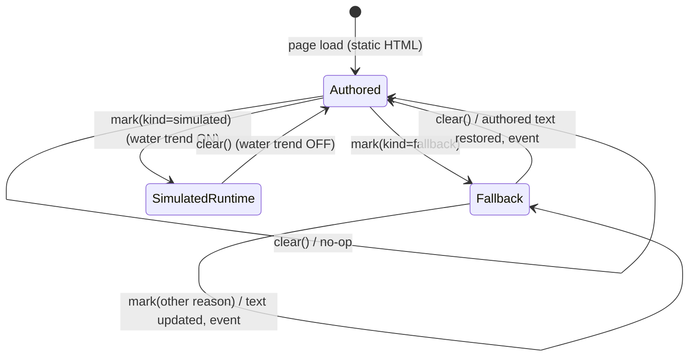
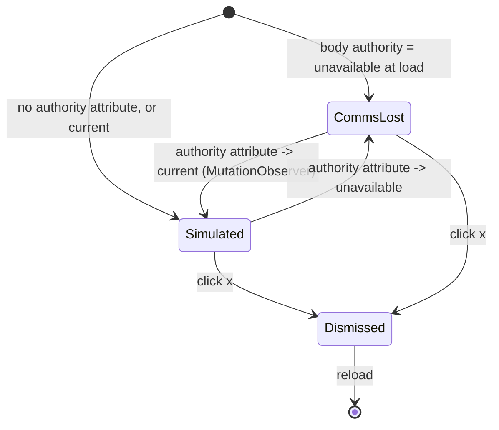
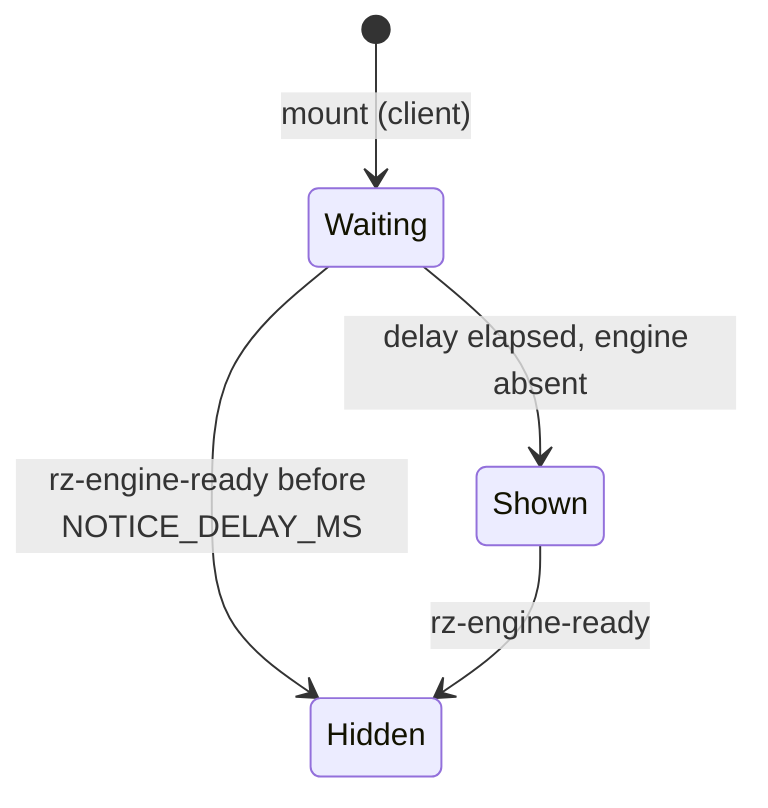
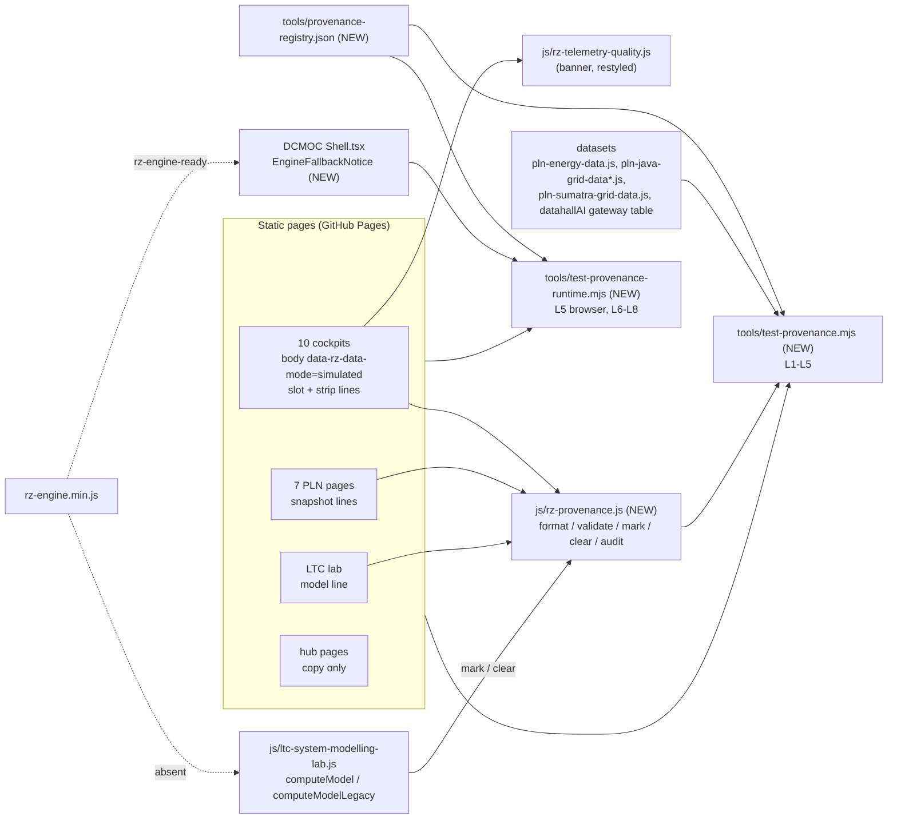

# PRD-Q06 — Simulation honesty layer: every figure that is not measured says what it is

## 1. Document control

| Field | Value |
|---|---|
| PRD id | PRD-Q06 |
| Feature | One provenance line idiom (`Simulated` / `Snapshot` / `Model output` / `Fallback`) from one small module, the shared simulated banner on all 10 cockpits, removal of every "Live" and "real-time" claim the site cannot back, visible fallbacks in the LTC lab and DCMOC, the X4 interim label and the X6 fix |
| Version | 1.0 |
| Status | Draft |
| Author | Opus 5.5; Fable quota exhausted |
| Date | 2026-11-10 |
| Owner requests | R110 (a PRD per idea), R111 (24-section structure) |
| Priority | 74.5 (addendum rank 1: I 7, N 4, C 9, E 2, effort 1.5 weeks; `documentation/PRODUCT_INNOVATION_ASSESSMENT_2026-11_ADDENDUM.md:76`) |
| Related findings | Q6 (`…_ADDENDUM.md:95-115`), X4 interim label only (`:50`), X6 (`:52`), maturity row "Simulation honesty: 2" (`:34`), baseline corrections (`00-audit-baseline/BASELINE.md:45-48`). New findings from this PRD: N1–N6 (§3.3) |
| Dependencies | None blocking. **X5** (tier-advisor and tia-942 noise bands, `…_ADDENDUM.md:51`) is owned by the peer session and is NOT specified here; when the peer ships X5, tier-advisor and tia-942 can join the registry (§10.3) with no change to this design. Consumers of this PRD: **Q7** scripted scenarios (`…_ADDENDUM.md:490`: "Q7 scenarios set kind=simulated scenario=<id>"; `04-implementation-plan/TRACKER.md:32` lists Q7 as depending on Q6), **P26** market-tracker dates (peer; coordinate on `dc-market-tracker.html`), **Q8** refresh pipeline (merged into P26, `01-improvement-register/REGISTER.md:31`; it will update `asOf`) |
| Related modules | NEW `js/rz-provenance.js`; `js/rz-telemetry-quality.js`; the 10 cockpits (`datahall.html`, `datahallAI.html`, `chiller-plant.html`, `fire-system.html`, `ict.html`, `water-system.html`, `fuel-system.html`, `EPMS_Telemetry.html`, `dc-conventional.html`, `cdu-mini-bms.html`); the 7 PLN pages; `ltc-system-modelling-lab.html` + `js/ltc-system-modelling-lab.js`; `dcmoc/src/components/layout/Shell.tsx` + `dcmoc/src/lib/rz-engine.ts`; `manual/datahallai.html`; `prd/datahallai.html`; `tools.html`; `insights.html`; `datacenter-solutions.html`; `cdu-selection-guide.html`; `dc-market-tracker.html`; `tools/build-og-images.py`; `search-index.json`; NEW `tools/provenance-registry.json`, `tools/test-provenance.mjs`, `tools/test-provenance-runtime.mjs`; `tools/ship-gate.sh`; `CLAUDE.md`; standards docs (§22.4) |
| Target wave | Addendum roadmap "Quick wins, weeks 1–2" (`…_ADDENDUM.md:554`). Implementation wave 1 of `04-implementation-plan/PROGRAM.md` (to be written by the main session); Q7 waits for it |
| Overlap to resolve | `01-improvement-register/REGISTER.md:24` and `04-implementation-plan/TRACKER.md:40` also list "X4 interim" and "X6" under PRD-X-DEFECTS. This PRD specifies both in full (FR-6, FR-7, FR-10). PRD-X-DEFECTS should point here, not re-specify them. The main session owns that decision |
| Approval status | Approved by owner R110/R111 2026-11-10. Approval class "ordinary" (`REGISTER.md:12`). The title and meta-description rewrites in §9.10 are SEO-visible copy; they are inside this approval because each one removes a false claim |
| Facts verified at | `wt-hub3` commit `1cb6dd292` (2026-11-10, "docs: product-transformation program skeleton"), working tree clean |

Change history

| Version | Date | Author | Change |
|---|---|---|---|
| 1.0 | 2026-11-10 | Opus 5.5 | First complete draft, all 24 sections. Every fact re-verified on `1cb6dd292` with the commands quoted in §3 |

## 2. Executive summary

The site shows simulated and snapshot figures next to words that say otherwise. The PLN page is headed "Live
Energy Dashboard" and its "Time" cell ticks with the visitor's wall clock beside a fixed 18:00 snapshot. The AI
data-hall cockpit says "Gateways 16 / 16 online" while its own model lists 15 gateways. The data-hall cockpit
injects random rack-inlet excursions and its basis drawer calls the result "deterministic". Four cockpits do not
declare that they are simulated at page level. The LTC lab and DCMOC fall back to local tables with nothing on
screen. A scan of 30 pages finds 43 "live" or "real-time" claims on 15 of them.

This PRD adds one idiom: a plain mono line under a panel title that names what the numbers are. There are four
kinds: `Simulated`, `Snapshot` (with an as-of date, a source and a data version), `Model output` and
`Fallback`. Static pages carry the line in their HTML, so it is there without JavaScript. Runtime fallbacks call
`RZProvenance.mark()`, which switches the line to `Fallback` and back. The existing simulated banner
(`js/rz-telemetry-quality.js`) keeps its labels and dismiss button. It loses its tinted background and its
pulsing dot, and it is adopted by the four cockpits that lack it. A registry file lists every page, panel line and
status field the rule covers. Two gates read it: a static gate (laws L1–L5) and a browser gate (L6–L8). All eight
laws fail on today's tree; §20.2 states how.

| Measure | Today (`1cb6dd292`) | After |
|---|---|---|
| Cockpits that declare `data-rz-data-mode="simulated"` and show the banner | 6 of 10 | 10 of 10 |
| Registry panels with a valid provenance line | 0 of 21 | 21 of 21 |
| Data-path status fields (comms, quality, clocks, "Online") tied to a simulated line | 0 of 22 | 22 of 22 |
| "live" / "real-time" claims on the 30 scanned pages | 43 on 15 pages | 0 |
| Forced fallbacks that show on screen (LTC ×3, DCMOC ×1) | 0 of 4 | 4 of 4 |
| Banner animations running on a cockpit | 1 per adopting page (`rzTqPulse`, infinite) | 0 |

## 3. Problem statement

### 3.1 Verified facts (run on `wt-hub3` at `1cb6dd292`, 2026-11-10)

**F1. Four cockpits do not declare the simulated page mode.**

```
$ for f in datahall.html datahallAI.html chiller-plant.html fire-system.html ict.html water-system.html \
           fuel-system.html EPMS_Telemetry.html dc-conventional.html cdu-mini-bms.html; do
    b=$(grep -n '<body' $f | head -1 | cut -c1-90); s=$(grep -n 'src="js/rz-telemetry-quality.js' $f | head -1 | cut -d: -f1)
    echo "$f | body=$b | tq-script-line=${s:-none}"; done
datahall.html        | body=581:<body data-rz-data-mode="simulated">                 | tq-script-line=557
datahallAI.html      | body=883:…<body class="locked" data-rz-data-mode="simulated" … | tq-script-line=849
chiller-plant.html   | body=626:<body data-rz-data-mode="simulated" data-active-hall="A"> | tq-script-line=590
fire-system.html     | body=443:<body class="p-4" data-rz-data-mode="simulated">     | tq-script-line=122
ict.html             | body=706:<body data-rz-data-mode="simulated">                 | tq-script-line=687
water-system.html    | body=490:<body data-rz-data-mode="simulated">                 | tq-script-line=102
fuel-system.html     | body=683:<body>                                              | tq-script-line=none
EPMS_Telemetry.html  | body=504:<body data-rz-basis-authority="unavailable">         | tq-script-line=none
dc-conventional.html | body=969:<body>                                              | tq-script-line=none
cdu-mini-bms.html    | body=285:<body>                                              | tq-script-line=none
```

Each of the four does say "simulated" somewhere inside the page (`grep -c -i simulat`: fuel 15, EPMS 9,
dc-conventional 14, cdu-mini-bms 11). dc-conventional shows the word in a header pill when authority is current
(`dc-conventional.html:1477` `setText('convAuthorityBadge', 'SIMULATED')`). EPMS is a recorded exception:
`standarization/TELEMETRY_QUALITY.md:82` says EPMS "retains its own operator status strip rather than this shared
banner". Its strip reads `EPMS NORMAL` in green when authority is current (`EPMS_Telemetry.html:1021-1023`), with
no simulated word at that level. The same standard still says "All four BMS cockpit pages currently declare
`data-rz-data-mode="simulated"`" (`TELEMETRY_QUALITY.md:40`) while its own adoption table lists six.

**F2. The shared banner is styled as a tinted pill with a pulsing dot.**
`js/rz-telemetry-quality.js:32` gives `simulated` the colour `#67e8f9` on `rgba(6,182,212,0.12)`;
`renderBanner()` writes that background inline (`:143-144`); `.rz-tq-banner-dot` runs
`rzTqPulse 1.8s ease-in-out infinite` (`:80-82`), stopped only under reduced motion (`:92`). The banner title
for `simulated` reads "Non-live deterministic telemetry generated from the governed engineering basis." (`:154`),
which is false on `datahall.html` (F5). The tests that pin the banner: `tools/test-conv-alarm-runtime.mjs:211-260`
(in-flow slot, not fixed, clears header, 44 px dismiss target, 2 px focus outline, dot animation stops under reduced
motion), `tools/test-datahall-ai-authority.mjs:197` (`/Simulated.*engine basis/i`),
`tools/test-conv-secondary-authority.mjs:129,211` (`COMMS LOST — AUTHORITY UNAVAILABLE`,
`/Simulated telemetry.*engine-derived basis/i`), `tools/test-operator-cockpit-regressions.mjs:480-525` (label
contains "simulated"; datahallAI uses the compact header slot).

**F3. No provenance line exists anywhere.**

```
$ grep -rl --include=*.html --include=*.js 'data-rz-provenance\|RZProvenance' . | grep -v node_modules
(no output; the only mention in the repo is documentation/PRODUCT_INNOVATION_ASSESSMENT_2026-11_ADDENDUM.md)
```

The closest existing idiom is the hub "basis" line: `.tool-head .basis` in `css/rz-tool.css:30` and
`.tool-results .res-head .basis` (`:95-96`), used on `pln-sumatra-grid.html:100`: "source RUPTL 2025-2034 /
PLN AR 2024 / public sources · dataset version 2026-06-26 · coordinates approximate; not an operational
topology". None of the 10 cockpits, the other 6 PLN pages or the LTC lab load `css/rz-hub.css` or
`css/rz-tool.css` (`grep -c 'rz-hub.css'` = 0 on all of them), so the line must bring its own style.

**F4. X6: the PLN page calls a fixed snapshot "Live" and ticks a wall clock beside it.**

- `pln-java-grid.html:1290` `<h2 class="pjg-section-title">Live Energy Dashboard</h2>`.
- `:1291-1295` the paragraph under it already says "Static representative figures based on PLN AR 2024, RUPTL
  2025-2034, BPS Statistical Indonesia 2024, and IEA Indonesia 2024 — not real-time telemetry."
- `:1300` the "Time" cell has `title="Local Western Indonesia Time (WIB / GMT+7) of the snapshot."`, but
  `:2437-2443` fills `#pjg-live-time` from `new Date()` and repeats every 60 s (`setInterval(updateClock, 60000)`).
  The snapshot it sits next to is `2026-05-01T18:00:00+07:00`.
- `:1136` `aria-label="Live grid KPIs"`, `:1299` `aria-label="Live KPIs"`.
- `:1138` an "All | Live" pill pair. `:1709` says "Pill toggle (visual only; both All and Live default
  visible)"; `:1710-1719` only swap an `active` class. It is a dead control. `:705-710` style the Live pill red
  "like the reference".
- `pln-java-grid-historical.html:515` "Back to Live Dashboard".
- The KPIs read `js/pln-energy-data.js`. Its object says `version: '2026-05-01-v5'` (`:217`) while its header
  comment still says `@version 2026-05-01-v3` (`:4`). `snapshot.timestamp` is `'2026-05-01T18:00:00+07:00'`.
- The map strip's "Sites" cell counts `window.PLN_JAVA_GRID.nodes` (744 nodes, topology `version
  '2026-04-29-v3'`).

```
$ node -e "const vm=require('vm'),fs=require('fs');const c={window:{}};vm.createContext(c);
  vm.runInContext(fs.readFileSync('js/pln-energy-data.js','utf8'),c);const e=c.window.PLN_ENERGY_DATA;
  console.log(e.version, e.snapshot.timestamp)"
2026-05-01-v5 2026-05-01T18:00:00+07:00
```

**F5. X4: the data-hall cockpit injects random excursions and labels only the banner.**
`datahall.html:2085` `function dhRand(min, max) { return Math.random() * (max - min) + min; }`. `fireExcursion()`
(`:2087-2132`) picks a random zone, CRAH, duration (10–15 s) and temperature (27.5–30.0 °C); `:2135` fires it
30 s after load and then every 120 s. The top banner does say it: `:2106` "⚠ EXCURSION SIMULATED — …". But:
- the alarm rows built by `evaluateAlarms()` (`:1413`, rows at `:1421-1422`: `msg: 'Rack inlet ' + … + '°C > …'`)
  and painted by `paintAlarmList()` (`:1658`) carry no label;
- the event log line (`:2111`) reads "Excursion event: … rack inlet rose to …";
- the Hall State basis note (`:2333`) reads "This is deterministic simulated alarm state, not measured BMS
  telemetry." The state is not deterministic: it depends on `Math.random()` and on how long the page has been open.

**F6. datahallAI states a gateway count its own model contradicts, and two services "Online".**
`datahallAI.html:1361-1363` render three inline-styled pills: "Historian: **Online**", "Notification: **Online**",
"Gateways: `<b id="bmsGwOnline">16 / 16</b>` online". The page's BMS model lists its gateways at `:9224-9231`:
`GW-01~04`, `GW-05~08`, `GW-09~12`, `GW-13~14` (14 field gateways) plus one row tagged `cloud GW` (REST/HTTPS);
the other two rows are tagged `native` and `network`, which are not gateways. 16 matches no count on the page.
`#bmsGwOnline` is never written by script (`grep -rn bmsGwOnline` finds only the HTML and two docs). The docs repeat
the error: `manual/datahallai.html:711` "16/16 gateways is modeled", `prd/datahallai.html:190` "16/16 gateways".

**F7. Twenty-two data-path status fields on 8 cockpits read like a site data path.** They show `OK`, `Online`,
`ONLINE`, `GOOD` or a clock, and nothing ties them to the simulated basis:

| Page | Field (selector, line) | What fills it |
|---|---|---|
| datahall.html | `#as-comms` (:651) | literal `'OK'` when the model snapshot paints (:1691-1693) |
| datahall.html | `#as-update` "Last Update" (:654-655) | browser time (:2163) |
| datahall.html | `#as-dq` (:660) | `S.meta.data_quality` = `'GOOD'` from `js/conv-engine.js:685` (:1689) |
| dc-conventional.html | `#as-comms` (:1072) | `'OK'` when `s.meta.version` exists (:1541, :1564-1567) |
| dc-conventional.html | `#as-update` "Last Update" (:1079-1080) | browser time every 1 s (`rzTick`, :1482-1490) |
| dc-conventional.html | `#as-dq` (:1085) | engine meta `'GOOD'` (:1571) |
| fire-system.html | `#as-facp` (:473) | literal `'Online'` (:1398) |
| fire-system.html | `#as-quality` (:484) | engine meta (test pins `'GOOD'`, `tools/test-fire-system-runtime-authority.mjs:261`) |
| fire-system.html | `#as-updated` "Updated" (:486) | browser time at render (:1443, :1767) |
| ict.html | `#m-quality` (:725) | engine meta |
| ict.html | `#as-updated` "Last Update" (:745) | time since page load, `uptime()` (:2090-2100) |
| ict.html | `[data-ict-ops-state]` ×3: WAN, BMS Fabric, Cameras (:756-758) | literal `'OK'` (:2034) |
| water-system.html | `#lastUpdate` "Last Update" (:525) | browser time (:1584; the comment at :1581-1582 admits it) |
| water-system.html | `#dataQuality` (:527) | engine meta |
| water-system.html | `#status-time` "UPDATED" (:900) | browser time (:1583) |
| fuel-system.html | `#as-upd` "Updated" (:716) | seconds since the last model render (:1707, :1722) |
| EPMS_Telemetry.html | `#val-system` (:1761) | literal `'ONLINE'` when no generator mode (:1770) |
| datahallAI.html | Historian span (:1361) | static "Online" |
| datahallAI.html | Notification span (:1362) | static "Online" |
| datahallAI.html | `#bmsGwOnline` (:1363) | static "16 / 16" |

Values that tests pin and this PRD therefore keeps unchanged: `comms 'OK'`, `quality 'GOOD'`
(`tools/test-conv-dashboard-authority.mjs:179-180`), `as-quality 'GOOD'` and `as-updated` as `HH:MM:SS`
(`tools/test-fire-system-runtime-authority.mjs:261,263`), ICT `quality 'GOOD'` and ops all `'OK'`
(`tools/test-conv-secondary-authority.mjs:208-209`). `js/conv-engine.js` is under the ship-gate byte-identical
guard (`tools/ship-gate.sh:349-361`), so the engine meta `data_quality: 'GOOD'` cannot change here.

**F8. "Live" and "real-time" claims: 43 on 15 of 30 scanned pages.** Scanner rules (identical to law L4, §20.2):
visible text, `aria-label`, `alt`, `title`, `placeholder` and the description/OG/Twitter meta contents, with
`<script>`, `<style>`, `<noscript>` and `<template>` skipped. Set A (25 pages: the 10 cockpits, the 7 PLN pages,
the 6 `ltc-*.html` pages, `dc-market-tracker.html`, `dcmoc/index.html`) flags any `live` or `real-time` /
`realtime` / `real time` word. Set B (5 hub pages: `tools.html`, `insights.html`, `datacenter-solutions.html`,
`cdu-hub.html`, `cdu-selection-guide.html`) flags the word only before a data noun (data, telemetry, parameters,
readouts, monitoring, dashboard, trackers, KPIs, feed, values, alerting, stats, capacity, map). Exempt: a negation
in the same clause within 40 characters before the word ("not", "no", "never", "non-"), and link text that is the
URL of a cited source.

```
datahallAI.html 1 [1180]            chiller-plant.html 2 [16, 23]       water-system.html 2 [12, 42]
fuel-system.html 1 [12]             EPMS_Telemetry.html 4 [12, 31, 40, 42]
dc-conventional.html 1 [40]         cdu-mini-bms.html 13 [7, 8×2, 17, 18, 22, 25, 26, 318, 319, 358, 379, 381]
pln-java-grid-historical.html 1 [515]   pln-java-grid.html 5 [1136, 1138, 1184, 1290, 1299]
ltc-system-modelling-lab.html 4 [4909, 4931, 5091, 5202]   dc-market-tracker.html 2 [30, 737]
tools.html 1 [624]   insights.html 4 [35, 55, 67, 256]   datacenter-solutions.html 1 [457]   cdu-selection-guide.html 1 [621]
FINDINGS 43   EXEMPT 5 (cdu-mini-bms:399 "not a live feed"; pln-java-grid-historical:517 and :655 negations;
pln-java-grid:1293 the cited URL and its negation)
```

The same claims reach generated and image artefacts: `llms-full.txt` has "Live Energy Dashboard" twice;
"Live Parameters" is in `llms.txt` (1), `llms-full.txt` (2) and `search-index.json:727`; "Live Capacity" is in
`llms.txt` (1) and `llms-full.txt` (1). The OG card `assets/og/cdu-mini-bms.webp` draws "live simulated parameters …
inject faults live" (I opened it). `assets/og/dc-market-tracker.webp` draws "Global hyperscale market trend monitor
with real-time map.", a string hard-coded in `tools/build-og-images.py:112`.

**F9. The LTC lab falls back silently on screen.** `js/ltc-system-modelling-lab.js:2701-2706`:

```js
function computeModel(input) {
    var legacy = computeModelLegacy(input);
    if (window.LTCLabPlant && !window.__ltcLegacy) {
        try { return window.LTCLabPlant.compute(input, legacy); } catch (e) { console.error('[ltc-lab-plant]', e); }
    }
    return legacy;
}
```

Three ways to reach the legacy result, none visible: `js/ltc-lab-plant.js` absent (`window.LTCLabPlant`
undefined), the plant compute throws (`:2704`, console only), or `window.__ltcLegacy = true`. A fourth path sits
inside `computeModelLegacy()` (`:2708-2711`): "Delegate to shared engine when available; inline tables are
fallback", i.e. the inline `CLIMATE_FACTORS` (`:44`), `RACK_PROFILES` (`:51`) and `COOLANTS` (`:59`) when
`RZEngine.models.ltc` is missing. `:8886` repeats the console-only catch for `LTCLabPlant.sync`. The output
panel (`ltc-system-modelling-lab.html:4575-4590`, heading "Engineering Output" at `:4576`) has no line that names
its basis.

**F10. DCMOC falls back silently in most modules.** `dcmoc/src/lib/rz-engine.ts:11` "Every consumer keeps a LOCAL
fallback: if the engine is absent for any reason, `rzData()` / `rzModels()` return `{}` and callers fall back to
the DCMOC-local constants". `rzData()` has 118 call sites in 52 files and `rzModels()` 145 in 58; only a few
modules say so on screen (`components/modules/PlatformDashboards.tsx:907`, `GridReliabilityDashboard.tsx:440,626`,
`MaintenanceDashboard.tsx:1328`, `DisasterRiskDashboard.tsx:364`). The engine loads from
`dcmoc/src/app/layout.tsx:42` (`/rz-engine.min.js?v=2026-11-06-tariffs`, `defer`); `useEngineReady()`
(`rz-engine.ts:88`) and the `rz-engine-ready` event (`:76-86`) already exist.

**F11. A random ripple is plotted as a trend on the water cockpit.** `water-system.html:1530-1536` (only while
the user has pressed "Simulation Mode: ON", `#btn-sim`, `:796`) pushes `0.40 + (Math.random() * 0.06 - 0.03)` and
`makeupLpm + (Math.random() * 4 - 2)` into the two plotted series every 2.5 s. The code comment calls it a
"cosmetic trend ripple ONLY"; on screen it is a moving line with no label.

**F12. The PLN stat tiles hold silent constant fallbacks.** `pln-java-grid.html:1549-1554`
(`data.installedMW || 47000`, `data.peakMW || 32000`, `data.reservePct || 31.0`, `data.renewablePct || 13.5`,
`data.dcMW || 950`, `data.substations || 142`). Today the dataset has all six fields with the same values (the
`node` check above prints `installedMW 47000 … substations 142`), so nothing fires. A missing field would show an
invented-looking constant, and a real `0` would be replaced by the constant.

### 3.2 Consequence of leaving it

- An engineer who sees "Live" beside a ticking clock and a figure that never changes concludes the site is careless
  or deceptive. The page's own fine print ("not real-time telemetry") does not survive the heading.
- "16 / 16 online" is falsifiable from the same page. Every other number there loses credibility with it.
- Trainees on the data-hall cockpit learn that random alarms are "deterministic"; Q7 (scripted scenarios) has no
  honest baseline to replace.
- A blocked or broken engine in the LTC lab or DCMOC changes results with no visible sign. The owner, the only
  DCMOC user, cannot tell a local-table result from an engine result.
- The site's own rule is broken: CLAUDE.md points every cockpit change to `standarization/ACCURACY_VALIDATION.md`
  ("READ BEFORE touching cockpit pages", `CLAUDE.md:435`), whose rule 2 bans `Math.random` on basis KPIs, and the
  owner's ACCURACY rule says every number has a source or is labelled a model output.
- Search engines and LLM crawlers index the false claims: they are in titles, meta descriptions, `llms*.txt`,
  `search-index.json` and two OG cards.

### 3.3 Addendum corrections and new findings

| Id | Addendum says | Verified | Correction |
|---|---|---|---|
| C1 | X4: "datahall invents alarms … label the alarms simulated" (`:50`) | The banner already says "EXCURSION SIMULATED" (`datahall.html:2106`) | The unlabelled parts are the alarm rows (`:1421-1422`), the log line (`:2111`) and the "deterministic" note (`:2333`), plus the banner tooltip (`js/rz-telemetry-quality.js:154`) |
| C2 | "Four cockpits … have no simulated-data banner" (`:96`) | True for the shared banner; each page has some in-page "simulated" wording (F1); EPMS's absence is a documented exception (`TELEMETRY_QUALITY.md:82`) | This PRD removes the EPMS exception and adopts the banner on all four |
| C3 | X6: "data file v2026-04-29" (`:52`) | The KPIs read `js/pln-energy-data.js` `2026-05-01-v5`; 2026-04-29-v3 is the topology file | The as-of line must cite both, each for what it feeds |
| C4 | "datahallAI Gateways 16/16" (`:96`) | The page's model has 14 field gateways + 1 cloud gateway (`datahallAI.html:9224-9231`) | Show "15 modelled (GW-01 to GW-14, plus the cloud gateway)" and fix two docs |
| C5 | `ltc-system-modelling-lab.js:2704` (`:96`) | The file is `js/ltc-system-modelling-lab.js`; the catch logs to the console | As `BASELINE.md:48` already corrected: silent on screen, not in the console |
| C6 | "Gate … no element contains Live unless its kind is telemetry" (`:113`) | No telemetry kind can exist: the site has no measured feed | Law L4 bans the claim outright on the scanned pages; there is no `telemetry` kind |
| N1 | — | 43 claims on 15 pages, incl. "real-time" meta on chiller, water, fuel, EPMS (F8) | In scope (FR-15) |
| N2 | — | 22 data-path fields (F7) | In scope (FR-5) |
| N3 | — | Random ripple on the water trend (F11) | In scope as a label (FR-11); a deterministic replacement belongs to Q7 |
| N4 | — | PLN stat tiles' constant fallbacks (F12) | In scope (FR-8) |
| N5 | — | Two OG cards draw the claims (F8) | In scope (FR-15) |
| N6 | — | `TELEMETRY_QUALITY.md:40` says "All four" while its table lists six | Fixed in the R089 doc update (§22.4) |

## 4. Objectives and success metrics

No target below is a guess: each is "all" or "none" of an enumerated set, and the set is fixed in
`tools/provenance-registry.json` (§10.3).

| Id | Objective | Metric and baseline | Target | Measurement method |
|---|---|---|---|---|
| O1 | Every cockpit declares itself simulated at page level | cockpits passing L1: 6/10 | 10/10 | `node tools/test-provenance.mjs --law L1` |
| O2 | Every registry panel names its basis | panels passing L2: 0/21 | 21/21 | `--law L2` |
| O3 | No status field reads like a site data path without a line that explains it | fields passing L3: 0/22 | 22/22 | `--law L3` |
| O4 | No false "live" / "real-time" claim | 43 findings (F8) + retired phrases in 4 generated files | 0 and 0 | `--law L4` |
| O5 | Restated dataset and model figures equal their source | 3 parity failures (no PLN lines, wall clock, 16 vs 15) | 0 | `--law L5` (static + one browser check) |
| O6 | A forced fallback is visible | 0/4 forced paths show a line | 4/4 within 5 s; 0 lines on the normal path | `tools/test-provenance-runtime.mjs --law L6` |
| O7 | Random excursions are labelled where they appear | 0 of 3 surfaces (rows, log, note) | 3/3 | `--law L7` |
| O8 | The labels are still, legible and accessible | banner pulses on 6 pages; contrast unmeasured | 0 running animations; contrast ≥ 4.5:1; axe 0 serious/critical on the lines; planted bad line caught | `--law L8` |
| O9 | The layer is cheap | — | `js/rz-provenance.js` ≤ 8,192 bytes raw and ≤ 3,072 bytes gzip; a repeated identical `mark()` causes 0 DOM mutations | `wc -c`, `gzip -9c | wc -c`, MutationObserver count in L6 |

Assumption: the addendum's 1.5-week effort predates N1–N5. §19 sums to about 15 engineer-days. The main session
should plan for that, not for 7.5 days.

## 5. Scope

### 5.1 In scope

1. NEW `js/rz-provenance.js`: pure `format()` and `validate()` (Node-loadable), DOM `mark()`, `clear()`,
   `audit()`, one injected stylesheet, one `rz-provenance-change` event (FR-1, FR-2).
2. Restyle of the shared banner in `js/rz-telemetry-quality.js`: same labels, same slot logic, same dismiss button;
   no tinted background, no pulsing dot, honest tooltip (FR-3).
3. Banner adoption on `fuel-system.html`, `EPMS_Telemetry.html`, `dc-conventional.html`, `cdu-mini-bms.html`;
   EPMS exception removed from the standard (FR-4).
4. A simulated line on each cockpit status strip, `aria-describedby` from each of the 22 fields, and honest labels
   for the clock fields (FR-5).
5. PLN: X6 fix on `pln-java-grid.html`, lines on the historical page, the 4 province pages and Sumatra, missing-field
   handling on the stat tiles (FR-6, FR-7, FR-8).
6. datahallAI BMS strip: 15 modelled gateways, no "Online", plain text; two docs corrected (FR-9).
7. X4 interim labels on `datahall.html` (FR-10). Water ripple label (FR-11). cdu-mini-bms copy and state word (FR-12).
8. LTC lab model line and four visible fallbacks (FR-13). DCMOC engine-fallback notice (FR-14).
9. Copy sweep of the 43 claims, the OG generator string, two OG cards, one hand-maintained search entry, and the
   generators that copy titles and descriptions (FR-15).
10. Registry, two gates, ship-gate and CLAUDE.md wiring, updates to four existing tests (FR-16).

### 5.2 Out of scope (non-goals)

- **X5**, the tier-advisor and tia-942 noise bands. Owned by the peer; a dependency only (§1).
- **Q7** scripted fault scenarios. Q6 only labels the random excursions; Q7 replaces them and will set
  `kind=simulated` with a scenario id on the same lines.
- **P26** per-figure dates on `dc-market-tracker.html` (peer). Q6 changes only the tracker's `<title>`, its OG
  image alt text and the OG generator string, and coordinates that edit with the peer session.
- Restyling other state pills that this PRD does not otherwise touch: dc-conventional's `.live-badge`
  (`dc-conventional.html:138-148`; its text is pinned by `tools/test-conv-dashboard-authority.mjs:151,210`) and
  historical PLN's "Updated 2026-05-02" chip (`pln-java-grid-historical.html:524`). Both are logged as OPEN rows in
  `standarization/UIUX_AUDIT_LEDGER.md` in the same release.
- Changing any engine. `js/conv-engine.js`, `js/datahall-model.js` and `js/datahall-calculations.js` stay
  byte-identical (`tools/ship-gate.sh:349-361`). `rz-engine.js` is untouched.
- Per-module fallback lines inside DCMOC (one shell-level notice covers the page; per-module lines already exist in
  four modules, F10).
- Any measured telemetry. The site has no live data source, so there is no `measured` kind.
- `PlatformDashboards.tsx:908` shows "Backend /calc … configured (server-side dispatch)" whenever the engine
  loaded. Whether DCMOC calls `worker/` at all is UNKNOWN — measure in T-13 and, if it does not, report it to the
  owner as a separate defect. Q6 does not change that row.

### 5.3 Existing capabilities reused

| Capability | Where | How Q6 uses it |
|---|---|---|
| Page-level banner, slot, compact slot, `comms_lost` dominance, MutationObserver on authority attributes | `js/rz-telemetry-quality.js:102-170`, `:223-240` | Unchanged logic; restyled; adopted on 4 more pages |
| Banner slot markup `<div data-rz-telemetry-banner-slot>` | e.g. `datahall.html:629`, `datahallAI.html:894` (compact + custom label) | Copied to the 4 pages; cdu-mini-bms uses a custom label |
| Network-first delivery of the banner script | `sw.js:19` (`'/js/rz-telemetry-quality.js'` in `NETWORK_FIRST_PATHS`) | The restyle reaches cached visitors on the next load |
| Basis line idiom | `css/rz-tool.css:30,95-96`; `pln-sumatra-grid.html:100` | Same mono, muted, one-line form; the module carries its own copy of the style |
| Hub tokens | `css/rz-hub.css:12-22` (dark), `:31-40` (light): `--rz-text-secondary #A0AEC0/#374151`, `--rz-text-primary #E8EDF5/#111827`, `--rz-accent-signal`, `--rz-line-tier-2`, `--rz-font-mono` | Read with fallbacks, because the target pages do not load `rz-hub.css` |
| Excursion test hook | `datahall.html:2133` `window.__fireDatahallExcursion = fireExcursion` (pinned by `tools/test-datahall-operator-engineering.mjs:65`) | The runtime gate fires an excursion on demand |
| Engine-ready signal | `dcmoc/src/lib/rz-engine.ts:76-100` | DCMOC notice waits on it |
| Session seeding for gated pages | `tools/test-ltc-lab-golden.mjs:86` (educator, tier pro); `tools/_dcmoc_trace_parity_probe.mjs:148` (DCMOC root) | Same seeding in the runtime gate |
| Served-tree browser gates on a free port | `tools/ship-gate.sh:316-325` (`LTC_BASE`, identity check) | The runtime gate runs there |
| Cache tokens | `tools/test-asset-cache-tokens.mjs --fix <asset>` (`CLAUDE.md:41-42`) | New and changed assets |
| Generators with `--check` | `tools/test-generator-freshness.py:57-70` | llms, llms-full, search-sections, sitemap freshness |

### 5.4 Dependencies

| Dependency | Type | Status |
|---|---|---|
| X5 (peer) | Soft. tier-advisor and tia-942 join the registry after it ships | Not blocking |
| P26 (peer) | Coordination on `dc-market-tracker.html` and `tools/build-og-images.py:110-112` | Message the peer before T-14 |
| PRD-X-DEFECTS | X4 interim and X6 are specified here | Main session to de-duplicate (§1) |
| DCMOC toolchain | `dcmoc/node_modules`, `next build --webpack` | Needed for T-13 only |
| Version number | "next free version, claimed with the peer" | Claimed at T-17 |

### 5.5 Constraints

- Static site, no build step for pages; vanilla ES5-style JS on the site (the module must parse in the same
  browsers as `js/rz-telemetry-quality.js`, which uses `var` and function expressions).
- No engine edits (§5.2). No peer-owned files (`js/rz-cx-*.js`, `cx-calculator.html`, `css/rz-cx-analysis.css`,
  `js/rz-cx-ext.js`, `rz-cx-tree-ui.js`, `id/index.html` meta): none is touched.
- Design register: hub tokens, IBM Plex Sans + JetBrains Mono, one amber accent, a state is a word, no pills,
  no glass, no gradient chrome, no hover transforms, no `transition: all`, radius ≤ 4 px, both themes, 1440 and
  390 widths, 16 px inputs on phones (no inputs are added).
- Existing test pins listed in F2 and F7 stay green, or the test is updated in the same commit with the reason.
- Copy is plain and literal. No internal ids (Q7, X4) in user-facing text.

### 5.6 Assumptions

| Id | Assumption | How it is checked |
|---|---|---|
| A1 | No page on the site shows measured telemetry today | F8 scan + the page texts; if one ever does, it gets its own kind in a later PRD |
| A2 | `rz-engine.min.js` normally executes before DCMOC hydrates (`layout.tsx:36-42` comment) | T-13 measures engine-ready time on the live site 10 times; the notice delay is set to the larger of 4,000 ms and 2 × the slowest measured time |
| A3 | Visitors keep the dismissed state only for the page view (existing behaviour, `rz-telemetry-quality.js:160-167`) | Unchanged |
| A4 | The province overlay `version` dates are the dates the overlays were compiled | Read from each file's header comment (`js/pln-java-grid-data-jabar.js:1`) |

## 6. User personas and use cases

Tiers as the site has them: a signed-out visitor resolves to `free` (`auth.js:1026`, `:1036`); paid tier `pro`;
`demo`; `root` (owner); `educator` is a role on tier `pro` (`js/rz-feature-flags.js:8-16`, `:212`).

| Persona | Real role | Goal on these pages | Pages they can open |
|---|---|---|---|
| P1 Facility / DC engineer | Evaluates designs, checks numbers against what they know | Know at a glance which figures are modelled, which are a dated snapshot and which came from a fallback | All public cockpits and PLN pages; tools and hub pages |
| P2 Operator / trainee | Practises reading a BMS-style screen | Understand that alarms and clocks belong to a simulation, and that excursions are random until Q7 | Public cockpits; datahallAI and dc-conventional only if root |
| P3 Student or educator | Uses the LTC lab for coursework | Trust that the lab's numbers came from the plant engine, or see plainly when they did not | LTC lab (tier `pro`, incl. educator role) |
| P4 Owner (root) | Runs DCMOC and the root-only cockpits | See when DCMOC or a cockpit fell back to local tables | Everything |
| P5 Signed-out visitor / crawler | Arrives from search or an LLM answer | Read titles and descriptions that do not overclaim | Public pages; titles and meta of gated pages |

Access per page (unchanged by this PRD):

| Page | signed-out (= free) | demo | pro / educator | root | Evidence |
|---|---|---|---|---|---|
| datahall, chiller-plant, fire-system, ict, water-system, fuel-system, EPMS, cdu-mini-bms | view | view | view | view | no entry in `js/rz-feature-flags.js` |
| datahallAI.html | locked | locked | locked | view | `rz-feature-flags.js:214-215` (`page-access` root only) |
| dc-conventional.html | locked | locked | locked | view | `:238-239` |
| ltc-system-modelling-lab.html | locked | locked | view | view | `:313-314` |
| pln-java-grid.html | map + SLD | map + SLD | all | all | `:276-279` (`historical-data` false for free) |
| dcmoc/ | locked | locked | locked | view (email allowlist) | `:251-254`; `auth.js:332-338`; `dcmoc/src/store/auth.ts:19` |
| dc-market-tracker.html | locked | locked | locked | view | `auth.js:333-334` (`ROOT_ONLY_PATHS`) |

Use cases:

| Id | Actor | Use case | Expected outcome |
|---|---|---|---|
| UC1 | P1 | Opens `pln-java-grid.html` and reads the energy KPIs | Heading "Energy snapshot"; a line "Snapshot · representative evening peak · as of 1 May 2026, 18:00 WIB · PLN AR 2024; RUPTL 2025–2034 · data 2026-05-01-v5"; "Snapshot time 18:00 WIB" that does not tick |
| UC2 | P2 | Watches `datahall.html` until an excursion fires | Banner as today; the new warning rows end "· simulated excursion, random timing"; the log says "Simulated excursion: …"; the Hall State drawer no longer says "deterministic" |
| UC3 | P1 | Opens `fuel-system.html` (or EPMS, dc-conventional, cdu-mini-bms) | The simulated banner line under the header, same as the other six cockpits |
| UC4 | P3 | Uses the LTC lab while `js/ltc-lab-plant.js` fails to load | The output panel line changes from "Model output · …" to "Fallback · lab legacy model (plant engine not loaded) · physical figures may differ from the plant engine" |
| UC5 | P4 | Opens DCMOC with the engine blocked | After the wait, a line under the header: "Fallback · shared engine not loaded · figures use DCMOC's local tables and can differ from the site calculators. Reload the page to retry." |
| UC6 | P5 | Sees the site in a search result or an LLM answer | Titles and descriptions say "simulated" where the page is a simulation; no "live" or "real-time" |

## 7. Complete user journey

### J1 PLN snapshot (UC1)

| Step | Detail |
|---|---|
| Entry | `datacenter-solutions.html` or `tools.html` → `pln-java-grid.html`; or search |
| Initial state | Static HTML already contains the three snapshot lines (no JS needed). The map KPI strip shows "Sites --" until JS runs (unchanged) |
| Actions | Scrolls to the energy section; switches province tabs; opens the historical page |
| System response | `populateMapKpiStrip()` and the energy renderer fill values from `PLN_ENERGY_DATA`; "Snapshot time" shows `18:00 WIB` from `snapshot.timestamp`; nothing ticks |
| Validation | The gate proves at build time that each line's as-of and version equal the dataset (L5) |
| Success | The reader sees one consistent statement: a dated, sourced, representative snapshot |
| Failure | `PLN_ENERGY_DATA` missing: KPI values stay "--" (today's behaviour), the static line still states what the panel would show; a stat-tile field missing: the tile shows "—" and the stat-row line switches to Fallback (FR-8) |
| Recovery | Reload. The line text does not depend on the data loading |
| Exit | Province page (its own snapshot line), historical page ("Back to grid map and snapshot") |

### J2 Data-hall excursion (UC2)

| Step | Detail |
|---|---|
| Entry | `datacenter-solutions.html` → `datahall.html` |
| Initial state | Banner line "Simulated telemetry — engine-derived basis" under the header; strip line under the alarm strip; alarm-list line |
| Actions | Waits 30 s (or a test calls `window.__fireDatahallExcursion()`); opens the Hall State basis drawer |
| System response | Banner shows "⚠ EXCURSION SIMULATED — …" (unchanged); each warning row for the excursing zone ends with "· simulated excursion, random timing"; the log line reads "Simulated excursion: …"; after 10–15 s rows clear and the log reads "Simulated excursion cleared: …" |
| Validation | L7 in the runtime gate |
| Success | Every surface that shows the excursion says it is simulated and random |
| Failure | Script error in the alarm painter: rows do not render (today's behaviour); the static alarm-list line still states the basis |
| Recovery | Reload |
| Exit | Any cockpit link |

### J3 Cockpit page-level declaration (UC3)

| Step | Detail |
|---|---|
| Entry | `dc-conventional.html` (root), `fuel-system.html`, `EPMS_Telemetry.html`, `cdu-mini-bms.html` |
| Initial state | `body[data-rz-data-mode="simulated"]`; slot after the header. On EPMS and dc-conventional the body first carries `data-rz-basis-authority="unavailable"`, so the banner first reads "COMMS LOST — AUTHORITY UNAVAILABLE" |
| System response | When the page validates its engine authority it sets `data-rz-basis-authority="current"` (`dc-conventional.html:1475`, `EPMS_Telemetry.html:1020`, `fuel-system.html:1079`); the observer re-renders the banner as "Simulated telemetry — engine-derived basis". cdu-mini-bms has no authority step and shows "Simulated parameters — typical operating bands, not a site feed" |
| Actions | Optional: dismiss the banner (44 px button) |
| Success | The same statement as on the six existing cockpits |
| Failure | `js/rz-telemetry-quality.js` fails to load: no banner; the page's strip line (static) still says "Simulated" |
| Recovery | Reload. The script is network-first (`sw.js:19`) |
| Exit | Back links (unchanged) |

### J4 LTC lab fallback (UC4)

| Step | Detail |
|---|---|
| Entry | `ltc-system-modelling-lab.html` as a pro or educator user |
| Initial state | Output panel line "Model output · plant engine (js/ltc-plant.js) for physical figures; lab screening model for scores" |
| Actions | Changes any input |
| System response | `computeModel()` runs. On the plant path it calls `RZProvenance.clear('#rz-prov-ltc-model')` (no DOM write when nothing changed). On any fallback path it calls `RZProvenance.mark('#rz-prov-ltc-model', {kind:'fallback', basis, reason})` |
| Validation | L6 forces each path |
| Success | The line always matches the path that produced the numbers |
| Failure | `RZProvenance` itself missing: `computeModel` behaves exactly as today (calls are guarded) and the static "Model output" line stays; the gate catches a missing script tag (L2) |
| Recovery | When the plant path works again on the next input change, `clear()` restores the authored line |
| Exit | Step thread, other LTC pages |

### J5 DCMOC fallback (UC5)

| Step | Detail |
|---|---|
| Entry | `/dcmoc/` as root |
| Initial state | No notice (server-rendered HTML was built with the engine, `rz-engine.ts:1-14`) |
| System response | `EngineFallbackNotice` mounts in `Shell` before `<PageDescription>` (`Shell.tsx:843`). If `useEngineReady()` is still false after `NOTICE_DELAY_MS`, it renders the fallback line. If the engine arrives later, the line is removed |
| Actions | Reload, or keep working with local tables |
| Success | The owner knows which numbers are local |
| Failure | None beyond the notice itself |
| Exit | Any DCMOC tab (the notice is shell-level, so it stays visible across tabs until the engine arrives) |

### J6 Crawler / search result (UC6)

| Step | Detail |
|---|---|
| Entry | A search engine or LLM reads `<title>`, meta description, `llms.txt`, `llms-full.txt`, OG card |
| System response | Rewritten strings (§9.10); regenerated `llms*.txt`; re-rendered OG cards |
| Validation | L4 scans the HTML and the four generated text files; T-14 opens both OG cards |
| Exit | n/a |

## 8. Functional requirements

Each FR lists: description · trigger · preconditions · inputs · processing · outputs · state changes · dependencies
· exceptions · acceptance.

**FR-1 Provenance module `js/rz-provenance.js`.**
- Description: one UMD module exposing `window.RZProvenance` in browsers and `module.exports` in Node.
- Trigger: script load (`defer`); API calls from page code.
- Preconditions: none. Works without `document` (Node) for `format` and `validate`.
- Inputs: a provenance record (§10.1) or a DOM element with `data-rz-provenance` attributes.
- Processing: `format(rec)` builds the line text (§10.2 grammar); `validate(rec)` returns `{ok, errors:[{code, field, message}]}`
  (codes in §11.3); `mark(target, rec)` validates, then writes the line under the target; `clear(target)` restores
  the authored line; `audit(root)` validates every `[data-rz-provenance]` under `root` and checks text equality;
  on DOMContentLoaded it injects the stylesheet once and runs `audit(document)`, logging one `console.warn` per
  invalid line with its code.
- Outputs: DOM text only via `textContent` and one `<b>` element for the kind word; a `rz-provenance-change`
  CustomEvent on `document` (`detail: {id, kind, previousKind}`) only when the kind or text changed.
- State changes: the line's `data-rz-provenance` attribute and text; a cached signature
  `kind|basis|reason|asOf|source|version` per line so repeated identical calls write nothing.
- Dependencies: none.
- Exceptions: invalid record → `mark` returns `null`, writes nothing, warns once per code per line; missing target →
  returns `null` and warns `E_TARGET`.
- Acceptance: unit cases U1–U14 (§20.1) pass in Node; a repeated identical `mark()` produces 0 MutationObserver
  records (L6); file ≤ 8,192 bytes raw, ≤ 3,072 bytes gzip.

**FR-2 Static line contract.**
- Description: every registry panel carries a `<p class="rz-prov" id="rz-prov-…" data-rz-provenance="…" …>`
  directly after the panel title (or after the element named in the registry's `after` selector).
- Trigger: page authoring; verified by the static gate.
- Preconditions: `js/rz-provenance.js` loaded on the page (needed only for styling and runtime marks).
- Inputs: attributes `data-rz-provenance`, `data-rz-prov-basis`, optional `data-rz-prov-asof`,
  `data-rz-prov-source`, `data-rz-prov-version`, `data-rz-prov-reason`.
- Processing: none at runtime beyond `audit()`; the text is authored as the exact output of `format()` with the
  kind word wrapped in `<b>`.
- Outputs: the visible line.
- State changes: none.
- Exceptions: text ≠ `format(attrs)` → `E_TEXT` (gate failure, console warning).
- Acceptance: L2 21/21.

**FR-3 Banner restyle in `js/rz-telemetry-quality.js`.**
- Description: the banner becomes a still, in-flow text line.
- Trigger: existing `renderBanner()`.
- Preconditions: as today.
- Processing: delete the inline `bannerEl.style.cssText = 'background:'…` (`:143-144`); replace the state rules at
  `:59-92` with the styling contract in §9.8; do not render `.rz-tq-banner-dot` (remove the span from the markup at
  `:156-158` and the `rzTqPulse` keyframes at `:80-82`); change the `simulated` tooltip (`:154`) to "Simulated
  values from the engine model. They are not measured at a site."; bump the module `version` from `'1.43.4'` to
  `'1.44.0'` (`:254`).
- Outputs: same labels as today: "Simulated telemetry — engine-derived basis", the slot's custom label,
  "COMMS LOST — AUTHORITY UNAVAILABLE", "Demo mode — training values only".
- State changes: none new.
- Exceptions: none.
- Acceptance: L8; the pins in F2 stay green after the test update in T-3.

**FR-4 Page-level declaration on 4 cockpits.**
- Description: add `data-rz-data-mode="simulated"` to `<body>`, the script tag
  `<script src="js/rz-telemetry-quality.js?v=<token>" defer></script>` in `<head>`, and one
  `<div data-rz-telemetry-banner-slot></div>` as the first in-flow element after the page header.
- Placement: `fuel-system.html` after `</header>` at `:724` (the header `header.topbar` opens at `:700` and already contains `#alarm-strip` `:709` and the clock `:721`);
  `EPMS_Telemetry.html` directly after `#epms-status-strip` (`:510`, which stays first); `dc-conventional.html`
  after `</header>` at `:997` (`header.header` opens at `:972`); `cdu-mini-bms.html` after `</header>` at `:322` (`header.bm-hero` opens at `:315`), with `data-rz-telemetry-label="Simulated parameters — typical operating bands, not a site feed"`.
- Trigger: page load. Preconditions: none.
- Processing: existing module logic.
- Outputs: the banner line.
- State changes: `TELEMETRY_QUALITY.md` adoption table gains 4 rows; the EPMS exception paragraph (`:82-83`) is
  replaced by an adoption row; `:40` "All four" becomes "All ten".
- Exceptions: authority unavailable → "COMMS LOST — AUTHORITY UNAVAILABLE" (existing dominance rule).
- Acceptance: L1 10/10; `tools/test-conv-alarm-runtime.mjs` layout checks pass on the 4 pages (T-3 adds them to
  `telemetryPages`, `:211-214`).

**FR-5 Data-path status fields.**
- Description: one simulated strip line per page and `aria-describedby="<line id>"` on each of the 22 fields in F7.
- Lines (ids and exact text in §9.10): `rz-prov-dh-strip` (datahall, after `.alarm-strip` `#alarmStrip`,
  `:632`), `rz-prov-conv-strip` (dc-conventional, after the strip containing `#as-comms`), `rz-prov-fire-strip`
  (after `#alarm-strip`, `fire-system.html:471`), `rz-prov-ict-strip` (after `#ict-ops-strip`, `ict.html:754`),
  `rz-prov-water-strip` (after `#alarmStrip`, `water-system.html:520`), `rz-prov-fuel-strip` (after
  `#alarm-strip`, `fuel-system.html:709`), `rz-prov-epms-strip` (inside `#epms-status-strip`, last child),
  `rz-prov-dcai-bms` (after `.bms-health`, `datahallAI.html:1360`).
- Label changes (visible label only; ids and values unchanged): datahall `:654` "Last Update" → "Page clock";
  dc-conventional `:1079` "Last Update" → "Page clock"; fire `:486` "Updated" → "Rendered"; ict `:745`
  "Last Update" → "Page open for"; water `:525` "Last Update" → "Page clock" and `:900` "UPDATED" → "PAGE CLOCK";
  fuel `:716` "Updated" → "Since render".
- Trigger: authoring. Processing: none at runtime.
- Exceptions: a field id renamed later → L3 fails with the registry selector.
- Acceptance: L3 22/22; existing value pins (F7) unchanged.

**FR-6 PLN main page (X6).**
- `:1290` heading → "Energy snapshot". `:1136` aria-label → "Grid KPIs, snapshot". `:1299` aria-label →
  "Snapshot KPIs".
- Delete the dead "All | Live" cell (`:1138`), its handler (`:1709-1719`) and its CSS (`:705-710` and the
  `.pjg-kpi-pill` rules around them). Keep the neighbouring cells.
- `:1300` label "Time" → "Snapshot time"; delete `updateClock()` and its interval (`:2437-2443`); write
  `#pjg-live-time` once from `PLN_ENERGY_DATA.snapshot.timestamp` with the same formatter the map strip uses
  (`:1702-1706`: hours and minutes of the parsed timestamp + " WIB"). Note: that formatter uses the browser's local
  time zone; replace both uses with a WIB-fixed format (UTC + 7 h) so a visitor outside UTC+7 sees "18:00 WIB".
- `:1184` "Two showcase pages are live; the remaining provinces are scheduled." → "Province pages exist for Jawa
  Barat, Jakarta-Banten, Jawa Tengah and Jawa Timur."
- Lines: `rz-prov-pln-map` after `#pjg-map-kpi-strip`; `rz-prov-pln-stats` after `#pjg-stat-row`;
  `rz-prov-pln-energy` after the paragraph at `:1291-1295`. Texts in §9.10.
- Acceptance: L2 (3 lines), L4 (5 findings gone), L5 (parity + no wall clock; the browser check sets a fake clock).

**FR-7 PLN historical, province and Sumatra pages.**
- Historical: `:515` "Back to Live Dashboard" → "Back to grid map and snapshot"; line `rz-prov-pln-hist` after the
  hero sub-paragraph (`:517`).
- Province pages (`pln-java-grid-jabar.html`, `-jakarta-banten`, `-jateng`, `-jatim`): line
  `rz-prov-pln-<prov>` after the hero sub-paragraph (jabar `:830`; locate the others with `grep -n '<h1'`). Version
  and as-of come from each overlay file (`version: '2026-04-29'` jabar and jakarta-banten, `'2026-04-30'` jateng and
  jatim). Each page loads `js/rz-provenance.js` for the style.
- Sumatra: add the attributes to the existing line at `pln-sumatra-grid.html:100` and rewrite its text to the
  `format()` output (§9.10); it keeps class `basis` and adds `rz-prov`.
- Acceptance: L2 (6 lines), L4 (historical finding gone), L5 (versions equal the files).

**FR-8 PLN stat tiles without silent constants.**
- Replace the six `x || constant` expressions (`pln-java-grid.html:1549-1554`) with a check: when a field is not a
  finite number, the tile value is "—" and the page calls
  `RZProvenance.mark('#rz-prov-pln-stats', {kind:'fallback', basis:'national block incomplete in topology data 2026-04-29-v3', reason:'missing: <field list>'})`.
- Acceptance: U-case in the runtime gate (L6b): delete `national.peakMW` in a request-interception copy of the data
  file → tile shows "—", line shows Fallback; normal path → 0 fallback lines.

**FR-9 datahallAI BMS strip.**
- Replace the three pills at `datahallAI.html:1361-1363` with plain text spans (no background, no border, no
  coloured text; the kind word is in the line below):
  "Historian: modelled · 1 yr hi-res + 5 yr daily", "Notification: modelled · email + SMS + push",
  "Gateways: `<b id="bmsGwOnline">15</b>` modelled (GW-01 to GW-14, plus the cloud gateway)".
- Add line `rz-prov-dcai-bms` (text in §9.10). Fix `manual/datahallai.html:711` ("15 gateways are modelled
  (GW-01 to GW-14 and the cloud gateway); none is monitored") and `prd/datahallai.html:190` ("15 modelled gateways").
- Acceptance: L3 (3 fields), L5 (number = 15 computed from the model table).

**FR-10 X4 interim labels (`datahall.html`).**
- In `evaluateAlarms()` (`:1413`), when `zn.excursionUntil > Date.now()`, append " · simulated excursion, random
  timing" to the `msg` of that zone's rows (`:1421-1422`).
- `:2111` log text → "Simulated excursion: " + zone + " rack inlet rose to " + t + "°C — " + crah + " under-cooling.";
  `:2124` → "Simulated excursion cleared: " + zone + " returned to rack-inlet baseline " + t + "°C.".
- `:2333` note → "Simulated alarm state from the page alarm evaluator. Excursions are injected at random times
  (30 s after load, then every 2 min); they are not measured BMS telemetry."
- Static line `rz-prov-dh-alarms` under the alarm list heading (text in §9.10).
- Keep `window.__fireDatahallExcursion` and the 25.4 °C design text (`tools/test-datahall-operator-engineering.mjs:65,74`).
- Acceptance: L7.

**FR-11 Water ripple label.** In `toggleSimulation()` (`water-system.html:1521-1540`): on ON, call
`RZProvenance.mark('#rz-prov-water-trend', {kind:'simulated', basis:'trend ripple is random noise around the model value; the model value does not move'})`;
on OFF, `clear()`. Static line `rz-prov-water-trend` above the trend chart with the OFF text (§9.10). Acceptance:
runtime check in L6b.

**FR-12 cdu-mini-bms.** Copy in §9.10 (title, 5 meta tags, h1, intro, panel heading, tile guide). State word:
`#simState` initial text and `:986` → `'RUNNING'` / `'PAUSED'`; restyle `.statepill` (`:94`) and `#simState`
(`:172-173`) to plain text: no padding box, no background, `font: 600 11px var(--bm-mono)`, colour
`var(--bm-amber)` only for PAUSED. Acceptance: L4 (13 findings gone).

**FR-13 LTC lab visible fallbacks.**
- Add `<script src="js/rz-provenance.js?v=<token>" defer></script>` before `js/ltc-system-modelling-lab.js`
  (`ltc-system-modelling-lab.html:5587`).
- Add the static line `rz-prov-ltc-model` after `<h3>Engineering Output</h3>` (`:4576`), kind `model`.
- In `computeModel()` (`js/ltc-system-modelling-lab.js:2701-2706`): plant path success → `clear`; `window.__ltcLegacy`
  set → mark F-DEBUG; `window.LTCLabPlant` missing → mark F-PLANT-MISSING; catch → mark F-PLANT-ERROR (keep the
  `console.error`). In `computeModelLegacy()` inline-table branch (`:2708-2711` else-path) → mark F-ENGINE-MISSING
  (this one wins only when the plant path is not used; when the plant path succeeds the physical figures do not come
  from the inline tables, so the engine-missing mark appends to the `reason` of the model line instead:
  "screening scores from inline lab tables (shared engine not loaded)").
- `:8886` `LTCLabPlant.sync` catch → same F-PLANT-ERROR mark.
- All calls are guarded: `if (window.RZProvenance) { … }`.
- Texts in §9.10. The 28 golden outputs (`tools/test-ltc-lab-golden.mjs`) must not change.
- Acceptance: L6 (3 LTC cases), golden and step gates green.

**FR-14 DCMOC engine-fallback notice.**
- NEW `dcmoc/src/components/layout/EngineFallbackNotice.tsx` (client component): uses `useEngineReady()`; after
  `NOTICE_DELAY_MS` (A2) without the engine it renders
  `<p data-rz-provenance="fallback" role="status" className="…">` with the text in §9.10; removes itself when
  the engine arrives.
- Mount it in `Shell.tsx` directly before `<PageDescription tabId={activeTab} />` (`:843`).
- Rebuild the static export (§22.3).
- Acceptance: L6 (DCMOC case).

**FR-15 Copy sweep.** Rewrite the 43 findings (strings in §9.10), `tools/build-og-images.py:112`, the
`search-index.json:727` title, regenerate `llms.txt`, `llms-full.txt`, `search-sections.json`, re-render
`assets/og/cdu-mini-bms.webp` and `assets/og/dc-market-tracker.webp` (delete the two files, then
`python3 tools/build-og-images.py --apply`, which only generates missing images per its usage line `:7`), and
open both new cards to read them. Acceptance: L4.

**FR-16 Registry, gates and wiring.** `tools/provenance-registry.json` (§10.3); `tools/test-provenance.mjs`
(L1–L5); `tools/test-provenance-runtime.mjs` (L5 browser check, L6–L8); wiring in `tools/ship-gate.sh` and
`CLAUDE.md` (§20.3); updates to `tools/test-conv-alarm-runtime.mjs` (dot assertion → no running animations;
4 pages added). Acceptance: both gates exit 0; `node tools/test-gate-wiring.mjs` exits 0.

## 9. UI/UX specification

### 9.1 Placement and information architecture

- The banner is the first in-flow element after a cockpit's header (existing rule, `TELEMETRY_QUALITY.md` adoption
  section). It states the page-level fact once.
- A provenance line sits directly under the element its registry entry names (`after` selector, §10.3): a panel
  title, a KPI strip, a status strip or a hero paragraph. It never sits inside a value cell and never replaces a
  value. One line per panel.
- A field that needs explaining points at its strip line with `aria-describedby`. Nothing is added inside the field.
- No new navigation, page, menu entry or search entry.

### 9.2 Layouts (ASCII)

(a) Cockpit at 1440 px (datahall shown; the other nine follow the same order):

```
┌────────────────────────────────────────────────────────────────────────────────────────────────┐
│ header (unchanged)                                                                             │
├────────────────────────────────────────────────────────────────────────────────────────────────┤
│ Simulated telemetry — engine-derived basis                                                [×]  │ ← banner line, 44 px, hairline below
├────────────────────────────────────────────────────────────────────────────────────────────────┤
│ CRITICAL 0 │ WARNING 2 │ MAINT 0 │ COMMS OK │ PAGE CLOCK 14:02:11 │ DATA QUALITY GOOD │ SCENARIO …│ ← existing strip, new clock label
│ Simulated · conv-engine.js scenario; comms = the page read a valid model snapshot; data quality │ ← strip line, mono 12 px
│ = the model's own flag; page clock = your browser time                                         │
├────────────────────────────────────────────────────────────────────────────────────────────────┤
│ ALARMS                                                                                         │
│ Simulated · alarms come from the page alarm evaluator; excursions are injected at random times │ ← alarm-list line
│ (30 s after load, then every 2 min)                                                            │
│ WARN · Hot aisle B   Rack inlet 28.7°C > 27°C · simulated excursion, random timing             │ ← row suffix while excursing
└────────────────────────────────────────────────────────────────────────────────────────────────┘
```

(b) Same at 390 px: identical order, text wraps, no truncation, no horizontal scroll; the dismiss button keeps
44 × 44 px and sits at the right of the first banner line.

```
┌──────────────────────────────────┐
│ header                           │
├──────────────────────────────────┤
│ Simulated telemetry —        [×] │
│ engine-derived basis             │
├──────────────────────────────────┤
│ strip cells (existing wrap)      │
│ Simulated · conv-engine.js       │
│ scenario; comms = the page read  │
│ a valid model snapshot; …        │
└──────────────────────────────────┘
```

(c) PLN energy section after FR-6:

```
Energy snapshot
Java-Bali generation mix, demand, and carbon intensity — modeled after energydashboard.co.uk/live. Static
representative figures … — not real-time telemetry.
Snapshot · representative evening peak · as of 1 May 2026, 18:00 WIB · PLN AR 2024; RUPTL 2025–2034; BPS 2024;
IEA Indonesia 2024 · data 2026-05-01-v5
┌───────────────┬──────────┬────────────┬─────────┬──────────┐
│ Snapshot time │ Demand   │ Generation │ Reserve │ …        │
│ 18:00 WIB     │ 28.4 GW  │ 28.4 GW    │ 18.6 GW │          │
└───────────────┴──────────┴────────────┴─────────┴──────────┘
```

(d) LTC output panel, normal and fallback:

```
Engineering Output                                   Engineering Output
Model output · plant engine js/ltc-plant.js for      Fallback · lab legacy model · plant engine not loaded;
physical figures; lab screening model for scores     physical figures may differ from the plant engine
[Quick KPI Snapshot …]                               [Quick KPI Snapshot …]
```

(e) DCMOC, engine missing after the wait:

```
┌ header (unchanged) ───────────────────────────────────────────────────────────────┐
│ Fallback · shared engine not loaded · figures use DCMOC's local tables and can    │
│ differ from the site calculators. Reload the page to retry.                       │
│ <PageDescription>                                                                 │
│ page content                                                                      │
```

### 9.3 Component hierarchy (exact HTML contract)

Static line:

```html
<p class="rz-prov" id="rz-prov-pln-energy" data-rz-provenance="snapshot"
   data-rz-prov-basis="representative evening peak"
   data-rz-prov-asof="2026-05-01T18:00:00+07:00"
   data-rz-prov-source="PLN AR 2024; RUPTL 2025–2034; BPS 2024; IEA Indonesia 2024"
   data-rz-prov-version="2026-05-01-v5"><b>Snapshot</b> · representative evening peak · as of 1 May 2026, 18:00 WIB · PLN AR 2024; RUPTL 2025–2034; BPS 2024; IEA Indonesia 2024 · data 2026-05-01-v5</p>
```

Runtime-capable line (LTC, water trend, PLN stats): same element plus `aria-live="polite"`. `mark()` rewrites the
attributes and the text; `clear()` restores the authored attributes and text, which the module saves on first
`mark()` in `el.__rzProvAuthored`.

Banner after FR-3 (classes and attributes unchanged; the dot span is gone):

```html
<div data-rz-telemetry-banner-slot>
  <div class="rz-tq-banner rz-tq-banner--in-flow" role="status" data-rz-tq-banner="1"
       data-rz-tq-state="simulated" title="Simulated values. They are not measured at a site.">
    <span class="rz-tq-banner-label">Simulated telemetry — engine-derived basis</span>
    <button class="rz-tq-banner-close" aria-label="Dismiss banner" type="button">×</button>
  </div>
</div>
```

DCMOC notice (React):

```tsx
<p data-rz-provenance="fallback" role="status"
   className="mx-4 sm:mx-6 lg:mx-8 mt-3 font-mono text-xs leading-relaxed text-slate-600 dark:text-slate-400 border-b border-slate-200 dark:border-slate-800 pb-2">
  <b className="font-semibold text-amber-800 dark:text-amber-400">Fallback</b> · shared engine not loaded · figures use DCMOC's local tables and can differ from the site calculators. Reload the page to retry.
</p>
```

### 9.4 Controls and exact behaviour

| Control | Where | Behaviour | Keyboard |
|---|---|---|---|
| Banner dismiss `×` (existing) | every cockpit banner | Adds `.dismissed`; the in-flow banner becomes `display:none` for this page view; nothing is stored | Tab to it; Enter or Space; 2 px amber focus ring |
| "All / Live" pill pair | `pln-java-grid.html:1138` | **Removed.** It changed only a class (`:1709-1719`) | n/a |
| "Simulation Mode: ON/OFF" (existing) | `water-system.html:796` | Also switches line `rz-prov-water-trend` between its OFF and ON texts | unchanged (`S` key, `:1591`) |
| Pause / resume (existing) | cdu-mini-bms | State word reads RUNNING or PAUSED | unchanged |
| Provenance lines | all registry panels | Read-only text. Not focusable. Reached by screen readers in reading order and through `aria-describedby` | n/a |

No dead buttons are added; one dead control is removed.

### 9.5 States

| Surface | State | What the reader sees |
|---|---|---|
| Static line | authored | `<b>Kind</b> · basis · …` |
| Runtime line | fallback | `<b>Fallback</b>` in amber text, reason after it; announced once (`aria-live="polite"`) |
| Runtime line | restored | authored text; no announcement (the event fires, the text returns) |
| Banner | simulated | "Simulated telemetry — engine-derived basis" (or the slot label) |
| Banner | comms_lost | "COMMS LOST — AUTHORITY UNAVAILABLE", label in alert red |
| Banner | dismissed | hidden until reload |
| DCMOC | waiting (< delay) | nothing |
| DCMOC | engine missing (≥ delay) | the fallback line |
| DCMOC | engine arrives late | the line is removed |
| Any page | JavaScript off | static lines present and unstyled (browser default paragraph); no banner (as today) |

### 9.6 Notifications

None. RZToast is not used: a toast disappears, and a provenance statement must stay as long as the numbers it
describes are on screen. Runtime changes are announced through `aria-live="polite"` on the runtime-capable lines
and `role="status"` on the DCMOC notice.

### 9.7 Loading, empty and error states

- Loading: static lines are in the HTML, so they are present at first paint even while values read `--` or
  `UNAVAILABLE` (existing fail-closed states, e.g. `datahall.html:651`).
- Empty: a panel with no data keeps its line; the line describes what the panel would show.
- Error: an invalid line logs `console.warn('[rz-provenance] <code> <id>')` and stays as authored; the static gate
  fails the build first (L2).

### 9.8 Styling contract (injected once by `js/rz-provenance.js`; banner rules replace `js/rz-telemetry-quality.js:59-92`)

```css
.rz-prov{margin:4px 0 8px;font:400 12px/1.5 var(--rz-font-mono,'JetBrains Mono','SF Mono',ui-monospace,monospace);
  letter-spacing:.02em;color:var(--rz-text-secondary,#A0AEC0);max-width:100%;overflow-wrap:anywhere}
.rz-prov b{font-weight:600;color:var(--rz-text-primary,#E8EDF5)}
.rz-prov[data-rz-provenance="fallback"] b{color:var(--rz-text-accent,#FFAA00)}
[data-theme="light"] .rz-prov{color:#374151}
[data-theme="light"] .rz-prov b{color:#111827}
[data-theme="light"] .rz-prov[data-rz-provenance="fallback"] b{color:#7A4800}
@media (prefers-color-scheme: light){:root:not([data-theme="dark"]) .rz-prov{color:#374151}
  :root:not([data-theme="dark"]) .rz-prov b{color:#111827}
  :root:not([data-theme="dark"]) .rz-prov[data-rz-provenance="fallback"] b{color:#7A4800}}

.rz-tq-banner{display:flex;align-items:center;gap:8px;min-height:44px;padding:0 0 0 12px;background:transparent;
  border:0;border-bottom:1px solid var(--rz-line-tier-2,rgba(255,255,255,.12));border-radius:0;
  font:400 12px/1.4 var(--rz-font-mono,'JetBrains Mono',monospace);letter-spacing:.02em;color:var(--rz-text-secondary,#A0AEC0)}
.rz-tq-banner-label{font-weight:600;color:var(--rz-text-primary,#E8EDF5)}
.rz-tq-banner[data-rz-tq-state="comms_lost"] .rz-tq-banner-label{color:var(--rz-accent-alert,#FF3030)}
[data-theme="light"] .rz-tq-banner{color:#374151;border-bottom-color:rgba(17,24,39,.14)}
[data-theme="light"] .rz-tq-banner-label{color:#111827}
[data-theme="light"] .rz-tq-banner[data-rz-tq-state="comms_lost"] .rz-tq-banner-label{color:#CC1F1F}
.rz-tq-banner-close{/* unchanged: 44 × 44 px, transparent, focus-visible 2 px solid var(--rz-accent-signal,#FFAA00) offset 2 px */}
```

Rules kept: the in-flow and compact variants (`:67-72`), the fixed fallback for legacy adopters (`:60-66`, `:93-95`;
no current cockpit uses it after FR-4). Rules removed: per-state background and border colours, `.rz-tq-banner-dot`,
`@keyframes rzTqPulse`, the inline `cssText` at `:143-144`.

Measured contrast for the chosen colours (WCAG formula, computed in this session):

| Foreground on background | Ratio |
|---|---|
| #A0AEC0 on #121316 (dark elevated) | 8.24 |
| #A0AEC0 on #191b1f (dark hover) | 7.64 |
| #374151 on #F5F7FA (light base) | 9.60 |
| #FFAA00 accent family: #E8B563 on #121316 | 9.93 |
| #7A4800 on #FFFFFF | 7.62 |
| #FF3030 on #121316 | 5.06 |
| #CC1F1F on #FFFFFF | 5.55 |

Cockpit backgrounds are not all hub colours, so L8 measures each rendered line against its actual computed
background (first non-transparent ancestor) and requires ≥ 4.5:1.

Register compliance: no pill, badge, chip, glass, gradient, glow or shadow; radius 0; no hover rule at all; no
`transition` at all; one accent (amber) used only for the word "Fallback"; IBM Plex Sans is untouched, the line is
JetBrains Mono like the existing basis line.

### 9.9 Responsive, keyboard, focus, motion

- 1440 px: lines are one or two rows. 390 px: lines wrap (`overflow-wrap:anywhere`), never truncate, never cause
  horizontal scroll (L8 asserts `document.documentElement.scrollWidth <= innerWidth`).
- Keyboard: no new focus stops. The banner dismiss button keeps its 44 px target and 2 px ring.
- Focus order: unchanged.
- Motion: none. The pulsing dot is removed. Reason: `standarization/MOTION_STANDARD.md:44-46` "Data the reader is
  acting on does not move for style … never to decorate". No `prefers-reduced-motion` variant is needed because
  nothing moves.

### 9.10 Exact copy strings

Kind words (from `format()`): `Simulated`, `Snapshot`, `Model output`, `Fallback`. Date display: `D Mon YYYY`
(`1 May 2026`), `Mon YYYY`, `YYYY`; a time with offset `+07:00` adds `, HH:MM WIB`, any other offset adds
`, HH:MM UTC±hh:mm`. Month names are a fixed English array (no `Intl`, so Node and browsers agree).

Static and runtime lines:

| Line id | Page | Kind | Attributes | Exact text |
|---|---|---|---|---|
| rz-prov-pln-map | pln-java-grid.html, after `#pjg-map-kpi-strip` (`:1136`) | snapshot | basis "representative evening peak; site count from topology data 2026-04-29-v3"; asof 2026-05-01T18:00:00+07:00; source "PLN AR 2024; RUPTL 2025–2034"; version 2026-05-01-v5 | Snapshot · representative evening peak; site count from topology data 2026-04-29-v3 · as of 1 May 2026, 18:00 WIB · PLN AR 2024; RUPTL 2025–2034 · data 2026-05-01-v5 |
| rz-prov-pln-stats | pln-java-grid.html, after `#pjg-stat-row` (`:1091`) | snapshot | basis "national block of the topology dataset"; asof 2024; source "PLN AR 2024"; version 2026-04-29-v3 | Snapshot · national block of the topology dataset · as of 2024 · PLN AR 2024 · data 2026-04-29-v3 |
| rz-prov-pln-energy | pln-java-grid.html, after `:1291-1295` | snapshot | as in §9.3 | Snapshot · representative evening peak · as of 1 May 2026, 18:00 WIB · PLN AR 2024; RUPTL 2025–2034; BPS 2024; IEA Indonesia 2024 · data 2026-05-01-v5 |
| rz-prov-pln-hist | pln-java-grid-historical.html, after `:517` | snapshot | basis "annual figures 2014–2024"; asof 2024; source "PLN AR 2024; RUPTL 2025–2034; BPS 2024; IEA Indonesia 2024; ESDM"; version 2026-05-01-v5 | Snapshot · annual figures 2014–2024 · as of 2024 · PLN AR 2024; RUPTL 2025–2034; BPS 2024; IEA Indonesia 2024; ESDM · data 2026-05-01-v5 |
| rz-prov-pln-jabar | pln-java-grid-jabar.html, after `:830` | snapshot | basis "20 kV DC-feeder overlay; coordinates approximate; not an operational topology"; asof 2026-04-29; source "public DC operator filings and market reports (listed in the data file)"; version 2026-04-29 | Snapshot · 20 kV DC-feeder overlay; coordinates approximate; not an operational topology · as of 29 Apr 2026 · public DC operator filings and market reports (listed in the data file) · data 2026-04-29 |
| rz-prov-pln-jakarta-banten | …-jakarta-banten.html, after `:786` | snapshot | same, asof and version 2026-04-29 | same text with 29 Apr 2026 / 2026-04-29 |
| rz-prov-pln-jateng | …-jateng.html, after `:804` | snapshot | same, 2026-04-30 | same text with 30 Apr 2026 / 2026-04-30 |
| rz-prov-pln-jatim | …-jatim.html, after `:788` | snapshot | same, 2026-04-30 | same text with 30 Apr 2026 / 2026-04-30 |
| rz-prov-pln-sumatra | pln-sumatra-grid.html `:100` (existing `.basis` line, rewritten) | snapshot | basis "coordinates approximate; not an operational topology"; asof 2026-06-26; source "RUPTL 2025–2034; PLN AR 2024; public sources"; version 2026-06-26 | Snapshot · coordinates approximate; not an operational topology · as of 26 Jun 2026 · RUPTL 2025–2034; PLN AR 2024; public sources · data 2026-06-26 |
| rz-prov-dh-strip | datahall.html, after `#alarmStrip` (`:632`) | simulated | basis as text | Simulated · conv-engine.js scenario; comms = the page read a valid model snapshot; data quality = the model's own flag; page clock = your browser time |
| rz-prov-dh-alarms | datahall.html, under the alarm list heading | simulated | basis as text | Simulated · alarms come from the page alarm evaluator; excursions are injected at random times (30 s after load, then every 2 min) |
| rz-prov-conv-strip | dc-conventional.html, after the strip holding `#as-comms` (`:1071-1087`) | simulated | basis as text | Simulated · conv-engine.js scenario; comms = the page read a valid model snapshot; data quality = the model's own flag; page clock = your browser time |
| rz-prov-fire-strip | fire-system.html, after `#alarm-strip` (`:471`) | simulated | basis as text | Simulated · conv-engine.js scenario; FACP and quality describe the model; rendered = your browser time at the last render |
| rz-prov-ict-strip | ict.html, after `#ict-ops-strip` (`:754`) | simulated | basis as text | Simulated · conv-engine.js scenario; WAN, BMS fabric, cameras and quality describe the model; page open for = time since this page loaded |
| rz-prov-water-strip | water-system.html, after `#alarmStrip` (`:520`) | simulated | basis as text | Simulated · conv-engine.js scenario; data quality = the model's own flag; page clock = your browser time |
| rz-prov-water-trend | water-system.html, above the trend chart | simulated | OFF basis "trend shows the model value" | OFF: Simulated · trend shows the model value — ON (runtime): Simulated · trend ripple is random noise around the model value; the model value does not move |
| rz-prov-fuel-strip | fuel-system.html, after `#alarm-strip` (`:709`) | simulated | basis as text | Simulated · conv-engine.js bulk fuel model; day-tank levels are local simulated state; since render = seconds since the model last drew |
| rz-prov-epms-strip | EPMS_Telemetry.html, last child of `#epms-status-strip` (`:510`) | simulated | basis as text | Simulated · single-line simulation on this page and conv-engine.js; system state, breakers, quality and scenario are not read from a site |
| rz-prov-dcai-bms | datahallAI.html, after `.bms-health` (`:1360`) | simulated | basis as text | Simulated · BMS architecture modelled on this page; historian, notification and gateways are not monitored |
| rz-prov-cdu-params | cdu-mini-bms.html, after the panel head at `:379` | simulated | basis as text | Simulated · values generated in your browser from typical operating bands; fault injection changes them |
| rz-prov-ltc-model | ltc-system-modelling-lab.html, after `:4576` | model | basis "plant engine js/ltc-plant.js for physical figures; lab screening model for scores" | Model output · plant engine js/ltc-plant.js for physical figures; lab screening model for scores |

LTC runtime fallback texts (one line, `rz-prov-ltc-model`):

| Code | Condition | Text |
|---|---|---|
| F-PLANT-MISSING | `window.LTCLabPlant` undefined, shared engine present | Fallback · lab legacy model · plant engine not loaded; physical figures may differ from the plant engine |
| F-PLANT-ERROR | `LTCLabPlant.compute` or `.sync` threw | Fallback · lab legacy model · plant engine raised an error (see the browser console); physical figures may differ from the plant engine |
| F-DEBUG | `window.__ltcLegacy === true` | Fallback · lab legacy model · window.__ltcLegacy is set |
| F-ENGINE-MISSING | plant path used, `RZEngine.models.ltc` missing | Fallback · inline lab tables for screening scores · shared engine not loaded; physical figures still come from the plant engine |
| F-BOTH | plant path not used and engine missing | Fallback · lab legacy model with inline lab tables · plant engine and shared engine not loaded |

Other runtime texts:

| Where | Text |
|---|---|
| PLN stats, a national field missing | Fallback · national block incomplete in topology data 2026-04-29-v3 · missing: <comma-separated field names> |
| DCMOC | Fallback · shared engine not loaded · figures use DCMOC's local tables and can differ from the site calculators. Reload the page to retry. |
| Banner tooltip, simulated | Simulated values. They are not measured at a site. |
| cdu-mini-bms banner slot label | Simulated parameters — typical operating bands, not a site feed |
| datahall row suffix | ` · simulated excursion, random timing` |
| datahall log, start / clear | `Simulated excursion: <zone> rack inlet rose to <t>°C — <crah> under-cooling.` / `Simulated excursion cleared: <zone> returned to rack-inlet baseline <t>°C.` |
| datahall Hall State note | Simulated alarm state from the page alarm evaluator. Excursions are injected at random times (30 s after load, then every 2 min); they are not measured BMS telemetry. |
| datahallAI strip | `Historian: modelled · 1 yr hi-res + 5 yr daily` · `Notification: modelled · email + SMS + push` · `Gateways: 15 modelled (GW-01 to GW-14, plus the cloud gateway)` |
| Clock labels | datahall and dc-conventional "Page clock"; fire "Rendered"; ict "Page open for"; water "Page clock" and "PAGE CLOCK"; fuel "Since render" |
| cdu-mini-bms state word | `RUNNING` / `PAUSED` |

Copy sweep (old → new; every line is a finding in F8):

| File:line | Old | New |
|---|---|---|
| cdu-mini-bms.html:7 | CDU Mini-BMS — Layout, P&amp;ID &amp; Live Parameters | CDU Mini-BMS — Layout, P&amp;ID &amp; Simulated Parameters |
| cdu-mini-bms.html:8 | Per-type datahall layout, animated P&ID and live simulated parameters (flow, ΔT, dP, pump, leak) for liquid-cooling CDUs — inject faults live. | Per-type datahall layout, animated P&ID and simulated parameters (flow, ΔT, dP, pump, leak) for liquid-cooling CDUs, with fault injection. |
| cdu-mini-bms.html:17, :22, :25 | … P&ID & Live Parameters | … P&ID & Simulated Parameters |
| cdu-mini-bms.html:18 | … + live parameters. … | … + simulated parameters. … |
| cdu-mini-bms.html:26 | … + live simulated parameters with fault-inject… | … + simulated parameters with fault-inject… |
| cdu-mini-bms.html:318 | Layout, P&amp;ID &amp; live parameters — per CDU type | Layout, P&amp;ID &amp; simulated parameters — per CDU type |
| cdu-mini-bms.html:319 | … and a live (simulated) parameter fee… | … and a simulated parameter fee… |
| cdu-mini-bms.html:358, :986 | LIVE | RUNNING |
| cdu-mini-bms.html:379 | Live parameters (simulated) | Simulated parameters |
| cdu-mini-bms.html:381 | … a marker for the <b>live value</b> … | … a marker for the <b>current value</b> … |
| cdu-selection-guide.html:621 | … P&amp;ID &amp; live parameters per type | … P&amp;ID &amp; simulated parameters per type |
| dc-conventional.html:40 | Conventional Data Center Dashboard - Live Infrastructure Monitoring | Conventional Data Center Dashboard - Simulated Infrastructure Monitoring |
| datahallAI.html:1180 | Hover: live values and its path lit | Hover: current model values and its path lit |
| chiller-plant.html:16, :23 | … lead-lag sequencing, real-time setpoint annotations. | … lead-lag sequencing and setpoint annotations on a simulated plant. |
| water-system.html:12 | … filtration systems, and treatment processes in real-time. | … filtration systems, and treatment processes on a simulated plant. |
| water-system.html:42 | Water Treatment System Dashboard - Real-time Facility Monitoring | Water Treatment System Dashboard - Simulated Facility Monitoring |
| fuel-system.html:12 | … and transfer pump status in real-time. | … and transfer pump status on a simulated plant. |
| EPMS_Telemetry.html:12 | Real-time EPMS telemetry dashboard for data center electrical power monitoring. Track voltage, current, and power distribution. | Simulated EPMS telemetry dashboard for data center electrical power monitoring: voltage, current and power distribution. |
| EPMS_Telemetry.html:31 | Real-time electrical power monitoring system for data center infrastructure. | Simulated electrical power monitoring system for data center infrastructure. |
| EPMS_Telemetry.html:40 | Real-time electrical power monitoring for data center infrastructure. | Simulated electrical power monitoring for data center infrastructure. |
| EPMS_Telemetry.html:42 | EPMS Telemetry Dashboard - Real-time Power Monitoring | EPMS Telemetry Dashboard - Simulated Power Monitoring |
| pln-java-grid.html:1136 | aria-label "Live grid KPIs" | aria-label "Grid KPIs, snapshot" |
| pln-java-grid.html:1138 | All / Live pills | removed |
| pln-java-grid.html:1184 | Two showcase pages are live; the remaining provinces are scheduled. | Province pages exist for Jawa Barat, Jakarta-Banten, Jawa Tengah and Jawa Timur. |
| pln-java-grid.html:1290 | Live Energy Dashboard | Energy snapshot |
| pln-java-grid.html:1299 | aria-label "Live KPIs" | aria-label "Snapshot KPIs" |
| pln-java-grid.html:1300 | Time | Snapshot time |
| pln-java-grid-historical.html:515 | Back to Live Dashboard | Back to grid map and snapshot |
| ltc-system-modelling-lab.html:4909 | Every active variable is rendered as a live node. | Every active variable is drawn as a node. |
| ltc-system-modelling-lab.html:4931 | Live share of major loads from IT input to final facility demand. | Share of major loads from IT input to final facility demand, at the current inputs. |
| ltc-system-modelling-lab.html:5091 | Live substituted equations with units and active values from the current simulation state. | Substituted equations with units and the values of the current inputs. |
| ltc-system-modelling-lab.html:5202 | Live flow map of facility power distribution from total input toward … | Flow map of facility power distribution from total input toward … at the current inputs. |
| dc-market-tracker.html:30, :737 | Global Data Center Market Tracker &#124; Live Capacity &amp; Growth Dashboard | Global Data Center Market Tracker &#124; Capacity &amp; Growth Dashboard (coordinate with the peer, P26) |
| tools/build-og-images.py:112 | Global hyperscale market trend monitor with real-time map. | Global hyperscale market tracker with a capacity map. (coordinate with the peer, P26) |
| tools.html:624 | … security, and live alerting workflows. | … security, and simulated alerting workflows. |
| insights.html:35, :55, :67 | … plus live trackers and reports on data centers and infrastructure. | … plus data trackers and reports on data centers and infrastructure. |
| insights.html:256 | Live data trackers, market analyses and reference infographics, … | Data trackers, market analyses and reference infographics, … |
| datacenter-solutions.html:457 | aria-label "Live readouts" | aria-label "Model readouts" |
| search-index.json:727 | CDU Mini-BMS — Datahall Layout, P&ID & Live Parameters | CDU Mini-BMS — Datahall Layout, P&ID & Simulated Parameters |

## 10. Data model

### 10.1 Provenance record (in-memory and HTML attributes)

| Field | Type | Required | Constraint | HTML attribute |
|---|---|---|---|---|
| kind | enum `simulated`, `snapshot`, `model`, `fallback` | yes | one of four | `data-rz-provenance` |
| basis | string | yes | 1–200 chars, no `<` or `>` | `data-rz-prov-basis` |
| asOf | string | snapshot: yes; others: no | `^\d{4}(-\d{2}(-\d{2}(T\d{2}:\d{2}(:\d{2})?(Z|[+-]\d{2}:\d{2}))?)?)?$` | `data-rz-prov-asof` |
| source | string | snapshot: yes | 1–200 chars | `data-rz-prov-source` |
| version | string | snapshot: yes | 1–40 chars, `^[0-9A-Za-z.\-]+$` | `data-rz-prov-version` |
| reason | string | no | 1–200 chars | `data-rz-prov-reason` |

There is no `measured` or `telemetry` kind (C6). Relationships: a line belongs to one panel; a field references
one line (`aria-describedby`); a registry entry names both.

### 10.2 Text grammar (`format`)

```
line    := WORD " · " basis [ " · as of " date ] [ " · " source ] [ " · data " version ] [ " · " reason ]
WORD    := "Simulated" | "Snapshot" | "Model output" | "Fallback"
date    := YYYY | Mon " " YYYY | D " " Mon " " YYYY [ ", " HH ":" MM " " zone ]
zone    := "WIB" (offset +07:00) | "UTC" (Z) | "UTC" sign hh ":" mm
```

In HTML the WORD is wrapped in `<b>`; equality is checked on `textContent` with runs of whitespace collapsed.

### 10.3 Registry `tools/provenance-registry.json` (NEW)

```json
{
  "$schema": "https://json-schema.org/draft/2020-12/schema#provenance-registry",
  "version": 1,
  "cockpits": [
    { "page": "datahall.html" }, { "page": "datahallAI.html", "compactSlot": true },
    { "page": "chiller-plant.html" }, { "page": "fire-system.html" }, { "page": "ict.html" },
    { "page": "water-system.html" }, { "page": "fuel-system.html" }, { "page": "EPMS_Telemetry.html" },
    { "page": "dc-conventional.html", "gate": "root" }, { "page": "cdu-mini-bms.html" }
  ],
  "panels": [
    { "id": "rz-prov-pln-energy", "page": "pln-java-grid.html", "kind": "snapshot",
      "after": "#pjg-live-dashboard .pjg-section-desc",
      "parity": { "file": "js/pln-energy-data.js", "global": "PLN_ENERGY_DATA",
                  "asOf": "snapshot.timestamp", "version": "version" } },
    { "id": "rz-prov-pln-jabar", "page": "pln-java-grid-jabar.html", "kind": "snapshot",
      "after": "h1 + p", "parity": { "file": "js/pln-java-grid-data-jabar.js", "versionRegex": "version:\\s*'([^']+)'",
                                     "asOfEqualsVersion": true } },
    { "id": "rz-prov-ltc-model", "page": "ltc-system-modelling-lab.html", "kind": "model",
      "after": ".calc-output-panel > h3", "runtime": true }
  ],
  "fields": [
    { "page": "datahall.html", "selector": "#as-comms", "line": "rz-prov-dh-strip" },
    { "page": "ict.html", "selector": "[data-ict-ops-state]", "count": 3, "line": "rz-prov-ict-strip" }
  ],
  "parityCounts": [
    { "page": "datahallAI.html", "selector": "#bmsGwOnline",
      "countFrom": { "file": "datahallAI.html", "block": "gateway:[", "rangeTag": "GW-(\\d+)~(\\d+)", "singleTag": "cloud GW" },
      "expect": 15 }
  ],
  "liveScan": {
    "pagesAny": ["<the 25 Set A pages>"],
    "pagesPhrase": ["tools.html", "insights.html", "datacenter-solutions.html", "cdu-hub.html", "cdu-selection-guide.html"],
    "generated": ["llms.txt", "llms-full.txt", "search-index.json", "search-sections.json", "tools/build-og-images.py"],
    "retired": ["Live Energy Dashboard", "Live Parameters", "Live Capacity", "Live Infrastructure Monitoring",
                "Real-time Facility Monitoring", "Real-time Power Monitoring", "Real-time EPMS",
                "Real-time electrical power monitoring", "real-time setpoint annotations",
                "treatment processes in real-time", "transfer pump status in real-time",
                "live trackers", "Live data trackers", "live alerting", "real-time map", "inject faults live"]
  },
  "fallbacks": [
    { "id": "ltc-plant-missing", "page": "ltc-system-modelling-lab.html", "line": "#rz-prov-ltc-model",
      "force": { "block": ["js/ltc-lab-plant.js"] }, "expectCode": "F-PLANT-MISSING" },
    { "id": "ltc-plant-error", "page": "ltc-system-modelling-lab.html", "line": "#rz-prov-ltc-model",
      "force": { "throwOn": "LTCLabPlant.compute" }, "expectCode": "F-PLANT-ERROR" },
    { "id": "ltc-engine-missing", "page": "ltc-system-modelling-lab.html", "line": "#rz-prov-ltc-model",
      "force": { "block": ["rz-engine.min.js"] }, "expectCode": "F-ENGINE-MISSING" },
    { "id": "dcmoc-engine-missing", "page": "dcmoc/", "line": "[data-rz-provenance=\"fallback\"]",
      "force": { "block": ["rz-engine.min.js"] } }
  ]
}
```

The example shows the shape; the shipped file lists all 10 cockpits, all 21 panels (the 21 line ids in §9.10 minus
`rz-prov-water-trend`'s ON text, which is runtime state of the same panel), all 22 fields (F7) and all four
fallbacks. Validation: `test-provenance.mjs` checks the registry against a JSON schema embedded in the gate
(required keys, unique ids, every page exists on disk, every `line` id is declared by some panel).

### 10.4 Datasets read for parity (existing, unchanged)

| Dataset | Fields read | Current value |
|---|---|---|
| `js/pln-energy-data.js` → `window.PLN_ENERGY_DATA` | `version`, `snapshot.timestamp` | `2026-05-01-v5`, `2026-05-01T18:00:00+07:00` |
| `js/pln-java-grid-data.js` → `window.PLN_JAVA_GRID` | `version`, `national.*` | `2026-04-29-v3`; six national fields present |
| `js/pln-java-grid-data-<prov>.js` | `version` | jabar, jakarta-banten `2026-04-29`; jateng, jatim `2026-04-30` |
| `js/pln-sumatra-grid-data.js` | `version` | `2026-06-26` |
| `datahallAI.html:9224-9231` gateway table | `tag` | 4 range tags (14) + `cloud GW` (1) = 15 |

### 10.5 Retention, audit fields, migration, compatibility

- Retention: nothing is stored. No localStorage, no Supabase rows. The banner's dismissed state lives for the page
  view only (unchanged).
- Audit fields: each registry entry may carry `"addedIn": "<version>"` and `"why": "<finding id>"` so the gate log
  explains itself.
- Migration: none for data. One markup migration: `pln-sumatra-grid.html:100` gains attributes and new text.
- Backward compatibility: `RZTelemetryQuality` keeps its API (`STATES`, `setPageMode`, `markPoint`,
  `getPointState`, `chipHtml`, `audit`); the `.rz-tq-banner-dot` element disappears, which only
  `tools/test-conv-alarm-runtime.mjs:250-260` reads (updated in T-3). All element ids in F7 stay.

### 10.6 Example records

```json
{ "kind": "snapshot", "basis": "representative evening peak", "asOf": "2026-05-01T18:00:00+07:00",
  "source": "PLN AR 2024; RUPTL 2025–2034; BPS 2024; IEA Indonesia 2024", "version": "2026-05-01-v5" }
{ "kind": "fallback", "basis": "lab legacy model",
  "reason": "plant engine not loaded; physical figures may differ from the plant engine" }
```

## 11. API and integration contracts

### 11.1 Why there is no backend API

The layer describes static and client-computed figures. No Supabase table, RPC or Worker is read or written:
`supabase/schema.sql`, `worker/` and `cf-worker/` are untouched. The nearest real contracts are the JS module API
below, the registry JSON (§10.3) and the dataset globals (§10.4).

### 11.2 `window.RZProvenance` (NEW, `js/rz-provenance.js`, also `module.exports`)

| Member | Signature | Returns | Notes |
|---|---|---|---|
| `version` | string | `'1.0.0'` | |
| `KINDS` | frozen object | `{simulated:'Simulated', snapshot:'Snapshot', model:'Model output', fallback:'Fallback'}` | |
| `format(rec)` | `(Record) → string` | line text without markup | pure; throws nothing; invalid input returns `''` |
| `validate(rec)` | `(Record) → {ok:boolean, errors:Array<{code,field,message}>}` | | pure |
| `fromElement(el)` | `(Element) → Record` | | reads `data-rz-*` attributes |
| `mark(target, rec)` | `(Element\|string, Record) → Element\|null` | the line element | idempotent; no DOM write when the signature is unchanged; dispatches `rz-provenance-change` on change |
| `clear(target)` | `(Element\|string) → Element\|null` | | restores the authored record; no-op if never marked |
| `audit(root)` | `(ParentNode = document) → Array<{id, kind, ok, errors}>` | | also checks `textContent === format(fromElement(el))` |

Event: `document` receives `new CustomEvent('rz-provenance-change', {detail: {id, kind, previousKind}})`.
Timeouts, retries, pagination, rate limits, auth: not applicable (synchronous, in-page).

### 11.3 Error codes (console and gate)

| Code | Meaning |
|---|---|
| E_KIND | unknown or missing kind |
| E_BASIS | basis missing, too long, or contains `<`/`>` |
| E_ASOF | asOf missing on a snapshot, or not in the allowed format |
| E_SOURCE | source missing on a snapshot |
| E_VERSION | version missing on a snapshot, or bad characters |
| E_TEXT | rendered text differs from `format()` |
| E_TARGET | `mark`/`clear` target not found |
| E_REGISTRY | gate only: registry entry invalid or page missing |

### 11.4 DCMOC component contract (NEW)

`EngineFallbackNotice(): JSX.Element | null`. No props. Reads `useEngineReady()` (`dcmoc/src/lib/rz-engine.ts:88`).
Constant `NOTICE_DELAY_MS` (A2). Renders nothing during SSR and before the delay.

### 11.5 Existing contracts this PRD depends on

- `RZTelemetryQuality` page mode and slot attributes: `data-rz-data-mode`, `data-rz-telemetry-banner-slot`,
  `data-rz-telemetry-compact`, `data-rz-telemetry-label`, and the authority attributes
  `data-rz-basis-authority` / `data-datahall-authority` (`js/rz-telemetry-quality.js:102-106`, `:131-148`).
- `window.__fireDatahallExcursion()` (`datahall.html:2133`).
- `window.LTCLabPlant.compute(input, legacy)` and `.sync(input)` (`js/ltc-system-modelling-lab.js:2704`, `:8886`).
- `window.RZEngine.models.ltc.compute(input)` (`:2711`).

## 12. Business rules and state machines

Rules:

1. A figure that is not measured at a site carries a provenance statement: page-level (banner) on cockpits, and a
   panel line where the registry lists the panel.
2. A snapshot line states as-of, source and data version, and they equal the dataset (L5).
3. A fallback is shown while it is in effect and removed when it ends.
4. The words "live" and "real-time" are not used for figures on this site. Negations ("not real-time telemetry")
   are allowed.
5. A status field that names a data path (comms, quality, clock, online) points at a line that says what it
   really means.
6. Precedence on the LTC line: F-BOTH > F-PLANT-ERROR > F-PLANT-MISSING > F-DEBUG > F-ENGINE-MISSING > model.

Provenance line:



Banner:



Data-hall zone (X4 interim):

```mermaid
stateDiagram-v2
    [*] --> Baseline
    Baseline --> Excursing: fireExcursion() (30 s after load, then every 120 s, or the test hook)
    Excursing --> Baseline: after 10-15 s (setTimeout)
    note right of Excursing: rows end "simulated excursion, random timing"; log "Simulated excursion: ..."
```

DCMOC notice:



## 13. Cross-module integration

| Module | Effect | Action in this PRD |
|---|---|---|
| Engine `rz-engine.js` | None | Not edited |
| Locked cockpit engines | None | Byte-identical guard stays green |
| `js/rz-telemetry-quality.js` | Restyle, tooltip copy, version `1.44.0` | T-3 |
| Service worker `sw.js` | `rz-telemetry-quality.js` is network-first (`:19`); the new module is cache-first by URL with a `?v=` token | `python3 tools/sync-sw-version.py` at release; tokens via `test-asset-cache-tokens.mjs --fix js/rz-provenance.js js/rz-telemetry-quality.js` |
| Search (`search-sections.json`, `search-index.json`) | Titles changed on cdu-mini-bms | Regenerate `search-sections.json`; hand-edit `search-index.json:727` (no generator writes tool entries: `grep -rln search-index.json tools/` finds only article tools) |
| `llms.txt`, `llms-full.txt` | Titles/descriptions changed | `python3 tools/build-llms-txt.py`, `python3 tools/build-llms-full.py`, then `--check` |
| `sitemap.xml` | No URL changes | `python3 tools/build-sitemap.py --check` stays green |
| OG cards | Two cards draw false claims | Re-render the two cards (FR-15) |
| Journal (`insights.html`) | Copy in hero and meta | `python3 tools/build-journal.py --check` must stay green (it splices grids only) |
| Manuals | `manual/datahallai.html:711` | Corrected (FR-9). `prd/datahallai.html:190` likewise |
| Explain DB | None | — |
| Incidents, scenarios, account page | None | — |
| DCMOC | New component, rebuilt export | T-13 |
| Q7 (next wave) | Will call `RZProvenance.mark(el, {kind:'simulated', basis:'scenario <id>'})` and remove the random excursion | Documented in §11.2 so Q7 can rely on it |
| P26 (peer) | Will add per-figure dates to the tracker using the same `snapshot` kind if the peer chooses | Offered, not required |

## 14. AI and automation requirements

No LLM or AI runs at page time; every line is deterministic text. Automation is limited to:

- Gates (`test-provenance.mjs`, `test-provenance-runtime.mjs`) in the ship gate.
- Existing generators (llms, search sections, OG cards) re-run by the implementer.
- No scheduled job. Q8/P26 may later update `asOf` through a data refresh; L5 then fails until the lines follow,
  which is intended (a human updates the line when the data changes).

Human approval points: the owner approved the PRD set (R110/R111). The copy in §9.10 is final unless the owner
edits it. Q6 changes no auth boundary, so no extra approval is needed.

## 15. Non-functional requirements

| Area | Requirement | Measurement |
|---|---|---|
| Performance: size | `js/rz-provenance.js` ≤ 8,192 bytes raw, ≤ 3,072 bytes gzip -9; banner script must not grow | `wc -c`, `gzip -9c f \| wc -c` in L2 |
| Performance: page weight | ≤ 1.5 KB of added HTML per page (lines + attributes) | byte diff per page in T-17 |
| Performance: runtime | Identical repeated `mark()` → 0 DOM mutations; 200 calls with alternating records complete in ≤ 50 ms in headless Chrome on the gate machine (assumption: the gate machine is the owner's laptop; record the measured value in the gate log) | L6 |
| Scalability | Registry is a flat list; gate time grows linearly with pages | gate log time |
| Availability | Static on GitHub Pages; lines are in HTML, so they survive JS failure | L2 static |
| Reliability | All runtime calls guarded by `if (window.RZProvenance)`; module errors never stop a cockpit | L6 normal path, existing cockpit gates |
| Accessibility | axe 0 serious/critical on `.rz-prov` and `.rz-tq-banner` nodes, both themes, 1440 and 390; contrast ≥ 4.5:1 measured on the computed background; planted-line method: the gate injects one deliberately low-contrast line (`#3D4A5C` on the page background, ≈ 2:1) and must see axe report it, then removes it | L8 |
| Keyboard | Banner dismiss reachable, 44 px, 2 px ring (existing test) | `tools/test-conv-alarm-runtime.mjs` |
| Reduced motion | Nothing animates in either mode | L8 (`el.getAnimations().length === 0` for the banner subtree and every line) |
| Security | Text only via `textContent`; no `innerHTML` with record data; no new network calls | code review + U13 (a record with `<script>` in `basis` fails validation) |
| Privacy | No data collected or stored | n/a |
| Maintainability | One module, one registry, one copy grammar; new pages join by adding a registry entry and a line | — |
| Observability | `console.warn('[rz-provenance] E_… <id>')`; gate prints per-law counts and every failing selector | gate logs |
| Data integrity | Parity law L5; text-equality check E_TEXT | L2, L5 |
| Backup / recovery | Git revert of the release commit; no data to restore | §22.5 |

## 16. Security and access control

- Roles and permissions: unchanged (§6). No page becomes more or less accessible.
- AuthN/AuthZ: untouched. The runtime gate seeds sessions only in its own headless browser, as existing gates do.
- Input validation: records are authored by developers, but `validate()` still rejects `<` and `>` in text fields
  and unknown kinds, and the DOM path never uses `innerHTML` with record data (the `<b>` element is created with
  `createElement`).
- Secrets: none. The module and registry contain no keys or URLs with tokens.
- Audit logging: gate logs only.
- Sensitive data: none shown. The LTC F-PLANT-ERROR text does not print the exception message on screen (it may
  contain internals); the message stays in the console.
- Abuse prevention: not applicable (no input surface).
- Approval: ordinary class (§1).

## 17. Edge cases and failure scenarios

| # | Case | Behaviour |
|---|---|---|
| E1 | JavaScript disabled | Static lines visible, unstyled; no banner (as today); values show their fail-closed text |
| E2 | `js/rz-provenance.js` fails to load | Static lines unstyled; runtime calls skipped (guarded); LTC fallbacks not shown → L6 catches it in CI because the gate loads the real file |
| E3 | `js/rz-telemetry-quality.js` fails to load | No banner; strip lines still say Simulated |
| E4 | Invalid authored line | `console.warn` with code; L2 fails the build |
| E5 | Dataset version bumped without updating lines | L5 fails with the expected and found values |
| E6 | `snapshot.timestamp` unparsable | PLN "Snapshot time" shows `--:--` (existing guard `isNaN(d.getTime())`, `pln-java-grid.html:1703`); L5 fails at build |
| E7 | Visitor outside UTC+7 | WIB-fixed formatter shows 18:00 WIB (FR-6); L5 browser check runs with a fake clock and `TZ=America/New_York` emulation |
| E8 | `mark()` called 60 times a second (slider drag) | No DOM writes unless the record changes; no event storm |
| E9 | `mark()` before DOMContentLoaded | Works: it finds the target by id; if the target is not yet parsed it returns `null` and warns `E_TARGET` once; LTC calls happen after load |
| E10 | Two fallbacks at once (plant and engine) | F-BOTH by precedence (§12 rule 6) |
| E11 | Engine arrives after the DCMOC delay | Notice removed on `rz-engine-ready` |
| E12 | Banner dismissed, then authority flips | `renderBanner()` recreates content but keeps `.dismissed` only if the element persists; current code recreates `innerHTML` on the same element, so dismissal persists for the view (unchanged) |
| E13 | Service worker serves an old page with new script | HTML is network-first (`sw.js` HTML branch), scripts carry tokens; an offline visitor may see the old page with the old script pair (consistent) |
| E14 | Stale cache token on a changed asset | `node tools/test-asset-cache-tokens.mjs` fails the gate (`tools/ship-gate.sh:244`) |
| E15 | Peer edits `dc-market-tracker.html` in parallel | Edit only the two strings; stage by hunk; re-run L4 after rebase |
| E16 | A future page reintroduces "live" | L4 fails with file:line |
| E17 | A dataset field is `0` legitimately (PLN tiles) | Shown as `0` (no `||` fallback); only non-finite values count as missing (FR-8) |
| E18 | Root session missing in the runtime gate | Gate fails with "seed failed" for dc-conventional and DCMOC rather than skipping |
| E19 | Concurrent sessions on the gate port | Runtime gate uses `$LTC_BASE` after the identity check (`tools/ship-gate.sh:316-325`), never a fixed port |
| E20 | DCMOC export not rebuilt | L6 DCMOC case fails (the old export has no notice) |

## 18. Technical architecture

### 18.1 Components and data flow



### 18.2 Sequence: LTC fallback

```mermaid
sequenceDiagram
    participant U as User
    participant Lab as computeModel()
    participant Plant as LTCLabPlant
    participant PV as RZProvenance
    participant L as #rz-prov-ltc-model
    U->>Lab: change an input
    Lab->>Lab: computeModelLegacy(input) (engine or inline tables; records source)
    alt plant present and no debug switch
        Lab->>Plant: compute(input, legacy)
        alt returns
            Plant-->>Lab: result
            Lab->>PV: engine used ? clear(L) : mark(L, F-ENGINE-MISSING)
        else throws
            Plant-->>Lab: Error
            Lab->>Lab: console.error (kept)
            Lab->>PV: mark(L, engine used ? F-PLANT-ERROR : F-BOTH)
        end
    else plant missing or debug switch
        Lab->>PV: mark(L, F-PLANT-MISSING / F-DEBUG / F-BOTH)
    end
    PV->>L: write text only if the signature changed
    PV-->>U: aria-live announces the new line
```

### 18.3 Sequence: static gate

```mermaid
sequenceDiagram
    participant G as test-provenance.mjs
    participant R as registry
    participant F as page files
    participant V as Node vm (datasets)
    participant P as rz-provenance.js (require)
    G->>R: load + validate schema
    G->>F: tokenize each page (skip script/style/noscript/template)
    G->>G: L1 body mode, script tag, one slot (10 cockpits)
    G->>P: format(attrs) per line; compare text (L2)
    G->>G: L3 aria-describedby -> existing simulated line (22 fields)
    G->>G: L4 live/real-time scan (30 pages) + retired phrases (5 files)
    G->>V: run dataset files; read version / timestamp / gateway tags
    G->>G: L5 parity + no wall-clock writer for #pjg-live-time
    G-->>G: print per-law counts; exit 1 on any failure
```

### 18.4 Technology decisions

| Decision | Choice | Reason |
|---|---|---|
| Module format | One UMD file, ES5 syntax | Same browsers as the existing cockpit scripts; Node can `require` it for the gate, the same pattern as `rz-engine.js` |
| Where the text lives | Static HTML, checked against `format()` | Works without JS, is crawlable, and parity is provable at build time |
| Styling | Injected once by the module | The target pages do not load hub CSS (F3); the banner already injects its CSS the same way |
| HTML parsing in the gate | A small tokenizer in the gate (strip comments, skip raw-text elements, read tags and text) | No new npm dependency; the rules are simple (§20.2 L4) |
| Browser | `puppeteer` (root `node_modules`) and vendored axe `tools/vendor/axe.min.js` 4.10.2 (`tools/audit-a11y.mjs:5,24,32`) | Same tools as existing gates |
| Served tree | `RZ_BASE` from ship-gate, or the gate's own `node:http` server on a free port | Same as `tools/test-conv-alarm-runtime.mjs:3` and `tools/ship-gate.sh:316-325` |

### 18.5 Deployment

GitHub Pages serves the repo root. Supabase and Cloudflare Workers are not involved. DCMOC ships as its committed
static export under `dcmoc/`, so its change needs a rebuild (§22.3) before the commit.

### 18.6 Alternatives and trade-offs

| Alternative | Why not |
|---|---|
| Extend `RZTelemetryQuality` with panel lines | Its API is cockpit point quality; PLN and the LTC lab would load a "telemetry" module for snapshot and model labels. The banner is reused; the line idiom gets its own small module |
| Render all lines from data at runtime | Absent without JS and for crawlers; the honesty statement would depend on the code it describes. Kept only for genuine runtime states (fallbacks, water ripple) |
| A badge, chip or coloured pill per panel | Breaks the register ("a state is a word"); the addendum itself warns the label "reads as noise if it is styled as a badge" (`…_ADDENDUM.md:111`) |
| A toast on fallback | Disappears while the numbers stay |
| Tooltip-only provenance | Invisible on touch screens and to most readers |
| Remove the random excursions now | That is Q7's job (scripted scenarios); removing them without a replacement leaves the alarm list empty |

## 19. Implementation breakdown

| Task | Description | Depends on | Files | Approach | Effort | Verification | Definition of done |
|---|---|---|---|---|---|---|---|
| T-1 | Registry and static gate, red first | — | NEW `tools/provenance-registry.json`, NEW `tools/test-provenance.mjs` | Write the registry from §10.3, F7 and §9.10; implement L1–L5 and U1–U14 (U-tests skip with "module missing" until T-2) | 1 d | `node tools/test-provenance.mjs` exits 1 with L1 6/10, L2 0/21, L3 0/22, L4 43, L5 3 failures | Red output pasted in the work log |
| T-2 | `js/rz-provenance.js` | T-1 | NEW `js/rz-provenance.js` | §11.2, §10.2, §9.8; `textContent` only; signature cache | 1 d | U1–U14 pass; size budget; `grep -c innerHTML js/rz-provenance.js` = 0 | Module merged; L2 still red (no lines yet) |
| T-3 | Banner restyle + test update | — | `js/rz-telemetry-quality.js`, `tools/test-conv-alarm-runtime.mjs` | FR-3; in the test replace the dot assertion (`:250-260`) with "banner subtree has 0 running animations in both motion modes"; add the 4 pages to `telemetryPages` (`:211-214`) after T-4 | 1 d | existing pins (F2) green; screenshots of 2 cockpits × 2 themes | Banner is a still line on 6 pages |
| T-4 | Adopt the banner on 4 cockpits | T-3 | `fuel-system.html`, `EPMS_Telemetry.html`, `dc-conventional.html`, `cdu-mini-bms.html`, `standarization/TELEMETRY_QUALITY.md` | FR-4 | 1 d | L1 10/10; `node tools/test-conv-alarm-runtime.mjs` green with 10 pages; `node tools/test-conv-dashboard-authority.mjs` green | Banner on 10/10 |
| T-5 | Strip lines, field links, clock labels | T-2 | 8 cockpits (F7) | FR-5 | 1.5 d | L3 22/22; L2 strip lines valid; existing value pins green | 22/22 |
| T-6 | PLN main page (X6) | T-2 | `pln-java-grid.html` | FR-6, FR-8 | 1 d | L2 (3), L4 (−5), L5 static + fake-clock browser check | Snapshot time fixed at 18:00 WIB |
| T-7 | PLN historical, provinces, Sumatra | T-2 | 6 PLN pages | FR-7 | 0.5 d | L2 (6), L4 (−1), L5 versions | Lines on 6 pages |
| T-8 | datahallAI BMS strip + docs | T-2 | `datahallAI.html`, `manual/datahallai.html`, `prd/datahallai.html` | FR-9 | 0.5 d | L3 (3), L5 (15); `node tools/test-datahall-ai-authority.mjs` green | "15 modelled" |
| T-9 | X4 interim labels | T-2 | `datahall.html` | FR-10 | 0.5 d | L7; `node tools/test-datahall-operator-engineering.mjs` green | 3/3 surfaces labelled |
| T-10 | Water ripple label | T-2 | `water-system.html` | FR-11 | 0.5 d | L6b water case | Label follows the toggle |
| T-11 | cdu-mini-bms copy and state word | — | `cdu-mini-bms.html` | FR-12 | 0.5 d | L4 (−13); screenshot running and paused | RUNNING/PAUSED as plain words |
| T-12 | LTC lab line and fallbacks | T-2 | `ltc-system-modelling-lab.html`, `js/ltc-system-modelling-lab.js` | FR-13; record the legacy source in `computeModelLegacy`; precedence §12 rule 6 | 1 d | L6 (3 cases); `tools/test-ltc-lab-golden.mjs` and `tools/test-ltc-lab-steps.mjs` green | Line follows the path |
| T-13 | DCMOC notice and rebuild | T-2 | NEW `dcmoc/src/components/layout/EngineFallbackNotice.tsx`, `dcmoc/src/components/layout/Shell.tsx`, the `dcmoc/` export | FR-14; measure engine-ready time 10× on the live site to set `NOTICE_DELAY_MS` (A2); check whether DCMOC calls `worker/` (§5.2) | 1.5 d | L6 DCMOC case; `node tools/test-dcmoc-cx-plan.mjs` green; `tools/_dcmoc_trace_parity_probe.mjs` clean | Export rebuilt and committed |
| T-14 | Copy sweep and generated artefacts | — (message the peer first for the tracker and OG generator lines) | 15 pages (F8), `tools/build-og-images.py`, `search-index.json`, `llms.txt`, `llms-full.txt`, `search-sections.json`, 2 OG cards | FR-15 | 1 d | L4 = 0; `python3 tools/test-generator-freshness.py` green; open both OG cards and read them | 0 claims |
| T-15 | Runtime gate | T-2…T-13 | NEW `tools/test-provenance-runtime.mjs` | §20.2 L5b, L6–L8; free port or `RZ_BASE`; sessions seeded as §5.3 | 1.5 d | Red on `1cb6dd292` in a worktree (proves it can fail), green on the branch | Gate exits 0 |
| T-16 | Wiring and standards | T-1, T-15 | `tools/ship-gate.sh`, `CLAUDE.md`, standards docs §22.4 | §20.3 | 0.5 d | `node tools/test-gate-wiring.mjs` exit 0; `node tools/test-telemetry-docs.mjs` green | Wired and documented |
| T-17 | Release | all | `js/rz-version.js`, `CHANGELOG.md`, `changelog.html`, `sw.js`, tokens | §22.8 | 1 d | full ship gate under `rz-lane`; live checks §22.7; screenshots 1440/390 × 2 themes looked at | Live and verified |

Total ≈ 15 engineer-days.

## 20. Test strategy

### 20.1 Unit (Node, inside `tools/test-provenance.mjs`)

| Id | Input | Expected |
|---|---|---|
| U1 | snapshot, all fields, asOf `2026-05-01T18:00:00+07:00` | `Snapshot · representative evening peak · as of 1 May 2026, 18:00 WIB · PLN AR 2024; RUPTL 2025–2034; BPS 2024; IEA Indonesia 2024 · data 2026-05-01-v5` |
| U2 | asOf `2024` | `… · as of 2024 · …` |
| U3 | asOf `2024-06` | `… · as of Jun 2024 · …` |
| U4 | asOf `2026-04-29` | `… · as of 29 Apr 2026 · …` |
| U5 | asOf `2026-04-29T00:00Z` | `… · as of 29 Apr 2026, 00:00 UTC · …` |
| U6 | asOf `…T09:30+05:30` | `…, 09:30 UTC+05:30 · …` |
| U7 | snapshot without asOf | `ok:false`, `E_ASOF` |
| U8 | snapshot without source | `E_SOURCE` |
| U9 | version `v5 final` | `E_VERSION` |
| U10 | kind `live` | `E_KIND` |
| U11 | kind `telemetry` | `E_KIND` (C6) |
| U12 | fallback with reason | `Fallback · lab legacy model · plant engine not loaded; physical figures may differ from the plant engine` |
| U13 | basis `<script>alert(1)</script>` | `E_BASIS` |
| U14 | exported members | exactly `version, KINDS, format, validate, fromElement, mark, clear, audit` |

### 20.2 LAWS (red first)

| Law | Claim | Command | How it fails today (`1cb6dd292`) |
|---|---|---|---|
| L1 | All 10 cockpits declare `data-rz-data-mode="simulated"`, load `js/rz-telemetry-quality.js` and have exactly one banner slot | `node tools/test-provenance.mjs --law L1` | 6/10. Reproduce now: `for f in fuel-system.html EPMS_Telemetry.html dc-conventional.html cdu-mini-bms.html; do grep -c 'data-rz-data-mode="simulated"' $f; done` prints `0` four times |
| L2 | All 21 registry panels have a line that validates and whose text equals `format()`; `js/rz-provenance.js` exists within its size budget and is loaded by each page that has a line | `node tools/test-provenance.mjs --law L2` | 0/21. Reproduce: `grep -rl --include=*.html 'data-rz-provenance=' . \| wc -l` prints `0` |
| L3 | All 22 data-path fields carry `aria-describedby` that resolves to a `data-rz-provenance="simulated"` line on the same page | `node tools/test-provenance.mjs --law L3` | 0/22. Reproduce: `grep -c 'aria-describedby="rz-prov-' datahall.html dc-conventional.html fire-system.html ict.html water-system.html fuel-system.html EPMS_Telemetry.html datahallAI.html` prints `0` for each |
| L4 | 0 "live"/"real-time" claims on the 30 scanned pages (rules in F8: Set A any word, Set B word + data noun, negation within 40 chars in the same clause exempt, cited-URL link text exempt), and 0 retired phrases (§10.3) in `llms.txt`, `llms-full.txt`, `search-index.json`, `search-sections.json`, `tools/build-og-images.py` | `node tools/test-provenance.mjs --law L4` | 43 findings on 15 pages (F8); retired phrases present, e.g. `grep -c 'Live Energy Dashboard' llms-full.txt` prints `2`, `grep -c 'real-time map' tools/build-og-images.py` prints `1` |
| L5 | Restated figures equal their source: every snapshot line's asOf and version equal the dataset named in its `parity` entry; `pln-java-grid.html` has no code that writes the wall clock into `#pjg-live-time` (no `setInterval(updateClock`, no `new Date()` feeding it); `#bmsGwOnline` equals the gateway count derived from `datahallAI.html:9224-9231` (15). Browser part: with the clock faked to 03:17 UTC+7 and the time zone emulated as `America/New_York`, `#pjg-live-time` reads `18:00 WIB` | `node tools/test-provenance.mjs --law L5 && node tools/test-provenance-runtime.mjs --law L5` | 3 failures: no lines; `grep -n 'setInterval(updateClock' pln-java-grid.html` prints `2443:`; `grep -o 'bmsGwOnline[^<]*' datahallAI.html` prints `bmsGwOnline" style="font-weight:700;">16 / 16` |
| L6 | Each forced fallback shows a `data-rz-provenance="fallback"` line with the expected code text within 5 s: LTC plant blocked (F-PLANT-MISSING), LTC plant throwing (F-PLANT-ERROR), LTC engine blocked (F-ENGINE-MISSING), DCMOC engine blocked; the normal path shows 0 fallback lines; restoring the plant restores the model line; a repeated identical `mark()` makes 0 DOM mutations. L6b (same command): PLN stats with `national.peakMW` removed show "—" and a fallback line; water trend line switches with the toggle | `env RZ_BASE=$LTC_BASE node tools/test-provenance-runtime.mjs --law L6` | 0/4: no `[data-rz-provenance]` element exists on any page, so every wait times out |
| L7 | After `window.__fireDatahallExcursion()`, every new alarm row for the excursing zone ends with "simulated excursion, random timing", the newest log line starts "Simulated excursion:", and the Hall State basis note does not contain "deterministic" | `env RZ_BASE=$LTC_BASE node tools/test-provenance-runtime.mjs --law L7` | Rows read `Rack inlet …°C > …` (`datahall.html:1421-1422`), log reads `Excursion event:` (`:2111`), note contains "deterministic" (`:2333`) |
| L8 | On the 10 cockpits × 2 themes × 1440 and 390: the banner and every `.rz-prov` are visible, in-flow, have `getAnimations().length === 0`, a transparent background, text contrast ≥ 4.5:1 against the computed background, no horizontal scroll; axe (vendored 4.10.2) reports 0 serious/critical on those nodes; the planted `#3D4A5C` line IS reported (proves the check can fail) | `env RZ_BASE=$LTC_BASE node tools/test-provenance-runtime.mjs --law L8` | `.rz-tq-banner-dot` runs `rzTqPulse` infinite (`js/rz-telemetry-quality.js:80-82`) and the banner background is `rgba(6,182,212,0.12)` (`:32`, `:143-144`) on the 6 adopters; the 4 others have no banner |

Each law also passes the mutation check during T-15: run the gate against a worktree of `1cb6dd292` and confirm the
red counts above, then against the branch and confirm 0.

### 20.3 Gate files and wiring

- NEW `tools/test-provenance.mjs` (static, ~2 s). Wire in `tools/ship-gate.sh` directly after the telemetry docs
  gate (`:167`):
  `gate "Q6 provenance — 10 cockpits declare simulated, 21 panel lines, 22 fields, no live/real-time claims, snapshot parity (L1-L5)" node tools/test-provenance.mjs --strict`
- NEW `tools/test-provenance-runtime.mjs` (browser). Wire inside the served-tree block, after the LTC step-thread
  gate (`:326-329`) and before the slop scan:
  `gate "Q6 provenance runtime — fallbacks visible, excursions labelled, banner a still line in both themes (L5b, L6-L8)" env RZ_BASE=$LTC_BASE timeout 900 node tools/test-provenance-runtime.mjs --strict`
- `CLAUDE.md` "Audit before push" block (`:36-60`): add
  `node   tools/test-provenance.mjs --strict          # Q6 honesty: cockpits declare simulated, provenance lines, no live/real-time claims, snapshot parity`
  and
  `node   tools/test-provenance-runtime.mjs --strict  # Q6 runtime: forced fallbacks visible, excursions labelled, still banner, contrast`
  so `node tools/test-gate-wiring.mjs` (`:1-23`: the CLAUDE.md list and the ship gate must agree) stays green.
- Local run of the browser gate through the browser lane:
  `rz-lane -l 1 -t 1200 -- node tools/test-provenance-runtime.mjs --strict` (the gate starts its own server when
  `RZ_BASE` is unset).

### 20.4 Other test layers

| Layer | What | Where |
|---|---|---|
| Integration | Registry ↔ pages ↔ datasets agree | `test-provenance.mjs` (schema + L2/L3/L5) |
| Contract | `RZProvenance` exports (U14); `RZTelemetryQuality` API unchanged (existing tests read `.rz-tq-banner`, `.rz-tq-banner-label`, `data-rz-tq-state`, `.rz-tq-banner-close`) | U14; `tools/test-datahall-ai-authority.mjs`, `tools/test-conv-secondary-authority.mjs`, `tools/test-operator-cockpit-regressions.mjs` |
| E2E (puppeteer via `rz-lane`) | J1–J5 | `test-provenance-runtime.mjs` |
| UI interaction | Dismiss; water toggle; cdu pause; excursion hook; LTC input change | runtime gate + `tools/test-conv-alarm-runtime.mjs` |
| Accessibility | axe on lines and banner + planted line; existing `node tools/audit-a11y.mjs --strict` | L8 |
| Security | U13; no `innerHTML` in the module; F-PLANT-ERROR shows no exception text | U13, grep, L6 text equality |
| Performance | Size budget; 200 alternating `mark()` calls ≤ 50 ms; 0 mutations on repeat | L2, L6 |
| Regression | Cockpit gates (`test-conv-alarm-runtime`, `test-datahall-ai-authority`, `test-operator-cockpit-regressions`, `test-conv-dashboard-authority`, `test-conv-secondary-authority`, `test-fire-system-runtime-authority`, `test-datahall-operator-engineering`, `test-telemetry-docs`), LTC golden and steps, slop render scan strict, dark coverage, generator freshness, asset cache tokens, gate wiring, engine byte-identical guard | full ship gate |
| Failure recovery | Plant restored after a forced error → model line returns; DCMOC engine delayed 6 s by interception → notice appears then disappears | L6 |
| Visual | Screenshots of the 10 cockpits, PLN main and historical, LTC lab (normal + fallback), DCMOC (notice) at 1440 and 390 in both themes, looked at by the implementer | T-17 |

## 21. Acceptance criteria

| Id | Given | When | Then |
|---|---|---|---|
| AC-1 | any of the 10 cockpits | it loads with authority current | a still banner line reads "Simulated telemetry — engine-derived basis" (or the page's slot label) under the header |
| AC-2 | EPMS or dc-conventional | authority is unavailable | the banner reads "COMMS LOST — AUTHORITY UNAVAILABLE" in alert red text, no background |
| AC-3 | `pln-java-grid.html` | a visitor in New York opens it at 03:17 local | the energy section heading is "Energy snapshot", "Snapshot time" reads 18:00 WIB and does not change, and the line names as-of, sources and data version |
| AC-4 | `pln-java-grid.html` | the page is inspected | there is no "All / Live" control and no "Live" word in text, aria-labels or meta |
| AC-5 | datahallAI as root | the BMS tab is open | the strip reads "Gateways: 15 modelled (GW-01 to GW-14, plus the cloud gateway)" and no "Online" |
| AC-6 | `datahall.html` | an excursion fires | each warning row of that zone ends "· simulated excursion, random timing" and the log line starts "Simulated excursion:" |
| AC-7 | `datahall.html` | the Hall State basis drawer opens | the note does not say "deterministic" |
| AC-8 | the LTC lab as educator | `js/ltc-lab-plant.js` fails to load | the output line reads the F-PLANT-MISSING text within 5 s |
| AC-9 | the LTC lab | the plant compute throws | the F-PLANT-ERROR text shows and the console still logs `[ltc-lab-plant]` |
| AC-10 | the LTC lab | the plant works again on the next input | the model line returns |
| AC-11 | DCMOC as root | the engine script is blocked | after the delay the fallback notice shows; when the engine arrives it disappears |
| AC-12 | any status field in F7 | a screen reader focuses its strip | the field's description is the strip line |
| AC-13 | the 30 scanned pages | L4 runs | 0 findings |
| AC-14 | any line in either theme at 390 px | it renders | contrast ≥ 4.5:1, no animation, no horizontal scroll |
| AC-15 | the gate set | `bash tools/ship-gate.sh` runs | both new gates pass and `test-gate-wiring` agrees |
| AC-16 | the live site after deploy | §22.7 runs | every check matches |

FR → test mapping:

| FR | Tests |
|---|---|
| FR-1 | U1–U14, L6 (mutations), L2 (size) |
| FR-2 | L2 |
| FR-3 | L8, `tools/test-conv-alarm-runtime.mjs`, `tools/test-datahall-ai-authority.mjs:197`, `tools/test-conv-secondary-authority.mjs:129,211`, `tools/test-operator-cockpit-regressions.mjs:514,525` |
| FR-4 | L1, L8, AC-1, AC-2 |
| FR-5 | L3, AC-12, existing value pins (F7) |
| FR-6 | L2, L4, L5, AC-3, AC-4 |
| FR-7 | L2, L4, L5 |
| FR-8 | L6b |
| FR-9 | L3, L5, AC-5 |
| FR-10 | L7, AC-6, AC-7 |
| FR-11 | L6b |
| FR-12 | L4 |
| FR-13 | L6, AC-8–AC-10, LTC golden + steps gates |
| FR-14 | L6, AC-11 |
| FR-15 | L4, AC-13, generator freshness |
| FR-16 | AC-15, `tools/test-gate-wiring.mjs` |

## 22. Rollout and migration

### 22.1 Sequence

1. T-1 registry + static gate (red) → 2. T-2 module → 3. T-3/T-4 banner → 4. T-5…T-12 page work, one commit per
task, each with its law moving towards green → 5. T-13 DCMOC → 6. T-14 copy sweep + generators → 7. T-15 runtime
gate → 8. T-16 wiring + standards → 9. T-17 release. Stage files by name only for files this task touched, and
re-check `git diff --cached` before each commit (parallel sessions share the checkout).

### 22.2 Flags

None. The change is copy and static markup plus one guarded module; a flag would add a dead path. Rollback is a
revert (§22.5).

### 22.3 DCMOC rebuild

`cd dcmoc && npx next build --webpack` (Turbopack is not used: it fails on a symlinked `node_modules` in a
worktree), then replace the export: `rm -rf _next _not-found && cp -r out/. .`, then run
`node tools/_dcmoc_trace_parity_probe.mjs` and `node tools/test-dcmoc-cx-plan.mjs`. The prerender loads
`rz-engine.js` through `rz-engine.ts:20-40` (`DCMOC_DCOS_STANDARD.md:20`).

### 22.4 Standards docs in the same release (rule R089, "standards docs follow every change", `standarization/UIUX_AUDIT_LEDGER.md:160`)

| Doc | Change |
|---|---|
| `standarization/TELEMETRY_QUALITY.md` | New section "Provenance lines" (kinds, grammar, registry, gates); adoption table +4 rows; remove the EPMS exception (`:82-83`); fix "All four" (`:40`); banner styling now a still line |
| `standarization/ACCURACY_VALIDATION.md` | Add a rule: every non-measured figure on a registry page carries a provenance line; "live"/"real-time" banned; cite both gates |
| `standarization/ANTI_VIBECODE_STANDARD.md` | The banner is a line, not a pill; no status dot |
| `standarization/MOTION_STANDARD.md` | "Never ship" row: a pulsing status dot beside data → a still word |
| `standarization/UIUX_AUDIT_LEDGER.md` | CLOSED: telemetry banner restyle, PLN dead pill; OPEN: dc-conventional `.live-badge` pill, PLN historical "Updated" chip |
| `standarization/PLN_DATA_SCHEMA.md` | `version` and `snapshot.timestamp` are read by provenance lines; a bump requires updating them (L5) |
| `CLAUDE.md` | Two audit lines (§20.3); a row for `js/rz-provenance.js` in the component table near `:407` |

### 22.5 Compatibility and rollback

- Compatible: all existing ids, API members and test pins except the removed `.rz-tq-banner-dot` (updated test).
- Rollback: `git revert <release commit>`; for DCMOC the revert restores the old export. Nothing persisted, nothing
  to migrate back.

### 22.6 Monitoring

Both gates run on every ship. After deploy, the live checks below run once; the main session records the output
in `05-test-evidence/`.

### 22.7 Post-deploy live validation

```
curl -s https://resistancezero.com/pln-java-grid.html | grep -c 'data-rz-provenance="snapshot"'   # 3
curl -s https://resistancezero.com/pln-java-grid.html | grep -c 'Live Energy Dashboard'           # 0
curl -s https://resistancezero.com/datahallAI.html | grep -o 'id="bmsGwOnline">[0-9]*'            # id="bmsGwOnline">15
curl -s https://resistancezero.com/fuel-system.html | grep -c 'data-rz-data-mode="simulated"'     # 1
curl -s https://resistancezero.com/js/rz-provenance.js | wc -c                                    # <= 8192
curl -s https://resistancezero.com/llms-full.txt | grep -c 'Live Energy Dashboard'                # 0
env RZ_BASE=https://resistancezero.com node tools/test-provenance-runtime.mjs --strict             # exit 0 (live gate)
```

Also confirm the release commit is on `origin/main` and that the Pages build for it succeeded (a green push is not
a deploy).

### 22.8 Release chain

1. Version: next free version, claimed with the peer (MINOR, a feature), in `js/rz-version.js`.
2. `CHANGELOG.md`: `## v<next> — <date>` entry: "Simulation honesty layer: provenance lines (simulated, snapshot,
   model output, fallback) on 21 panels; the simulated banner on all 10 cockpits as a still line; 43 live/real-time
   claims removed; PLN snapshot time fixed; datahallAI gateways 15 modelled; LTC lab and DCMOC fallbacks visible;
   data-hall random excursions labelled."
3. `python3 tools/build-changelog-html.py --apply` (`CLAUDE.md:32-34`).
4. `python3 tools/sync-sw-version.py`.
5. `node tools/test-asset-cache-tokens.mjs --fix js/rz-provenance.js js/rz-telemetry-quality.js js/ltc-system-modelling-lab.js js/rz-version.js`
   (name only your assets).
6. Generators: `build-llms-txt.py`, `build-llms-full.py`, `build-search-sections.py`; OG cards (FR-15); then
   `python3 tools/test-generator-freshness.py`.
7. `python3 tools/audit-version-stamp.py --strict`.
8. Full gate: `rz-lane -l 1 -t 7200 -- bash tools/ship-gate.sh`.
9. Push; §22.7.

## 23. Risks and dependencies

| # | Risk | Likelihood | Impact | Mitigation |
|---|---|---|---|---|
| R1 | Existing cockpit tests break on the banner restyle | Medium | Medium | Keep classes, labels and button; update only the dot assertion (T-3); run the 8 cockpit gates before commit |
| R2 | Lines read as noise | Low | Medium | One line per panel, muted mono, no colour except the word Fallback; the owner sees screenshots at T-17 |
| R3 | Parallel peer edits on `dc-market-tracker.html` or `tools/build-og-images.py` | Medium | Low | Message the peer first; two-string edits; stage by hunk |
| R4 | DCMOC build fails in a worktree | Medium | Medium | `--webpack`; build from the main checkout if needed; T-13 is isolated |
| R5 | LTC golden outputs change | Low | High | The line is outside the 28 captured outputs; run golden + steps after T-12 |
| R6 | `NOTICE_DELAY_MS` too short on slow links → false notice | Medium | Low | A2: measure 10× live; delay = max(4 s, 2 × slowest); the notice disappears when the engine arrives |
| R7 | OG regeneration rewrites other cards | Low | Medium | Delete only the two files and run `--apply` (generates missing only) |
| R8 | Scope larger than the addendum's 1.5 weeks | Certain | Low | §19 says 15 days; plan accordingly |
| R9 | X5 still open when Q6 ships, so tier-advisor keeps noise bands | Certain until the peer ships | Medium | Out of scope by owner split; registry ready for tier-advisor |
| R10 | Overlap with PRD-X-DEFECTS (X4 interim, X6) | Medium | Low | §1 note; the main session de-duplicates |
| R11 | Browser gate flakes under concurrent headless sessions | Medium | Low | Run under `rz-lane`; free port; retry once only on navigation timeout, never on an assertion |
| R12 | Copy rewrites change SEO snippets | Certain | Low | The new text is still descriptive; regenerate llms and search files in the same release |

## 24. Definition of done

- [ ] `js/rz-provenance.js` shipped, ≤ 8,192 bytes raw and ≤ 3,072 gzip, U1–U14 green.
- [ ] Banner is a still in-flow line on all 10 cockpits; all existing banner pins green.
- [ ] 21/21 panel lines valid; 22/22 fields described; 0 live/real-time claims; parity 0 failures (L1–L5 green).
- [ ] Forced fallbacks 4/4 visible and restored; excursions labelled 3/3; L8 green in both themes at 1440 and 390,
      with the planted line caught.
- [ ] LTC golden and step gates, cockpit gates, slop scan strict, dark coverage, a11y, generator freshness, cache
      tokens, gate wiring and the engine byte-identical guard all green in one full `rz-lane` ship-gate run.
- [ ] DCMOC export rebuilt and committed; trace-parity probe clean.
- [ ] Two OG cards re-rendered and read by eye; `llms*.txt` and `search-*.json` regenerated or edited.
- [ ] Standards docs updated in the same release (§22.4); CLAUDE.md lists both gates.
- [ ] Version bumped (claimed with the peer), CHANGELOG and `changelog.html` updated, SW synced.
- [ ] Live checks (§22.7) pass and the live runtime gate exits 0; screenshots looked at and filed in
      `05-test-evidence/`.
- [ ] Nothing only renders: the lines change when the state changes (L6, L7), persist across tabs where required
      (DCMOC), handle missing data (FR-8) and pass live.
