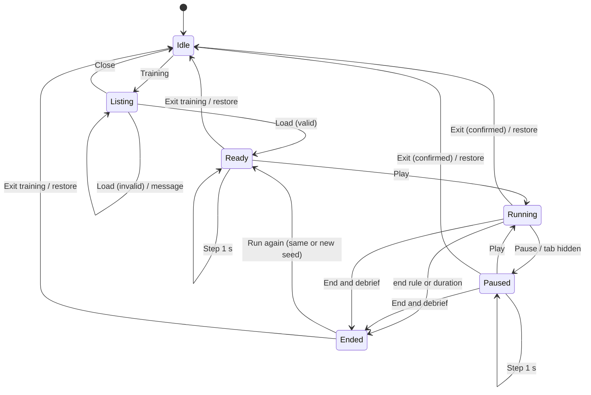
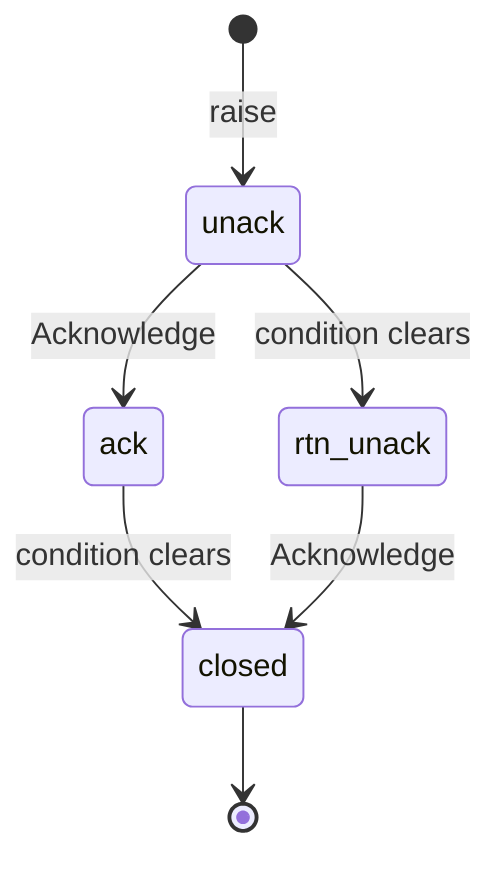
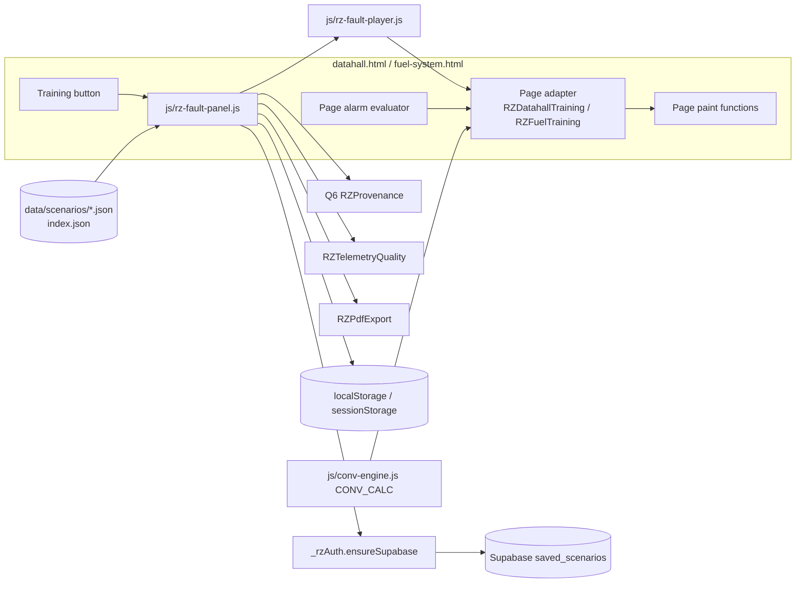
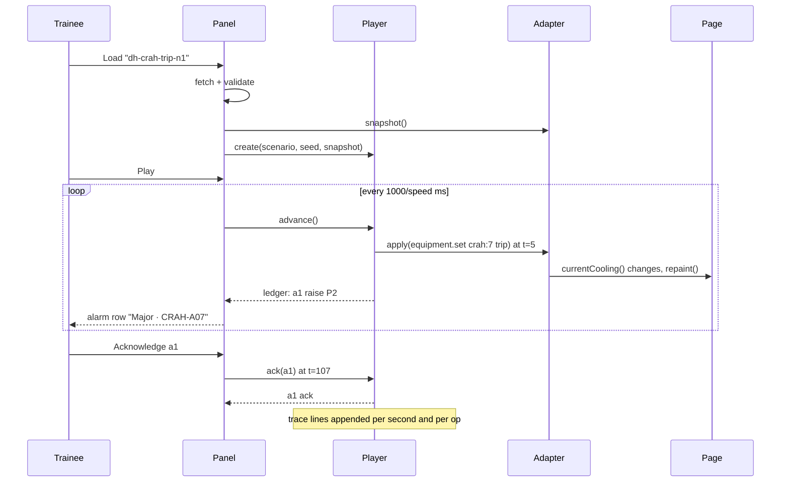

# PRD-Q07 — Scripted fault scenarios for the data-hall cockpit (training mode)

## 1. Document control

| Field | Value |
|---|---|
| PRD id | PRD-Q07 |
| Feature | Training mode on the conventional data-hall cockpit (`datahall.html`) and the fuel cockpit (`fuel-system.html`): scripted, seeded fault scenarios with play, pause and step; acknowledgement per alarm; expected actions with sourced time budgets; a debrief with PDF export; saved runs on the device and, when signed in, in the account. Removes the random excursion generator from `datahall.html` |
| Version | 1.0 |
| Status | Draft |
| Author | Opus 5.5 (Fable quota exhausted) |
| Date | 2026-11-11 |
| Owner requests | R110 (PRD per idea), R111 (24-section structure) |
| Priority | 73.0 (addendum rank: I 8, N 8, C 7, E 5, effort 4 weeks; `documentation/PRODUCT_INNOVATION_ASSESSMENT_2026-11_ADDENDUM.md:78`) |
| Related findings | Q7 (`…_ADDENDUM.md:144-175`, workflow table `:517-532`), X4 (`:50`), maturity row "simulation honesty" (`:34`), BASELINE §7. New findings in this PRD: F2 (excursion values chosen to always warn), F5 (no air-side transient model anywhere in the repo), F8 (engine labels the A1 allowable range "recommended"), F13 (stale EPMS line in a standard), corrections C1–C5 (§3.3) |
| Dependencies | **Q6** provenance labels (`documentation/product-transformation/02-prds/PRD-Q06/PRD.md`, new `js/rz-provenance.js`) must ship first; PRD-Q06 §13 (`:1257`) already records that Q7 will call `RZProvenance.mark(...)` and remove the random excursion. Owner decisions OQ-1 to OQ-4 (§23). No peer-owned file is touched |
| Related modules | `datahall.html`, `fuel-system.html`, `js/conv-engine.js` (read only, byte-locked by `tools/ship-gate.sh:349-361`), `js/rz-alarm-state.js`, `js/rz-telemetry-quality.js`, `js/rz-pdf-export.js`, `js/rz-toast.js`, `js/rz-sheet.js`, `js/rz-supabase.js`, `auth.js`, `css/rz-hub.css`, `tools/test-datahall-operator-engineering.mjs`, `tools/test-ict-datahall-operator-runtime.mjs`, `tools/test-datahall-authority.mjs`, `manual/datahall.html`, `prd/datahall.html`, `manual/fuel-system.html` |
| Target wave | Addendum roadmap "Strategic, week 17+" (`…_ADDENDUM.md:558`), after Q6 (wave 1) |
| Approval status | Approved by owner R110/R111 2026-11-10 (the PRD set). The addendum marks Q7 "Major feature: needs owner approval" (`…_ADDENDUM.md:144-175`, "Dependencies and risks"); that approval is the R110/R111 set approval plus the per-scenario acceptance in §12. Phase C (temperature model) additionally needs the owner to adopt the hall's thermal capacitance (OQ-1) |

Change history

| Version | Date | Author | Change |
|---|---|---|---|
| 1.0 | 2026-11-11 | Opus 5.5 | First complete draft, 24 sections. Facts verified against `wt-hub3` at `2f458f7c5` (branch `hub-r3`) |

## 2. Executive summary

`datahall.html` invents its alarms. Thirty seconds after load, and every two minutes after that, it picks a random row, a random CRAH, a random 10–15 s duration and a random rack-inlet temperature between 27.5 and 30.0 °C (`datahall.html:2079-2135`). Every draw lands above the 27 °C warning and below the 30 °C critical threshold, so the generator always produces exactly one warning. The log names a CRAH as "under-cooling" (sometimes the standby unit, which is not even running), but the page has no link between CRAH units and rows, and the cooling capacity it shows never changes. A trainee learns that warnings appear without cause and clear by themselves.

This PRD replaces the generator with scripted training scenarios. A scenario is a JSON file with a timeline, alarms with ISA-18.2 states, expected operator actions, and a time budget for each, every rate, threshold and budget citing its source. A seeded, integer clock makes every run reproducible: the same scenario, seed and operator inputs give a byte-identical trace. The trainee plays, pauses or steps the run, acknowledges each alarm, ticks off actions, and gets a debrief that compares expected and actual timing. The debrief exports as PDF through the site's existing builder (`js/rz-pdf-export.js`) and is saved on the device, and in the account's `saved_scenarios` table when signed in.

The research found that nothing in the repository can compute how fast a data hall heats up when cooling is lost: the conventional engine is steady-state, `rz-engine.js` has no transient air model, and `js/ltc-plant.js` models only liquid loops (F5). The engine's own numbers also show that losing one CRAH at N+1 produces no excursion at all (58 × 130 kW = 7,540 kW against 7,500 kW, F6). So v1 ships scenarios whose consequences the engine can compute exactly (equipment state, capacity, redundancy, alarms, procedure timing) and states plainly what is not modelled. A minimum, sourced thermal model (single-zone air energy balance) is specified as Phase C and stays switched off until the owner adopts the hall's thermal capacitance. No number is tuned for drama.

Scope v1: `datahall.html` (three scenarios) and `fuel-system.html` (one scenario). `datahallAI.html`, `EPMS_Telemetry.html`, `cdu-mini-bms.html` and `dc-conventional.html` were inventoried (Appendix A): none has a random alarm path; they move to v2 with reasons.

## 3. Problem statement

### 3.1 Verified facts (commands run 2026-11-11 on `wt-hub3` at `2f458f7c5`; full commands in Appendix B)

| # | Fact | Evidence | Command |
|---|---|---|---|
| F1 | `datahall.html` has one `Math.random` call in code, in the excursion helper `dhRand`. The other two matches are comments | `datahall.html:2085` (code); `:978`, `:1217` (comments) | `grep -n 'Math.random' datahall.html` |
| F2 | The excursion fires 30 s after load, then every 120 s. It draws a row (0–24 of 25 rows: 500 racks / 20 per row), a CRAH (1–59, so it can name unit 59, the standby that is not running), a duration (10–15 s) and a temperature (27.5–30.0 °C, rounded to 0.1). The evaluator warns above 27 °C and goes critical above 30 °C, so every draw yields one warning and never a critical. The banner calls the CRAH "affected" and the log "under-cooling", but CRAH units carry no row mapping and capacity does not change | `datahall.html:2079-2135` (schedule `:2135`; draws `:2088-2091`); rows `:981`, `:1179-1185`; CRAH count `:1344`; thresholds `:1409-1424`; banner `:2105-2107`; log `:2112`; CRAH units `:1449-1466` | `sed -n 2079,2135p datahall.html` |
| F3 | The excursion hook `window.__fireDatahallExcursion` (`:2133`) is pinned by three gates and planned into Q6's law L7 | `tools/test-datahall-operator-engineering.mjs:65`; `tools/test-ict-datahall-operator-runtime.mjs:106-127` (asserts +1 warning containing "Rack inlet", then restore); `tools/test-datahall-authority.mjs:103`; `PRD-Q06/PRD.md:643`, `:1498` | `grep -rn 'fireDatahallExcursion' tools/` |
| F4 | The other five pages in scope have no `Math.random` call in code; their alarm paths are deterministic thresholds, operator toggles, or scripted scenario tables | Appendix A (file:line per page) | Appendix B, B2 |
| F5 | No model in the repo computes air-side temperature rise over time. `js/conv-engine.js` is a steady-state snapshot (`crahRequired` `:286-291`, cooling block `:842-862`). `rz-engine.js` has a steady class check `models.architecture.thermalCheck` (`:13656-13672`) and no time model. `js/ltc-plant.js` `transient()` (`:533-568`) handles only the liquid loops (kinds `fws-pump`, `cooler`, `chiller`, `chw`); its CRAH fault overlay changes steady air capacity only (`:570-622`), and it models the LTC liquid-cooled plant, not this hall | as cited | `grep -n "transient\|kind ===" js/ltc-plant.js`; `grep -n 'thermalCheck' rz-engine.js` |
| F6 | Engine values the scenarios use: version 2.2.0; Hall A IT load 7,500 kW of 10,000 kW design; CRAH 130 kW sensible each (`ASSUMED — no vendor selection made`, `js/conv-engine.js:158`); 58 required, 59 installed, 58 running; 7,540 kW available. One trip with the standby starting: 58 × 130 = 7,540 kW ≥ 7,500 kW, covered with 40 kW to spare. One trip with the standby unavailable: 57 × 130 = 7,410 kW, 90 kW short. The page already states "7,670 kW installed and 7,540 kW post-failure capacity" (`prd/datahall.html`, pinned by `tools/test-conv-document-parity.mjs:39`) | `js/conv-engine.js:158`, `:286-291`; `datahall.html:1165-1167`, `:1329`, `:1341-1354` | Appendix B, B3 (prints `2.2.0 7500 10000 58 59 58 130 7540 25.4`) |
| F7 | Sourced timing and limits that exist in the repo: alarm classes P1–P4 with operator response times (MSC-1 worked example of the RZ Cx handbook, not a standard); heartbeat alarm after 30 s without change; ASHRAE recommended rack inlet 18–27 °C and A1 allowable 15–32 °C; rate-of-change limits ≤ 5 °C in any 15 min and ≤ 20 °C in any hour; NFPA 110 Type 10 (10 s) | `data/cx-handbook/chapters/21_bms_architecture_points.md:625-632`, `:615`; `data/cx-handbook/chapters/28_integrated_systems_testing.md:365`, `:368`, `:369`; `data/cx-handbook/chapters/33_glossary_quick_reference.md:504`; `data/cx-handbook/chapters/15_generators_fuel_synchronising.md:32` | `sed -n 625,632p …/21_bms_architecture_points.md` |
| F8 | No sourced room heat-up rate exists. The only figure (0.43 K/min, `28_integrated_systems_testing.md:644`) is a measured value inside a worked example; the article-9 cooling-loss times are unsourced. `rz-engine.js` labels 15–32 °C "Class A1 (air, recommended)" (`:8750-8757`), but 15–32 °C is the A1 *allowable* range; recommended is 18–27 °C (`28_…:368`) | as cited | `sed -n 8750,8757p rz-engine.js` |
| F9 | Persistence contract: `saved_scenarios` (id uuid, user_id uuid → auth.users on delete cascade, calc text, name text, payload jsonb, created_at) with checks name 1–120, calc 1–40, payload ≤ 65,536 bytes, RLS own rows, and a cap of 200 rows per user shared with every calculator. `rzSupa.saveScenario/listScenarios/deleteScenario` exist. Cockpit pages do not load `js/rz-supabase.js`; `auth.js` lazy-loads it through `ensureSupabase()`, which is internal (not on `window._rzAuth`). `account.html` shows "Open" only when `payload.inputs` has keys | `supabase/schema.sql:280-331`; `js/rz-supabase.js:163-188`; `auth.js:432-455`; `account.html:214-245` | `sed -n 280,331p supabase/schema.sql` |
| F10 | The shared PDF builder `window.RZPdfExport` (`buildDocument` `:176-226`, `open` `:228-241`) is loaded by 11 pages; `datahall.html` and `fuel-system.html` are not among them | `js/rz-pdf-export.js`; `grep -l 'rz-pdf-export.js' *.html` | Appendix B, B6 |
| F11 | Access: `datahall.html` and `fuel-system.html` are public (no `page-access` entry, no root gate) and in `sitemap.xml`; `datahallAI.html` and `dc-conventional.html` are root-only with educators admitted | `js/rz-feature-flags.js:214-222`, `:238-246`, `:495`; `grep -c 'rootGate\|enforceTierFeatureAccess' …` = 0 for datahall and fuel | Appendix B, B7 |
| F12 | Q6 contract on this page: `<body data-rz-data-mode="simulated">` (`datahall.html:581`); Q6 adds the line `rz-prov-dh-alarms` ("excursions are injected at random times …") and the row suffix " · simulated excursion, random timing" (`PRD-Q06/PRD.md:930`, `:960`) | as cited | `grep -n 'rz-prov-dh' PRD-Q06/PRD.md` |
| F13 | `standarization/ALARM_STATE.md:98` says "EPMS_Telemetry.html untouched per owner mandate", but `standarization/BMS_SHELL.md:536` records that the owner revoked the byte-untouched designation | as cited | `grep -n 'untouched' standarization/*.md` |
| F14 | Public documents describe the excursion as a feature: `manual/datahall.html:596`, `:617`, `:632`; `prd/datahall.html:188` (FR-22), `:248`, `:265` (AC-11) | as cited | `grep -n -i excursion manual/datahall.html prd/datahall.html` |

### 3.2 Consequence of leaving it

- A trainee learns a false pattern: a rack-inlet warning every two minutes that has no cause and clears itself in 10–15 s. Real excursions follow a cause (capacity lost, airflow broken) and do not clear on their own.
- The printed temperature in the banner and log is a random number presented as a reading, against the ACCURACY rule (CLAUDE.md, ACCURACY) and the spirit of `standarization/ACCURACY_VALIDATION.md` Rule 2 (`:18-32`), which today lists KPIs but not alarms.
- There is nothing to practise: no acknowledgement per alarm, no expected action, no record of a run.
- Q6 can only label the excursion "random timing". The label is honest; the defect stays.

### 3.3 Addendum corrections

| # | Addendum says | Verified | Correction in this PRD |
|---|---|---|---|
| C1 | "Scenario: CRAH-3 fan failure at 70 % load … Temperatures rise at rates from the engine's thermal model" (`:144-175`) | No engine model gives an air-side rise rate (F5). The engine's hall runs at 75 % (7,500 of 10,000 kW), not 70 %. One CRAH lost at N+1 is covered by the standby and produces no steady excursion (F6) | Load comes from the engine snapshot. The CRAH-trip scenario shows no temperature change and says why. Temperature output exists only in Phase C, behind an adopted capacitance (FR-12) |
| C2 | X4 / Q7: "picks a random zone and CRAH every 120 s" (`:50`, `:145`) | First at 30 s, then every 120 s (`datahall.html:2135`); the temperature range sits between the warning and critical thresholds by construction (F2) | Stated as F2 |
| C3 | "Integration points: datahall, datahallAI, fuel-system, EPMS" | `datahallAI.html` is root/educator-gated and already scripted; `EPMS_Telemetry.html` has no random path and its ATS timings (1 s / 2 s, `:1084`, `:1094`) carry no source (Appendix A) | v1 = `datahall.html` + `fuel-system.html`; the others are v2 (§5.2) |
| C4 | BASELINE §7: "Q7 needs … the engine's thermal model" | That model does not exist (F5) | FR-12 specifies the minimum sourced model and blocks its output until OQ-1 |
| C5 | — | `ALARM_STATE.md:98` is stale (F13) | Fixed in the release's standards update (§22) |

## 4. Objectives and success metrics

| Objective | Metric | Target | Measurement | Assumption |
|---|---|---|---|---|
| O1 No invented alarms | `Math.random` calls in `datahall.html` code and in `js/rz-fault-*.js` | 0 (today 1) | L1 | Comments excluded; `rz-tracker.js` session ids are outside the alarm path |
| O2 Reproducible runs | Traces of the same scenario + seed + inputs | byte-identical in node and in the browser, and equal to the committed golden | L2 | Golden traces regenerated only on a scenario version bump |
| O3 Every value sourced | Rate, threshold and budget fields without a resolvable basis | 0 | L3 | Basis = file:line in the repo, or an owner adoption record |
| O4 Honest idle state | Alarms injected when no scenario runs, over 10 simulated minutes | 0 (today: 1 at 30 s, then 1 every 120 s) | L4 | Page timers are fast-forwarded in the test |
| O5 Useful debrief | Expected alarms and actions listed with expected and actual times, seed, engine version, trace id; PDF carries the same rows | 100 % of rows | L5 | — |
| O6 Runs persist | Local save and account save round-trip | Pass | L6 | Account save tested against a stubbed `rzSupa`; one live check by the owner's account after deploy |
| O7 Use | Training runs started per month | UNKNOWN — no baseline; measure with the existing `rz-tracker.js` event after release (task T-15) | Tracker event `fault_run_start` counts | No target is set before a baseline exists |

## 5. Scope

### 5.1 In scope

1. Remove the excursion block `datahall.html:2079-2135` and every text that describes it (banner text, log lines, Q6 interim suffix, manual and page-PRD rows F14).
2. Scenario format `rz-fault-scenario/1`: JSON schema, catalogue `data/scenarios/index.json`, four scenario files (Appendix C), golden traces.
3. `js/rz-fault-player.js` (DOM-free core: validation, seeded clock, events, alarm ledger, expected actions, trace, debrief data, replay, Phase C thermal function).
4. `js/rz-fault-panel.js` + `css/rz-fault-panel.css` (Training button, panel, controls, alarm rows with Acknowledge, actions, debrief, PDF, saves).
5. Page adapters inside `datahall.html` (in place of the removed block) and `fuel-system.html`.
6. Persistence: `localStorage` (`rz_fault_runs_v1`) and `saved_scenarios` (calc `fault-training`) when signed in.
7. Integration with Q6 (`RZProvenance.mark`), `RZTelemetryQuality.setPageMode('demo')`, `RZPdfExport`, `RZToast`, `RZSheet`.
8. New gate `tools/test-fault-scenarios.mjs`; updates to the three gates in F3.
9. Phase C: the lumped air model (FR-12), switched on per scenario only after OQ-1.

### 5.2 Out of scope (non-goals)

| Item | Why |
|---|---|
| `datahallAI.html` scenarios | Root/educator-gated (`js/rz-feature-flags.js:214-222`, `:495`); its electrical, cooling and fire scenario tables are already deterministic (Appendix A). Adopting the player there is v2; its electrical timeline offsets need sources first |
| `EPMS_Telemetry.html` | No random path; operator-driven; ATS delays 1 s / 2 s unsourced (`:1084`, `:1094`). v2 with NFPA 110 Type 10 as the basis (F7) |
| `cdu-mini-bms.html` | Has its own fault picker (`:337-345`) whose offsets `SCEN` (`:466-473`) carry no source; Q6 labels them. v2 after the offsets are sourced |
| `dc-conventional.html` | Deterministic thresholds (`:1516`), gated page; nothing to replace |
| `chiller-plant.html` chiller-trip scenario | Not in the six pages of the brief; the engine supports it (7 of 10 chillers, 31,250 kW rejection) — candidate for v2 |
| Changing `js/conv-engine.js` | Byte-locked (`tools/ship-gate.sh:349-361`); the player reads the snapshot only |
| Multi-user or instructor-led sessions, scoring leaderboards, badges | Not requested; gamification is excluded by the design rules |
| User-uploaded scenario files | No upload path in v1; every scenario is a reviewed static file |
| Fixing `rz-engine.js` A1 label (F8) | Engine change with its own gate chain; reported to the engine owner (risk R8) |

### 5.3 Existing capabilities reused

| Capability | Where | Use |
|---|---|---|
| Conventional engine snapshot | `js/conv-engine.js` (`CONV_CALC.snapshot`, `getHallSnapshot`), loaded at `datahall.html:537` | Hall IT load, CRAH counts, unit size, set point |
| Page alarm evaluator | `datahall.html:1409-1424`; `fuel-system.html:1312-1330` | Unchanged; evaluator alarms join the ledger |
| ISA-18.2 state names | `js/rz-alarm-state.js:32-44` (`normal`, `unack`, `ack`, `rtn_unack`, …), export `:156-167` | Ledger states (rendered as words, not chips) |
| Data-mode banner with a "Demo / training" state | `js/rz-telemetry-quality.js:30-37` (`demo`), `setPageMode` `:108-113`, export `:256` | Page shows "Demo / training" while a scenario runs |
| PDF document shell | `js/rz-pdf-export.js:176-241` | Debrief PDF |
| Toast, sheet | `js/rz-toast.js:175`, `:239-242`; `js/rz-sheet.js:275-277` | Save/PDF feedback; phone panel |
| Supabase client and scenario table | `js/rz-supabase.js:163-188`; `supabase/schema.sql:280-331` | Account save/list/delete |
| Supabase lazy loader | `auth.js:432-455` | Exported (one line) and reused, so a page never loads a second client |
| Hub tokens | `css/rz-hub.css:11-30` (dark), `:31-39` (light) | Panel styling |
| Motion tokens | `standarization/MOTION_STANDARD.md:60-68` | Only through RZSheet/RZToast; the panel itself does not animate |
| Test harness with own server | `tools/test-fmea-sim.mjs:21-28` pattern; `rz-lane` (`~/.local/bin/rz-lane`, usage `rz-lane [-l N] [-t SECS] -- <cmd>`) | New gate |

### 5.4 Dependencies

| Dependency | Type | State on 2026-11-11 |
|---|---|---|
| Q6 `js/rz-provenance.js` and the `rz-prov-dh-*` lines | Blocking | PRD written (`PRD-Q06/PRD.md`), not shipped |
| Owner decision OQ-1 (hall thermal capacitance) | Blocks Phase C only | Open |
| Owner decision OQ-2 (standby start delay) | Refines S1/S2; not blocking | Open |
| Owner acceptance per scenario file | Blocks listing of that scenario | Open |
| Peer | Version claim only | Peer holds local v3.35.10 work (STATE.md) |

### 5.5 Constraints

- Zero-build static site, vanilla ES5 in pages and shared modules (matching `js/rz-alarm-state.js`).
- `js/conv-engine.js`, `js/datahall-model.js`, `js/datahall-calculations.js` must stay byte-identical (`tools/ship-gate.sh:349-361`).
- `tools/test-conv-document-parity.mjs:6-60` pins strings in `manual/datahall.html` and `prd/datahall.html`; edits keep every required string.
- Design rules of the brief: hub tokens, IBM Plex Sans + JetBrains Mono, one amber accent, states as words, radius ≤ 4 px, no `transition: all`, no hover transforms, Font Awesome only, 1440 and 390 px, both themes, 16 px inputs on phones.
- ACCURACY: every number on screen is an engine value, a basis value with its source, or a model output labelled with its basis.

### 5.6 Assumptions

| # | Assumption | If wrong |
|---|---|---|
| A1 | Q6 ships before Q7 with the API in `PRD-Q06/PRD.md` §11.2 | Q7 T-11 waits; nothing else changes |
| A2 | The Cx handbook's MSC-1 alarm classes (`21_…:625-632`) are acceptable as the training budget basis, labelled as a worked example | Owner supplies another alarm philosophy; budgets change in the scenario files only |
| A3 | The standby CRAH starts automatically, as the page's own N+1 logic assumes (`datahall.html:1347-1351`) | S1 adds an operator action "Start the standby CRAH" |
| A4 | A training row in `saved_scenarios` without `inputs` is acceptable on the Account page (shows Delete only, F9) | Account page gets a "Training runs" filter (v2) |

## 6. User personas and use cases

Tiers as implemented: `free | demo | pro | root` (`js/rz-feature-flags.js:6`); `getTier()` returns `free` with no session, `pro` for any signed-in non-demo user, root and educators included (`auth.js:1034-1043`); educator is a role on a pro session (CLAUDE.md, Auth tiers).

| Persona | Real role | Goal | Permissions in this feature | Expected outcome |
|---|---|---|---|---|
| P1 Operator trainee | Shift technician or junior operator | Practise the first ten minutes of a CRAH trip, a heartbeat loss, a bund alarm | Signed-out: run, debrief, PDF, save on this device | Knows which alarm class needs what within which time |
| P2 DC / facility engineer | Reviews alarm philosophy, N+1 logic | Check how the hall behaves when redundancy is lost | Same as P1; signed in (pro) adds account save | Sees capacity arithmetic from the engine and what is not modelled |
| P3 Educator | `role=educator`, `tier=pro` | Run a scenario with a class, collect PDFs | As signed-in pro; no roster in v1 | One PDF per trainee run, with seed and trace id |
| P4 Student | Signed-out visitor | Understand alarm states and response times | As P1 | Reads the debrief's sources |
| P5 Owner (root) | Approves scenario files and the thermal capacitance | Keep scenarios honest | Edits files in the repo; no admin UI | Only accepted scenarios are listed |

| UC | Persona | Use case |
|---|---|---|
| UC1 | P1 | Open `datahall.html`, press Training, load "CRAH trip with the standby unit available", play, acknowledge, confirm the standby, read the debrief |
| UC2 | P2 | Load "CRAH trip during standby maintenance", step second by second, read the capacity deficit and the not-modelled note |
| UC3 | P3 | Share a link `datahall.html#scn=dh-bms-heartbeat-loss&seed=4`; each trainee runs it and downloads the PDF |
| UC4 | P1 signed in | Save a run to the account; reopen its debrief later from the panel |
| UC5 | P1 | Run "Bund sump high" on `fuel-system.html` and use the page's own ACK button |
| UC6 | P5 | Add a scenario file, run the gate, accept it (status `approved`) |

## 7. Complete user journey

### J1 Normal visit, no training (all personas)
- Entry: `datahall.html` from the tools hub, the conventional cockpit nav, or search.
- Initial state: engine snapshot painted; alarm list shows the evaluator result. With the engine values of today that is the existing copy "No active alarms — racks <85% rating and rack inlets within the recommended upper limit." (`datahall.html:1661`). No alarm appears later by itself.
- System: the Training button sits in the top bar after "Manual" (`datahall.html:622-623`). If the engine failed to load (authority unavailable path `:1135-1139`), the button is disabled and its text reads "Training unavailable".
- Exit: navigation as today.

### J2 Run a scenario (UC1)
1. Press **Training**. Desktop: the panel opens at the top of the right sidebar, above "Active Alarms" (`:919-921`). Phone (≤ 768 px): `RZSheet.open` shows the same panel as a bottom sheet. The panel fetches `data/scenarios/index.json?v=<RZ_VERSION>` (lazy, first open only).
2. Loading: the panel shows "Loading scenarios…". Error: "The scenario list could not be loaded. Training is unavailable right now." with **Retry**.
3. List: one row per approved scenario for this page: title, one-line summary, "About N min · Model: capacity only" (or "Model: capacity and temperature" in Phase C), button **Load**.
4. Load: the file is fetched and validated (FR-3). Valid → the panel switches to the run view; the page enters training (FR-13): banner "Training scenario running: <title>. Not live plant data." in `#excursionBanner` (`:587`, kept and renamed in code to the training banner), data mode `demo`, provenance basis "scenario <id> v<n> · seed <s>". Invalid → message (§9.6) and the page stays in J1.
5. Run view initial state: clock "T+00:00:00", state "Ready", controls Play, Step 1 s, Restart, End and debrief, Exit training; speed select (1×, 10×).
6. Play: the clock advances one scenario second per wall second (1×) or ten (10×). Events apply at their second (FR-4); the page repaints through its adapter (CRAH cell state word, capacity boxes, N+1 result).
7. An alarm raises: it appears in the training alarm list with its class word ("Major"), source tag, message, state "Unacknowledged", the budget line "Acknowledge within 5 min · Cx handbook §21.11.1 (worked example)" and **Acknowledge**. The page's own alarm list and strip count it too (adapter merge, FR-5).
8. Acknowledge: state becomes "Acknowledged"; the second is recorded. Expected actions for that alarm appear as checkboxes with their budget.
9. Tick an action: the second is recorded; its effects (if any) apply from the next second (FR-7).
10. End: when every alarm is closed and every timed action is done, or at the scenario's duration, the run ends; or the trainee presses **End and debrief**. The panel shows the debrief (FR-8), focus moves to its heading.
11. Debrief actions: **Download PDF**, **Save to account** (signed in) or "Sign in to save runs to your account." (signed out), **Run again with the same seed**, **Run with a new seed**, **Exit training**. The run is saved on the device automatically when the debrief opens (FR-10).
12. Exit training: the page restores the engine state (FR-5 restore), clears the banner, sets data mode back to `simulated`, removes the scenario provenance. Focus returns to the Training button.

Failure and recovery inside J2:
- Engine missing or version not 2.2.0-compatible with the scenario's `engine.version` → "This scenario was written for conv-engine <x>; the page runs <y>. It cannot run until the scenario is reviewed." No fallback to random, no partial run.
- Tab hidden during play → the run pauses (Page Visibility API); on return the state reads "Paused (tab was hidden)".
- Reload during a run → the run is lost; the panel offers "A run was interrupted at T+00:04:12. Start again?" from a local draft (FR-10). The trace is never resumed silently.
- Exit mid-run → inline confirmation "End this run? It will not be saved." **End run** / **Keep running** (no `window.confirm`, CLAUDE.md RZToast note).

### J3 Phone (390 px)
Same as J2 inside `RZSheet`. Controls stack two per row, 44 px minimum height; the trainee name field is 16 px. The page behind stays scrollable when the sheet is closed; reopening the sheet keeps the run (the player lives outside the sheet DOM).

### J4 Deep link (UC3)
`datahall.html#scn=<id>&seed=<n>`: after the engine binds, the panel opens with that scenario loaded and paused at T+00:00:00. Invalid id or seed → "This training link could not be read. The page shows its normal view." and the hash is removed with `history.replaceState`. The `#scn=` key is separate from P2's `#rzs=` (calculators only).

### J5 Saved runs (UC4)
Panel → **Saved runs**: rows from this device (newest first, max 20) and, when signed in, from the account (`listScenarios('fault-training')`). Open → debrief view. When the scenario version still matches, the debrief is recomputed by replay and must equal the stored result (FR-10); when it does not match: "This run used version 1 of the scenario; the current version is 2. The debrief shows the saved results." Delete → removes that row (account rows via `deleteScenario`).

### J6 Fuel page (UC5)
`fuel-system.html` gets the same Training button in its header and the same panel. During a run, the page's ACK button (`window.ackAlarms`, `:1749`) also acknowledges every unacknowledged training alarm at the current second. The page's `r` and `p` shortcuts (`:1786-1791`) are ignored while focus is in a form field or a scenario is running (FR-15).

### J7 Owner adds a scenario (UC6)
Author the file per `standarization/FAULT_SCENARIO_STANDARD.md` (new) → `node tools/test-fault-scenarios.mjs --law L3 --file data/scenarios/<id>.json` → `--write-golden <id>` → review → set `status: "approved"`, `approvedBy`, `approvedOn`, `request` → add to `index.json` → full gate.

## 8. Functional requirements

Each FR lists: description, trigger, preconditions, inputs, processing, outputs, state change, dependencies, exceptions, acceptance. §8.1 repeats the fields as a matrix.

**FR-1 Remove the random excursion**
- Description: delete `datahall.html:2079-2135` (comment, `excursionState`, `dhRand`, `dhRandInt`, `fireExcursion`, `window.__fireDatahallExcursion`, the 30 s / 120 s schedule) and the Q6 interim suffix and line copy.
- Trigger: release of phase A.
- Preconditions: FR-5 adapter in place (it replaces the block) and the three gates in F3 updated (T-12).
- Inputs: none.
- Processing: code removal; `#excursionBanner` stays as the training banner (empty and hidden outside training).
- Outputs: no alarm, banner or log line appears without a scenario.
- State change: none persisted.
- Dependencies: FR-5, FR-16.
- Exceptions: none.
- Acceptance: L1 (0 `Math.random` calls in code), L4 (0 injected alarms in 10 simulated minutes).

**FR-2 Scenario files and catalogue**
- Description: scenarios live in `data/scenarios/<id>.json` (schema §10.2); `data/scenarios/index.json` lists the approved ones per page; golden traces live in `data/scenarios/_golden/<id>.seed<k>.trace.txt`.
- Trigger: author adds or changes a scenario.
- Preconditions: owner acceptance for `status: "approved"`.
- Inputs: JSON files.
- Processing: the gate validates every file, checks `index.json` lists exactly the approved files for each page, checks golden traces exist for seed 1 of each approved scenario.
- Outputs: catalogue consumed by the panel.
- State change: repository files only.
- Dependencies: FR-3.
- Exceptions: a draft file is never listed; a listed file that fails validation fails the gate.
- Acceptance: L3; AC-2.

**FR-3 Loader and validation**
- Description: `RZFaultPlayer.validate(scenario, ctx)` returns `{ok, errors[]}`; the panel refuses to load on any error.
- Trigger: Load, deep link, saved-run replay.
- Preconditions: file fetched (same origin, `?v=<RZ_VERSION>`).
- Inputs: parsed JSON; context `{page, engineVersion, snapshot}`.
- Processing: rules V1–V16 (§10.3).
- Outputs: valid scenario object (frozen copy) or error list.
- State change: none.
- Dependencies: §10.2 schema.
- Exceptions: JSON parse error → `E_PARSE`; fetch error → `E_FETCH`; every rule has its code (§11.1).
- Acceptance: L7 (each planted malformed fixture refused with its code and copy; page keeps working; no page error).

**FR-4 Seeded, integer clock and player**
- Description: one player instance per run; time is an integer `t` in seconds from 0.
- Trigger: Play (timer every `1000 / speed` ms), Step (+1 s), Restart, End.
- Preconditions: valid scenario, adapter snapshot taken.
- Inputs: scenario, `seed` (integer 1–2,147,483,647), adapter snapshot, operator inputs.
- Processing: `advance()` → `t += 1`; apply events scheduled at `t` (absolute events in file order, then action-triggered events in the order their actions were recorded); evaluate conditions (capacity deficit, comms state, Phase C temperature); update the alarm ledger; append one trace line (§10.4). `ack(id)` and `act(id)` are stamped with the current `t`, write one trace line each, and schedule effects at `t + max(1, delayS)`. Picks use the LCG `s = (Math.imul(1103515245, s) + 12345) >>> 0`, index = `s % n`, one step per pick in declaration order (the same constants as `rz-engine.js:12182-12185`, with `Math.imul` so the 32-bit result is exact).
- Outputs: state object `{scenarioId, version, seed, t, plantState, ledger, actions, inputs[]}` (the addendum's state, `…_ADDENDUM.md:517-532`), trace lines.
- State change: in memory; draft copy in `sessionStorage` key `rz_fault_draft_v1` each second (for the interrupted-run offer).
- Dependencies: FR-3, FR-5.
- Exceptions: `advance()` after the end → no-op; `ack` of a closed alarm → no-op with no trace line.
- Acceptance: L2 (byte-identical traces in node and browser, equal to golden; 10× speed gives the same trace).

**FR-5 Data-hall adapter (inside `datahall.html`, replacing `:2079-2135`)**
- Description: `window.RZDatahallTraining = {snapshot, apply, restore, pageAlarms, repaint}` gives the player a narrow handle on the page's state.
- Trigger: player events and conditions; Exit training.
- Preconditions: engine bound (`HALL`, `S` available, `:1165-1167`, `:1341-1354`).
- Inputs: events `equipment.set` (`crah:<n>`, `crah:standby`, `crah:pick:<name>`; states `run`, `stby`, `trip`, `oos`), `comms.set` (`ok`, `stale`), `thermal.set` (Phase C: hall rack-inlet °C).
- Processing: keep a training copy of the CRAH unit states; recompute `running`, `availableKw = running × CRAH_UNIT_KW`, `n1Pass`, headroom and margin through one function `currentCooling()`; every consumer of `COOL_AVAIL_KW`, `N1_PASS`, `CRAH_RUNNING`, `COOL_HEADROOM`, `COOL_MARGIN_PCT` (today `:1346-1354`, `:1429`, `:1452-1454`, `:1494-1501`, `:1564-1574`, `:1987`, `:2039`, `:2249`) reads `currentCooling()`; outside training it returns the engine values unchanged. `refreshAlarmState()` (`:1431`) merges `evaluateAlarms()` with the player's active alarms. CRAH cells show the state word (RUN, STBY, TRIP, OOS) — the page's existing vocabulary.
- Outputs: repainted page; `pageAlarms()` returns the merged list for the ledger.
- State change: in memory only; `restore()` returns every value to the engine snapshot.
- Dependencies: FR-4.
- Exceptions: an event that names a unit outside 1–`CRAH_TOTAL`, or `crah:standby` when none is in STBY → validation error at load time (V12), never at run time.
- Acceptance: AC-3, AC-4; outside training `tools/test-datahall-authority.mjs` and `tools/test-conv-coverage.mjs --strict` stay green (parity); L2 through the browser.

**FR-6 Alarm ledger and acknowledgement**
- Description: every alarm in a run has an id, class (P1–P4), source tag, message, state, raised second, acknowledged second, cleared second.
- Trigger: `raise` rules (`onEvent`, `when` condition, `pageTag` match) and `clear` rules (`onAction`, condition false, `pageTag` gone).
- Preconditions: run active.
- Inputs: scenario `alarms[]`, page evaluator alarms.
- Processing: states from `RZAlarmState.STATES` keys: raise → `unack`; ack: `unack → ack`, `rtn_unack → normal` (closed); clear: `ack → normal` (closed), `unack → rtn_unack`. Evaluator alarms not listed in the scenario enter the ledger as "Other alarm" without a budget. Phase C: zone alarms raised in the same second for the same threshold are grouped into one ledger row "Rack inlet above 27 °C in 25 of 25 rows (single-zone model: rows are not resolved)".
- Outputs: training alarm list (§9), merged page list, trace lines.
- State change: ledger in memory and in the run record.
- Dependencies: `js/rz-alarm-state.js` (names only; `chipHtml` is not used because a state is a word).
- Exceptions: a raise for an alarm already active → ignored, one trace line `dup`.
- Acceptance: AC-5; L2 (states appear in the trace).

**FR-7 Expected actions and time budgets**
- Description: each expected alarm has an acknowledgement budget; each expected action has a label, an optional budget and optional effects.
- Trigger: the alarm it follows raises (actions appear then).
- Preconditions: basis id present for every budget (V8).
- Inputs: `acks[]`, `actions[]`.
- Processing: on tick of an action, stamp `t`; schedule effects; budget clocks start at the alarm's raise second.
- Outputs: checkbox list with budget lines (§9.6).
- State change: action record.
- Dependencies: FR-4, FR-6.
- Exceptions: an action whose alarm never raised is not shown and is reported "Not reached" in the debrief.
- Acceptance: AC-6.

**FR-8 Debrief**
- Description: built from the run record by `RZFaultPlayer.debrief(run)`; identical in panel and PDF.
- Trigger: run ends (end rule, duration, or End and debrief).
- Preconditions: run record complete.
- Inputs: run record, scenario.
- Processing: per expected alarm: raised, acknowledged, budget, result word (§9.6) and basis; per action: done, budget, result, basis; other alarms; model notes (what the run computed, what it did not); header with scenario id + version, seed, engine module + version, site version (`window.RZ_VERSION`), trace id (FNV-1a 32-bit of the trace text, hex), start time (device clock, labelled), optional trainee name.
- Outputs: debrief object and its HTML.
- State change: none.
- Dependencies: FR-4, FR-6, FR-7.
- Exceptions: a run ended before any alarm raised → debrief says "The run ended before the first alarm." and lists nothing as late.
- Acceptance: L5.

**FR-9 PDF export**
- Description: **Download PDF** builds the document with `RZPdfExport.buildDocument({title, subtitle, accent, generatedAt, meta, sections, omitted, footerNote})` and opens it with `RZPdfExport.open(html, {onBlocked})` (`js/rz-pdf-export.js:176-241`).
- Trigger: button.
- Preconditions: `js/rz-pdf-export.js` loaded (lazy-loaded on first click, same `?v=` token as the 11 pages that load it).
- Inputs: debrief object.
- Processing: sections Alarms, Expected actions, Other alarms, What the simulation models, Sources; all user text escaped by the panel's `esc()` before it enters section HTML; `footerNote: "Training simulation. Not live plant data."`; `accent: '#7A4800'` (light-register text accent, `css/rz-hub.css:35`).
- Outputs: print window; popup blocked → `RZToast.warn("Allow pop-ups for this site to download the PDF.")`.
- State change: none.
- Dependencies: FR-8; `standarization/PDF_EXPORT_STANDARD.md` (`<\/script>` rule via `RZPdfExport.escapeScript`).
- Exceptions: builder missing after lazy load → `RZToast.fault("The PDF builder did not load. Try again.")`.
- Acceptance: L5 (PDF HTML rows equal panel rows); AC-8.

**FR-10 Saves on this device and replay**
- Description: the run record is written to `localStorage['rz_fault_runs_v1']` (array, newest first, max 20, each ≤ 16 KB) when the debrief opens; a draft is kept in `sessionStorage['rz_fault_draft_v1']` during a run.
- Trigger: debrief opens; every second while running (draft).
- Preconditions: storage available (try/catch).
- Inputs: run record (§10.5).
- Processing: drop the oldest beyond 20; refuse a record over 16 KB with "This run is too large to save on this device." (cannot happen with v1 scenarios; guard only).
- Outputs: Saved runs list.
- State change: browser storage.
- Dependencies: FR-8.
- Exceptions: storage blocked → "Saving on this device is blocked in this browser." (once per session); the run still debriefs.
- Acceptance: L6 (round-trip; replay of a saved run reproduces its trace id).

**FR-11 Saves in the account**
- Description: **Save to account** inserts one `saved_scenarios` row: `calc = 'fault-training'`, `name = "<title> · <YYYY-MM-DD HH:MM>"` (≤ 120 chars, title truncated first), `payload = run record` without `inputs` (so `account.html:214-245` shows Delete only).
- Trigger: button (never automatic: the 200-row cap is shared with calculator scenarios, F9).
- Preconditions: signed in; Supabase client from `window._rzAuth.ensureSupabase()` (one-line export added to `auth.js` next to the existing `window._rzAuth` members, `:785`; no behaviour change).
- Inputs: run record.
- Processing: serialise; refuse > 65,536 bytes before the call; `rzSupa.saveScenario('fault-training', name, payload)`; map errors (§9.6).
- Outputs: `RZToast.ok("Saved to your account.")`.
- State change: one row, RLS own rows (`supabase/schema.sql:299-309`).
- Dependencies: FR-10.
- Exceptions: not signed in → message; cap reached (`saved scenario limit reached (200)…`, `schema.sql:322`) → cap message; network or other error → "Could not save to your account. The run is still saved on this device."; double click → button disabled until the call returns (no duplicates).
- Acceptance: L6 (stubbed `rzSupa` receives exactly one insert with the contract fields); AC-9.

**FR-12 Phase C: minimum sourced thermal model (switched off until OQ-1)**
- Description: `RZFaultPlayer.thermal.lumpedAir(T, qItKw, qCoolKw, capKjPerK, tSetC, dtS)` returns `max(tSetC, T + (qItKw − qCoolKw) × dtS / capKjPerK)`: a single-zone air energy balance `C·dT/dt = Q_IT − Q_cool`, clamped at the set point because the CRAH controls hold it while capacity suffices.
- Trigger: each `advance()` in a scenario whose `model.thermal` is `lumped-air-v1`.
- Preconditions: `model.params.capKjPerK` present with a basis whose evidence is `ADOPTED` (owner) — the validator refuses `lumped-air-v1` otherwise (V14).
- Inputs: `Q_IT` = `HALL.it_load_kw` (7,500 kW, engine); `Q_cool` = running CRAH × 130 kW (engine, ASSUMED unit size); `tSetC` = `rack_inlet_target_c` (25.4 °C, `js/conv-engine.js:145`); `C` = adopted value.
- Processing: Euler step of 1 s (exact for this linear form between events). The air-only value `C_air = 1.2 × 1.006 × V` kJ/K (`datahall.html` `AIR_RHO_CP`) is a lower bound on `C` (furniture, racks and structure add mass) and therefore gives the fastest possible rise; if the owner adopts the air-only bound, every temperature line says "fastest possible rise (air only)". `V` (hall air volume) is UNKNOWN: no hall geometry exists in `js/conv-engine.js`, `js/conv-design-basis.js` or `js/conv-parameters.js` (grep in Appendix B, B8); `js/ltc-plant.js:144` geometry belongs to the LTC halls, not this hall.
- Outputs: hall rack-inlet temperature fed to `thermal.set`; the page evaluator then raises its own 27 °C / 30 °C alarms; the debrief adds the rate of change against the ASHRAE limits ≤ 5 °C in any 15 min and ≤ 20 °C in any hour (`28_…:369`) and the time spent above 27 °C (recommended) and above 32 °C (A1 allowable, `28_…:368`).
- State change: in memory.
- Dependencies: OQ-1; optionally OQ-2 (standby start delay, a sequence-of-operation value; UNKNOWN — until adopted, a standby that starts is shown running from the next second and the debrief says the start transient is not modelled).
- Exceptions: none at run time; refusals happen at validation.
- Acceptance: U-tests T1–T4 (§20.1) with hand checks; L3 refuses a `lumped-air-v1` scenario without an `ADOPTED` capacitance.

**FR-13 Provenance and data mode (Q6 integration)**
- Description: while a scenario runs, the page says so in the Q6 vocabulary.
- Trigger: load and exit.
- Preconditions: Q6 shipped.
- Inputs: scenario id, version, seed.
- Processing: on load `RZProvenance.mark(alarmPanel, {kind: 'simulated', basis: 'scenario <id> v<n> · seed <s>'})` and the same on the training panel; `RZTelemetryQuality.setPageMode('demo')`; the Q6 line `rz-prov-dh-alarms` text becomes "Simulated · alarms come from the page alarm evaluator and, in training, from the loaded scenario." On exit `RZProvenance.clear(...)` on the panel, `setPageMode('simulated')`.
- Outputs: banner "Demo / training"; provenance attributes.
- State change: DOM attributes.
- Dependencies: Q6 API (`PRD-Q06/PRD.md` §11.2).
- Exceptions: `RZProvenance` missing → the run still works; the gate fails (L8), so it cannot ship that way.
- Acceptance: L8.

**FR-14 Deep link**
- Description: `#scn=<id>&seed=<n>` opens the panel with that scenario paused at 0.
- Trigger: page load with that hash.
- Preconditions: engine bound.
- Inputs: hash; `id` matches `^[a-z0-9-]{3,48}$` and is in `index.json` for this page; `seed` matches `^[0-9]{1,10}$` and ≤ 2,147,483,647.
- Processing: parse with `URLSearchParams` on the hash without `#`; ignore other keys; `history.replaceState` removes the hash after reading.
- Outputs: loaded run or the error copy.
- State change: none persisted.
- Dependencies: FR-3.
- Exceptions: invalid → copy (§9.6), normal view.
- Acceptance: AC-10.

**FR-15 Fuel adapter and scenario S4 (phase B)**
- Description: `window.RZFuelTraining = {snapshot, apply, restore, pageAlarms, repaint}` in `fuel-system.html` near `:1749`; event `interlock.set` (keys of `state.interlocks`, `:1153`); the page's evaluator raises the alarm (`:1312-1330`).
- Trigger: player events; page ACK.
- Preconditions: `FUEL_AUTHORITY_AVAILABLE` true.
- Inputs: S4 file.
- Processing: wrap `window.ackAlarms` (`:1749`) so that, in training, it also acknowledges every unacknowledged training alarm at the current second; the keydown handler (`:1786-1791`) returns early when `e.target` is an `input`, `select` or `textarea`, or when a run is active; `restore()` calls the page's `resetSimulation()` (`:1733-1747`) and re-applies the pre-training interlocks snapshot.
- Outputs: as FR-5.
- State change: in memory.
- Dependencies: FR-4, FR-6.
- Exceptions: none beyond FR-3.
- Acceptance: AC-11; L2 for S4.

**FR-16 Gates and documents**
- Description: new gate `tools/test-fault-scenarios.mjs`; updated gates in F3; documents in F14 rewritten.
- Trigger: T-12, T-14.
- Preconditions: FR-1 to FR-15.
- Inputs: —
- Processing: `test-datahall-operator-engineering.mjs:65` asserts `window.RZDatahallTraining` and the absence of `fireExcursion`; `test-ict-datahall-operator-runtime.mjs:106-127` loads S1 through the panel API, steps to the trip, asserts +1 warning whose text contains the tripped tag, exits, asserts the count is restored; `test-datahall-authority.mjs:103` loads S1 and steps once instead of firing an excursion; Q6's L7 is rewritten to the training banner (coordinate in the Q6 implementation if it ships first).
- Outputs: green gate set.
- State change: repository.
- Dependencies: all.
- Exceptions: —
- Acceptance: `bash tools/ship-gate.sh` exit 0.

### 8.1 FR field matrix

| FR | Trigger | Preconditions | Inputs | Outputs | State change | Dependencies | Exceptions | Acceptance |
|---|---|---|---|---|---|---|---|---|
| FR-1 | Phase A release | FR-5, gates updated | — | No injected alarm | — | FR-5, FR-16 | — | L1, L4 |
| FR-2 | Author change | Owner acceptance | JSON files | Catalogue | Repo files | FR-3 | Draft never listed | L3, AC-2 |
| FR-3 | Load, link, replay | File fetched | JSON, page context | Frozen scenario or errors | — | Schema | E_* codes | L7 |
| FR-4 | Play, step, restart, end | Valid scenario | Scenario, seed, inputs | State, trace | Memory, draft | FR-3, FR-5 | No-op after end | L2 |
| FR-5 | Events, exit | Engine bound | Events | Repainted page | Memory | FR-4 | Load-time refusal | AC-3, AC-4, parity gates |
| FR-6 | Raise/clear rules | Run active | Alarms, evaluator | Ledger | Memory, run record | `rz-alarm-state.js` | Duplicate ignored | AC-5, L2 |
| FR-7 | Alarm raised | Basis per budget | `acks[]`, `actions[]` | Checkboxes | Action record | FR-4, FR-6 | "Not reached" | AC-6 |
| FR-8 | Run ends | Record complete | Run, scenario | Debrief | — | FR-4/6/7 | Ended before first alarm | L5 |
| FR-9 | Download PDF | Builder loaded | Debrief | Print window | — | FR-8 | Popup blocked, builder missing | L5, AC-8 |
| FR-10 | Debrief opens; each second | Storage | Run record | Saved runs | Browser storage | FR-8 | Blocked storage | L6 |
| FR-11 | Save to account | Signed in | Run record | Row | `saved_scenarios` | FR-10, `auth.js` export | Cap, network, double click | L6, AC-9 |
| FR-12 | `advance()` (Phase C) | Adopted `C` | Engine values, `C` | Temperature | Memory | OQ-1 | Refused at validation | T1–T4, L3 |
| FR-13 | Load, exit | Q6 shipped | Id, version, seed | Banner, attributes | DOM | Q6 | Gate fails without Q6 | L8 |
| FR-14 | Hash on load | Engine bound | Hash | Loaded run | — | FR-3 | Invalid copy | AC-10 |
| FR-15 | Events, page ACK | Fuel authority | S4 | Repainted page | Memory | FR-4/6 | — | AC-11, L2 |
| FR-16 | T-12, T-14 | FR-1..15 | — | Green gates | Repo | All | — | ship-gate exit 0 |

## 9. UI/UX specification

### 9.1 Placement and information architecture

- `datahall.html`: a `<button class="nav-btn" id="rz-fault-open" type="button">Training</button>` after the Manual link (`:623`), before the alarm launch slot (`:624`). Panel container `<section class="rz-fault" id="rz-fault" aria-label="Training" hidden>` inserted as the first child of `.sidebar-right` (`:918`), above "Active Alarms".
- `fuel-system.html`: the same button in its header button group; the panel above its alarm table.
- Phone (≤ 768 px): the button opens `RZSheet.open({content: panelNode, label: 'Training'})`; the panel node moves into the sheet and back on close.
- No new page, no nav entry, no sitemap change (the feature lives on indexed pages).

### 9.2 Layout (ASCII)

Desktop 1440, scenario list:
```
┌ Training scenarios ───────────────────────────────────────── [Close] ┐
│ Scripted faults for practice. Nothing here is live plant data.       │
│──────────────────────────────────────────────────────────────────────│
│ CRAH trip with the standby unit available                     [Load] │
│ One running CRAH trips; the standby starts. About 10 min ·           │
│ Model: capacity only                                                 │
│──────────────────────────────────────────────────────────────────────│
│ CRAH trip during standby maintenance                          [Load] │
│ …                                                                    │
│──────────────────────────────────────────────────────────────────────│
│ BMS heartbeat lost on the CRAH gateway                        [Load] │
│──────────────────────────────────────────────────────────────────────│
│ Saved runs (3)                                                  [▸]  │
└──────────────────────────────────────────────────────────────────────┘
```

Desktop 1440, run view:
```
┌ CRAH trip with the standby unit available ───────── [Exit training] ┐
│ Scenario dh-crah-trip-n1 v1 · seed 1 · conv-engine 2.2.0             │
│ T+00:04:12   Running   Speed [1× ▾]                                  │
│ [Pause] [Step 1 s] [Restart] [End and debrief]                       │
│──────────────────────────────────────────────────────────────────────│
│ Alarms                                                               │
│ Major · CRAH-A07                              Unacknowledged         │
│ CRAH-A07 tripped — fan stopped                                       │
│ Acknowledge within 5 min · Cx handbook §21.11.1 (worked example)     │
│                                                      [Acknowledge]   │
│──────────────────────────────────────────────────────────────────────│
│ Expected actions                                                     │
│ [ ] Confirm the standby CRAH is running                              │
│     Within 30 min · Cx handbook §21.11.1 (worked example)            │
│──────────────────────────────────────────────────────────────────────│
│ Plant                                                                │
│ CRAH running   58 of 59      Capacity 7,540 kW for 7,500 kW IT       │
│ Redundancy     none left (standby in use)                            │
│ Rack inlet     not modelled in this scenario  [Why?]                 │
└──────────────────────────────────────────────────────────────────────┘
```

Debrief:
```
┌ Debrief ─────────────────────────────────────────────────────────────┐
│ CRAH trip with the standby unit available                            │
│ Scenario dh-crah-trip-n1 v1 · seed 1 · conv-engine 2.2.0 ·           │
│ site 3.x.y · trace 9f3a01c2 · started 14:02 (this device's clock)    │
│ Trainee (optional) [__________]                                      │
│──────────────────────────────────────────────────────────────────────│
│ Alarm            Raised   Acknowledged  Budget  Result       Source  │
│ CRAH-A07 trip    T+0:05   T+1:47        5 min   Within budget  §21… │
│──────────────────────────────────────────────────────────────────────│
│ Action                     Done     Budget   Result                  │
│ Confirm standby running    T+3:10   30 min   Within budget           │
│──────────────────────────────────────────────────────────────────────│
│ What the simulation models / does not model (list)                   │
│ Sources (list with file:line)                                        │
│ [Download PDF] [Save to account] [Run again, same seed]              │
│ [Run with a new seed] [Exit training]                                │
└──────────────────────────────────────────────────────────────────────┘
```
Phone 390: one column; table rows become two-line fact rows (label above value); buttons full width, 44 px min height.

### 9.3 Component hierarchy (HTML contract)

```html
<section class="rz-fault" id="rz-fault" aria-label="Training" data-rz-provenance="simulated">
  <header class="rz-fault__head"><h2 class="rz-fault__title" tabindex="-1">…</h2>
    <p class="rz-fault__meta">Scenario … · seed … · conv-engine …</p>
    <button type="button" class="rz-fault__exit">Exit training</button></header>
  <div class="rz-fault__clock" role="timer" aria-live="off">T+00:00:00</div>
  <p class="rz-fault__state" aria-live="polite">Ready</p>
  <div class="rz-fault__controls">button×5, <label>Speed <select></select></label></div>
  <h3>Alarms</h3><ul class="rz-fault__alarms" role="list">
    <li data-alarm="a1" data-state="unack">…<button type="button">Acknowledge</button></li></ul>
  <h3>Expected actions</h3><ul class="rz-fault__actions" role="list">
    <li><label><input type="checkbox" data-action="x1"> …</label><p class="rz-fault__budget">…</p></li></ul>
  <h3>Plant</h3><dl class="rz-fault__plant" data-rz-fact-list>…</dl>
  <section class="rz-fault__debrief" hidden>…<table>…</table></section>
</section>
```
The plant block is a fact list (`data-rz-fact-list`, one fact per row; CLAUDE.md rejected pattern 14: no stat tiles).

### 9.4 Controls and behaviour

| Control | Behaviour | Disabled when |
|---|---|---|
| Training | Opens the panel (lazy-loads panel JS, CSS, catalogue on first use) | Engine unavailable |
| Load | Fetch + validate + enter training | A run is active (the list is hidden during a run) |
| Play / Pause | Toggle the wall timer; label switches | Run ended |
| Step 1 s | `advance()` once | Running or ended |
| Speed | 1× or 10×; changes the timer only, never the trace | Ended |
| Restart | Inline confirm "Restart from T+00:00:00 with seed s?" → new player, same seed | — |
| End and debrief | Ends the run now; unacknowledged alarms are reported "Not acknowledged" | Ended |
| Exit training | Inline confirm when running; restores the page | — |
| Acknowledge (per alarm) | `ack(id)`; button removed after | Alarm already acknowledged or closed |
| Action checkbox | `act(id)`; checkbox becomes read-only, shows "Done at T+…" | Already done |
| Why? (rack inlet) | Expands an inline note (button `aria-expanded`) explaining the missing capacitance | — |
| Download PDF | FR-9 | — |
| Save to account | FR-11; shows "Saving…" while pending | Signed out (then the line "Sign in to save runs to your account." with the site's login link `_rzAuth.showModal()`), or pending |
| Run again with the same seed / with a new seed | New run; new seed = `(Date.now() % 2147483646) + 1`, printed | — |
| Saved runs | Expands the list (local + account) | — |

No global keyboard shortcuts are added (MOTION_STANDARD frequency gate; and the fuel page's own shortcuts must not fire into the panel).

### 9.5 States

| State | Panel shows |
|---|---|
| Loading list | "Loading scenarios…" (text, no spinner animation) |
| List error | "The scenario list could not be loaded. Training is unavailable right now." + Retry |
| Empty list | "No training scenarios are published for this page yet." |
| Scenario invalid | Message §9.6, list stays |
| Ready | "Ready" |
| Running | "Running" |
| Paused | "Paused" or "Paused (tab was hidden)" |
| Ended | Debrief |
| Saving | Button text "Saving…", disabled |
| Interrupted draft found | "A run was interrupted at T+hh:mm:ss. Start again?" Start again / Discard |

### 9.6 Exact copy strings

| Key | Text |
|---|---|
| button | Training |
| button disabled | Training unavailable |
| panel title | Training scenarios |
| intro | Scripted faults for practice. Nothing here is live plant data. |
| banner (in `#excursionBanner`) | Training scenario running: {title}. Not live plant data. |
| meta line | Scenario {id} v{version} · seed {seed} · conv-engine {engineVersion} |
| model line (capacity only) | Model: capacity only |
| rack inlet not modelled | Rack inlet: not modelled in this scenario. The hall's thermal capacitance has not been adopted, so the page cannot compute how fast the air would warm. Capacity is computed from the engine. |
| covered at N+1 | Capacity {availKw} kW for {itKw} kW IT: the standby covers the loss, so the rack inlet stays at the {setC} °C design point. |
| deficit | Capacity {availKw} kW for {itKw} kW IT: {deficitKw} kW short. |
| class words | Critical (P1), Major (P2), Minor (P3), Advisory (P4) |
| state words | Unacknowledged, Acknowledged, Returned, not acknowledged, Closed |
| budget line | {Acknowledge within / Within} {n} min · {basis label} |
| no budget | No time budget set |
| results | Within budget · Late by {m} min {s} s · Not acknowledged · Not done · Not reached · No time budget set |
| other alarms heading | Other alarms during the run |
| ended early | The run ended before the first alarm. |
| fetch error | The scenario file could not be loaded. Check your connection and try again. |
| invalid | This scenario file could not be used: {reason}. The page stays in its normal view. |
| engine mismatch | This scenario was written for conv-engine {x}; the page runs {y}. It cannot run until the scenario is reviewed. |
| engine missing | Training needs the conventional DC model, which did not load. Training is unavailable on this page right now. |
| link error | This training link could not be read. The page shows its normal view. |
| exit confirm | End this run? It will not be saved. [End run] [Keep running] |
| saved local | Saved on this device. |
| storage blocked | Saving on this device is blocked in this browser. |
| signed out | Sign in to save runs to your account. |
| saved account | Saved to your account. |
| cap | Your account already holds 200 saved items. Delete some on the Account page to save more. |
| account error | Could not save to your account. The run is still saved on this device. |
| popup blocked | Allow pop-ups for this site to download the PDF. |
| pdf missing | The PDF builder did not load. Try again. |
| version changed | This run used version {a} of the scenario; the current version is {b}. The debrief shows the saved results. |
| PDF footer | Training simulation. Not live plant data. |

Error `{reason}` strings per code are in §11.1. Copy carries no internal ids (Q7, X4), in line with `PRD-Q06/PRD.md:382`.

### 9.7 Styling contract (`css/rz-fault-panel.css`, budget ≤ 4,096 B)

- Tokens only from `css/rz-hub.css` (`--rz-bg-elevated`, `--rz-bg-inset`, `--rz-line-tier-2`, `--rz-text-primary/secondary/muted`, `--rz-accent-signal`, `--rz-accent-alert`, `--rz-text-accent`); both themes come from the token file. The cockpit pages load `css/rz-hub.css` for this (its body rules are scoped to `body.hub`, `:44-48`, so the cockpit body is untouched; its only global rule is `html { scroll-behavior: smooth }` with a reduced-motion override, `:42-43`, which the gate's screenshot pass checks for side effects).
- Panel: 1 px `--rz-line-tier-2` border, radius 2 px, no shadow, no gradient, no backdrop filter.
- One amber element per state: the Acknowledge button of an unacknowledged P1/P2 alarm uses `--rz-accent-signal` border and text; everything else is graphite. Critical class word uses `--rz-accent-alert` text colour; no coloured stripe or fill on the row (UX law 14).
- Fonts: IBM Plex Sans for text; JetBrains Mono for the clock, T+ times, kW and °C values.
- Inputs and selects: `font-size: 16px` at ≤ 768 px; buttons `min-height: 44px` at ≤ 768 px.
- Hover: border colour only (`--rz-line-tier-1`); no transform. `transition-property: border-color` with `--rz-dur-press` and `--rz-ease-out`.
- Font Awesome is not needed; no icons.

### 9.8 Motion

None in the panel. The phone sheet uses `RZSheet` (its motion is governed and gated by `tools/test-rz-motion.mjs`); toasts use `RZToast`. Alarm arrival does not flash or blink (a state is a word; blinking also fails WCAG 2.3.1 risk checks).

### 9.9 Accessibility

- Panel is a labelled region; headings in order (h2, h3).
- New alarm → the state line (`aria-live="polite"`) announces "{class word} alarm: {message}". The clock is `aria-live="off"` (it would announce every second).
- Every button has visible text; Acknowledge buttons have `aria-label="Acknowledge {source} {message}"`.
- Focus: Load → title (`tabindex="-1"`); debrief → debrief heading; Exit → Training button. In the sheet, RZSheet traps and returns focus.
- Contrast: AA in both themes (axe, with the planted-line method: a deliberately low-contrast line is planted in a test copy to prove axe inspects the panel, then removed).
- Reduced motion: nothing to reduce in the panel; RZSheet handles its own floor.

## 10. Data model

### 10.1 Existing state

- No `data/scenarios/` directory exists (`ls data/scenarios` → "No such file or directory").
- Page state lives in closures (`datahall.html` IIFE; `fuel-system.html` `state`, `:1142`).
- `saved_scenarios` (F9) is the only server table used; no SQL change.

### 10.2 Scenario schema (`data/scenarios/scenario.schema.json`, JSON Schema draft 2020-12, abridged to the normative parts)

```json
{
  "$id": "https://resistancezero.com/data/scenarios/scenario.schema.json",
  "type": "object",
  "required": ["schema","id","version","status","page","title","summary","engine","durationS","basis","events","alarms","acks","actions","model"],
  "additionalProperties": false,
  "properties": {
    "schema": {"const": "rz-fault-scenario/1"},
    "id": {"type": "string", "pattern": "^[a-z0-9-]{3,48}$"},
    "version": {"type": "integer", "minimum": 1},
    "status": {"enum": ["draft","approved","retired"]},
    "approvedBy": {"const": "owner"},
    "approvedOn": {"type": "string", "format": "date"},
    "request": {"type": "string", "pattern": "^R[0-9]{3,4}$"},
    "page": {"enum": ["datahall.html","fuel-system.html"]},
    "title": {"type": "string", "minLength": 8, "maxLength": 80},
    "summary": {"type": "string", "minLength": 20, "maxLength": 300},
    "engine": {"type": "object", "required": ["module","version"], "properties": {
      "module": {"enum": ["conv-engine"]}, "version": {"type": "string", "pattern": "^[0-9]+\\.[0-9]+\\.[0-9]+$"},
      "hall": {"enum": ["A","B","C","D"]}}},
    "durationS": {"type": "integer", "minimum": 60, "maximum": 3600},
    "endWhen": {"enum": ["all-closed","duration"]},
    "picks": {"type": "array", "maxItems": 4, "items": {"type": "object", "required": ["name","from"],
      "properties": {"name": {"type": "string", "pattern": "^[a-z]{1,12}$"}, "from": {"enum": ["crah.running"]}}}},
    "basis": {"type": "array", "minItems": 1, "items": {"type": "object", "required": ["id","label","text","source","evidence"],
      "properties": {"id": {"type": "string", "pattern": "^[a-z0-9-]{3,40}$"},
        "label": {"type": "string", "maxLength": 60},
        "text": {"type": "string", "maxLength": 400},
        "source": {"type": "string", "pattern": "^[A-Za-z0-9_./ -]+:[0-9]+(-[0-9]+)?$"},
        "evidence": {"enum": ["PUBLISHED","WORKED_EXAMPLE","SITE_RULE","ENGINE","ADOPTED","ASSUMED"]},
        "value": {"type": "number"}, "unit": {"type": "string", "maxLength": 12}}}},
    "events": {"type": "array", "items": {"type": "object", "required": ["do"],
      "properties": {"at": {"type": "integer", "minimum": 0}, "onAction": {"type": "string"}, "delayS": {"type": "integer", "minimum": 0},
        "do": {"enum": ["equipment.set","comms.set","interlock.set","note"]},
        "target": {"type": "string", "pattern": "^(crah:([0-9]{1,3}|standby|pick:[a-z]{1,12})|gateway:crah|interlock:[a-z]{2,12})$"},
        "state": {"enum": ["run","stby","trip","oos","ok","stale",true,false]},
        "note": {"type": "string", "maxLength": 200}, "basis": {"type": "string"}}}},
    "alarms": {"type": "array", "items": {"type": "object", "required": ["id","class","source","text","raise"],
      "properties": {"id": {"type": "string", "pattern": "^a[0-9]{1,2}$"}, "class": {"enum": ["P1","P2","P3","P4"]},
        "source": {"type": "string"}, "text": {"type": "string", "maxLength": 120},
        "raise": {"type": "object"}, "clear": {"type": "object"}, "basis": {"type": "string"}}}},
    "acks": {"type": "array", "items": {"type": "object", "required": ["alarm","budgetS","basis"],
      "properties": {"alarm": {"type": "string"}, "budgetS": {"type": "integer", "minimum": 1}, "basis": {"type": "string"}}}},
    "actions": {"type": "array", "items": {"type": "object", "required": ["id","label","afterAlarm"],
      "properties": {"id": {"type": "string", "pattern": "^x[0-9]{1,2}$"}, "label": {"type": "string", "maxLength": 80},
        "afterAlarm": {"type": "string"}, "budgetS": {"type": ["integer","null"], "minimum": 1}, "basis": {"type": "string"}}}},
    "model": {"type": "object", "required": ["thermal"], "properties": {
      "thermal": {"enum": ["none","lumped-air-v1"]}, "params": {"type": "object"}, "notes": {"type": "array", "items": {"type": "string", "maxLength": 300}}}},
    "relatedIncidents": {"type": "array", "maxItems": 3, "items": {"type": "string", "pattern": "^[a-z0-9-]{3,80}$"}},
    "teaching": {"type": "array", "maxItems": 5, "items": {"type": "string", "maxLength": 300}}
  }
}
```

Text fields may use placeholders resolved at run time from the engine snapshot or a basis value: `{tag}`, `{standbyTag}`, `{availKw}`, `{itKw}`, `{deficitKw}`, `{unitKw}`, `{running}`, `{installed}`, `{setC}`, `{basis:<id>}`.

### 10.3 Validation rules (`RZFaultPlayer.validate`)

| Rule | Check | Code |
|---|---|---|
| V1 | `schema` is `rz-fault-scenario/1` | E_SCHEMA |
| V2 | `id` equals the file name and matches the pattern | E_ID |
| V3 | `page` equals the page loading it | E_PAGE |
| V4 | `engine.module` and major.minor of `engine.version` equal the loaded engine (`CONV_CALC` meta version) | E_ENGINE |
| V5 | `status` is `approved` for listing (drafts load only with `?draft=1` and `rz_premium_session` role root) | E_STATUS |
| V6 | every `at` ≤ `durationS`; events sorted by `at` among absolute events | E_TIME |
| V7 | every `basis` reference resolves to a `basis[].id` | E_BASIS |
| V8 | every `acks[].budgetS` and every non-null `actions[].budgetS` has a basis | E_BUDGET |
| V9 | every `basis[].source` path exists in the site and the line range exists (checked by the gate; the browser checks the reference only) | E_SOURCE |
| V10 | no numeric literal with a unit (`/\d[\d,.]*\s?(kW|°C|K|%|s|min|h)\b/`) in `title`, `summary`, `text`, `label`, `note`, `teaching`; use placeholders | E_LITERAL |
| V11 | alarm ids unique; every `acks[].alarm` and `actions[].afterAlarm` names an alarm | E_REF |
| V12 | targets resolvable on the page: `crah:<n>` within 1–installed; `crah:standby` resolves at load to the unit in STBY at t=0 (unit 59 with today's engine) and keeps that identity for the whole run; no event trips a unit that is already tripped at that second; `interlock:<key>` is a key of the fuel `state.interlocks` | E_TARGET |
| V13 | `raise` has exactly one of `onEvent` (event index, optional `delayS` that must carry a basis), `when` (`capacity.deficit`, `comms.stale`), `pageTag` (string) | E_RAISE |
| V14 | `model.thermal` `lumped-air-v1` requires `params.capKjPerK` referencing a basis with evidence `ADOPTED` | E_MODEL |
| V15 | file ≤ 8,192 bytes; ≤ 40 events; ≤ 12 alarms; ≤ 12 actions | E_SIZE |
| V16 | `relatedIncidents[]` exist as `data/incidents/<slug>.json` (gate only); rendered with the word "Root access" per the Q01 contract | E_INCIDENT |

### 10.4 Trace format

One line per event, UTF-8, `\n` separated, no trailing spaces:
```
t=<int>|<kind>|<detail>
```
Kinds: `tick` (detail `crah=<running>/<installed> capKw=<int> itKw=<int> T=<°C to 0.1 or ->`; written only when the plant state differs from the previous `tick` line, so a 30-minute run stays a few kilobytes), `event` (`equipment.set crah:7 trip`), `alarm` (`a1 raise P2` / `a1 ack` / `a1 clear` / `a1 dup`), `action` (`x1 done`), `end` (`all-closed` or `duration` or `user`). Header lines: `scenario=<id> v=<n> seed=<s> engine=conv-engine@<ver> picks=u:7`. The trace id is FNV-1a 32-bit over the full text, lower-case hex (the hash family already used by `js/datahall-ai/sim-telemetry.js`).

### 10.5 Run record (device storage and account payload)

```json
{
  "kind": "fault-training-run", "v": 1,
  "scenarioId": "dh-crah-trip-n1", "scenarioVersion": 1, "page": "datahall.html",
  "seed": 1, "engine": {"module": "conv-engine", "version": "2.2.0"}, "site": "3.x.y",
  "startedAt": "2026-11-20T07:02:11Z", "endedAt": "2026-11-20T07:08:40Z", "endReason": "all-closed",
  "inputs": null,
  "ops": [{"t": 107, "k": "ack", "id": "a1"}, {"t": 190, "k": "act", "id": "x1"}, {"t": 240, "k": "act", "id": "x2"}],
  "result": {"alarms": [{"id": "a1", "raisedT": 5, "ackT": 107, "budgetS": 300, "verdict": "within"}],
             "actions": [{"id": "x1", "doneT": 190, "budgetS": 1800, "verdict": "within"}], "other": []},
  "traceId": "9f3a01c2", "trainee": ""
}
```
- `inputs` is always `null`, so `account.html:214-245` never renders "Open" for a training row (it would map `fault-training` to a non-existent calculator page).
- `ops` is the replay input; `result` is the stored verdict; `traceId` proves a replay is identical.
- Retention: device list keeps 20; account rows until the user deletes them (cascade on account deletion, `schema.sql:282`).
- Audit fields: `created_at` (server), `startedAt`/`endedAt` (device clock, labelled), seed, engine and site versions.

### 10.6 Example scenario
Appendix C holds the four v1 files in full.

### 10.7 Migration and compatibility
- New files only; no SQL migration.
- `version` bumps on any change to a scenario's timeline, alarms, budgets or model; golden traces are regenerated with `--write-golden` in the same commit; old saved runs keep their stored result (J5).
- Retired scenarios stay in the repository with `status: "retired"` so saved runs can still show their title.

## 11. API and integration contracts

No new server endpoint. The contracts are JS module APIs, JSON files and one existing Supabase table.

### 11.1 `window.RZFaultPlayer` (`js/rz-fault-player.js`, DOM-free, UMD like `js/rz-alarm-state.js:156-167`)

| Member | Signature | Returns / effect |
|---|---|---|
| `version` | string | `'1.0.0'` |
| `validate` | `(scenario, ctx{page, engineVersion, snapshot}) → {ok, errors:[{code, path, reason}]}` | Rules §10.3 (V9, V16 file checks are gate-only) |
| `create` | `(scenario, {seed, snapshot, adapter}) → player` | Throws `E_INVALID` if not validated |
| `player.advance()` | → state | +1 s, events, conditions, ledger, trace |
| `player.ack(alarmId)` | → bool | Records at current `t` |
| `player.act(actionId)` | → bool | Records; schedules effects |
| `player.end(reason)` | → run record | Stops |
| `player.state()` | → frozen state | `{scenarioId, version, seed, t, plantState, ledger, actions, ops}` |
| `player.trace()` | → string | §10.4 |
| `traceId(text)` | → 8-hex string | FNV-1a 32 |
| `debrief(run, scenario)` | → debrief object | FR-8 |
| `replay(scenario, run, snapshot)` | → `{trace, traceId, result}` | Applies `ops` at their `t` |
| `thermal.lumpedAir(T, qIt, qCool, cap, tSet, dt)` | → number | FR-12 |
| `pick(seed, n, count)` | → int[] | LCG of FR-4 |

Error reasons (shown after "This scenario file could not be used:"): E_PARSE "the file is not valid JSON", E_FETCH "the file could not be fetched", E_SCHEMA "it uses an unknown format", E_ID "its id does not match its file name", E_PAGE "it belongs to another page", E_ENGINE "it was written for another engine version", E_STATUS "it is not approved for publication", E_TIME "an event is outside the scenario's duration", E_BASIS "a source reference is missing", E_BUDGET "a time budget has no source", E_LITERAL "a text field contains a typed number", E_REF "an alarm or action reference is broken", E_TARGET "it names equipment this page does not have", E_RAISE "an alarm has no valid trigger", E_MODEL "its temperature model has no adopted capacitance", E_SIZE "it is too large".

### 11.2 `window.RZFaultPanel` (`js/rz-fault-panel.js`)

`mount({page, adapter, catalogueUrl, mountNode, sheetBreakpointPx: 768})` once per page; `open()`, `close()`, `loadScenario(id, seed)`, `isRunning()`. Emits DOM events on `document`: `rz-fault-run-start` `{id, seed}`, `rz-fault-run-end` `{id, seed, traceId, endReason}` (consumed by the tracker, T-15).

### 11.3 Page adapter contract (implemented in each page)

| Member | Contract |
|---|---|
| `snapshot()` | `{page, engineVersion, hall, crah:[{n, state}], unitKw, itKw, installed, setC}` (datahall) or `{page, interlocks:{…}}` (fuel); pure |
| `apply(event)` | Applies one event; returns `true` or throws `E_TARGET` (cannot happen after V12) |
| `pageAlarms()` | `[{tag, sev, msg}]` from the page evaluator, merged |
| `repaint()` | Calls the page's paint functions |
| `restore()` | Returns the page to the engine state; idempotent |

### 11.4 Supabase (existing, verified)

| Operation | Call | Auth / RLS | Validation | Errors | Idempotency |
|---|---|---|---|---|---|
| Save | `rzSupa.saveScenario('fault-training', name, payload)` → `insert` into `saved_scenarios` (`js/rz-supabase.js:163-170`) | Signed-in user; RLS own rows (`schema.sql:299-309`) | Client: name ≤ 120, payload ≤ 65,536 bytes; server checks `:293-297` | Not signed in → `'Silakan login dulu untuk menyimpan.'` (mapped); cap → `'saved scenario limit reached (200). Delete some to save more.'` (`:322`, mapped); network → mapped | Button disabled while pending; no retry loop |
| List | `rzSupa.listScenarios('fault-training')` (`:171-180`) | Own rows | — | Mapped to "Account runs could not be loaded." | — |
| Delete | `rzSupa.deleteScenario(id)` (`:181-188`) | Own rows | — | Mapped | Repeat delete is harmless |

Rate limits: none added; inserts are user-initiated and capped at 200 rows by the trigger. Timeouts: the panel abandons a pending save after 15 s with the account-error copy (the Supabase call may still complete; the next list shows it). Pagination: not needed (≤ 200 rows).

### 11.5 `auth.js` export

Add `ensureSupabase: ensureSupabase` to the existing `window._rzAuth` object (`auth.js:785`). It changes no permission and no session handling; it lets the panel reuse the single loader and the single `window.__rzSupaLoading` promise (`:434-454`) so a cockpit never instantiates a second Supabase client. Mirror the change into `auth.min.js` (the homepage twin, memory "Stale .min twin").

### 11.6 Static files

| File | Contract |
|---|---|
| `data/scenarios/index.json` | `{"schema":"rz-fault-catalogue/1","pages":{"datahall.html":["dh-crah-trip-n1",…],"fuel-system.html":["fuel-bund-high"]}}` — exactly the approved files |
| `data/scenarios/<id>.json` | §10.2 |
| `data/scenarios/_golden/<id>.seed1.trace.txt` | §10.4, no operator ops |

## 12. Business rules and state machines

Rules:
1. A scenario is listed only with `status: "approved"`, `approvedBy: "owner"`, `approvedOn`, `request`.
2. Every rate, threshold and budget names a basis; a basis is a file:line in the repo or an owner adoption record.
3. Placeholders fill every number in text; no typed numbers with units.
4. No randomness at run time except the seeded picks; the seed is printed.
5. Training never writes to the engine or to any page state outside its adapter; Exit restores.
6. A temperature is shown only from FR-12 with an adopted capacitance; otherwise the copy says "not modelled".
7. Budgets are labelled with their basis evidence ("worked example" for the handbook classes).

Run lifecycle:


Alarm lifecycle (ISA-18.2 names from `js/rz-alarm-state.js:32-44`, rendered as words):


Scenario file lifecycle: `draft → approved → retired` (owner only, by commit).

## 13. Cross-module integration

| Module | Change | Propagation |
|---|---|---|
| `datahall.html` | Remove `:2079-2135`; add adapter, `currentCooling()`, Training button, panel mount, `css/rz-hub.css` and `css/rz-fault-panel.css` links, `js/rz-fault-player.js` and `js/rz-fault-panel.js` (deferred, panel lazy) | Cache tokens via `node tools/test-asset-cache-tokens.mjs --fix …` |
| `fuel-system.html` | Adapter, ACK wrap, keydown guard, button, panel | Same |
| `js/conv-engine.js` | None (read only) | Engine byte guard stays green |
| Q6 `js/rz-provenance.js`, `tools/provenance-registry.json` | Q7 marks; the `rz-prov-dh-alarms` text changes (FR-13); the Q6 interim suffix is removed | Q6 gates (`tools/test-provenance.mjs`, `tools/test-provenance-runtime.mjs`) updated in the same release |
| `js/rz-telemetry-quality.js` | Used (`setPageMode('demo')`) | `standarization/TELEMETRY_QUALITY.md` notes training |
| `js/rz-pdf-export.js` | New adopter (lazy) | `tools/test-rz-pdf-export.mjs` adopter list if it enumerates adopters |
| `auth.js`, `auth.min.js` | One export | `tools/test-auth-surface.mjs` stays green |
| `account.html` | None. A training row renders as its escaped name, the raw calc id "fault-training" and the date, with Delete only (`account.html:216-235`: no label map, "Open" only when `payload.inputs` has keys) | — |
| Tests in F3 | Rewritten (FR-16) | — |
| `manual/datahall.html` `:596`, `:617`, `:632`; `prd/datahall.html` `:188`, `:248`, `:265`; `manual/fuel-system.html` | Replace excursion text with a "Training mode" section; keep every string pinned by `tools/test-conv-document-parity.mjs:6-60` | `python3 tools/build-llms-full.py --apply`; `python3 tools/build-search-sections.py --apply` if headings change |
| Incidents | Optional `relatedIncidents` with "Root access" wording (Q01 contract, `isRootOnlyHref`) | None in v1 files |
| Q17 learning paths | May later link a scenario by `#scn=` (a v2 alarm path, `PRD-Q17`) | Contract: the hash in FR-14 |
| Explain DB | Terms used in panel copy (`crah`, `alarm-management`) exist in `js/rz-explain-db.js`; panel adds `data-explain` on "CRAH" and "acknowledge" where keys exist | No DB change |
| Search, sitemap, llms | No new page | llms-full regenerates for manual text |
| Service worker `sw.js` | Static assets are cache-first under a version-named cache (`sw.js:5`, `:108`); the version bump renames the cache; scenario JSON is fetched with `?v=<RZ_VERSION>` | `python3 tools/sync-sw-version.py` |
| `rz-tracker.js` | Count `rz-fault-run-start` events (T-15) | — |

## 14. AI and automation requirements

- No LLM anywhere in the runtime path. The player is deterministic code.
- Automation: the gate validates files, recomputes golden traces and, in the browser, checks the page. `--write-golden <id>` regenerates a golden trace on purpose; the gate never rewrites one silently.
- Human approval points: (1) each scenario file (`status: approved`); (2) the thermal capacitance (OQ-1); (3) the standby start delay (OQ-2); (4) the alarm-class basis (A2).

## 15. Non-functional requirements

| Area | Requirement | Measurement |
|---|---|---|
| Performance, first load | Added bytes before the Training click ≤ 3,072 B (button, adapter, mount stub). Panel JS, CSS, catalogue load on first click | `wc -c`; puppeteer request log shows no `rz-fault-panel.js` or `data/scenarios/` request before the click |
| Performance, files | `js/rz-fault-player.js` ≤ 20,480 B; `js/rz-fault-panel.js` ≤ 28,672 B; CSS ≤ 4,096 B; each scenario ≤ 8,192 B | gate size check |
| Performance, run | `advance()` ≤ 1 ms median on the gate machine for v1 scenarios; 3,600 steps in node ≤ 500 ms | gate timing (reported, asserted with the stated bounds) |
| Scalability | ≤ 50 scenario files per page before the list needs filtering | Assumption; revisit at 30 |
| Availability | Static GitHub Pages; Supabase optional (training works signed out and offline after first load) | — |
| Reliability | Same inputs → same trace (L2); tab hidden → pause | L2, AC-7 |
| Accessibility | axe 0 serious/critical in both themes at 1440 and 390 with the panel open and with the debrief open; planted-line proof | L8 browser part |
| Security | §16 | — |
| Privacy | Trainee name optional, never sent anywhere except the user's own account row when they press Save | Code review + L6 stub |
| Maintainability | Player DOM-free and node-testable; files < 800 lines; scenario rules in `standarization/FAULT_SCENARIO_STANDARD.md` | — |
| Observability | `rz-fault-run-start/end` DOM events; console warnings carry the error code | — |
| Data integrity | Stored result vs replay compared on open (J5) | L6 |
| Backup/recovery | Repository holds every scenario and golden; account rows follow Supabase backups; device list is best effort | — |

## 16. Security and access control

- Roles: everyone can run scenarios on public pages; saving to the account needs a signed-in Supabase user; RLS restricts rows to the owner (`schema.sql:299-309`); the 200-row cap is enforced server-side (`:314-331`).
- No secrets in client code; the Supabase anon config is loaded the same way as today (`auth.js:449-452`).
- Inputs: scenario files are same-origin static JSON, validated before use; text is inserted with `textContent` or escaped by `esc()` before entering HTML (panel and PDF); the deep-link hash is matched against strict patterns and the catalogue; trainee name is limited to 60 characters of letters, digits, space and `.,'-`, and escaped.
- Drafts (`?draft=1`) load only for a root session (`window._rzAuth.isRootSession()`); this is a convenience for the owner's review and grants no server access.
- Abuse: inserts are user-initiated, size-checked, capped by the trigger.
- Audit: run records carry seed, engine and site versions, trace id; account rows carry `created_at`.
- Approval: the `auth.js` export (FR-11) adds no permission; it is reviewed with the release, not an auth-boundary change in the STATE.md sense. Retiring the excursion is a feature removal in name only: it is the defect X4 the owner asked to fix, replaced in the same release.

## 17. Edge cases and failure scenarios

| Case | Behaviour |
|---|---|
| Malformed JSON, unknown field, broken reference | Refused with code and copy; page stays normal (L7) |
| Scenario written for engine 2.2.x, page loads 2.3.0 | Refused (E_ENGINE) until reviewed |
| `CONV_CALC` missing or authority unavailable | Button disabled "Training unavailable"; no fallback to random |
| Catalogue fetch fails or offline | List error + Retry |
| Scenario fetch fails | Fetch-error copy |
| Two rapid Load clicks | Second ignored while loading |
| Double Acknowledge | Second click ignored (button removed after first) |
| Acknowledge while paused | Allowed, stamped at the current second |
| Tab hidden | Pause, labelled |
| Reload mid-run | Interrupted-draft offer; never silently resumed |
| Speed changed mid-run | Trace unchanged (L2 asserts 1× = 10×) |
| Seed 0, negative, > 2,147,483,647, non-numeric | Link error copy; panel input clamps to the range |
| Standby already in use (S2 premise) and a second trip | V12 refuses a scenario that targets a unit already tripped at that second |
| Storage blocked or full | Message once; debrief still works |
| Account cap reached | Cap copy; local copy kept |
| Network error on save | Account-error copy; local copy kept |
| Session expired between open and save | `getUser()` null → signed-out copy |
| Stale service-worker cache | Scenario fetched with `?v=<RZ_VERSION>`; cache name changes with the version (`sw.js:5`) |
| Stale `auth.js` without `ensureSupabase` export | Save button shows "Account save is unavailable on this page right now." and stays disabled |
| Popup blocked on PDF | Toast |
| Fuel page shortcut `r` while typing a name | Ignored (FR-15) |
| Q6 not loaded | Run works; L8 fails in the gate, so this cannot ship |
| Saved run of a retired scenario | Debrief from the stored result with "This scenario has been retired." |
| Phase C scenario before OQ-1 | Refused (E_MODEL) and not listed |

## 18. Technical architecture

Components:


Sequence, one acknowledged alarm:


Technology decisions and alternatives:

| Decision | Chosen | Alternative | Why |
|---|---|---|---|
| Where the thermal model lives | In `js/rz-fault-player.js`, one pure function with tests | A new `RZEngine.models` entry | `datahall.html` does not load `rz-engine.js` (16k lines); the function has one consumer; the engine route adds catalogue, min twin and value-binding work with no second user. Revisit if a second page needs it |
| Clock | Integer seconds, explicit `advance()` | `requestAnimationFrame` time | Determinism and byte-identical traces |
| Randomness | Seeded picks only | No seed at all | A seed lets one file teach several units without new files; printed for audit |
| Persistence | Device + existing `saved_scenarios` | `app_state` single row | The brief asks for `saved_scenarios`; one row per run fits its list/delete API |
| Panel on phone | `RZSheet` | Inline below the hall | The hall view is already long at 390 px; the sheet keeps the alarm list reachable |
| Excursion hook | Removed | Keep as deterministic test hook | A hook that injects alarms is the defect; tests drive scenarios instead |

Deployment: static files on GitHub Pages; Supabase unchanged; no Worker.

## 19. Implementation breakdown

| T | Description | Depends | Files | Approach | Effort | Verification | DoD |
|---|---|---|---|---|---|---|---|
| T-1 | Write the gate skeleton with all eight laws, run it red on today's tree | — | `tools/test-fault-scenarios.mjs` | Own static server on port 0 (pattern `tools/test-fmea-sim.mjs:21-28`); `--law`, `--strict`, `--write-golden`, `--file` | 1 d | Every law fails with its stated message (§20.4) | Red output stored in `05-test-evidence/Q07/red.txt` |
| T-2 | Schema + catalogue + four scenario files (draft) | — | `data/scenarios/*` | Appendix C; placeholders for every number | 1 d | L3 green on the files | Owner review requested |
| T-3 | Player core | T-2 | `js/rz-fault-player.js` | ES5 UMD; validation, clock, ledger, trace, debrief, replay, pick | 2 d | Unit block of the gate (U1–U7) | Node runs produce goldens |
| T-4 | Thermal function (Phase C code, disabled by data) | T-3 | same | FR-12 | 0.5 d | U-tests T1–T4 | E_MODEL refusal proven |
| T-5 | Datahall adapter + `currentCooling()` refactor | T-3 | `datahall.html` | Replace `:2079-2135`; route consumers listed in FR-5 | 2 d | `test-datahall-authority.mjs`, `test-conv-coverage.mjs --strict`, `test-conv-snapshot-binding.mjs` green outside training | Parity proven |
| T-6 | Panel UI (list, run view, ledger, actions) | T-3, T-5 | `js/rz-fault-panel.js`, `css/rz-fault-panel.css` | §9 | 2 d | L2 browser part, AC-3..AC-7 | Screenshots looked at |
| T-7 | Debrief + PDF | T-6 | panel | `RZPdfExport` lazy | 1 d | L5 | PDF HTML rows = panel rows |
| T-8 | Device saves, drafts, replay | T-7 | panel | FR-10 | 1 d | L6 local part | Replay trace id equal |
| T-9 | `auth.js` export + account save/list/delete | T-8 | `auth.js`, `auth.min.js`, panel | FR-11 | 1 d | L6 stub part; `tools/test-auth-surface.mjs` | No second client (one `GoTrueClient` in console) |
| T-10 | Deep link | T-6 | panel | FR-14 | 0.5 d | AC-10 | — |
| T-11 | Q6 integration | Q6 shipped, T-6 | panel, Q6 line copy, Q6 gates | FR-13 | 0.5 d | L8 | Q6 gates green |
| T-12 | Update the three gates in F3 (+ Q6 L7) | T-5, T-6 | `tools/test-datahall-operator-engineering.mjs`, `tools/test-ict-datahall-operator-runtime.mjs`, `tools/test-datahall-authority.mjs` | FR-16 | 1 d | Each fails on a mutated adapter (red), passes on the real one | Wired unchanged in ship-gate |
| T-13 | Fuel adapter + S4 (phase B) | T-6 | `fuel-system.html` | FR-15 | 1.5 d | AC-11, L2 for S4 | Shortcut guard proven |
| T-14 | Documents and standards | T-1..T-13 | manuals, `prd/datahall.html`, standards (§22) | Keep parity strings | 1 d | `tools/test-conv-document-parity.mjs` | R089 list done |
| T-15 | Tracker events + baseline note | T-6 | panel, `rz-tracker.js` call only | Count runs; no personal data | 0.5 d | Event seen in a test run | O7 baseline documented after 30 days |
| T-16 | Release | all | `js/rz-version.js`, `CHANGELOG.md` | §22 chain | 0.5 d | Live checks §22 | DoD §24 |
| T-17 | Phase C (after OQ-1) | T-4, OQ-1 | S2 file v2, golden | Add `lumped-air-v1` with the adopted basis | 1 d | U-tests + L2 + L3 | Owner-accepted file |

Total phases A+B ≈ 18.5 days; Phase C 1 day after the owner's decision. Addendum estimate 4 weeks holds.

## 20. Test strategy

### 20.1 Test levels

| Level | What | Where |
|---|---|---|
| Unit (node, DOM-free) | U1 validate accepts the four files; U2 sixteen planted fixtures (`tools/fixtures/fault/v01.json` … `v16.json`, one per rule V1–V16) are each rejected with exactly their code; U3 LCG picks equal a BigInt recomputation for seeds 1, 2 and 2,147,483,647; U4 ledger transitions (all five edges of §12 plus `dup`); U5 debrief verdicts (within, late, not acknowledged, not done, not reached, no budget); U6 replay of recorded ops gives the stored trace id; U7 trace identical for speed 1× and 10× (timer independent); thermal T1 `lumpedAir(25.4, 7500, 7540, C, 25.4, 1)` = 25.4 (covered, clamped); T2 deficit 90 kW, `C` = 1,000 kJ/K, 10 steps → 25.4 + 0.9 = 26.3 °C (hand check: 90 × 10 / 1,000); T3 recovery clamps at the set point; T4 E_MODEL without an `ADOPTED` basis | `tools/test-fault-scenarios.mjs --unit` |
| Contract | Adapter contract §11.3 on both pages; `saved_scenarios` payload shape and `calc`; `index.json` equals approved files | gate |
| Integration | Panel + player + adapter in the real page; parity outside training (existing gates) | gate + existing gates |
| E2E (puppeteer under `rz-lane`) | UC1, UC2, UC3, UC5 at 1440 and 390, both themes, signed out; UC4 with a stubbed `rzSupa` | `rz-lane -l 1 -t 900 -- node tools/test-fault-scenarios.mjs --strict` |
| UI interaction | Every control in §9.4 clicked; disabled states; keyboard order; Escape closes the sheet | gate |
| Accessibility | axe with planted line; focus targets; live region text | gate (L8 browser part) |
| Security | XSS strings in trainee name and in a fixture text field (rejected by V10/escaped); hash fuzz (20 malformed hashes) | gate |
| Performance | Byte budgets; pre-click request log; 3,600-step timing | gate |
| Regression | Existing cockpit gates (`tools/ship-gate.sh:147-160`), document parity (`:168`), engine byte guard (`:349-361`) | ship-gate |
| Failure recovery | Fetch failure (route intercept), storage blocked (stub throws), popup blocked (stub `window.open` → null), save error and cap error (stub returns errors) | gate |

### 20.2 Visual check
Screenshots at 1440 and 390, dark and light: list, run view with an unacknowledged P2, debrief, PDF preview page. Stored in `documentation/product-transformation/05-test-evidence/Q07/` and looked at before the release (owner rule: check the rendered result).

### 20.3 Gate wiring in `tools/ship-gate.sh`

After line 160 (`gate "Conventional data hall/ICT — runtime state" …`):
`gate "fault scenarios — scripted, seeded and sourced; no random alarm path; debrief, PDF, saves" node tools/test-fault-scenarios.mjs --strict`

The three updated gates keep their existing lines (`:154`, `:159`, `:160`).

### 20.4 LAWS

| Law | Claim | Command | How it fails on today's tree |
|---|---|---|---|
| L1 | No `Math.random` call in `datahall.html` code (comments stripped) or in `js/rz-fault-*.js`, and no `fireExcursion`/`dhRand` identifier remains | `node tools/test-fault-scenarios.mjs --law L1` | `datahall.html:2085` calls `Math.random` → `L1 FAIL datahall.html:2085 Math.random`, exit 1 |
| L2 | For each approved scenario, seed 1, no ops: the node trace, the browser trace (1× and 10×) and `data/scenarios/_golden/<id>.seed1.trace.txt` are byte-identical; with a recorded ops list, replay reproduces the stored trace id | `--law L2` | No player, no scenario, no golden → `L2 FAIL missing js/rz-fault-player.js`, exit 1 |
| L3 | Every scenario validates (V1–V16); every rate, threshold and budget has a basis whose `source` file and line range exist; no typed numbers with units in text; `index.json` lists exactly the approved files; a `lumped-air-v1` scenario without an `ADOPTED` capacitance is refused | `--law L3` | `data/scenarios/` does not exist → `L3 FAIL no scenarios`, exit 1 |
| L4 | With no scenario loaded, fast-forwarding every page timer through 600 simulated seconds adds no alarm, no banner text and no log line beyond the load lines; the alarm list equals the evaluator on the engine snapshot | `--law L4` (browser; the test wraps `setTimeout`/`setInterval` before page scripts, as `tools/test-ict-datahall-operator-runtime.mjs:106-116` does, and fires each timer callback in delay order) | The 30 s timer fires `fireExcursion` → warning count 0 → 1, banner "⚠ EXCURSION SIMULATED …" → `L4 FAIL injected alarm at 30 s`, exit 1 |
| L5 | The debrief lists every expected alarm and action with expected and actual times, result and basis, plus seed, engine version, site version and trace id; the PDF HTML from `RZPdfExport.buildDocument` contains the same rows and the footer "Training simulation. Not live plant data." | `--law L5` (browser; S1 with scripted ops: ack at 107, x1 at 190, x2 at 240) | No Training button → `L5 FAIL #rz-fault-open missing`, exit 1 |
| L6 | The run is in `localStorage['rz_fault_runs_v1']` after the debrief; replay from storage gives the same trace id; with a stubbed `rzSupa`, Save to account performs exactly one insert with `calc:'fault-training'`, `name` ≤ 120 chars, `payload.inputs === null`, payload ≤ 65,536 bytes; cap and network errors show their copy and keep the local copy | `--law L6` | No panel → `L6 FAIL`, exit 1 |
| L7 | Each malformed fixture (16, one per rule) is refused with its code and copy; the page keeps its normal view; zero page errors | `--law L7` | No loader → `L7 FAIL`, exit 1 |
| L8 | While a scenario runs: `document.body` has `data-rz-data-mode="demo"`; the alarm panel and training panel carry `data-rz-provenance="simulated"` with basis `scenario <id> v<n> · seed <s>`; `RZProvenance.audit()` reports 0 issues; the text "random timing" appears nowhere; after Exit the mode is `simulated` again; axe 0 serious/critical at 1440 and 390 in both themes with the panel and the debrief open (planted line caught first); computed `transition-property` never `all`, no `transform` on hover, radius ≤ 4 px, inputs 16 px at 390 | `--law L8` | No training mode and no `RZProvenance` on today's tree → `L8 FAIL`, exit 1 |

Red-first proof beyond "file missing": after implementation, each law is re-run against a deliberate mutation (re-insert one `Math.random` call; change one golden byte; delete one basis; restore the 30 s timer; drop one debrief row; skip the local save; accept one malformed fixture; leave the mode `simulated`) and must fail with its message. The mutated outputs are stored with the green outputs in `05-test-evidence/Q07/`.

## 21. Acceptance criteria

| AC | Given | When | Then |
|---|---|---|---|
| AC-1 | `datahall.html` loaded, no scenario | 10 minutes pass | No alarm appears that the evaluator did not produce; no excursion banner or log line |
| AC-2 | The catalogue | The gate runs | It lists exactly the approved files, per page |
| AC-3 | S1 loaded, seed 1 | Step to the trip second | The tripped unit shows TRIP; the standby shows RUN from the next second; capacity line reads "Capacity 7,540 kW for 7,500 kW IT: the standby covers the loss, so the rack inlet stays at the 25.4 °C design point." |
| AC-4 | S2 loaded | Step past the trip | Capacity reads "7,410 kW for 7,500 kW IT: 90 kW short."; N+1 reads FAIL; a P1 alarm raises; the rack-inlet line reads "not modelled" |
| AC-5 | An alarm is Unacknowledged | Acknowledge | State word changes to Acknowledged; the second is recorded; when the condition clears the alarm closes |
| AC-6 | An alarm with actions raised | Tick an action | "Done at T+…" shows; its effects apply from the next second |
| AC-7 | Running | Tab hidden | State "Paused (tab was hidden)"; trace unchanged |
| AC-8 | Debrief open | Download PDF | A print window opens with the same rows; with popups blocked a toast says so |
| AC-9 | Signed in | Save to account | One row appears in Account with Delete only; a second click while saving does nothing |
| AC-10 | Link `#scn=dh-bms-heartbeat-loss&seed=4` | Page loads | Panel opens with that scenario paused at T+00:00:00; the hash is removed |
| AC-11 | `fuel-system.html`, S4 running | Press the page's ACK | The training alarm "LS-102 HIGH" becomes Acknowledged at that second; typing "r" in the trainee field does not reset the page |
| AC-12 | Phase C file without an adopted capacitance | Load | Refused with "its temperature model has no adopted capacitance" |

FR → test mapping

| FR | Tests |
|---|---|
| FR-1 | L1, L4, AC-1 |
| FR-2 | L3, AC-2 |
| FR-3 | L7, U2 |
| FR-4 | L2, U3, U7 |
| FR-5 | AC-3, AC-4, parity gates |
| FR-6 | U4, AC-5, L2 |
| FR-7 | AC-6, U5 |
| FR-8 | L5, U5 |
| FR-9 | L5, AC-8 |
| FR-10 | L6, U6 |
| FR-11 | L6, AC-9 |
| FR-12 | T1–T4, AC-12, L3 |
| FR-13 | L8 |
| FR-14 | AC-10 |
| FR-15 | AC-11, L2 (S4) |
| FR-16 | ship-gate exit 0 |

## 22. Rollout and migration

| Phase | Content | Visible change | Gate state |
|---|---|---|---|
| A | T-1..T-12, T-14..T-16 on `datahall.html` with S1–S3 | Training on the data hall; excursion gone | All eight laws (`--strict`) |
| B | T-13: fuel adapter + S4 | Training on the fuel page | Same laws cover S4 |
| C | T-17 after OQ-1 | S2 v2 shows temperature with its basis | Same laws; U-tests T1–T4 |

- Flags: none at runtime; a scenario's `status` is its switch.
- Data migration: none.
- Compatibility: outside training the page renders exactly the engine values (parity gates).
- Rollback: set a scenario to `retired` (content rollback) or `git revert` the release commit. Reverting brings the random excursion back; if that is ever needed, Q6's label must return with it.
- Monitoring: tracker counts of `rz-fault-run-start`; gate logs.
- Post-deploy live validation: `curl -s https://resistancezero.com/datahall.html | grep -c 'Math.random'` → 0; `curl -s https://resistancezero.com/data/scenarios/index.json` lists the approved ids; `curl -s https://resistancezero.com/js/rz-version.js` equals the release (GitHub Pages deploys are not guaranteed, addendum `:576`); `node tools/test-fault-scenarios.mjs --law L4 --base https://resistancezero.com` and `--law L2 --base …` against the live site.
- Release chain: next free version, claimed with the peer (MINOR: new feature); `js/rz-version.js`; `CHANGELOG.md` entry; `python3 tools/build-changelog-html.py --apply`; `python3 tools/sync-sw-version.py`; `node tools/test-asset-cache-tokens.mjs --fix js/rz-fault-player.js js/rz-fault-panel.js css/rz-fault-panel.css auth.js auth.min.js`; generators `python3 tools/build-llms-full.py --apply` (manual text) and `python3 tools/build-search-sections.py --apply` (if manual headings change); `bash tools/ship-gate.sh --probe`; push; `python3 tools/indexnow-submit.py --since HEAD~1`.
- Standards docs in the same release (R089): new `standarization/FAULT_SCENARIO_STANDARD.md` (format, basis rules, approval, golden traces); `standarization/ACCURACY_VALIDATION.md` Rule 2 (`:18-32`): alarms and fault events are never random; add the L4 acceptance test; `standarization/ALARM_STATE.md` (training ledger uses the four states as words; fix `:98` per F13); `standarization/BMS_SHELL.md` adoption table row; `standarization/TELEMETRY_QUALITY.md` (training uses `demo`); `standarization/PDF_EXPORT_STANDARD.md` adopters; `standarization/UIUX_AUDIT_LEDGER.md` row for X4 closed with the version and `tools/test-fault-scenarios.mjs`; `standarization/CONTENT_LINKAGE_PLAYBOOK.md` row "new scenario → schema, golden, index, manual, owner acceptance"; CLAUDE.md audit list line for the new gate (`tools/test-gate-wiring.mjs` then enforces the wiring).
- Peer coordination: claim the version; tell the peer about the `auth.js` export; no peer-owned file is touched.

## 23. Risks and dependencies

| # | Risk | Likelihood | Impact | Mitigation |
|---|---|---|---|---|
| R1 | Q6 slips | Medium | Q7 cannot ship (L8) | Build T-1..T-10 in parallel; T-11 last |
| R2 | Trainees expect temperatures in v1 | High | Disappointment | Plain "not modelled" copy with the reason; Phase C path visible; S1 teaches that N+1 covers one trip |
| R3 | `currentCooling()` refactor changes a number outside training | Medium | Accuracy regression | Parity gates (`test-datahall-authority.mjs`, `test-conv-coverage.mjs --strict`, `test-conv-snapshot-binding.mjs`) run before and after T-5 |
| R4 | 200-row cap shared with calculators fills up | Low | Save fails | Save only on click; cap copy; local copy kept |
| R5 | Handbook classes read as an industry standard | Medium | Misleading budgets | Every budget line says "worked example"; OQ-3 lets the owner adopt another basis |
| R6 | Scenario files drift from the engine (engine bump) | Medium | Wrong numbers | V4 refuses a mismatch; placeholders, not typed numbers (V10) |
| R7 | Golden traces rewritten carelessly | Low | Determinism unproven | `--write-golden` only by name; reviewed diff |
| R8 | `rz-engine.js` A1 label (F8) misleads elsewhere | Medium | Wrong teaching elsewhere | Reported to the engine owner as a separate engine fix; Q7 cites the handbook, not the engine table |
| R9 | Q6 L7 still references the excursion | High if order differs | Red gate | FR-16 rewrites it in the same release |
| R10 | GitHub Pages deploy does not run | Medium | Live stays old | Live version check in §22 |

Open questions for the owner:
- OQ-1 Adopt the Hall A air volume (or an effective thermal capacitance with its source) for Phase C; or adopt the air-only bound labelled "fastest possible rise".
- OQ-2 Adopt a standby CRAH start delay (sequence of operation), or keep "not modelled".
- OQ-3 Keep the Cx handbook MSC-1 alarm classes as the training budget basis, or supply the site's alarm philosophy (the page code cites a "doc-03 Alarm Rules" that is not in the repository, `datahall.html:1409`).
- OQ-4 Accept the four scenario files (Appendix C) for publication.

## 24. Definition of done

- [ ] `datahall.html` has no `Math.random` call and no excursion code or copy; L1, L4 green.
- [ ] Four scenario files approved by the owner, catalogue and goldens committed; L3 green.
- [ ] Player, panel, adapters work at 1440 and 390, both themes; screenshots looked at.
- [ ] Same scenario + seed + ops → byte-identical traces in node and browser; L2 green.
- [ ] Debrief and PDF carry every row, seed, engine version, site version, trace id; L5 green.
- [ ] Device save and account save round-trip; errors handled; L6 green.
- [ ] Malformed files refused with their copy; L7 green.
- [ ] Q6 provenance and data mode correct; axe clean; design rules hold; L8 green.
- [ ] The three updated gates and the new gate wired; `bash tools/ship-gate.sh --probe` exit 0.
- [ ] Manuals, page PRD and the standards in §22 updated in the same release.
- [ ] Version claimed with the peer, CHANGELOG, changelog page, service-worker cache name, cache tokens.
- [ ] Live: page has no `Math.random`, catalogue served, live L2 and L4 pass against `https://resistancezero.com`.
- [ ] Phase C stays refused until OQ-1 is decided; when decided, T-17 done with the adopted basis.

## Appendix A — Inventory of alarm paths on the six cockpit pages (verified 2026-11-11)

| Page | `Math.random` in code | Alarm and scenario paths | Timers | Q7 v1 |
|---|---|---|---|---|
| `datahall.html` (2,403 lines) | 1 (`:2085`); comments `:978`, `:1217` | Evaluator `:1409-1424` (rack load > 85 % warn, > 95 % crit; rack inlet > 27 °C warn, > 30 °C crit); random excursion `:2079-2135`; historian fixture `js/conv-alarm-events.js` (14 events `CV-E-001…`, "Conventional DC historian training snapshot; not live state", API `:216-225`) rendered by `js/conv-alarm-workspace.js` | `:2135` excursion schedule; `setInterval(tick, 1000)` `:2242` (clock only, `:2159-2164`) | Replace (FR-1..14) |
| `datahallAI.html` (15,737 lines, root + educators) | 0; comments `:570`, `:1579`, `:3614-3616`, `:6812`, `:6939`, `:7795`, `:12476`, `:13286`, `:13780` | `js/datahall-ai/electrical-topology.js` `SCENARIOS` from `:364` (normal, utility_a_fail, utility_b_fail, ups_a_bypass, busway_a_trip, genset_pool_start_failure, rack_psu_a_loss, transfer_failure; timelines `{offsetSeconds, code, message}` at 0/1/10/15 s, no source in the file), `evaluateScenario` `:888`; `js/datahall-ai/hmi-payloads.js` `COOLING_SCENARIOS` (normal, cdu-pump-fail, chiller-trip, leak-z07), `coolingScenario` `:239`; `js/datahall-ai/fire-points.js` stages `:121`, `RELEASE_DELAY_S = 30, LOCKOUT_AFTER_S = 300` `:131`, `stageOf` `:241`; `js/datahall-ai/sim-telemetry.js` seeded FNV-1a sinusoid (no random) | 20 `setInterval` (e.g. `:1909` clock, `:4844` electrical tick, `:8243`, `:8975` 4 s) | v2 (gated, already scripted) |
| `fuel-system.html` (1,987 lines) | 0 | Seeded LCG for instrument jitter only `:1218-1220` (seed 1337); evaluator `:1312-1330` (day tank < 30 % warn, < 25 % crit; UST < 60 % warn, < 30 % crit; interlocks leak, bund, water, polish, dtll, pumpfail; overfill > 95 %); interlock severities `:1156`; physics `:1407` (day-tank −0.10 %/s, refill +0.45 %/s, UST −0.015 %/s: local, unsourced; day tank declared simulated local state `:1258`); global ACK `:1749`; shortcuts `:1786-1791` | `:1711` (1 s physics), `:1719` (1 s age counter) | Phase B adapter + S4 |
| `EPMS_Telemetry.html` (2,145 lines) | 0; comments `:701`, `:1739` | Operator toggles `toggleSource` `:1325`, `toggleTie` `:1329`; `runATSLogic` `:1056` with timeouts 1 s `:1084` and 2 s `:1094` (unsourced); alarm count = breakers in trip `:1774-1786`; scenario label from `snapshot.meta.scenario` `:1719` | 500 ms `:1046`; status bar `:1053` | v2 |
| `dc-conventional.html` (2,852 lines, root + educators) | 0; comments `:382`, `:1052`, `:1495`, `:1504` | `paintAlarmStrip(s)` `:1516` (PUE > 1.5 warn; ASHRAE A1 recommended 18–27 °C warn, > 32 °C crit; RH 20–80 %; fuel < 24 h warn, < 12 h crit); `convInjectIssue`/`convIssuePage` `:2649-2659` | `setInterval(updateData, 5000)` `:1693` | None |
| `cdu-mini-bms.html` (1,001 lines) | 0 | Fault picker `:337-345` (normal, leak, pumpfail, clog, hotfws, lowflow); offsets `SCEN` `:466-473` and causes `:475-482` (unsourced); `rnd(n)` `:485` sinusoid of `Date.now()` (deterministic form, not reproducible across runs); note `:399` "Educational simulation — not a live feed" | `simStart` `:981` | v2 after sourcing |

## Appendix B — Commands behind §3

- B1 `grep -n 'Math.random' datahall.html` → `978` (comment), `1217` (comment), `2085` (code).
- B2 `for f in datahallAI.html fuel-system.html EPMS_Telemetry.html dc-conventional.html cdu-mini-bms.html; do grep -n 'Math.random' $f; done` → comment lines only (listed in Appendix A); `fuel-system.html` and `cdu-mini-bms.html` none.
- B3 `node -e "global.window=global; require('./js/conv-engine.js'); const C=CONV_CALC, S=C.snapshot, h=C.getHallSnapshot('A'); console.log(S.meta.version, h.it_load_kw, h.it_design_kw, S.cooling.crah_required, S.cooling.crah_installed, S.cooling.crah_running, S.cooling.crah_unit_sensible_kw, S.cooling.crah_available_kw, S.cooling.rack_inlet_target_c)"` → `2.2.0 7500 10000 58 59 58 130 7540 25.4`.
- B4 `sed -n 2079,2135p datahall.html`; `sed -n 1404,1430p datahall.html`; `sed -n 1440,1466p datahall.html`.
- B5 `grep -rn 'fireDatahallExcursion' tools/` → `test-datahall-authority.mjs:103`, `test-datahall-operator-engineering.mjs:65`, `test-ict-datahall-operator-runtime.mjs:117`.
- B6 `grep -l 'rz-pdf-export.js' *.html` → article-10, article-11, article-12, article-13, cdu-calculator, cdu-checklist, changelog, fire-checklist, fire-system, geopolitics-1, water-system.
- B7 `grep -c 'rootGate\|enforceTierFeatureAccess\|body class="locked' datahall.html fuel-system.html EPMS_Telemetry.html cdu-mini-bms.html dc-conventional.html datahallAI.html` → 0, 0, 0, 0, 2, 4.
- B8 `grep -n -i 'area_m2\|hall_area\|ceiling\|height_m\|volume\|plenum\|floor_area' js/conv-engine.js js/conv-design-basis.js js/conv-parameters.js` → one comment about a water volume (`js/conv-engine.js:465`); no hall geometry.
- B9 `sed -n 625,632p data/cx-handbook/chapters/21_bms_architecture_points.md`; `sed -n 364,370p data/cx-handbook/chapters/28_integrated_systems_testing.md`.
- B10 `sed -n 280,331p supabase/schema.sql`; `sed -n 163,188p js/rz-supabase.js`; `sed -n 428,456p auth.js`.
- B11 `grep -n 'transient\|kind ===' js/ltc-plant.js`; `grep -n 'thermalCheck' rz-engine.js`; `sed -n 8750,8757p rz-engine.js`.
- B12 `grep -n 'untouched' standarization/ALARM_STATE.md standarization/BMS_SHELL.md`.

## Appendix C — The four v1 scenario files (drafts for owner acceptance)

Shared basis entries (each file carries the ones it uses):

```json
[
  {"id":"hb-classes","label":"Cx handbook §21.11.1 (worked example)","text":"Alarm classes: P1 acknowledge within 1 min, on site within 5 min; P2 acknowledge within 5 min, action within 30 min; P3 acknowledge within 30 min; P4 next working day. MSC-1 worked example, not a standard.","source":"data/cx-handbook/chapters/21_bms_architecture_points.md:625-632","evidence":"WORKED_EXAMPLE"},
  {"id":"hb-heartbeat","label":"Cx handbook §21.10 heartbeat","text":"The BMS raises an alarm when the gateway heartbeat counter stops changing for 30 s.","source":"data/cx-handbook/chapters/21_bms_architecture_points.md:615","evidence":"WORKED_EXAMPLE","value":30,"unit":"s"},
  {"id":"conv-crah","label":"conv-engine CRAH basis","text":"CRAH unit sensible capacity (assumed, no vendor selection), required, installed and running counts for the hall.","source":"js/conv-engine.js:158","evidence":"ENGINE"},
  {"id":"page-n1","label":"Page N+1 logic","text":"On a single-unit outage the standby starts; surviving capacity is installed minus one unit.","source":"datahall.html:1347-1351","evidence":"SITE_RULE"},
  {"id":"fuel-bund","label":"Fuel page interlock","text":"Bund sump high inhibits transfer and fill; severity critical.","source":"fuel-system.html:1326","evidence":"SITE_RULE"}
]
```

S1 `data/scenarios/dh-crah-trip-n1.json`:
```json
{"schema":"rz-fault-scenario/1","id":"dh-crah-trip-n1","version":1,"status":"draft","page":"datahall.html",
 "title":"CRAH trip with the standby unit available",
 "summary":"One running CRAH in the hall trips. The standby unit starts. The hall stays covered; the exercise is the response.",
 "engine":{"module":"conv-engine","version":"2.2.0","hall":"A"},"durationS":1800,"endWhen":"all-closed",
 "picks":[{"name":"u","from":"crah.running"}],
 "basis":["…hb-classes, conv-crah, page-n1…"],
 "events":[
  {"at":5,"do":"equipment.set","target":"crah:pick:u","state":"trip","basis":"conv-crah"},
  {"at":6,"do":"equipment.set","target":"crah:standby","state":"run","basis":"page-n1","note":"Start delay not modelled: the standby is shown running from the next second."}],
 "alarms":[{"id":"a1","class":"P2","source":"{tag}","text":"{tag} tripped, fan stopped","raise":{"onEvent":0},"clear":{"onAction":"x2"},"basis":"hb-classes"}],
 "acks":[{"alarm":"a1","budgetS":300,"basis":"hb-classes"}],
 "actions":[
  {"id":"x1","label":"Confirm the standby CRAH is running","afterAlarm":"a1","budgetS":1800,"basis":"hb-classes"},
  {"id":"x2","label":"Reset the tripped CRAH after inspection","afterAlarm":"a1","budgetS":null}],
 "model":{"thermal":"none","notes":["Capacity {availKw} kW for {itKw} kW IT after the standby starts; no rack-inlet change is computed."]},
 "teaching":["At N+1 one trip is a loss of redundancy, not a thermal event: confirm the standby and restore redundancy."]}
```
(`basis` holds the full objects in the file; abbreviated here. `x2` has an effect `{"do":"equipment.set","target":"crah:pick:u","state":"stby"}` that returns the unit to standby.)

S2 `data/scenarios/dh-crah-trip-standby-oos.json` (v1 capacity only; v2 adds `lumped-air-v1` after OQ-1):
- Premise at 0: `crah:standby` state `oos`; alarm a0 P4 "{standbyTag} out of service for maintenance" (no acknowledgement budget: "next working day" is outside the session; result "No time budget set").
- At 60: `crah:pick:u` trips → a1 P2 "{tag} tripped, fan stopped" (ack budget 300 s, `hb-classes`).
- Condition `capacity.deficit` → a2 P1 "Cooling capacity {availKw} kW below hall IT load {itKw} kW" (ack budget 60 s, `hb-classes`; class P1 because the handbook defines P1 as "immediate risk to IT load").
- Actions after a2: x1 "Send a technician to the hall" budget 300 s (`hb-classes`, on site within 5 min); x2 "Return {standbyTag} to service" no budget, effect `crah:standby` → `run`, which clears a2 through the condition.
- Model: `none`; note "Rack inlet: not modelled in this scenario…".

S3 `data/scenarios/dh-bms-heartbeat-loss.json`:
- At 10: `gateway:crah` → `stale` (values stop changing; on this page the values are static, so nothing visible changes — the teaching point).
- a1 P2 "BMS heartbeat lost on the CRAH gateway", `raise: {"onEvent": 0, "delayS": 30, "basis": "hb-heartbeat"}`, so it raises at 40; class P2 because the handbook's P2 meaning is "a failed device"; the comms cell (`#as-comms`, `datahall.html:651`) reads STALE while a1 is active.
- Ack budget 300 s; x1 "Check the gateway at its local panel" budget 1,800 s; x2 "Restart the gateway" no budget, effect `gateway:crah` → `ok`, which clears a1.

S4 `data/scenarios/fuel-bund-high.json` (phase B):
- At 10: `interlock:bund` → `true`; the page evaluator raises "LS-102 HIGH" (`fuel-system.html:1326`); a1 P1 `raise: {"pageTag": "LS-102 HIGH"}` (`fuel-bund`).
- Ack budget 60 s (`hb-classes`); x1 "Send a technician to the bund" budget 300 s; x2 "Confirm transfer and fill are inhibited" no budget; x3 "Bund pumped out and level switch reset" no budget, effect `interlock:bund` → `false`, which clears a1.
