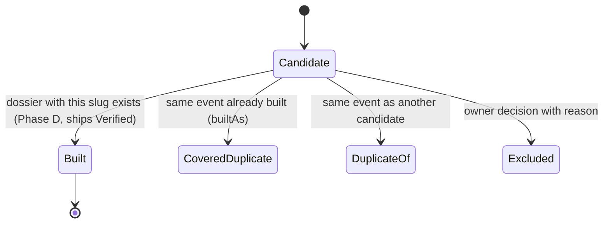
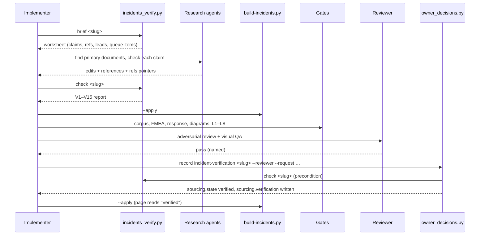

# PRD-Q09 — Finish the incident library: visible verification state, seed verification, and a transparent build order

## 1. Document control

| Field | Value |
|---|---|
| PRD id | PRD-Q09 |
| Feature | Every incident dossier and the hub show the dossier's verification state in words; the 15 seed dossiers are verified against primary sources through a recorded, machine-checked checklist; reference types mean what they say (who published a source is checked, not assumed); the owner's open review queue is decided; the unbuilt candidates of `_master-list.json` (at most 92 at `7335fd257`, §3.0) get a generated build order from a stated rule |
| Version | 1.2 |
| Status | Draft |
| Author | Opus 5.5 (Fable quota exhausted) |
| Date | 2026-11-11 |
| Owner requests | R110 (PRD per idea), R111 (24-section structure) |
| Priority | 57.0 (addendum rank 17: I 6, N 3, C 8, E 6, effort 5 weeks; `documentation/PRODUCT_INNOVATION_ASSESSMENT_2026-11_ADDENDUM.md:92`) |
| Related findings | Q9 (`…_ADDENDUM.md:422-438`); maturity row "Incident library: 3" (`:30`); BASELINE §2 row "Incident library" (`00-audit-baseline/BASELINE.md:25`). New findings F1–F15 (§3.1); corrections C1–C6 (§3.3) |
| Dependencies | None blocking for Phase A. **Owns the dossier state model** (coordinator decision D12): the field `sourcing.state` and the shared rules module `tools/lib/incident_rules.py`, which PRD-Q18 and PRD-Q03 consume (dependency edge Q09 → Q18 and Q09 → Q03 only). Shared, built outside this PRD: `tools/owner_decisions.py` (one approval CLI, D15; specified by `03-architecture`). Reads the access decision of PRD-Q01 (F5, §16: dossiers stay root-only and noindex). Interacts with PRD-Q03 law L7 (a verified facility seed needs a `_reproduce-review.json` verdict once Q3 has shipped). Owner decisions D-Q09-1…D-Q09-16 in `documentation/product-transformation/DECISIONS.md` (§23) |
| Related modules | `tools/build-incidents.py`, `tools/test-incidents-corpus.mjs`, `tools/_ingest_rca.py`, `tools/_ingest_deep.py`, `tools/_incidents_next_batch.py`, new `tools/incidents_verify.py`, new `tools/lib/incident_rules.py` (shared rules, owned here), shared `tools/owner_decisions.py` (record writes), new `tools/incidents_build_order.py`, new `tools/test-incident-verification.mjs`, `data/incidents/*.json`, `data/incidents/_master-list.json`, `data/incidents/_review-queue.md`, new `data/incidents/_publishers.json`, new `data/incidents/_build-order.json`, generated `dc-incidents.html` and 43 `incident-*.html`, `tools/ship-gate.sh` |
| Target wave | Addendum roadmap "Strategic, week 17 onward" (`…_ADDENDUM.md:558`). Phase A (visible state, reference corrections, tooling) may run earlier: it removes claims the pages cannot back, the same class as the honesty work of Q6 |
| Approval status | Approved by owner R110/R111 2026-11-10 (the PRD set); approval class "ordinary (content)" (`01-improvement-register/REGISTER.md:22`). Owner decisions still needed, recorded in `DECISIONS.md` (status PROPOSED, recommendation as default): D-Q09-1…D-Q09-12 (review-queue items and two "official" questions, were D-1…D-12) and D-Q09-13…D-Q09-16 (rule order, library size, legacy state, press-only exception, were OQ-1…OQ-4) |

Change history

| Version | Date | Author | Change |
|---|---|---|---|
| 1.0 | 2026-11-11 | Opus 5.5 | First complete draft, 24 sections. Every count verified against `wt-hub3` at `fcaa892df` (branch `hub-r3`) with the scripts in Appendix A |
| 1.1 | 2026-11-11 | Opus 5.5 | QA batch 2 revisions (D9–D16). D9: gate `--phase A|B|C|D` and `--fixture`; a law-wiring table (§20.2) states for each law the phase it blocks from and its precondition, and laws whose preconditions are unmet run in report mode (PASS/FAIL lines, never fail the gate); one planted-violation fixture per law replaces the "file missing" red proofs (§20.5); AC-5 rewritten to the existing hub word "Press-sourced", which §9.6 and FR-3 now define. D12: this PRD owns the state model as the explicit field `sourcing.state` (A1, FR-1, §10.2, V15) and one rules module `tools/lib/incident_rules.py` (§11.7) consumed by PRD-Q18 and PRD-Q03. D15: decisions renamed D-Q09-1…16 and moved to `DECISIONS.md`; request pattern `^R[0-9]{3,4}$`; the verification write moves from `incidents_verify.py stamp` to `tools/owner_decisions.py record incident-verification`. D16: no Supabase, so `tools/lib/rz-supa-stub.mjs` is named and not used (§20.1). `ship-gate.sh` insertions by anchor text, not line number |
| 1.2 | 2026-11-11 | Opus 5.5 | QA batch 3 drift fixes: counts re-verified at `7335fd257` (§3.0): 50 dossiers (15 seed, 35 legacy), `referenceCount` on 35, 10 without coordinates, master list 130 entries / `withPostmortem` 77, up to 92 unbuilt candidates. Forward-looking counts in §2, §4, §5, §8, §9, §10.9, §13, §19, §20, §23 and §24 now follow the current tree or are computed; the F-rows of §3.1 keep their `fcaa892df` values. New §13 rule for dossiers written outside this PRD's flow; D-Q09-14 restated |

## 2. Executive summary

The incident library holds 50 dossiers (43 when this PRD was first counted; 7 were added on 2026-11-11 from official provider reviews, §3.0). Fifteen carry the marker "2026-08-02 (seed — pending deep research)" in `sourcing.lastVerified`. They are not empty: the CHANGELOG records that all 15 went through the deep-forensic research workflow on 2026-08-02 (`CHANGELOG.md:11103-11140`), and each has 14–18 events and 8–12 metrics. But they rest on thin sources (median 2 references against 6 for the other 28), several lean on Wikipedia and trade press, and the marker was never resolved either way. A reader cannot see any of this: the marker prints once, as the last line of the page, and the hub never mentions it, while its lede says "Every fact traces to a public post-incident report."

Verification exposed a second problem. "Official" is decided by a reference's `type` field alone. When the publisher of each "official" reference is checked, 17 of them on 12 dossiers come from news sites, blogs, third-party analysts or an affected party, and on 8 dossiers the `officialPostmortem` flag disagrees with its own references. The X/Oregon fire dossier shows "Official RCA" on the hub on the strength of a news article typed `vendor-status`.

This PRD delivers:

1. **A visible state on every dossier and on the hub.** "Seed — sources pending" with a plain explanatory note; "Last verified {date}" for the researched dossiers (35 at `7335fd257`, §3.0); "Verified {date}" for dossiers that pass the new checklist.
2. **Reference integrity.** A controlled type vocabulary and a small publisher registry (`_publishers.json`). The `officialPostmortem` flag must equal what the references prove.
3. **A verification CLI.** `tools/incidents_verify.py` with `brief` and `check`; the write (the "stamp") goes through the shared approval CLI as `python3 tools/owner_decisions.py record incident-verification <slug>` (coordinator decision D15). A dossier leaves the state `seed` only through that record, after every machine check passes and a reviewer is recorded.
4. **The 15 seeds verified in five batches**, in an order given by a stated rule. Every event and metric points at the reference that supports it, and the page shows those pointers.
5. **Decisions on the 10 open review-queue items**, each with a recommendation, plus two new questions about what "official" means.
6. **A generated build order** (`tools/incidents_build_order.py` → `_build-order.json`) for the unbuilt candidates (75 at `fcaa892df`; at most 92 at `7335fd257`, §3.0; the generator computes the number). The rule: (R1) a primary document whose publisher is confirmed, then (R2) a facility category the site's tools model, then (R3) newest first. The top 15 are listed in §5.7.
7. **Gate wiring.** The existing provenance gate `tools/test-incidents-corpus.mjs` passes but is not wired; it gets wired. A new gate `tools/test-incident-verification.mjs` carries eight laws, each red on today's tree.

No fact is added by this PRD. Every claim a dossier makes after verification cites a primary source, or is written as an attributed report ("The Register reported …") with that report cited. An unsupported claim is struck.

## 3. Problem statement

### 3.0 Drift since the first count (re-verified at `7335fd257`, v1.2)

A parallel incident session added 7 dossiers built from official provider post-incident reviews (`75c4cd576`,
`0f3fd9f0f`, `7d8037737`) and 17 queue candidates (`5c2c9e505`) after the first count. The F-rows of §3.1 keep
the values measured at `fcaa892df`; every later section uses the numbers below or computes them at gate time.

| Item | At `fcaa892df` | At `7335fd257` | Command |
|---|---|---|---|
| Dossiers (`data/incidents/*.json`, not `_*`) | 43 | 50 | `ls data/incidents/*.json \| grep -v '/_' \| wc -l` |
| Seed marker in `sourcing.lastVerified` | 15 | 15 | Appendix A script, `'seed' in lastVerified.lower()` |
| ISO `lastVerified` (future `legacy`) | 28 | 35 (2026-07-31 ×16, 2026-08-01 ×9, 2026-08-08 ×3, 2026-11-11 ×7) | same script |
| `sourcing.referenceCount` present | 28 | 35 (stale against `len(references)` on 17) | `git grep -l referenceCount -- 'data/incidents/*.json' \| wc -l` |
| Stored `officialPostmortem: true` | 30 | 37 (the 7 new dossiers carry `true`) | same script |
| Dossiers without an `INCIDENT_COORDS` entry (`tools/build-incidents.py:1027`) | 3 | 10: the 3 of F12 plus `gcp-europe-west4-a-drups-cooling-2026`, `gcp-europe-west2-b-plc-power-2026`, `aws-eu-west-1-dublin-plc-2011`, `aws-tokyo-cooling-control-2019`, `aws-sydney-drups-voltage-sag-2016`, `azure-australia-east-chiller-restart-2023`, `azure-southeast-asia-chiller-lockout-2023` | key set of `INCIDENT_COORDS` against the dossier slugs |
| `_master-list.json` `count` / `withPostmortem` | 113 / 60 | 130 / 77 | `json.load(...)['count']`, `['withPostmortem']` |
| Unbuilt candidates | 75 distinct | at most 92 (75 + the 17 entries of `5c2c9e505`; none of the 17 slugs is built, and none of the 7 new dossiers matches an older entry); the exact distinct number comes from `incidents_build_order.py --report` (A1 duplicate rule) | entry diff against `5c2c9e505~1` |

The 7 new dossiers carry an ISO `lastVerified` of 2026-11-11, `referenceCount`, `officialPostmortem: true`, no
`verification` record and no `sourcing.state`. §13 states how they enter this PRD's state model.

### 3.1 Verified facts (commands run 2026-11-11 on `wt-hub3` at `fcaa892df`; scripts in Appendix A)

| # | Fact | Evidence | Command |
|---|---|---|---|
| F1 | 43 dossiers (`data/incidents/*.json`, names not starting with `_`). 15 carry the identical marker `2026-08-02 (seed — pending deep research)` in `sourcing.lastVerified`; the 28 others carry an ISO date (2026-07-31 ×16, 2026-08-01 ×9, 2026-08-08 ×3). Seed slugs: att-nationwide-outage-2024, azure-china-north3-regional-2024, azure-west-us2-thermal-2026, cloudflare-june-2022-config-19dc, cyrusone-cme-chicago-cooling-2025, digital-realty-la-el-segundo-fire-2023, digital-realty-singapore-liion-fire-2024, fastly-global-cdn-2021, google-council-bluffs-arcflash-2022, london-heatwave-cooling-2022, optus-australia-nationwide-2023, psn-outage-2025, rogers-canada-nationwide-2022, virginia-dc-alley-heatdome-2022, x-twitter-oregon-fire-2025 (at `fcaa892df`; current values in §3.0) | Same list as PRD-Q18 Appendix A1 | A2 |
| F2 | The seeds are researched drafts, not skeletons. CHANGELOG v1.125.1 and v1.125.2 (2026-08-02) record all 15 as researched by the deep-forensic workflow, "public sources only". Seeds hold 14–18 events and 8–12 metrics, and every one meets the structural depth floor of `standarization/DC_INCIDENTS_QA_STANDARD.md:11-25`. But their references have a median of 2 (minimum 1) against 6 for researched dossiers. Optus's 2 references are the same Wikipedia URL twice, and 23 of its event and metric sources cite Wikipedia | `CHANGELOG.md:11103-11140` | A2; `sed -n 11103,11140p CHANGELOG.md` |
| F3 | The seed state is invisible. On a seed page the marker prints once, inside the last line of the Sources section (`tools/build-incidents.py:1628`): line 943 of 993 in `incident-att-nationwide-outage-2024.html`, line 992 of 1042 in `incident-x-twitter-oregon-fire-2025.html`. `dc-incidents.html` contains "seed" 0 times. The hub lede claims "Every fact traces to a public post-incident report." (`:616`), and the FAQ claims "every material fact is traced to a public post-incident report" (`:620`). The hub's hero footer reads "Source public post-incident reports" (`:1377`, in `hero_dashboard`), and the page shell gives all 44 generated pages the meta `ai-content-declaration` "human-curated, sourced from public post-incident reports" (`:490`) | as cited | A2; `grep -n -i 'post-incident report' tools/build-incidents.py`; `grep -l 'sourced from public post-incident reports' incident-*.html \| wc -l` → 43 |
| F4 | "Official" is a type, never a publisher. The provenance gate treats any reference typed `official-postmortem`, `regulatory` or `vendor-status` as official (`tools/test-incidents-corpus.mjs:20`) and accepts `officialPostmortem: true` on that basis (`:133`). Checked against a v1 publisher registry (§10.3), 17 such references on 12 dossiers come from a news site, a blog, a third-party analyst or an affected party. On 8 dossiers `officialPostmortem` differs from what the references prove; 15 dossiers fail either check. Examples: x-twitter-oregon-fire-2025 is `true` on idcnova.com news typed `vendor-status` (the hub shows "Official RCA"); virginia-dc-alley-heatdome-2022 cites a tingfire.com blog typed `vendor-status`; dyn-mirai-ddos-2016 cites krebsonsecurity.com typed `regulatory`; azure-china-north3-regional-2024 types two learn.microsoft.com documentation pages and a TLS-certificate observation as `official-postmortem`; aws-us-east-1-thermal-2025 types the AWS post-event-summary index as `official-postmortem`, although the quoted text records that no summary exists for the event | as cited | A2 |
| F5 | The type vocabulary has drifted. The 228 references use 22 type values. 13 references carry 12 one-off types: `official`, `official-status` ×2, `official-statement`, `vendor`, `vendor-doc`, `rca`, `postmortem-summary`, `reference`, `news-analysis`, `external-analysis`, `secondary`, `secondary-aggregator`. The ingest map (`tools/_ingest_rca.py:25-30`) would normalise some of these, but these references were not ingested through it | Q18 A1 list of reference types; this PRD Appendix B | `python3 -c` count in Appendix B |
| F6 | Three researched dossiers have no reference of an official type at all: alibaba-cloud-global-2023, british-airways-heathrow-power-2017 and delta-atlanta-switchgear-2016. Counting only references whose publisher is confirmed, 8 of the 28 non-seed dossiers have no primary reference today: those three plus azure-wan-router-global-2023, equinix-ld8-london-ups-2020, kakao-sk-cc-pangyo-fire-2022, nirs-daejeon-battery-fire-2025 and red-sea-subsea-cables-2024. After the corrections of Appendix C, 5 remain: alibaba-cloud-global-2023, aws-us-east-1-thermal-2025 (its only AWS reference is the summary index, whose quote records that no summary exists for the event), british-airways-heathrow-power-2017, delta-atlanta-switchgear-2016 and red-sea-subsea-cables-2024 | — | A2, A4 |
| F7 | Claims are not tied to references. Event and metric `source` fields are free text, and the builder renders neither: events print time, phase and text (`tools/build-incidents.py:1514-1518`), metrics print label and value (`:1521-1524`). A URL and identifier matcher ties 493 of 1,169 event and metric entries to a reference of the same dossier; 676 do not resolve, and only 9 of 43 dossiers resolve completely. 24 source strings on 3 seeds carry research-process notes: cyrusone 13 ("not re-fetched"), virginia 9 ("not re-verified verbatim"), london 2 | as cited | A3, A2 |
| F8 | Master list: 113 entries, generated 2026-07-31, field `withPostmortem` 60 (a recount of `officialPostmortem: true` also gives 60). Breakdown: 29 built under the same slug; 2 marked `status: covered-duplicate` with `builtAs` (Rogers, Optus); 6 duplicates of built dossiers not marked (same operator, same date): cloudflare-bgp-spine-outage-2022, fastly-cdn-config-outage-2021, google-oracle-london-heatwave-cooling-2022, gcp-global-service-control-outage-2025, google-iam-identity-outage-2020, microsoft-azure-ad-outage-2020; 1 duplicate of another candidate (cloudflare-workers-kv-2025 ≡ cloudflare-workers-kv-gcp-dependency-2025). That leaves **75 distinct unbuilt candidates**. Separately, 9 built dossiers, all seeds, have no master entry. Among the 75: 32 flag an official postmortem; 30 have a primary document whose publisher is confirmed (R1); 22 are facility incidents (R2); 6 are both. 7 candidates (nyse, southwest, kt-korea, nse-india, centurylink, mainone, tsb) type a news or third-party page as official (at `fcaa892df`; current values in §3.0) | `data/incidents/_master-list.json:2-4` | A1 |
| F9 | The batch helper re-proposes duplicates. `python3 tools/_incidents_next_batch.py 100` proposes 83 candidates. It ignores `status: covered-duplicate`, so 8 of them are duplicates, and 4 of its first 5 picks (Rogers, Optus, Google IAM 2020, Fastly) are already built. Its hand-kept SKIP set (`tools/_incidents_next_batch.py:10-14`) names 2 slugs that do not exist in the list | as cited | `python3 tools/_incidents_next_batch.py 100` (read-only) |
| F10 | The review queue holds 10 open items under "Internal contradictions between fields or sources" (`data/incidents/_review-queue.md:50-77`), none with a recorded decision. Re-checked today, each is still open in the data except the parts noted in §3.4 | as cited | §3.4 commands |
| F11 | `sourcing.referenceCount` is stored on 28 dossiers and is stale on 17 (the queue named 3). No code reads it (at `fcaa892df`; current values in §3.0) | `_review-queue.md:73-74` | A2; `grep -rln referenceCount --include=*.py --include=*.mjs --include=*.js --include=*.html .` → no file |
| F12 | Three dossiers have no map coordinates and are skipped without a message on the hub map: alibaba-cloud-global-2023, aws-ebs-ec2-rds-us-east-1-2011 and azure-wan-router-global-2023. The coordinate table is `INCIDENT_COORDS` (`tools/build-incidents.py:1027`); the silent skip is `:1081-1083`. The cluster file and the chunk file cover all 43 (at `fcaa892df`; current values in §3.0) | as cited | A2 |
| F13 | The provenance gate passes but is not wired. `node tools/test-incidents-corpus.mjs` prints "43 incident(s) checked, all provenance + structure OK", yet `tools/ship-gate.sh` runs only the five incident gates at `:67-71` and CLAUDE.md lists only those five (`:59-62`, `:64`). `standarization/DC_INCIDENTS_STANDARD.md:85` names the corpus gate first among "Gates (all must pass before ship)". The "mandatory" visual QA `tools/incidents-visual-qa.mjs` (`standarization/DC_INCIDENTS_QA_STANDARD.md:60-62`) is not wired either | as cited | `node tools/test-incidents-corpus.mjs`; `grep -n incident tools/ship-gate.sh` |
| F14 | The library is root-only and noindex: `'dc-incidents'` page access is root only (`js/rz-feature-flags.js:233-235`), with 2 root accounts (`auth.js:246`). The audience of the state note is therefore the owner. The rule "facility" = {power, cooling, fire, flood} lives in the builder (`tools/build-incidents.py:711`, `_domain()` `:816-817`), and the site's calculators model exactly those systems (Appendix B, tool list) | as cited | `sed -n 230,236p js/rz-feature-flags.js` |
| F15 | All 43 dossier files equal `json.dumps(d, indent=1, ensure_ascii=False) + "\n"` byte for byte. The two ingest writers call `json.dump(d, …, ensure_ascii=False, indent=1)` without the final newline (`tools/_ingest_rca.py:118`, `tools/_ingest_deep.py:124`), so a re-ingest drops it. New writers write the on-disk format, and T-2 adds the newline to both ingest writers, so untouched dossiers stay byte-identical | as cited | Round-trip check in Appendix B |

### 3.2 Consequence of leaving it

- The owner reads 15 dossiers as if their dates, figures and causes were confirmed, while some rest on Wikipedia or a single trade article, and nothing on the page says so.
- The hub counts "30 with official RCA". At least one of those (X/Oregon) has no official document behind it. Two more rest on an affected party's statement (Equinix LD8 on LINX) or on a mirror of the operator's report (Azure WAN on msxfaq.de).
- PRD-Q18 counts seed and researched dossiers separately, and PRD-Q03 refuses seeds (RV12). Without a defined way out of the seed state, both carry the 15 as permanent exceptions.
- Building more dossiers from the list today means re-proposing built incidents (F9) and inheriting mis-typed "official" sources (F8).

### 3.3 Addendum and baseline corrections

| # | Source says | Verified | Correction |
|---|---|---|---|
| C1 | Addendum: "Only 43 of the 113 candidates in `_master-list.json` are built" (`:30`); "70 candidates are unbuilt" (`:423`) | 37 list entries are covered by 34 built dossiers, and 9 built dossiers are not in the list; 76 entries remain, which are 75 distinct incidents (F8) | Q9 works from 75 candidates |
| C2 | Addendum: "15 seed dossiers are unverified" | True of their verification, but they are researched drafts with full structure (F2); the marker was never resolved | The work is a verification pass against primary sources, not research from zero; effort per seed is lower (§19) |
| C3 | Addendum acceptance: "0 dossiers read 'seed' without the visible note" | Today the marker is visible only as the last line of the page (F3) | Acceptance moves to the top of the page and to the hub (FR-2, FR-3; L1) |
| C4 | Addendum acceptance: "Each verified dossier has at least 1 primary source" (`:438`) | 3 researched dossiers have no reference of an official type, 8 have no reference whose publisher is confirmed (F6), and a reference's type does not prove its publisher (F4) | The rule counts only references whose publisher is confirmed; an owner-accepted search record is the documented exception (FR-5, L3, D-Q09-16) |
| C5 | BASELINE §2: "15 dossiers are still seed-only. Only 43 of the 113 candidates are built." | Seeds confirmed (15); the 43-of-113 reading is wrong as in C1 | As C1 |
| C6 | Addendum Q9 workflow: "Research, verify sources, flip the flag." | No tool or rule governs the flip; any edit of `lastVerified` flips the state | The flip happens only through the `incident-verification` record (`tools/owner_decisions.py record`) after the checks pass (FR-7, L3) |

The addendum's other figures hold: 43 dossiers, 228 references, 15 seeds, `withPostmortem` 60, last update 2026-08-08 (Q18 A1: `lastUpdated` range 2026-07-31 to 2026-08-08).

### 3.4 Review-queue items re-checked today (`data/incidents/_review-queue.md:50-77`)

| # | Item (queue text, shortened) | State in today's data (command: `grep -c` on the dossier JSON, Appendix B) |
|---|---|---|
| Q-1 | nirs-daejeon-battery-fire-2025: first report ~20:15 before ignition ~20:20; "extinguished" 06:30 vs ~18:30; "96" used for two counts; 5 charged vs "Lee and three other officials"; G-Drive users 191,000 vs ~125,000 | Open. "20:15" ×7, "20:20" ×8, "191,000" ×3, "125,000" ×6, "Lee and three" ×1. The 06:30 time no longer appears |
| Q-2 | kakao-sk-cc-pangyo-fire-2022: ignition ~15:30 vs spark 15:19; normalised 19:00 vs 23:00; disruption from ~15:20 vs building cut 16:52 | Partly open. "15:30" ×3 vs "15:19" ×7; "23:00" no longer appears (`durationMin` is now 7420); "15:20" ×8 and "16:52" ×6 |
| Q-3 | equinix-ld8-london-ups-2020: power lost ~04:23–04:24, static-switch failure 04:33, Equinix onset 04:40; rootCause says 21:49 "could not be verified" while SOE and metrics cite it from LINX | Open. "04:23" ×14, "04:33" ×16, "04:40" ×1, "21:49" ×10, and "could not be verified" still in `rootCause` |
| Q-4 | unisuper-gcp-account-deletion-2024: analysis says member count and FUM "could not be verified … omitted", yet severity carries them; joint statement ~9 May vs 8 May | Partly open. The "could not be verified" sentence is gone. `sequenceOfEvents[13]` still reads "~9 May 2024" while 5 other places say "8 May" |
| Q-5 | red-sea-subsea-cables-2024: metric says no exact UTC was published, ref 6 gives 09:46 UTC; "TGN-EA" vs "TGN-Eurasia"; duration end | Partly open. `metrics[7]` ("Detection date of cable damage") still says "exact UTC not published" while reference 6 (Kentik) gives 09:46; "TGN-EA" ×7 and "TGN-Eurasia" ×7. The duration part is closed: `durationStatus` is `not-established` |
| Q-6 | facebook-meta-bgp-dns-2021: Wikipedia 21:50 / 22:05 vs Cloudflare 21:20 / 21:28; "state both" | Both sets present ("21:50" ×2, "22:05" ×1, "21:20" ×6, "21:28" ×5). Whether they are attributed to their sources is checked in T-13 |
| Q-7 | x-twitter-oregon-fire-2025: `severity.impactUsd` ~$260k (flagged unverified) vs official ~$250k | Open. `impactUsd` reads "Reported equipment loss ~$260k…"; "250k"/"250,000" appear 12 times |
| Q-8 | psn-outage-2025: `location` San Mateo, while rootCause says no source ties the outage to San Mateo | Open. `location.city` is "San Mateo, California"; `rootCause` now says the San Mateo specificity "has been removed as unsupported" |
| Q-9 | `sourcing.referenceCount` stale on kakao, ovhcloud, red-sea | Open and wider: stale on 17 of 28 (F11) |
| Q-10 | google-council-bluffs-arcflash-2022: `officialPostmortem: true` rests on OSHA records, not an operator post-mortem; "worth stating on the page" | Open: the page does not state it |

## 4. Objectives and success metrics

| # | Objective | Metric | Target | Measurement | Assumption |
|---|---|---|---|---|---|
| O1 | Readers see the state | Seed dossiers without the state line and note; hub rows of seeds without the word; generated strings claiming the facts come from post-incident reports | 0 / 0 / 0 (at `fcaa892df` 15 / 15 / 47: 4 on the hub, the meta on each of 43 dossiers; L1 recomputes over every dossier) | L1 | — |
| O2 | "Official" is true | Official-typed references failing the publisher rule; dossiers whose `officialPostmortem` differs from the derived value | 0 / 0 (today 17 refs on 12 dossiers / 8) | L2 | Registry v1 (§10.3) is correct; every addition is reviewed |
| O3 | Every non-seed dossier stands on a primary source | Non-seed dossiers with no confirmed primary reference and no accepted search record | 0 (today 8; 5 after the corrections of T-4) | L3 | D-Q09-16 accepts the search-record exception |
| O4 | Seeds burn down | Dossiers carrying the seed marker | 15 → 0 across five batches | `node tools/test-incident-verification.mjs --report` prints the count | One batch of 3 per 2 working days (§19); the owner may stop at any batch |
| O5 | The queue is decided | Open items without a decision line; machine-checkable items still failing | 0 / 0 (today 10 / Q-9 fails on 17 dossiers) | L4 | Owner answers D-Q09-1…D-Q09-12 |
| O6 | The order is reproducible | `_build-order.json` equals a fresh recompute; list entries not classified exactly once | equal / 0 (today: file missing; 7 duplicates unmarked) | L5 | — |
| O7 | Nothing is silently left out | Dossiers without coordinates, cluster point or chunks | 0 (10 without coordinates at `7335fd257`, §3.0) | L6 | — |
| O8 | Gates run | Incident gates documented as mandatory but not in `ship-gate.sh` | 0 (today `test-incidents-corpus.mjs` and the new gate) | L7 | — |
| O9 | New dossiers | Candidates built from the order | UNKNOWN — the owner sets the number (D-Q09-14); the PRD specifies the first 15 | `_build-order.json` coverage block | Earlier scope note "20–50 incidents" (project memory, 2026-07) may still apply |

No target is a user-behaviour number: the library has two readers (F14) and no usage tracking.

## 5. Scope

### 5.1 In scope

1. Builder: the state line on every dossier, the seed note, reference markers on events and metrics, numbered references, the seed word and count on the hub, corrected hub copy, and no silent skip for missing coordinates (`tools/build-incidents.py`).
2. Data rules: the type vocabulary (adds `party-statement`), the publisher registry `data/incidents/_publishers.json`, the `officialPostmortem` consistency rule, the `sourcing.verification` and `sourcing.primarySearch` records, `refs` pointers on events and metrics, and removal of `referenceCount`.
3. Tools: `tools/incidents_verify.py` (`brief`, `check`); the `incident-verification` record kind for `tools/owner_decisions.py record`; the shared rules module `tools/lib/incident_rules.py`; `tools/incidents_build_order.py` (`--apply`, `--check`, `--report`); `tools/_incidents_next_batch.py` reading the order; `_TYPE_MAP` updated in both ingest scripts.
4. Data corrections: the 36 reference corrections of Appendix C on 21 dossiers (the 17 references of F4, 6 more official-typed references that are not incident reports or are an operator's update log, and the 13 references of F5); mark the 7 duplicates in `_master-list.json`; add coordinates for the 10 dossiers of §3.0.
5. Content: verify the 15 seeds (five batches); apply the owner's decisions on Q-1…Q-10; find primary sources, or record the search, for the 5 non-seed dossiers left without one after T-4 (F6).
6. Content, Phase D (behind D-Q09-14): build new dossiers in rank order, with the same checklist.
7. Gates: wire `node tools/test-incidents-corpus.mjs`; add `tools/test-incident-verification.mjs` (L1–L8); run the visual QA on every batch's slugs.
8. Standards and changelog per §22.

### 5.2 Out of scope

| Item | Why |
|---|---|
| Opening the library to non-root readers | Access change, owner only (PRD-Q01 §16, D-Q18-1) |
| Re-verifying the researched (legacy) dossiers claim by claim (35 at `7335fd257`) | They keep the state "Last verified {date}" (D-Q09-15); only their reference types, publisher rule and queue items are corrected here. Full re-verification is a Phase 3 option |
| Re-scoring any FMEA mode | Scores belong to the dossiers and `tools/test-incidents-fmea.py`. If an edit to event text breaks a verbatim FMEA or response quote, the quote is repaired; no score changes |
| A "Seed" filter chip on the hub list | Not needed for the state to be visible; PRD-Q18's patterns page already lists seeds for the owner |
| Renaming the hub chips' visual style (`sev-chip`, `st-chip`) | Existing hub idiom; only the words change, and only after D-Q09-10 |
| Adding the 9 built dossiers that have no entry to `_master-list.json` | The list is a candidate list; the build-order file reports them as "built outside the list" |
| Any LLM at run time | The pages are static; research agents work only in the authoring path (§14) |

### 5.3 Existing capabilities reused

| Capability | Where | Use |
|---|---|---|
| Dossier loader, page shell, freshness check | `tools/build-incidents.py:1650-1656`, `:481-528`, `:1663-1686` | All page changes; `--check` covers them |
| `.metabar` idiom (mono, muted, `·` separators) | `tools/build-incidents.py:141-143`, hub `:617` | The state line, rather than a new component |
| Theme tokens of the incident pages | `tools/build-incidents.py:97-107` (`--line`, `--muted`, `--amber`, both themes) | Note panel, markers |
| Provenance gate | `tools/test-incidents-corpus.mjs` | Wired as is (F13) |
| FMEA and response gates (verbatim quotes) | `tools/test-incidents-fmea.py`, `tools/test-incidents-response.py` | Re-run after every content edit; they catch broken quotes |
| Diagram freshness | `tools/build-incident-diagrams.mjs --check` | Re-run after edits to FMEA labels |
| Visual QA with ungate snippet | `tools/incidents-visual-qa.mjs:28-34` | Per batch; also the ungate method for L8 |
| Research pipeline and ingest | `standarization/DC_INCIDENTS_STANDARD.md:65-73`; `tools/_ingest_rca.py`, `tools/_ingest_deep.py` | Research for seeds and new dossiers |
| Writer prompt and reviewer checklist | `standarization/DC_INCIDENTS_QA_STANDARD.md:27-58` | Embedded in the verification brief |
| Seed rule | PRD-Q18 F1 (`"seed" in lastVerified.lower()`) | Becomes the one-time migration rule: T-2 writes `sourcing.state` from it (15 `seed`, 35 `legacy` at `7335fd257`). From then on the field is the state, owned by this PRD (D12); Q18 and Q3 read it through `tools/lib/incident_rules.py` |
| Vector index and cluster | `tools/build-incidents-vectors.py` (ollama `nomic-embed-text`) | New dossiers only |

### 5.4 Dependencies

- PRD-Q18 and PRD-Q03 consume this PRD's state model (`sourcing.state`) and rules module (`tools/lib/incident_rules.py`); their counts move as seeds are verified, and their gates compute expected counts from the data at gate time (§13). The edge runs Q09 → Q18 and Q09 → Q03 only.
- `tools/owner_decisions.py` (shared approval CLI, coordinator decision D15) must exist before the first seed batch (T-8); it is specified in `03-architecture`, not here.
- PRD-Q01 relations mark seed dossiers in the proposal report (Q01 BR7); after a stamp the mark disappears on the next report.
- Owner: D-Q09-1…D-Q09-16 (`DECISIONS.md`).
- Network access for research (WebSearch and WebFetch in the authoring session). There is no network in any gate.
- No peer-owned file is touched.

### 5.5 Constraints

- Generated pages are never hand-edited (CLAUDE.md:64; `build-incidents.py --check`).
- Public sources only. No auth-walled content, no intranet, no personal-data compilation on private individuals (`standarization/DC_INCIDENTS_STANDARD.md:79-81`; CHANGELOG v1.125.1: "public sources only — no intranet").
- Short attributed quotes only (copyright guardrail, same lines).
- Root-only and noindex stay; no IndexNow ping on these ships (`standarization/DC_INCIDENTS_STANDARD.md:36`).
- Design rules of the brief: a state is a word, not a badge; one 1 px hairline per panel; radius ≤ 4 px; no `transition: all`; no hover transform; both themes; 390 and 1440 px.
- Dossier JSON byte format of F15.

### 5.6 Assumptions

| # | Assumption | If wrong |
|---|---|---|
| A1 | The dossier state is the explicit field `sourcing.state` ∈ {`seed`, `legacy`, `verified`}, owned by this PRD (coordinator decision D12). T-2 writes it once from today's marker; `lastVerified` keeps its marker text for seeds, and V15 keeps the two consistent | A consumer that still reads the marker keeps working until the seed is verified, because V15 forbids `state: seed` without the marker; consumers move to `tools/lib/incident_rules.state()` in their own releases (Q18 v1.1, Q03 v1.2) |
| A2 | The publisher of a document can be decided from its URL plus an optional explicit `publisher` | The registry gains path prefixes (already supported) or the reviewer sets `publisher` with `mirror: true` |
| A3 | Most seeds have a reachable primary document | Where none exists, the dossier keeps press sources and needs an accepted search record (D-Q09-16) |
| A4 | One verification batch of 3 seeds takes about 2 working days with agents | The schedule in §19 stretches; scope does not change |
| A5 | City-centre coordinates are acceptable anchors for global incidents, as the standard already does (`standarization/DC_INCIDENTS_STANDARD.md:42`) | Owner gives a different anchor |

### 5.7 The build order: rule and top 15

**Rule (lexicographic, applied by `tools/incidents_build_order.py`):**

1. **R1 — primary document available.** At least one candidate source is typed `official-postmortem`, `regulatory` or `vendor-status`, and its URL belongs to an organisation in `_publishers.json` named in the candidate's `operator`, or to a registered authority. This is the publisher rule of FR-5 applied to candidates. The list's own `officialPostmortem` flag is not used: it disagrees with the sources on 6 of the 75 candidates (Appendix A1).
2. **R2 — relevance to the site's tools.** The candidate's `category` includes power, cooling, fire or flood. This is the builder's own facility set (`tools/build-incidents.py:711`). The site's calculators model exactly these systems: fire-calculator, fire-checklist, tier-advisor, tia-942-checklist, spares-readiness-calculator, pue-calculator, the CDU tools and the compare pages for UPS, generators, cooling and suppression (Appendix B). PRD-Q03 can reproduce only facility incidents (its code N).
3. **R3 — recency.** Date, newest first.
4. **Tie-break.** `magnitudeScore` descending, then slug ascending.
5. **Exclusions.** Entries built under the same slug, entries marked `covered-duplicate`, and entries marked `duplicate-of`. Of an intra-list duplicate pair, the entry kept is the one with more confirmed official sources (cloudflare-workers-kv-gcp-dependency-2025).

**Top 15 (from Appendix A1 output, `fcaa892df`):**

| Rank | Master-list id | Date | Categories | R1 basis (publisher confirmed) | R2 |
|---|---|---|---|---|---|
| 1 | `dbs-equinix-cooling-outage-2023` | 2023-10-14 | cooling, network | Monetary Authority of Singapore media release (authority) | 1 |
| 2 | `gcp-paris-europe-west9-fire-flood-2023` | 2023-04-25 | fire, flood, cooling | Google Cloud status incidents (operator) | 1 |
| 3 | `alibaba-cloud-hong-kong-cooling-2022` | 2022-12-18 | cooling, fire | Alibaba Cloud notice (operator) | 1 |
| 4 | `aws-us-east-1-generator-2019` | 2019-08-31 | power | AWS message (operator) | 1 |
| 5 | `google-belgium-lightning-2015` | 2015-08-13 | power | Google Cloud status incident (operator) | 1 |
| 6 | `aws-derecho-storm-us-east-1-2012` | 2012-06-29 | power, software | AWS summary (operator) | 1 |
| 7 | `cloudflare-1111-resolver-2025` | 2025-07-14 | network, software | Cloudflare blog (operator) | 0 |
| 8 | `cloudflare-workers-kv-gcp-dependency-2025` | 2025-06-12 | software, supply | Cloudflare blog (operator); absorbs `cloudflare-workers-kv-2025` | 0 |
| 9 | `azure-front-door-ddos-2024` | 2024-07-30 | network, software | Azure status history, tracking IDs (operator) | 0 |
| 10 | `aws-us-east-1-lambda-capacity-2023` | 2023-06-13 | software | AWS message (operator) | 0 |
| 11 | `reddit-pi-day-kubernetes-outage-2023` | 2023-03-14 | software | r/RedditEng post (operator's engineering channel) | 0 |
| 12 | `datadog-multiregion-systemd-outage-2023` | 2023-03-08 | software, network | Datadog incident report (operator) | 0 |
| 13 | `atlassian-deletion-script-outage-2022` | 2022-04-05 | software, human | Atlassian post-incident review (operator) | 0 |
| 14 | `slack-database-config-outage-2022` | 2022-02-22 | software | Slack status incident (operator) | 0 |
| 15 | `roblox-consul-boltdb-73h-outage-2021` | 2021-10-28 | software, network | Roblox blog (operator) | 0 |

Only 6 candidates satisfy both R1 and R2, so ranks 7–15 are non-facility incidents with operator reports. Under the alternative order R2 > R1 > R3 (D-Q09-13), ranks 7–15 would be facility incidents with press sources only (vantage-san-antonio-transformer-2026, azure-west-europe-power-2023, cyxtera-boston-battery-fire-2023, kt-ahyeon-exchange-fire-2018, ovh-roubaix-strasbourg-power-2017, telstra-chatswood-exchange-fire-2017, global-switch-sydney-fire-trip-2016, salesforce-na14-power-2016, telecity-meridian-gate-london-2015). Those conflict with the primary-source rule of this PRD. The recommendation is the briefed order. The sources named in the table are leads recorded in the list; none is a verified fact until the dossier's verification passes.

## 6. User personas and use cases

Tiers as implemented: `free | demo | pro | root` (`js/rz-feature-flags.js:6`); `'dc-incidents'` page access is root only (`:233-235`); root accounts at `auth.js:246`; educators are pro sessions with a role and are not admitted (PRD-Q18 F9).

| Persona | Role | Goal | Access | Outcome |
|---|---|---|---|---|
| P1 Owner (root, admin) | Engineering operations leader; curates the library and teaches from it | Know which dossiers can be quoted as confirmed; decide queue items; choose what to build next | Full | The state at the top of every dossier; a decision packet; a ranked, reproducible build list |
| P2 Implementer (main session or agent) | Runs research, verification and builds | Verify a seed without inventing anything; flip it only when it truly passes | Repository | `brief` → research → `check` → review → record (`owner_decisions.py record incident-verification`); gates name every gap |
| P3 Adversarial reviewer (second agent or owner) | Checks a batch against QA §3 | Find unsupported claims and render defects | Repository and screenshots | Named in the verification record |
| P4 DC / facility engineer, educator (pro) | Would read dossiers if the owner shares them | Trust a figure enough to teach with it | None in v1 (root gate) | Covered if the owner opens access later |
| P5 Signed-out visitor | — | — | Root gate card | No content |

| UC | Persona | Use case |
|---|---|---|
| UC1 | P1 | Opens a seed dossier and reads "Seed — sources pending" with the note before any figure |
| UC2 | P1 | On the hub, sees which rows are seeds and how many remain |
| UC3 | P2 | Verifies a seed: gets a worksheet, maps every event and metric to a reference, fixes or strikes claims, passes `check`, gets review, stamps |
| UC4 | P1 | Answers the queue decisions D-Q09-1…D-Q09-12 by request id; the session applies them |
| UC5 | P2 | Builds the next candidate: `incidents_build_order.py --report`, then `_incidents_next_batch.py 3`, research, ingest, verify, stamp |
| UC6 | P1 | Clicks a reference marker on an event and lands on the numbered reference |

## 7. Complete user journey

### J1 Owner reads a seed dossier (UC1, UC6)
- Entry: hub row → `incident-<slug>.html`, or a direct URL; root signed in.
- Initial state: the shell renders `<body class="locked">`; `enforceTierFeatureAccess('dc-incidents')` unlocks it for root (unchanged).
- Top of page: backlink, eyebrow, title, chips, then **the state line** "Seed — sources pending · drafted 2026-08-02 · 3 sources, 0 primary", then **the note** (§9.6), then the section nav.
- Reading: the summary and timeline are unchanged for seeds. Once a dossier is verified, every event and metric ends with markers such as [1] [3]. Activating a marker jumps to the numbered reference, which carries a 1 px amber outline while targeted; browser back returns to the event.
- Failure: none at run time (static page). A missing reference index is caught by `check` and by L3 before release.
- Exit: "← All incidents", site nav.

### J2 Owner scans the hub (UC2)
- The metabar reads "{n} catalogued · {pm} with official RCA · 15 seed, sources pending · provenance-mandatory · root access" (the seed segment disappears at 0).
- Each seed row shows "Seed — sources pending" under its status word. The lede and FAQ no longer claim that every fact traces to a post-incident report.

### J3 Implementer verifies a seed (UC3)
1. `python3 tools/incidents_verify.py brief <slug> > /tmp/…/brief-<slug>.md` produces a worksheet: every event, metric, root-cause sentence and severity field with its current source text; the references with resolved publishers; the leads from the master twin; the slug's open queue items; the checklist (§12.2).
2. Research (agents with WebSearch and WebFetch, public sources only) finds the primary documents. Each claim is checked against the document's text: a mismatch is corrected; an unsupported claim is struck or rewritten as an attributed report. Edits go into the dossier JSON. New references carry `type`, `title`, `url`, `quote`, `accessed` and, where needed, `publisher` and `mirror`. Every event and metric gets `refs`.
3. `python3 tools/incidents_verify.py check <slug>` runs V1–V15 (§10.6). Exit 1 names each failure, for example "V6 sequenceOfEvents[4] has no refs" or "V3 references[0] typed vendor-status: idcnova.com is not registered for operator 'Digital Realty'".
4. `python3 tools/build-incidents.py --apply`, then the incident gates (`test-incidents-corpus`, `test-incidents-fmea`, `test-incidents-response`, `build-incident-diagrams --check`). If edits broke a verbatim FMEA or response quote, the gates name it; the quote is repaired from the new text.
5. Adversarial review (QA §3 A and B) plus `node tools/incidents-visual-qa.mjs <out> <slug>`; the screenshots at 390 and 1440 are looked at.
6. `python3 tools/owner_decisions.py record incident-verification <slug> --reviewer "<who>" --request R<nnn> --checked <n> --corrected <n> --struck <n>` (the stamp) refuses unless `incidents_verify.py check <slug>` passes. It sets `sourcing.state` to `verified`, writes `sourcing.verification`, sets `lastVerified` to the stamp date and removes `referenceCount`.
7. Rebuild; the page now reads "Verified {date} · …". Run L1–L8; ship the batch.
- Recovery: a stamp can be undone only by `git revert`; the CLI never un-stamps (BR-6).

### J4 Owner decides the queue (UC4)
The session sends one packet (T-7) listing D-Q09-1…D-Q09-12 with the evidence and a recommendation each. The owner answers by id. The session writes the decision line under each item in `_review-queue.md` with the request id, applies the data change in the next batch, and the line's status becomes "done v{version}".

### J5 Implementer builds the next candidate (UC5)
`python3 tools/incidents_build_order.py --report` → `python3 tools/_incidents_next_batch.py 3` (now reading `_build-order.json`) → research workflow → `_ingest_deep.py` → coordinates, vectors and diagrams → the J3 checks → stamp → release. A new dossier never ships as a seed in Phase D; it ships verified or not at all (BR-7).

## 8. Functional requirements

**FR-1 Verification state model**
- Description: a dossier is in exactly one of three states, stored in the field `sourcing.state` (this PRD owns the field and its name, coordinator decision D12). **`seed`**: `lastVerified` carries the seed marker. **`legacy`** (shown "Last verified"): `lastVerified` is an ISO date and there is no `sourcing.verification`. **`verified`**: `lastVerified` is an ISO date equal to `sourcing.verification.date`. T-2 writes the field into all 43 dossiers from today's marker (15 `seed`, 28 `legacy`); only the `incident-verification` record (FR-7) changes it afterwards.
- Trigger: every build and every gate run.
- Preconditions: dossiers load.
- Inputs: `sourcing.state`, `sourcing.lastVerified`, `sourcing.verification`.
- Processing: `state(d)` in `tools/lib/incident_rules.py` (§11.7), imported by the builder, `incidents_verify.py`, PRD-Q18 and PRD-Q03; the Node gate reads the field and the module's `dump` output. V15 checks the field against the other two fields; `lastVerified` must match `^\d{4}-\d{2}-\d{2}$` or exactly `^\d{4}-\d{2}-\d{2} \(seed — pending deep research\)$`.
- Outputs: the state used by FR-2 and FR-3.
- State changes: none (pure).
- Dependencies: none.
- Exceptions: any other form makes the builder exit 1 with "lastVerified of <slug> is neither a date nor the seed marker"; a missing or inconsistent `sourcing.state` exits 1 with "sourcing.state of <slug> is '<v>', expected '<derived>'" (V15).
- Acceptance: L1, L3; unit U1.

**FR-2 Dossier state line and seed note**
- Description: after `.chips`, every dossier renders `<div class="metabar inc-verif" id="verification">` with the copy of §9.6 for its state. Seeds also render `<p class="inc-seed-note">` immediately after it.
- Trigger: build.
- Preconditions: FR-1.
- Inputs: state; `references`; the publisher registry (to count primary references).
- Processing: n = number of references; p = number of references whose type is primary (§10.2) and that pass the publisher rule (FR-5); the date is the `YYYY-MM-DD` part of `lastVerified`.
- Outputs: HTML inside the first `.reading-col` (`tools/build-incidents.py:1566-1576`), before `<nav class="inc-nav">` (`:1577`).
- State changes: generated page files.
- Dependencies: FR-5.
- Exceptions: none.
- Acceptance: L1, L8; AC-1, AC-2.

**FR-3 Hub state**
- Description: (a) the status cell of each seed row adds `<span class="st-seed">Seed — sources pending</span>` after the existing `st-chip` (`:603`); (b) the metabar (`:617`) gains the segment "{s} seed, sources pending" when s > 0; (c) the lede sentence at `:616`, the FAQ sentence at `:620`, the hero footer "Source public post-incident reports" (`:1377`) and the page-shell meta `ai-content-declaration` (`:490`, all 44 pages) are replaced by the copy in §9.6; (d) after decision D-Q09-10 only, the status word "Official RCA" (`:591`) becomes "Official record", together with the filter chip label (`:647`), the hero footer count (`:1380`) and the metabar ("with an official record"); (e) a row whose `officialPostmortem` is false keeps the existing status word "Press-sourced" (`tools/build-incidents.py:591`, class `st-press`), unchanged by this PRD and by D-Q09-10, so a dossier whose flag T-4 turns false (x-twitter-oregon-fire-2025, and equinix-ld8-london-ups-2020 under D-Q09-11) shows "Press-sourced" after the rebuild.
- Trigger: build.
- Inputs: states; `officialPostmortem`.
- Outputs: `dc-incidents.html`.
- Exceptions: none.
- Acceptance: L1; AC-3, AC-4, AC-5.

**FR-4 Reference type vocabulary**
- Description: `references[].type` ∈ {`official-postmortem`, `regulatory`, `vendor-status`, `party-statement`, `press`, `news`, `analysis`, `encyclopedia`, `forum`, `aggregator`, `other`}. A one-time normalisation retypes the 13 references of F5 and the references corrected under FR-5 (table in Appendix C). `REF_TONE` (`tools/build-incidents.py:39-42`) gains `party-statement: "cyan"` and keeps its other entries. `_TYPE_MAP` in `tools/_ingest_rca.py:25-30` and the matching map in `_ingest_deep.py` change as follows: `official-statement`, `statement`, `press-release` and `vendor` map to `party-statement`; `official-status` maps to `vendor-status`; `analysis`, `encyclopedia`, `forum` and `aggregator` map to themselves instead of falling through to `press`.
- Trigger: T-4 (one time); every later ingest.
- Inputs: dossier references.
- Processing: by the table; a type outside the vocabulary fails V2.
- Outputs: dossier JSON (indent 1, `ensure_ascii=False`, F15).
- State changes: 36 references across 21 dossiers (Appendix C).
- Exceptions: `party-statement` never satisfies `officialPostmortem` (it is primary, not official).
- Acceptance: L2 (V2 part); U2.

**FR-5 Publisher registry and the "official" rule**
- Description: the new `data/incidents/_publishers.json` (§10.3) lists organisations and authorities with names and URL prefixes. Rules:
  - A reference typed `official-postmortem` or `vendor-status` must resolve to an organisation whose names include a substring of the dossier's `operatorShort`, compared case-insensitively. Resolution uses the URL prefix, or the explicit `publisher` field when the reference sets `mirror: true`.
  - A reference typed `regulatory` must resolve to an authority.
  - A reference typed `party-statement` must resolve to any registered organisation or authority.
  - `sourcing.officialPostmortem` must equal "at least one `official-postmortem`, `regulatory` or `vendor-status` reference passes".
  - A `web.archive.org` URL resolves through the archived URL.
- Trigger: build, `check`, gates.
- Inputs: dossier, registry.
- Processing: pure functions `resolve_publisher(url, ref, registry)` and `official_ok(dossier, registry)`, implemented once in `tools/lib/incident_rules.py` (D12) and imported by the builder (for the count p), `incidents_verify.py`, PRD-Q18 and PRD-Q03. The gate reads the module's `dump` output and proves each rule with a planted-violation fixture (§20.5).
- Outputs: pass or fail with the slug, reference index, type, host and reason.
- State changes: none.
- Exceptions: an unregistered host fails with "host <h> not in _publishers.json". The fix is a reviewed registry entry or a retype, never a silent pass.
- Acceptance: L2; AC-5, AC-6; U3–U5.

**FR-6 Claim pointers and markers**
- Description: each `sequenceOfEvents[i]` and `metrics[j]` may carry `refs: [int, …]` (0-based indices into `references`). Verified dossiers must carry them on every entry (V6). The builder renders markers `<a class="ref-mk" href="#ref-{k+1}" aria-label="Source {k+1}: {title}">[{k+1}]</a>` at the end of the event text and of the metric value. Each reference `<li>` gets `id="ref-{k+1}"` and a leading `<span class="ref-n">[{k+1}]</span>`.
- Trigger: build.
- Inputs: `refs`.
- Processing: indices outside `0…len(references)-1` → build error naming slug, field and index.
- Outputs: dossier HTML.
- Exceptions: entries without `refs` render as today (seed and legacy dossiers).
- Acceptance: L3 (V6), L8; AC-7.

**FR-7 Verification CLI `tools/incidents_verify.py` and the verification record**
- Description: two read-only commands here, one write through the shared approval CLI (coordinator decision D15).
  - `brief <slug>`: prints the Markdown worksheet of J3 step 1 (format §11.1). Read-only.
  - `check <slug>|--all`: runs V1–V15 and exits 0 or 1. Read-only.
  - The stamp: `python3 tools/owner_decisions.py record incident-verification <slug>` `--reviewer … --request R<nnn> --checked n --corrected n --struck n [--primary-refs i,j] [--restamp]`. The shared CLI owns request-id validation, the date, the atomic write (temp file + rename) and "refusal leaves the file unchanged"; this PRD registers the record kind `incident-verification` in `tools/lib/incident_rules.py` with its precondition (`check <slug>` exits 0) and its writer (sets `sourcing.state` to `verified`, writes `sourcing.verification` and `lastVerified`, removes `sourcing.referenceCount`, F15 byte format).
- Trigger: implementer.
- Preconditions: dossier exists; for the record, a reviewer string and a request id matching `^R[0-9]{3,4}$`.
- Inputs: §11.1.
- Outputs: worksheet, check report, updated dossier.
- State changes: the `incident-verification` record only.
- Dependencies: registry; `_review-queue.md` (read, for the brief); `_master-list.json` (read, for leads).
- Exceptions: §11.1 exit codes.
- Acceptance: U6–U10; L3.

**FR-8 Seed verification program**
- Description: verify the 15 seeds in five batches of three, in the rule order of §12.3, each through J3. The checklist of §12.2 applies.
- Trigger: T-8…T-12.
- Outputs: 15 dossiers in state Verified, or in state Seed with a recorded reason (D-Q09-16).
- Exceptions: no primary document reachable for a seed → record the search in `sourcing.primarySearch`; the dossier stays a seed unless the owner accepts the record (D-Q09-16).
- Acceptance: O4; L1–L3; AC-8.

**FR-9 Review-queue decisions**
- Description: T-7 sends D-Q09-1…D-Q09-12 (§23) to the owner. Each answer is recorded under its item in `_review-queue.md` in the format of §10.8 and applied: Q-7 and Q-8 in their seed batch, the others in T-13.
- Acceptance: L4; AC-9.

**FR-10 Remove `referenceCount`**
- Description: delete `sourcing.referenceCount` from every dossier that carries it (35 at `7335fd257`) (decision D-Q09-9). No code reads it (F11). The `incident-verification` record removes it on verified dossiers.
- Acceptance: L4 (machine part of Q-9).

**FR-11 Master-list hygiene**
- Description: mark the 6 unmarked duplicates of built dossiers `status: "covered-duplicate"` with `builtAs` (F8 table), and mark `cloudflare-workers-kv-2025` as `status: "duplicate-of"` with `duplicateOf: "cloudflare-workers-kv-gcp-dependency-2025"`. Allowed statuses: `covered-duplicate`, `duplicate-of`, `excluded` (owner decision, with `reason`). The fields `count` and `withPostmortem` describe the whole list and stay.
- Acceptance: L5.

**FR-12 Build-order generator**
- Description: `tools/incidents_build_order.py` classifies every list entry exactly once (`built`, `covered-duplicate`, `duplicate-of`, `excluded`, `candidate`), applies the rule of §5.7 and writes `data/incidents/_build-order.json` (§10.5) with `--apply`. `--check` exits 1 if the file differs from a fresh computation. `--report` prints the ranked table. `tools/_incidents_next_batch.py` reads the file and emits the next N candidates in rank order; its hand-kept SKIP set is removed.
- Exceptions: a list entry whose `builtAs` names a missing dossier → error.
- Acceptance: L5; U11–U13.

**FR-13 New-dossier program (Phase D, behind D-Q09-14)**
- Description: build candidates in rank order, in batches of 2–3, through the research workflow and then J3. Additional checks for a new dossier: coordinates, cluster point, chunks (FR-14), diagrams (`build-incident-diagrams.mjs`), FMEA (`test-incidents-fmea.py`), response layer (`test-incidents-response.py`) and `operatorShort` ≤ 18 characters (QA §2 viz-safe labels).
- Acceptance: L1–L6 stay green with the new dossier; AC-10.

**FR-14 Library completeness**
- Description: add coordinates for the 10 dossiers of §3.0, taken from each dossier's own `location`: for the 3 of F12, Hangzhou; the us-east-1 anchor `[39.04, -77.49]` that five AWS dossiers already use (`tools/build-incidents.py:1028-1032`); Madrid. For the 7 added on 2026-11-11: Dublin, Tokyo, Sydney (two dossiers), Singapore; for the two Google Cloud dossiers whose `location.city` is "Site not named", the location Google publishes for the region (`europe-west4`: Eemshaven, Netherlands; `europe-west2`: London), so the marker says region, not site. City-centre values come from GeoNames during T-15, cited in a code comment. `hub_geo_map` then raises "no INCIDENT_COORDS for <slug>" instead of skipping. The gate checks that every dossier has coordinates, a `_cluster.json` point and chunks in `incidents-chunks.jsonl`.
- Acceptance: L6.

**FR-15 Gates**
- Description:
  - Wire `gate "incident corpus — provenance and structure on every dossier" node tools/test-incidents-corpus.mjs` after the anchor line `gate "incident pages — generated pages match the builder"` (today `tools/ship-gate.sh:67`; insert by anchor text).
  - Add `tools/test-incident-verification.mjs` with laws L1–L8 (§20.4), `--phase` and `--fixture`, and wire it with `--strict --phase A` after the anchor line `gate "incident figures — drawn by the diagram engine…"` (today `:71`). Which law blocks from which phase: §20.2.
  - Add both to CLAUDE.md's audit list.
  - Run `node tools/incidents-visual-qa.mjs` on every batch's slugs. It needs a browser, so it runs under `rz-lane` in the batch procedure; its full run stays outside the ship gate, as today.
- Acceptance: L7.

### 8.1 FR field matrix

| FR | Trigger | Preconditions | Inputs | Outputs | State change | Dependencies | Exceptions | Acceptance |
|---|---|---|---|---|---|---|---|---|
| FR-1 | Build, gate | Dossiers load | `state`, `lastVerified`, `verification` | State | `sourcing.state` written once (T-2) | `tools/lib/incident_rules.py` | Bad form or V15 → exit 1 | L1, L3, U1 |
| FR-2 | Build | FR-1 | State, refs, registry | State line, note | Pages | FR-5 | — | L1, L8 |
| FR-3 | Build | FR-1 | States, PM | Hub words, copy | Hub | D-Q09-10 for (d) | — | L1, AC-5 |
| FR-4 | T-4, ingest | — | Refs | Retyped refs | Dossier JSON | — | Unknown type → V2 | L2, U2 |
| FR-5 | Build, check, gate | Registry | Dossier | Pass/fail | — | Registry | Unregistered host | L2, U3–U5 |
| FR-6 | Build | — | `refs` | Markers, ids | Pages | — | Bad index → error | L3, L8 |
| FR-7 | Implementer | Reviewer, request `^R[0-9]{3,4}$` | §11.1 | Worksheet, report, verification record | Dossier (record) | FR-5, `tools/owner_decisions.py` | §11.1 | U6–U10, L3 |
| FR-8 | T-8…T-12 | FR-1…FR-7 | Seeds | Verified dossiers | Dossiers | Owner (D-Q09-16) | No primary → search record | L1–L3 |
| FR-9 | T-7, T-13 | Owner answers | Queue | Decision lines, data fixes | Queue, dossiers | Owner | Unanswered → stays open | L4 |
| FR-10 | T-13 | D-Q09-9 | every dossier with the field (35) | Field removed | Dossiers | — | — | L4 |
| FR-11 | T-6 | — | List | Statuses | List | — | — | L5 |
| FR-12 | Build order run | FR-11, registry | List, dossiers | `_build-order.json` | File | — | Missing `builtAs` target | L5, U11–U13 |
| FR-13 | Phase D | D-Q09-14 | Candidates | New dossiers | Files | FR-12, FR-14 | — | L1–L6 |
| FR-14 | T-15 | — | 3 dossiers | Coordinates; builder raises | Builder | — | Missing coords → error | L6 |
| FR-15 | T-1, T-16 | — | — | Wiring | `ship-gate.sh`, CLAUDE.md | — | — | L7 |

## 9. UI/UX specification

### 9.1 Placement and information architecture
No new page. Two generated page families change: the hub `dc-incidents.html` and every dossier `incident-<slug>.html` (50 at `7335fd257`). Both stay root-only and noindex. The state line sits where the reader looks first: under the title and chips, above the section nav.

### 9.2 Layout (ASCII)

Seed dossier, 1440 px (reading column):
```
← All incidents
INCIDENT DOSSIER · RANK #34 · MAGNITUDE 6.3
Fastly Global CDN Outage — Latent Software Bug (June 8, 2021)
[Fastly] [2021-06-08] [1h 13m to substantial restoration] [Software] [Network]
Seed — sources pending · drafted 2026-08-02 · 2 sources, 1 primary
┌──────────────────────────────────────────────────────────────────────┐
│ This dossier is a seed. It was assembled on 2026-08-02 from 2 public │
│ sources, 1 of them primary, and its dates, figures and causes have   │
│ not yet been checked one by one against a primary source: the        │
│ operator's own report, a regulator, or an investigating authority.   │
│ It will read "Verified" with a date once they have.                  │
└──────────────────────────────────────────────────────────────────────┘
Summary · Timeline · Response · FMEA · Causes · Actions · Sources   (sticky nav, unchanged)
```
(Eyebrow, chips and counts are today's values on `incident-fastly-global-cdn-2021.html`: 2 references, of which the Fastly summary is the 1 primary. The page computes them at build time.)

Verified dossier, after the stamp:
```
Verified {date} · {n} sources, {p} primary · every event and figure cites its source
…
Sequence of events
 2021-06-08 09:47 UTC  TRIGGER  Onset — a customer pushes a valid configuration change meeting the … [1]
 …
References and provenance
 [1] official-postmortem  Summary of June 8 outage — Fastly (Nick Rockwell)  https://www.fastly.com/blog/summary-of-june-8-outage
```

Hub row, status cell (seed):
```
│ Official RCA │      ← existing st-chip, unchanged until D-Q09-10
│ Seed — sources pending │   ← new, muted text, wraps under the chip
```
Hub metabar at `fcaa892df`: `43 catalogued · 30 with official RCA · 15 seed, sources pending · provenance-mandatory · root access`. After T-4 the 30 reads 29 under the recommended decisions (§10.4). At `7335fd257` the stored flag is `true` on 37 dossiers (§3.0), so the figure is recomputed by the builder, never written by hand.

390 px: the state line wraps by `·` segment (`.metabar` is `flex-wrap`); the note fills the column; markers wrap inline. The hub table keeps its existing `.table-wrap` behaviour, and the seed word wraps inside its cell.

### 9.3 Component hierarchy (exact HTML contract)
```html
<div class="reading-col">
  <a class="backlink" href="dc-incidents.html">← All incidents</a>
  <div class="eyebrow">Incident dossier · Rank #… · magnitude …</div>
  <h1>…</h1>
  <div class="chips">…</div>
  <div class="metabar inc-verif" id="verification" data-state="seed|legacy|verified"
       data-sources="2" data-primary="1">
    <b>Seed — sources pending</b><span class="sep">·</span>drafted 2026-08-02<span class="sep">·</span>2 sources, 1 primary
  </div>
  <p class="inc-seed-note">This dossier is a seed. …</p>          <!-- seeds only -->
</div>
<nav class="inc-nav" …>…</nav>
…
<li id="soe-5"><time>…</time><span class="ev"><span class="phase-chip">…</span> …text…
  <a class="ref-mk" href="#ref-1" aria-label="Source 1: Summary of June 8 outage">[1]</a></span></li>
…
<ul class="refs"><li id="ref-1"><span class="ref-n">[1]</span><span class="chip green">official-postmortem</span> …</li></ul>
```
Hub: `<td><span class="st-chip st-off">Official RCA</span><span class="st-seed">Seed — sources pending</span></td>`; on the row `data-state="seed"`.

### 9.4 Controls and behaviour

| Control | Behaviour |
|---|---|
| Reference marker `[k]` | Link to `#ref-k`. The page scrolls with the shell's existing `scroll-margin-top`; the target `<li>` shows `:target { outline: 1px solid var(--amber); outline-offset: 2px }`. Keyboard: Tab reaches it, Enter activates it |
| Reference `<li>` | Not focusable itself; its URL link works as today (`target="_blank" rel="noopener nofollow"`) |
| Hub row | Unchanged (whole-row click to the dossier) |
| Hub filter chips | Unchanged; after D-Q09-10 the label "Official RCA" reads "Official record" |
There are no new buttons, forms, filters, dialogs or toasts. Nothing in this feature needs `RZToast`: every state is static text.

### 9.5 States

| State | Dossier | Hub |
|---|---|---|
| Seed | State line (seed copy) + note | Seed word in the row; seed count in the metabar |
| Last verified (legacy) | State line "Last verified {date} · n sources, p primary" | Nothing extra |
| Verified | State line (verified copy); markers on every event and metric | Nothing extra |
| Non-root visitor | Root gate card (unchanged) | Same |
| p = 0 | Copy says "0 primary". Not hidden: that is the point | — |

Loading, empty and error states do not apply (static pages; empty is impossible with 50 dossiers). A build error stops the release before any page changes.

### 9.6 Exact copy strings

| Key | Text |
|---|---|
| seed state | **Seed — sources pending** · drafted {date} · {n} sources, {p} primary |
| legacy state | **Last verified** {date} · {n} sources, {p} primary |
| verified state | **Verified** {date} · {n} sources, {p} primary · every event and figure cites its source |
| singular forms | "1 source", "1 primary" (the builder picks the form) |
| seed note | This dossier is a seed. It was assembled on {date} from {n} public sources, {p} of them primary, and its dates, figures and causes have not yet been checked one by one against a primary source: the operator's own report, a regulator, or an investigating authority. It will read “Verified” with a date once they have. |
| hub row word | Seed — sources pending |
| hub metabar segment | {s} seed, sources pending |
| hub lede (replaces `:616` sentence) | Every fact cites a public source; a dossier marked “Seed — sources pending” has not yet been checked against primary sources. |
| hub FAQ (replaces the clause at `:620`) | every material fact cites a public source, primary wherever one exists, and where an authoritative cause was never published the dossier says so rather than invent one. Dossiers marked “Seed — sources pending” keep that mark until their facts are checked against primary sources. |
| hub hero footer (replaces `:1377`) | **Source** cited public reports, primary where one exists |
| page meta `ai-content-declaration` (replaces `:490`) | human-curated from cited public reports; seed dossiers are marked until checked against primary sources |
| marker aria-label | Source {k}: {reference title} |
| hub status word, `officialPostmortem` true | Official RCA (existing, `tools/build-incidents.py:591`) |
| hub status word, `officialPostmortem` false | Press-sourced (existing, `tools/build-incidents.py:591`, class `st-press`; this PRD keeps it unchanged, also after D-Q09-10; FR-3 (e), AC-5) |
| D-Q09-10 (conditional) status word | Official record (replaces "Official RCA" in the row, filter chip and metabar; "Press-sourced" is unchanged) |

### 9.7 Styling (added to `DOSSIER_CSS` and the hub CSS in `tools/build-incidents.py`; budget ≤ 1 KB)
- `.inc-verif`: inherits `.metabar`; `<b>` in `--text-body`. One amber element per view stays the `:target` outline and the focus ring.
- `.inc-seed-note`: `border:1px solid var(--line); border-radius:4px; padding:0.6rem 0.8rem; color:var(--text-body); font-size:0.86rem; background:transparent;` no fill, no wash, no coloured stripe (UX law 14; CLAUDE.md rejected pattern 7).
- `.ref-mk`: JetBrains Mono 0.72rem, `color:var(--muted)`, `text-decoration:none`; hover and focus `text-decoration:underline; text-decoration-color:var(--muted)`; `transition-property:color` only.
- `.ref-n`: JetBrains Mono, `--muted`, `margin-right:0.4rem`.
- `.st-seed`: `display:block; margin-top:0.2rem; font-family:'JetBrains Mono',monospace; font-size:0.64rem; color:var(--muted); white-space:normal;` no border, so it is not a pill.
- Radius ≤ 4 px everywhere; no gradient, glass, shadow or transform; IBM Plex Sans body, JetBrains Mono labels (the page shell already loads both).

### 9.8 Motion
None. The jump to a reference uses the shell's existing scroll behaviour, and the outline appears instantly.

### 9.9 Accessibility
- The state line is plain text in reading order before the nav; screen readers hear it right after the title.
- Markers carry `aria-label`. The visible "[k]" is the number the reader matches in the list.
- Contrast: `--muted` on `--bg` is the existing metabar pairing, already inside the incident pages' axe runs. L8 re-checks it after a planted low-contrast line is caught first.
- Nothing relies on colour alone: every state is a word.
- Without JavaScript everything works (links and static text).

## 10. Data model

### 10.1 Existing (read)
Dossier schema per `standarization/DC_INCIDENTS_STANDARD.md:19` and Q18 F2. Fields used: `slug`, `operatorShort`, `category`, `sequenceOfEvents[].{t,phase,event,source}`, `metrics[].{label,value,source}`, `references[].{title,url,type,quote,accessed}`, `sourcing.{officialPostmortem,lastVerified,confidence?,referenceCount?}`.

### 10.2 Changed and new dossier fields

| Field | Type | Rule | Change |
|---|---|---|---|
| `references[].type` | enum | Vocabulary of FR-4. Primary types: `official-postmortem`, `regulatory`, `vendor-status`, `party-statement`. Official types (back `officialPostmortem`): the first three | Normalised (Appendix C) |
| `references[].publisher` | string, optional | Registry id; required when `mirror` is true | New |
| `references[].mirror` | bool, optional | True when the URL hosts a copy of the publisher's document (for example msxfaq.de hosting Microsoft's MO502273 report) | New |
| `references[].mirrorNote` | string, required when `mirror` | Why the copy is the same document (for example the report id and date match) | New |
| `sequenceOfEvents[].refs`, `metrics[].refs` | int[] | 0-based indices into `references`; required on Verified dossiers | New |
| `sourcing.state` | enum `seed` \| `legacy` \| `verified` | Owned by this PRD (D12). Written once by T-2 from the marker; afterwards only by the `incident-verification` record. Consistent with `lastVerified` and `verification` (V15) | New |
| `sourcing.lastVerified` | string | `YYYY-MM-DD` or `YYYY-MM-DD (seed — pending deep research)` | Format enforced |
| `sourcing.verification` | object | §10.6 | New |
| `sourcing.primarySearch` | object, optional | `{date, routes:[{route, query, result}] (≥3), decision: "R…"}` | New |
| `sourcing.referenceCount` | — | Removed (FR-10) | Removed |
| `sourcing.officialPostmortem` | bool | Must equal the derived value (FR-5) | Rule added |

`sourcing.verification` (shape only; the values are placeholders, not a record):
```json
{
 "method": "rz-incident-verify/1",
 "date": "2026-11-20",
 "reviewer": "adversarial review: Opus 5.5 agent (batch B3); owner spot-check of 5 claims",
 "request": "R1xx (pattern ^R[0-9]{3,4}$)",
 "claims": {"checked": 31, "corrected": 4, "struck": 1},
 "primaryRefs": [0, 2]
}
```

### 10.3 `data/incidents/_publishers.json` (schema `rz-incident-publishers/1`)
```json
{
 "schema": "rz-incident-publishers/1",
 "entities": {
  "aws": {"kind": "organisation", "names": ["Amazon Web Services", "AWS", "Amazon"], "prefixes": ["aws.amazon.com/"]},
  "us-fcc": {"kind": "authority", "names": ["US Federal Communications Commission"], "prefixes": ["docs.fcc.gov/"]}
 }
}
```
Prefixes are matched against `host + path` with the scheme and `www.` removed; `web.archive.org/web/<ts>/<url>` resolves to `<url>`.

v1 entries. Each is the plain fact of who runs the domain; none is a claim about an incident.

| Id | Kind | Names | Prefixes |
|---|---|---|---|
| aws | organisation | Amazon Web Services, AWS, Amazon | aws.amazon.com/ |
| microsoft | organisation | Microsoft, Azure | azure.microsoft.com/, azure.status.microsoft/, status.azure.com/, devblogs.microsoft.com/, learn.microsoft.com/, blogs.microsoft.com/, support.microsoft.com/ |
| azure-21vianet | organisation | 21Vianet | status.azure.cn/ |
| google | organisation | Google | cloud.google.com/, status.cloud.google.com/ |
| cloudflare | organisation | Cloudflare | blog.cloudflare.com/ |
| crowdstrike | organisation | CrowdStrike | crowdstrike.com/ |
| dyn | organisation | Dyn | dyn.com/ |
| meta | organisation | Meta, Facebook | engineering.fb.com/ |
| fastly | organisation | Fastly | fastly.com/ |
| northc | organisation | NorthC | northcdatacenters.com/ |
| linx | organisation | LINX | linx.net/ |
| ovhcloud | organisation | OVHcloud, OVH | corporate.ovhcloud.com/ |
| unisuper | organisation | UniSuper | unisuper.com.au/ |
| alibaba-cloud | organisation | Alibaba | alibabacloud.com/ |
| akamai | organisation | Akamai | akamai.com/ |
| atlassian | organisation | Atlassian | atlassian.com/ |
| roblox | organisation | Roblox | blog.roblox.com/ |
| datadog | organisation | Datadog | datadoghq.com/ |
| github | organisation | GitHub | github.blog/ |
| jpx | organisation | Japan Exchange Group, Tokyo Stock Exchange | jpx.co.jp/ |
| reddit | organisation | Reddit | reddit.com/r/RedditEng/ |
| slack | organisation | Slack | slack-status.com/, slack.engineering/ |
| us-fcc | authority | US Federal Communications Commission | docs.fcc.gov/ |
| ca-crtc | authority | Canadian Radio-television and Telecommunications Commission | crtc.gc.ca/ |
| us-osha | authority | US Occupational Safety and Health Administration | osha.gov/ |
| us-cisa | authority | US Cybersecurity and Infrastructure Security Agency | cisa.gov/ |
| fr-bea-ri | authority | BEA-RI (France) | bea-ri.developpement-durable.gouv.fr/ |
| fr-igedd | authority | IGEDD (France) | igedd.developpement-durable.gouv.fr/ |
| kr-gov | authority | Government of the Republic of Korea (korea.kr) | korea.kr/ |
| sg-mas | authority | Monetary Authority of Singapore | mas.gov.sg/ |
| au-asic | authority | Australian Securities and Investments Commission | asic.gov.au/, download.asic.gov.au/ |
| au-acma | authority | Australian Communications and Media Authority | acma.gov.au/ |
| au-infrastructure | authority | Australian Department of Infrastructure | infrastructure.gov.au/ |

Validation R1–R5: schema const; ids `^[a-z0-9-]+$`; kind ∈ {organisation, authority}; ≥ 1 name and ≥ 1 prefix; no prefix in two entries. Additions happen only in a reviewed change whose commit message names the document that shows who runs the domain.

### 10.4 Reference correction table
Appendix C lists all 36 corrections on 21 dossiers: from type, to type, publisher, mirror, reason. Applied in memory with the v1 registry (Appendix A4), they leave 0 publisher failures and 0 flag mismatches, and change `officialPostmortem` on 3 dossiers:
- x-twitter-oregon-fire-2025 `true` → `false` (its only "official" source is a news article).
- equinix-ld8-london-ups-2020 `true` → `false` (LINX is an affected party, D-Q09-11), unless T-13 finds an Equinix document.
- northc-almere-fire-2026 `false` → `true` (the operator's own update log is `vendor-status`, D-Q09-12).
- azure-wan-router-global-2023 stays `true` (mirror of the operator's report, plus the status-history PIR retyped from `official`).
- kakao-sk-cc-pangyo-fire-2022, nirs-daejeon-battery-fire-2025 and ovhcloud-sbg2-fire-2021 stay `true` (their korea.kr and IGEDD references are retyped `regulatory`).
- aws-us-east-1-thermal-2025 and azure-china-north3-regional-2024 stay `false` (their mis-typed index, documentation, certificate and history-page references become `other`).

The hub count "with official RCA" moves from 30 to 29 under the recommended D-Q09-11 and D-Q09-12, or to 28 if D-Q09-12 types the NorthC log as a party statement. Today the references themselves support 28 (A4).

### 10.5 `data/incidents/_build-order.json` (schema `rz-incident-build-order/1`, generated; the example values are from `fcaa892df`)
```json
{
 "schema": "rz-incident-build-order/1",
 "inputs": {"masterGenerated": "2026-07-31", "publishersSchema": "rz-incident-publishers/1"},
 "rule": {"order": ["R1 primary document with confirmed publisher", "R2 facility category", "R3 date, newest first"],
          "tieBreak": ["magnitudeScore desc", "slug asc"], "facility": ["power", "cooling", "fire", "flood"],
          "officialTypes": ["official-postmortem", "regulatory", "vendor-status"]},
 "coverage": {"entries": 113, "built": 29, "coveredDuplicate": 8, "duplicateOf": 1, "excluded": 0, "candidates": 75,
              "builtOutsideList": ["att-nationwide-outage-2024", "…"]},
 "candidates": [
  {"rank": 1, "slug": "dbs-equinix-cooling-outage-2023", "date": "2023-10-14", "category": ["cooling", "network"],
   "r1": 1, "r1Basis": [{"type": "regulatory", "publisher": "sg-mas", "url": "https://www.mas.gov.sg/news/media-releases/2023/…"}],
   "r2": 1, "magnitudeScore": 4.55, "listFlag": false}
 ],
 "unconfirmedOfficialClaims": [{"slug": "nyse-opening-auction-dr-glitch-2023", "type": "regulatory", "host": "marketsmedia.com",
                                "reason": "host not registered as an authority"}]
}
```
Constraints: every list slug appears exactly once across the coverage classes and `candidates`; ranks run 1…N with no gaps; `listFlag` copies the list's `officialPostmortem` for information only; written with `indent=1, sort_keys=False, ensure_ascii=False` plus a trailing newline. Size: UNKNOWN until T-6 writes it; budget ≤ 128 KB.

### 10.6 Verification checks V1–V15 (in `tools/lib/incident_rules.py`, run by `incidents_verify.py check` and read by the gate)

| V | Check |
|---|---|
| V1 | `lastVerified` has one of the two forms (FR-1) |
| V2 | Every `references[].type` is in the vocabulary |
| V3 | Publisher rule for each official- or party-typed reference (FR-5) |
| V4 | `officialPostmortem` equals the derived value |
| V5 | ≥ 1 primary reference passing V3, or `sourcing.primarySearch` with ≥ 3 routes and a decision id |
| V6 | Every event and metric has `refs` with valid indices (Verified only) |
| V7 | No event or metric `source` contains a process note matching `unverified|not re-verified|not verified|not re-fetched|could not be verified|not independently|crawl-cited|\(flagged\)|not fetch-verified|unconfirmed` (Verified only). Uncertainty about a fact belongs in the event text, attributed |
| V8 | `sourcing.referenceCount` absent |
| V9 | `verification.date` = `lastVerified`; `method` const; `reviewer` non-empty; `request` matches `^R[0-9]{3,4}$`; `claims.checked` ≥ events + metrics; `primaryRefs` ⊆ indices passing V3 with a primary type (or empty when V5 is met by `primarySearch`) |
| V10 | `python3 tools/test-incidents-fmea.py --strict --require-all` and `python3 tools/test-incidents-response.py --strict --require-all` pass for the slug (verbatim quotes still hold) |
| V11 | `node tools/test-incidents-corpus.mjs` passes for the slug |
| V12 | The slug has coordinates, a cluster point and chunks (FR-14) |
| V13 | `operatorShort` ≤ 18 characters (QA standard §2) |
| V14 | No open queue item names the slug without a decision line (§10.8) |
| V15 | `sourcing.state` is present and agrees with the record: `seed` ⇔ `lastVerified` carries the seed marker; `verified` ⇔ `sourcing.verification` present and `verification.date` = `lastVerified`; `legacy` otherwise |

V10 and V11 run their own gates; `check` reports them.

### 10.7 `_master-list.json` changes
Entry fields added on 7 entries: `status` (`covered-duplicate` | `duplicate-of` | `excluded`), `builtAs` or `duplicateOf`, and `reason` for `excluded`. The written format matches the file's current format, which T-6 measures and keeps (indent, key order). Example:
```json
{"slug": "fastly-cdn-config-outage-2021", "…": "…", "status": "covered-duplicate", "builtAs": "fastly-global-cdn-2021"}
```

### 10.8 `_review-queue.md` decision format
Under each item, two lines indented by two spaces:
```
  - Decision R1xx (2026-11-1x): <the owner's answer in one sentence>
  - Status: open | done v<version>
```
The gate parses the "Internal contradictions" section: every top-level item needs both lines once T-13 has shipped; until then L4 reports them as open.

### 10.9 Migration, compatibility, retention
- Additive fields; consumers that ignore them (the vector tools) keep working. `sourcing.state` is written into every dossier by T-2 (50 at `7335fd257`) (one scripted change, F15 byte format); PRD-Q18 and PRD-Q03 read it through `tools/lib/incident_rules.py`.
- `referenceCount` removal: no reader (F11).
- The JSON byte format is preserved (F15), so untouched dossiers stay byte-identical; the freshness gate rebuilds the pages.
- Rollback is `git revert` of the release; generated pages revert with it.
- Retention: all data in git; the verification record is permanent audit history.

## 11. API and integration contracts

No server endpoint, Supabase table or Worker is involved: the library is generated static HTML and JSON (F14). The nearest real contracts are the CLIs, the JSON files and the gate.

### 11.1 `tools/incidents_verify.py`

| Command | Arguments | Output | Exit |
|---|---|---|---|
| `brief <slug>` | — | Markdown to stdout: (1) the state, (2) the references table with index, type, resolved publisher or "UNREGISTERED", quote, (3) one row per event and metric: index, text, `source`, `refs`, (4) root-cause sentences split on `. `, (5) severity fields, (6) master-list leads (twin by slug, `builtAs` or same date and operator) with type and URL, (7) open queue items for the slug, (8) checklist §12.2 | 0; 2 when the slug is unknown |
| `check <slug>` / `check --all` | `--json` optional | One line per failed V-check: `V3 references[0] vendor-status idcnova.com: not registered for operator 'Digital Realty'` | 0 pass; 1 fail; 2 bad input |
| (write) `tools/owner_decisions.py record incident-verification <slug>` | `--reviewer` (non-empty), `--request` matching `^R[0-9]{3,4}$`, `--checked n --corrected n --struck n`, `--date YYYY-MM-DD` (default: today, UTC), `--primary-refs i,j`, `--restamp` | The changed `sourcing` block | 0 written; 1 refused (prints the failed checks); 2 bad input. Exit codes and flags are the shared CLI's (D15; specified in `03-architecture`); this PRD fixes only the record kind's precondition and writer |

Contracts: `brief` and `check` never write. The `incident-verification` record writes one file atomically and never touches any field outside `sourcing.state`, `sourcing.verification`, `sourcing.lastVerified` and `sourcing.referenceCount`. A second record on a Verified dossier is allowed only with `--restamp`, which replaces the record (new date) and keeps the old one under `verification.previous[]`.

### 11.2 `tools/incidents_build_order.py`

| Flag | Behaviour |
|---|---|
| (none) | Dry run: prints counts and the first 15 |
| `--apply` | Writes `_build-order.json` |
| `--check` | Exit 1 when the file differs from a fresh computation, naming the first differing key |
| `--report` | Markdown table of every candidate: rank, slug, date, categories, R1 basis, R2, magnitude, list flag; then `unconfirmedOfficialClaims` |

### 11.3 `tools/_incidents_next_batch.py`
`python3 tools/_incidents_next_batch.py N` emits the first N candidates of `_build-order.json` in the existing JSON shape (`slug, title, operator, dcName, location, date, category, brief, officialPostmortem, sources`), sources limited to the R1 basis plus up to two others. Its stderr line keeps the form `[next-batch] n incidents · m remain after · k done`.

### 11.4 Builder contract (`tools/build-incidents.py`)
Imports `state`, `primary_count` and `official_ok` from `tools/lib/incident_rules.py` (§11.7). New render helpers in the builder: `verif_line(inc, registry) -> str`, `ref_markers(refs, references) -> str`. The registry is loaded once from `data/incidents/_publishers.json`; when the file is missing, the build fails with "publisher registry missing" (no default). The `--check` output count stays "all 44 generated pages", or 46 if PRD-Q18 has shipped.

### 11.5 Gate CLI `tools/test-incident-verification.mjs`
`--law L1…L8` runs one law; `--phase A|B|C|D` selects which laws are blocking (the wiring table of §20.2); `--strict` runs every law, exits 1 only when a law that is blocking at the given phase fails, and prints every other law as `REPORT Ln PASS|FAIL …` without failing (coordinator decision D9); `--report` prints counts (seeds left, states, refs failing) and every law's PASS/FAIL line and exits 0; `--fixture <dir> --law Ln` runs one law against a planted-violation tree (§20.5) and must exit 1 with the expected line; `--base <url>` checks the static laws L1 and L5 against a live origin. It uses no network otherwise; L8 uses puppeteer on `file://` pages with the ungate snippet of `tools/incidents-visual-qa.mjs:28-34`.

### 11.6 Consumers
PRD-Q18 and PRD-Q03 consume the state model through `tools/lib/incident_rules.py` (`state`, `is_seed`, `official_ok`) and read `officialPostmortem`; Node gates read `sourcing.state` directly or the module's `dump`. PRD-Q01's report and PRD-Q17 read `sourcing.state`. None of them defines its own seed or "official" rule (coordinator decision D12), and none hardcodes a count that this PRD's work moves.

### 11.7 Shared rules module `tools/lib/incident_rules.py` (owned by this PRD, D12)
The builder is Python (`tools/build-incidents.py`), so the module is Python, stdlib only, importable by path from `tools/` scripts.

| Member | Signature | Contract |
|---|---|---|
| `STATES` | `("seed", "legacy", "verified")` | The only state values |
| `state` | `(inc: dict) -> str` | Returns `sourcing.state`; raises `ValueError` naming the slug when it is missing or fails V15 |
| `is_seed` | `(inc: dict) -> bool` | `state(inc) == "seed"` |
| `load_registry` | `(path="data/incidents/_publishers.json") -> dict` | Validates R1–R5; raises "publisher registry missing" |
| `resolve_publisher` | `(url: str, ref: dict, registry: dict) -> str \| None` | Prefix match on host + path; archive URLs resolve through the archived URL; `publisher` when `mirror` is true |
| `primary_refs` / `primary_count` | `(inc, registry) -> list[int]` / `-> int` | Indices of primary-typed references that pass the publisher rule (FR-5) |
| `official_ok` | `(inc, registry) -> bool` | The derived `officialPostmortem` (FR-5) |
| `checks` | `(inc, registry, *, slugs_ctx) -> list[str]` | V1–V15 failure lines, the text `incidents_verify.py check` prints |
| `RECORD_KINDS["incident-verification"]` | `{precondition(slug) -> list[str], apply(inc, record) -> dict}` | Used by `tools/owner_decisions.py record`; `apply` returns a new dict (no mutation) |
| CLI `python3 tools/lib/incident_rules.py dump [--fixture <dir>]` | JSON to stdout | `{slug: {state, primaryCount, officialDerived, officialStored, failures[]}}` for every dossier; the Node gates of this PRD, PRD-Q18 and PRD-Q03 read it instead of re-implementing the rules |

Unit tests: `tools/test-incidents-verify.py` (U1–U10, U14 below).

## 12. Business rules and state machines

### 12.1 Rules
- BR-1: The state is derived from data, never typed into a page.
- BR-2: "Official" requires a confirmed publisher. A document's type does not prove who wrote it.
- BR-3: A claim survives verification only if a primary reference states it, or if it is written as an attributed report that cites the report. Unsupported claims are struck. Where two primary sources disagree, both are stated with attribution.
- BR-4: Seeds are never counted as verified anywhere (hub, Q18, Q3).
- BR-5: Only the `incident-verification` record (`tools/owner_decisions.py record`, "the stamp") moves a dossier into `verified`, and only after V1–V15 pass and a reviewer is named.
- BR-6: No tool moves a dossier back to Seed. Reverting a stamp is a `git revert` with a CHANGELOG line.
- BR-7: A new dossier (Phase D) ships Verified or not at all.
- BR-8: Registry additions need the evidence of who runs the domain in the commit message.
- BR-9: Owner decisions are recorded with their request id before the data changes.

### 12.2 Per-dossier verification checklist

| # | Check | Kind | Where enforced |
|---|---|---|---|
| C-1 | `lastVerified` form; after the stamp it equals the verification date | Machine | V1, V9 |
| C-2 | Every reference type in the vocabulary | Machine | V2 |
| C-3 | Every official- or party-typed reference has a confirmed publisher (registry, or `publisher` with `mirror`) | Machine | V3 |
| C-4 | `officialPostmortem` equals the derived value | Machine | V4 |
| C-5 | ≥ 1 confirmed primary reference, or an accepted search record listing ≥ 3 routes | Machine | V5 |
| C-6 | Every event and metric has `refs` | Machine | V6 |
| C-7 | No research-process notes left in `source` strings | Machine | V7 |
| C-8 | `referenceCount` removed | Machine | V8 |
| C-9 | Existing incident gates pass: corpus (structure, header date, duration), FMEA and response (verbatim quotes), diagrams `--check`, builder `--check` | Machine | V10, V11, ship gate |
| C-10 | Coordinates, cluster point, chunks present | Machine | V12 |
| C-11 | Every event, metric value, root-cause sentence and severity field read against the text of its cited reference: mismatch corrected, unsupported claim struck or attributed; counts recorded | Human | `verification.claims` |
| C-12 | Fields agree with each other (brief ↔ metrics ↔ events ↔ severity ↔ root cause); the slug's queue items answered | Human + V14 | Reviewer |
| C-13 | Each primary reference read in full: a status-history page that does not list the incident, a documentation page or a certificate observation is `other`, not official | Human | Reviewer |
| C-14 | Guardrails: short attributed quotes; no auth-walled or intranet content; no personal data on private individuals (officials named only in their official role and only when the primary record names them) | Human | Reviewer |
| C-15 | Adversarial review against QA §3 A (content) and §3 B (render), by a second agent or the owner | Human | `verification.reviewer` |
| C-16 | Visual QA on the slug and screenshots at 390 and 1440, both themes, looked at | Human + tool | `incidents-visual-qa.mjs`, evidence folder |
| C-17 | Cross-module: if facility and PRD-Q03 has shipped, add the `_reproduce-review.json` verdict (Q3 L7); re-run the Q1 relations report | Human + their gates | Q3 L7 |

### 12.3 Seed verification order (same rule as §5.7, applied to seeds)
R1 counts the dossier's own confirmed primary references plus the leads of its master twin.

| Batch | Seeds (rank order) | R1 | R2 | Known leads (from the dossier or its twin; to be confirmed) |
|---|---|---|---|---|
| B1 | azure-west-us2-thermal-2026; azure-china-north3-regional-2024; google-council-bluffs-arcflash-2022 | 1, 1, 1 | 1, 1, 1 | Azure PIR GHRP-84G (named in the event sources); Azure status history and status.azure.cn, but their quoted text records the incident's absence, so they need replacing; OSHA inspections 1615410.015 and 1615423.015 |
| B2 | london-heatwave-cooling-2022; att-nationwide-outage-2024; optus-australia-nationwide-2023 | 1, 1, 1 | 1, 0, 0 | Google Cloud incident XVq5om2XEDSqLtJZUvcH (Oracle side has no primary yet); FCC DOC-404150A1; master twin lists an ACMA investigation report and the Department of Infrastructure review |
| B3 | rogers-canada-nationwide-2022; cloudflare-june-2022-config-19dc; fastly-global-cdn-2021 | 1, 1, 1 | 0, 0, 0 | CRTC Xona report; Cloudflare post-mortem; Fastly summary |
| B4 | cyrusone-cme-chicago-cooling-2025; x-twitter-oregon-fire-2025; digital-realty-singapore-liion-fire-2024 | 0, 0, 0 | 1, 1, 1 | A CME notice and CyrusOne statements (named in sources, "not re-fetched"); the Hillsboro Fire & Rescue report quoted by CRN; SCDF statements quoted by the Straits Times |
| B5 | digital-realty-la-el-segundo-fire-2023; virginia-dc-alley-heatdome-2022; psn-outage-2025 | 0, 0, 0 | 1, 1, 0 | Digital Realty and Evocative reports as relayed by DCD; the PJM presentation and NERC event analysis named in sources; Sony/PlayStation statements (party-statement) |

### 12.4 Verification routes (primary sources only)

| Route | Use | Where it is recorded |
|---|---|---|
| Operator report or status entry: AWS post-event summaries, Azure status history by tracking id, Google Cloud status incidents, operator engineering blogs and newsrooms | `official-postmortem`, `vendor-status`, `party-statement` | `standarization/DC_INCIDENTS_STANDARD.md:69`; existing references |
| Regulator and government: FCC (docs.fcc.gov), CRTC, ACMA, the Australian Department of Infrastructure, MAS, ASIC, OSHA inspection detail, CISA; Korean ministry releases through korea.kr (republishes ministry releases verbatim and is fetchable); French BEA-RI and IGEDD | `regulatory` | Existing references; project memory `project_dc_incidents_dossier` (korea.kr route) |
| Courts | `regulatory` | DC_INCIDENTS_STANDARD:73 (UK Find Case Law checked for BA-2017) |
| Archive fallback for dead official pages: web.archive.org snapshot of the official URL | Same type as the original; URL resolves through the archive | Existing references |
| Standards texts, when a dossier cites a clause: law.resource.org/pub/us/cfr/ibr/ (NFPA 72, 13, 70E, 30 in full), docinfofiles.nfpa.org (drafts with clause text), VDE preview PDFs (IEC clause numbers, never values). Refusing hosts: ashrae.org, se.com, the iso.org reader | Clause checks only | Project memory `feedback_free_standard_text_routes` |
| Not allowed | Auth-walled pages, intranets, private social posts, scraping behind logins | DC_INCIDENTS_STANDARD:79-81 |

A route that fails is recorded (route, query, result) in `sourcing.primarySearch`. A failed route is never filled with a press claim presented as primary.

### 12.5 State machines

"stamp" below is the `incident-verification` record written by `tools/owner_decisions.py record`; the states are the values of `sourcing.state`.

```mermaid
stateDiagram-v2
  [*] --> Seed: new skeleton or researched draft (state seed, lastVerified = date + seed marker)
  Seed --> Verified: stamp (V1–V15 pass, reviewer named, request id)
  Seed --> Seed: research and edits (check fails, page keeps the note)
  Legacy --> Verified: optional re-verification (Phase 3, D-Q09-15) via stamp
  Verified --> Verified: restamp after a correction (previous record kept)
  Verified --> [*]
  note right of Seed: hub word and note shown; Q18 "+n seed"; Q3 refuses (RV12)
  note right of Legacy: "Last verified {date}"; no markers required
  note right of Verified: markers on every event and metric
```

Candidate states in the master list:


## 13. Cross-module integration

| Module | Effect | Propagation |
|---|---|---|
| `tools/build-incidents.py` | State line, note, markers, numbered references, hub word and count, copy, registry load, coordinates error | Every rebuild; `--check` turns red until the pages are rebuilt |
| `dc-incidents.html` and every dossier (50) | Regenerated | Freshness gate (`tools/ship-gate.sh:67`) |
| `tools/test-incidents-corpus.mjs` | Unchanged code, wired into the ship gate | Runs on every ship |
| `tools/_ingest_rca.py`, `tools/_ingest_deep.py` | `_TYPE_MAP` (FR-4) | New research arrives with vocabulary types; V3 catches wrong publishers |
| `tools/_incidents_next_batch.py` | Reads `_build-order.json` | No duplicate proposals (F9 closed) |
| PRD-Q18 patterns page | Consumes `sourcing.state` through `tools/lib/incident_rules.py`; counts move from "+n seed" to researched as records land; postmortem shares change after T-4 | Q18 v1.1 computes every expected count from the data at gate time and states its ACs as formulas (D12), so nothing needs restating. Order: Q09 Phase A (state field, module) before Q18 T-2 |
| PRD-Q03 reproduce | RV12 refuses seeds through `incident_rules.is_seed` (Q03 v1.2, D12); a verified facility seed falls under L7 and needs a verdict | C-17 in the checklist; Q03 ships after Q09 Phase A |
| PRD-Q01 relations | Seed mark in the proposal report disappears after a stamp | Re-run the report after each batch |
| PRD-Q17 learning paths | If a path uses an incident step, it may prefer Verified dossiers | Optional; Q17 reads `sourcing.state` |
| `tools/ship-gate.sh` (shared with PRD-Q01, PRD-Q03, PRD-Q18) | Two new gate lines | Inserted by anchor text (the line after `gate "incident pages — generated pages match the builder"` and after `gate "incident figures — drawn by the diagram engine…"`), never by line number; release order Q09 Phase A → Q18 → Q01 phase 2 → Q03, each rebasing on the last |
| `tools/owner_decisions.py`, `DECISIONS.md` | D-Q09-1…16 recorded; `incident-verification` record kind registered | Shared CLI (D15) |
| Vector index (`incidents-chunks.jsonl`, `_cluster.json`) | Changed text on seeds: re-embed the changed chunks (incremental by content hash); new dossiers: required | V12; `python3 tools/build-incidents-vectors.py` per batch |
| Diagrams (`_diagrams.json`) | Only when FMEA labels change | `node tools/build-incident-diagrams.mjs --check` |
| Explain DB | New outage terms for new dossiers go to `tools/explain-extra-batch-incidents.json` | `tools/test-explain-db.mjs` |
| Sitemap, llms, search index | None: noindex pages (`tools/build-sitemap.py` skips noindex, PRD-Q18 F11) | L5 `--base` live check confirms 0 references |
| Service worker | HTML network-first (PRD-Q18 §13) | None |
| `articles.html` incident count marker | Changes only when Phase D adds dossiers | The builder already maintains it |
| Dossiers written outside this PRD's flow (for example the 7 of §3.0 from the parallel incident session, `tools/incidents_build_order.py` and the stamp not used) | Enter as `legacy` ("Last verified {date}") when their `lastVerified` is an ISO date, as `seed` when it carries the marker; T-2's migration, re-run by the builder's `--check`, sets `sourcing.state`; FR-10 removes their `referenceCount`; FR-14 needs their coordinates | Rule: any session may add a dossier, but it must add the `INCIDENT_COORDS` entry, `sourcing.state` (once T-2 has shipped) and no `referenceCount` in the same commit, or L1, L4 and L6 turn red at the next ship. The new slug is removed from the candidate pool by `_build-order.json` on its next `--apply` |
| Second Brain graph | None | — |
| Account page, scenarios, engine, manuals, journal | None | — |

## 14. AI and automation requirements

- **Deterministic first.** State, counts, publisher resolution, checks, build order and markers are deterministic code (Python builder and CLIs, Node gate). No LLM in any build, gate or page.
- **Authoring path.** Research and verification use agents (WebSearch and WebFetch) in the authoring session, under the QA standard's writer prompt and reviewer checklist (`standarization/DC_INCIDENTS_QA_STANDARD.md:27-58`), batched at ≤ 3 dossiers (QA §5 allows ≤ 5; 3 keeps review effort per batch inside 2 days). Agents may propose edits, retypes and registry entries. They may not write the `incident-verification` record unless the reviewer is a different agent, or the owner, from the one that wrote the edits.
- **Anti-fabrication.** Every quote must be verbatim from the fetched document. The existing `_ingest_rca.py` rule stays: a verdict with `fabricationRisk == "high"` is skipped (`tools/_ingest_rca.py:8-10`).
- **Human approval points.** D-Q09-1…D-Q09-16 in `DECISIONS.md` (owner); accepting a `primarySearch` exception (owner, D-Q09-16); every verification record (named reviewer).
- **No scheduled job.** A periodic `check --all` could later join the homelab timers; not specified here.

## 15. Non-functional requirements

| Area | Requirement | Measurement |
|---|---|---|
| Performance (bytes) | Per dossier: state line ≤ 250 B; seed note ≤ 550 B; markers ≤ 60 B each (22–30 per seed dossier: 14–18 events plus 8–12 metrics, so ≤ 1.8 KB); CSS ≤ 1 KB; no JS added | `wc -c` on a dossier before and after, in T-3 |
| Performance (render) | No layout shift: the state line is static HTML above the nav | L8 records layout-shift entries inside `#verification` = 0 |
| Build time | `build-incidents.py --check` slower by ≤ 1 s | `time` before and after (reported in T-3) |
| CLI speed | `check --all` < 5 s; `incidents_build_order.py --check` < 2 s | `time` |
| Scalability | Registry grows by a few entries per batch; the build order is O(list size) | — |
| Availability | GitHub Pages static; no runtime dependency | — |
| Reliability | The record write is atomic (shared CLI); the rules live in one module (D12), so the builder, the CLI and the gates cannot disagree; each rule is proven by a planted-violation fixture that must fail (§20.5) | Unit tests and L2 and L3 comparisons |
| Accessibility | Text states; `aria-label` on markers; axe 0 serious or critical at 390 and 1440 in both themes, with a planted low-contrast line caught first | L8 |
| Security | §16 | — |
| Privacy | No user data; guardrail C-14 on personal data | Review |
| Maintainability | `tools/lib/incident_rules.py` < 500 lines, `incidents_verify.py` < 300 lines, `incidents_build_order.py` < 300, gate < 800; standards updated (§22) | Review |
| Observability | `check --all --json`; gate `--report`; build-order `--report` | — |
| Data integrity | Byte-format round trip (F15); V1–V15; freshness gate | U10, L3 |
| Backup and recovery | Git; verification records kept under `previous[]` on restamp | — |

## 16. Security and access control

- Access is unchanged: root-only, noindex, no IndexNow (F14; `standarization/DC_INCIDENTS_STANDARD.md:31-36`). The feature adds no new exposure, since dossier JSON is already public (PRD-Q01 §16).
- Input handling in the builder: every dossier string passes `html.escape(…, quote=True)`, as today. Marker `href`s are built from integers; `aria-label` text from the reference title is escaped. U5 plants `` in a reference title and expects escaped output.
- External links keep `target="_blank" rel="noopener nofollow"` (`tools/build-incidents.py:1560`).
- Registry and URL parsing: the registry is matched on prefixes, never evaluated as patterns, so no regex injection is possible. Archive URLs are parsed with `urllib.parse`.
- CLI safety: the `incident-verification` record writes only the named dossier inside `data/incidents/`; the slug must match `^[a-z0-9-]+$`, and paths are joined, never concatenated from user text. No shell calls with user input; V10 and V11 run fixed argv lists.
- Secrets: none. The research agents need no keys beyond the session's own tools.
- Research guardrails: no auth-walled or intranet content (C-14). The `accessed` date is recorded on every reference.
- Audit: verification records with reviewer and request id, queue decision lines and git history.

## 17. Edge cases and failure scenarios

| Case | Behaviour |
|---|---|
| Primary document behind a login or paywall | Not fetched; recorded as a failed route; a press report of it may be cited only as an attributed report |
| Official page gone | web.archive.org snapshot of the official URL; resolves through the archive (V3) |
| Two primary sources disagree (for example times) | Both stated with attribution (BR-3); the event cites both refs |
| Operator later revises its report | `accessed` shows when it was read; a restamp after re-reading; the previous record is kept |
| Host not in the registry | V3 fails naming the host; fix by a reviewed registry entry (BR-8) or a retype |
| A mirror of an operator document | `publisher` + `mirror: true` + `mirrorNote`; reviewer confirms the identity of the document |
| Seed with no primary anywhere | `primarySearch` with ≥ 3 routes; stays Seed unless the owner accepts (D-Q09-16) |
| Edit breaks a verbatim FMEA or response quote | V10 fails naming the mode and pointer; repair the quote from the new text (no score change) |
| `refs` index out of range | Build error naming slug, field, index |
| Record (stamp) run while checks fail | Refused, exit 1, nothing written |
| Two sessions edit the same dossier | Git conflict on the JSON; resolve, re-run `check`; never stamp on a merge without re-checking |
| Queue item answered "keep both" | Decision line records it; data unchanged; status done |
| Candidate built under a new slug | `_master-list.json` entry gets `builtAs`; build order excludes it |
| Owner stops Phase D after N | Order stays valid; `_incidents_next_batch.py` simply is not run |
| Stale page cache | HTML network-first in `sw.js` (PRD-Q18 §13); the freshness gate guarantees committed pages are current |
| Builder run without the registry file | Fails with "publisher registry missing" |
| Vector tooling unavailable (ollama down) | New-dossier batch blocks at V12. Seeds with edited text keep their old chunks until re-embedded; V12 checks presence, not freshness (the semantic map is descriptive) |
| Non-root visitor | Root gate (unchanged) |

## 18. Technical architecture

```mermaid
flowchart LR
  R[(Research: public primary sources)] --> J[(data/incidents/<slug>.json)]
  P[(_publishers.json)] --> RL[tools/lib/incident_rules.py]
  J --> RL
  RL --> V[incidents_verify.py brief/check]
  RL --> OD[owner_decisions.py record incident-verification]
  OD -- stamp --> J
  RL --> Q18[PRD-Q18 incidents_patterns.py]
  RL --> Q03[PRD-Q03 reproduce tools]
  RL --> B[build-incidents.py]
  B --> D[incident-*.html: state line, note, markers]
  B --> H[dc-incidents.html: seed word, count, copy]
  M[(_master-list.json)] --> O[incidents_build_order.py]
  P --> O
  J --> O
  O --> BO[(_build-order.json)]
  BO --> NB[_incidents_next_batch.py] --> R
  G[test-incident-verification.mjs] -. reads incident_rules.py dump + fixtures .-> RL
  G -.-> P
  G -.-> BO
  G -.-> D
  G -.-> H
  C[test-incidents-corpus.mjs] -.-> J
```

Sequence for one seed:


Alternatives and trade-offs:

| Decision | Chosen | Alternative | Why |
|---|---|---|---|
| State field | Explicit `sourcing.state` enum, owned here (D12), consistent with the marker (V15) | Keep the marker as the only state | One owner and one field name for every consumer (Q18, Q03, Q01, Q17); the marker alone let two PRDs name a future field differently (QA K3) |
| Official rule | Publisher registry + derived flag | Keep type-only rule | Type-only lets news count as official (F4) |
| Claim links | `refs` indices + rendered markers | Keep free-text `source` | Free text cannot be checked (F7); markers make "cites its source" visible |
| Flip | Shared `owner_decisions.py record` after checks (D15) | Edit the date by hand; a Q09-only `stamp` command | Hand edits flipped nothing reliably (C6); one approval CLI for every PRD |
| Build order | Generated file from a stated rule | Hand list | Reproducible; F9 showed the hand-kept skip set rot |
| Hub seed filter | Not added | Filter chip | Not needed for visibility; Q18 lists seeds |
| Rules | One Python module read by builder, CLI, gates and consumers (D12) | Independent Node re-implementation in each gate | Three PRDs re-implementing the seed and official rules is how the field names diverged; correctness is proven by planted fixtures instead of by a second implementation |

Deployment: static GitHub Pages; no Supabase, no Worker.

## 19. Implementation breakdown

| T | Description | Depends | Files | Approach | Effort | Verification | DoD |
|---|---|---|---|---|---|---|---|
| T-1 | Gate skeleton with L1–L8, `--phase`, `--fixture`; one planted-violation fixture per law (§20.5) | — | `tools/test-incident-verification.mjs`, `tools/fixtures/incident-verification/` | Node; reads `incident_rules.py dump`; puppeteer on `file://` for L8 | 2 d | Every fixture run exits 1 with its expected line; `--strict --phase A` on today's tree fails only on Phase A laws | Red output stored in `05-test-evidence/Q09/` |
| T-2 | Registry v1 + vocabulary + `_TYPE_MAP`; both ingest writers append the final newline (F15); shared rules module; `sourcing.state` written into every dossier | — | `data/incidents/_publishers.json`, `tools/_ingest_rca.py`, `tools/_ingest_deep.py`, `tools/lib/incident_rules.py`, every dossier JSON (50 at `7335fd257`) | §10.3 table; R1–R5 validation; §11.7; one scripted migration (15 `seed`, 35 `legacy` at `7335fd257`; the script counts at run time) | 1 d | L2 runs in report mode and names the failing dossiers; V15 passes on every dossier; `build-incidents.py --check` unchanged | — |
| T-3 | Builder: state line, note, hub word, count, copy, markers, numbered refs, registry load | T-2 | `tools/build-incidents.py` | FR-2, FR-3, FR-6; CSS §9.7 | 1.5 d | L1 green after rebuild; bytes measured | Screenshots 390/1440 both themes looked at |
| T-4 | Reference corrections (Appendix C), PM recomputed, count reported | T-2 | 21 dossier JSONs | Scripted retype with the byte format; then `--apply` | 1 d | L2 green except items waiting on D-Q09-11 and D-Q09-12 | Count change in CHANGELOG |
| T-5 | `incidents_verify.py` (`brief`, `check`) + the `incident-verification` record kind + unit tests | T-2; `tools/owner_decisions.py` (shared, D15) for U8–U9 | `tools/incidents_verify.py`, `tools/lib/incident_rules.py`, `tools/test-incidents-verify.py` | §11.1, §11.7 | 1.5 d | U1–U10 green | — |
| T-6 | Master-list hygiene + build-order generator + next-batch | T-2 | `_master-list.json`, `tools/incidents_build_order.py`, `tools/_incidents_next_batch.py` | FR-11, FR-12 | 1 d | L5 green; `--report` top 15 equals §5.7 | — |
| T-7 | Decision packet D-Q09-1…D-Q09-16 to the owner (rows already in `DECISIONS.md`) | — | message; answers recorded with `tools/owner_decisions.py decide` | Evidence from §3.4 and §23 | 0.5 d | Owner answers recorded | Queue lines written |
| T-8 | Seed batch B1 | T-3…T-6 | 3 dossiers | J3 | 2 d | `check` 0; L1–L3; visual QA | 3 stamps; release |
| T-9 | Seed batch B2 | T-8 | 3 dossiers | J3 | 2 d | same | same |
| T-10 | Seed batch B3 | T-9 | 3 dossiers | J3 | 2 d | same | same |
| T-11 | Seed batch B4 (includes Q-7) | T-10, D-Q09-7 | 3 dossiers | J3 | 2 d | same | same |
| T-12 | Seed batch B5 (includes Q-8) | T-11, D-Q09-8 | 3 dossiers | J3 | 2 d | same | same |
| T-13 | Apply queue decisions on legacy dossiers (Q-1…Q-6, Q-9, Q-10) and FR-10 | T-7 | nirs, kakao, equinix, unisuper, red-sea, facebook, google-council-bluffs, every `referenceCount` (35) | Per decision; FMEA/response quotes repaired | 1.5 d | L4 green; incident gates green | Decision lines "done" |
| T-14 | Primary search for the 5 non-seed dossiers without a primary after T-4: alibaba-cloud-global-2023, aws-us-east-1-thermal-2025, british-airways-heathrow-power-2017, delta-atlanta-switchgear-2016, red-sea-subsea-cables-2024 | T-4, T-5, D-Q09-16 | 5 dossiers | §12.4 routes; references or `primarySearch` | 2 d | L3 green | Owner accepts any exception |
| T-15 | Coordinates for the 10 dossiers of §3.0; builder raises on missing coordinates. Runs before Phase A blocks L6, because the 7 dossiers of §3.0 turn L1, L4 and L6 red at Phase A (no `sourcing.state` until T-2, `referenceCount` until T-13, no coordinates until T-15) | — | `tools/build-incidents.py` | FR-14 | 0.5 d | L6 green | Map shows one marker per dossier (50 at `7335fd257`) |
| T-16 | Wiring with `--phase A` (by anchor text), standards, CLAUDE.md lines, CHANGELOG, release (Phase A) | T-1…T-6, T-15 | §22 | — | 0.5 d | Full ship gate green; L2–L4 print REPORT lines and do not fail it | Live checks §22 |
| T-17…T-24 | Phase D: new dossiers in rank order, 2 per task (ranks 1–2, 3–4, …, 15) | D-Q09-14, T-16 | new dossier JSONs, coordinates, vectors | Research workflow → `_ingest_deep.py` → J3 → record | 2 d each | L1–L6 green with the new dossiers | Each ships Verified |

Totals: Phase A (T-1…T-7, T-15, T-16) ≈ 8.5 days; seeds (T-8…T-12) 10 days; legacy fixes (T-13, T-14) 3.5 days; Phase D 16 days for the first 15 candidates. That is ≈ 38 working days, against the addendum's 5 weeks for seeds plus the first builds. Phase D is the part the owner can scale (D-Q09-14).

## 20. Test strategy

### 20.1 Levels

| Level | What | Ids |
|---|---|---|
| Unit (Python, `tools/test-incidents-verify.py`) | U1 state for the three forms and a bad form; U2 vocabulary rejects `official`; U3 publisher resolution: prefix, archive URL, mirror with publisher, unregistered host; U4 derived PM for regulatory, vendor-status, party-statement; U5 escaped title in the marker label; U6 `brief` lists every event and metric; U7 `check` names V6 on a missing `refs`; U8 the `incident-verification` record refuses on a failing check and writes nothing; U9 the record sets `sourcing.state` to `verified`, writes `verification` and removes `referenceCount`; U10 round trip keeps an untouched dossier byte-identical; U14 `state()` raises on each V15 mismatch (seed without marker, verified without record, missing field) | U1–U10, U14 |
| Unit (build order) | U11 classification of a 6-entry fixture (built, covered, duplicate-of, excluded, two candidates); U12 rule order and tie-break; U13 `--check` detects a hand edit | U11–U13 |
| Contract | `_publishers.json` R1–R5; `_build-order.json` constraints §10.5; verification record V9 | in the gate |
| Rules (Node reads the module) | L2 and L3 read `python3 tools/lib/incident_rules.py dump` and assert its lines; L5 recomputes the build order (no shared rule involved); every rule is proven by its fixture (§20.5) | L2, L3, L5 |
| Supabase stub | Not applicable: no Supabase anywhere in this PRD. The shared stub `tools/lib/rz-supa-stub.mjs` (coordinator decision D16) is not loaded | — |
| Static HTML | L1 states and copy; markers resolve to `#ref-k` ids; hub word and count | L1 |
| E2E (puppeteer via `rz-lane`) | Seed and verified dossier and the hub at 390 and 1440 px, both themes: state line visible above the nav, note present, a marker click lands on `#ref-k` with the outline, no horizontal overflow, no page error | L8 |
| Accessibility | axe with a planted low-contrast line caught first; then 0 serious or critical | L8 |
| Security | Fixture dossier with `` in a reference title renders as text (U5); slug validation in the record writer | U5, U8 |
| Performance | Byte budgets §15 on two dossiers | T-3 report |
| Regression | `python3 tools/build-incidents.py --check`, `node tools/test-incidents-corpus.mjs`, `python3 tools/test-incidents-fmea.py --strict --require-all`, `node tools/test-fmea-sim.mjs --strict`, `python3 tools/test-incidents-response.py --strict --require-all`, `node tools/build-incident-diagrams.mjs --check`, `node tools/audit-page-gates.mjs --strict`, and PRD-Q18's gate if shipped | ship gate |
| Failure recovery | One planted-violation fixture per law (§20.5) | red proofs |
| Visual | `node tools/incidents-visual-qa.mjs <out> <slugs>` per batch; screenshots in `documentation/product-transformation/05-test-evidence/Q09/` looked at | C-16 |

### 20.2 Gate wiring in `tools/ship-gate.sh`
Insertion is by anchor text, never by line number (PRD-Q01, PRD-Q03 and PRD-Q18 insert near the same lines; today the anchors are at `:67` and `:71`).
- After the line `gate "incident pages — generated pages match the builder" python3 tools/build-incidents.py --check`:
  `gate "incident corpus — provenance and structure on every dossier" node tools/test-incidents-corpus.mjs`
- After the line `gate "incident figures — drawn by the diagram engine, zero warnings, file current" node tools/build-incident-diagrams.mjs --check`:
  `gate "incident verification — state visible, official means official, primary sources, queue decided, build order current" node tools/test-incident-verification.mjs --strict --phase A`
- The release that meets the next phase's preconditions changes `--phase A` to `B`, then `C`, in the same commit as the work (one line). No release raises the phase while a precondition below is unmet.
- The unit tests run inside the second gate's L3 and L5 (the gate invokes `python3 tools/test-incidents-verify.py` first).

Law wiring (coordinator decision D9). A law is blocking from the phase in the second column. Before that, `--strict` runs it in report mode: it prints `REPORT Ln PASS` or `REPORT Ln FAIL <reason>` and never fails the gate.

| Law | Blocking from (phase · task) | Precondition (all must hold) |
|---|---|---|
| L1 state visible, honest copy | A · T-16 | T-2 (`sourcing.state` on every dossier), T-3 (builder renders it). No owner input: the D-Q09-10 word is not part of L1 |
| L2 vocabulary, publisher rule, derived flag | C · T-13 | T-2 registry, T-4 corrections applied; D-Q09-11 and D-Q09-12 not PROPOSED in `DECISIONS.md` and applied by T-13 (the Equinix LD8 and NorthC flags depend on them). Until then each batch's dossiers still pass V2–V4 through `check`, the record's precondition |
| L3 primary source on every non-seed dossier; records pass V1–V15 | C · T-14 | T-4, T-5, T-14 done; D-Q09-16 (the `primarySearch` exception) not PROPOSED. The record part (V1–V15 on every dossier with `verification`) is blocking from B · T-8, once the first record exists |
| L4 queue decided, `referenceCount` gone | C · T-13 | D-Q09-1…D-Q09-12 not PROPOSED; T-13 applied |
| L5 build order current | A · T-16 | T-6. D-Q09-13 (rule order) only re-ranks; the law checks the file against the rule in force |
| L6 coordinates, cluster, chunks | A · T-16 | T-15 |
| L7 wiring | A · T-16 | T-16 itself (the gate lines and CLAUDE.md lines land in the same commit) |
| L8 render, axe, design rules | A · T-16 for the hub, one seed and one legacy dossier; the verified-dossier item from B · T-8 | T-3; a verified dossier exists (B1). Before B1 the item prints `REPORT L8 verified dossier: none yet` |

Phase B starts with the first seed batch (T-8); Phase C with T-13 and T-14; Phase D (new dossiers, D-Q09-14) adds no law.

### 20.3 Test data
Fixtures live under `tools/fixtures/incident-verification/`: a seed, a legacy and a verified dossier (small, synthetic, clearly named `fixture-*`), a 6-entry master list and a registry with 3 entries. They are never read by the builder (outside `data/incidents/`).

### 20.4 LAWS

| Law | Claim | Command | How it fails on today's tree |
|---|---|---|---|
| L1 | Every dossier carries `sourcing.state` consistent with its record (V15) and shows its state line `#verification` before the section nav, with the copy of §9.6 for its state; every seed also shows the note; every seed's hub row shows "Seed — sources pending"; the hub metabar shows the seed count; no generated page claims that its facts come from post-incident reports (lede, FAQ, hero footer, page meta) | `node tools/test-incident-verification.mjs --law L1` | No page has `#verification`; the hub contains "seed" 0 times; the hub carries 4 "post-incident report(s)" claims (lede, FAQ, hero footer, meta) and every dossier the meta claim → `L1 FAIL 43 dossiers without #verification; 15 seed rows without the word; 4 overclaiming strings on the hub, 43 on dossiers` |
| L2 | Every reference type is in the vocabulary; every official- or party-typed reference has a confirmed publisher; `officialPostmortem` equals the derived value on every dossier | `--law L2` | Fixture `l2-news-as-vendor` (§20.5). On today's data with the v1 registry in place (T-2) but before T-4: `L2 FAIL 17 references on 12 dossiers; officialPostmortem mismatch on 8 (x-twitter-oregon-fire-2025 true, derived false; …)`; plus 13 references with off-vocabulary types |
| L3 | Every non-seed dossier has ≥ 1 confirmed primary reference or an accepted `primarySearch`; every dossier carrying `sourcing.verification` passes V1–V15; `python3 tools/test-incidents-verify.py` passes | `--law L3` | `L3 FAIL no confirmed primary (8): alibaba-cloud-global-2023, azure-wan-router-global-2023, british-airways-heathrow-power-2017, delta-atlanta-switchgear-2016, equinix-ld8-london-ups-2020, kakao-sk-cc-pangyo-fire-2022, nirs-daejeon-battery-fire-2025, red-sea-subsea-cables-2024` (A4). After T-4 it still fails on 5 until T-14 closes them (report mode until then, §20.2). Red proof: fixtures `l3-no-primary` and `l3-verified-missing-refs` (§20.5) |
| L4 | Every item under "Internal contradictions" in `_review-queue.md` carries a decision line and a status line; no dossier stores `referenceCount`; the machine-checkable decisions hold (x-twitter `impactUsd` equals the value decided in D-Q09-7; psn `location.city` per D-Q09-8) | `--law L4` | `L4 FAIL 10 items without a decision line; referenceCount present on 28 dossiers (stale on 17)` |
| L5 | `_build-order.json` equals a fresh recomputation (Node, independent of Python); every master-list entry is classified exactly once; no candidate is a known duplicate; `_incidents_next_batch.py 100` proposes only candidates; sitemap, llms and search contain no incident URL | `--law L5` | Fixture `l5-hand-edited-order` (§20.5). On today's tree the recount names the 7 unmarked duplicates and `_incidents_next_batch.py` proposes 8 duplicates (F9) |
| L6 | Every dossier has map coordinates, a `_cluster.json` point and chunks in `incidents-chunks.jsonl`; the builder raises on a missing coordinate | `--law L6` | `L6 FAIL no coordinates: alibaba-cloud-global-2023, aws-ebs-ec2-rds-us-east-1-2011, azure-wan-router-global-2023` |
| L7 | `tools/ship-gate.sh` runs `node tools/test-incidents-corpus.mjs` and `node tools/test-incident-verification.mjs --strict`; CLAUDE.md's audit list names both | `--law L7` | `L7 FAIL ship-gate.sh does not run test-incidents-corpus.mjs` (F13) |
| L8 | At 390 and 1440 px in both themes, on one seed, one legacy and (after B1) one verified dossier and on the hub: the state line is visible above the nav without horizontal overflow; a marker click focuses `#ref-k` with its outline; axe reports 0 serious or critical after a planted low-contrast line is caught; computed `transition-property` never `all`; no transform on hover; radius ≤ 4 px; fonts IBM Plex Sans and JetBrains Mono; layout-shift inside `#verification` = 0 | `--law L8` (puppeteer under `rz-lane`) | `#verification` absent → `L8 FAIL state line not found on incident-fastly-global-cdn-2021.html` |

### 20.5 Planted-violation fixtures (the red proof of every law)
Each fixture is a small tree under `tools/fixtures/incident-verification/<name>/` (dossiers named `fixture-*`, never read by the builder). `node tools/test-incident-verification.mjs --fixture <dir> --law <Ln>` must exit 1 and print the expected line; the gate's own self-test runs all of them before the real laws, so a law that cannot fail turns the gate red. "File missing" is not a red proof.

| Fixture | Law | Plant | Expected failure line |
|---|---|---|---|
| `l1-no-state-line` | L1 | A built seed page without `#verification` | `L1 FAIL incident-fixture-seed.html: no #verification` |
| `l1-state-mismatch` | L1 | `sourcing.state: "seed"` on a dossier whose `lastVerified` is an ISO date | `L1 FAIL fixture-legacy V15 sourcing.state 'seed', expected 'legacy'` |
| `l1-overclaim` | L1 | Hub lede still says "Every fact traces to a public post-incident report." | `L1 FAIL dc-incidents.html: overclaiming string 'post-incident report'` |
| `l2-news-as-vendor` | L2 | A news URL (`www.idcnova.com/…`) typed `vendor-status`, flag `true` | `L2 FAIL fixture-legacy references[0] vendor-status idcnova.com: not registered for operator 'Fixture Op'; officialPostmortem true, derived false` |
| `l3-no-primary` | L3 | A legacy dossier with press references only and no `primarySearch` | `L3 FAIL no confirmed primary (1): fixture-legacy` |
| `l3-verified-missing-refs` | L3 | A verified dossier whose `sequenceOfEvents[2]` has no `refs` | `L3 FAIL fixture-verified sequenceOfEvents[2] has no refs` |
| `l4-undecided-item` | L4 | A queue file with one item lacking its decision line; one dossier with `referenceCount` | `L4 FAIL 1 items without a decision line; referenceCount present on 1 dossiers` |
| `l5-hand-edited-order` | L5 | `_build-order.json` with ranks 1 and 2 swapped | `L5 FAIL _build-order.json differs from recomputation at candidates[0].slug` |
| `l6-no-coords` | L6 | A dossier slug absent from the coordinate table | `L6 FAIL no coordinates: fixture-legacy` |
| `l7-unwired` | L7 | A copy of `ship-gate.sh` without the corpus line | `L7 FAIL ship-gate.sh does not run test-incidents-corpus.mjs` |
| `l8-transition-all` | L8 | A dossier page whose `.inc-verif` has `transition: all` and a planted low-contrast line | `L8 FAIL transition-property all on .inc-verif` and the planted line reported by axe |

## 21. Acceptance criteria

| AC | Given | When | Then |
|---|---|---|---|
| AC-1 | Root signed in | Opens `incident-optus-australia-nationwide-2023.html` before B2 | Under the chips: "Seed — sources pending · drafted 2026-08-02 · 2 sources, 0 primary", then the seed note, then the nav |
| AC-2 | A legacy dossier | Opens `incident-aws-s3-us-east-1-2017.html` | "Last verified 2026-07-31 · 4 sources, 1 primary"; no note |
| AC-3 | The hub | Reads the metabar | "… 15 seed, sources pending …" before B1; the segment is absent after B5 when all are stamped |
| AC-4 | The hub | Reads the lede, the FAQ and the hero footer | None says the facts come from public post-incident reports; each carries the §9.6 copy |
| AC-5 | After T-4, before B4 | Opens the hub and the X/Oregon dossier (`x-twitter-oregon-fire-2025`) | The hub row's status cell reads "Press-sourced" (§9.6, FR-3 (e): its `officialPostmortem` is now false), and the dossier's state line reads "Seed — sources pending · drafted 2026-08-02 · 3 sources, 0 primary". If B4 confirms an authority record, the row reads "Official RCA" (or "Official record" after D-Q09-10) and p ≥ 1. L2 passes (report mode until Phase C) |
| AC-6 | A reference typed `vendor-status` on a news host | Gate runs | L2 fails naming slug, index, host |
| AC-7 | A dossier stamped in B1 | Clicks the marker [1] on an event | Lands on reference [1] with its outline; Back returns |
| AC-8 | B1–B5 done | Gate `--report` | "seed dossiers: 0" or the remaining ones each with an owner-accepted search record |
| AC-9 | Owner answered D-Q09-1…D-Q09-12 | Opens `_review-queue.md` and `DECISIONS.md` | Each item has a decision line with its request id (`^R[0-9]{3,4}$`) and a status; each `DECISIONS.md` row is ACCEPTED, REJECTED or DEFAULTED |
| AC-10 | Phase D batch 1 shipped | Opens the hub | Two new dossiers (ranks 1–2) listed, each "Verified {date}", each on the map |
| AC-11 | `_incidents_next_batch.py 3` | Runs | Proposes ranks 1–3 of `_build-order.json`, none a duplicate |
| AC-12 | A signed-out visitor | Opens any dossier | Root gate card; no content (unchanged) |

FR → test mapping

| FR | Tests |
|---|---|
| FR-1 | U1, U14, L1, L3 |
| FR-2 | L1, L8, AC-1, AC-2 |
| FR-3 | L1, AC-3, AC-4, AC-5 |
| FR-4 | U2, L2 |
| FR-5 | U3, U4, L2, AC-5, AC-6 |
| FR-6 | U5, L3, L8, AC-7 |
| FR-7 | U6–U10, L3 |
| FR-8 | L1–L3, AC-8 |
| FR-9 | L4, AC-9 |
| FR-10 | L4 |
| FR-11 | L5 |
| FR-12 | U11–U13, L5, AC-11 |
| FR-13 | L1–L6, AC-10 |
| FR-14 | L6 |
| FR-15 | L7 |

## 22. Rollout and migration

- **Sequence.**
  - Phase A, one release: T-1 red, then T-2…T-6, T-15, T-16. This gives the visible state, reference corrections, tools, wiring and the build order.
  - Phase B: five seed batches, one release each.
  - Phase C: T-13, T-14, after the owner's decisions.
  - Phase D: new dossiers, one release per 2–3 dossiers, behind D-Q09-14.
- **Flags.** None; root-only pages.
- **Data migration.** T-4 retypes (Appendix C), T-6 statuses and FR-10 deletion. All are scripted with the F15 byte format and reviewed as diffs.
- **Compatibility.** Additive fields; `sourcing.state` written once (T-2); Q18 and Q3 read it through the shared module in their own releases, which ship after Phase A; hub anchors and dossier ids unchanged; reference ids are new.
- **Rollback.** `git revert` of a release; a reverted stamp returns the dossier to Seed with its old JSON.
- **Monitoring.** The two gates on every ship (verification gate at the current `--phase`, report lines for the other laws); `check --all` before each batch.
- **Post-deploy live validation.**
  - `curl -s https://resistancezero.com/incident-optus-australia-nationwide-2023.html | grep -c 'id="verification"'` → 1.
  - `curl -s https://resistancezero.com/dc-incidents.html | grep -c 'Seed — sources pending'` → the seed count.
  - `node tools/test-incident-verification.mjs --law L1 --base https://resistancezero.com`.
  - Compare live `js/rz-version.js` with the release; deploys are not guaranteed (addendum `:576`).
- **Release chain, each release.**
  - Version: next free version, claimed with the peer (MINOR for Phase A, a new visible state; PATCH for batches).
  - `js/rz-version.js`; `CHANGELOG.md`, which names every changed `officialPostmortem` and the new hub count; `python3 tools/build-changelog-html.py --apply`; `python3 tools/sync-sw-version.py`.
  - Generators: `python3 tools/build-incidents.py --apply`, `python3 tools/incidents_build_order.py --apply`, and per batch `python3 tools/build-incidents-vectors.py` and `node tools/build-incident-diagrams.mjs`.
  - `node tools/test-asset-cache-tokens.mjs` (no shared asset changes expected; the CSS is inline).
  - `bash tools/ship-gate.sh`; push. No IndexNow: the pages are gated.
- **Standards docs in the same release (R089).**
  - `standarization/DC_INCIDENTS_STANDARD.md`: the three states and their copy; type vocabulary; publisher registry; derived `officialPostmortem`; build-order rule; the two new gates in "Gates".
  - `standarization/DC_INCIDENTS_QA_STANDARD.md`: §1 gains `refs` on events and metrics; new §3C "Verification checklist" (C-1…C-17); writer prompt line "every event and metric carries `refs`"; §5 gains `brief`/`check` and the `owner_decisions.py record incident-verification` step.
  - `standarization/CONTENT_LINKAGE_PLAYBOOK.md`: new or verified dossier → build order regenerated, vectors re-embedded, Q3 verdict (C-17), Q1 report re-run.
  - `standarization/UIUX_AUDIT_LEDGER.md`: rows "seed state invisible" and "hub overclaims post-incident sourcing", closed with the version and L1.
  - CLAUDE.md: two audit-list lines next to `:59-64`.

## 23. Risks and dependencies

| # | Risk | Likelihood | Impact | Mitigation |
|---|---|---|---|---|
| R1 | A verifier "fills" a gap with plausible text | Medium | False facts in a reference library | BR-3; verbatim quotes; adversarial reviewer different from the writer; V10 quote checks; `fabricationRisk` skip |
| R2 | Registry entry wrong (domain mis-attributed) | Low | Wrong "official" | BR-8 evidence in commit; small table; reviewer |
| R3 | The hub's official count drops and reads as a regression | Medium | Owner surprise | CHANGELOG names each change and why; D-Q09-10 to D-Q09-12 decided first |
| R4 | Seeds cannot reach primaries (fires under investigation, private operators) | Medium | Seeds remain | `primarySearch` + D-Q09-16; honest state stays visible |
| R5 | Editing event text breaks FMEA and response quotes widely | Medium | Rework | V10 names each; repair from new text; budgeted in batch effort |
| R6 | Local embedding is slow (project memory: 37–87 s per chunk on this machine) | High for Phase D | Batch delay | Incremental by content hash; run overnight; V12 checks presence only |
| R7 | Build order disputed (facility-first wanted) | Medium | Re-planning | D-Q09-13 with both lists in §5.7 |
| R8 | Library growth beyond the owner's intended size | Medium | Wasted effort | D-Q09-14; Phase D per batch, stoppable |
| R9 | Q18 acceptance numbers go stale | Low (was High) | Q18 AC text mismatch | Q18 v1.1 states its ACs as formulas and computes expected counts at gate time from `sourcing.state` (D12) |
| R10 | Concurrent sessions edit `build-incidents.py` | Low | Merge conflicts | Peer message before each push (STATE.md rules) |

Decisions for the owner (each with a recommendation). They are recorded in `documentation/product-transformation/DECISIONS.md` as D-Q09-1…D-Q09-16 (status PROPOSED, the recommendation as default); D-Q09-13…16 were OQ-1…OQ-4. The owner's answer is recorded with `tools/owner_decisions.py decide` and the request id (D15):

| Id | Question | Recommendation |
|---|---|---|
| D-Q09-1 | NIRS: first report before ignition; extinguished time; "96" used twice; 5 charged vs "Lee and three"; 191,000 vs ~125,000 users | Re-read the MOIS and National Fire Agency releases (korea.kr) and keep what they state; where two primaries differ, state both; "96" split into its two meanings with sources |
| D-Q09-2 | Kakao: ignition 15:30 vs spark 15:19; disruption 15:20 vs building cut 16:52 | Keep 15:19 per the MSIT and NFS records if they state it; state 15:20 as onset of disruption and 16:52 as the full cut (both events, not a conflict) |
| D-Q09-3 | Equinix LD8: 04:23–04:24 customer loss, 04:33 static switch, 04:40 Equinix onset; 21:49 "could not be verified" vs LINX | Show the three times as three attributed events; drop "could not be verified" if LINX's page states 21:49, citing it |
| D-Q09-4 | UniSuper: SOE 13 "~9 May" vs "8 May" | Use the date printed on the joint statement (primary) |
| D-Q09-5 | Red Sea: "exact UTC not published" vs Kentik 09:46 UTC; TGN-EA vs TGN-Eurasia | "No operator time published; Kentik measured 09:46 UTC" (attributed); use the cable name as its owner publishes it, one name throughout |
| D-Q09-6 | Facebook: Wikipedia vs Cloudflare restoration times | Confirm both are attributed in the text; close |
| D-Q09-7 | X/Oregon `impactUsd` ~$260k vs ~$250k | Use the figure in the fire authority's record if B4 finds it; otherwise state the press figure as reported, attributed |
| D-Q09-8 | PSN `location` San Mateo | `location.city` "Not disclosed"; map anchor stays at the operator's head office per the standard's anchor rule, labelled as an anchor |
| D-Q09-9 | `referenceCount` | Delete the field (no reader) |
| D-Q09-10 | "Official RCA" for regulator records (Council Bluffs OSHA) and status logs | Rename the hub word to "Official record"; the dossier's state line already shows "p primary"; Council Bluffs' page states the basis via its references |
| D-Q09-11 | Equinix LD8 `officialPostmortem` rests on LINX (an affected party) | Retype LINX as `party-statement`; flag becomes false unless an Equinix document is found in T-13 |
| D-Q09-12 | NorthC's running update log | Type `vendor-status`; flag becomes true (operator's own record) |
| D-Q09-13 | Build order: R1 > R2 > R3 (briefed) or facility first? | R1 > R2 > R3: facility-first puts nine press-only candidates at ranks 7–15 |
| D-Q09-14 | How many new dossiers? The library has 50 (7 added on 2026-11-11 from official reviews outside this PRD's build order; project memory of 2026-07 records an owner scope of 20–50) | Verify all 15 seeds first; then re-rank `_build-order.json` over the current master list (130 entries at `7335fd257`) and ask again with the new top ranks |
| D-Q09-15 | Keep three visible states, or re-verify the legacy dossiers (35 at `7335fd257`) to "Verified"? | Keep three states now; re-verification as Phase 3 |
| D-Q09-16 | Accept a `primarySearch` record as the exception for press-only dossiers? | Yes, per dossier, owner-accepted; the state line then reads "0 primary" honestly |

## 24. Definition of done

- [ ] Every dossier shows its state line; every seed shows the note; the hub shows the seed word and count; no overclaiming copy (L1).
- [ ] Reference types in the vocabulary; every official- and party-typed reference has a confirmed publisher; `officialPostmortem` derived-consistent on every dossier; CHANGELOG lists each changed flag (L2).
- [ ] Every non-seed dossier stands on a confirmed primary reference or an owner-accepted search record; every verified dossier passes V1–V15 (L3).
- [ ] All 10 queue items decided and recorded; `referenceCount` gone (L4).
- [ ] `_build-order.json` current; duplicates marked; next-batch proposes only candidates (L5).
- [ ] Every dossier on the map, in the cluster and in the chunks; the builder fails on a missing coordinate (L6).
- [ ] Both gates wired by anchor text and listed in CLAUDE.md (L7); the verification gate runs at `--phase C` with every law blocking (§20.2).
- [ ] Every law's fixture fails with its expected line (§20.5).
- [ ] Render, axe and design rules pass at 390/1440 in both themes; screenshots looked at (L8).
- [ ] The 15 seeds stamped Verified, or each remaining one carries an owner-accepted search record (O4).
- [ ] Standards docs and CHANGELOG updated in each release; versions claimed with the peer.
- [ ] Live pages show the state; live L1 passes.

## Appendix A — Recount scripts and their output (run 2026-11-11, `fcaa892df`)

The outputs below are the `fcaa892df` values. The re-count at `7335fd257` is §3.0; rerunning these scripts on the current tree gives those numbers.

### A1 Master-list accounting and build order (stdlib only, read-only)

```python
#!/usr/bin/env python3
"""Q9 A1: master-list accounting and the transparent build order (stdlib only, read-only).
Run:  python3 -I q9_a1_master.py /home/baguspermana7/wt-hub3"""
import collections, glob, json, os, re, sys
from urllib.parse import urlparse

root = sys.argv[1] if len(sys.argv) > 1 else "."
ml = json.load(open(os.path.join(root, "data/incidents/_master-list.json"), encoding="utf-8"))
inc = ml["incidents"]
docs = {}
for f in glob.glob(os.path.join(root, "data/incidents/*.json")):
    if not os.path.basename(f).startswith("_"):
        d = json.load(open(f, encoding="utf-8")); docs[d["slug"]] = d
# same incident (same operator, same date) built under another slug; found by date match, read by hand
DUP_OF_BUILT = {
    "cloudflare-bgp-spine-outage-2022": "cloudflare-june-2022-config-19dc",
    "fastly-cdn-config-outage-2021": "fastly-global-cdn-2021",
    "google-oracle-london-heatwave-cooling-2022": "london-heatwave-cooling-2022",
    "gcp-global-service-control-outage-2025": "gcp-global-service-control-2025",
    "google-iam-identity-outage-2020": "gcp-global-auth-quota-2020",
    "microsoft-azure-ad-outage-2020": "azure-active-directory-2020",
}
INTRA_DUP = {"cloudflare-workers-kv-2025": "cloudflare-workers-kv-gcp-dependency-2025"}
OFF = {"official-postmortem", "regulatory", "vendor-status"}
FAC = {"power", "cooling", "fire", "flood"}
REG = {  # host -> operator name pattern, or None for an authority
    "akamai.com": "akamai", "alibabacloud.com": "alibaba", "atlassian.com": "atlassian",
    "aws.amazon.com": "amazon|aws", "azure.microsoft.com": "azure|microsoft",
    "azure.status.microsoft": "azure|microsoft", "blog.cloudflare.com": "cloudflare",
    "blog.roblox.com": "roblox", "cloud.google.com": "google", "datadoghq.com": "datadog",
    "github.blog": "github", "jpx.co.jp": "japan exchange|tokyo stock", "reddit.com": "reddit",
    "slack-status.com": "slack", "slack.engineering": "slack", "status.cloud.google.com": "google",
    "asic.gov.au": None, "download.asic.gov.au": None, "mas.gov.sg": None,
}
def host(u): return urlparse(u).netloc.lower().removeprefix("www.").removeprefix("m.")
def r1(x):
    op = x["operator"].lower()
    for c in x["candidateSources"]:
        if c.get("type") in OFF and host(c["url"]) in REG:
            pat = REG[host(c["url"])]
            if pat is None or re.search(pat, op):
                return 1
    return 0
def r2(x): return 1 if set(x["category"]) & FAC else 0

cls = collections.Counter()
cand = []
for x in inc:
    s = x["slug"]
    if s in docs: cls["built (same slug)"] += 1
    elif x.get("status") == "covered-duplicate": cls["covered-duplicate (marked)"] += 1
    elif s in DUP_OF_BUILT: cls["duplicate of a built dossier (unmarked)"] += 1
    elif s in INTRA_DUP: cls["duplicate of another candidate (unmarked)"] += 1
    else: cand.append(x)
print("master: generated", ml["generated"], "| count", ml["count"], "| withPostmortem field", ml["withPostmortem"],
      "| officialPostmortem true (recount)", sum(1 for x in inc if x["officialPostmortem"]))
print("classification:", dict(cls), "| candidates", len(cand))
print("built dossiers outside the master list:", sorted(set(docs) - {x["slug"] for x in inc} - set(DUP_OF_BUILT.values())
      - {x.get("builtAs") for x in inc if x.get("builtAs")}))
print("candidates: flag true", sum(1 for x in cand if x["officialPostmortem"]), "| R1", sum(map(r1, cand)),
      "| R2", sum(map(r2, cand)), "| R1 and R2", sum(1 for x in cand if r1(x) and r2(x)))
print("official-typed candidate source on a news/third-party host (R1 = 0):",
      [x["slug"] for x in cand if any(c.get("type") in OFF for c in x["candidateSources"]) and not r1(x)])
order = sorted(cand, key=lambda x: (-r1(x), -r2(x), tuple(-int(p) for p in x["date"].split("-")),
                                    -float(x["magnitudeScore"]), x["slug"]))
for i, x in enumerate(order[:15], 1):
    print(f"{i:2d}. {x['slug']} | {x['date']} | {','.join(x['category'])} | R1 {r1(x)} R2 {r2(x)} | "
          f"magnitude {x['magnitudeScore']} | flag {x['officialPostmortem']}")
print("facility-first order (R2, R1, R3), top 15:", [x["slug"] for x in sorted(cand, key=lambda x: (
    -r2(x), -r1(x), tuple(-int(p) for p in x["date"].split("-")), -float(x["magnitudeScore"]), x["slug"]))[:15]])
```

Output (verbatim, long lines wrapped):
```
master: generated 2026-07-31 | count 113 | withPostmortem field 60 | officialPostmortem true (recount) 60
classification: {'built (same slug)': 29, 'duplicate of a built dossier (unmarked)': 6, 'covered-duplicate (marked)': 2,
  'duplicate of another candidate (unmarked)': 1} | candidates 75
built dossiers outside the master list: ['att-nationwide-outage-2024', 'azure-china-north3-regional-2024',
  'azure-west-us2-thermal-2026', 'cyrusone-cme-chicago-cooling-2025', 'digital-realty-la-el-segundo-fire-2023',
  'digital-realty-singapore-liion-fire-2024', 'psn-outage-2025', 'virginia-dc-alley-heatdome-2022', 'x-twitter-oregon-fire-2025']
candidates: flag true 32 | R1 30 | R2 22 | R1 and R2 6
official-typed candidate source on a news/third-party host (R1 = 0): ['centurylink-level3-bgp-2020',
  'southwest-skysolver-meltdown-2022', 'tsb-core-banking-migration-2018', 'kt-korea-nationwide-2021',
  'mainone-google-route-leak-2018', 'nse-india-telecom-clearing-outage-2021', 'nyse-opening-auction-dr-glitch-2023']
 1. dbs-equinix-cooling-outage-2023 | 2023-10-14 | cooling,network | R1 1 R2 1 | magnitude 4.55 | flag False
 2. gcp-paris-europe-west9-fire-flood-2023 | 2023-04-25 | fire,flood,cooling | R1 1 R2 1 | magnitude 6.05 | flag True
 3. alibaba-cloud-hong-kong-cooling-2022 | 2022-12-18 | cooling,fire | R1 1 R2 1 | magnitude 6.05 | flag True
 4. aws-us-east-1-generator-2019 | 2019-08-31 | power | R1 1 R2 1 | magnitude 4.8 | flag True
 5. google-belgium-lightning-2015 | 2015-08-13 | power | R1 1 R2 1 | magnitude 3.6 | flag True
 6. aws-derecho-storm-us-east-1-2012 | 2012-06-29 | power,software | R1 1 R2 1 | magnitude 5.05 | flag True
 7. cloudflare-1111-resolver-2025 | 2025-07-14 | network,software | R1 1 R2 0 | magnitude 5.25 | flag True
 8. cloudflare-workers-kv-gcp-dependency-2025 | 2025-06-12 | software,supply | R1 1 R2 0 | magnitude 6.4 | flag True
 9. azure-front-door-ddos-2024 | 2024-07-30 | network,software | R1 1 R2 0 | magnitude 5.6 | flag True
10. aws-us-east-1-lambda-capacity-2023 | 2023-06-13 | software | R1 1 R2 0 | magnitude 6.2 | flag True
11. reddit-pi-day-kubernetes-outage-2023 | 2023-03-14 | software | R1 1 R2 0 | magnitude 3.85 | flag True
12. datadog-multiregion-systemd-outage-2023 | 2023-03-08 | software,network | R1 1 R2 0 | magnitude 6.05 | flag True
13. atlassian-deletion-script-outage-2022 | 2022-04-05 | software,human | R1 1 R2 0 | magnitude 5.85 | flag True
14. slack-database-config-outage-2022 | 2022-02-22 | software | R1 1 R2 0 | magnitude 3.4 | flag True
15. roblox-consul-boltdb-73h-outage-2021 | 2021-10-28 | software,network | R1 1 R2 0 | magnitude 6.05 | flag True
facility-first order (R2, R1, R3), top 15: ['dbs-equinix-cooling-outage-2023', 'gcp-paris-europe-west9-fire-flood-2023',
  'alibaba-cloud-hong-kong-cooling-2022', 'aws-us-east-1-generator-2019', 'google-belgium-lightning-2015',
  'aws-derecho-storm-us-east-1-2012', 'vantage-san-antonio-transformer-2026', 'azure-west-europe-power-2023',
  'cyxtera-boston-battery-fire-2023', 'kt-ahyeon-exchange-fire-2018', 'ovh-roubaix-strasbourg-power-2017',
  'telstra-chatswood-exchange-fire-2017', 'global-switch-sydney-fire-trip-2016', 'salesforce-na14-power-2016',
  'telecity-meridian-gate-london-2015']
```
List flag vs R1 among the 75 candidates (computed with the A1 functions): 4 flag `true` without any official-typed source (azure-ddos-storm1359-2023, salesforce-dns-outage-2021, tencent-cloud-config-outage-2023, tencent-cloud-api-2024), and 2 flag `false` while an authority document is listed (dbs-equinix-cooling-outage-2023 via MAS, asx-trade-nasdaq-upgrade-outage-2020 via ASIC): 6 disagreements. Separately, the 7 candidates listed above type a news or third-party page as official while their flag is `false`. R1 ignores the flag.

### A2 Dossier evidence (stdlib only, read-only)

```python
#!/usr/bin/env python3
"""Q9 A2: dossier-level evidence for PRD-Q09 §3. Run: python3 -I q9_a2_dossiers.py /home/baguspermana7/wt-hub3"""
import collections, glob, json, os, re, statistics, sys
from urllib.parse import urlparse

root = sys.argv[1] if len(sys.argv) > 1 else "."
files = sorted(f for f in glob.glob(os.path.join(root, "data/incidents/*.json")) if not os.path.basename(f).startswith("_"))
docs = [json.load(open(f, encoding="utf-8")) for f in files]
def is_seed(d): return "seed" in str(d["sourcing"].get("lastVerified", "")).lower()
OFF = {"official-postmortem", "regulatory", "vendor-status"}
ORGS = {"aws": (["Amazon Web Services", "AWS", "Amazon"], ["aws.amazon.com/"]),
        "microsoft": (["Microsoft", "Azure"], ["azure.microsoft.com/", "azure.status.microsoft/", "status.azure.com/",
                                               "devblogs.microsoft.com/", "learn.microsoft.com/", "blogs.microsoft.com/"]),
        "azure-21vianet": (["21Vianet"], ["status.azure.cn/"]), "google": (["Google"], ["cloud.google.com/", "status.cloud.google.com/"]),
        "cloudflare": (["Cloudflare"], ["blog.cloudflare.com/"]), "crowdstrike": (["CrowdStrike"], ["crowdstrike.com/"]),
        "dyn": (["Dyn"], ["dyn.com/"]), "meta": (["Meta", "Facebook"], ["engineering.fb.com/"]), "fastly": (["Fastly"], ["fastly.com/"]),
        "northc": (["NorthC"], ["northcdatacenters.com/"]), "linx": (["LINX"], ["linx.net/"]),
        "ovhcloud": (["OVHcloud", "OVH"], ["corporate.ovhcloud.com/"]), "unisuper": (["UniSuper"], ["unisuper.com.au/"])}
AUTH = {"us-fcc": "docs.fcc.gov/", "ca-crtc": "crtc.gc.ca/", "us-osha": "osha.gov/", "us-cisa": "cisa.gov/",
        "fr-bea-ri": "bea-ri.developpement-durable.gouv.fr/", "fr-igedd": "igedd.developpement-durable.gouv.fr/", "kr-gov": "korea.kr/"}
def hostpath(u):
    p = urlparse(u); h = p.netloc.lower().removeprefix("www.")
    m = re.search(r"/web/[^/]+/(https?://.+)$", u) if h == "web.archive.org" else None
    return hostpath(m.group(1)) if m else h + p.path
def passes(d, r):
    hp = hostpath(r["url"]); op = d.get("operatorShort", "").lower()
    if r["type"] == "regulatory": return any(hp.startswith(a) for a in AUTH.values())
    return any(hp.startswith(p) and any(n.lower() in op for n in names) for names, pres in ORGS.values() for p in pres)
seeds = [d for d in docs if is_seed(d)]
print("dossiers", len(docs), "| seed", len(seeds), "| lastVerified forms:",
      dict(collections.Counter("seed" if is_seed(d) else ("iso" if re.fullmatch(r"\d{4}-\d{2}-\d{2}", d["sourcing"]["lastVerified"]) else "other") for d in docs)))
for name, sel in (("researched", [d for d in docs if not is_seed(d)]), ("seed", seeds)):
    st = lambda k: [len(d.get(k, [])) for d in sel]
    print(f"{name}: references median {statistics.median(st('references'))} (min {min(st('references'))}), "
          f"SOE {min(st('sequenceOfEvents'))}-{max(st('sequenceOfEvents'))}, metrics {min(st('metrics'))}-{max(st('metrics'))}")
bad, mism, noprim = {}, [], []
for d in docs:
    b = [(i, r["type"], hostpath(r["url"])[:42]) for i, r in enumerate(d["references"]) if r["type"] in OFF and not passes(d, r)]
    ok = sum(1 for r in d["references"] if r["type"] in OFF and passes(d, r))
    if b: bad[d["slug"]] = b
    if bool(d["sourcing"].get("officialPostmortem")) != (ok > 0): mism.append((d["slug"], d["sourcing"].get("officialPostmortem"), ok))
    if not is_seed(d) and not any(r["type"] in OFF for r in d["references"]): noprim.append(d["slug"])
print("official-typed refs failing the publisher rule:", sum(map(len, bad.values())), "refs on", len(bad), "dossiers")
for s, b in bad.items(): print("   ", s, b)
print("officialPostmortem != derived:", mism)
print("union of dossiers failing L2:", len(set(bad) | {m[0] for m in mism}))
print("non-seed dossiers with no reference of an official type:", noprim)
RX = re.compile(r"unverified|not re-verified|not verified|not re-fetched|could not be verified|not independently|crawl-cited|\(flagged\)|not fetch-verified|unconfirmed", re.I)
print("SOE/metric sources carrying a process flag, seeds:", {d["slug"]: n for d in seeds
      for n in [sum(1 for e in d["sequenceOfEvents"] + d["metrics"] if RX.search(str(e.get("source", ""))))] if n})
print("referenceCount stored but != len(references):", sum(1 for d in docs if d["sourcing"].get("referenceCount") not in (None, len(d["references"]))),
      "| field present on", sum(1 for d in docs if "referenceCount" in d["sourcing"]))
src = open(os.path.join(root, "tools/build-incidents.py"), encoding="utf-8").read()
blk = src[src.index("INCIDENT_COORDS = {"):]; blk = blk[:blk.index("\n}")]
print("dossiers without map coordinates:", sorted({d["slug"] for d in docs} - set(re.findall(r'"([a-z0-9-]+)":\s*\[', blk))))
hub = open(os.path.join(root, "dc-incidents.html"), encoding="utf-8").read()
print("hub mentions of 'seed':", hub.lower().count("seed"))
for d in seeds[:1] + seeds[-1:]:
    page = open(os.path.join(root, f"incident-{d['slug']}.html"), encoding="utf-8").read().split("\n")
    hits = [i + 1 for i, l in enumerate(page) if "seed — pending" in l]
    print(f"incident-{d['slug']}.html: seed marker on line(s) {hits} of {len(page)}")
```

Output (verbatim, long lines wrapped):
```
dossiers 43 | seed 15 | lastVerified forms: {'iso': 28, 'seed': 15}
researched: references median 6.0 (min 1), SOE 15-24, metrics 9-13
seed: references median 2 (min 1), SOE 14-18, metrics 8-12
official-typed refs failing the publisher rule: 17 refs on 12 dossiers
    azure-wan-router-global-2023 [(0, 'official-postmortem', 'msxfaq.de/cloud/marketing/mo502273_postinc')]
    crowdstrike-falcon-global-outage-2024 [(6, 'vendor-status', 'blogs.microsoft.com/blog/2024/07/20/helpin')]
    dyn-mirai-ddos-2016 [(0, 'regulatory', 'krebsonsecurity.com/2018/09/mirai-botnet-a'), (3, 'vendor-status',
      'blog.cloudflare.com/inside-mirai-the-infam')]
    equinix-ld8-london-ups-2020 [(0, 'official-postmortem', 'linx.net/outage-equinix-ld8-reachability/'), (1, 'vendor-status',
      'linx.net/incidents-log/')]
    gcp-global-service-control-2025 [(1, 'vendor-status', 'thousandeyes.com/blog/google-cloud-outage-'), (2, 'vendor-status',
      'blog.cloudflare.com/cloudflare-service-out')]
    kakao-sk-cc-pangyo-fire-2022 [(0, 'official-postmortem', 'korea.kr/briefing/pressReleaseView.do')]
    nirs-daejeon-battery-fire-2025 [(0, 'official-postmortem', 'korea.kr/briefing/pressReleaseView.do'), (1, 'official-postmortem',
      'korea.kr/briefing/pressReleaseView.do')]
    ovhcloud-sbg2-fire-2021 [(1, 'official-postmortem', 'igedd.developpement-durable.gouv.fr/IMG/pd'), (2, 'regulatory',
      'regmedia.co.uk/2022/06/10/ovh_report.pdf')]
    red-sea-subsea-cables-2024 [(0, 'vendor-status', 'blog.cloudflare.com/q1-2024-internet-disru')]
    rogers-canada-nationwide-2022 [(1, 'vendor-status', 'blog.cloudflare.com/cloudflares-view-of-th')]
    virginia-dc-alley-heatdome-2022 [(0, 'vendor-status', 'tingfire.com/blog/what-happened-when-3-gig')]
    x-twitter-oregon-fire-2025 [(0, 'vendor-status', 'idcnova.com/news/fire-breaks-out-at-oregon')]
officialPostmortem != derived: [('aws-us-east-1-thermal-2025', False, 1), ('azure-china-north3-regional-2024', False, 4),
  ('azure-wan-router-global-2023', True, 0), ('equinix-ld8-london-ups-2020', True, 0), ('kakao-sk-cc-pangyo-fire-2022', True, 0),
  ('nirs-daejeon-battery-fire-2025', True, 0), ('northc-almere-fire-2026', False, 1), ('x-twitter-oregon-fire-2025', True, 0)]
union of dossiers failing L2: 15
non-seed dossiers with no reference of an official type: ['alibaba-cloud-global-2023', 'british-airways-heathrow-power-2017',
  'delta-atlanta-switchgear-2016']
SOE/metric sources carrying a process flag, seeds: {'cyrusone-cme-chicago-cooling-2025': 13, 'london-heatwave-cooling-2022': 2,
  'virginia-dc-alley-heatdome-2022': 9}
referenceCount stored but != len(references): 17 | field present on 28
dossiers without map coordinates: ['alibaba-cloud-global-2023', 'aws-ebs-ec2-rds-us-east-1-2011', 'azure-wan-router-global-2023']
hub mentions of 'seed': 0
incident-att-nationwide-outage-2024.html: seed marker on line(s) [943] of 993
incident-x-twitter-oregon-fire-2025.html: seed marker on line(s) [992] of 1042
```
The kakao, nirs and ovhcloud rows fail only because a government document is typed `official-postmortem`; retyped `regulatory` (Appendix C) they pass and the flags stay true. The aws-thermal, azure-china and northc rows fail the other way: an official type on a page that is not an incident report (aws-thermal, azure-china) or that is the operator's update log (northc, D-Q09-12).

### A3 Event and metric sources against references

```python
#!/usr/bin/env python3
"""Q9 A3: do SOE and metric `source` strings point at a reference? Run: python3 -I q9_a3_sources.py <repo>"""
import glob, json, os, re, sys
root = sys.argv[1] if len(sys.argv) > 1 else "."
def norm(u):
    u = re.sub(r"^https?://", "", u.strip().lower()); return re.sub(r"^www\.", "", u).rstrip("/")
def resolves(piece, refs):
    p = norm(re.sub(r"\([^)]*\)", "", piece))
    if not p: return False
    for r in refs:
        ru = norm(r.get("url", ""))
        if ru and (p == ru or p.startswith(ru) or ru in p or (len(p) > 12 and ru.startswith(p))): return True
    toks = re.findall(r"[A-Za-z]{2,}-?\d{3,}[A-Za-z0-9]*", piece)
    return any(t.lower() in (r.get("url", "") + " " + r.get("title", "")).lower() for t in toks for r in refs)
tot = bad = clean = 0
for f in sorted(glob.glob(os.path.join(root, "data/incidents/*.json"))):
    if os.path.basename(f).startswith("_"): continue
    d = json.load(open(f, encoding="utf-8")); refs = d.get("references", []); n = 0
    for e in d.get("sequenceOfEvents", []) + d.get("metrics", []):
        tot += 1
        pieces = [x for x in re.split(r"\s*;\s*|\s+\+\s+", str(e.get("source", ""))) if x.strip()]
        if not pieces or not all(resolves(x, refs) for x in pieces): bad += 1; n += 1
    clean += n == 0
print(f"SOE + metric entries {tot}; resolved {tot - bad}; unresolved {bad}; dossiers with every entry resolved {clean} of 43")
```
Output: `SOE + metric entries 1169; resolved 493; unresolved 676; dossiers with every entry resolved 9 of 43`. Free-text names such as "BEA-RI report" or "Wikipedia (2023_Optus_outage)" do not resolve by design. The matcher is a measure of how far free text is from a checkable pointer, not a defect count; FR-6 replaces it with `refs`.

### A4 Publisher and primary rules with the full v1 registry, today and after Appendix C (stdlib only, read-only; corrections applied in memory)

```python
#!/usr/bin/env python3
"""Q9 A4: the FR-5 publisher rule and the V5 primary rule with the full v1 registry of PRD-Q09 §10.3,
on today's data and after the Appendix C corrections (simulated in memory; nothing is written).
Run: python3 -I q9_a4_rules.py /home/baguspermana7/wt-hub3"""
import copy, glob, json, os, re, sys
from urllib.parse import urlparse

root = sys.argv[1]
docs = {}
for f in sorted(glob.glob(os.path.join(root, "data/incidents/*.json"))):
    if not os.path.basename(f).startswith("_"):
        d = json.load(open(f, encoding="utf-8")); docs[d["slug"]] = d
ORG = {"aws": (["Amazon Web Services", "AWS", "Amazon"], ["aws.amazon.com/"]),
       "microsoft": (["Microsoft", "Azure"], ["azure.microsoft.com/", "azure.status.microsoft/", "status.azure.com/", "devblogs.microsoft.com/", "learn.microsoft.com/", "blogs.microsoft.com/", "support.microsoft.com/"]),
       "azure-21vianet": (["21Vianet"], ["status.azure.cn/"]), "google": (["Google"], ["cloud.google.com/", "status.cloud.google.com/"]),
       "cloudflare": (["Cloudflare"], ["blog.cloudflare.com/"]), "crowdstrike": (["CrowdStrike"], ["crowdstrike.com/"]), "dyn": (["Dyn"], ["dyn.com/"]),
       "meta": (["Meta", "Facebook"], ["engineering.fb.com/"]), "fastly": (["Fastly"], ["fastly.com/"]), "northc": (["NorthC"], ["northcdatacenters.com/"]),
       "linx": (["LINX"], ["linx.net/"]), "ovhcloud": (["OVHcloud", "OVH"], ["corporate.ovhcloud.com/"]), "unisuper": (["UniSuper"], ["unisuper.com.au/"]),
       "alibaba-cloud": (["Alibaba"], ["alibabacloud.com/"]), "akamai": (["Akamai"], ["akamai.com/"]), "atlassian": (["Atlassian"], ["atlassian.com/"]),
       "roblox": (["Roblox"], ["blog.roblox.com/"]), "datadog": (["Datadog"], ["datadoghq.com/"]), "github": (["GitHub"], ["github.blog/"]),
       "jpx": (["Japan Exchange Group", "Tokyo Stock Exchange"], ["jpx.co.jp/"]), "reddit": (["Reddit"], ["reddit.com/r/RedditEng/"]),
       "slack": (["Slack"], ["slack-status.com/", "slack.engineering/"])}
AUTH = {"us-fcc": ["docs.fcc.gov/"], "ca-crtc": ["crtc.gc.ca/"], "us-osha": ["osha.gov/"], "us-cisa": ["cisa.gov/"],
        "fr-bea-ri": ["bea-ri.developpement-durable.gouv.fr/"], "fr-igedd": ["igedd.developpement-durable.gouv.fr/"], "kr-gov": ["korea.kr/"],
        "sg-mas": ["mas.gov.sg/"], "au-asic": ["asic.gov.au/", "download.asic.gov.au/"], "au-acma": ["acma.gov.au/"], "au-infrastructure": ["infrastructure.gov.au/"]}
OFFICIAL = {"official-postmortem", "regulatory", "vendor-status"}
PRIMARY = OFFICIAL | {"party-statement"}
def hostpath(u):
    p = urlparse(u); h = p.netloc.lower().removeprefix("www.")
    m = re.search(r"/web/[^/]+/(https?://.+)$", u) if h == "web.archive.org" else None
    return hostpath(m.group(1)) if m else h + p.path
def entity(r):
    if r.get("mirror") and r.get("publisher"): return r["publisher"]
    hp = hostpath(r["url"])
    for k, (_, pres) in ORG.items():
        if any(hp.startswith(p) for p in pres): return k
    for k, pres in AUTH.items():
        if any(hp.startswith(p) for p in pres): return k
    return None
def passes(d, r):
    e = entity(r); t = r["type"]
    if t == "regulatory": return e in AUTH
    if t in ("official-postmortem", "vendor-status"):
        return e in ORG and any(n.lower() in d.get("operatorShort", "").lower() for n in ORG[e][0])
    if t == "party-statement": return e is not None
    return False
def seed(d): return "seed" in str(d["sourcing"].get("lastVerified", "")).lower()
def report(label, D):
    bad = {s: [i for i, r in enumerate(d["references"]) if r["type"] in PRIMARY and not passes(d, r)] for s, d in D.items()}
    bad = {s: v for s, v in bad.items() if v}
    mism = [s for s, d in D.items() if bool(d["sourcing"].get("officialPostmortem")) != any(r["type"] in OFFICIAL and passes(d, r) for r in d["references"])]
    noprim = [s for s, d in D.items() if not seed(d) and not any(r["type"] in PRIMARY and passes(d, r) for r in d["references"])]
    derived_pm = sum(1 for d in D.values() if any(r["type"] in OFFICIAL and passes(d, r) for r in d["references"]))
    print(f"[{label}] refs failing V3: {sum(map(len, bad.values()))} on {len(bad)} dossiers | PM mismatch {len(mism)}: {mism}")
    print(f"[{label}] non-seed without a confirmed primary ({len(noprim)}): {noprim}")
    print(f"[{label}] derived PM true: {derived_pm} | stored PM true: {sum(1 for d in D.values() if d['sourcing'].get('officialPostmortem'))}")
report("today", docs)
# Appendix C applied (D-Q09-11: LINX -> party-statement; D-Q09-12: northc log -> vendor-status; ovh ref2 -> press = worst case)
FIX = {("azure-wan-router-global-2023", 0): {"publisher": "microsoft", "mirror": True}, ("azure-wan-router-global-2023", 1): "vendor-status",
       ("azure-wan-router-global-2023", 3): "analysis", ("crowdstrike-falcon-global-outage-2024", 6): "party-statement",
       ("crowdstrike-falcon-global-outage-2024", 7): "party-statement", ("dyn-mirai-ddos-2016", 0): "press", ("dyn-mirai-ddos-2016", 3): "analysis",
       ("equinix-ld8-london-ups-2020", 0): "party-statement", ("equinix-ld8-london-ups-2020", 1): "party-statement",
       ("gcp-global-service-control-2025", 1): "analysis", ("gcp-global-service-control-2025", 2): "party-statement",
       ("kakao-sk-cc-pangyo-fire-2022", 0): "regulatory", ("nirs-daejeon-battery-fire-2025", 0): "regulatory", ("nirs-daejeon-battery-fire-2025", 1): "regulatory",
       ("ovhcloud-sbg2-fire-2021", 1): "regulatory", ("ovhcloud-sbg2-fire-2021", 2): "press", ("ovhcloud-sbg2-fire-2021", 7): "party-statement",
       ("red-sea-subsea-cables-2024", 0): "analysis", ("rogers-canada-nationwide-2022", 1): "analysis", ("virginia-dc-alley-heatdome-2022", 0): "analysis",
       ("x-twitter-oregon-fire-2025", 0): "press", ("aws-us-east-1-thermal-2025", 0): "other", ("aws-us-east-1-thermal-2025", 4): "press",
       ("azure-china-north3-regional-2024", 0): "other", ("azure-china-north3-regional-2024", 1): "other", ("azure-china-north3-regional-2024", 2): "other",
       ("azure-china-north3-regional-2024", 3): "other", ("northc-almere-fire-2026", 0): "vendor-status", ("gcp-stt-gdc-delhi-fire-2026", 2): "vendor-status",
       ("gcp-stt-gdc-delhi-fire-2026", 3): "vendor-status", ("unisuper-gcp-account-deletion-2024", 5): "party-statement",
       ("azure-active-directory-2020", 3): "analysis", ("aws-ebs-ec2-rds-us-east-1-2011", 4): "press", ("facebook-meta-bgp-dns-2021", 2): "analysis",
       ("facebook-meta-bgp-dns-2021", 3): "encyclopedia", ("cloudflare-bot-management-feature-file-2025", 3): "aggregator"}
after = copy.deepcopy(docs)
for (s, i), v in FIX.items():
    r = after[s]["references"][i]
    if isinstance(v, dict): r.update(v)
    else: r["type"] = v
print("Appendix C changes:", len(FIX), "on", len({s for s, _ in FIX}), "dossiers")
for s, d in after.items():   # recompute the flag the way T-4 does
    d["sourcing"]["officialPostmortem"] = any(r["type"] in OFFICIAL and passes(d, r) for r in d["references"])
report("after T-4", after)
flips = [(s, docs[s]["sourcing"].get("officialPostmortem"), after[s]["sourcing"]["officialPostmortem"]) for s in docs
         if bool(docs[s]["sourcing"].get("officialPostmortem")) != after[s]["sourcing"]["officialPostmortem"]]
print("flag changes after T-4:", flips)
```

Output (verbatim):
```
[today] refs failing V3: 17 on 12 dossiers | PM mismatch 8: ['aws-us-east-1-thermal-2025', 'azure-china-north3-regional-2024', 'azure-wan-router-global-2023', 'equinix-ld8-london-ups-2020', 'kakao-sk-cc-pangyo-fire-2022', 'nirs-daejeon-battery-fire-2025', 'northc-almere-fire-2026', 'x-twitter-oregon-fire-2025']
[today] non-seed without a confirmed primary (8): ['alibaba-cloud-global-2023', 'azure-wan-router-global-2023', 'british-airways-heathrow-power-2017', 'delta-atlanta-switchgear-2016', 'equinix-ld8-london-ups-2020', 'kakao-sk-cc-pangyo-fire-2022', 'nirs-daejeon-battery-fire-2025', 'red-sea-subsea-cables-2024']
[today] derived PM true: 28 | stored PM true: 30
Appendix C changes: 36 on 21 dossiers
[after T-4] refs failing V3: 0 on 0 dossiers | PM mismatch 0: []
[after T-4] non-seed without a confirmed primary (5): ['alibaba-cloud-global-2023', 'aws-us-east-1-thermal-2025', 'british-airways-heathrow-power-2017', 'delta-atlanta-switchgear-2016', 'red-sea-subsea-cables-2024']
[after T-4] derived PM true: 29 | stored PM true: 29
flag changes after T-4: [('equinix-ld8-london-ups-2020', True, False), ('northc-almere-fire-2026', False, True), ('x-twitter-oregon-fire-2025', True, False)]
```

## Appendix B — Other commands behind §3

- Seed pages and hub copy: `grep -n -o '[^.]*post-incident report[^.]*\.' tools/build-incidents.py` → `:616`, `:620`; `sed -n 1620,1630p tools/build-incidents.py` (disclaimer `:1628`).
- Provenance gate: `sed -n 15,22p tools/test-incidents-corpus.mjs`; `sed -n 118,140p tools/test-incidents-corpus.mjs`; `node tools/test-incidents-corpus.mjs` → "INCIDENTS-CORPUS GATE — 43 incident(s) checked, all provenance + structure OK."
- Wiring: `grep -n 'incident' tools/ship-gate.sh` → `:67-71` only; `grep -n 'incident' CLAUDE.md` → `:59-62`, `:64`.
- Next-batch: `python3 tools/_incidents_next_batch.py 100` → stderr "[next-batch] 83 incidents · 0 remain after · 43 done"; the slugs include rogers-national-outage-2022, optus-national-bgp-outage-2023, google-iam-identity-outage-2020, fastly-cdn-config-outage-2021, cloudflare-bgp-spine-outage-2022, google-oracle-london-heatwave-cooling-2022, microsoft-azure-ad-outage-2020, cloudflare-workers-kv-2025.
- Type vocabulary: `python3 -c "import json,glob,os,collections;print(collections.Counter(r['type'] for f in glob.glob('data/incidents/*.json') if not os.path.basename(f).startswith('_') for r in json.load(open(f))['references']))"` → press 70, news 68, official-postmortem 34, vendor-status 20, regulatory 8, other 7, analysis 5, official-status 2, and 1 each for reference, postmortem-summary, rca, official, news-analysis, secondary-aggregator, vendor-doc, external-analysis, secondary, encyclopedia, forum, aggregator, vendor, official-statement.
- JSON byte format: for all 43 dossiers the file content equals `json.dumps(d, indent=1, ensure_ascii=False) + "\n"` exactly; neither `indent=2` nor the same string without the newline matches any file. `grep -n 'json.dump' tools/_ingest_rca.py tools/_ingest_deep.py` shows both writers omit the newline.
- Review queue state (§3.4): `grep -c` on each dossier JSON for the strings quoted in the table.
- Tools by facility system: `fire-calculator.html`, `fire-checklist.html`, `compare-fm200-vs-novec.html`, `compare-wet-vs-preaction.html` (fire); `tier-advisor.html`, `tia-942-checklist.html`, `spares-readiness-calculator.html`, `compare-ups-online-vs-offline.html`, `compare-n1-vs-2n.html`, `compare-diesel-vs-gas-generator.html` (power); `pue-calculator.html`, `compare-air-vs-liquid-cooling.html`, `cdu-hub.html` (cooling). Each exists (`ls`) with the title read from `<title>`.

## Appendix C — Reference corrections applied in T-4

| Dossier | Ref | From | To | Publisher / note |
|---|---|---|---|---|
| azure-wan-router-global-2023 | 0 | official-postmortem | official-postmortem | `publisher: microsoft`, `mirror: true`, `mirrorNote`: "copy of Microsoft 365 Post Incident Report MO502273, report date 6 Feb 2023, as titled" |
| azure-wan-router-global-2023 | 1 | official | vendor-status | microsoft (status.azure.com history, tracking ID VSG1-B90) |
| crowdstrike-falcon-global-outage-2024 | 6 | vendor-status | party-statement | microsoft (affected platform vendor) |
| dyn-mirai-ddos-2016 | 0 | regulatory | press | krebsonsecurity.com is a journalist's site |
| dyn-mirai-ddos-2016 | 3 | vendor-status | analysis | Cloudflare is not the operator |
| equinix-ld8-london-ups-2020 | 0, 1 | official-postmortem, vendor-status | party-statement | linx (affected party), per D-Q09-11 |
| gcp-global-service-control-2025 | 1 | vendor-status | analysis | ThousandEyes is a third party |
| gcp-global-service-control-2025 | 2 | vendor-status | party-statement | cloudflare (affected customer of Google Cloud) |
| kakao-sk-cc-pangyo-fire-2022 | 0 | official-postmortem | regulatory | kr-gov |
| nirs-daejeon-battery-fire-2025 | 0, 1 | official-postmortem | regulatory | kr-gov |
| ovhcloud-sbg2-fire-2021 | 1 | official-postmortem | regulatory | fr-igedd |
| ovhcloud-sbg2-fire-2021 | 2 | regulatory | regulatory with `mirror: true` and a publisher, or press | Reviewer reads the PDF in T-4: if it is the BEA-RI or IGEDD report, mirror; otherwise press |
| red-sea-subsea-cables-2024 | 0 | vendor-status | analysis | Cloudflare is not the operator |
| rogers-canada-nationwide-2022 | 1 | vendor-status | analysis | Cloudflare is not the operator |
| virginia-dc-alley-heatdome-2022 | 0 | vendor-status | analysis | tingfire.com blog |
| x-twitter-oregon-fire-2025 | 0 | vendor-status | press | idcnova.com news; the flag becomes false |
| aws-us-east-1-thermal-2025 | 0 | official-postmortem | other | AWS summary index; the quote records that no summary exists for the event |
| azure-china-north3-regional-2024 | 0, 1 | official-postmortem | other | Documentation pages, not incident reports |
| azure-china-north3-regional-2024 | 2 | vendor-status | other | Status history; quote records the incident is not listed |
| azure-china-north3-regional-2024 | 3 | official-postmortem | other | TLS-certificate observation |
| northc-almere-fire-2026 | 0 | official-postmortem | vendor-status | northc running update log, per D-Q09-12 |
| gcp-stt-gdc-delhi-fire-2026 | 2, 3 | official-status | vendor-status | google (status.cloud.google.com) |
| unisuper-gcp-account-deletion-2024 | 5 | official-statement | party-statement | unisuper (unisuper.com.au) |
| ovhcloud-sbg2-fire-2021 | 7 | vendor | party-statement | ovhcloud (corporate.ovhcloud.com) |
| crowdstrike-falcon-global-outage-2024 | 7 | vendor-doc | party-statement | microsoft (support.microsoft.com, KB5042429) |
| azure-active-directory-2020 | 3 | rca | analysis | build5nines.com article (third party) |
| aws-us-east-1-thermal-2025 | 4 | postmortem-summary | press | infoq.com news article |
| aws-ebs-ec2-rds-us-east-1-2011 | 4 | reference | press | datacenterknowledge.com article |
| azure-wan-router-global-2023 | 3 | news-analysis | analysis | networkworld.com |
| facebook-meta-bgp-dns-2021 | 2, 3 | external-analysis, secondary | analysis, encyclopedia | blog.cloudflare.com (third party); en.wikipedia.org |
| cloudflare-bot-management-feature-file-2025 | 3 | secondary-aggregator | aggregator | controld.com |

Indices are 0-based positions in each dossier's `references` at `fcaa892df`. The table holds 36 reference changes on 21 dossiers, the same set A4 applies in memory. Equinix's two LINX references depend on D-Q09-11 and NorthC's on D-Q09-12; T-4 applies those three only after the decisions, and ovhcloud reference 2 only after the reviewer has read the PDF.
