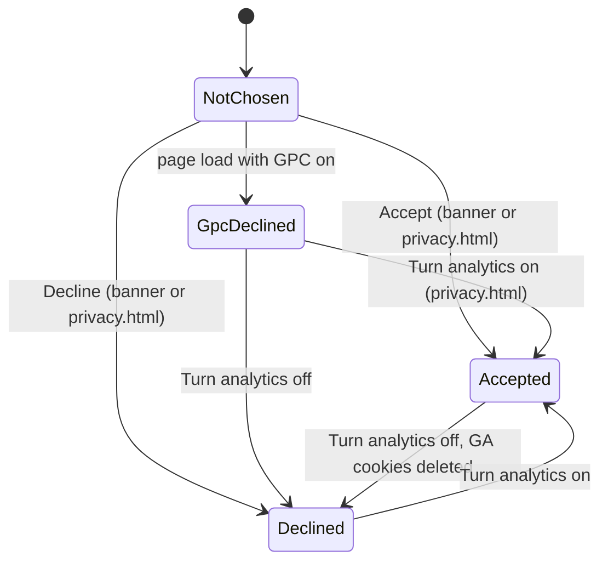
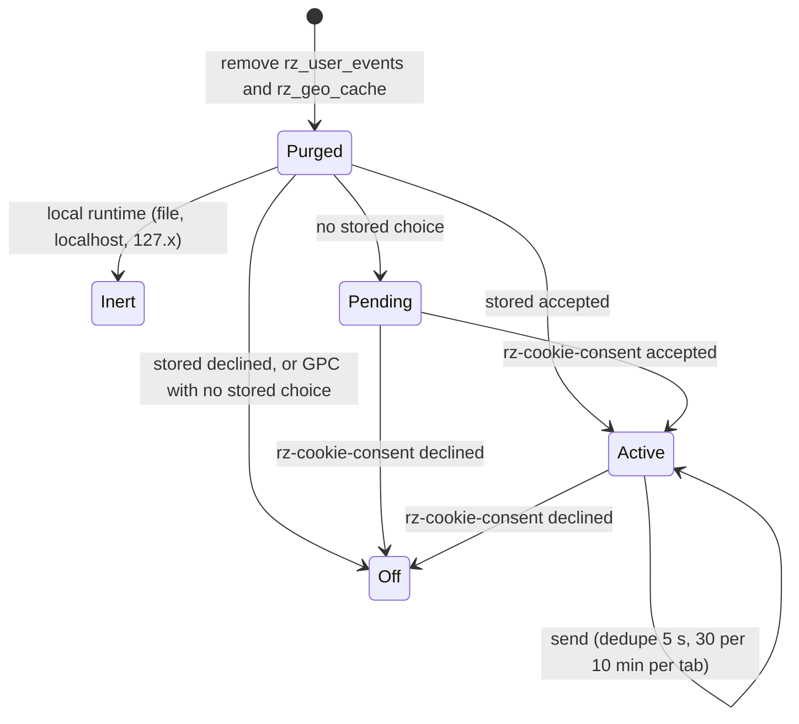
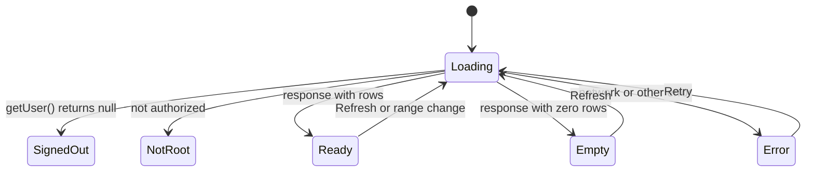
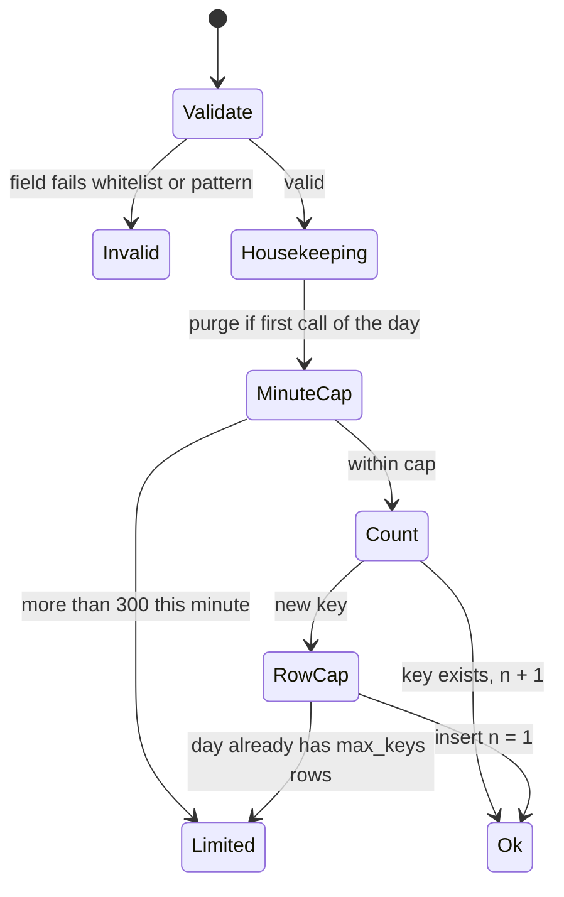
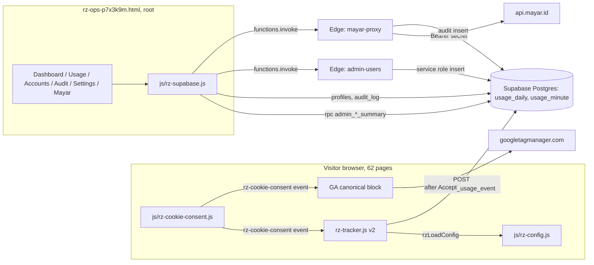
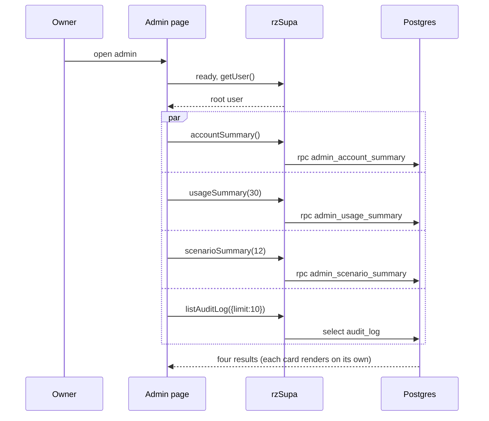
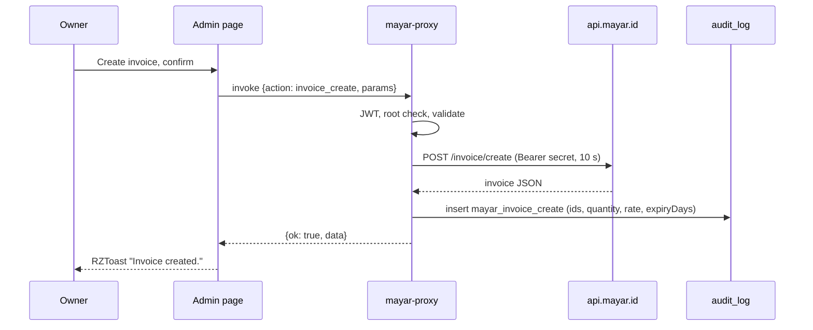

# PRD-Q10 — Admin console on real data, with consent-gated, PII-free usage counts

## 1. Document control

| Field | Value |
|---|---|
| PRD id | PRD-Q10 |
| Feature | Every number in the root admin console `rz-ops-p7x3k9m.html` comes from a Supabase query or the panel says "No data yet". A consent-gated, rate-limited, aggregate-only usage counter replaces the localStorage tracker that captures IP address, city and e-mail. GA4 loads only after the visitor presses Accept. The Mayar payment key leaves the browser |
| Version | 1.1 |
| Status | Draft |
| Author | Opus 5.5; Fable quota exhausted |
| Date | 2026-11-11 |
| Owner requests | R110 (a PRD per idea), R111 (24-section structure) |
| Priority | 56.0 (addendum rank 18: I 5, N 3, C 7, E 4, effort 3 weeks; `documentation/PRODUCT_INNOVATION_ASSESSMENT_2026-11_ADDENDUM.md:93`) |
| Related findings | Q10 (`…_ADDENDUM.md:440-457`). X10 (`:56`, "Admin KPIs fabricated with no label"): the interim label is specified in PRD-X-DEFECTS FR-X10 and is removed by this PRD when it ships. The rz-tracker privacy finding reported by PRD-Q17. New findings N1–N12 in §3.3 |
| Dependencies | (1) Owner approval: this PRD changes a privacy and auth boundary (`documentation/product-transformation/STATE.md:9-10`, `:52`); decisions D-Q10-1 to D-Q10-13 in §5.7. (2) Owner actions OA-1 to OA-5 (§22.1): SQL and Edge Function deploys need the owner's Supabase dashboard; credentials never pass through an agent (`STATE.md:47`). (3) PRD-Q11 shares the SQL test harness `tools/lib/pg-harness.mjs` and the config loader `rzLoadConfig()`; whichever PRD ships first creates them. (4) PRD-X-DEFECTS FR-X10 is the interim. (5) PRD-Q10 owns the usage event list (R12). PRD-Q17 adds `path_step_done` and `path_done` in its own release only if D-Q17-4 = B; PRD-Q07 adds no event (its T-15 forbids tracker calls) |
| Related modules | `rz-ops-p7x3k9m.html`; `rz-tracker.js` (62 pages); `js/rz-cookie-consent.js` (253 HTML files at `7335fd257`, 246 at `9e49bfefd`; T-5 enumerates them by `git grep -l`, never by the number); the GA4 loader in 162 HTML files; `privacy.html`; `supabase/schema.sql` (NEW Module 10); NEW `supabase/functions/mayar-proxy/`; `supabase/functions/admin-users/index.ts`; `js/rz-supabase.js`; `setup-supabase.html` (owner action board); `js/rz-toast.js`; `sw.js`; the callers of `window.rzTrack` (`js/rz-command-palette.js`, `js/rz-article-diagram.js`, `js/rz-scrolly.js`) |
| Target wave | Addendum roadmap "Strategic, week 17 onward" (`…_ADDENDUM.md:558`). The main session sets the implementation wave in `04-implementation-plan/` |
| Approval status | PRD approved by owner R110/R111 2026-11-10. Implementation is BLOCKED until the owner explicitly decides D-Q10-1 to D-Q10-13 (a declined row applies its "If declined" path, §5.7) (privacy and auth boundary, `STATE.md:52`). The approval class in `01-improvement-register/REGISTER.md:23` is "auth/privacy boundary: approval needed" |
| Facts verified at | `wt-hub3` commit `9e49bfefd` (2026-11-11, "docs: tracker X2 verified, record P25 SW module contract"). Site version `3.35.10` (`js/rz-version.js:2`). Working tree clean except another agent's untracked `02-prds/PRD-Q09/` |

Change history

| Version | Date | Author | Change |
|---|---|---|---|
| 1.0 | 2026-11-11 | Opus 5.5 | First complete draft, all 24 sections. Every fact re-verified on `9e49bfefd` with the commands quoted in §3 |
| 1.1 | 2026-11-11 | Opus 5.5 | QA batch 3 fixes: page allow-list and per-client bucket for `record_usage_event` (FR-2, §10.2, §16, L5 S11–S13; new D-Q10-13); "If declined" column for every decision (§5.7); D9 law-wiring table (§20.2a); R114 statement (§5.5); event-name owner and the Q07/Q17 names corrected (§5.4, §13, L5 S10); peer-owned `cx-calculator.html` and `id/index.html` handed to the peer (FR-6, §13, L4); new D-Q10-12 for the two root-only definer reads (FR-3); FR-2 output is `text`. New counts verified at `7335fd257` |

## 2. Executive summary

The admin console is root-only and `noindex`, and most of what it shows is invented in the browser at load
time. `generateUsers()` makes 39 users (4 seeds and 35 random ones, `rz-ops-p7x3k9m.html:2586`). Revenue is
the count of fake pro users times $49, and churn is fixed at 2.1% (`:2689`). The page prints "99.97%"
uptime, "42ms" response time, a "0.02%" error rate and "234" PDF exports as literals (`:911`, `:921`,
`:1970`, `:1975`, `:1980`). `seedUADemoData()` writes about 280 fake visitor events, with made-up IP addresses
and cities, into the admin's own localStorage (`:5528`). Nothing on screen says any of this is invented.
The parts that are real work: the Supabase account list, tier changes, and create, reset and delete through
the `admin-users` Edge Function.

The data source behind "User Activity" is `rz-tracker.js`, which 62 pages load. It never sends an event to
the site. It writes each event, with IP address, city, region, timezone, user agent, screen, language,
referrer and, on login, the e-mail address, into the visitor's own localStorage. Before any consent it sends
the visitor's IP address to `ipapi.co` (`rz-tracker.js:38`). So the admin can only ever see its own browser
plus the seed. Separately, GA4 loads on 162 HTML files on the first scroll, click, key or touch whatever the
cookie banner says. 0 of the 162 require Accept, and 5 load GA at parse time.

The addendum's plan, "call the existing `log_event` RPC", does not work. `supabase/schema.sql:964-965`
revokes anonymous EXECUTE on `log_event`, so a signed-out visitor is meant to be unable to call it, and
`audit_log` is the privileged-action trail with `ip` and `ua` columns. The revoke itself may not take effect,
because PostgreSQL grants EXECUTE on new functions to PUBLIC and the schema never revokes that (finding N6).

This PRD delivers six things:

1. **A counter.** A new aggregate-only usage store: `usage_daily`, `usage_minute` and `usage_maintenance`,
   and the RPC `record_usage_event`. The RPC is callable by anyone. It checks every field against a
   whitelist, caps each client at 30 and the whole site at 300 events a minute, accepts only allow-listed pages, and keeps 400 days.
   It stores no IP address, no identifier, no user agent, no e-mail, no account id and no query string.
2. **A new `rz-tracker.js`.** It sends only after Accept, and never under Global Privacy Control unless the
   visitor chose Accept explicitly. It deletes the old IP and e-mail history from every visitor's browser.
3. **GA4 behind Accept.** One canonical loader goes on all 162 GA files, applied and checked by a sweep tool.
4. **`privacy.html`.** It says exactly what is counted and what is not, and it gets a control to change or
   withdraw the cookie choice, which the policy already promises.
5. **The admin.** Every fabricated panel and figure is deleted. Dashboard, Usage, Accounts, Audit log and
   Settings read real queries: three new root-only RPCs, plus `profiles` and `audit_log`. Every panel names
   its source and has loading, empty, error and not-root states. Messages use RZToast instead of `alert()`.
6. **Mayar.** Payment calls go through a new Edge Function, `mayar-proxy`. The key becomes a Supabase secret.

Eight laws prove it. Each fails on today's tree (§20.2). There are four new gate files and a sweep check,
wired into `tools/ship-gate.sh`.

## 3. Problem statement

### 3.1 Verified facts (run on `wt-hub3` at `9e49bfefd`, 2026-11-11)

| # | Fact | Evidence | Command |
|---|---|---|---|
| P1 | The admin generates its data at load time | `generateUsers` at `rz-ops-p7x3k9m.html:2481, :2586, :6054`; `seedUADemoData` at `:5528, :5658` (5 lines); `generateActivities` at `:2481, :2611, :6057`; `Math.random` on 6 lines (`:2577, :2578, :2598, :3413, :5567, :5599`); `rand(` on 27 lines | `grep -n "generateUsers\|seedUADemoData\|generateActivities" rz-ops-p7x3k9m.html`; `grep -c "Math.random" rz-ops-p7x3k9m.html` → 6; `grep -c "rand(" rz-ops-p7x3k9m.html` → 27 |
| P2 | 39 fabricated users | `generateUsers()` `:2586-2609`: 4 seed accounts plus 35 users built from `FIRST_NAMES`/`LAST_NAMES`/`DOMAINS`, random tier (`:2598`), random status, dates (`randDate`, `:2578`) and countries | `sed -n 2586,2610p rz-ops-p7x3k9m.html` |
| P3 | Every Dashboard and Revenue figure derives from P2 or a literal | `renderKPIs()` `:2628` ("+% from last month" = total ÷ 42; revenue = pro × 49; "2.1% churn"); `renderDashboardCharts()` `:2645` (active sessions `rand(3,12)` `:2650`; growth `[12,18,24,31,42,N]`; hourly usage `rand(2,45)` `:2661`; funnel `[1200,…]` `:2664`; geography from fake countries `:2669`); `renderRevenue()` `:2689` (MRR = pro × 49, LTV = 49 × 14.2, churn 2.1%, MRR history `[98,147,196,245,343,mrr]`, revenue table `:2708`); user modal "Lifetime Value" = amount × `rand(4,16)` `:3182` | `sed -n 2628,2710p rz-ops-p7x3k9m.html` |
| P4 | Literal figures printed as measurements | subtitle "Real-time platform metrics and analytics" `:894`; PDF Exports "234" `:911`; uptime "99.97%" `:921` and `:1970`; "42ms" `:1975`; "0.02%" `:1980`; nav badges "50" (`navUserCount`, `:812`) and "15" (`:816`); Settings "v2.0.0 (Feb 2026)" `:4890` while the site is 3.35.10 (`js/rz-version.js:2`); "Auth Backend: localStorage (Pre-Supabase)" `:4892`; Data Management buttons that only toast "Mock: …" `:1998-2001` | `grep -n "99.97%\|>42ms<\|>0.02%<\|Mock: \|Real-time platform metrics\|>234<\|Pre-Supabase\|v2.0.0 (Feb 2026)" rz-ops-p7x3k9m.html` |
| P5 | The audit log and "recent activity" are fabricated | `renderAudit/filterAudit` `:4863` and the dashboard feed read `activities` from `generateActivities()` (`:2611`, 40 events from a fixed base date) | `sed -n 2611,2627p rz-ops-p7x3k9m.html` |
| P6 | "User Activity" seeds itself | `UA_STORAGE_KEY='rz_user_events'` `:5488`; `seedUADemoData()` `:5528` writes about 280 events with fake IPs and cities into localStorage through `saveUAEvents` (`:5605`); `renderActivity()` `:5656` seeds whenever fewer than 50 events exist (`:5658`) | `sed -n 5528,5606p rz-ops-p7x3k9m.html` |
| P7 | Feature panel lists fabricated users | "Per-User Overrides" renders pro users from P2 with a button that only alerts "Override panel for … — coming with Supabase integration" `:3570` | `grep -n "coming with Supabase" rz-ops-p7x3k9m.html` |
| P8 | Subscribers panel has no writer | `getSubscribers` `:4912` reads localStorage `rz_newsletter_subscribers`; that key appears in no other file. Newsletter capture is banned by the gate at `tools/ship-gate.sh:285` | `grep -rln "rz_newsletter_subscribers" --include=*.js --include=*.html .` → `rz-ops-p7x3k9m.html` only |
| P9 | The topbar clock is mislabelled | `:2542` prints the browser's local time and appends " UTC+7", wrong in any other timezone | `sed -n 2542p rz-ops-p7x3k9m.html` |
| P10 | The Mayar key lives in browser storage | `MAYAR_API_BASE='https://api.mayar.id/hl/v1'` `:4975`; `getMayarKey()` reads localStorage `rz_mayar_key` `:4989`; sent as `Authorization: Bearer` from the browser `:5005`; client guard 18 calls/min `:4998-5001`; no writer of `rz_mayar_key` anywhere in the repo; failures toast "Some API calls failed — CORS or API key issue" | `sed -n 4975,5010p rz-ops-p7x3k9m.html` |
| P11 | `rz-tracker.js` captures personal data locally and sends the IP to a third party | header `:1-8` ("Captures: IP, country, city, timezone, screen, language, referrer, browser"); `fetch('https://ipapi.co/json/')` `:38` on every non-local host; event fields `:106-123` (`ip, country, cc, city, tz, device, browser, screen, lang, ref, ua` 80 chars, `sid`); `track('page_view')` on load `:134` with no consent check; login listener stores the e-mail `:181-189` (and labels every non-demo login "signup"); `auth.js:910` dispatches `rz-auth-change` with `email` | `sed -n 1,190p rz-tracker.js` |
| P12 | The tracker never sends to the site | the only network call in the file is `:38` | `grep -n "fetch(\|XMLHttpRequest\|sendBeacon" rz-tracker.js` → `:38` only |
| P13 | 62 pages load it | 61 root pages carry a tag: 46 as `src="rz-tracker.js"` and 15 as `src="rz-tracker.js?v=20260920-180645d6"`. The token matches the current hash `180645d6`. `index.html:1509-1511` injects it with no token. All 62 also load `js/rz-cookie-consent.js`. The addendum's "63 pages" counted `changelog.html`, which only mentions the file in text (`:34596`) | `grep -rhoE --include=*.html "src=\"/?rz-tracker\.js[^\"]*\"" . \| sort \| uniq -c`; `sha256sum rz-tracker.js \| cut -c1-8` |
| P14 | Callers of `window.rzTrack` | `js/rz-command-palette.js:104` (`rz_command`, command title), `:140` (`rz_search_open`), `:310` (`rz_search_go` with destination **and the raw search text `q`**); `js/rz-article-diagram.js:75` (`rz_diagram_scenario`); `js/rz-scrolly.js:76` (`rz_scrolly_complete`) | `grep -rn "rzt(\|rzTrack" js/*.js` |
| P15 | GA4 loads without consent on every GA page | 162 HTML files load `G-GED7FX8RTV`: 83 root, 39 `manual/`, 33 `cx-handbook/`, 4 `embed/`, 3 `id/`. 157 use an inline loader that fires on the first scroll, click, key or touch. 5 use a classic `<script async src>` tag that loads at parse time: `changelog.html`, `embed/index.html`, `embed/capex-widget.html`, `embed/pue-widget.html`, `embed/carbon-widget.html`. 101 files skip GA only when the stored choice is `'declined'`; 58 have no consent check at all; 0 require `'accepted'`. `index.html:12-30` has no check. `tools.html:9` says "default to deny on first visit", but the code only checks `'declined'` (`:10-12`) | `grep -rl --include=*.html "googletagmanager.com/gtag/js?id=G-GED7FX8RTV" . \| wc -l` → 162, then `grep -l` for each variant (§20.2 L4) |
| P16 | Consent cannot be changed or withdrawn | `js/rz-cookie-consent.js:131-135` never shows the banner again once a choice is stored, and the file exposes no API. `privacy.html:399` promises "Withdraw consent: Withdraw previously given consent at any time." `standarization/LEGAL_COMPLIANCE_STANDARD.md:28` calls the banner "GDPR-style opt-in/out" | `sed -n 122,150p js/rz-cookie-consent.js` |
| P17 | `privacy.html` does not match the code | "Last updated: December 11, 2025" `:273`. IP row "Server logs, analytics — geo analytics" `:303`. §1.3 (`:309-325`) says local keys are "never transmitted to our servers" and omits `rz_user_events` and `rz_geo_cache`. §3 (`:337-350`) lists Google Analytics, Google Fonts/cdnjs and Chart.js but not Supabase or ipapi.co. `:371` says "input data is not sent to servers", yet saved scenarios are stored in Supabase (`saved_scenarios.payload`, `supabase/schema.sql:280-288`) | `grep -n -i "supabase\|ipapi\|rz_user_events" privacy.html` → no match |
| P18 | `log_event` is not built for anonymous counts | `schema.sql:728-755` inserts `actor_id = auth.uid()` (nullable FK, `:704`) with no rate limit and up to 32 KB of `meta` (`:714`). `:964-965` revokes EXECUTE from `anon` only. No `revoke … from public` exists for any function (`:45` is the schema CREATE revoke) | `grep -n "from public" supabase/schema.sql` → `:45` only |
| P19 | Server reads already available to root | `profiles` "root reads all" policy `:131`; `audit_log` "root reads all" `:724`; `rzSupa.listAllProfiles` (`js/rz-supabase.js:264`), `rzSupa.listAuditLog` (`:420`, 0 callers). `saved_scenarios` is own-row only, so root cannot count other users' scenarios without a definer function | `grep -n "create policy" supabase/schema.sql` |
| P20 | Admin user operations leave no audit row | `supabase/functions/admin-users/index.ts` has 0 references to `audit_log` or `log_event`. Only the profile tier/role trigger (`schema.sql:757-784`) audits | `grep -c "audit_log\|log_event" supabase/functions/admin-users/index.ts` → 0 |
| P21 | Every admin message is a blocking `alert()` | 7 calls of `(window.showToast\|\|alert)`, and `showToast` is defined nowhere in the page; `js/rz-toast.js` is loaded by 3 pages (`changelog.html`, `cdu-calculator.html`, `rfs-readiness-workbench.html`) | `grep -c "window.showToast\|\|alert" rz-ops-p7x3k9m.html` → 7 |
| P22 | A stale warning on two accounts | `SUPA_PUBLIC_PW` `:3266-3267` flags bagus@ and admin@ as "Password is public in source code". `supabase/functions/admin-users/index.ts:47-54` records that both passwords were rotated | `sed -n 3266,3267p rz-ops-p7x3k9m.html` |

### 3.2 Consequence of leaving it

- **The owner decides on invented numbers.** Accounts, revenue, churn, uptime and visitor geography on the
  admin are random or literal. A decision such as "pro converts at 8%" would rest on `Math.random()`.
- **Privacy.** 62 pages send each visitor's IP address to `ipapi.co` before any choice, and keep IP, city
  and login e-mail in localStorage on shared machines. GA4 loads before any choice on 162 files, and on 5
  of them at parse time. Embed widgets carry GA into third-party sites with no banner at all. The privacy
  policy promises a withdrawal that the site cannot perform, and its data table is wrong in four places.
- **Security.** A long-lived payment API key sits in the admin browser's localStorage. Any script running
  on the resistancezero.com origin can read it. The admin page itself loads Chart.js, Leaflet and
  markercluster from jsDelivr and Font Awesome from cdnjs (`rz-ops-p7x3k9m.html:15-21`). That key can
  create invoices and read customer records. Admin user deletions and password resets leave no trail.
- **The addendum's fix would make it worse.** Pointing anonymous events at `log_event` would either fail
  (if the anon revoke works) or let anyone write unlimited 32 KB rows into the privileged audit trail (if
  PUBLIC still holds EXECUTE).

### 3.3 Addendum corrections and new findings

| # | Addendum statement | What the code says | Effect on this PRD |
|---|---|---|---|
| C1 | "Read `profiles` and call the existing `log_event` RPC, rate-limited" (`…_ADDENDUM.md:442`) | `log_event` is meant to be authenticated-only (`schema.sql:964-965`). It writes the privileged trail, which has `ip` and `ua` columns, a 32 KB `meta` and no rate limit (P18) | A separate aggregate store and RPC (FR-1, FR-2). `audit_log` keeps admin actions only |
| C2 | "Visitor events go to the RPC, and the admin reads them" (`:445`) | No event reaches any server today. The tracker writes only to the visitor's localStorage (P12) | The admin's "User Activity" has never shown a visitor. The new counter starts at zero, and the admin says so ("No data yet") |
| C3 | "rz-tracker (63 pages)" (`:447`) | 62 pages load it (P13) | Counted pages = 62 |
| C4 | X10 acceptance names only `generateUsers` and `seedUADemoData` (`:56`, `:455`) | `generateActivities` and 8 literal figures (P4) are not covered by those two names | Law L1 checks the full list |

New findings (not in the addendum):

- **N1.** GA4 loads before consent on all 162 GA files (P15). It is included here because the addendum's
  acceptance "no event is sent without consent" (`:457`) is false for GA otherwise.
- **N2.** There is no way to withdraw or change consent (P16).
- **N3.** `ipapi.co` receives every visitor's IP address on 62 pages before any choice (P11).
- **N4.** The login e-mail is stored in the tracker history, and every non-demo login is mislabelled
  "signup" (`rz-tracker.js:181-189`).
- **N5.** Raw search text is passed to the tracker (`js/rz-command-palette.js:310`, `q`), and today's
  tracker stores it in localStorage.
- **N6.** `log_event` may still be executable by `anon` through PUBLIC. PostgreSQL grants EXECUTE on new
  functions to PUBLIC by default (PostgreSQL manual, "Privileges"), and a revoke from one role does not
  remove a PUBLIC grant. The live state is UNKNOWN; T-1 measures it with a read-only query (OA-1).
- **N7.** `privacy.html` is inaccurate in four places (P17).
- **N8.** The topbar clock is mislabelled (P9).
- **N9.** Admin user operations write no audit row (P20).
- **N10.** The Mayar key is in browser storage (P10). After the move, rotate it (OA-4).
- **N11.** A stale "public pw" warning (P22).
- **N12.** Every admin message uses `alert()` (P21).

## 4. Objectives and success metrics

No target below is invented. "Today" values were measured with the commands in §3.1. Each target is the
end state the laws in §20.2 assert. Traffic-dependent values are UNKNOWN until measured after deployment.

| # | Objective | Metric | Today | Target | Method |
|---|---|---|---|---|---|
| O1 | No fabricated number in the admin | fabricated generator names + `Math.random` lines + the literal figures of P4 in `rz-ops-p7x3k9m.html` | 3 generator functions (8 lines), 6 `Math.random` lines, 8 literal figures | 0, 0, 0 | L1 |
| O2 | Every rebuilt panel names its source | `data-ops-source` attributes with known values on the rebuilt cards and sections | 0 | 16 (13 cards in Dashboard, Usage and Audit log, plus Settings, Mayar and Accounts; §9.3) | L1, L6 |
| O3 | No analytics request before Accept | requests to `googletagmanager.com`, `google-analytics.com`, `ipapi.co` or `/rest/v1/rpc/record_usage_event` before a choice, after Decline, and under GPC with no choice, on the sampled pages | ≥ 1 (GA after the first scroll on `index.html`; GA at parse time on `changelog.html`; `ipapi.co` on load on a non-local host) | 0 | L2 |
| O4 | One canonical GA loader everywhere | files carrying the `rz-ga-consent v1` block ÷ files carrying `G-GED7FX8RTV` | 0 / 162 | 162 / 162 after the peer applies the block to its 2 files; until then 160 / 160 plus 2 `peer-owned, pending` | L4 |
| O5 | The usage payload carries no personal data | keys outside `{p_event,p_page,p_device,p_detail}`; values that look like an e-mail, an IP address, a user agent or typed search text | today's local record holds `ip`, `city`, `ua` and `email` | 0 | L3 |
| O6 | A real visit is counted | live: after Accept, the `record_usage_event` response body is `"ok"` | impossible today (no endpoint) | `"ok"` | §22.7 V-3 |
| O7 | The Mayar key is out of the browser | `rz_mayar_key` and `api.mayar.id` in `rz-ops-p7x3k9m.html` | 1 and 1 | 0 and 0 | L7 |
| O8 | Admin mutations leave a trail | audit-row calls per mutating action in `admin-users` and `mayar-proxy` | 0 of 4 (`admin-users`) | 4 of 4, and 2 of 2 for `mayar-proxy` | L7 (static part) |
| O9 | The counter stays within budget | `usage_daily` rows a day; worst-case table size | n/a | ≤ `max_keys` rows a day by construction (4,648 at `7335fd257`, FR-2a). Worst case 400 days × 4,648 rows = 1,859,200 rows: arithmetic from the caps, not a forecast. Real volume UNKNOWN; measure 30 days after release with `select count(*) from usage_daily` (T-14) | L5, §22.6 |
| O10 | The tracker does not grow | `wc -c rz-tracker.js` | 7,581 bytes | ≤ 7,581 bytes (today's size is the budget) | L3 static part |

## 5. Scope

### 5.1 In scope

1. **Supabase Module 10 (NEW)**, appended to `supabase/schema.sql`. It creates `usage_daily`,
   `usage_minute` and `usage_maintenance`; `record_usage_event()` (anon and authenticated);
   `admin_usage_summary()`, `admin_account_summary()` and `admin_scenario_summary()` (root only); and the
   grants for all of them. It also revokes `log_event` from PUBLIC (N6).
2. **`rz-tracker.js` v2**, rewritten in place. The same 62 pages load it, so no page markup changes. It is
   consent-gated, sends whitelisted fields only and purges the legacy keys.
3. **`js/rz-cookie-consent.js`.** GPC counts as Decline when no choice is stored. Adds the public API
   `window.RZCookieConsent`, withdrawal that deletes GA cookies, and accurate banner copy.
4. **GA4 canonical loader** in all 162 files and in the three generators that emit GA
   (`tools/build-cx-handbook.py:302-324`, `tools/build-changelog-html.py:444-450`,
   `tools/generate-city-pages.py:119-124`, `:1009-1014`). It is applied and checked by
   `tools/gate-gtag-consent.py`, an existing v1.10.15 one-off fixer that is wired nowhere, hardcodes another
   checkout (`ROOT = Path("/home/baguspermana7/rz-work")`, `:13`) and writes the `'declined'`-only pattern
   (`:16-40`). It is rewritten in place with `--check` and `--apply`.
5. **`privacy.html`.** Rewrite of the analytics, local-storage, sharing and security statements; a
   "Your cookie choice" control; a new "Last updated" date. The wording is the owner's to approve (D-Q10-10).
6. **`rz-ops-p7x3k9m.html`.** Deletions (§8 FR-8). Rebuilt Dashboard, Usage (replaces User Activity),
   Accounts (the real Supabase panel, renamed from Credentials; the fabricated Users section is deleted),
   Audit log and Settings. Mayar through the proxy. RZToast. Loading, empty, error and not-root states.
   The clock in Asia/Jakarta time.
7. **NEW Edge Function** `supabase/functions/mayar-proxy/`, with its testable core `core.ts`. Audit rows
   added to `supabase/functions/admin-users/index.ts`.
8. **`js/rz-supabase.js`** additions: `usageSummary`, `accountSummary`, `scenarioSummary`, `setRole`, a
   paged `listAuditLog`, and `mayar`.
9. **`setup-supabase.html`.** Owner-action board entries for OA-1 to OA-5.
10. **`sw.js`.** Add `/rz-tracker.js` and `/js/rz-config.js` to `NETWORK_FIRST_PATHS`, so privacy-critical
    code is never served stale from the service-worker cache.
11. Gates (§20), standards docs (§22.4) and the release chain (§22.8).

### 5.2 Out of scope (non-goals)

- Tier Manager v2 and the dormant AUTH_V2 path (`auth.js:138-147`, placeholder gateway; `worker-auth/`).
  Untouched (D-Q10-9).
- The DC Intelligence, Stock Investment, Finance Terminal and IDR Stocks sections. They read their own
  data files or apps, and none of the `Math.random` lines (P1) is in them. Their badges and visual register
  are untouched.
- The Feature Flags panel internals. PRD-Q11 owns them. This PRD deletes only the fabricated "Per-User
  Overrides" card (P7).
- The billing webhook and the `subscriptions` and `payments` tables (`schema.sql:835-879`). They have no
  writer, and root cannot read them (own-row RLS). Mayar data comes from the proxy instead.
- Educator allowlist UI (`rzSupa.listEducators/addEducator/removeEducator`, `js/rz-supabase.js:463-482`, 0
  callers) and the client-side `rz_admin_educators` path in `auth.js:256-292`. That is an auth follow-up.
- Unique visitors, cohorts, retention curves, geography, referrers and funnels. They are not collected by
  design, so the admin never shows them.
- Extending the counter to the roughly 190 pages that do not load `rz-tracker.js` (D-Q10-8).
- A full visual re-skin of the 7,115-line admin. Only the rebuilt panels follow §9.8.
- Legal advice. The privacy text in §9.10 is a draft for the owner.

### 5.3 Existing capabilities reused

| Capability | Where |
|---|---|
| Root check in SQL | `public.is_root()` `supabase/schema.sql:102-114` |
| Root-readable profiles and audit rows | policies `:131`, `:724` |
| Tier and role RPCs, root-checked and audited by trigger | `admin_set_tier` `:197`, `admin_set_role` `:236`, trigger `audit_profile_privilege_change()` `:757-784` |
| Edge Function pattern (CORS allowlist, JWT check, root check, `{ok,data}` / `{ok:false,error,message}` envelope) | `supabase/functions/admin-users/index.ts:33-101` (allowlist `:33`, `corsHeaders` `:57`, `getUser` `:94`, root check `:101`) |
| Client wrapper with `friendly()` errors and `ready` promise | `js/rz-supabase.js:81`, `:486-488` |
| Real account panel (list, tier select, add, reset, delete) | `rz-ops-p7x3k9m.html:3238-3400` |
| HTML escaping helper | `rzEsc` `rz-ops-p7x3k9m.html:3230` (used at `:3280`) |
| Toasts | `window.RZToast.{show,ok,warn,fault,info}` `js/rz-toast.js:239-247` |
| Consent key, event and GA disable flag | `js/rz-cookie-consent.js:25-27`, `:53-65` |
| Admin theme (light and dark) | `toggleAdminTheme()` (`rz-ops-p7x3k9m.html:2517`), tokens `css/rz-finance-suite.css:20-75` |
| Owner action board | `OWNER_ACTIONS` array, `setup-supabase.html:67` |
| Served tree and free port for browser gates | `tools/ship-gate.sh:311-348` |
| Cache-token tool | `node tools/test-asset-cache-tokens.mjs --fix <asset>` |

### 5.4 Dependencies

| Dependency | Kind | Status |
|---|---|---|
| Owner approval of D-Q10-1 to D-Q10-13 | blocking for implementation | pending |
| OA-1 to OA-5 (owner runs SQL, deploys functions, sets the secret, rotates the Mayar key) | blocking for go-live of the server parts | pending; prepared by T-15 |
| `tools/lib/pg-harness.mjs` + dev dependency `@electric-sql/pglite` (or Docker `postgres:16` fallback) | shared with PRD-Q11 | NEW, created by T-1 |
| PRD-X-DEFECTS FR-X10 (interim labels) | interim, superseded here | specified there |
| Event names from other PRDs | later additions to the whitelist | PRD-Q10 owns the one event list (R12: SQL check, RPC whitelist, tracker whitelist). PRD-Q17 may add `path_step_done` and `path_done`, and only if D-Q17-4 = B. PRD-Q07 adds no event: its T-15 forbids tracker calls (`PRD-Q07/PRD.md:1039`) |
| Peer P25 service-worker module (v3.37.0, not live, `STATE.md:64-68`) | `sw.js` is registered on more pages after P25 | coordinate the `NETWORK_FIRST_PATHS` edit with the peer |

### 5.5 Constraints

- Static site, zero build for pages, vanilla ES5 in shared scripts (`rz-tracker.js` and
  `js/rz-cookie-consent.js` are ES5 today; keep them ES5).
- The repo is public, so no secret goes in any file. The Supabase publishable key in `js/rz-config.js` is
  public by design (the `SUPABASE_ANON` value is a publishable `sb_publishable_…` key); RLS and function
  grants are the boundary.
- The free Supabase plan is likely: the keep-alive workflow `.github/workflows/supabase-keepalive.yml`
  exists to prevent pausing, which suggests the free plan. Plan and DB size are UNKNOWN; T-1 measures them
  through OA-1.
- Peer-owned files: `cx-calculator.html` loads `rz-tracker.js` with a bare tag. This PRD does not edit that
  tag. The new tracker is picked up by the same URL.
- Release chain and design register: §9.8, §22.
- Owner rule R114 (no paid service, no pay-per-use API): this PRD adds none. Supabase stays on the
  existing plan (tables, functions and `pgcrypto`, which Module 0 already installs, `supabase/schema.sql:40`);
  GA4 is free; `ipapi.co` is removed; Mayar is the owner's existing payment provider and the proxy runs on
  Supabase Edge Functions of the same project; PGlite is MIT and dev-only. The abuse limits of FR-2 are
  built in SQL, not bought (no WAF, CAPTCHA or rate-limit service).

### 5.6 Assumptions

- A1. A visitor's choice stored in `localStorage['rz_cookie_consent']` is the consent record. There is no
  server-side consent log, because the counter is anonymous and cannot be tied back to a visitor.
- A2. Days are Asia/Jakarta calendar days. The owner reads the admin in that timezone, as the existing
  " UTC+7" label shows.
- A3. Counts are a lower bound: only consenting visitors, only the 62 pages, events fired during navigation
  may be lost, and caps may bind. The admin says so on every usage panel.
- A4. supabase-js v2 sends `apikey` and `Authorization: Bearer <key>` on a signed-out request, and the
  site's sign-in already works with that header pair on `/auth/v1`. The tracker copies the pair. §22.7 V-3
  verifies it live on `/rest/v1/rpc`.

### 5.7 Owner decisions (defaults used by this PRD)

| # | Decision | Default | Why it needs the owner | If declined (REJECTED) |
|---|---|---|---|---|
| D-Q10-1 | Allow a new anonymous write path, `record_usage_event`, with the caps of FR-2 | approve | new auth surface (`STATE.md:9`) | No counter: Module 10 creates no `record_usage_event` and no `usage_*` table; tracker v2 still ships without IP, e-mail or `ipapi.co` and sends nothing; the Usage panel shows "Not collected". L3 keeps its static part; its payload part, L2's counter assertions and L5 S1–S4, S7, S10–S13 run in report mode |
| D-Q10-2 | Retention: `usage_daily` 400 days, `usage_minute` 1 hour | approve | data retention is a privacy choice | The counter does not ship until the owner names another retention; then §10.5 and L5 S7 use that number. Until then as "D-Q10-1 declined" |
| D-Q10-3 | Global Privacy Control counts as Decline when no choice is stored, and the banner is not shown. An explicit Accept on `privacy.html` overrides it | approve | changes who sees the banner | GPC is ignored; the banner shows under GPC like any first visit. The GPC cases leave L2; R1's GPC sentence is deleted |
| D-Q10-4 | GA4 loads only after Accept on all 162 files. GA numbers will then count consenting visitors only | approve | business-visible drop in GA counts | FR-6 does not run; the 162 GA loaders stay; L4 runs in report mode; L2 keeps only its counter and `ipapi.co` assertions. The `privacy.html` text (D-Q10-10) must then say that GA loads before a choice |
| D-Q10-5 | Mayar through `mayar-proxy`, key as secret `MAYAR_API_KEY`; rotate the key after the move | approve | secret handling; new function | No `mayar-proxy`; the Mayar section keeps today's browser-stored key; L7 runs in report mode and R8 is recorded as an open risk; OA-3 and OA-4 are not done |
| D-Q10-6 | Delete fabricated panels and figures (FR-8) rather than keep them labelled | approve | feature removal (`STATE.md:9`) | The PRD-X-DEFECTS FR-X10 labels stay on the fabricated sections; FR-8 deletes nothing; L1 asserts that every fabricated section carries its FR-X10 label, not that it is absent; O1 is dropped |
| D-Q10-7 | Delete the Subscribers panel (P8) | approve | feature removal | The Subscribers panel stays with its FR-X10 label "This browser only"; L1 exempts it by id |
| D-Q10-8 | Keep counting on the current 62 pages only | approve | scope | The owner names the extra pages; they get the tracker tag and enter the page allow-list (FR-2a); no law changes, because L5 and L3 compute the page set |
| D-Q10-9 | Leave AUTH_V2 and Tier Manager v2 untouched | approve | scope | Out of scope here; a separate PRD is needed |
| D-Q10-10 | Publish the `privacy.html` text of §9.10 | owner reviews wording | legal copy | T-8 waits for the owner's wording; `privacy.html` is not changed and L2's withdrawal case and L8's privacy control run in report mode until it is published |
| D-Q10-11 | Revoke `log_event` from PUBLIC and grant it to `authenticated` only | approve | auth boundary | `log_event` grants stay as today; L5 S8 leaves the law; N6 stays open as a risk row |
| D-Q10-12 | New root-only `security definer` reads: `admin_account_summary` reads `auth.users.last_sign_in_at` and `admin_scenario_summary` counts every user's `saved_scenarios` (aggregate counts only, never `payload` or `name`). Both widen root's read surface beyond today's RLS (own-row only on `saved_scenarios`, P19). Requires owner approval — auth boundary | approve | auth boundary (`STATE.md:52`) | Neither function is created. The Accounts panel shows counts from `profiles` only (no last sign-in column); the scenario card shows "Not collected"; L5 S6 covers `admin_usage_summary` only; L6 uses the fixture without those two shapes |
| D-Q10-13 | Per-client limit on `record_usage_event`: the function reads the first address of the `x-forwarded-for` request header only to form an HMAC with a salt that rotates daily, keeps that hash in `usage_client_minute` for at most 2 minutes, and never writes it to `usage_daily` (FR-2a). Privacy boundary: the counter otherwise reads no request header | approve | privacy boundary (R2 is narrowed from "never reads" to "never stores beyond 2 minutes") | No per-client bucket. The honest minimum applies: risk row K14 states that one client can saturate the site-wide 300/min cap; each capped minute is recorded in `_limited`; the Usage panel shows a banner "Counts were capped in {m} of {total} minutes on {day}" when more than 5 % of a day's counted minutes were capped; L5 S11 asserts `limited` plus `_limited` instead of `ok` |

## 6. User personas and use cases

Tiers and roles as the site has them: `profiles.tier` is `free | demo | pro | root`
(`supabase/schema.sql:84`), `profiles.role` is `user | educator | root` (`:86`), and root means
`tier = 'root'` (`is_root()`, `:102-114`). In the browser, `auth.js` derives the role from the session
(`detectRole` `:296`, `ROOT_EMAILS` `:246`). Client checks are cosmetic. RLS and function grants are the
boundary.

| Persona | Real role on this site | Goal | Permissions in this feature | Expected outcome |
|---|---|---|---|---|
| V1 Signed-out visitor | reader, any page | read, use tools, decide about analytics once | may cause `record_usage_event` calls only after Accept; cannot read anything | nothing leaves the browser before a choice; the choice can be changed on `privacy.html` |
| V2 Signed-in user (free, demo, pro; role user or educator) | DC and facility engineers, operators, students, educators | same as V1 | same as V1. The counter never reads `auth.uid()`, so counts are never tied to an account | identical to V1 |
| A1 Owner as admin (`tier = 'root'`) | runs the site | true account, usage and payment numbers; manage accounts; review admin actions | `admin_*` RPCs, `profiles` and `audit_log` reads, `admin_set_tier/role`, `admin-users`, `mayar-proxy` | every number has a source; empty data says "No data yet" |
| A2 Signed-in non-root who opens the admin URL | any account | none (curiosity) | none; every RPC returns `not authorized` | the "not a root account" state, no data |
| A3 Scripted client with the public key | abuse | inflate counts or fill the DB | can call `record_usage_event` directly | per client 30 events a minute (D-Q10-13), site-wide 300 a minute; pages outside the allow-list are stored as `/other`, so junk cannot create keys (FR-2a); cannot read; never sees other data |

Use cases: UC1 first visit with no choice (V1); UC2 Accept (V1); UC3 Decline (V1); UC4 browser with GPC
(V1); UC5 change or withdraw a choice on `privacy.html` (V1, V2); UC6 the owner reads Dashboard and Usage
(A1); UC7 the owner reviews and exports the audit log (A1); UC8 the owner changes a role or deletes an
account and sees the audit row (A1); UC9 the owner reads Mayar balance and transactions and creates an
invoice (A1); UC10 a non-root opens the admin (A2); UC11 Supabase is unreachable (A1).

## 7. Complete user journey

### J1 First visit, no choice (UC1)
1. Entry: any page, for example `/tools.html`. Initial state: no `rz_cookie_consent`, no GPC.
2. The banner slides up with the copy of §9.10. Nothing loads from `googletagmanager.com` or `ipapi.co`, and
   no `record_usage_event` request is made, whatever the visitor scrolls, clicks or types.
3. The tracker deletes `localStorage['rz_user_events']` and `sessionStorage['rz_geo_cache']`, which hold the
   old IP and e-mail history, on every page load whatever the choice.
4. Exit: the visitor leaves. Nothing was sent.

### J2 Accept (UC2)
1. The visitor presses **Accept**. `rz_cookie_consent = 'accepted'` and the `rz-cookie-consent` event fires.
2. The tracker sends `visit_start` (first page of this tab session) and `page_view` for the current page:
   2 POSTs. The GA loader loads `gtag.js`.
3. On later pages the tracker sends `page_view` on load, and the whitelisted interaction events as they happen.
4. Failure: the POST fails (offline, 5xx). The count is lost and nothing is retried. The page is unaffected
   and nothing is shown to the visitor.

### J3 Decline (UC3)
1. **Decline** stores `'declined'` and sets `window['ga-disable-G-GED7FX8RTV'] = true`.
2. No analytics request is made on this or any later page. The banner never returns. The choice can be
   changed in J5.

### J4 GPC (UC4)
1. `navigator.globalPrivacyControl === true` and no stored choice. The banner is not shown. Analytics stay
   off exactly as in J3. Nothing is stored, so a later explicit choice still works.
2. On `privacy.html`, "Your cookie choice" reads "Declined (your browser sends Global Privacy Control)".

### J5 Change or withdraw (UC5)
1. Entry: the banner's "Details" link, or any of the links to `privacy.html` (110 HTML files link it), then
   the "Your cookie choice" section.
2. The current state is shown as a word: "Accepted", "Declined", "Declined (your browser sends Global
   Privacy Control)" or "Not chosen yet".
3. **Turn analytics off** stores `'declined'`, sets the GA disable flag and deletes `_ga` and `_ga_*`
   cookies for `resistancezero.com` and `.resistancezero.com`. The status line reads "Saved. Analytics are
   off on this browser."
4. **Turn analytics on** stores `'accepted'`. The status line reads "Saved. Analytics are on on this
   browser." GA loads on the next interaction, and counting starts with the next page view.
5. Validation: none needed (two buttons). Exit: any link.

### J6 Owner opens the admin (UC6)
1. Entry: the admin URL. `checkAccess()` (`rz-ops-p7x3k9m.html:2405`) is unchanged and cosmetic.
2. Initial state: the Dashboard shows a loading line per card ("Loading…").
3. `rzSupa.ready`, then `getUser()`. If no user: the sign-in state (§9.7). If the user is not root: the
   not-root state.
4. Root: four calls run in parallel: `accountSummary()`, `usageSummary(30)`, `scenarioSummary(12)` and
   `listAuditLog(10)`. Each card fills on its own. "Updated HH:MM:SS WIB" is set when the last call settles.
5. A card whose call fails shows its error line and a **Retry** button that repeats that one call. A card
   with zero rows shows its "No data yet" copy.
6. Recovery: **Refresh** in the header repeats all four calls.

### J7 Usage (UC6)
1. Nav **Usage**. Default range 30 days. Changing the select (7, 30 or 90 days) calls `usageSummary(n)`.
2. Chart: page views per day. Tables: events, top pages, screen widths, search destinations, palette
   commands and diagram scenarios.
3. If a cap bound on any day in the range, a line reads "Counting was capped on N days in this range; these
   counts are lower than the real traffic."

### J8 Audit log (UC7, UC8)
1. Nav **Audit log**. The first 50 rows, newest first, with the actor e-mail resolved from the loaded
   account list.
2. The action filter and target search apply to the loaded rows. **Load older** fetches the next 50, keyed
   on `created_at`. **Export CSV** downloads the loaded rows.
3. After a role change in Accounts, a `role` change row appears at the top on the next load (written by the
   existing trigger). After a delete or a password reset, an `admin_delete_user` or `admin_reset_password`
   row appears (FR-12).

### J9 Mayar (UC9)
1. Nav **Mayar payments**. Balance, recent transactions and unpaid invoices load through `mayar-proxy`.
2. **Create invoice**: form, then a confirm dialog with the amount, then POST. The button is disabled while
   in flight. Success: RZToast "Invoice created." and the link is shown.
3. Failures: `not_deployed` (the function does not exist), `not_root`, `upstream_rate_limited`,
   `upstream_timeout`, `upstream_error`. Each has its copy in §9.10. Recovery: **Retry**, or Owner Actions
   for `not_deployed`.

### J10 Non-root or signed out (UC10)
- Signed out: "Sign in with a root account to see admin data." plus a link to `account.html`. No call is
  made except `getUser()`.
- Not root: "This account (<email>) is not a root account. Admin data is not shown." Every RPC would return
  `not authorized: root required` anyway.

### J11 Supabase unreachable (UC11)
- Every card shows "Could not reach Supabase: <message>." with **Retry**. No number is shown.

## 8. Functional requirements

Each FR is testable. Test ids refer to §20 (L = law, T-x = unit or contract check inside the named gate).

### FR-1 Supabase Module 10: usage store, grants, `log_event` fix
- **Description:** Append "Module 10 — usage counts" to `supabase/schema.sql` (DDL in §10.2). It creates
  three tables with RLS on and no policy, revokes all table privileges from `anon` and `authenticated`,
  creates the four functions of FR-2 and FR-3 with explicit grants, and fixes N6 with
  `revoke execute on function public.log_event(text, text, text, jsonb) from public;` and
  `grant execute on function public.log_event(text, text, text, jsonb) to authenticated;`.
- **Trigger:** the owner pastes the block into the SQL Editor (OA-2).
- **Preconditions:** Modules 0–9 applied (they are live: profiles, audit_log and admin RPCs are in use). OA-1
  results recorded.
- **Inputs:** none.
- **Processing:** re-runnable DDL (`create table if not exists`, `create or replace function`, `drop policy if
  exists`), the convention the file already uses (`schema.sql:63`, `:197`, `:719`).
- **Outputs:** three tables, four functions, one seed row in `usage_maintenance`.
- **State changes:** new objects; `log_event` executable by `authenticated` only.
- **Dependencies:** `public.is_root()` (`:102`).
- **Exceptions:** running it twice changes nothing. Running it before Module 0 fails on `is_root()`, which
  is the correct failure.
- **Acceptance:** L5 cases S5, S8, S9 (§20.2); the static block check in `tools/test-usage-events-sql.mjs`.

### FR-2 `record_usage_event` (NEW RPC, callable by anyone)
- **Description:** count one whitelisted event in `usage_daily`. Never store an identifier.
- **Trigger:** `POST /rest/v1/rpc/record_usage_event` from `rz-tracker.js` (FR-4).
- **Preconditions:** none (anon or authenticated).
- **Inputs:** `p_event text`, `p_page text`, `p_device text`, `p_detail text default ''`.
- **Processing (exact order):**
  1. Validate. `p_event` must be one of the 12 client events of §10.2. `p_page` must match
     `^/[A-Za-z0-9/_.-]{0,119}$`, then is mapped by FR-2a (allow-list). `p_device` must be `narrow` or `wide`. `coalesce(p_detail,'')` must match
     `^[A-Za-z0-9/_.:-]{0,120}$`. Only `rz_search_go`, `rz_command` and `rz_diagram_scenario` may carry a
     non-empty detail. Any failure returns `'invalid'` with no write of any kind.
  2. `v_day := (now() at time zone 'Asia/Jakarta')::date`.
  3. Housekeeping, once per day: `update usage_maintenance set last_purge = v_day where id and last_purge <
     v_day`. If a row was updated, delete `usage_daily` rows with `day < v_day - 400` and `usage_minute`
     rows older than 1 hour.
  3a. Per-client cap (FR-2a, D-Q10-13): upsert `(minute, client hash)` in `usage_client_minute`; if its
     `n > 30`, return `'limited'` without touching the global bucket.
  4. Global cap: upsert the current minute in `usage_minute` and read back `n`. If `n > 300`, return
     `'limited'`. When `n = 301` exactly, first add 1 to the `_limited` row of `v_day`, so each capped
     minute is recorded once.
  5. Existing key: `update usage_daily set n = n + 1` on the 5-column key. If a row matched, return `'ok'`.
  6. Cardinality cap: if `v_day` already has `usage_maintenance.max_keys` rows (FR-2a: the size of the
     allow-listed key space, 4,648 at `7335fd257`), add 1 to the `_overflow` row of `v_day` and return
     `'limited'`. With the allow-list this cap cannot be reached by valid keys; it stays as a guard.
  7. Insert the key with `n = 1`, using `on conflict … do update set n = n + 1` for the race. Return
     `'ok'`.
- **Outputs:** `text`, one of `ok`, `limited` or `invalid` (the SQL `returns text`; PostgREST serialises it as
  the JSON string `"ok"` and so on).
- **State changes:** at most one `usage_daily` row and one `usage_minute` row touched per call, plus the
  daily purge.
- **Never reads:** `auth.uid()`, or any column other than its own tables. It reads one request header,
  `x-forwarded-for`, only under D-Q10-13 and only to form the per-client hash of FR-2a; with D-Q10-13
  declined it reads no request header.
- **Exceptions:** a database error becomes HTTP 5xx from PostgREST. The client ignores it (FR-4).
- **Acceptance:** L5 S1–S4, S7, S11–S13.

### FR-2a Abuse limits: page allow-list and per-client bucket (v1.1)
- **Why:** with v1.0's single site-wide bucket and free `p_page`, one script with the public key could hold
  the counter at `limited` all day, or fill the day's key cap with junk pages so every real new key landed in
  `_overflow` (QA batch 3).
- **Page allow-list.** NEW table `usage_pages(page text primary key)`, RLS on, no policy, no client privilege.
  Its rows are the sitemap `<loc>` pathnames plus every HTML file that loads `rz-tracker.js`, each with a
  trailing `/` mapped to `index.html` as the tracker does (FR-4). At `7335fd257`: 213 sitemap paths plus 8
  tracker pages not in the sitemap (`changelog.html` and 7 LTC pages) = 221. NEW
  `tools/build-usage-pages.py` writes `supabase/usage-pages.sql` (one `insert … on conflict do nothing` per
  page plus a `delete` of pages no longer listed, and an `update usage_maintenance set max_keys = …`); the
  release chain runs it with `--check` (freshness), and the owner pastes the file when it changes (OA-2).
  Mapping in step 1: a `p_page` not in `usage_pages` is stored as `/other`. For `rz_search_go`, `p_detail`
  must be in `usage_pages` or equal `external`, else it is stored as `/other`, and the page column is stored
  as `/` (the admin lists details by event and detail only, §10.2 `details`). For `rz_command` and
  `rz_diagram_scenario`, a detail that is not already a key of the day becomes `other` once that event has
  50 distinct details on the day, and the page column is stored as `/`.
- **Key-space bound.** Keys per day ≤ 9 non-detail events × (221 pages + `/other`) × 2 devices + 223
  `rz_search_go` details × 2 + 2 events × 51 details × 2 + 2 marker rows = 3,996 + 446 + 204 + 2 =
  4,648. `max_keys` is set to this number by the generator, so junk or valid-key filling cannot push a real
  key into `_overflow`.
- **Per-client bucket (D-Q10-13).** NEW table `usage_client_minute(bucket timestamptz, client bytea, n int,
  primary key (bucket, client))`, RLS on, no policy. `client = hmac(first address of x-forwarded-for, daily
  salt, 'sha256')`, the salt being `usage_maintenance.salt` (`gen_random_bytes(32)`, replaced at the daily
  housekeeping, so hashes cannot be linked across days). Rows older than 2 minutes are deleted in the first
  call of each minute. A client over 30 calls a minute gets `limited` and does not count towards the
  site-wide 300, so one client cannot exhaust the site-wide bucket; saturating it needs at least 10
  addresses. If the header is absent, the per-client step is skipped and the admin shows "Per-client limit
  inactive" (V-8 checks the header live). `pgcrypto` is already installed (Module 0); no paid service.
- **Admin signal (both branches).** The Usage panel shows "Counts were capped in {m} of {total} minutes on
  {day}" when more than 5 % of a day's counted minutes were capped.
- **Acceptance:** L5 S11–S13.

### FR-3 Root-only summaries (NEW RPCs)
- **Description:** three read functions that return JSON shaped for the admin (contracts in §11.3–§11.5):
  `admin_usage_summary(p_days int default 30)`, `admin_account_summary()` and
  `admin_scenario_summary(p_months int default 12)`.
- **Trigger:** the admin panels (FR-9, FR-10).
- **Preconditions:** the caller is authenticated and `is_root()`.
- **Inputs:** `p_days` 1–400; `p_months` 1–36.
- **Processing:** each raises `'not authorized: root required'` when not root (same text as
  `admin_set_tier`, `schema.sql:209`). Each raises `'invalid days'` or `'invalid months'` outside the range,
  then aggregates with `group by`. `admin_account_summary` reads `profiles` and `auth.users.last_sign_in_at`.
  `admin_scenario_summary` reads `saved_scenarios.calc`, `user_id` and `created_at` only, never `payload` or
  `name`. Both of these are `security definer` reads beyond today's RLS and need D-Q10-12 (auth boundary);
  if it is declined they are not created (§5.7). Months and days are Asia/Jakarta. Month and day series include zero entries, so charts do not
  skip gaps.
- **Outputs:** `jsonb` (§11).
- **State changes:** none (`stable`).
- **Dependencies:** FR-1.
- **Exceptions:** not root or bad range: PostgREST HTTP 400 with the message. The client maps it (FR-15).
- **Acceptance:** L5 S6; L6 (rendering of the shapes).

### FR-4 `rz-tracker.js` v2
- **Description:** rewrite the file in place (same URL, so the 62 pages need no markup change). ES5, one
  IIFE, guard `window.__rzUsage`.
- **Trigger:** page load; the `rz-cookie-consent` event; clicks matching the existing heuristics
  (`rz-tracker.js:138-178`); calls to `window.rzTrack`.
- **Preconditions:** none.
- **Inputs:** `localStorage['rz_cookie_consent']`, `navigator.globalPrivacyControl`, `location.pathname`,
  `matchMedia('(max-width: 767px)')`, `window.rzTrack(name, extra)` arguments.
- **Processing:**
  1. On every load, whatever the choice: `localStorage.removeItem('rz_user_events')` and
     `sessionStorage.removeItem('rz_geo_cache')`.
  2. Local runtime (`file:`, `localhost`, `127.x.x.x`, `[::1]`; the regex at `:21-23`): stop here. Nothing
     is ever sent from a development or gate server.
  3. Consent state: stored `'accepted'` is `active`. Stored `'declined'` is `off`. No stored value with GPC
     on is `off`. No stored value without GPC is `pending`, and the tracker listens for `rz-cookie-consent`.
  4. On becoming `active` (on load, or when the event arrives with `'accepted'`): if
     `sessionStorage['rz_ev_visit']` is absent, send `visit_start` and set it to `'1'`. Then send
     `page_view` once for this page load. The event `'declined'` sets the state to `off` permanently for
     this page.
  5. Click heuristics: the existing five (`pro_click`, `pdf_export`, `cv_download`, `ws_download`,
     `calc_use`), with the same text and attribute tests. The text is used only to classify the click and is
     never sent.
  6. `window.rzTrack(name, extra)`: if `name` is one of the 12 client events, derive the detail (rules
     below) and send. Otherwise drop it silently. `extra.q` and every other field are ignored.
  7. `send(event, detail)`: only in state `active`. Skip if the same `event|page|detail` was sent less than
     5,000 ms ago. Skip once the tab has sent 30 events in the current 10-minute window
     (`sessionStorage['rz_ev_budget']`, `{start,n}`). Load config through `rzLoadConfig()` (§11.8). POST
     the four fields with `keepalive: true`, `credentials: 'omit'` and a 5 s abort. Never retry. Never
     surface an error.
- **Detail rules:** `rz_search_go`: the pathname of `extra.to` resolved against `location`, or `external`
  for another origin. `rz_command`: `slug(extra.cmd)`. `rz_diagram_scenario`: `slug(extra.scenario)`. Every
  other event: `''`. `slug` lowercases, replaces each run outside `[a-z0-9]` with `-`, trims `-` and cuts to
  40 characters. **Page:** `location.pathname`; a trailing `/` gets `index.html` appended; anything failing
  the page regex becomes `/other`. **Device:** `narrow` when `(max-width: 767px)` matches, else `wide`.
- **Outputs:** POSTs; `window.rzTrack` (kept signature); `window.RZUsage = {version:'2.0.0', state(),
  sent()}` for diagnostics.
- **State changes:** `sessionStorage` keys `rz_ev_visit` and `rz_ev_budget`. Legacy keys removed.
- **Dependencies:** FR-2, FR-5, `js/rz-config.js`.
- **Exceptions:** no config (file missing, offline): nothing is sent. `matchMedia` missing: `wide`.
  Storage throws (private mode): the dedupe and budget fall back to in-memory values for the page.
- **Acceptance:** L2, L3.

### FR-5 Consent engine (`js/rz-cookie-consent.js`)
- **Description:** keep the key, the legacy migration (`:38-51`), the event and the banner. Add GPC
  handling, a public API, withdrawal and accurate copy.
- **Trigger:** page load; banner buttons; `RZCookieConsent.set()`.
- **Preconditions:** none.
- **Inputs:** stored value; `navigator.globalPrivacyControl`.
- **Processing:**
  1. `effective()` returns the stored value, else `'declined'` when GPC is on, else `null`.
  2. `init()`: a stored choice behaves as today. No stored choice with GPC on: set the GA disable flag, do
     not show the banner, store nothing. Otherwise show the banner.
  3. `window.RZCookieConsent = { get: effective, stored: getConsent, gpc: function () {…}, set: setConsent }`.
     `set` accepts only `'accepted'` or `'declined'`; anything else throws `TypeError('consent must be
     accepted or declined')`.
  4. `setConsent('declined')` additionally expires every cookie named `_ga` or starting with `_ga_`, with
     `Max-Age=0; path=/`, once without a domain and once with `domain=.resistancezero.com`.
  5. Banner copy defaults (`TEXT`, `:30-36`) change to §9.10. The `/id/` pages keep their
     `window.RZ_COOKIE_TEXT`. PRD-Q15 owns their Indonesian wording.
- **Outputs:** the API; the event `rz-cookie-consent` with `detail` set to the value (unchanged).
- **State changes:** the stored key; GA cookies on withdrawal.
- **Exceptions:** storage blocked: `get()` returns `effective()` from GPC only, and `set()` still
  dispatches the event, so this page honours the choice.
- **Acceptance:** L2 (GPC and withdrawal cases); unit cases in `tools/test-usage-consent.mjs`.

### FR-6 One GA4 loader that waits for Accept (162 files)
- **Description:** replace every GA loader with the canonical block of §11.8, marked `rz-ga-consent v1`.
  `gtag` is a queue stub until the visitor's stored choice is `'accepted'`. Then `gtag.js` loads on the
  first interaction, or immediately when the `rz-cookie-consent` event brings `'accepted'`.
- **Trigger:** `python3 tools/gate-gtag-consent.py --apply` (one run, reviewed diff). The file is rewritten in
  place: ROOT is derived from `__file__`, and the old `NEW_BLOCK` (`:16-40`) is deleted.
- **Preconditions:** the template file `tools/templates/rz-ga-consent-v1.html` exists. The tool and the
  three generators read it, and none of them embeds its own copy. `build-cx-handbook.py` (33 pages,
  freshness-checked at `tools/test-generator-freshness.py:72`) and `build-changelog-html.py`
  (`changelog.html`) are re-run after the change. `generate-city-pages.py` writes to `dc-market/`, which is
  absent from the repo; its template is updated so a future run cannot bring the eager tag back.
- **Inputs:** every `.html` under the repo root except `node_modules/`, `dcmoc/` and `.git/` that contains
  `G-GED7FX8RTV`, minus the peer-owned files `cx-calculator.html` and `id/index.html` (`STATE.md:46`; one
  `gtag/js` loader each at `7335fd257`). `--apply` never writes those two. They are handed to the peer
  session with the template `tools/templates/rz-ga-consent-v1.html`; `--check` reports them as
  `peer-owned, pending` (not a failure) until the peer has applied the block, then counts them as canonical.
  The target is 162/162 only after the peer has applied it; before that it is 160/160 plus 2 pending.
- **Processing:** locate each GA loader: the 157 inline `s.src='https://www.googletagmanager.com/gtag/js…'`
  blocks with their preceding `<!-- Google tag … -->` comments, and the 5 classic
  `<script async src="…gtag/js?id=G-GED7FX8RTV">` tags with the inline `gtag('config'…)` script that
  follows them. Replace the first with the template and delete the rest. Leave every other byte unchanged.
  Running it twice is a no-op.
- **Outputs:** edited files; a summary line `GA consent: <n> files rewritten, <m> already canonical`.
- **`--check`:** exit 1 and list each file that lacks exactly one canonical block, whose block differs from
  the template, or that has any `gtag/js?id=` outside the block. It also fails if any `tools/*.py` or
  `tools/*.mjs` other than this tool contains the literal `googletagmanager.com/gtag/js`, which would mean
  a generator still embeds its own loader. The 2 peer-owned files are listed as `peer-owned, pending` and
  do not fail the check. Exit 0 prints `GA consent: 160/160 canonical, 2 peer-owned pending, 0 generator
  literals` (or `162/162 canonical` once the peer has applied the block).
- **Exceptions:** a file whose GA code matches neither form: `--apply` refuses that file (exit 2), names it,
  and changes nothing in it.
- **Acceptance:** L4; L2 on the sampled pages.

### FR-7 `privacy.html` states what is collected and lets the visitor change the choice
- **Description:** replace the statements of P17 with the text of §9.10 (owner approves wording, D-Q10-10).
  Add section "4.1 Your cookie choice" with the control of §9.2.8. Set "Last updated" to the release date.
- **Trigger:** release.
- **Processing:** the control reads `RZCookieConsent.get()`, `stored()` and `gpc()` on load and renders the
  state word. The two buttons call `set()` and update the status line (`role="status"`).
- **Exceptions:** `RZCookieConsent` missing (script blocked): the section shows "Your browser blocked the
  script that stores this choice. Clear this site's data to reset it." and both buttons are `disabled`.
- **Acceptance:** L2 (withdraw case on `privacy.html`), L8 (control at 1440 and 390, both themes).

### FR-8 Delete every fabricated panel, figure and generator from the admin
- **Description:** remove, not label (D-Q10-6, D-Q10-7):
  - code: `FIRST_NAMES`, `LAST_NAMES`, `DOMAINS`, `STATUSES`, `rand`, `randDate`, `generateUsers`,
    `generateActivities`, `renderKPIs`, `renderDashboardCharts`, `renderRevenue`, the fabricated user table
    (`renderTable` `:2738`, its modal including "Lifetime Value" `:3182`, its exports `:2836-2865`,
    `promoteEducator`/`demoteEducator` `:2813-2834`), the `openReport()` branches that read fabricated
    data (`dashboard` `:2926`, `revenue` `:2957`, `users` `:2980`, `audit` `:3029`, `subscribers` `:3047`,
    `activity` `:3069`) and their Report buttons. The `benchmarks` (`:3012`) and `mayar` (`:3117`) branches
    read real data and stay. The `features` branch (`:2995`) reads the dead legacy flat flags and is removed
    by PRD-Q11. Also removed: the
    legacy `CREDENTIALS` vault `:2547-2552` and its card, `renderAudit`/`filterAudit` over `activities`
    `:4863`, `seedUADemoData` and all `UA_*`/`ua*` activity code (`:5485` to the end of `exportUAEventsCSV()`, which starts at `:6027`), `getSubscribers` `:4912`, the
    dead manual-account helpers that still call `Math.random` (`:3413`; manual accounts are retired,
    `:3398-3400`), and the second init block `:6052-6072` (it calls the fabricated renderers and `renderMayar()` at load);
  - markup: `sec-revenue` `:949`, `sec-users` `:969`, `sec-subscribers` `:1592`, the contents of
    `sec-activity` `:1862`, the System Health and Data Management cards in `sec-settings` (`:1962-2003`), the
    quick stats and KPI grid in `sec-dashboard` (`:892-947`), the Per-User Overrides card in `sec-features`;
  - nav: Revenue (`$`), User Activity (count), Users (`50`), Subscribers, and the badges `Live` and `15` on
    Mayar and Credentials.
- **Processing:** on admin load, run `localStorage.removeItem()` for `rz_user_events` (the seeded copy),
  `rz_newsletter_subscribers` and `rz_mayar_key`.
- **Exceptions:** the Personal Apps and DC Intelligence code stays byte-identical. L1 checks a hash of
  those ranges against today's, so an accidental edit fails.
- **Acceptance:** L1.

### FR-9 Dashboard on real data
- **Description:** four cards and one chart (§9.2.1): Accounts (`admin_account_summary`); Usage, last 30
  days (`admin_usage_summary(30)`); Saved scenarios (`admin_scenario_summary(12)`); Recent admin actions
  (`listAuditLog(10)`); New accounts per month (bar chart from `signupsByMonth`).
- **Trigger:** showing the section (first time), the **Refresh** button, and sign-in completion.
- **Preconditions:** `rzSupa.ready` resolved.
- **Processing:** `getUser()`, then the state machine of §12.3. The four calls run in parallel
  (`Promise.allSettled` with an ES5 fallback, as `renderMayar()` does at `:5373`). Each card renders on its
  own result.
- **Outputs:** fact lists (label and value rows), one table and one chart. Every number comes from the
  response. No derived ratio is shown, so no "conversion" and no "churn".
- **State changes:** none (read-only). "Updated HH:MM:SS WIB".
- **Exceptions:** per card (FR-15).
- **Acceptance:** L6 (exact numbers from the stub, no other number), L8.

### FR-10 Usage panel (replaces "User Activity")
- **Description:** nav item **Usage** in Analytics, section `sec-activity` reused (id kept so
  `showSection('activity')` still works).
- **Inputs:** range select `#usageRange` with 7, 30 (default) or 90 days.
- **Processing:** `usageSummary(n)`, then render: a bar chart of `page_view` per day, one amber series with
  every day in range (zeros included); tables Events (every event with a count above 0, in the label order
  of §9.10), Top pages (25), Screen width, Search results opened (10), Palette commands (10) and Diagram
  scenarios (10). Show the capped note when `cappedDays > 0`, the first-day line ("Counting started on
  {firstDay}"), and the not-collected footnote.
- **Exceptions:** an empty range gives the empty state of §9.7. A failed call gives the error state with
  **Retry**.
- **Acceptance:** L6, L8.

### FR-11 Accounts panel (the real Supabase panel, renamed)
- **Description:** nav "Credentials" becomes **Accounts**. Section id `sec-credentials` is kept. The
  legacy vault card is deleted (FR-8). The Supabase panel (`:3238-3400`) stays, with five changes:
  1. `listAllProfiles()` also selects `role` and `status` (columns exist, `schema.sql:76-77`).
  2. Tier is shown as a word (mono text), not a `tier-badge` pill.
  3. A **Role** select per row offers `user` and `educator`, calling the new `rzSupa.setRole()` →
     `admin_set_role` (`schema.sql:236`, root-checked, audited by trigger `:770-773`). Rows whose role is
     `root` show the word `root` and no select.
  4. The stale "⚠ public pw" flag (`SUPA_PUBLIC_PW`, `:3266-3267`) is removed (P22).
  5. The panel title shows the count as text ("42 accounts" from `supaCount`, `:3260`), not a badge.
- **Exceptions:** `admin_set_role` errors map to toasts: `cannot demote the last root role` becomes "Not
  changed: this is the last root account." and the select reverts.
- **Acceptance:** L6 (role change calls `setRole` with the row id; revert on error), L8.

### FR-12 Audit log on `audit_log`, and audit rows from the Edge Functions
- **Description:** the Audit log panel reads `audit_log` through `rzSupa.listAuditLog({limit:50, before,
  action})`. The AUTH_V2 "server" source toggle (`auditSrcServer`) is untouched (D-Q10-9). The fabricated
  "client" source is deleted.
- **Processing:** newest first. **Load older** passes `before = created_at` of the last row, a keyset with
  no offset. The action select filters on the server (`eq('action', …)`). The target search filters the
  loaded rows on `target_type`/`target_id`. The actor shows the e-mail from the loaded account list, else
  the first 8 characters of the UUID, else `system` for a null actor. Expanding a row shows `meta` as
  escaped, pretty-printed JSON. **Export CSV** writes the loaded rows (`time_wib, actor, action,
  target_type, target_id, meta_json`) with RFC 4180 quoting.
- **Edge Function audit rows:** `admin-users` inserts through its service client
  `{actor_id: caller.id, action, target_type:'profile', target_id, meta}` for `admin_create_user` (`meta
  {tier}`), `admin_reset_password` (`meta {}`), `admin_delete_user` (`meta {tier_before}`) and
  `admin_migrate_legacy` (`meta {created}`). `mayar-proxy` does the same for `mayar_invoice_create`
  (`target_type 'mayar_invoice'`, `target_id` = Mayar's invoice id, `meta {quantity, rate,
  expiryDays}`) and `mayar_portal_link` (`meta {}`). No audit row holds an e-mail, a name or a phone
  number.
- **Exceptions:** if the audit insert fails after the operation succeeded, the function returns `{ok:true,
  data, audit:'failed'}` and logs the error. The admin shows the warn toast "Done, but the audit row was not
  written." The operation is not rolled back, because a user deletion cannot be undone.
- **Acceptance:** L6 (panel), L7 (static: every mutating case calls `audit(`).

### FR-13 Settings with true facts, and a correct clock
- **Description:** replace the Settings grid (`:4877-4911`) with "Platform facts" (§9.10). Delete System
  Health and Data Management (FR-8).
- **Processing:** facts come from `window.RZ_VERSION` and `RZ_VERSION_DATE` (`js/rz-version.js:2-3`), the
  host of `RZ_CONFIG.SUPABASE_URL`, and constants that describe the code (GA id, counter name, hosting).
  "This browser's localStorage" is measured as today (`storageUsed`) and labelled "This browser only".
  Topbar clock: `new Date().toLocaleTimeString('en-GB', {timeZone:'Asia/Jakarta', hour12:false}) + ' WIB'`.
- **Acceptance:** L1 (no stale literal), L6 (clock text matches `/^\d{2}:\d{2}:\d{2} WIB$/`).

### FR-14 Mayar through `mayar-proxy`, key out of the browser
- **Description:** NEW Edge Function (contract §11.6). The admin's `mayarFetch(endpoint, options)` (`:4994`)
  becomes a thin wrapper over `rzSupa.mayar(action, params)`. Every existing caller (`:5072-5264`) maps to
  one of 7 actions: `balance`, `transactions` (with the optional `period`, `startDate`/`endDate`,
  `productId` and `customerId` filters the callers use at `:5084-5128`), `unpaid` (`:5091`, `:5134`),
  `customer_search` (`:5143`), `membership` (`:5206`), `invoice_create` (`:5244`) and `portal_link`
  (`:5264`). Delete `MAYAR_API_BASE`, `MAYAR_KEY`, `getMayarKey()` and the Bearer header. Keep the
  18-per-minute client guard (`:4998-5001`). `renderMayar()` runs when the Mayar section is first shown,
  not at admin load. Today both init paths call it eagerly (`:2484`, `:6070`), while `showSection()` already
  calls it lazily (`:2505`). Removing the two eager calls means an admin visit costs no Mayar call unless the
  owner opens that section.
- **Processing in the function:** CORS allowlist and root check copied from `admin-users`, then
  `validate(body)` and `buildUpstream(action, params)` from `core.ts`, then `fetch` to
  `https://api.mayar.id/hl/v1` with `Authorization: Bearer ${Deno.env.get('MAYAR_API_KEY')}` and a 10 s
  timeout. Return `{ok:true, data:<Mayar JSON>}`. Errors per §11.9.
- **UI fixes in the same panel:** the 9 invoice and filter inputs whose `aria-label` repeats the
  placeholder (for example `aria-label="john@example.com"`) get real labels (§9.10). Invoice creation shows
  a confirm dialog and disables its button while in flight.
- **Exceptions:** function not deployed (404 from `/functions/v1/mayar-proxy`): state `not_deployed` with
  "The mayar-proxy function is not deployed yet. See Owner Actions." No fallback to a browser key.
- **Acceptance:** L7; L6 (not-deployed state with the stub).

### FR-15 Panel states, source attribution and notifications
- **Description:** every rebuilt card is an `.ops-card` with `data-ops-source` (one or more space-separated
  values from `admin_account_summary`,
  `admin_usage_summary`, `admin_scenario_summary`, `audit_log`, `profiles`, `mayar-proxy`, `site-constants`,
  `this-browser`) and a visible "Source: …" caption (§9.10). Each card runs the state machine of §12.3:
  `loading`, then `ready`, `empty`, `error`, `signed-out` or `not-root`.
- **Notifications:** load `js/rz-toast.js` (with its `?v=` token) and define
  `window.showToast = function (m, kind) { return RZToast[kind || 'info'](m); }`, so the 7 existing
  `(window.showToast||alert)` call sites stop using `alert()`. `showMayarToast` routes to RZToast.
- **Error mapping:** a message matching `/not authorized|root required/` gives `not-root`. `not signed in`
  gives `signed-out`. Network `TypeError` gives "Could not reach Supabase". Anything else gives the
  `friendly()` text.
- **Acceptance:** L1 (attribute present), L6 (each state reachable with the stub).

### FR-16 `js/rz-supabase.js` API additions
- **Description:** add `usageSummary(days)`, `accountSummary()`, `scenarioSummary(months)`,
  `setRole(userId, role)`, `listAuditLog({limit, before, action})` (the old numeric argument still works) and
  `mayar(action, params)`. Add `role` and `status` to `listAllProfiles`. Every method returns `{data,
  error}` as the file does today and never throws.
- **Acceptance:** contract checks in `tools/test-admin-real-data.mjs --static` (method names and argument
  validation, read from source); L6 through the stub that mirrors the same API.

### FR-17 Owner board, service worker and docs
- **Description:** `setup-supabase.html` `OWNER_ACTIONS` gains entries for OA-1 to OA-5 (Indonesian copy,
  as the board is, §9.10). `sw.js` `NETWORK_FIRST_PATHS` (`:11-22`) gains `/rz-tracker.js` and
  `/js/rz-config.js` (coordinate with the peer's P25). Standards docs change per §22.4.
- **Acceptance:** DoD checklist §24; `node tools/test-gate-wiring.mjs` passes with the new CLAUDE.md lines.

## 9. UI/UX specification

### 9.1 Information architecture (admin nav, before and after)

| Group | Before (`rz-ops-p7x3k9m.html:792-858`) | After |
|---|---|---|
| Analytics | Dashboard; Revenue `$`; Mayar Payments `Live`; User Activity `0` | Dashboard; Usage; Mayar payments |
| Management | Users `50`; Credentials `15`; Feature Flags; Tier Manager `v2` (hidden unless AUTH_V2); Subscribers `0` | Accounts; Feature flags (PRD-Q11); Tier Manager (unchanged) |
| Intelligence | DC Intelligence | unchanged |
| System | Audit Log; Owner Actions; Settings | Audit log; Owner Actions; Settings |
| Personal Apps | Stock Investment; Finance Terminal `Live`; IDR Stocks `WIP` | unchanged (out of scope) |

No nav item in the rebuilt groups carries a badge. Counts live on the panels.

### 9.2 Layouts

#### 9.2.1 Dashboard, 1440 px (example values are layout placeholders, not data)

```
+-- sidebar 240 ---+ +-- main ------------------------------------------------------------------------+
| ANALYTICS        | | Dashboard                                        Updated 14:02:11 WIB  [Refresh] |
|  > Dashboard     | | Accounts, usage and admin actions, read from Supabase.                          |
|    Usage         | |                                                                                  |
|    Mayar payments| | +-- Accounts -------------------------+ +-- Usage, last 30 days ---------------+ |
| MANAGEMENT       | | | Accounts                        n   | | Page views                         n   | |
|    Accounts      | | | Tier free                       n   | | Visits (browser-tab sessions)      n   | |
|    Feature flags | | | Tier demo                       n   | | Calculate-button clicks            n   | |
|    Tier Manager  | | | Tier pro                        n   | | PDF-export clicks                  n   | |
| INTELLIGENCE     | | | Tier root                       n   | | Most viewed page    /path.html     n   | |
|    DC Intel.     | | | Role educator                   n   | | Source: usage_daily through            | |
| SYSTEM           | | | Suspended                       n   | | admin_usage_summary(30). Counts only   | |
|    Audit log     | | | Signed in within 30 days        n   | | visitors who accepted analytics        | |
|    Owner Actions | | | Never signed in                 n   | | cookies on the 62 pages that load      | |
|    Settings      | | | New this month                  n   | | rz-tracker.js, so they are a lower     | |
| PERSONAL APPS    | | | Source: profiles and auth.users     | | bound.                                 | |
|    ...           | | | through admin_account_summary().    | +----------------------------------------+ |
|                  | | +-------------------------------------+                                            |
|                  | | +-- New accounts per month (bar, 12 months, one amber series) ------------------+ |
|                  | | |  |   |       |   |   ||  |   |   |                                          | |
|                  | | | Source: profiles.created_at, Asia/Jakarta calendar months.                     | |
|                  | | +--------------------------------------------------------------------------------+ |
|                  | | +-- Saved scenarios -------------------+ +-- Recent admin actions -------------+ |
|                  | | | Saved scenarios                  n   | | Time (WIB)   Actor   Action   Target   | |
|                  | | | Accounts with a saved scenario   n   | | ... 10 rows                            | |
|                  | | | capex                            n   | | Source: audit_log, newest 10 rows.     | |
|                  | | | ... every calculator with a count    | +----------------------------------------+ |
|                  | | | Source: saved_scenarios through      |                                            |
|                  | | | admin_scenario_summary(12). Counts   |                                            |
|                  | | | only; scenario contents are not read.|                                            |
|                  | | +--------------------------------------+                                            |
+------------------+ +----------------------------------------------------------------------------------+
```

Grid: `grid-template-columns: repeat(2, minmax(0, 1fr)); gap: 16px` at ≥ 1024 px; the chart spans both
columns. Values are right-aligned, `font-family: var(--fs-mono)`, `font-variant-numeric: tabular-nums`.

#### 9.2.2 Dashboard, 390 px

```
+-- 390 ------------------------------------+
| [=] Dashboard                  [Refresh]  |
| Updated 14:02:11 WIB                      |
| +-- Accounts ----------------------------+|
| | Accounts                            n  ||
| | ... rows as 1440, one column           ||
| | Source: ...                            ||
| +----------------------------------------+|
| +-- Usage, last 30 days -----------------+|
| +-- New accounts per month (bars) -------+|
| +-- Saved scenarios ---------------------+|
| +-- Recent admin actions ----------------+|
| | 14:02  role_change                     ||
| | bagus@...  profile 3f2a9c1e            ||  (two-line rows; no horizontal scroll)
| +----------------------------------------+|
+-------------------------------------------+
```

Side gutter 16 px. Cards stack in the order shown. The table becomes two-line rows (time and action, then
actor and target).

#### 9.2.3 Usage, 1440 px

```
Usage                                                    Range [Last 30 days v]   [Refresh]
Page views and named events from visitors who accepted analytics cookies.
+-- Page views per day ---------------------------------------------------------------------+
|  bars, one per day, zeros drawn as empty slots                                             |
|  Source: usage_daily through admin_usage_summary(30). Days are Asia/Jakarta calendar days. |
|  2026-10-13 to 2026-11-11.                                                                 |
+--------------------------------------------------------------------------------------------+
(Counting was capped on 2 days in this range, so these counts are lower than the real traffic.)
+-- Events ------------------------------+  +-- Top pages ----------------------------------+
| Event                          Count   |  | Page                              Page views  |
| Page views                         n   |  | /path.html                                n   |
| Visits (browser-tab sessions)      n   |  | ... up to 25                                  |
| ...                                    |  +-----------------------------------------------+
+----------------------------------------+  +-- Screen width ---------------+
+-- Search results opened ---------------+  | Narrow (767 px or less)    n  |
| Destination                    Count   |  | Wide (more than 767 px)    n  |
+----------------------------------------+  +-------------------------------+
+-- Palette commands --------------------+  +-- Diagram scenarios ---------------------------+
Counting started on 2026-11-12.
Not collected: IP address, location, browser, user agent, referrer, account, e-mail, typed search text,
query strings, or any identifier. See privacy.html.
```

At 390 px: one column, the range select is full width with `font-size: 16px`, and the chart keeps a height
of 180 px.

#### 9.2.4 Audit log, 1440 px

```
Audit log                         Action [All actions v]  Search [Target id or type    ]  [Export CSV]
Admin actions recorded in Supabase audit_log. Times are Asia/Jakarta (WIB).
+-----------------------------------------------------------------------------------------------+
| Time (WIB)          Actor                      Action                 Target                  |
| 2026-11-11 14:02    bagus@resistancezero.com   role_change            profile 3f2a9c1e        |
|   > Details   {"old":"user","new":"educator"}                                                 |
| ... 50 rows                                                                                   |
+-----------------------------------------------------------------------------------------------+
[Load older]                                                         Showing 50 rows, newest first
```

At 390 px: the filters stack (select, input, button, each full width, 16 px font). Rows become two-line
blocks as on the dashboard.

#### 9.2.5 Accounts row (root view)

```
| B | bagus@resistancezero.com          root   Tier [root  v]  Role  root        2026-07-11  [key] [trash] |
| E | educator@resistancezero.com       pro    Tier [pro   v]  Role [educator v]  2026-07-11  [key] [trash] |
```

At 390 px the row wraps: e-mail on line 1; tier select and role select on line 2; date and the two icon
buttons on line 3. The icon buttons keep their `title` and gain `aria-label` ("Reset password for
<email>", "Delete <email>").

#### 9.2.6 Settings

```
Settings
+-- Platform facts --------------------------------------------------------------+
| Site version                 3.35.x (from js/rz-version.js)                    |
| Version date                 2026-11-xx                                        |
| Accounts backend             Supabase Auth, project host kffjaqkqwhvbqxdumyll…  |
| Usage counter                record_usage_event, schema Module 10              |
| Google Analytics             G-GED7FX8RTV, loads only after Accept             |
| Hosting                      GitHub Pages (static files)                       |
| Admin file                   rz-ops-p7x3k9m.html                               |
| This browser's localStorage  n KB (this browser only)                          |
| Source: site constants and this browser.                                       |
+--------------------------------------------------------------------------------+
```

#### 9.2.7 Mayar, states that are new

```
+-- Mayar payments ------------------------------------------------------------------+
| The mayar-proxy function is not deployed yet. See Owner Actions.   [Owner Actions] |
+------------------------------------------------------------------------------------+
```

The rest of the Mayar layout is unchanged. Data reaches the same renderers.

#### 9.2.8 `privacy.html` "4.1 Your cookie choice"

```
4.1 Your cookie choice
Current choice: Declined (your browser sends Global Privacy Control)
[Turn analytics on]  [Turn analytics off]
Saved. Analytics are off on this browser.          <- role="status", empty until a button is used
This choice is stored in this browser only (localStorage key rz_cookie_consent).
```

The button that matches the current choice is `disabled` (with `aria-disabled="true"`). At 390 px the two
buttons stack full width with a minimum height of 44 px.

#### 9.2.9 Cookie banner

Layout unchanged (`js/rz-cookie-consent.js:67-88`). Copy changes only (§9.10).

### 9.3 Component hierarchy (HTML contract)

```html
<div class="section active" id="sec-dashboard">
  <header class="ops-head">
    <h1>Dashboard</h1>
    <p class="ops-sub">Accounts, usage and admin actions, read from Supabase.</p>
    <p class="ops-updated" id="dashUpdated" aria-live="polite"></p>
    <button type="button" class="btn btn-ghost" id="dashRefresh">Refresh</button>
  </header>
  <div class="ops-grid">
    <section class="ops-card" data-ops-source="admin_account_summary" data-state="loading" aria-labelledby="cardAccountsH">
      <h2 id="cardAccountsH">Accounts</h2>
      <dl class="ops-facts" id="cardAccounts"></dl>
      <p class="ops-state" role="status"></p>      <!-- loading / empty / error copy -->
      <button type="button" class="btn btn-ghost ops-retry" hidden>Retry</button>
      <p class="ops-source">Source: profiles and auth.users through admin_account_summary().</p>
    </section>
    <!-- usage (admin_usage_summary), scenarios (admin_scenario_summary), audit (audit_log), chart (profiles) -->
  </div>
</div>
```

Cards with `data-ops-source` (13): Dashboard 5 (accounts, usage, scenarios, recent actions, signups chart);
Usage 7 (chart, events, top pages, screen width, search destinations, palette commands, diagram scenarios),
which share one call, so each carries `admin_usage_summary`; Audit log 1 (`audit_log`). Settings and
Mayar carry the attribute on their existing cards (`site-constants`/`this-browser`, `mayar-proxy`), and the
Accounts panel carries `profiles`. L1 counts the rebuilt sections' cards: 13 plus 3 = 16 attributes.

### 9.4 Controls and exact behaviour

| Control | Where | Behaviour | Keyboard |
|---|---|---|---|
| Refresh | Dashboard, Usage | re-runs the panel's calls; disabled while any call is in flight; no toast on success | Enter or Space |
| Retry | each card in error | re-runs that card's call only | Enter or Space |
| Range select `#usageRange` | Usage | `change` triggers `usageSummary(7/30/90)`; the previous result stays visible with `aria-busy="true"` until the new one renders | native select |
| Action select `#auditAction` | Audit log | `change` reloads the first page with the action filter on the server | native select |
| Search `#auditSearch` | Audit log | filters loaded rows by `target_type` or `target_id` substring (case-insensitive) after 200 ms idle; shows "No rows match." when empty | text input, 16 px on phones |
| Export CSV | Audit log | downloads `audit-log-<YYYYMMDD-HHMM>.csv` of the loaded rows; disabled with no rows | Enter or Space |
| Load older | Audit log | fetches 50 older rows; hidden when the last page returned fewer than 50 | Enter or Space |
| Details | Audit row | toggles `aria-expanded` and shows `meta` JSON | Enter or Space |
| Tier select | Accounts | unchanged behaviour (`changeSupaTier`, `:3309`) | native |
| Role select | Accounts | `setRole`; on error toast + revert | native |
| Reset password / Delete | Accounts | unchanged flows (`:3363`, `:3374`); the result toast via RZToast; the audit-failed warn toast when `audit:'failed'` | Enter or Space |
| Turn analytics on/off | `privacy.html` | `RZCookieConsent.set()`; status line; buttons swap disabled state | Enter or Space |
| Create invoice | Mayar | validate, confirm dialog with name, amount and quantity, then POST; button disabled until the response | Enter or Space |

There are no dead buttons. Every control above has a handler and a test in L6 or L8.

### 9.5 States (per card)

| State | Shown | Copy |
|---|---|---|
| loading | state line, no numbers, `data-state="loading"`, `aria-busy="true"` | "Loading…" |
| ready | content; state line empty | — |
| empty | state line; content hidden | per card, §9.10 |
| error | state line plus Retry | "Could not load {card}: {message}." |
| signed-out | one panel-level message replacing all cards | "Sign in with a root account to see admin data." plus link "Open account.html" |
| not-root | one panel-level message | "This account ({email}) is not a root account. Admin data is not shown." |
| not-configured | one panel-level message | "Supabase is not configured on this page." (existing copy, `:3241`) |

### 9.6 Notifications (RZToast)

| Event | Kind | Copy |
|---|---|---|
| Tier changed | ok | "Tier changed to {tier} for {email}." |
| Role changed | ok | "Role changed to {role} for {email}." |
| Role change refused, last root | warn | "Not changed: this is the last root account." |
| Password reset sent | ok | existing copy kept |
| Account deleted | ok | "Deleted {email}." |
| Audit row missing | warn | "Done, but the audit row was not written." |
| Invoice created | ok | "Invoice created." |
| Mayar limit | warn | "Mayar allows 18 calls a minute from this page. Wait a moment and retry." |
| Any failed write | fault | "{action} failed: {message}" |

Reads never toast. Their state lines carry the message.

### 9.7 Loading, empty and error copy

- Accounts empty: "No accounts yet."
- Usage empty: "No data yet. Counting starts when a visitor accepts analytics cookies on a page that loads
  rz-tracker.js."
- Scenarios empty: "No saved scenarios yet."
- Recent actions or Audit log empty: "No admin actions recorded yet."
- Chart with all-zero months: the bars render at zero and the caption adds "No new accounts in this period."
- Error: "Could not load {Accounts|usage counts|saved scenarios|the audit log}: {message}."
- Network: "Could not reach Supabase: {message}."

### 9.8 Styling contract (admin; one CSS block added to the page's `<style>`)

The admin already runs on the finance-suite tokens (`css/rz-finance-suite.css:20-75`), and that sheet
documents them as unified with the hub register (one amber accent `--fs-acc2`, IBM Plex Sans `--fs-sans`,
JetBrains Mono `--fs-mono`, card radius `--fs-r: 4px`). Loading `css/rz-hub.css` beside it would put two
token systems on one page, so the rebuilt panels use `--fs-*`:

```css
.ops-grid{display:grid;grid-template-columns:repeat(2,minmax(0,1fr));gap:16px}
.ops-card{background:var(--fs-bg2);border:1px solid var(--fs-bd);border-radius:var(--fs-r);padding:16px;min-width:0}
.ops-card h2{font:600 14px/1.3 var(--fs-sans);color:var(--fs-t1);margin:0 0 12px}
.ops-facts{display:grid;grid-template-columns:minmax(0,1fr) auto;gap:6px 16px;margin:0}
.ops-facts dt{color:var(--fs-t3);font:400 13px/1.4 var(--fs-sans)}
.ops-facts dd{margin:0;text-align:right;color:var(--fs-t1);font:500 13px/1.4 var(--fs-mono);font-variant-numeric:tabular-nums}
.ops-source,.ops-state{color:var(--fs-t4);font:400 12px/1.4 var(--fs-sans);margin:12px 0 0}
.ops-table{width:100%;border-collapse:collapse;font:400 13px/1.4 var(--fs-sans)}
.ops-table th{color:var(--fs-t3);font-weight:500;text-align:left;border-bottom:1px solid var(--fs-bd);padding:6px 8px}
.ops-table td{border-bottom:1px solid var(--fs-bd2);padding:6px 8px;color:var(--fs-t2)}
.ops-table td.num{text-align:right;font-family:var(--fs-mono);font-variant-numeric:tabular-nums}
.ops-retry{margin-top:8px}
@media (max-width:1023px){.ops-grid{grid-template-columns:minmax(0,1fr)}}
@media (max-width:767px){.ops-card select,.ops-card input{font-size:16px;width:100%}}
```

Rules: no stat tiles (facts are `<dl>` rows); no badge or pill for a state (tier and role are words); no
gradient; no shadow beyond the existing card; no `transition: all`; no `:hover` transform; radius ≤ 4 px on
cards. Chart.js series colour reads `getComputedStyle(document.documentElement).getPropertyValue('--fs-acc2')`
at render time and again after `toggleAdminTheme()`, so both themes are correct. One series per chart, no
fill gradient, no legend for a single series. The axis titles are the caption.

### 9.9 Responsive, keyboard, focus, motion

- **Widths:** verified at 1440 and 390 (L8). No horizontal scroll at 390 (`scrollWidth ≤ clientWidth` on
  `main`). Inputs and selects are 16 px on phones.
- **Keyboard:** every control is a native `button`, `select` or `input`. Tab order follows the visual order.
  The Details toggles are buttons with `aria-expanded`. The audit table has `<caption>` text equal to its
  card title.
- **Focus:** `:focus-visible` outline `2px solid var(--fs-acc2)`, offset 2 px. After **Load older**, focus
  moves to the first new row's Details button.
- **Motion:** none added. Cards appear without animation. The chart is created with `animation: false`.
  RZToast keeps its own motion (`js/rz-toast.js:17-29`, transitions on transform and opacity, reduced
  motion respected).
- **Screen readers:** each card's state line is `role="status"`. The updated time is `aria-live="polite"`.

### 9.10 Exact copy strings

**Cookie banner** (`js/rz-cookie-consent.js` defaults)
- msg: "Analytics stay off until you choose. Accept turns on Google Analytics and an anonymous page-view
  count on this site."
- more: "Details" (link to `/privacy.html#cookie-choice`)
- accept: "Accept"
- decline: "Decline"

**`privacy.html` replacements** (draft; the owner approves wording, D-Q10-10)
- §1.2 table rows:
  - "Page views and named events (only after you accept analytics cookies) | resistancezero.com page counter
    (Supabase) | Counts per day, page, event and screen-width class. No IP address, no identifier, no
    browser details, no account, no typed text."
  - "Page views and feature usage (only after you accept analytics cookies) | Google Analytics
    (G-GED7FX8RTV) | Service improvement, usage patterns"
  - "IP address | Our hosting and service providers (GitHub Pages, Supabase, Cloudflare) receive it with
    every request and keep request logs under their own policies | Delivering the site. This site's own
    scripts do not record it."
- §1.3 note: "The following data is stored in your browser's localStorage. The page counter and Google
  Analytics never read these keys. Saved scenarios are the exception: when you are signed in and press
  Save, the scenario is stored in your account (Supabase)."
- §1.3 rows added: "rz_cookie_consent | your analytics choice | remembering it". Rows removed: none (the old
  `rz_user_events` and `rz_geo_cache` were never listed; the new tracker deletes them).
- §3 provider list adds: "Supabase — accounts, saved scenarios and the anonymous page counter".
- §4 cookies table, GA row purpose: "Analytics, set only after you accept".
- §5 bullet: "Calculator computations run in your browser. Inputs leave your browser only when you save a
  scenario to your account."
- §6 retention adds: "Anonymous page counts | 400 days".
- §4.1 new section: heading "4.1 Your cookie choice"; "Current choice: {Accepted | Declined | Declined (your
  browser sends Global Privacy Control) | Not chosen yet}"; buttons "Turn analytics on", "Turn analytics
  off"; status "Saved. Analytics are on on this browser." or "Saved. Analytics are off on this browser.";
  note "This choice is stored in this browser only (localStorage key rz_cookie_consent)."; blocked-script
  copy in FR-7.

**Admin.** Every string in §9.2, §9.5–§9.7, plus:
- Event labels: `page_view` "Page views"; `visit_start` "Visits (browser-tab sessions)"; `calc_use`
  "Calculate-button clicks"; `pdf_export` "PDF-export clicks"; `cv_download` "CV-download clicks";
  `ws_download` "Work-sample download clicks"; `pro_click` "Pro-mode button clicks"; `rz_search_open`
  "Search opened"; `rz_search_go` "Search result opened"; `rz_command` "Palette command run";
  `rz_diagram_scenario` "Diagram scenario chosen"; `rz_scrolly_complete` "Scroll story finished";
  `_limited` "Minutes in which the per-minute cap refused events"; `_overflow` "Events refused by the daily
  row cap".
- Screen width rows: "Narrow (767 px or less)", "Wide (more than 767 px)".
- Capped note: "Counting was capped on {n} day(s) in this range, so these counts are lower than the real
  traffic."
- First-day line: "Counting started on {YYYY-MM-DD}."
- Settings rows: "Site version", "Version date", "Accounts backend" ("Supabase Auth, project host {host}"),
  "Usage counter" ("record_usage_event, schema Module 10"), "Google Analytics" ("G-GED7FX8RTV, loads only
  after Accept"), "Hosting" ("GitHub Pages (static files)"), "Admin file", "This browser's localStorage"
  ("{n} KB (this browser only)"); caption "Source: site constants and this browser."
- Mayar input labels: "Customer name", "Customer e-mail", "Customer mobile (optional)", "Description",
  "Quantity", "Rate (IDR)", "Redirect URL after payment (optional)", "Invoice expiry (days)", "Product ID".
  The currency is labelled IDR because the existing placeholder is 99000 and Mayar is an Indonesian
  gateway. T-11 confirms it against Mayar's API documentation before release.
- Mayar errors: `not_deployed` "The mayar-proxy function is not deployed yet. See Owner Actions.";
  `not_root` "Only a root account can read payments."; `upstream_rate_limited` "Mayar refused the call
  (rate limit). Wait a minute and retry."; `upstream_timeout` "Mayar did not answer within 10 seconds.
  Check the invoice list before retrying a create."; `upstream_error` "Mayar answered {status}: {message}".

**Owner board entries** (`setup-supabase.html`, Indonesian like the rest of the board)
- OA-1 title: "Cek dua hal di SQL Editor sebelum Module 10 (read-only)". Steps: the two queries of §22.1.
  Why: "Supaya tahu apakah anon masih bisa memanggil log_event dan berapa ukuran DB sekarang."
- OA-2 title: "Jalankan SQL Module 10 — usage counts". Steps: SQL Editor, paste the Module 10 block, Run,
  then the verify queries of §22.1.
- OA-3 title: "Deploy Edge Function mayar-proxy + set secret MAYAR_API_KEY". Why: "Kunci Mayar tidak boleh
  lagi ada di browser."
- OA-4 title: "Rotasi API key Mayar setelah OA-3". Why: "Kunci lama pernah tersimpan di localStorage
  browser admin."
- OA-5 title: "Deploy ulang admin-users (baris audit)".

## 10. Data model

### 10.1 Existing data this PRD reads (unchanged)

| Object | Fields used | Source | Who can read |
|---|---|---|---|
| `public.profiles` | `id, email, tier, role, status, created_at` | `supabase/schema.sql:63-88` | own row; root all (`:130-131`) |
| `auth.users` | `id, last_sign_in_at` | Supabase Auth | only inside `admin_account_summary` (definer) |
| `public.saved_scenarios` | `calc, user_id, created_at` (never `payload`, never `name`) | `:280-288` | own rows; counts through `admin_scenario_summary` |
| `public.audit_log` | all columns except `ip`, `ua` (always null for these writers) | `:702-716` | own rows; root all (`:723-724`) |
| `localStorage['rz_cookie_consent']` | `'accepted' \| 'declined'` | `js/rz-cookie-consent.js:25` | the visitor's browser |

### 10.2 Proposed SQL (NEW Module 10, appended to `supabase/schema.sql` after Module 9)

```sql
-- ===== Module 10 — usage counts (anonymous, aggregate-only) ==================
-- A row is a counter for (day, event, page, detail, device). No identifier, no IP address,
-- no user agent, no account id and no query string is stored or read. record_usage_event()
-- is the only write path; no client role can read or write these tables directly.

create table if not exists public.usage_daily (
  day     date    not null,                 -- Asia/Jakarta calendar day
  event   text    not null,
  page    text    not null,                 -- pathname only, no query, no hash
  detail  text    not null default '',      -- only for rz_search_go / rz_command / rz_diagram_scenario
  device  text    not null,                 -- 'narrow' (<= 767 px) | 'wide'
  n       integer not null default 0 check (n >= 0),
  primary key (day, event, page, detail, device)
);
alter table public.usage_daily drop constraint if exists usage_daily_event_chk;
alter table public.usage_daily add  constraint usage_daily_event_chk check (event in (
  'page_view','visit_start','pro_click','pdf_export','cv_download','ws_download','calc_use',
  'rz_search_open','rz_search_go','rz_command','rz_diagram_scenario','rz_scrolly_complete',
  '_limited','_overflow'));
alter table public.usage_daily drop constraint if exists usage_daily_page_chk;
alter table public.usage_daily add  constraint usage_daily_page_chk   check (page ~ '^/[A-Za-z0-9/_.-]{0,119}$');
alter table public.usage_daily drop constraint if exists usage_daily_detail_chk;
alter table public.usage_daily add  constraint usage_daily_detail_chk check (detail ~ '^[A-Za-z0-9/_.:-]{0,120}$');
alter table public.usage_daily drop constraint if exists usage_daily_device_chk;
alter table public.usage_daily add  constraint usage_daily_device_chk check (device in ('narrow','wide'));

create table if not exists public.usage_minute (
  bucket timestamptz primary key,           -- date_trunc('minute', now())
  n      integer not null default 0 check (n >= 0)
);

create table if not exists public.usage_maintenance (
  id         boolean primary key default true check (id),   -- exactly one row
  last_purge date not null,
  max_keys   integer not null default 4648,                 -- FR-2a key-space bound, set by usage-pages.sql
  salt       bytea   not null default extensions.gen_random_bytes(32)  -- D-Q10-13, replaced daily
);
insert into public.usage_maintenance (id, last_purge) values (true, current_date - 1)
  on conflict (id) do nothing;

-- FR-2a: page allow-list (rows from supabase/usage-pages.sql, generated by tools/build-usage-pages.py)
create table if not exists public.usage_pages (page text primary key check (page ~ '^/[A-Za-z0-9/_.-]{0,119}$'));
-- D-Q10-13: per-client minute bucket; hash only, kept <= 2 minutes, never joined to usage_daily
create table if not exists public.usage_client_minute (
  bucket timestamptz not null,
  client bytea       not null,
  n      integer     not null default 0 check (n >= 0),
  primary key (bucket, client)
);
alter table public.usage_pages         enable row level security;
alter table public.usage_client_minute enable row level security;
revoke all on public.usage_pages, public.usage_client_minute from anon, authenticated;

alter table public.usage_daily       enable row level security;
alter table public.usage_minute      enable row level security;
alter table public.usage_maintenance enable row level security;
-- No policy on purpose. Belt and braces: no table privilege either.
revoke all on public.usage_daily, public.usage_minute, public.usage_maintenance from anon, authenticated;

create or replace function public.record_usage_event(
  p_event  text,
  p_page   text,
  p_device text,
  p_detail text default ''
)
returns text
language plpgsql
security definer
set search_path = public, extensions
as $$
declare
  v_day    date        := (now() at time zone 'Asia/Jakarta')::date;
  v_minute timestamptz := date_trunc('minute', now());
  v_detail text        := coalesce(p_detail, '');
  v_page   text        := p_page;
  v_addr   text;
  v_client bytea;
  v_n      integer;
  v_rows   integer;
  v_max    integer;
begin
  -- 1. validate; an invalid call writes nothing at all
  if p_event is null or p_event not in (
       'page_view','visit_start','pro_click','pdf_export','cv_download','ws_download','calc_use',
       'rz_search_open','rz_search_go','rz_command','rz_diagram_scenario','rz_scrolly_complete')
     or p_page is null or p_page !~ '^/[A-Za-z0-9/_.-]{0,119}$'
     or p_device is null or p_device not in ('narrow','wide')
     or v_detail !~ '^[A-Za-z0-9/_.:-]{0,120}$'
     or (v_detail <> '' and p_event not in ('rz_search_go','rz_command','rz_diagram_scenario')) then
    return 'invalid';
  end if;

  -- 1a. FR-2a allow-list mapping
  if not exists (select 1 from public.usage_pages where page = v_page) then
    v_page := '/other';
  end if;
  if p_event = 'rz_search_go' then
    v_page := '/';
    if v_detail <> 'external' and not exists (select 1 from public.usage_pages where page = v_detail) then
      v_detail := '/other';
    end if;
  elsif p_event in ('rz_command','rz_diagram_scenario') then
    v_page := '/';
    if not exists (select 1 from public.usage_daily where day = v_day and event = p_event and detail = v_detail)
       and (select count(distinct detail) from public.usage_daily where day = v_day and event = p_event) >= 50 then
      v_detail := 'other';
    end if;
  end if;

  -- 2. housekeeping, once per Asia/Jakarta day (the row lock serialises racing callers)
  update public.usage_maintenance set last_purge = v_day, salt = gen_random_bytes(32)
   where id and last_purge < v_day;
  if found then
    delete from public.usage_daily  where day < v_day - 400;
    delete from public.usage_minute where bucket < now() - interval '1 hour';
  end if;

  -- 2a. per-client cap (D-Q10-13): 30 a minute per hashed address; skipped when the header is absent
  v_addr := btrim(split_part(coalesce(current_setting('request.headers', true)::json ->> 'x-forwarded-for', ''), ',', 1));
  if v_addr <> '' then
    select hmac(convert_to(v_addr, 'UTF8'), salt, 'sha256') into v_client from public.usage_maintenance where id;
    insert into public.usage_client_minute as c (bucket, client, n) values (v_minute, v_client, 1)
      on conflict (bucket, client) do update set n = c.n + 1
      returning c.n into v_n;
    if v_n > 30 then
      return 'limited';
    end if;
  end if;

  -- 3. global cap: 300 events a minute for the whole site
  insert into public.usage_minute as m (bucket, n) values (v_minute, 1)
    on conflict (bucket) do update set n = m.n + 1
    returning m.n into v_n;
  if v_n = 1 then                             -- first call of the minute: drop old client hashes
    delete from public.usage_client_minute where bucket < v_minute - interval '2 minutes';
  end if;
  if v_n > 300 then
    if v_n = 301 then                       -- record each capped minute once
      insert into public.usage_daily as d (day, event, page, detail, device, n)
        values (v_day, '_limited', '/', '', 'wide', 1)
        on conflict (day, event, page, detail, device) do update set n = d.n + 1;
    end if;
    return 'limited';
  end if;

  -- 4. an existing key is counted
  update public.usage_daily set n = n + 1
   where day = v_day and event = p_event and page = v_page and detail = v_detail and device = p_device;
  if found then
    return 'ok';
  end if;

  -- 5. a new key only under the daily cardinality cap
  select count(*) into v_rows from public.usage_daily where day = v_day;
  select max_keys into v_max from public.usage_maintenance where id;
  if v_rows >= v_max then
    insert into public.usage_daily as d (day, event, page, detail, device, n)
      values (v_day, '_overflow', '/', '', 'wide', 1)
      on conflict (day, event, page, detail, device) do update set n = d.n + 1;
    return 'limited';
  end if;
  insert into public.usage_daily as d (day, event, page, detail, device, n)
    values (v_day, p_event, v_page, v_detail, p_device, 1)
    on conflict (day, event, page, detail, device) do update set n = d.n + 1;
  return 'ok';
end;
$$;

create or replace function public.admin_usage_summary(p_days integer default 30)
returns jsonb
language plpgsql
security definer
stable
set search_path = public
as $$
declare
  v_to   date := (now() at time zone 'Asia/Jakarta')::date;
  v_from date;
begin
  if not public.is_root() then
    raise exception 'not authorized: root required';
  end if;
  if p_days is null or p_days < 1 or p_days > 400 then
    raise exception 'invalid days';
  end if;
  v_from := v_to - (p_days - 1);
  return jsonb_build_object(
    'from', v_from, 'to', v_to, 'days', p_days,
    'firstDay', (select min(day) from usage_daily where event not in ('_limited','_overflow')),
    'totals', coalesce((select jsonb_object_agg(event, total) from (
        select event, sum(n) as total from usage_daily
         where day between v_from and v_to group by event) t), '{}'::jsonb),
    'byDay', (select jsonb_agg(jsonb_build_object(
        'day', g.d::date,
        'page_view',   coalesce((select sum(n) from usage_daily u where u.day = g.d::date and u.event = 'page_view'), 0),
        'visit_start', coalesce((select sum(n) from usage_daily u where u.day = g.d::date and u.event = 'visit_start'), 0))
        order by g.d)
        from generate_series(v_from::timestamp, v_to::timestamp, interval '1 day') as g(d)),
    'topPages', coalesce((select jsonb_agg(jsonb_build_object('page', page, 'n', total) order by total desc, page)
        from (select page, sum(n) as total from usage_daily
               where day between v_from and v_to and event = 'page_view'
               group by page order by total desc, page limit 25) t), '[]'::jsonb),
    'byDevice', coalesce((select jsonb_object_agg(device, total) from (
        select device, sum(n) as total from usage_daily
         where day between v_from and v_to and event = 'page_view' group by device) t), '{}'::jsonb),
    'details', coalesce((select jsonb_object_agg(event, items) from (
        select event, jsonb_agg(jsonb_build_object('detail', detail, 'n', total) order by total desc, detail) as items
          from (select event, detail, sum(n) as total,
                       row_number() over (partition by event order by sum(n) desc, detail) as rk
                  from usage_daily
                 where day between v_from and v_to and detail <> ''
                   and event in ('rz_search_go','rz_command','rz_diagram_scenario')
                 group by event, detail) r
         where rk <= 10 group by event) e), '{}'::jsonb),
    'cappedDays', (select count(distinct day) from usage_daily
                    where day between v_from and v_to and event in ('_limited','_overflow'))
  );
end;
$$;

create or replace function public.admin_account_summary()
returns jsonb
language plpgsql
security definer
stable
set search_path = public
as $$
declare
  v_month timestamp := date_trunc('month', now() at time zone 'Asia/Jakarta');
begin
  if not public.is_root() then
    raise exception 'not authorized: root required';
  end if;
  return jsonb_build_object(
    'asOf', now(),
    'total', (select count(*) from profiles),
    'byTier', (select jsonb_build_object(
        'free', count(*) filter (where tier = 'free'), 'demo', count(*) filter (where tier = 'demo'),
        'pro',  count(*) filter (where tier = 'pro'),  'root', count(*) filter (where tier = 'root'))
        from profiles),
    'byRole', (select jsonb_build_object(
        'user', count(*) filter (where role = 'user'), 'educator', count(*) filter (where role = 'educator'),
        'root', count(*) filter (where role = 'root'))
        from profiles),
    'suspended', (select count(*) from profiles where status = 'suspended'),
    'signedIn30d', (select count(*) from auth.users where last_sign_in_at >= now() - interval '30 days'),
    'neverSignedIn', (select count(*) from auth.users where last_sign_in_at is null),
    'newThisMonth', (select count(*) from profiles
                      where date_trunc('month', created_at at time zone 'Asia/Jakarta') = v_month),
    'signupsByMonth', (select jsonb_agg(jsonb_build_object('month', to_char(g.m, 'YYYY-MM'),
        'n', (select count(*) from profiles p
               where date_trunc('month', p.created_at at time zone 'Asia/Jakarta') = g.m)) order by g.m)
        from generate_series(v_month - interval '11 months', v_month, interval '1 month') as g(m))
  );
end;
$$;

create or replace function public.admin_scenario_summary(p_months integer default 12)
returns jsonb
language plpgsql
security definer
stable
set search_path = public
as $$
declare
  v_month timestamp := date_trunc('month', now() at time zone 'Asia/Jakarta');
begin
  if not public.is_root() then
    raise exception 'not authorized: root required';
  end if;
  if p_months is null or p_months < 1 or p_months > 36 then
    raise exception 'invalid months';
  end if;
  return jsonb_build_object(
    'total', (select count(*) from saved_scenarios),
    'users', (select count(distinct user_id) from saved_scenarios),
    'byCalc', coalesce((select jsonb_agg(jsonb_build_object('calc', calc, 'n', c) order by c desc, calc)
        from (select calc, count(*) as c from saved_scenarios group by calc) t), '[]'::jsonb),
    'byMonth', (select jsonb_agg(jsonb_build_object('month', to_char(g.m, 'YYYY-MM'),
        'n', (select count(*) from saved_scenarios s
               where date_trunc('month', s.created_at at time zone 'Asia/Jakarta') = g.m)) order by g.m)
        from generate_series(v_month - make_interval(months => p_months - 1), v_month, interval '1 month') as g(m))
  );
end;
$$;

-- Grants. PostgreSQL gives EXECUTE on every new function to PUBLIC; revoke it explicitly.
revoke execute on function public.record_usage_event(text, text, text, text) from public;
grant  execute on function public.record_usage_event(text, text, text, text) to anon, authenticated;
revoke execute on function public.admin_usage_summary(integer)    from public, anon;
revoke execute on function public.admin_account_summary()         from public, anon;
revoke execute on function public.admin_scenario_summary(integer) from public, anon;
grant  execute on function public.admin_usage_summary(integer)    to authenticated;
grant  execute on function public.admin_account_summary()         to authenticated;
grant  execute on function public.admin_scenario_summary(integer) to authenticated;

-- N6: Module 8 revoked log_event from anon only (:965); PUBLIC's default grant still covered anon.
revoke execute on function public.log_event(text, text, text, jsonb) from public;
grant  execute on function public.log_event(text, text, text, jsonb) to authenticated;
```

Indexes: the primary key `(day, event, page, detail, device)` serves every query here. Each query filters
on a day range (leading column) or counts one day. No other index is added.

### 10.3 Wire payload (client to `record_usage_event`)

| Field | Type and rule | Example |
|---|---|---|
| `p_event` | one of the 12 client events (§10.2 list) | `"page_view"` |
| `p_page` | `^/[A-Za-z0-9/_.-]{0,119}$`; pathname only; a trailing `/` gets `index.html`; else `/other` | `"/tools.html"` |
| `p_device` | `"narrow"` when `(max-width: 767px)` matches, else `"wide"` | `"wide"` |
| `p_detail` | `^[A-Za-z0-9/_.:-]{0,120}$`; non-empty only for `rz_search_go` (destination pathname or `external`), `rz_command` (slug of the command title) and `rz_diagram_scenario` (slug of the scenario id) | `"/pue-calculator.html"` |

**Collected:** the event name, the page pathname, a destination pathname or a site-defined slug for three
events, the screen-width class and the Asia/Jakarta day (set by the server).

**Not collected:** IP address (the counter never stores it; under D-Q10-13 it reads the `x-forwarded-for` header once per call to form a salted hash kept for at most 2 minutes, FR-2a; Supabase's infrastructure receives it with
the request like any web request, §9.10), country, city, timezone, user agent, browser, screen size,
language, referrer, account id, e-mail, any session or visitor identifier, query string, URL hash, typed
search text (`q` at `js/rz-command-palette.js:310` is dropped), calculator inputs, time of day.

### 10.4 Browser storage contract

| Key | Store | Owner | Value | Lifetime |
|---|---|---|---|---|
| `rz_cookie_consent` | localStorage | `js/rz-cookie-consent.js` (unchanged) | `'accepted' \| 'declined'` | until changed |
| `rz_ev_visit` | sessionStorage | `rz-tracker.js` (NEW) | `'1'` | tab session |
| `rz_ev_budget` | sessionStorage | `rz-tracker.js` (NEW) | `{"start":<ms>,"n":<int>}` | tab session |
| `rz_user_events`, `rz_geo_cache` | local / session | removed by `rz-tracker.js` on every load | — | deleted |
| `rz_mayar_key`, `rz_newsletter_subscribers` | localStorage | removed by the admin on load | — | deleted |

### 10.5 Retention

| Data | Kept | Mechanism |
|---|---|---|
| `usage_daily` | 400 days (D-Q10-2) | purge in the first `record_usage_event` call of each Asia/Jakarta day |
| `usage_minute` | 1 hour | same purge |
| `audit_log` | unchanged (no purge exists today) | — |
| Visitor's legacy tracker history | deleted at the visitor's next page view on any of the 62 pages | FR-4 step 1 |
| Mayar data | not stored by the site | proxy passes through |

Worst-case size (arithmetic from the caps, not a forecast): 4,648 rows/day × 400 days = 1,859,200
`usage_daily` rows. Real volume: UNKNOWN, measured 30 days after release (T-14).

### 10.6 Audit fields

Counters carry no audit fields by design: they record no actor. Admin mutations are audited in `audit_log`
(FR-12). Existing actions are `tier_change` and `role_change` (trigger, `schema.sql:764-773`). NEW actions:
`admin_create_user`, `admin_reset_password`, `admin_delete_user`, `admin_migrate_legacy`,
`mayar_invoice_create`, `mayar_portal_link`. PRD-Q11 adds `feature_override_set` and
`feature_override_delete`.

### 10.7 Migration and backward compatibility

- Module 10 is additive. Re-running it changes nothing.
- The `log_event` grant change affects only anonymous callers. `rzSupa.logEvent` (`js/rz-supabase.js:413`)
  has 0 callers.
- `window.rzTrack(name, extra)` keeps its signature. The 5 existing call sites need no change.
- Visitors who accepted before keep `'accepted'`, so their GA continues. Visitors who never chose stop
  sending GA until they choose (D-Q10-4). Visitors who declined stay declined.
- The old tracker can stay cached until the service-worker `CACHE_NAME` bump of the release (`sw.js:5`,
  synced by `tools/sync-sw-version.py`) and the HTTP cache expiry. `NETWORK_FIRST_PATHS` (FR-17) stops it
  from recurring.
- The admin's localStorage clean-up (FR-8) runs once on the next admin visit.

### 10.8 Example records (illustrative values, not data)

```
usage_daily       ('2026-11-12', 'page_view',      '/tools.html', '',                    'wide',   37)
usage_daily       ('2026-11-12', 'rz_search_go',   '/index.html', '/pue-calculator.html', 'narrow',  2)
usage_daily       ('2026-11-12', '_limited',       '/',           '',                    'wide',    1)
usage_minute      ('2026-11-12 03:41:00+00', 12)
usage_maintenance (true, '2026-11-12')
audit_log         (…, actor_id=<root uuid>, action='admin_delete_user', target_type='profile',
                   target_id='3f2a9c1e-…', meta={"tier_before":"free"}, ip=null, ua=null, created_at=…)
```

## 11. API and integration contracts

### 11.1 Existing contracts used (verified)

| Contract | Method and path | Auth | Source |
|---|---|---|---|
| Profiles list | `GET /rest/v1/profiles?select=id,email,tier,display_name,created_at&order=created_at.asc&limit=1000` (gains `role,status`) | user JWT; RLS own/root | `js/rz-supabase.js:264-272`; `schema.sql:130-131` |
| Set tier | `POST /rest/v1/rpc/admin_set_tier {target, new_tier}` | authenticated; raises unless root; anon revoked | `schema.sql:197-235`, `:274` |
| Set role | `POST /rest/v1/rpc/admin_set_role {target, new_role}` | same; last-root guard | `:236-272`, `:275` |
| Audit read | `GET /rest/v1/audit_log?select=id,actor_id,action,target_type,target_id,meta,created_at&order=created_at.desc&limit<=500` | RLS own/root | `js/rz-supabase.js:420-427`; `schema.sql:723-724` |
| Admin users | `POST /functions/v1/admin-users {action: migrate_legacy\|create_user\|reset_password\|delete_user, …}` | Bearer user JWT; root | `supabase/functions/admin-users/index.ts:83` (handler), cases `:110-178` |

### 11.2 NEW `record_usage_event`

| Item | Contract |
|---|---|
| Method, path | `POST {SUPABASE_URL}/rest/v1/rpc/record_usage_event` |
| Headers | `apikey: <publishable key>`, `Authorization: Bearer <publishable key>` (the pair supabase-js v2 sends when signed out; A4), `Content-Type: application/json` |
| Body | `{"p_event":"page_view","p_page":"/tools.html","p_device":"wide","p_detail":""}` |
| 200 response | `text` `ok`, `limited` or `invalid`, serialised by PostgREST as a JSON string |
| Errors | 404 `PGRST202` (Module 10 not applied); 401 (bad key); 5xx (database). The client ignores all of them |
| AuthN / AuthZ | anon or authenticated; the function reads no identity |
| Validation | §10.2 step 1 (server); §10.3 (client, defence in depth only) |
| Rate limits | server: 30 events/min per client (D-Q10-13), 300 events/min site-wide; `max_keys` rows/day (FR-2a). Client: 30 events per tab per 10 min; 5 s dedupe |
| Timeout | client aborts after 5 s |
| Idempotency | none (a counter). Duplicates are prevented only by the client dedupe |
| Retries | none |
| Pagination | not applicable |

### 11.3 NEW `admin_usage_summary`

`POST /rest/v1/rpc/admin_usage_summary {"p_days":30}` with `Authorization: Bearer <root user JWT>`.

```json
{
  "from": "2026-10-14", "to": "2026-11-12", "days": 30, "firstDay": "2026-11-12",
  "totals":   {"page_view": 37, "visit_start": 15, "rz_search_go": 2},
  "byDay":    [{"day": "2026-10-14", "page_view": 0, "visit_start": 0}],
  "topPages": [{"page": "/tools.html", "n": 37}],
  "byDevice": {"wide": 30, "narrow": 7},
  "details":  {"rz_search_go": [{"detail": "/pue-calculator.html", "n": 2}]},
  "cappedDays": 0
}
```
(illustrative values). Errors: HTTP 400 `not authorized: root required`; HTTP 400 `invalid days`;
unauthenticated callers get PostgREST's permission-denied response (EXECUTE revoked from anon). Timeout:
client 15 s. Idempotent read. Retries: the Retry button only.

### 11.4 NEW `admin_account_summary`

`POST /rest/v1/rpc/admin_account_summary {}`. Response keys: `asOf` (timestamptz), `total`, `byTier
{free,demo,pro,root}`, `byRole {user,educator,root}`, `suspended`, `signedIn30d`, `neverSignedIn`,
`newThisMonth`, `signupsByMonth [{month:"YYYY-MM", n}]` with 12 entries, zeros included. Errors as §11.3.

### 11.5 NEW `admin_scenario_summary`

`POST /rest/v1/rpc/admin_scenario_summary {"p_months":12}`. Response keys: `total`, `users`, `byCalc
[{calc, n}]` (all calculators, descending), `byMonth [{month, n}]` with `p_months` entries. Errors: as
§11.3 plus `invalid months`.

### 11.6 NEW Edge Function `mayar-proxy`

| Item | Contract |
|---|---|
| Method, path | `POST {SUPABASE_URL}/functions/v1/mayar-proxy` (OPTIONS answered for CORS) |
| Headers | `Authorization: Bearer <root user JWT>`, `apikey`, `Content-Type: application/json` (`supabase.functions.invoke` sets them) |
| CORS | the `admin-users` allowlist (`supabase/functions/admin-users/index.ts:33-40`), same `corsHeaders()` |
| AuthN / AuthZ | `anon.auth.getUser(token)`, then `profiles.tier === 'root'` through the service client (copied from `:90-101`) |
| Secret | `Deno.env.get('MAYAR_API_KEY')`; missing gives 500 `config_missing`; never echoed or logged |
| Body | `{"action": <name>, "params": {…}}` |
| Upstream | `https://api.mayar.id/hl/v1`, `Authorization: Bearer <secret>`, 10 s timeout |
| Success | `200 {"ok":true,"data":<Mayar JSON as returned>}` (plus `"audit":"failed"` when FR-12's audit insert failed) |

| Action | Params (validated in `core.ts`) | Upstream |
|---|---|---|
| `balance` | none | `GET /balance` |
| `transactions` | `period?` ∈ {today, week, month, year}; `startDate?`/`endDate?` both or neither, `^\d{4}-\d{2}-\d{2}$`; `productId?`, `customerId?` `^[A-Za-z0-9_-]{1,64}$` | `GET /transactions?<given params>` |
| `unpaid` | `startDate?`/`endDate?` as above | `GET /unpaid?<given params>` |
| `customer_search` | `search` 2–80 characters | `GET /customer?search=<encoded>` |
| `membership` | `productId` required, `tierId?` same pattern | `GET /membership?productId=…&tierId=…` |
| `invoice_create` | `name` 1–120; `email` `^[^\s@]+@[^\s@]+\.[^\s@]+$` (the pattern of `admin-users/index.ts:78`); `description` 1–200; `quantity` integer 1–1000; `rate` integer 1–1,000,000,000; `expiryDays` integer 1–90; `mobile?` `^\+?[0-9]{8,15}$`; `redirectUrl?` `^https://\S{1,300}$` | `POST /invoice/create` with the body the admin builds today (`rz-ops-p7x3k9m.html:5238-5241`) |
| `portal_link` | `email` as above | `POST /customer/login/portal {email}` |

The ranges are this site's own validation rules. Mayar's own limits are UNKNOWN, and T-11 reads them from
Mayar's API documentation and narrows the rules if they are stricter.

Errors (`{"ok":false,"error":<code>,"message":<text>}`): 400 `bad_json`, `invalid_action`,
`invalid_params`; 401 `no_token`, `invalid_token`; 403 `not_root`; 405 `method_not_allowed`; 429
`upstream_rate_limited` (Mayar answered 429); 502 `upstream_error` (other upstream 4xx/5xx; the message
carries the upstream status); 504 `upstream_timeout`; 500 `config_missing`, `db_error`. Rate limit: the
admin's client guard (18/min, kept), plus Mayar's own limit, which is forwarded. Idempotency: reads are
idempotent. `invoice_create` is not, and no upstream idempotency key is known (T-11), so the UI
prevents double submission and the timeout copy says to check the invoice list first. Retries: none
automatic.

### 11.7 CHANGED `admin-users`

After each successful mutating case (`migrate_legacy`, `create_user`, `reset_password`, `delete_user`,
`:110-178`), insert one `audit_log` row (FR-12) with the service client. On insert failure, keep the
success response and add `"audit":"failed"`. The request and response shapes are otherwise unchanged.

### 11.8 JS module contracts

**`rzLoadConfig()`.** Verbatim in `rz-tracker.js` and, per PRD-Q11, `js/rz-feature-flags.js`. A twin check
in `tools/test-usage-consent.mjs --static` asserts the two function texts are identical.

```js
function rzLoadConfig() {
  if (window.RZ_CONFIG && window.RZ_CONFIG.SUPABASE_URL) return Promise.resolve(window.RZ_CONFIG);
  if (window.__rzConfigP) return window.__rzConfigP;
  window.__rzConfigP = new Promise(function (resolve) {
    var s = document.createElement('script');
    s.src = '/js/rz-config.js';
    s.async = true;
    s.onload = function () { resolve(window.RZ_CONFIG && window.RZ_CONFIG.SUPABASE_URL ? window.RZ_CONFIG : null); };
    s.onerror = function () { resolve(null); };
    document.head.appendChild(s);
  });
  return window.__rzConfigP;
}
```

**`window.rzTrack(name, extra)`.** Kept. Unknown names are dropped. `extra` fields other than `to`, `cmd` and
`scenario` are ignored. **`window.RZUsage`**: `{version:'2.0.0', state: () => 'inert'|'pending'|'active'|'off',
sent: () => <int>}`.

**`window.RZCookieConsent`** (NEW): `get() → 'accepted'|'declined'|null` (effective, GPC-aware);
`stored() → 'accepted'|'declined'|null`; `gpc() → boolean`; `set('accepted'|'declined') → void` (throws
`TypeError` otherwise; dispatches `rz-cookie-consent`; on `'declined'` deletes GA cookies).

**`window.rzSupa`** additions (each returns `{data, error}`, never throws):
`usageSummary(days)`, `accountSummary()`, `scenarioSummary(months)`, `setRole(userId, role)` (`role` ∈
`user`, `educator`; else `{error:'invalid role'}`), `listAuditLog({limit=50, before, action})`, and
`mayar(action, params)` (wraps `client.functions.invoke('mayar-proxy', {body:{action, params}})`; maps a
404 to `{error:'not_deployed'}`).

**GA canonical block** (`tools/templates/rz-ga-consent-v1.html`, inserted verbatim):

```html
<!-- rz-ga-consent v1: Google Analytics loads only after the visitor accepts analytics cookies -->
<script>
(function () {
  var ID = 'G-GED7FX8RTV';
  window.dataLayer = window.dataLayer || [];
  window.gtag = window.gtag || function () { window.dataLayer.push(arguments); };
  var loaded = false;
  function accepted() {
    try { return localStorage.getItem('rz_cookie_consent') === 'accepted'; } catch (e) { return false; }
  }
  function load() {
    if (loaded || !accepted()) return;
    loaded = true;
    gtag('js', new Date());
    gtag('config', ID);
    var s = document.createElement('script');
    s.async = true;
    s.src = 'https://www.googletagmanager.com/gtag/js?id=' + ID;
    document.head.appendChild(s);
  }
  ['scroll', 'click', 'keydown', 'touchstart'].forEach(function (e) {
    document.addEventListener(e, load, { once: true, passive: true });
  });
  document.addEventListener('rz-cookie-consent', function (ev) {
    if ((ev.detail || ev.rzDetail) === 'accepted') load();
  });
})();
</script>
```

On `/id/` pages, the legacy key `cookieConsent` is migrated by `js/rz-cookie-consent.js` at
DOMContentLoaded (`:42-48`). The block reads the key at interaction time, after the migration, so a
returning `/id/` visitor who accepted keeps GA.

**Tool CLI:** `python3 tools/gate-gtag-consent.py --check | --apply [paths…]`. Exit 0 means clean, 1 means
violations listed, 2 means a file with an unknown GA form (`--apply` refuses it).

### 11.9 Client error mapping (admin)

| Source | Condition | State or copy |
|---|---|---|
| any RPC | message matches `/not authorized\|root required/` | not-root |
| `rzSupa` | `not signed in` | signed-out |
| fetch | `TypeError` (network) | "Could not reach Supabase: {message}." |
| RPC | `PGRST202` (function missing) | "Could not load {card}: the server function is not installed yet (schema Module 10)." |
| `mayar` | `not_deployed` | §9.10 Mayar copy |
| `mayar` | other codes | §9.10 Mayar copy per code |
| any | other | `friendly()` text (`js/rz-supabase.js:81`) |

## 12. Business rules and state machines

| # | Rule |
|---|---|
| R1 | No analytics request (GA or counter) leaves the browser before an explicit Accept. GPC with no stored choice counts as Decline. An explicit choice beats GPC |
| R2 | The counter never stores or forwards IP address, user agent, account, e-mail, query string, typed text or any identifier. One exception under D-Q10-13: a salted HMAC of the client address, with a salt that changes daily, kept in `usage_client_minute` for at most 2 minutes and never written to `usage_daily` |
| R3 | A count is a lower bound, and every usage panel says so |
| R4 | Every number on a rebuilt admin panel comes from a server response, or is labelled as a site constant or a this-browser measurement |
| R5 | No panel shows a derived business ratio (conversion, churn, lifetime value), because none has a source |
| R6 | Root-only data is enforced in SQL and in the Edge Functions, never only in the page |
| R7 | Every admin mutation writes an audit row. A failed audit write is shown, not hidden |
| R8 | The Mayar key exists only as a Supabase secret |
| R9 | Days and months are Asia/Jakarta calendar units |
| R10 | Retention per §10.5 |
| R11 | Caps per §11.2; a capped day is shown as capped |
| R12 | Adding an event name needs, in the same release, the SQL check list, the RPC whitelist and the tracker whitelist. A parity check in `tools/test-usage-events-sql.mjs` fails when they differ |

Consent, per browser:



Tracker, per page load:



Admin card:



`record_usage_event` decision:



## 13. Cross-module integration

| Module | Change | How it propagates |
|---|---|---|
| 62 tracker pages (`rz-tracker.js`) | new file at the same URL | 15 tokened tags refreshed with `node tools/test-asset-cache-tokens.mjs --fix rz-tracker.js`. The 46 bare tags and the `index.html` injection (`:1509-1511`) get the file at the same URL after the HTTP cache and the `CACHE_NAME` bump |
| `cx-calculator.html` and `id/index.html` (peer-owned, `STATE.md:46`) | none by this PRD | handed to the peer: the GA template (FR-6) and the note that `cx-calculator.html` starts counting after Accept. `gate-gtag-consent.py --check` reports both as `peer-owned, pending` until the peer applies the block |
| `js/rz-command-palette.js` (P14 area), `js/rz-article-diagram.js`, `js/rz-scrolly.js` | none | the tracker drops `q` and keeps the names |
| `js/rz-cookie-consent.js` (253 HTML files at `7335fd257`; enumerated by `git grep -l`) | API, GPC, copy | token refresh on every referencing page (`--fix js/rz-cookie-consent.js`). The cx-handbook pages get it through `python3 tools/build-cx-handbook.py`. `cx-calculator.html`'s tag: coordinate with the peer |
| GA loader (162 files; 3 generators) | canonical block | sweep of 160 files plus generator re-runs (`build-cx-handbook.py`, `build-changelog-html.py --apply`); the 2 peer-owned files are applied by the peer |
| `privacy.html` | text and control | sitemap `lastmod` if the generator derives it (`python3 tools/build-sitemap.py --check`); IndexNow ping for `privacy.html` after push |
| `sw.js` | 2 entries in `NETWORK_FIRST_PATHS` | the peer's P25 registers the SW on more pages; coordinate the edit |
| `setup-supabase.html` | OA entries | owner board lists the actions |
| Account page (`account.html`) | none | sign-in still sets the Supabase session that the admin reads |
| Engine, explain-db, incidents, journal, manuals content, search index, llms | none | no copy in them describes the tracker. A static check (§20.4) greps `manual/` and `standarization/` for `ipapi` |
| PRD-Q11 | shares the harness and `rzLoadConfig()`; owns the Feature Flags panel | whichever ships first creates the shared pieces |
| PRD-Q17 | adds `path_step_done` and `path_done` only if D-Q17-4 = B (names from `DECISIONS.md` D-Q17-4) | PRD-Q10 owns the event list; R12 parity check forces the three lists to change together |
| PRD-Q07 | none: T-15 forbids tracker calls (`PRD-Q07/PRD.md:1039`) | no event added |
| PRD-X-DEFECTS FR-X10 | interim labels on the fabricated panels | removed with the panels by FR-8 |

## 14. AI and automation requirements

- No LLM anywhere in the runtime path. Every rule is deterministic SQL or JavaScript.
- Automation is limited to the tools that run at release time: the GA tool (`--apply` once, `--check` on
  every ship-gate), the generators, and the daily purge inside `record_usage_event` (no scheduler, no cron
  extension).
- Human approval points: D-Q10-1 to D-Q10-13 before implementation; OA-1 to OA-5 (owner-run SQL, deploys, secret,
  rotation); D-Q10-10 privacy wording before publishing.

## 15. Non-functional requirements

| Area | Requirement | Measurement |
|---|---|---|
| Performance, visitor | 0 analytics requests before a choice. After Accept: 2 POSTs on the first page of a tab (`visit_start`, `page_view`), 1 per later page, plus a CORS preflight when the browser's preflight cache misses, plus one `/js/rz-config.js` load on pages that do not already have it | L2 request log |
| Performance, bytes | `rz-tracker.js` ≤ 7,581 bytes (today's size) | L3 static: `wc -c rz-tracker.js` |
| Performance, RPC | round trip UNKNOWN | T-14: 10 live samples from V-3, median reported in the CHANGELOG |
| Performance, admin | page bytes today 551,389; after FR-8 UNKNOWN (expected smaller, no target) | T-14: `wc -c rz-ops-p7x3k9m.html` |
| Scalability | bounded by the caps; worst case §10.5 | L5 S3, S4 |
| Availability | static pages on GitHub Pages are unaffected by Supabase downtime. The counter silently drops, and the admin shows error states. Supabase free-plan pausing is prevented by `.github/workflows/supabase-keepalive.yml` | L6 error state |
| Reliability | no retries, so counts are a lower bound by definition; the purge is idempotent | L5 S7 |
| Accessibility | axe clean on rebuilt panels and the privacy control, both themes, 1440 and 390, with the planted-line method (inject one known low-contrast line, require axe to flag it, then remove it and require 0); keyboard reachable; status regions | L8 |
| Security | §16 | L5, L7 |
| Privacy | data minimisation (§10.3), consent (R1), GPC, retention (§10.5) | L2, L3, L5 S9 |
| Maintainability | one GA template; one event whitelist checked for parity in three places (R12); a shared config loader with a twin check | L4, L5, §11.8 |
| Observability | `_limited`/`_overflow` visible in the admin; `RZUsage.state()`/`sent()`; Edge Function errors via `console.error` without bodies | L6, L7 |
| Data integrity | PK plus CHECK constraints; counters only increase except by purge | L5 |
| Backup and recovery | usage data is non-critical (losing it loses history only). Accounts and audit rows follow the existing Supabase plan's backups (plan UNKNOWN; OA-1 records it) | — |

## 16. Security and access control

| Role | Can | Cannot |
|---|---|---|
| anon (visitor) | `record_usage_event` | read any usage table; call `admin_*`; call `log_event` (after FR-1) |
| authenticated non-root | `record_usage_event`; `log_event` (unchanged intent); read own profile and audit rows | `admin_*` (raises); read others' rows |
| root | everything above; `admin_*`; all profiles and audit rows; `admin-users`; `mayar-proxy` | read usage tables directly (no policy; only through `admin_usage_summary`) |
| service_role (Edge Functions only) | audit inserts; admin user ops | — (never in a browser) |

- **AuthN/AuthZ.** Supabase JWT. `is_root()` inside every `admin_*` function. Edge Functions validate the
  JWT and the root tier with the service client. The page's `checkAccess()` (`:2405`) stays cosmetic: a
  forged `rz_premium_session` opens the shell, and every data call is refused.
- **Input validation.** SQL whitelist and patterns (§10.2); `core.ts` validation (§11.6); client derivation
  is defence in depth only.
- **Secrets.** `MAYAR_API_KEY` as a Supabase secret, set by the owner (OA-3). The service role is
  auto-injected (`admin-users/index.ts:21-23`). The publishable key is public by design. L7 fails if the
  admin builds a Bearer header from browser storage.
- **Audit logging.** FR-12 (R7).
- **Sensitive data.** Mayar customer names, e-mails and phones are shown to root only, never stored, never
  logged. Audit rows carry ids only.
- **Abuse prevention.** Caps (R11). No read path for anon. The `_limited` minute counter is one hot row, at
  most 301 writes a minute.
- **XSS.** Every server string goes through `rzEsc` or `textContent` (emails, page paths, details, actions,
  targets). `meta` JSON is rendered with `textContent` inside `<pre>`. L6 plants `` in a stub detail and asserts no element is created.
- **CSV injection.** Cells starting with `=`, `+`, `-` or `@` get a leading `'` in the export.
- **Open redirect.** `redirectUrl` must be `https://`.
- **Approval.** D-Q10-1 to D-Q10-13 (STATE.md:9-10, :52). D-Q10-12 (definer reads) is an auth boundary; D-Q10-13 (per-client hash) a privacy boundary.

| Threat | Today | After |
|---|---|---|
| Forged admin session | shell plus fabricated data | shell only; every call refused |
| Count inflation by script | n/a (no counter) | 30/min per client (D-Q10-13) and 300/min site-wide; capped minutes shown per day; framed as a lower bound |
| One client denies the counter (saturates the site-wide cap) | n/a | not possible from one address with D-Q10-13 (its calls stop at 30/min before the global bucket); without it, possible, and shown as capped minutes (K14) |
| DB fill or junk keys | n/a | pages outside the allow-list become `/other`; at most `max_keys` rows a day (4,648 at `7335fd257`) |
| Personal data smuggled in `detail` | n/a | `@`, spaces and `?` impossible by pattern; text is visible to root only |
| Audit spam via `log_event` | possible if PUBLIC holds EXECUTE (N6) | revoked |
| Mayar key theft | readable by any script on the origin | not in the browser; rotated (OA-4) |
| IP leak to `ipapi.co` | every visitor on 62 pages | none |

## 17. Edge cases and failure scenarios

| # | Case | Behaviour |
|---|---|---|
| E1 | Storage blocked (private mode, cookies off) | consent `null` unless GPC; the banner shows every load; nothing is sent; dedupe and budget in memory |
| E2 | Accept pressed twice quickly | the 5 s dedupe sends one `page_view` |
| E3 | Accept on page A, tab B already open | tab B starts counting on its next load (the event fires per document) |
| E4 | GPC on, then Accept on `privacy.html` | stored `'accepted'` wins; counting and GA start |
| E5 | Decline after GA loaded on this page | `ga-disable` flag stops further hits; GA cookies deleted; the counter stops at once |
| E6 | `js/rz-config.js` 404 or offline | `rzLoadConfig()` resolves `null`; nothing is sent |
| E7 | Module 10 not applied | RPC 404 `PGRST202`; tracker ignores it; admin shows "the server function is not installed yet" |
| E8 | Bot with no JS | nothing counted |
| E9 | Bot with JS that clicks Accept | counted like a visitor; bounded by the caps; counts remain a lower bound for humans only in the absence of bots, so the caption says "visitors who accepted", not "people" |
| E10 | 301st event in a minute | `'limited'`; `_limited` +1 once that minute |
| E11 | 1,001st key in a day | `'limited'`; `_overflow` +1 per refused event |
| E12 | Two first-of-day calls race | the `usage_maintenance` row lock serialises them; the second sees `last_purge = v_day` and skips |
| E13 | Midnight Asia/Jakarta during a burst | the day switches; the minute bucket is UTC-based and unaffected |
| E14 | Admin signed out mid-session | the next call returns `not signed in`; panels switch to signed-out |
| E15 | Root demoted while the admin is open | the next call raises `not authorized`; panels switch to not-root |
| E16 | Audit insert fails after `delete_user` | `audit:'failed'` warn toast; the deletion stands |
| E17 | Delete an account that authored audit rows | `audit_log.actor_id` references `profiles` without `on delete` (`schema.sql:704`), so the cascade fails; the toast shows the error "Delete failed: this account has audit rows." (the trail is kept) |
| E18 | Mayar function not deployed | `not_deployed` state; no browser fallback |
| E19 | Mayar timeout on `invoice_create` | 504 copy warns to check the invoice list before retrying |
| E20 | Service worker serves the old tracker | `NETWORK_FIRST_PATHS` plus `CACHE_NAME` bump; the old tracker would only write to the visitor's own localStorage, which the new one purges on its first run |
| E21 | Stale `?v=` token | `test-asset-cache-tokens.mjs` (STRICT) fails the ship-gate |
| E22 | Page path with `%20` or non-ASCII | fails the pattern; sent as `/other` |
| E23 | Very long command title | slug cut to 40 characters |
| E24 | `rzTrack` called before consent | dropped (not queued) |
| E25 | Admin CSV with a target starting with `=` | prefixed with `'` |

## 18. Technical architecture

### 18.1 Components and data flow



### 18.2 Sequence: a visitor accepts and is counted

```mermaid
sequenceDiagram
  participant V as Visitor
  participant C as rz-cookie-consent.js
  participant T as rz-tracker.js
  participant G as GA block
  participant S as Supabase RPC
  V->>T: page load
  T->>T: purge legacy keys; state = pending
  V->>C: press Accept
  C->>C: store 'accepted'
  C-->>T: rz-cookie-consent ('accepted')
  C-->>G: rz-cookie-consent ('accepted')
  G->>G: load gtag.js
  T->>T: rzLoadConfig()
  T->>S: record_usage_event(visit_start, /tools.html, wide, '')
  S-->>T: "ok"
  T->>S: record_usage_event(page_view, /tools.html, wide, '')
  S-->>T: "ok"
```

### 18.3 Sequence: the owner opens the Dashboard



### 18.4 Sequence: an invoice through the proxy



### 18.5 Technology decisions

- Plain `fetch` in the tracker, not supabase-js: the tracker runs on 62 pages, while supabase-js is an ES
  module loaded from jsDelivr on 10 pages only (`js/rz-supabase.js`).
- Aggregate counters, not raw events: nothing identifying exists to leak, to retain or to delete on request.
- Housekeeping on write, not `pg_cron`: no extension to enable, and the first call of each day does it.
- A separate store, not `log_event`: C1.
- Edge Function for Mayar: the only place a server-side secret can live in this stack (`admin-users` is the
  precedent).

### 18.6 Deployment

GitHub Pages serves the static files (pushed by the main session, `git push origin hub-r3:main`).
Supabase: SQL Module 10 via the SQL Editor (OA-2); Edge Functions `mayar-proxy` (new) and `admin-users`
(changed) via the Dashboard or `supabase functions deploy` by the owner (OA-3, OA-5). No Cloudflare change.

### 18.7 Alternatives and trade-offs

| Alternative | Why not chosen |
|---|---|
| Reuse `log_event` | C1: wrong table, no rate limit, identity column, meant to be authenticated-only |
| Raw events with a hashed session id | an identifier, more data, more retention duty; counters answer the owner's questions |
| GA only, no own counter | the admin cannot read GA without an OAuth integration; the addendum acceptance needs "a real event appears in the admin" |
| A third-party analytics service or a self-hosted one | another processor, or new infrastructure cost (approval class "new infrastructure cost", `STATE.md:9-10`) |
| `pg_cron` purge | needs an extension enabled by the owner; on-write purge is enough at this volume |
| Keep the fabricated panels with labels | X10's interim. Labels keep dead weight and still show invented numbers next to real ones |

## 19. Implementation breakdown

| Task | Description | Depends on | Files | Effort | Verification | DoD |
|---|---|---|---|---|---|---|
| T-1 | SQL harness spike: `tools/lib/pg-harness.mjs` with PGlite (`npm i -D @electric-sql/pglite`; fallback Docker `postgres:16`), Supabase shims (roles `anon`, `authenticated`, `service_role`; schema `auth` with `users(id, email, last_sign_in_at)` and `auth.uid()` from `request.jwt.claim.sub`), loads Modules 0–9 cleanly. Ask the owner for OA-1 | — | `tools/lib/pg-harness.mjs`, `package.json` | 1.5 d | `node tools/test-usage-events-sql.mjs --harness-only` prints `schema loaded: modules 0-9` | shared with PRD-Q11; documented shims |
| T-2 | Module 10 SQL (FR-1–FR-3, FR-2a) and `tools/test-usage-events-sql.mjs` (L5), red first; NEW `tools/build-usage-pages.py` writing `supabase/usage-pages.sql` (with `--check`); the harness installs `pgcrypto` in schema `extensions`, as Supabase does | T-1 | `supabase/schema.sql`, `supabase/usage-pages.sql`, `tools/build-usage-pages.py`, `tools/test-usage-events-sql.mjs`, `tools/fixtures/admin-rpc-shapes.json` | 2 d | L5 red on today's schema, then green | fixtures written from real function output |
| T-3 | `js/rz-supabase.js` additions (FR-16) | T-2 | `js/rz-supabase.js` | 0.5 d | static contract check in L1 gate | token refreshed on 10 pages |
| T-4 | Tracker v2 (FR-4) | T-2 | `rz-tracker.js` | 1.5 d | L3 static part red, then green | ≤ 7,581 bytes |
| T-5 | Consent engine (FR-5) | — | `js/rz-cookie-consent.js` | 1 d | unit cases in L2 gate | token refreshed on every page that `git grep -l 'rz-cookie-consent.js' -- '*.html'` lists at the implementing commit (253 at `7335fd257`), never on a quoted count (coordinate `cx-calculator.html`) |
| T-6 | GA template, `tools/gate-gtag-consent.py` rewrite, generators, `--apply` (FR-6) | T-5 | template, tool, 3 generators, 160 files (2 peer-owned files handed to the peer) | 1.5 d | L4 red (0/162), then green (160/160 plus 2 pending) | generators re-run; freshness green |
| T-7 | `tools/test-usage-consent.mjs` (L2, L3 browser): host mapping `--host-resolver-rules="MAP rz.test 127.0.0.1:<port>"` so the old tracker's local exemption (`rz-tracker.js:21-23`) cannot hide the `ipapi.co` call; request interception; GPC via `evaluateOnNewDocument`; withdrawal; port the four checks of the unwired `tools/_cookie_e2e.mjs` | T-4, T-5, T-6 | `tools/test-usage-consent.mjs` | 2 d | red on today's tree (GA after first scroll; `ipapi.co` on load) | wired in ship-gate |
| T-8 | `privacy.html` (FR-7), draft to the owner (D-Q10-10) | T-5 | `privacy.html` | 1 d | L2 withdrawal case; L8 control | owner approved wording |
| T-9 | Admin deletions (FR-8) and `tools/test-admin-real-data.mjs --static` (L1) | — | `rz-ops-p7x3k9m.html`, gate | 1.5 d | L1 red (names, `Math.random`, literals), then green | Personal Apps and DC Intelligence byte-identical |
| T-10a | Dashboard and Usage panels (FR-9, FR-10, FR-15) | T-3, T-9 | `rz-ops-p7x3k9m.html` | 2 d | L6 cases D1–D5 | all states reachable |
| T-10b | Accounts, Audit log, Settings, clock, toasts (FR-11–FR-13, FR-15) | T-3, T-9 | `rz-ops-p7x3k9m.html` | 1.5 d | L6 cases A1–A4 | no `alert()` left |
| T-11 | `mayar-proxy` (`core.ts`, `index.ts`), admin wiring (FR-14), `tools/test-mayar-proxy.mjs` (L7); read Mayar's API docs for limits, idempotency and currency | T-3 | `supabase/functions/mayar-proxy/*`, admin, gate | 2 d | L7 red, then green | `core.ts` uses erasable TypeScript only, so Node 24 can import it with type stripping |
| T-12 | `admin-users` audit rows (FR-12) | — | `supabase/functions/admin-users/index.ts` | 0.5 d | L7 static part | `audit:'failed'` path present |
| T-13 | `tools/test-admin-real-data.mjs --browser --design` (L6, L8) with a stub `js/rz-supabase.js` served by request interception from `tools/fixtures/admin-rpc-shapes.json` | T-10a, T-10b, T-2 | gate | 2 d | L6/L8 red on today's admin, then green | both themes, 1440 and 390 |
| T-14 | Measurements: tracker bytes, admin bytes, live RPC latency (V-3), DB size (OA-1); 30-day row count | release | CHANGELOG | 0.5 d | numbers quoted with commands | no UNKNOWN left that a command can answer |
| T-15 | Owner board entries, standards docs (§22.4), CLAUDE.md audit list, ship-gate wiring (FR-17) | all | docs, `tools/ship-gate.sh`, `CLAUDE.md`, `setup-supabase.html`, `sw.js` | 1 d | `node tools/test-gate-wiring.mjs` green | R089 complete |
| T-16 | Release chain and live validation (§22) | T-15, OA-2 | release files | 1 d | V-1 to V-7 | live evidence in the CHANGELOG |

Total 22.5 days. That is above the addendum's 3-week estimate (`…_ADDENDUM.md:93`). The difference is the
GA sweep (N1) and the Mayar proxy (N10), which the addendum did not include.

## 20. Test strategy

### 20.1 Layers

- **Unit:** `slug`, page normalisation, detail derivation, dedupe and budget, run by loading `rz-tracker.js`
  in `node:vm` with a fake `window`, `localStorage` and `sessionStorage` (`test-usage-consent.mjs --unit`).
  `core.ts` validation and mapping (`test-mayar-proxy.mjs`).
- **Integration:** SQL behaviour on a real Postgres engine (L5).
- **Contract:** `test-usage-events-sql.mjs` writes `tools/fixtures/admin-rpc-shapes.json` from the real
  function output. The admin browser stub serves exactly that file, so a shape change in SQL fails the
  browser gate until the admin follows.
- **E2E:** puppeteer against the served tree (`$LTC_BASE`, `tools/ship-gate.sh:317-330`), under rz-lane
  like the other browser gates.
- **UI interaction:** every control in §9.4 (L6).
- **Accessibility:** axe with the planted-line method (L8).
- **Security:** grants and RLS (L5), secret placement (L7), XSS plant (L6).
- **Performance:** bytes (L3), request counts (L2).
- **Regression:** the full `tools/ship-gate.sh`.
- **Failure recovery:** error and Retry states, missing function, offline config (L6, L2 E6).

### 20.2 LAWS (red first)

| Law | Claim | Command | Red on today's tree (how it fails) |
|---|---|---|---|
| L1 | The admin contains no fabricated generator, literal measurement or `Math.random`, and every rebuilt card names its source | `node tools/test-admin-real-data.mjs --static` | finds `generateUsers` (3 lines), `seedUADemoData` (2), `generateActivities` (3), `FIRST_NAMES`, `randDate`; `Math.random` on 6 lines; the 8 literals of P4; 0 `data-ops-source` attributes against 16 required |
| L2 | No request to `googletagmanager.com`, `google-analytics.com`, `ipapi.co` or `/rest/v1/rpc/record_usage_event` before Accept, after Decline, or under GPC with no choice; after Accept exactly 1 `visit_start` and 1 `page_view` within 3 s and 1 `gtag/js` request; after withdrawal on `privacy.html` 0 further requests and no `_ga*` cookie. Pages: `index.html`, `tools.html`, `glossary.html`, one `manual/` page, one `cx-handbook/` page, `embed/capex-widget.html`, `changelog.html`, `id/index.html`, `privacy.html` | `env RZ_BASE=$LTC_BASE node tools/test-usage-consent.mjs` | `index.html` requests `gtag/js` after the first scroll with no choice (`index.html:26-28`); `changelog.html` and the embed request it at parse time; `ipapi.co` is requested on load on host `rz.test` (`rz-tracker.js:38`); `RZCookieConsent` is undefined, so the withdrawal case cannot run |
| L3 | Every counter payload has exactly the 4 keys with whitelisted values, and no value looks like an e-mail, an IPv4/IPv6 address, a user agent or the typed search text; legacy keys are purged; the tracker has no `ipapi`, `userAgent`, `rz-auth-change` or `email`, and is ≤ 7,581 bytes | `env RZ_BASE=$LTC_BASE node tools/test-usage-consent.mjs --payload` and `node tools/test-usage-consent.mjs --static` | today's tracker sends no payload at all (the payload assertion fails on "0 requests"); a pre-seeded `rz_user_events` survives the load; `rz-tracker.js:38`, `:79`, `:121`, `:181-186` match |
| L4 | All 162 GA files carry exactly one canonical block and no other loader, except the 2 peer-owned files (`cx-calculator.html`, `id/index.html`), which are reported `peer-owned, pending` until the peer applies the block; no generator embeds a loader | `python3 tools/gate-gtag-consent.py --check` | today the tool has no `--check`; with it, 0/162 canonical and 3 generator literals (`build-cx-handbook.py:317`, `build-changelog-html.py:445`, `generate-city-pages.py:119`, `:1009`) |
| L5 | On a real Postgres engine with Modules 0–10: S1 a valid anon call returns `ok` and counts; S2 each invalid input returns `invalid` and writes nothing; S3 the 301st call in a minute returns `limited` and records `_limited` once; S4 the 1,001st key of a day returns `limited` and records `_overflow`; S5 `anon` and `authenticated` get permission denied on every `usage_*` table; S6 each `admin_*` function denies anon, raises for non-root, and returns the expected JSON for root; S7 rows older than 400 days vanish on the first call of a new day; S8 `has_function_privilege('anon','public.log_event(text,text,text,jsonb)','execute')` is false; S9 no `usage_*` column is named `ip`, `ua`, `user_id`, `email`, `session` or similar; S10 the event whitelists in the SQL check, the RPC and `rz-tracker.js` are identical (they hold `path_step_done` and `path_done` only if D-Q17-4 = B, and no Q07 event); S11 with the request header set to address A, 301 calls with a junk page, then 1 call from address B with an allow-listed page → B's call returns `ok` and is counted (with D-Q10-13 declined: returns `limited`, `_limited` recorded once, and the admin fixture shows the capped-minutes banner); S12 1,000 calls with 1,000 distinct junk pages → exactly one new key (`/other`), then a new allow-listed key → `ok`; S13 `usage_client_minute` rows older than 2 minutes are gone after the first call of a new minute, and no `usage_daily` column holds a hash | `node tools/test-usage-events-sql.mjs` | `record_usage_event` does not exist (S1 fails with "function … does not exist"); S8 returns true because PUBLIC keeps EXECUTE (`schema.sql:965` revokes anon only). Against the v1.0 SQL of §10.2, S11 fails (B gets `limited`) and S12 fails (1,000 junk keys created) |
| L6 | With a stub `rzSupa` serving the fixture: the Dashboard shows exactly the fixture's numbers and no other digit run outside an allowlist ("30 days", "12 months", dates and times); empty fixture shows each card's empty copy; an error shows the error copy and Retry re-calls once; not-root and signed-out states show their copy and no number; the role select calls `setRole(id, 'educator')`; a planted `` in a detail creates no element; the clock text matches `/^\d{2}:\d{2}:\d{2} WIB$/`; no `alert()` is called | `env RZ_BASE=$LTC_BASE node tools/test-admin-real-data.mjs --browser` | today the Dashboard renders 39 fabricated users, "99.97%" and "234", ignores the stub, calls `alert()` (7 sites), and the clock ends " UTC+7" |
| L7 | The admin never reads a Mayar key or calls `api.mayar.id`; `mayar-proxy` reads the key only from `Deno.env.get('MAYAR_API_KEY')`; `core.ts` rejects unknown actions and each invalid param, and maps the 7 actions to exactly the 7 upstream requests; every mutating case in `admin-users` and `mayar-proxy` calls `audit(`; no audit `meta` built in either function contains `email`, `name` or `mobile` | `node tools/test-mayar-proxy.mjs` | `rz-ops-p7x3k9m.html:4975` and `:4989` match; `supabase/functions/mayar-proxy/` does not exist; `admin-users` has 0 audit calls |
| L8 | The rebuilt panels and the privacy control pass axe in light and dark at 1440 and 390 (planted line flagged, then 0 violations); no horizontal overflow at 390; no `.health-stat` or `.kpi-*` tile in rebuilt sections; no `transition: all` and no `:hover` transform in the added CSS; card radius ≤ 4 px; inputs ≥ 16 px at 390 | `env RZ_BASE=$LTC_BASE node tools/test-admin-real-data.mjs --design` | the Dashboard renders `.health-stat` tiles (`rz-ops-p7x3k9m.html:904-922`) and the KPI grid; Settings renders 4 `.health-stat` tiles (`:1966-1990`); `privacy.html` has no `#cookie-choice` section, so the control assertions fail |

### 20.2a Law wiring: blocking point and precondition (coordinator decision D9)

Before its blocking point, a law runs in report mode (`--strict` prints `REPORT Ln PASS|FAIL …` and exits 0 for
it). A law blocks the ship gate only when every precondition holds. "Not PROPOSED" means ACCEPTED, DEFAULTED or
REJECTED; a REJECTED decision applies its "If declined" path of §5.7, which changes the law as stated there.

| Law | Blocking from (release · task) | Precondition (all must hold) |
|---|---|---|
| L1 | Q10 release · T-9 | D-Q10-6 and D-Q10-7 not PROPOSED (declined: label form of L1) |
| L2 | Q10 release · T-7 | D-Q10-1, D-Q10-3, D-Q10-4 not PROPOSED; D-Q10-10 ACCEPTED or DEFAULTED for the withdrawal case; T-5, T-6, T-8 |
| L3 | static part: Q10 release · T-4; payload part: Q10 release · T-7 | static: none; payload: D-Q10-1 ACCEPTED or DEFAULTED |
| L4 | Q10 release · T-6 | D-Q10-4 ACCEPTED or DEFAULTED; the 2 peer-owned files count as `pending`, not as failures |
| L5 | Q10 release · T-2 | D-Q10-1 and D-Q10-2 ACCEPTED or DEFAULTED; D-Q10-11, D-Q10-12, D-Q10-13 not PROPOSED; `tools/lib/pg-harness.mjs` exists (T-1, or PRD-Q11 T-1) |
| L6 | Q10 release · T-13 | D-Q10-6 and D-Q10-12 not PROPOSED; T-10a, T-10b |
| L7 | Q10 release · T-11 | D-Q10-5 ACCEPTED or DEFAULTED (declined: report mode) |
| L8 | Q10 release · T-13 (design part) | D-Q10-10 not PROPOSED for the privacy control; T-10a, T-10b |

If D-Q10-1 is declined, L5 keeps S5, S8 and S9 (grants and columns) and every other case reports only.

### 20.3 Gate files and wiring in `tools/ship-gate.sh`

| Gate file | NEW or changed | Inserted at |
|---|---|---|
| `tools/test-admin-real-data.mjs --static` (L1) | NEW | after `:190` (auth surface) |
| `tools/test-usage-events-sql.mjs` (L5) | NEW (uses `tools/lib/pg-harness.mjs`) | after the L1 line |
| `tools/test-mayar-proxy.mjs` (L7) | NEW | after the L5 line |
| `tools/test-usage-consent.mjs --static` (L3 static, twin check) | NEW | after the L7 line |
| `tools/gate-gtag-consent.py --check` (L4) | CHANGED (rewritten in place) | after `:285` (commercial surface) |
| `tools/test-usage-consent.mjs` and `--payload` (L2, L3) | NEW | in the served-tree block, after `:329-330` (LTC lab step thread), before `:334` (Cx program tree), with `env RZ_BASE=$LTC_BASE timeout 300` |
| `tools/test-admin-real-data.mjs --browser --design` (L6, L8) | NEW | same block, after the consent gate, `timeout 300` |

```bash
gate "admin real data — no fabricated figure, every rebuilt card names its source (Q10 L1)" node tools/test-admin-real-data.mjs --static
gate "usage SQL — whitelist, caps, retention, root-only reads, log_event not anon (Q10 L5)" node tools/test-usage-events-sql.mjs
gate "Mayar key server-side — proxy allowlist, audit rows (Q10 L7)" node tools/test-mayar-proxy.mjs
gate "usage tracker static — no IP or e-mail capture, size budget, config-loader twin (Q10 L3)" node tools/test-usage-consent.mjs --static
gate "GA consent — gtag loads only after Accept on every GA page, no generator literal (Q10 L4)" python3 tools/gate-gtag-consent.py --check
gate "usage consent — no analytics request before Accept, PII-free payload (Q10 L2, L3)" \
  env RZ_BASE=$LTC_BASE timeout 300 node tools/test-usage-consent.mjs --payload
gate "admin console — real panels and states, axe both themes at 1440 and 390 (Q10 L6, L8)" \
  env RZ_BASE=$LTC_BASE timeout 300 node tools/test-admin-real-data.mjs --browser --design
```

The same lines go into the "Audit before push" list (`CLAUDE.md:36`), which `node tools/test-gate-wiring.mjs`
(`tools/ship-gate.sh:235`) requires to match the ship-gate.

### 20.4 Other checks

- `grep -rn "ipapi" manual/ standarization/ documentation/*.md` lists every doc that describes the old
  tracker. Each hit is either rewritten or recorded as history (changelog entries stay).
- The four checks of `tools/_cookie_e2e.mjs` (banner on first visit, spares tour after Accept, no banner for
  a returning visitor, decline flag) move into `test-usage-consent.mjs`. The scratch file is not wired and
  points at another checkout (`:3`); it stays untouched.

## 21. Acceptance criteria

| # | Given | When | Then |
|---|---|---|---|
| AC-1 | a fresh browser on `/tools.html` | the visitor scrolls, clicks and types without choosing | no request goes to GA, `ipapi.co` or the counter (L2) |
| AC-2 | the same browser | the visitor presses Accept | 1 `visit_start` and 1 `page_view` POST, and 1 `gtag/js` request (L2) |
| AC-3 | a browser that declined | any interaction on any page | 0 analytics requests (L2) |
| AC-4 | GPC on and no stored choice | a page loads | no banner and 0 analytics requests (L2) |
| AC-5 | an accepted browser | the visitor presses "Turn analytics off" on `privacy.html` | `_ga*` cookies are gone and later interactions send nothing (L2) |
| AC-6 | any counter request | it is inspected | it has exactly 4 keys and no personal value (L3) |
| AC-7 | a visitor with old `rz_user_events` | they open any tracker page | the key is gone (L3) |
| AC-8 | Module 10 on a test database | an anon calls `record_usage_event` with valid input | `"ok"` and `n` increments (L5 S1) |
| AC-9 | the same | anon selects from `usage_daily` or calls `admin_usage_summary` | permission denied (L5 S5, S6) |
| AC-10 | the admin with root fixtures | the Dashboard loads | every number equals the fixture and nothing else is shown (L6) |
| AC-11 | the admin with empty fixtures | the Usage panel loads | "No data yet. Counting starts when …" (L6) |
| AC-12 | a non-root session | the admin loads | "This account (…) is not a root account. Admin data is not shown." and no number (L6) |
| AC-13 | the admin source | it is scanned | no `generateUsers`, `seedUADemoData`, `Math.random`, "99.97%" or `rz_mayar_key` (L1, L7) |
| AC-14 | an invoice created through the admin | the audit log is read | a `mayar_invoice_create` row with ids only (L7 static, L6) |
| AC-15 | every GA file | `--check` runs | `160/160 canonical, 2 peer-owned pending, 0 generator literals` until the peer applies its 2 files, then `162/162` (L4) |
| AC-16 | the rebuilt panels | axe runs in both themes at 1440 and 390 | 0 violations after the planted line is flagged (L8) |
| AC-17 | the live site after release | V-3 runs | the RPC answers `"ok"` (§22.7) |

| FR | Tests |
|---|---|
| FR-1 | L5 S5, S8, S9 |
| FR-2 | L5 S1–S4, S7, S10 |
| FR-3 | L5 S6; L6 |
| FR-4 | L2, L3 |
| FR-5 | L2 (GPC, withdrawal), unit cases |
| FR-6 | L4, L2 |
| FR-7 | L2 (withdrawal), L8 |
| FR-8 | L1 |
| FR-9 | L6, L8 |
| FR-10 | L6, L8 |
| FR-11 | L6, L8 |
| FR-12 | L6, L7 |
| FR-13 | L1, L6 |
| FR-14 | L7, L6 (`not_deployed`) |
| FR-15 | L1, L6 |
| FR-16 | L1 (static contract), L6 |
| FR-17 | `node tools/test-gate-wiring.mjs`; DoD |

## 22. Rollout and migration

### 22.1 Owner actions (the owner's own access; nothing secret passes through an agent)

- **OA-1 (read-only, before anything):** in the SQL Editor run
  `select has_function_privilege('anon', 'public.log_event(text,text,text,jsonb)', 'execute');` and
  `select pg_size_pretty(pg_database_size(current_database()));`. Report the boolean and the size. Also read
  the plan name from the dashboard. These close N6 and the §15 UNKNOWNs.
- **OA-2:** paste Module 10 (§10.2) into the SQL Editor and run it. Verify:
  `select relname, relrowsecurity from pg_class where relname like 'usage_%';` (all true) and
  `select has_function_privilege('anon','public.admin_usage_summary(integer)','execute');` (false).
- **OA-3:** deploy `mayar-proxy` (Dashboard → Edge Functions → new function from the repo code, or
  `supabase functions deploy mayar-proxy`). Set the secret `MAYAR_API_KEY` (Dashboard → Edge Functions →
  Secrets). The key never enters the repo or a chat.
- **OA-4:** rotate the Mayar API key in Mayar's dashboard, then update the secret. The admin removes the
  old browser copy itself (FR-8).
- **OA-5:** redeploy `admin-users` with the audit rows.

### 22.2 Sequence

1. Owner approves D-Q10-1 to D-Q10-13. Implementation starts.
2. OA-1 results recorded in the tracker.
3. T-1 to T-15 on the branch; all laws green locally; full `tools/ship-gate.sh` green.
4. **OA-2 before the push**, so the new tracker never posts to a missing function.
5. Push (main session). Then OA-3, OA-5, OA-4.
6. Live validation (§22.7).

### 22.3 Flags

None. The visitor's consent is the runtime gate. A second switch would only add a state to test.

### 22.4 Standards docs in the same release (rule R089, `standarization/UIUX_AUDIT_LEDGER.md:160`)

- `standarization/LEGAL_COMPLIANCE_STANDARD.md`: `:28` ("GDPR-style opt-in/out" becomes the exact rule:
  analytics only after Accept, GPC as Decline, withdrawal on `privacy.html`); §7 (`:173-215`): the shared
  script replaces the inline banner pattern, the GA canonical block, the counter, and the list of what is
  and is not collected.
- `standarization/AUTH_STANDARD.md` §Admin Dashboard (`:233`): panels, sources, states, `mayar-proxy`, audit
  actions.
- `supabase/SUPABASE_SCHEMA.md`: Module 10 in the ER overview (`:10-60`), migration steps (`:75`) and the
  verification block (`:89`).
- `standarization/FINANCE_SUITE_STANDARD.md`: the `.ops-*` classes on `--fs-*` tokens.
- `CLAUDE.md:36` "Audit before push": the 7 gate lines.
- `standarization/UIUX_AUDIT_LEDGER.md`: a row for the admin register and the privacy control.

### 22.5 Compatibility and rollback

- Rolling back the static release restores the old tracker. It writes only to the visitor's own storage,
  so no server data is harmed. Module 10 can stay: it is inert without callers.
- Rolling back the `log_event` grant is one statement, but should not be needed (0 client callers).
- The GA change is reversible by reverting the sweep commit.

### 22.6 Monitoring

- Owner-visible: capped days and the `_limited`/`_overflow` rows in the Usage panel; Edge Function logs in
  the Supabase dashboard.
- Implementer-run, read-only, weekly for 4 weeks:
  `RZ_BASE=https://resistancezero.com node tools/test-usage-consent.mjs --live --no-accept`. It asserts 0
  analytics requests before consent on the live site and writes nothing.
- T-14 at 30 days: the owner runs `select count(*), count(distinct day) from usage_daily;` and reports the
  two numbers.

### 22.7 Post-deploy live validation

| # | Check | Command | Pass |
|---|---|---|---|
| V-1 | new tracker live | `curl -s https://resistancezero.com/rz-tracker.js \| grep -c ipapi` | `0` |
| V-2 | no request before consent, live | `RZ_BASE=https://resistancezero.com node tools/test-usage-consent.mjs --live --no-accept` | exit 0 |
| V-3 | a real visit is counted | `RZ_BASE=https://resistancezero.com node tools/test-usage-consent.mjs --live --accept-once /tools.html` | RPC body `"ok"` (adds 1 `visit_start` and 1 `page_view`, noted in the CHANGELOG); 10 timing samples give the median for §15 |
| V-4 | anon cannot read counts | the script POSTs `rpc/admin_usage_summary` and GETs `usage_daily` with the publishable key read from `js/rz-config.js` at runtime (never printed) | permission denied on both |
| V-5 | anon cannot write audit | POST `rpc/log_event` as anon | permission denied. If it succeeds, the fix did not apply; one root-visible row `live_check` is the cost of knowing |
| V-6 | proxy refuses anonymous calls | `curl -s -X POST "$SUPABASE_URL/functions/v1/mayar-proxy" -H 'Content-Type: application/json' -d '{"action":"balance"}'` | `401` with `no_token` |
| V-7 | GA canonical live | `curl -s https://resistancezero.com/index.html \| grep -c "rz-ga-consent v1"` | `1` |
| V-8 | the per-client header reaches the function (D-Q10-13) | root runs `select count(*) from usage_client_minute` in the SQL Editor within 2 minutes of V-3 | ≥ 1; if 0, the header is absent, the admin shows "Per-client limit inactive" and K14 applies |

### 22.8 Release chain

1. Version in `js/rz-version.js`: the next free version, claimed with the peer.
2. `CHANGELOG.md` entry (privacy change, admin rebuild, counter, live evidence), then
   `python3 tools/build-changelog-html.py --apply`.
3. `python3 tools/sync-sw-version.py` (`sw.js` `CACHE_NAME`).
4. Tokens: `node tools/test-asset-cache-tokens.mjs --fix rz-tracker.js`, `--fix js/rz-cookie-consent.js`,
   `--fix js/rz-supabase.js` and `--fix js/rz-toast.js` (newly loaded by the admin).
5. Generators: `python3 tools/build-cx-handbook.py`; `python3 tools/build-sitemap.py --check` (and apply if
   `privacy.html`'s `lastmod` changes); `python3 tools/test-generator-freshness.py`.
6. Standards docs per §22.4.
7. `bash tools/ship-gate.sh` green, browser gates under rz-lane.
8. Push by the main session (`git push origin hub-r3:main`); IndexNow for `privacy.html`.
9. §22.7 V-1 to V-7, with the outputs quoted in the CHANGELOG.

## 23. Risks and dependencies

| # | Risk | Likelihood | Impact | Mitigation |
|---|---|---|---|---|
| K1 | GA numbers drop after D-Q10-4 | certain if D-Q10-4 is approved | owner's GA trend breaks | stated in D-Q10-4; the CHANGELOG records the release date as the break point |
| K2 | Consent rate is low, so the counter shows little | UNKNOWN | the admin looks empty | the copy says "lower bound"; nothing is extrapolated |
| K3 | PGlite lacks a needed feature (roles, `citext`) | medium | L5 cannot run | T-1 spike; Docker `postgres:16` fallback (Docker is installed) |
| K4 | The publishable key in `Authorization` is rejected on `/rest/v1/rpc` | low (A4) | nothing is counted | V-3 detects it on day 1; fix: send `apikey` only |
| K5 | Scripted inflation | low | misleading counts | caps, capped-day note, "visitors who accepted" wording |
| K6 | The peer edits `sw.js` or `cx-calculator.html` at the same time | medium | merge conflict or a stale token | coordinate before T-15; stage by hunk |
| K7 | Owner actions delayed | medium | server parts not live | OA-2 gates the push; the static parts wait on the branch |
| K8 | A gate pins the old GA text (for example in manual tests) | low | ship-gate red | run the full ship-gate after `--apply`; update pinned text in the same release |
| K9 | Mayar API differences (params, currency, limits) | medium | proxy rejects valid calls | T-11 reads the docs; the proxy forwards Mayar's errors verbatim in `message` |
| K10 | Deleting an account with audit rows fails (E17) | low | owner confusion | explicit error copy; the trail is deliberately kept |
| K11 | Legal wording of `privacy.html` | medium | compliance doubt | D-Q10-10 owner review; no legal claim beyond the facts in §10.3 |
| K12 | Free-plan DB size | low | storage pressure | 1,859,200-row worst case (FR-2a key space × 400 days), reached only under daily abuse of every key; OA-1 measures the current size; T-14 measures bytes per row and the owner can shorten D-Q10-2 |
| K14 | One client saturates the site-wide cap (only if D-Q10-13 is declined) | medium | real visits recorded as capped | capped minutes recorded and shown per day (FR-2a admin signal); L5 S11 |
| K13 | Embed widgets lose GA (no banner on third-party sites) | certain | fewer GA embed hits | intended: no consent mechanism there; stated in the CHANGELOG |

## 24. Definition of done

- [ ] Owner approved D-Q10-1 to D-Q10-13 (recorded in `STATE.md`); OA-1 to OA-5 done and recorded.
- [ ] Module 10 live; OA-2 verification queries returned the expected values.
- [ ] L1–L8 red on the pre-change tree (outputs saved) and green after; all 7 gate lines wired in
      `tools/ship-gate.sh` and `CLAUDE.md:36`; `node tools/test-gate-wiring.mjs` green.
- [ ] No fabricated figure, generator or `Math.random` in the admin; every rebuilt card names its source.
- [ ] Dashboard, Usage, Accounts, Audit log, Settings and Mayar work end to end for a root account, and
      show the right state for empty data, errors, non-root and signed-out.
- [ ] Every admin mutation leaves an audit row, or shows the audit-failed warning.
- [ ] The Mayar key exists only as a Supabase secret and was rotated.
- [ ] 160 GA files canonical and the 2 peer-owned files handed over (162/162 once the peer applies them); generators read the template; freshness green.
- [ ] `privacy.html` text approved by the owner and published; the cookie-choice control works in both
      themes at 1440 and 390.
- [ ] Release chain complete (§22.8): version claimed with the peer, CHANGELOG, tokens, SW cache, generators,
      standards docs.
- [ ] Live: V-1 to V-7 passed with outputs quoted in the CHANGELOG; T-14 numbers recorded.
- [ ] Rendering is not done: the counter counts on the live site, the admin reads real rows, and every
      acceptance test above passes against the live deployment where it can run without credentials.
