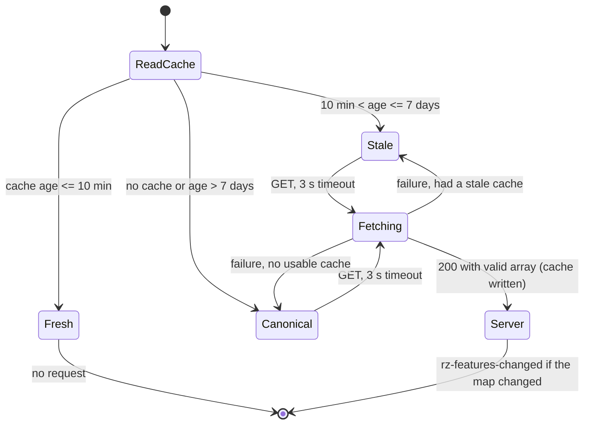
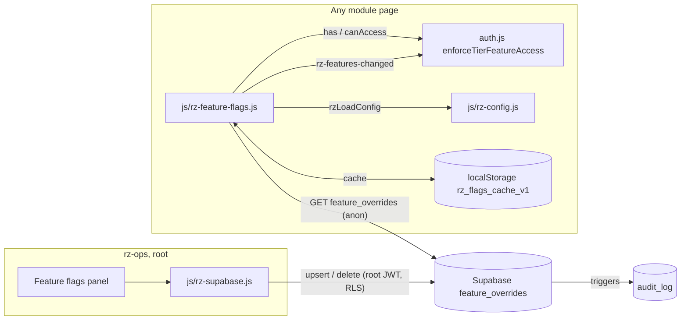
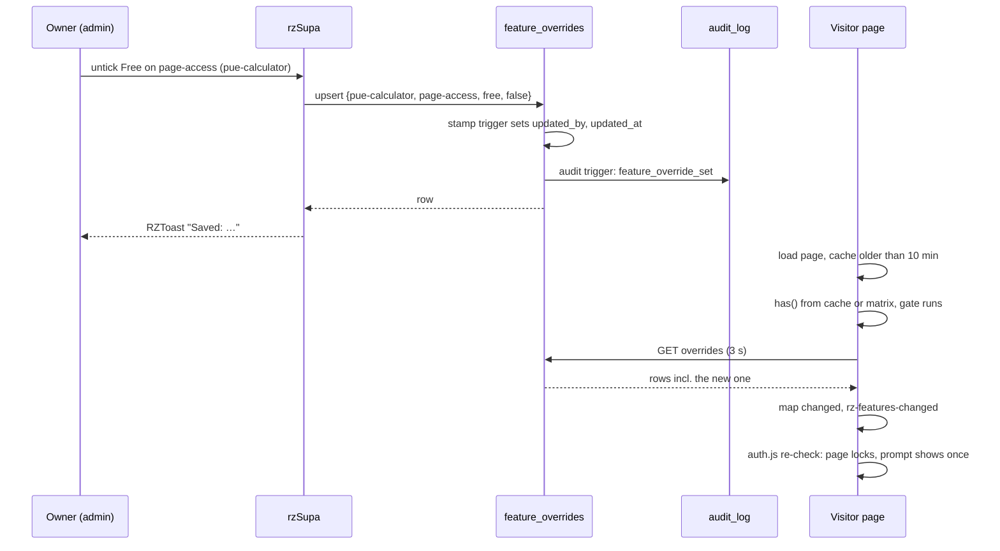

# PRD-Q11 — Server-side feature flags: one override set for every visitor, written only by root, audited

## 1. Document control

| Field | Value |
|---|---|
| PRD id | PRD-Q11 |
| Feature | `js/rz-feature-flags.js` reads per-page overrides from Supabase `feature_overrides` (cached, with a safe fallback to the shipped matrix) instead of the visitor's own localStorage. The admin console writes them there. Only root can write, every write is audited, and the flag keys that pages use match the matrix |
| Version | 1.2 |
| Status | Draft |
| Author | Opus 5.5; Fable quota exhausted |
| Date | 2026-11-11 |
| Owner requests | R110 (a PRD per idea), R111 (24-section structure) |
| Priority | 57.5 (addendum rank 16: I 4, N 2, C 8, E 2, effort 1 week; `documentation/PRODUCT_INNOVATION_ASSESSMENT_2026-11_ADDENDUM.md:91`) |
| Related findings | Q11 (`…_ADDENDUM.md:404-420`). New findings N1–N8 in §3.3 |
| Dependencies | (1) Owner approval: auth boundary (`documentation/product-transformation/STATE.md:52`, `01-improvement-register/REGISTER.md:21`); owner decisions D-Q11-1 to D-Q11-8 (§5.7, written as `DECISIONS.md` rows). (2) Owner action OA-1: the owner runs the SQL (§22.1). (3) PRD-Q10: shares `tools/lib/pg-harness.mjs` and `rzLoadConfig()`. Whichever PRD ships first creates them. PRD-Q10 deletes the fabricated "Per-User Overrides" card (its FR-8), and its Audit log panel shows this PRD's audit actions |
| Related modules | `js/rz-feature-flags.js` (66 HTML files load it at `7335fd257`; L6 computes the count); `auth.js` and its twin `auth.min.js`; `rz-ops-p7x3k9m.html` Feature Flags section; `js/rz-supabase.js`; `supabase/schema.sql` (NEW Module 11); 5 LTC topic pages; `datacenter-solutions.html`; `standarization/FEATURE_FLAGS_STANDARD.md` |
| Target wave | Addendum roadmap: Q11 is not named in a wave row. The main session sets the wave in `04-implementation-plan/` |
| Approval status | PRD approved by owner R110/R111 2026-11-10. Implementation is BLOCKED until D-Q11-1 to D-Q11-8 are decided in `DECISIONS.md` (ACCEPTED or DEFAULTED, each with the request id of the owner message). D-Q11-1, D-Q11-2, D-Q11-3 and D-Q11-8 are the auth boundary (`STATE.md:52`); D-Q11-6 is a feature removal. A law blocks the ship gate only once its precondition holds (§20.3) |
| Facts verified at | `wt-hub3` commit `9e49bfefd` (2026-11-11). Site version `3.35.10` (`js/rz-version.js:2`). Reach re-counted at `7335fd257` (v1.2) |

Change history

| Version | Date | Author | Change |
|---|---|---|---|
| 1.0 | 2026-11-11 | Opus 5.5 | First complete draft, all 24 sections. Every fact re-verified on `9e49bfefd` with the commands quoted in §3 |
| 1.1 | 2026-11-11 | Opus 5.5 | Program conventions applied. Decisions of version 1.0 (local ids 1 to 7) renamed D-Q11-1…D-Q11-7 and written as `DECISIONS.md` rows (coordinator decisions D5, D15); new D-Q11-8 for the `auth.js` listener of FR-3 (auth boundary). Law wiring with report mode before each law's blocking point (D9, §20.3). Owner rule R114 (no paid services or pay-per-use APIs) stated in §5.5 |
| 1.2 | 2026-11-11 | Opus 5.5 | QA batch 3 fixes: cache can only restrict (option b), future `fetchedAt` rejected, L2 forged-cache cases (FR-2, §10.3, §16, O2, L2); L4 module list; reach re-counted at `7335fd257` (66/64); OA-1 pre-check failure path |

## 2. Executive summary

The site gates 42 of its 57 flag pages with a 4-tier matrix in `js/rz-feature-flags.js`. The admin console
has a matrix editor, and it does nothing outside the admin's own browser. Toggles are written to
`localStorage['rz_admin_features_by_page']` (`rz-ops-p7x3k9m.html:3643`), and the module reads the same key
in each visitor's browser (`js/rz-feature-flags.js:526-536`). The admin's change never reaches anyone else.
Any visitor can write that key themselves and unlock a page. The server table `feature_overrides` exists
with root-only write policies (`supabase/schema.sql:359-382`), and its client methods have 0 callers.

The audit also found that the matrix and the pages disagree. Five LTC topic pages ask for keys that are not
in the matrix, so pro and educator users are locked out of pages the matrix says they may open. The
datacenter-solutions hub gates its LTC card without loading the module, so the same users cannot follow that
card. Of 204 matrix cells, the 162 that are not `page-access` have no reader at all, yet the admin shows them
as live toggles.

This PRD wires the read and write paths through Supabase:

1. **Read path.** The module fetches the override rows (one anonymous GET, 3 s timeout) and caches them for
   10 minutes. It keeps a stale copy for up to 7 days. If the server is unreachable and the cache is too
   old, it falls back to the shipped matrix, which is the safe default. It ignores the localStorage key, and
   tells `auth.js` to re-check the page gate when the server answer changes it.
2. **Writes.** The admin writes overrides to the table, deletes rows that equal the default, applies presets
   in one batch, and offers a one-time upload of overrides left in the admin's browser.
3. **SQL hardening.** Keys are validated, root can never lose page access, `updated_by` is forced to the real
   caller, an audit trigger writes `audit_log`, and anonymous readers can no longer see who changed a flag.
4. **Key fixes.** The five LTC keys are renamed to the page names, the hub loads the module, and the admin
   says which flags no page reads.

Flags stay a UX gate: a locked page's HTML is still public, and §16 says so plainly. Eight laws, each red
today, prove the change (§20.2).

## 3. Problem statement

### 3.1 Verified facts (run on `wt-hub3` at `9e49bfefd`, 2026-11-11)

| # | Fact | Evidence | Command |
|---|---|---|---|
| P1 | The module trusts browser-local overrides | `has()` (`js/rz-feature-flags.js:510`) checks the root page-access invariant (`:520`), admits educators on 2 pages (`:525`), then reads `localStorage['rz_admin_features_by_page']` and returns `ov[tier]` when it is a boolean (`:527-540`), before the canonical matrix (`:542-548`). The header documents the key (`:27-30`) | `sed -n 510,545p js/rz-feature-flags.js` |
| P2 | The admin writes only to its own browser | `toggleFeatureFlag` (`rz-ops-p7x3k9m.html:3637-3645`) sets the key and dispatches `rz-features-changed`; `resetFeaturePage` (`:3647`) and `applyFeaturePreset` (`:3658`) do the same; the panel says "Changes persist immediately." (`:1054`) | `grep -n "rz_admin_features_by_page" rz-ops-p7x3k9m.html` → 9 lines |
| P3 | The server table exists and is unused | `feature_overrides` (`supabase/schema.sql:359-368`): `id, page_key, feature_key, tier, enabled, updated_by → profiles, updated_at`, `unique (page_key, feature_key, tier)`; tier check `:370`; RLS "all read" plus root insert, update and delete (`:374-382`); `updated_at` trigger (`:384-387`). `rzSupa.getFeatureOverrides` (`js/rz-supabase.js:446`) and `setFeatureOverride` (`:452`) have 0 callers | `grep -rn "getFeatureOverrides\|setFeatureOverride" --include=*.js --include=*.html . \| grep -v rz-supabase.js` → no match |
| P4 | `updated_by` comes from the client, and anyone can read it | `setFeatureOverride` sends `updated_by: user.id` (`js/rz-supabase.js:458`); no trigger forces it; the "all read" policy (`schema.sql:379`) exposes every column to anon, including the writer's profile UUID | `sed -n 452,462p js/rz-supabase.js` |
| P5 | No validation of keys, and no guard for root access | only the tier is checked (`:370`). Any text is accepted as `page_key`/`feature_key`. `page-access` with `tier='root', enabled=false` is accepted by SQL; only the client invariant (`js/rz-feature-flags.js:520`) prevents a root lock-out | `sed -n 369,371p supabase/schema.sql` |
| P6 | No audit for flag changes | `audit_log` is written only by `log_event` and the profile tier/role trigger (`schema.sql:728-784`) | `grep -n "insert into public.audit_log" supabase/schema.sql` → 3 lines, none for overrides |
| P7 | Five LTC pages ask for keys that do not exist | the pages call `enforceTierFeatureAccess('ltc-uptime-tier-alignment')`, `'ltc-ashrae-thermal-control'`, `'ltc-nfpa-fire-risk'`, `'ltc-iso-energy-governance'` and `'ltc-ansi-tia-topology-readiness'` (each at `:85`). The matrix has `'ltc-ashrae'` (`js/rz-feature-flags.js:317`), `'ltc-uptime'` (`:321`), `'ltc-ansi-tia'` (`:325`), `'ltc-iso-energy'` (`:329`) and `'ltc-nfpa'` (`:333`), each with `page-access {free:false, demo:false, pro:true, root:true}`. `has()` returns `false` when the page key is missing (`:543-544`), so `auth.js` locks the page for every non-root user (`auth.js:1073-1092`). Pro and educator users see "Pro or Educator access required for this module." (`:1095`) although they are pro | scan script in §20.2 L6 (prints the 5 keys) |
| P8 | The hub gates a card without the module | `datacenter-solutions.html:639` calls `enforceTierFeatureAccess('standards-ltc-lab')` on the LTC card click. The page does not load `js/rz-feature-flags.js` (`grep -c` → 0), so `canAccess` is undefined, `allowed` stays false (`auth.js:1073-1082`), navigation is cancelled and pro or educator users get the denial prompt | `grep -c "rz-feature-flags.js" datacenter-solutions.html` → 0 |
| P9 | Only `page-access` is read | the matrix has 57 page keys, 204 cells, 64 distinct feature keys and 42 pages with `page-access`. The only reader is `auth.js:1076-1080`, which asks for `'page-access'`. 0 of the 162 other cells has a literal reader anywhere | `grep -rn "_rzFeatures\.has(\|_rzFeatures\.canAccess(\|RZ_FEATURE_FLAGS\.canAccess(" --include=*.js --include=*.html .` → `auth.js` only |
| P10 | The admin shows a function as a page | the public mirror adds `RZ_FEATURE_FLAGS.canAccess` (`js/rz-feature-flags.js:593-597`), an enumerable function key. `renderFeatures()` lists `Object.keys(schema)` as page tabs (`rz-ops-p7x3k9m.html:3552-3557`), so a tab named `canAccess` appears | `node` evaluation in §20.2 L6 prints `function keys [ 'canAccess' ]` |
| P11 | A duplicate schema in the admin | `RZ_FEATURE_FLAGS_FALLBACK` (`rz-ops-p7x3k9m.html:3527-3542`) is a second, different matrix (snake_case keys, no root column), used when the module is missing (`:3546-3550`) | `sed -n 3527,3550p rz-ops-p7x3k9m.html` |
| P12 | Dead legacy controls | `DEFAULT_FEATURES`/`featureFlags` in localStorage `rz_admin_features` (`:2570`), `toggleFeature`/`toggleExperimental` (`:3683-3684`), and the features report (`:2995-3011`, built from them). The key `rz_admin_features` is read nowhere outside the admin | `grep -rn "rz_admin_features['\"]" --include=*.js --include=*.html .` → `rz-ops-p7x3k9m.html` only |
| P13 | Two presets are duplicates | `all_pro+` equals `pro_only`, and `all_demo+` equals `demo_up` (`:3669-3675`) | `sed -n 3669,3675p rz-ops-p7x3k9m.html` |
| P14 | The standard documents the local mechanism | `standarization/FEATURE_FLAGS_STANDARD.md` §6 "Admin Console Integration" (`:244-286`) specifies the localStorage key; §3 lists "14 pages as of v1.18.0" (`:88`) while the matrix has 57; §7 requires page keys to equal the file name (`:289-294`), which the 5 LTC keys break | `grep -n "^## \|^### " standarization/FEATURE_FLAGS_STANDARD.md` |
| P15 | Reach | At `9e49bfefd`: 59 HTML files load the module (56 root, 3 under `Apps/`); 58 call `enforceTierFeatureAccess` with a literal key, using 14 distinct keys. Re-count at `7335fd257` (v1.2): 66 load it (63 root, 3 under `Apps/`), 64 call it with a literal key using 13 distinct keys; the 7 new `incident-*.html` dossiers gate on `dc-incidents` (51 calls). L6 and O9 compute these counts; no law quotes them. `sw.js` already serves the module network-first (`sw.js:15`) | scan script in §20.2 L6 |

### 3.2 Consequence of leaving it

- **The admin control is fake.** The owner can believe a page is closed or opened when nothing changed for
  anyone else. The addendum's acceptance "a toggle in profile A is seen in profile B" fails.
- **Paying and educator users are locked out** of 5 LTC topic pages and the hub's LTC card, against the
  matrix.
- **Anyone can unlock a page** by writing one localStorage key. The content is in the HTML anyway (§16), so
  the gate is cosmetic for a determined visitor, but it should at least be consistent.
- **No trail.** Nobody can tell who changed access to what, or when.

### 3.3 Addendum corrections and new findings

| # | Addendum statement | What the code says | Effect on this PRD |
|---|---|---|---|
| C1 | "Wire the existing methods" (`…_ADDENDUM.md:410`) | `rzSupa` is an ES module that loads supabase-js from jsDelivr on 10 pages only (`js/rz-supabase.js`). The flag module runs on 66 pages (59 at `9e49bfefd`) as a classic script and cannot call it | The read path is one plain REST GET (FR-2). The admin write path does use `rzSupa`, extended (FR-8) |
| C2 | "RLS must restrict writes to admins" (`:415`) | It already does (`schema.sql:380-382`). The real gaps are no audit, a client-supplied `updated_by`, an anon-readable `updated_by`, no key validation and no root guard (P4–P6) | FR-1 closes them |
| C3 | "Effort 1 week" (`:412`) | The key mismatches (P7, P8), the inert cells (P9) and the migration of local overrides were not in the estimate | 11.5 days (§19) |

New findings: **N1** P7 (5 LTC pages lock out pro and educator users). **N2** P8 (hub card). **N3** P9 (162
inert cells shown as live). **N4** P10 (`canAccess` tab). **N5** P4 (writer UUID readable by anon). **N6**
P5 (no root guard in SQL). **N7** P11 (duplicate schema). **N8** P13 (duplicate presets).

## 4. Objectives and success metrics

| # | Objective | Metric | Today | Target | Method |
|---|---|---|---|---|---|
| O1 | An admin change reaches every visitor | a fresh profile B applies a row written by profile A | no (no request made) | yes, within the cache TTL of 10 min (immediately for a profile without a cache) | L1 |
| O2 | Nothing a visitor writes to localStorage widens their own access | a forged `rz_admin_features_by_page`, or a forged `rz_flags_cache_v1` (any `fetchedAt`, including now or the future) holding a row that grants more than the shipped matrix, changes `has()` from false to true | yes (old key) | no | L2 |
| O3 | Flags fail safe | with the server down and no cache, `has()` equals the shipped matrix; page load is not delayed past 3 s | n/a | yes | L3 |
| O4 | Only root writes, inputs are validated, root keeps access | SQL cases accepted or refused as specified | bad keys accepted; root page-access can be set false; `updated_by` forged | refused, refused, forced | L4 |
| O5 | Every flag change is audited | `audit_log` rows per insert, update and delete | 0 | 1 each | L5 |
| O6 | The keys pages use exist, and the pages that gate load the module | missing keys; enforcing pages without the module; function keys in the schema | 5; 1; 1 | 0; 0; 0 | L6 |
| O7 | The admin edits the server, never localStorage | `localStorage.setItem` calls from the flag panel | 3 call sites (`:3643`, `:3653`, `:3677`) | 0 | L7 |
| O8 | Anonymous readers see only what the module needs | anon can select `updated_by` | yes (by policy `schema.sql:379`) | no | L4, L8 |
| O9 | Cost per visitor | GET requests to `feature_overrides` per browser per 10 minutes on module pages | 0 | ≤ 1 | L3 |

## 5. Scope

### 5.1 In scope

1. NEW SQL "Module 11 — feature overrides: validation, audit, column privileges" (§10.2).
2. `js/rz-feature-flags.js`: fetch, cache, resolution order, event, `source()`, local key ignored,
   `canAccess` mirror made non-enumerable, `RZ_FLAG_CONSUMERS` list, and the five LTC keys renamed to
   their page names.
3. `auth.js` (and `auth.min.js` via `node tools/audit-min-twins.mjs --fix`): re-check the page gate on
   `rz-features-changed`.
4. `datacenter-solutions.html`: load the module (one tag, with its token).
5. `rz-ops-p7x3k9m.html` Feature Flags section on server state: toggles, presets (5), reset, CSV export,
   inert flags read-only, root controls, the migration card for local overrides. Deleted:
   `RZ_FEATURE_FLAGS_FALLBACK`, legacy flat flags, the Experimental card, the features report branch.
6. `js/rz-supabase.js`: `setFeatureOverride` without `updated_by`; NEW `deleteFeatureOverride`,
   `deleteFeatureOverrides`, `setFeatureOverrides`.
7. Gates, docs and the release chain.

### 5.2 Out of scope (non-goals)

- Making page content secret. Locked pages ship their HTML (§16). A secret needs a server, which is not this
  PRD.
- Readers for the 162 inert cells (pdf-export and the rest). Each needs its own product decision; this PRD
  only stops the admin from presenting them as live.
- `public.has_feature()` (`schema.sql:431`) and the `feature_flags` catalog (`:338`): a different model
  (one minimum tier per feature key), 0 callers, unchanged.
- Per-user overrides. No table supports them; PRD-Q10 deletes the fabricated card.
- `auth.js` client-side tier detection (`getTier`, email-prefix rules at `js/rz-feature-flags.js:464`) and
  the client-side educator list `rz_admin_educators` (`auth.js:256-292`). That is an auth follow-up.
- The dormant AUTH_V2 path (`auth.js:138-147`).

### 5.3 Existing capabilities reused

| Capability | Where |
|---|---|
| Override table, unique key, tier check, RLS (all read, root write) | `supabase/schema.sql:359-387` |
| Root check | `public.is_root()` `:102` |
| Audit table and the trigger pattern to copy | `audit_log` `:702-724`; `audit_profile_privilege_change()` `:757-784` |
| `updated_at` trigger | `public.set_updated_at()` `:49-57`, attached at `:384-387` |
| Client methods to extend | `rzSupa.getFeatureOverrides` `:446`, `setFeatureOverride` `:452` (`js/rz-supabase.js`) |
| Resolution helpers | `getTier` `:442`, `getRole` `:479`, `EDUCATOR_ACCESS_PAGES` `:495`, `has` `:510` (`js/rz-feature-flags.js`) |
| Gate enforcement | `enforceTierFeatureAccess` `auth.js:1062-1110` |
| Change event | `rz-features-changed` (`js/rz-feature-flags.js:600-606`; `FEATURE_FLAGS_STANDARD.md` §4 "Event") |
| Network-first service-worker path for the module | `sw.js:15` |
| Min-twin rebuild | `node tools/audit-min-twins.mjs --fix` (gate at `tools/ship-gate.sh:249`) |
| Shared config loader and SQL harness | PRD-Q10 §11.8 `rzLoadConfig()`, PRD-Q10 T-1 `tools/lib/pg-harness.mjs` |
| Toasts | `window.RZToast` (`js/rz-toast.js:239-247`), loaded in the admin by PRD-Q10 FR-15; if Q11 ships first, it adds the tag |

### 5.4 Dependencies

| Dependency | Kind | Status |
|---|---|---|
| Owner decisions D-Q11-1 to D-Q11-8 (`DECISIONS.md`) | blocking | PROPOSED |
| OA-1 SQL Module 11 | blocking for go-live | pending |
| `tools/lib/pg-harness.mjs`, `rzLoadConfig()` | shared with PRD-Q10 | created by whichever ships first |
| PRD-Q10 FR-8 (Per-User Overrides card deleted), FR-15 (RZToast in the admin) | soft | if Q11 ships first, Q11 deletes the card and loads RZToast |

### 5.5 Constraints

- Classic ES5 script on 66 pages (at `7335fd257`); synchronous `has()` must stay synchronous (callers expect a boolean).
- The publishable key in `js/rz-config.js` is public by design; RLS and grants are the boundary.
- Peer-owned files: `cx-calculator.html` loads the module (it is one of the 56 root loaders). Its tag token
  changes when the module changes: coordinate with the peer.
- Owner rule R114 (2026-11-11): no paid service or pay-per-use API. PRD-Q11 adds none. It uses the Supabase
  project the site already runs on (the existing table `feature_overrides`, through the existing REST endpoint),
  adds at most 1 GET per browser per 10 minutes on module pages (O9; D-Q11-4 sets the bound) and no new endpoint,
  function or provider. Whether that project's plan bills usage, and the size of the added traffic, are
  UNKNOWN — measure in task T-11 (V-3 prints the row count and response bytes; the owner reads the plan in the
  Supabase dashboard during OA-1). Local tests use PGlite (`@electric-sql/pglite`, open source) or Docker
  `postgres:16`, and puppeteer; no hosted test service.

### 5.6 Assumptions

- A1. Overrides are few. The table holds only deviations from the matrix (R2), so typical responses are
  small. The real row count is UNKNOWN; it is measured live (V-3).
- A2. A visitor's first page view after a change may show the previous state for up to the cache TTL (10
  minutes); a visitor with no cache sees the canonical state until the GET returns, then the server state.
- A3. Root page access is never something an admin wants to remove (the client invariant already says so,
  `js/rz-feature-flags.js:513-520`).

### 5.7 Owner decisions and owner actions

Owner decisions follow the program format (coordinator decisions D5 and D15): one row per decision in
`documentation/product-transformation/DECISIONS.md`, id `D-Q11-n`, status PROPOSED until an owner message names the
id. The rows below use that file's columns so they can be appended unchanged with `tools/owner_decisions.py`; this
PRD does not edit `DECISIONS.md` itself. D-Q11-1 to D-Q11-7 carry the local ids 1 to 7 of version 1.0 in the same order; D-Q11-8 is new (the
`auth.js` change of FR-3 is an auth-boundary change of its own). No option uses a paid service or a pay-per-use API
(owner rule R114).

| Id | Question | Options | Recommended default | Status | Decided by | Date |
|---|---|---|---|---|---|---|
| D-Q11-1 | PRD-Q11 FR-1, §10.2 (auth boundary, `STATE.md` approval list): SQL Module 11 on `public.feature_overrides`: key CHECKs (`^[a-z0-9][a-z0-9-]{0,63}$`), no row that removes root page access, `updated_by` forced to the caller by a trigger, an audit trigger into `audit_log`, and a column grant so anon and authenticated read only `page_key, feature_key, tier, enabled, updated_at`. Requires owner approval — auth boundary | A approve; the owner runs it (OA-1, §22.1). B decline: PRD-Q11 does not ship; the admin keeps writing its own browser's storage and every visitor keeps their own overrides (P1–P3); no Q11 gate is wired | A | PROPOSED | — | — |
| D-Q11-2 | PRD-Q11 FR-6.1, P7 (auth boundary: who can open 5 pages): the 5 LTC topic pages ask for keys the matrix does not hold, so they lock every non-root visitor although the matrix grants pro and educator | A rename the 5 matrix keys to the page names (`ltc-ashrae` → `ltc-ashrae-thermal-control` and the four others, values unchanged); pro and educator users reach the 5 pages, as the matrix intends. B keep the pages root-only: rename the keys and set `pro: false` on the 5 rows. If REJECTED: unchanged; L6 lists the 5 keys as an accepted exception and L1 drops its pro clause | A (matrix intent) | PROPOSED | — | — |
| D-Q11-3 | PRD-Q11 FR-6.2, P8 (auth boundary: who can follow a gated card): `datacenter-solutions.html:639` gates its LTC card but does not load `js/rz-feature-flags.js`, so pro and educator users get the denial prompt | A load the module on that page (one tag before `auth.js`). B decline: the page stays as it is; L6 lists it as an accepted exception | A | PROPOSED | — | — |
| D-Q11-4 | PRD-Q11 FR-2, A2 (cost of the new read, R114): cache TTL, maximum stale age and request timeout of the module's GET | A TTL 10 minutes, maximum stale age 7 days, timeout 3 s: at most 1 GET per browser per 10 minutes on module pages (O9). B TTL 60 minutes with the same stale age and timeout: one sixth of the requests, and an admin change takes up to an hour to reach a visitor. If REJECTED: FR-2 is not built and PRD-Q11 does not ship | A | PROPOSED | — | — |
| D-Q11-5 | PRD-Q11 FR-4.3, P9: 162 of the 204 matrix cells have no reader on any page | A show them read-only, labelled "No page reads this flag". B show them as live toggles, as today (a toggle then changes nothing a visitor sees). If REJECTED: as B; L7 drops its inert-row assertion | A | PROPOSED | — | — |
| D-Q11-6 | PRD-Q11 FR-4 "Deleted", P12 (feature removal, `STATE.md` approval list): delete the legacy flat flags (`DEFAULT_FEATURES`, `featureFlags`, `toggleFeature`, `toggleExperimental`), the Experimental card, the hidden legacy card and the features report with its Report button. Requires owner approval — feature removal | A delete them. B keep them beside the new panel (they keep writing `rz_admin_features`, which no page reads). If REJECTED: as B; no law changes (L7 tests the new panel's controls only) | A | PROPOSED | — | — |
| D-Q11-7 | PRD-Q11 FR-4.5, P13: two of the 7 presets are duplicates (`all_pro+` equals `pro_only`, `all_demo+` equals `demo_up`) | A keep 5 presets: Everyone, Demo and above, Pro and above, Root only, Off. B keep all 7 under their current names. If REJECTED: as B; L7 counts 7 presets | A | PROPOSED | — | — |
| D-Q11-8 | PRD-Q11 FR-3 (auth boundary, `STATE.md` approval list): `auth.js` and its twin `auth.min.js` gain a listener on `rz-features-changed` that re-evaluates `enforceTierFeatureAccess` for the page's last key, so a server change locks or unlocks the page within the same page view. Requires owner approval — auth boundary | A approve. B decline: the gate is evaluated once per page view; a server change reaches a visitor from the next page view after the GET has filled the cache, and L1 asserts the lock after a reload | A | PROPOSED | — | — |

Implementation starts only when none of the eight rows is PROPOSED (they decide the auth boundary, a feature
removal and the request volume). D-Q11-1 declined or REJECTED, or D-Q11-4 REJECTED, ends PRD-Q11 with no change.

Owner action (not a decision; only the owner can do it): **OA-1**, run SQL Module 11 in the Supabase SQL Editor
with the pre-check and verification of §22.1, after D-Q11-1 is ACCEPTED or DEFAULTED and before the push.

## 6. User personas and use cases

Tiers and roles as the site has them: `profiles.tier` `free | demo | pro | root` (`supabase/schema.sql:84`),
`profiles.role` `user | educator | root` (`:86`). In the browser, the module resolves the tier with
`_rzAuth` when present (`js/rz-feature-flags.js:442-470`); educators consume the `pro` column, and two pages
also admit `role = educator` explicitly (`:495`). Signed-out visitors are `free`.

| Persona | Goal | Permission here | Outcome |
|---|---|---|---|
| V1 Signed-out visitor | open a page | reads overrides anonymously (no identity sent) | sees the page the server state allows |
| V2 Free or demo user | same | same | same, using the `free` or `demo` column |
| V3 Pro user or educator (DC engineers, operators, students, educators) | open pro pages, including the LTC topic pages | same | admitted where the matrix and overrides say pro |
| A1 Owner as admin (`tier = 'root'`) | open or close a page per tier for everyone; see who changed what | writes `feature_overrides`; reads `audit_log` | change visible to new visitors at once, to cached visitors within 10 minutes; audit row written |
| A2 Signed-in non-root on the admin URL | none | reads overrides like anyone; every write refused by RLS | read-only panel with an explanation |
| A3 Visitor who edits localStorage | unlock a page | none | the local key is ignored (the HTML stays public, §16) |

Use cases: UC1 the owner closes a page for `free`; UC2 the owner reopens it (back to default, so the row is
deleted); UC3 the owner applies a preset to a page; UC4 the owner resets a page; UC5 the owner uploads the
old local overrides once; UC6 a visitor in another browser gets the change; UC7 Supabase is down; UC8 a pro
user opens an LTC topic page; UC9 a non-root opens the panel.

## 7. Complete user journey

### J1 Visitor page load (UC6, UC7, UC8)
1. Entry: any of the 66 pages that load the module, for example `ltc-ashrae-thermal-control.html`.
2. The module evaluates at once: it reads `rz_flags_cache_v1`. A fresh cache (< 10 min) is used, with no
   request. A stale cache (≤ 7 days) is used now and a GET starts. With no usable cache, the canonical
   matrix is used now and a GET starts.
3. `auth.js` runs the page gate (`enforceTierFeatureAccess(key)`) with that state: unlocked or locked with
   the prompt.
4. The GET returns within 3 s. The module validates the rows, writes the cache, and, if any resolved
   `page-access` result for this tier changed, dispatches `rz-features-changed`.
5. `auth.js` re-runs the gate for the last key. If the result changed, the page unlocks (lock class removed)
   or locks (prompt shown).
6. Failure: the GET fails or times out. The state from step 2 stays. No console error, no prompt about it.

### J2 Owner closes a page for one tier (UC1)
1. Admin → **Feature flags**. The panel loads the rows with `rzSupa.getFeatureOverrides()`. The status line
   reads "Source: Supabase feature_overrides (n changed). Loaded 14:02:11 WIB."
2. The owner picks a page in the list (or the select at 390 px) and unticks **Free** on `page-access`.
3. The checkbox shows the new state at once and is disabled while saving. The panel calls
   `setFeatureOverride(page, 'page-access', 'free', false)`.
4. Success: the row's state column reads "changed"; RZToast "Saved: {page} · page-access · free off."; the
   trigger writes `audit_log` (`feature_override_set`).
5. Failure: the checkbox reverts, RZToast fault "Not saved: {message}".

### J3 Back to default (UC2)
- Ticking the cell back to the matrix value deletes the row (`deleteFeatureOverride`); "changed" disappears;
  audit `feature_override_delete`.

### J4 Preset (UC3) and reset (UC4)
- Preset: choose one of 5 in the select, press **Apply**, confirm "Apply 'Pro and above' to 4 flags on
  {page}?". The panel computes, per active feature and tier, an upsert (value differs from default) or a
  delete (value equals default), and sends one batch upsert plus one delete filter. Toast "Saved: preset
  'Pro and above' on {page}."
- Reset: **Reset page to defaults**, confirm, `deleteFeatureOverrides(page)`, toast "Saved: {page} is back
  to the defaults."

### J5 Migration of old local overrides (UC5)
- If `rz_admin_features_by_page` in the admin browser holds entries, a card lists them: "This browser holds
  {n} overrides from the old admin. They no longer affect anyone." **Upload to Supabase** writes the ones
  that differ from the default and are valid (skipping root page-access off); **Discard** removes the key.
  Both remove the card. Skipped items are listed with their reason.

### J6 Non-root on the panel (UC9)
- The matrix renders the server state read-only (checkboxes disabled). The status line reads "Read-only:
  sign in with a root account to change flags."

### J7 Supabase down while the owner edits
- Load fails: "Could not load overrides: {message}." plus **Retry**. The matrix is not shown, so the owner
  never edits a state that might not be the server's.

## 8. Functional requirements

### FR-1 SQL Module 11: validation, forced writer, audit, column privileges
- **Description:** append Module 11 (§10.2) to `supabase/schema.sql`. Three CHECKs (page key, feature key,
  root page access never off), a BEFORE trigger that sets `updated_by := auth.uid()` and `updated_at :=
  now()`, an AFTER trigger that writes `audit_log`, and column privileges so that `anon` and `authenticated`
  can select only `page_key, feature_key, tier, enabled, updated_at`, and `anon` cannot write at all.
- **Trigger:** the owner runs the block (OA-1).
- **Preconditions:** Module 1 (`feature_overrides`) and Module 5 (`audit_log`) applied (both live). Existing
  rows must pass the new CHECKs; the pre-check query in §22.1 lists any that would not.
- **Inputs:** none.
- **Processing:** re-runnable DDL in the file's convention (`drop constraint if exists` then `add`,
  `create or replace function`, `drop trigger if exists` then `create trigger`).
- **Outputs:** constraints, two trigger functions, two triggers, grants.
- **State changes:** writes now produce audit rows; `updated_by` can no longer be forged; anon cannot read
  `updated_by` or `id`.
- **Dependencies:** `is_root()` (RLS policies unchanged, `schema.sql:379-382`).
- **Exceptions:** an existing row that violates a CHECK makes `add constraint` fail. The pre-check in §22.1
  finds it first, and the owner deletes it in the admin before running the block.
- **Acceptance:** L4, L5.

### FR-2 Module read path: server overrides, cache, safe fallback
- **Description:** `js/rz-feature-flags.js` resolves `has()` from an in-memory map of server rows and stops
  reading `rz_admin_features_by_page`.
- **Trigger:** module evaluation on every page that loads it; the cross-tab `storage` event for
  `rz_flags_cache_v1`.
- **Preconditions:** none. Works with no network.
- **Inputs:** `localStorage['rz_flags_cache_v1']`; the GET response; `rzLoadConfig()` (PRD-Q10 §11.8).
- **Processing:**
  1. Read the cache `{v:1, fetchedAt, rows}`. Reject it whole if the shape is wrong. Validate each row:
     `page_key` and `feature_key` match `^[a-z0-9][a-z0-9-]{0,63}$`, `tier` is one of the four, `enabled` is
     a boolean, and the row is not `page-access`/`root`/`false`. Drop invalid rows one by one.
  2. Age = `Date.now() - fetchedAt`. If `fetchedAt` is more than 60 s in the future (age < −60,000 ms;
     the 60 s allows clock skew), reject the cache whole. Cache age ≤ 7 days: build the map from it. The
     source is `cache` if the age is ≤ 10 minutes, else `stale-cache`. Older or missing: an empty map,
     source `canonical`.
     **The cache can only restrict (option b of QA batch 3).** A cached row is applied only when its
     `enabled` value is less than or equal to the shipped matrix value for the same page, feature and tier
     (`false` rows, and `true` rows the matrix already grants). A cached row that grants more than the
     shipped matrix (`enabled: true` where the matrix says `false`) is held as pending and is not applied;
     if any pending row exists, the GET of step 3 starts even when the cache is fresh. A granting row
     becomes effective only from the body of a GET made in this page view. If that GET fails, the pending
     rows are never applied, so a forged or stale grant fails closed.
  3. If the source is not `cache`, or step 2 holds pending rows, start one GET (§11.2) with a 3 s abort. On 200 with an array: validate
     the rows, build the new map, write the cache with `fetchedAt = Date.now()`, set the source to `server`,
     and dispatch `rz-features-changed` if the map differs from the previous one. On any failure: keep the
     current map and source, log nothing, show nothing.
  4. `has(page, feature)`: root page-access invariant (`:520`, unchanged) → educator admit (`:525`,
     unchanged) → the map's value for `page/feature/tier` if present (server rows of this page view, or
     restricting cache rows) → canonical (`:542-548`, unchanged).
  5. The `storage` listener (`:600-606`) watches `rz_flags_cache_v1` instead of the old key, rebuilds the
     map from the new cache under the rules of steps 1–2 (restricting rows only; server rows already
     received in this page view are kept) and dispatches `rz-features-changed`.
- **Outputs:** `_rzFeatures.has` and `canAccess` (unchanged signatures); NEW `_rzFeatures.source()` returning
  `{source, fetchedAt, rows}`; NEW `_rzFeatures.refresh()` returning a promise (used by the admin after a
  write).
- **State changes:** `rz_flags_cache_v1` written; nothing else.
- **Dependencies:** FR-1 (the column list), `js/rz-config.js`.
- **Exceptions:** storage blocked: no cache; one GET per page view. Config missing: canonical only.
- **Acceptance:** L1, L2, L3.

### FR-3 `auth.js` re-checks the gate when the flags change
- **Approval:** requires owner approval — auth boundary (D-Q11-8, `STATE.md:52`). If D-Q11-8 is declined, FR-3
  is not built: the gate is evaluated once per page view, and L1 asserts the server state after a reload.
- **Description:** `enforceTierFeatureAccess(pageKey)` (`auth.js:1062`) remembers the last key. A listener on
  `rz-features-changed` re-evaluates it.
- **Processing:** compute `allowed` exactly as `:1073-1082` do. If allowed and the body is `locked`: remove
  `locked` and call `hideModal()` (`:823`) if the modal shows the gate message. If not allowed and the body
  is not `locked`: call `enforceTierFeatureAccess(lastKey)`, which locks and shows the prompt. Otherwise do
  nothing, so no prompt is shown twice. Root is unaffected (`:1065-1071`).
- **Outputs:** the page gate follows the server state within the same page view.
- **Dependencies:** FR-2. `auth.min.js` rebuilt with `node tools/audit-min-twins.mjs --fix` (3 pages load
  the twin).
- **Exceptions:** no `enforceTierFeatureAccess` call on the page: the listener does nothing.
- **Acceptance:** L1 (unlock and lock after the GET), L7 regression of the min twin via
  `node tools/audit-min-twins.mjs --strict`.

### FR-4 Admin Feature Flags panel on server state
- **Description:** rebuild `sec-features` (`rz-ops-p7x3k9m.html:1052-1120`) to read and write
  `feature_overrides`.
- **Trigger:** showing the section; a control (§9.4).
- **Preconditions:** `rzSupa.ready`. Root for writes.
- **Processing:**
  1. Load: `getUser()`, then `getFeatureOverrides()`. Build the row map. Determine root as the Accounts panel
     does (`:3253-3254`, the caller's own profile row) or with `accountSummary()` when PRD-Q10 is live.
  2. Page list: the keys of `window.RZ_FEATURE_FLAGS` (no function keys, FR-6), with a text filter; each
     page with at least one row shows the word "changed".
  3. Matrix: for each feature of the selected page, four checkboxes (free, demo, pro, root). The checked
     state is the row value if a row exists, else the canonical value. Root `page-access` is checked and
     disabled ("Root always keeps page access"). Features not in `RZ_FLAG_CONSUMERS` (FR-7) are disabled
     and labelled "No page reads this flag".
  4. Toggle: if the new value equals the canonical value, `deleteFeatureOverride(page, feature, tier)`;
     else `setFeatureOverride(page, feature, tier, value)`. While saving, the checkbox is disabled. On
     success, reload that page's rows, run `_rzFeatures.refresh()` so the admin tab's own gates follow, and
     toast. On error, revert and toast.
  5. Presets (5, D-Q11-7): "Everyone" (all on), "Demo and above", "Pro and above", "Root only" and "Off" (root
     page access stays on). **Apply** after a confirm. One batch `setFeatureOverrides(rows)` for values
     that differ from the default, then one `deleteFeatureOverrides(page, cells)` for values equal to the
     default. Inert features are skipped.
  6. **Reset page to defaults**: confirm, then `deleteFeatureOverrides(page)`.
  7. **Export CSV**: `page,feature,free,demo,pro,root,changed_tiers,read_by_a_page` for every schema
     cell, resolved from the rows.
  8. Rows for keys that are not in the matrix are listed under "Overrides for keys not in the matrix"
     with a **Delete** button each.
- **Deleted:** `RZ_FEATURE_FLAGS_FALLBACK` (`:3527-3542`) and its use (`:3546-3550`); the legacy flat flags
  (`DEFAULT_FEATURES`, `featureFlags` `:2570`, `toggleFeature`, `toggleExperimental` `:3683-3684`); the
  Experimental card; the hidden legacy card (`#legacyFeatCard`); the features report branch (`:2995-3011`)
  and the panel's Report button (`:1057`).
- **Exceptions:** non-root: read-only (all checkboxes disabled, status line). Load error: the error state
  with Retry, and no matrix.
- **Acceptance:** L7, L8 (design).

### FR-5 One-time migration of the admin browser's local overrides
- **Description:** if `localStorage['rz_admin_features_by_page']` parses to a non-empty object in the admin
  browser, show the migration card (§9.2.3).
- **Processing:** flatten to `(page, feature, tier, value)`. Classify each item: `upload` (valid keys, a
  boolean value that differs from the canonical value, not root page-access off), `same as default`
  (skipped), `invalid` (skipped, reason shown) or `root page access off` (skipped). **Upload to
  Supabase** sends one batch `setFeatureOverrides` of the `upload` items, then removes the local key.
  **Discard** removes the key. Neither touches a visitor's browser.
- **Exceptions:** upload error: the key stays, the error toast shows, and the card stays.
- **Acceptance:** L7 (both buttons).

### FR-6 Keys consistent between pages, matrix and admin
- **Description:**
  1. Rename 5 matrix keys to the page names (D-Q11-2): `ltc-ashrae` → `ltc-ashrae-thermal-control`,
     `ltc-uptime` → `ltc-uptime-tier-alignment`, `ltc-ansi-tia` → `ltc-ansi-tia-topology-readiness`,
     `ltc-iso-energy` → `ltc-iso-energy-governance`, `ltc-nfpa` → `ltc-nfpa-fire-risk`
     (`js/rz-feature-flags.js:317-335`). Values unchanged.
  2. `datacenter-solutions.html` loads `js/rz-feature-flags.js` (tag with its token) before `auth.js` (D-Q11-3).
  3. The public mirror `RZ_FEATURE_FLAGS.canAccess` (`:593-597`) is defined with
     `Object.defineProperty(window.RZ_FEATURE_FLAGS, 'canAccess', {value: fn, enumerable: false})`. The
     fallback call in `auth.js:1077-1078` keeps working, and `Object.keys()` no longer returns it.
- **Exceptions:** a server row under an old key (`ltc-ashrae`) becomes an orphan and is listed under "keys not
  in the matrix" (FR-4 step 8). The pre-check in §22.1 finds such rows before release.
- **Acceptance:** L6.

### FR-7 Honest list of consumed flags
- **Description:** `js/rz-feature-flags.js` exports `window.RZ_FLAG_CONSUMERS = {'page-access': ['auth.js']}`,
  the features that some code reads. The admin uses it (FR-4 step 3).
- **Processing:** the static gate (L6) scans `*.js` and `*.html` for `_rzFeatures.has(`,
  `_rzFeatures.canAccess(` and `RZ_FEATURE_FLAGS.canAccess(`. A literal feature argument must be listed.
  `auth.js` asks for `'page-access'` (`:1076-1080`). A new reader therefore fails the gate until it is
  listed, and a listed feature with no reader also fails.
- **Acceptance:** L6.

### FR-8 `js/rz-supabase.js` changes
- `setFeatureOverride(pageKey, featureKey, tier, enabled)`: stop sending `updated_by` (`:458`). The stamp
  trigger overwrites any client value, so sending it only invites the false belief that the client decides it.
- NEW `setFeatureOverrides(rows)`: one `upsert(rows, {onConflict: 'page_key,feature_key,tier'})`. Rows are
  validated client-side with the same patterns, at most 300 per call.
- NEW `deleteFeatureOverride(pageKey, featureKey, tier)`: `delete()` with three `eq` filters.
- NEW `deleteFeatureOverrides(pageKey, cells?)`: `delete().eq('page_key', pageKey)`, optionally restricted to
  `cells` (`or` filter on feature and tier).
- All return `{data, error}` and never throw. Errors from RLS map to "Not permitted — you must be signed in as
  a root user." (the existing wording, `:282-284`).
- **Acceptance:** L7 (calls and arguments), static contract check in the L6 gate.

### FR-9 Docs
- `standarization/FEATURE_FLAGS_STANDARD.md`: §6 rewritten (server table, cache, TTL, fallback, admin flow,
  audit); §3 registry updated from "14 pages" to the real list (generated by the L6 gate's `--list`); §7
  keeps "key = file name" and records the 5 renames; §4 documents `source()`, `refresh()` and
  `RZ_FLAG_CONSUMERS`.
- `standarization/AUTH_STANDARD.md` §Admin Dashboard (`:233`): the flag panel and its audit actions.
- `supabase/SUPABASE_SCHEMA.md`: Module 11 and its verification queries.
- **Acceptance:** DoD §24.

## 9. UI/UX specification

### 9.1 Placement

Admin nav → Management → **Feature flags** (section id `sec-features`, unchanged). No other page gets UI. A
visitor sees only the effect: an unlocked page or the existing gate prompt.

### 9.2 Layouts

#### 9.2.1 1440 px

```
Feature flags                                                                  [Export CSV]
Per-page access by tier. Changes are stored in Supabase and reach every visitor within 10 minutes.
Source: Supabase feature_overrides (3 changed). Loaded 14:02:11 WIB.                  [Reload]
+-- Pages ------------------+ +-- standards-ltc-lab ---------------------------------------------+
| Filter [               ] | | Preset [Pro and above v] [Apply]          [Reset page to defaults] |
| capex-calculator         | | Feature        Free  Demo  Pro   Root  Default        State      |
| datahall-ai      changed | | page-access    [ ]   [ ]   [x]   [x]*  F N D N P Y R Y            |
| ...57 pages              | | * Root always keeps page access                                   |
| standards-ltc-lab changed| | pdf-export     [ ]   [ ]   [x]   [x]   F N D N P Y R Y  No page    |
|                          | |   (checkboxes disabled)                               reads this |
+--------------------------+ +-------------------------------------------------------------------+
+-- Overrides for keys not in the matrix (shown only when there are any) ----------------------+
| ltc-ashrae / page-access / pro : off                                              [Delete]   |
+-----------------------------------------------------------------------------------------------+
```

The "State" column reads "changed" when any tier of that feature has a row, otherwise it is empty.
"Default" is plain mono text (`F N D N P Y R Y`), as today (`rz-ops-p7x3k9m.html:3627`).

#### 9.2.2 390 px

```
+-- 390 -----------------------------------+
| Feature flags                [Export CSV]|
| Source: Supabase … Loaded 14:02 WIB      |
| Page [standards-ltc-lab           v]     |   (native select replaces the list; 16 px)
| Preset [Pro and above v]  [Apply]        |
| [Reset page to defaults]                 |
| page-access                    changed   |
|   [ ] Free      [ ] Demo                 |
|   [x] Pro       [x] Root (always)        |
| pdf-export          No page reads this   |
|   [ ] Free  [ ] Demo  [x] Pro  [x] Root  |   (disabled)
+------------------------------------------+
```

Each feature is a block with a 2×2 grid of labelled checkboxes, so there is no horizontal scroll. Touch
targets are at least 44 px high.

#### 9.2.3 Migration card (admin browser with old local overrides only)

```
+-- Old local overrides in this browser --------------------------------------------------------+
| This browser holds 6 overrides from the old admin. They no longer affect anyone.               |
| Page                 Feature       Tier   Value   Action                                        |
| pue-calculator       page-access   free   off     will upload                                   |
| datahall-ai          page-access   root   off     skipped: root always keeps page access       |
| tools                advanced_mode pro    on      skipped: not a valid key                      |
| [Upload to Supabase]  [Discard]                                                                |
+-----------------------------------------------------------------------------------------------+
```

### 9.3 Component hierarchy

```html
<div class="section" id="sec-features">
  <header class="ops-head">
    <h1>Feature flags</h1>
    <p class="ops-sub">Per-page access by tier. Changes are stored in Supabase and reach every visitor within 10 minutes.</p>
    <p class="ops-state" id="flagsStatus" role="status"></p>
    <button type="button" class="btn btn-ghost" id="flagsReload">Reload</button>
    <button type="button" class="btn btn-ghost" id="flagsCsv">Export CSV</button>
  </header>
  <section class="ops-card" id="flagsMigrate" hidden data-ops-source="this-browser">…</section>
  <div class="flags-layout">
    <nav class="flags-pages" aria-label="Flag pages">
      <label for="flagsFilter">Filter</label><input id="flagsFilter" type="search">
      <ul id="flagsPageList"><li><button type="button" aria-pressed="true">standards-ltc-lab</button> <span class="flags-changed">changed</span></li></ul>
      <select id="flagsPageSelect" aria-label="Page"></select>   <!-- shown only under 768 px -->
    </nav>
    <section class="ops-card" data-ops-source="feature_overrides" aria-labelledby="flagsPageTitle">
      <h2 id="flagsPageTitle">standards-ltc-lab</h2>
      <div class="flags-tools"><select id="flagsPreset" aria-label="Preset"></select>
        <button type="button" id="flagsApply">Apply</button>
        <button type="button" id="flagsReset">Reset page to defaults</button></div>
      <table class="ops-table flags-matrix"><caption>Access for standards-ltc-lab by tier</caption>…</table>
    </section>
  </div>
  <section class="ops-card" id="flagsOrphans" hidden data-ops-source="feature_overrides">…</section>
</div>
```

Each checkbox has `aria-label="{Tier} access: {feature} on {page}"`. Disabled inert rows carry
`aria-describedby` pointing to the "No page reads this flag" text.

### 9.4 Controls and exact behaviour

| Control | Behaviour | Keyboard |
|---|---|---|
| Filter | filters the page list by substring after 150 ms idle; shows "No page matches." when empty | text input |
| Page button or select | selects the page; the matrix renders from memory (no request) | Enter or Space; native select |
| Tier checkbox | FR-4 step 4; disabled while saving | Space |
| Preset select + Apply | Apply is disabled until a preset is chosen; confirm dialog; FR-4 step 5 | native, Enter |
| Reset page to defaults | disabled when the page has no rows; confirm; FR-4 step 6 | Enter |
| Reload | re-reads the rows | Enter |
| Export CSV | downloads `feature-flags-<YYYYMMDD-HHMM>.csv` | Enter |
| Delete (orphan row) | confirm, then `deleteFeatureOverride` | Enter |
| Upload to Supabase / Discard | FR-5 | Enter |

Every control has a handler and a test in L7. There are no dead buttons.

### 9.5 States

| State | Shown |
|---|---|
| loading | status "Loading overrides…", matrix hidden |
| ready, root | status "Source: Supabase feature_overrides ({n} changed). Loaded {HH:MM:SS} WIB." |
| ready, not root | status "Read-only: sign in with a root account to change flags." All checkboxes and buttons except Reload and Export are disabled |
| signed out | status "Read-only: sign in with a root account to change flags." (rows are public, so the matrix still renders) |
| error | status "Could not load overrides: {message}." with Retry; matrix hidden |
| saving | the one control disabled, `aria-busy="true"` on its row |

### 9.6 Notifications (RZToast)

| Event | Kind | Copy |
|---|---|---|
| toggle saved | ok | "Saved: {page} · {feature} · {tier} {on\|off}." |
| back to default | ok | "Saved: {page} · {feature} · {tier} back to the default." |
| preset | ok | "Saved: preset '{name}' on {page}." |
| reset | ok | "Saved: {page} is back to the defaults." |
| upload | ok | "Uploaded {n} overrides. Skipped {m}." |
| discard | info | "Old local overrides removed from this browser." |
| any write refused | fault | "Not saved: {message}" |

### 9.7 Loading, empty and error copy

- No rows at all: status adds "No page differs from the defaults."
- Selected page has no features (cannot happen with today's matrix): "No flags are defined for this page."
- Error: "Could not load overrides: {message}."

### 9.8 Styling

The panel reuses PRD-Q10's `.ops-*` classes on the admin's `--fs-*` tokens (`css/rz-finance-suite.css:20-75`).
Checkboxes are native inputs at 16 px with `accent-color: var(--fs-acc2)`. The pill-shaped
`.toggle-switch`/`.toggle-slider` markup (`rz-ops-p7x3k9m.html:3615`, styles `:179-184`) is replaced: a state is a word,
and a checkbox is the plain control. "changed" is mono text in `--fs-t3`, not a badge. No gradient, no
`transition: all`, no `:hover` transform, radius ≤ 4 px.

### 9.9 Responsive, keyboard, focus, motion

- 1440 and 390, both themes (`toggleAdminTheme()`, `rz-ops-p7x3k9m.html:2517`). No horizontal scroll at 390.
- Tab order: header controls, page filter, page list, preset, Apply, Reset, matrix row by row.
- After a save, focus stays on the checkbox. After Apply or Reset, focus returns to the button.
- `:focus-visible` outline `2px solid var(--fs-acc2)`.
- Motion: none.

### 9.10 Exact copy strings

All strings above, plus:
- Preset names: "Everyone", "Demo and above", "Pro and above", "Root only", "Off (root keeps page access)".
- Confirm Apply: "Apply '{preset}' to {n} flags on {page}?"
- Confirm Reset: "Reset {page} to the defaults? This deletes {n} overrides."
- Confirm orphan delete: "Delete the override {page} / {feature} / {tier}?"
- Root note: "Root always keeps page access."
- Inert note: "No page reads this flag."
- Migration heading: "Old local overrides in this browser"; body "This browser holds {n} overrides from the
  old admin. They no longer affect anyone."; skip reasons "same as the default", "not a valid key", "root
  always keeps page access".

## 10. Data model

### 10.1 Existing (unchanged columns)

`public.feature_overrides` (`supabase/schema.sql:359-368`): `id uuid pk`, `page_key text`, `feature_key text`,
`tier text` (check `:370`), `enabled boolean`, `updated_by uuid → profiles`, `updated_at timestamptz`,
`unique (page_key, feature_key, tier)`. Indexes `:371-372` (the lookup index duplicates the unique index;
left as is).

### 10.2 Proposed SQL (NEW Module 11)

```sql
-- ===== Module 11 — feature overrides: validation, audit, column privileges =====
-- Keys follow the matrix in js/rz-feature-flags.js (kebab-case); root never loses page access.
alter table public.feature_overrides drop constraint if exists feature_overrides_page_key_chk;
alter table public.feature_overrides add  constraint feature_overrides_page_key_chk
  check (page_key ~ '^[a-z0-9][a-z0-9-]{0,63}$');
alter table public.feature_overrides drop constraint if exists feature_overrides_feature_key_chk;
alter table public.feature_overrides add  constraint feature_overrides_feature_key_chk
  check (feature_key ~ '^[a-z0-9][a-z0-9-]{0,63}$');
alter table public.feature_overrides drop constraint if exists feature_overrides_root_access_chk;
alter table public.feature_overrides add  constraint feature_overrides_root_access_chk
  check (not (feature_key = 'page-access' and tier = 'root' and enabled = false));

-- The writer is the real caller, never a client-supplied value.
create or replace function public.feature_override_stamp()
returns trigger
language plpgsql
set search_path = public
as $$
begin
  new.updated_by := (select auth.uid());
  new.updated_at := now();
  return new;
end;
$$;
drop trigger if exists trg_feature_overrides_stamp on public.feature_overrides;
create trigger trg_feature_overrides_stamp
  before insert or update on public.feature_overrides
  for each row execute function public.feature_override_stamp();

-- Every change leaves an audit row (definer: clients have no insert path to audit_log).
create or replace function public.audit_feature_override_change()
returns trigger
language plpgsql
security definer
set search_path = public
as $$
begin
  if tg_op = 'DELETE' then
    insert into public.audit_log (actor_id, action, target_type, target_id, meta)
    values ((select auth.uid()), 'feature_override_delete', 'feature_override',
            old.page_key || '/' || old.feature_key || '/' || old.tier,
            jsonb_build_object('old', old.enabled));
    return old;
  end if;
  if tg_op = 'UPDATE' and new.enabled is not distinct from old.enabled then
    return new;                                    -- nothing changed, nothing to audit
  end if;
  insert into public.audit_log (actor_id, action, target_type, target_id, meta)
  values ((select auth.uid()), 'feature_override_set', 'feature_override',
          new.page_key || '/' || new.feature_key || '/' || new.tier,
          jsonb_build_object('old', case when tg_op = 'UPDATE' then to_jsonb(old.enabled) else 'null'::jsonb end,
                             'new', new.enabled));
  return new;
end;
$$;
drop trigger if exists trg_feature_overrides_audit on public.feature_overrides;
create trigger trg_feature_overrides_audit
  after insert or update or delete on public.feature_overrides
  for each row execute function public.audit_feature_override_change();

-- Readers get only what the module needs; anon never writes (RLS already refuses; belt and braces).
revoke select on public.feature_overrides from anon, authenticated;
grant  select (page_key, feature_key, tier, enabled, updated_at) on public.feature_overrides to anon, authenticated;
revoke insert, update, delete on public.feature_overrides from anon;
revoke execute on function public.audit_feature_override_change() from public, anon, authenticated;
revoke execute on function public.feature_override_stamp()        from public, anon, authenticated;
```

Trigger functions are not callable as RPCs (they return `trigger`); the revokes keep the grant list tidy.

### 10.3 Client cache (`localStorage['rz_flags_cache_v1']`)

```json
{"v": 1, "fetchedAt": 1762900000000,
 "rows": [{"page_key": "standards-ltc-lab", "feature_key": "page-access", "tier": "free", "enabled": true,
           "updated_at": "2026-11-12T03:41:00Z"}]}
```

| Field | Rule |
|---|---|
| `v` | `1`; another value means the cache is discarded |
| `fetchedAt` | epoch ms of the successful GET; a value more than 60 s in the future discards the cache |
| `rows` | ≤ 5,000 rows, each validated as FR-2 step 1 |

Freshness: ≤ 10 minutes fresh (no request); ≤ 7 days usable while a GET is attempted; older means discarded.

Trust: the cache is written by the visitor's own browser and can be edited by the visitor. It is a hint that
can only restrict access: rows that grant more than the shipped matrix are applied only after a GET in the
same page view returns them (FR-2 step 2). A forged cache can therefore lock the visitor out of their own
view (harmless) but cannot unlock anything.

### 10.4 Retention, audit fields, migration, compatibility

- Rows live until deleted. "Back to default" deletes, so the table holds only deviations (R2).
- Audit: `updated_by` and `updated_at` forced by trigger; `audit_log` rows `feature_override_set` and
  `feature_override_delete` with `target_id = page/feature/tier` and `meta {old, new}`.
- Migration: existing server rows (expected none; the pre-check counts them) must pass the CHECKs.
  Browser-local overrides migrate only through FR-5, in the admin browser.
- Compatibility: `has()`, `canAccess()`, `getTier()`, `listFeatures()` and `listPages()` keep their
  signatures. `listPages()` no longer returns `canAccess`. The event name is unchanged.
- The 5 key renames: no server row uses the old keys today (pre-check), and the pages already use the new
  names.

### 10.5 Example records (illustrative values, not data)

```
feature_overrides (id=…, page_key='pue-calculator', feature_key='page-access', tier='free', enabled=false,
                   updated_by=<root uuid, set by trigger>, updated_at='2026-11-12 03:41:00+00')
audit_log         (actor_id=<root uuid>, action='feature_override_set', target_type='feature_override',
                   target_id='pue-calculator/page-access/free', meta={"old":null,"new":false})
```

## 11. API and integration contracts

### 11.1 Existing (verified)

| Contract | Detail | Source |
|---|---|---|
| Read overrides (admin) | `rzSupa.getFeatureOverrides()` → `select('page_key, feature_key, tier, enabled, updated_at')` | `js/rz-supabase.js:446-450` |
| Write override (admin) | `rzSupa.setFeatureOverride()` → upsert on `page_key,feature_key,tier` | `:452-462` |
| RLS | all read; root insert, update, delete | `schema.sql:379-382` |

### 11.2 Module GET (NEW caller of an existing endpoint)

| Item | Contract |
|---|---|
| Method, path | `GET {SUPABASE_URL}/rest/v1/feature_overrides?select=page_key,feature_key,tier,enabled,updated_at&order=page_key.asc,feature_key.asc,tier.asc&limit=5000` |
| Headers | `apikey` and `Authorization: Bearer <publishable key>` (PRD-Q10 A4); `Accept: application/json` |
| Fetch options | `credentials: 'omit'`, `cache: 'no-store'`, abort after 3,000 ms |
| 200 response | JSON array of rows |
| Errors | any non-200, a non-array body, a timeout or a network error: ignored (FR-2 step 3) |
| Auth | anonymous; RLS "all read" plus the column grant of FR-1 |
| Rate | ≤ 1 request per browser per 10 minutes while the cache is fresh; one per page view when storage is blocked |
| Idempotency, retries | idempotent read; no retry in the same page view |
| Pagination | `limit=5000`. The table can hold at most 204 cells × 4 tiers = 816 rows for matrix keys; orphan rows are bounded by root writes |

### 11.3 Admin writes (supabase-js, root JWT)

| Method | Request | Errors |
|---|---|---|
| `setFeatureOverride(p, f, t, e)` | `POST /rest/v1/feature_overrides?on_conflict=page_key,feature_key,tier` (upsert, `Prefer: resolution=merge-duplicates`) body `{page_key, feature_key, tier, enabled}` | RLS violation (non-root) → "Not permitted — …"; CHECK violation → `friendly()` text |
| `setFeatureOverrides(rows)` | same, array body (≤ 300) | same |
| `deleteFeatureOverride(p, f, t)` | `DELETE /rest/v1/feature_overrides?page_key=eq.p&feature_key=eq.f&tier=eq.t` | RLS: a non-root delete affects 0 rows; the wrapper reports "Not permitted" when 0 rows were expected to change |
| `deleteFeatureOverrides(p, cells?)` | `DELETE …?page_key=eq.p[&or=(…)]` | same |

Timeout: supabase-js default fetch, wrapped by the existing `rzFetch` (`js/rz-supabase.js`, retries only
idempotent requests). Writes are idempotent by key (an upsert of the same value is a no-op and writes no
audit row, §10.2).

### 11.4 JS module API (`js/rz-feature-flags.js`)

| Member | Contract |
|---|---|
| `_rzFeatures.has(page, feature)` | boolean; resolution FR-2 step 4 |
| `_rzFeatures.canAccess(page, feature)` | alias of `has` (unchanged) |
| `_rzFeatures.getTier()`, `listFeatures(page)`, `listPages()` | unchanged; `listPages()` has no function key |
| `_rzFeatures.source()` (NEW) | `{source: 'canonical'\|'cache'\|'stale-cache'\|'server', fetchedAt: number\|null, rows: number}` |
| `_rzFeatures.refresh()` (NEW) | `Promise<boolean>`: true if the map changed; dispatches the event as FR-2 |
| `window.RZ_FLAG_CONSUMERS` (NEW) | `{ [featureKey]: string[] }` (files that read it) |
| Event `rz-features-changed` | on `window`, no detail; fired when the map changes (fetch or another tab) |
| `rzLoadConfig()` | the PRD-Q10 §11.8 function, verbatim (twin check) |

## 12. Business rules and state machines

| # | Rule |
|---|---|
| R1 | Resolution order: root page access always → educators on `datahall-ai` and `dc-conventional` → server override → shipped matrix → false |
| R2 | A server row exists only when it differs from the shipped matrix; setting a cell back to the default deletes the row |
| R3 | Root page access cannot be switched off (CHECK, client invariant, disabled control) |
| R4 | Freshness: fresh ≤ 10 min, usable ≤ 7 days, else the shipped matrix |
| R5 | `rz_admin_features_by_page` never affects resolution; only the admin's migration card reads it |
| R6 | Flags are a UX gate: content on a locked page is in its HTML. Anything that must stay private must not ship in a page |
| R7 | Every insert, changing update and delete is audited by trigger |
| R8 | A feature that no code reads cannot be toggled |
| R9 | A page key used by `enforceTierFeatureAccess` must exist in the matrix, and a page that calls it must load the module |

Flag source, per page view:



Admin cell:

```mermaid
stateDiagram-v2
  [*] --> Default: no row
  [*] --> Overridden: row exists
  Default --> Saving: toggle (value differs from default)
  Overridden --> Saving: toggle back to default (delete)
  Saving --> Overridden: upsert ok
  Saving --> Default: delete ok
  Saving --> Default: error, revert (was default)
  Saving --> Overridden: error, revert (was overridden)
```

## 13. Cross-module integration

| Module | Change | Propagation |
|---|---|---|
| 66 module pages (at `7335fd257`; enumerated by grep, not by the number) | new module code | `?v=` token refresh: `node tools/test-asset-cache-tokens.mjs --fix js/rz-feature-flags.js`; `cx-calculator.html` (peer-owned) needs its token refreshed: coordinate with the peer |
| `auth.js` / `auth.min.js` | FR-3 listener | `node tools/audit-min-twins.mjs --fix`; tokens `--fix auth.js` and `--fix auth.min.js` |
| 5 LTC topic pages | none (their keys become valid) | pro and educator users can open them (D-Q11-2) |
| `datacenter-solutions.html` | one script tag | the LTC card works for pro and educator users (D-Q11-3) |
| `rz-ops-p7x3k9m.html` | panel rebuilt | PRD-Q10 audit panel lists the new actions |
| `sw.js` | none | the module is already network-first (`:15`) |
| `privacy.html` | §1.3 local storage list gains `rz_flags_cache_v1` ("copy of the site's access settings; fewer requests") | coordinate with PRD-Q10's rewrite of the same table |
| Search, sitemap, llms, explain-db, incidents, journal, engine | none | — |
| `standarization/FEATURE_FLAGS_STANDARD.md`, `AUTH_STANDARD.md`, `supabase/SUPABASE_SCHEMA.md` | rewritten sections (FR-9) | same release (R089) |

## 14. AI and automation requirements

No LLM in any path. Resolution, caching and validation are deterministic. The only automation is the static
gate (L6) that rescans consumers and keys on every ship-gate run, and the generated page registry for the
standard (`--list`). Human approval points: D-Q11-1 to D-Q11-8, OA-1, and every confirm dialog in the admin.

## 15. Non-functional requirements

| Area | Requirement | Measurement |
|---|---|---|
| Performance | no added wait before the gate runs (synchronous resolution from memory); one GET ≤ 3 s in the background when the cache is not fresh | L3 timing: `has()` returns before any network activity; `performance.now()` delta |
| Bytes | module today 32,842 bytes; growth measured and reported (UNKNOWN until built) | T-9: `wc -c js/rz-feature-flags.js` before and after |
| Response size | UNKNOWN (row count); measured live | V-3: `curl … \| wc -c` |
| Availability | static pages work with Supabase down (shipped matrix) | L3 |
| Reliability | invalid rows dropped one by one; an invalid cache is discarded whole | L3 |
| Accessibility | panel axe-clean at 1440 and 390 in both themes (planted-line method); native checkboxes with labels | L8 |
| Security | §16 | L4, L5, L8 |
| Maintainability | consumers list and key coverage are gated (R9) | L6 |
| Observability | `_rzFeatures.source()`; audit rows; the admin status line | L1, L5 |
| Data integrity | CHECKs plus unique key; triggers | L4 |

## 16. Security and access control

- **What this is.** A UX gate. `enforceTierFeatureAccess` adds a `locked` class and opens a prompt
  (`auth.js:1084-1108`); the page's HTML is already in the browser. The tier comes from client-side state
  (`js/rz-feature-flags.js:442-470`). Anyone who forges a session can pass any gate. This PRD does not
  change that, and must not be described as access control for secrets (R6).
- **Writes.** RLS root-only (unchanged, `schema.sql:380-382`); anon has no table write privilege (FR-1).
  The writer is forced by trigger (forgery of `updated_by` removed).
- **Reads.** Anonymous by design. Columns limited to what the module needs; the writer's UUID and the row
  id are no longer public (N5).
- **Validation.** Key patterns in SQL and in the client; root page access cannot be switched off.
- **Audit.** Trigger rows for every change (R7), visible to root in the PRD-Q10 Audit log panel.
- **XSS.** Keys are pattern-limited to `[a-z0-9-]`; the admin still renders them with `rzEsc` or
  `textContent`, never into inline `onclick` strings (today's `onclick="selectFeaturePage('…')"`,
  `rz-ops-p7x3k9m.html:3556`, is replaced by `addEventListener`).
- **Abuse.** Anonymous GET is cheap and cached; the table is small. No new anonymous write path.
- **Secrets.** None involved.
- **Approval.** D-Q11-1 to D-Q11-8 (§5.7). D-Q11-1, D-Q11-2, D-Q11-3 and D-Q11-8 are the auth boundary; D-Q11-6 is a feature removal.

| Threat | Today | After |
|---|---|---|
| Visitor unlocks a page with localStorage (`rz_admin_features_by_page`) | works (`:527-540`) | ignored |
| Visitor forges `rz_flags_cache_v1` with a granting row and `fetchedAt` = now or in the future | key does not exist | future `fetchedAt` discards the cache; a granting row waits for a GET of this page view and is never applied from cache (FR-2 step 2) |
| Root writes another root's UUID as `updated_by` | possible (`js/rz-supabase.js:458`) | forced by trigger |
| Anyone reads who changed a flag | yes (all-read policy) | no (column grant) |
| Admin locks root out of a page | blocked only in the client | blocked in SQL too |
| Silent change | no trail | audit row |

## 17. Edge cases and failure scenarios

| # | Case | Behaviour |
|---|---|---|
| E1 | Server down, no cache | shipped matrix; no error shown |
| E2 | Server slow (> 3 s) | abort; state from cache or matrix |
| E3 | Server returns `[]` | empty map; the cache stores `[]` (fresh 10 min) |
| E4 | Server returns an error body (object) | ignored |
| E5 | A row with an unknown tier or a bad key | dropped; the others apply |
| E6 | Cache JSON corrupted | discarded; GET |
| E7 | Storage blocked | no cache; GET on every page view |
| E8 | Two tabs | the tab that fetches writes the cache; the other gets a `storage` event and updates |
| E9 | Override tightens access while a visitor is reading | on that visitor's next fresh fetch the gate locks the page (prompt shown once) |
| E10 | Override loosens access | the page unlocks in place after the fetch; the prompt closes |
| E11 | Visitor's cache predates a change | up to 10 minutes of the old state (A2) |
| E12 | Two admins edit the same cell | last write wins; both writes are audited |
| E13 | Root account with overrides is deleted | `updated_by` references `profiles` without `on delete` (`schema.sql:365`), so the delete fails while that account is the writer of a row; the admin shows the error (PRD-Q10 E17 is the same class) |
| E14 | Batch preset partly fails | one upsert request is atomic in PostgREST (one statement); the delete is a second request: on its failure, the toast says "Saved partly: {message}" and the panel reloads the rows |
| E15 | Old key rows (`ltc-ashrae`) | shown as orphans with Delete |
| E16 | `enforceTierFeatureAccess` called before the module loaded | as today: `canAccess` missing means not allowed; L6 forbids that page shape (R9) |
| E17 | Educator on `datahall-ai` | admitted by the explicit rule before overrides (unchanged order) |
| E18 | Override for `page-access` root `true` | allowed but redundant; the admin never writes it because it equals the default |
| E19 | `cache: 'no-store'` unsupported | the fetch still works; HTTP caching may return an older body within its max-age |

## 18. Technical architecture

### 18.1 Components



### 18.2 Sequence: admin change reaches a visitor



### 18.3 Technology decisions

- Plain REST GET in the module (C1): no supabase-js on the 66 module pages.
- Client-side resolution kept: the matrix already lives in the module; the server stores only deviations.
- Triggers rather than RPC-only writes: the existing RLS and `rzSupa` write path stay, and the audit cannot be
  bypassed by any client that can write.
- localStorage cache rather than the service worker: the SW is registered on `index.html` only today, and the
  peer's P25 changes that; a page-level cache works everywhere.

### 18.4 Deployment

Static release through GitHub Pages (main session push). SQL Module 11 is run by the owner (OA-1) before the
push. Either order works technically: the module selects only granted columns, and Module 11 accepts the old
admin's writes because the stamp trigger overwrites any client `updated_by`. Running the SQL first means the
audit trail is complete from the first admin write made with the new panel.

### 18.5 Alternatives and trade-offs

| Alternative | Why not |
|---|---|
| Server-side resolution with `has_feature()` per check | one RPC per gate check, needs a session for tier, and `has_feature` uses a different model (`feature_flags.min_tier`) |
| Edge Function that serves a merged matrix | new infrastructure for a table that RLS already exposes safely |
| Keep localStorage and sync on admin load | does not reach other browsers |
| Fail closed when the server is unreachable | would lock pro users out during an outage; the shipped matrix is the reviewed default |

## 19. Implementation breakdown

| Task | Description | Depends on | Files | Effort | Verification | DoD |
|---|---|---|---|---|---|---|
| T-1 | SQL Module 11 and `tools/test-feature-overrides-sql.mjs` (L4, L5) on the shared harness (create the harness if PRD-Q10 has not) | — | `supabase/schema.sql`, gate, `tools/lib/pg-harness.mjs` | 1.5 d | L4/L5 red on today's schema, then green | pre-check queries written for OA-1 |
| T-2 | Module read path (FR-2) | T-1 | `js/rz-feature-flags.js` | 1.5 d | L2, L3 | `source()`, `refresh()` |
| T-3 | `auth.js` listener (FR-3), min twin. Requires owner approval — auth boundary (D-Q11-8) | T-2, D-Q11-8 | `auth.js`, `auth.min.js` | 0.5 d | L1 unlock/lock; `node tools/audit-min-twins.mjs --strict` | no double prompt |
| T-4 | Key consistency (FR-6) and consumers list (FR-7) | — | `js/rz-feature-flags.js`, `datacenter-solutions.html` | 1 d | L6 red (5 keys, 1 page, 1 function key), then green | standard §7 respected |
| T-5 | `rzSupa` changes (FR-8) | T-1 | `js/rz-supabase.js` | 0.5 d | L7 call assertions | no `updated_by` sent |
| T-6 | Admin panel rebuild (FR-4) | T-4, T-5 | `rz-ops-p7x3k9m.html` | 2 d | L7 | no localStorage write |
| T-7 | Migration card (FR-5) | T-6 | `rz-ops-p7x3k9m.html` | 0.5 d | L7 upload/discard | skip reasons shown |
| T-8 | `tools/test-feature-flags-server.mjs --browser` (L1, L2, L3, L7) and `--design` (L8) with REST and `rzSupa` stubs | T-2, T-3, T-6 | gate | 2 d | red on today's tree | wired |
| T-9 | `tools/test-feature-flags-server.mjs --static` (L6), `--list` for the standard, byte measurement | T-4 | gate | 0.5 d | red, then green | registry generated |
| T-10 | Docs (FR-9), ship-gate and CLAUDE.md wiring | all | docs | 1 d | `node tools/test-gate-wiring.mjs` | R089 complete |
| T-11 | Release chain and live checks (§22) | T-10, OA-1 | release files | 0.5 d | V-1 to V-4 | outputs in the CHANGELOG |

Total 11.5 days, against the addendum's 1 week (C3).

## 20. Test strategy

### 20.1 Layers

- **Unit:** row validation, cache freshness, resolution order, map diff (module loaded in `node:vm` with
  fake storage; part of `--static`).
- **Integration:** SQL on a real Postgres engine (L4, L5).
- **Contract:** the browser stub's REST rows are produced from the SQL harness's `select` with the granted
  columns, so a column change fails both.
- **E2E / UI:** puppeteer on the served tree with a REST stub (request interception for
  `/rest/v1/feature_overrides`) and a stub `js/rz-supabase.js` for the admin (two browser contexts share
  one in-memory stub store, so profile A's write is profile B's read).
- **Accessibility:** L8. **Security:** L4, L8. **Regression:** full ship-gate, min twins, tokens.
- **Failure recovery:** L3 (timeout, 500, bad JSON, stale cache, no cache).

### 20.2 LAWS (red first)

| Law | Claim | Command | Red on today's tree |
|---|---|---|---|
| L1 | Profile A (admin, stub store) unticks Free on `page-access` for a free page; profile B (fresh context, signed out) opening that page sees it locked after the GET; ticking it back unlocks it in B on reload. A pro session on `ltc-ashrae-thermal-control.html` is not locked | `env RZ_BASE=$LTC_BASE node tools/test-feature-flags-server.mjs --browser --case cross-profile` | the module makes no request, so B never changes; the admin writes localStorage in A only; the LTC page locks the pro session (P7) |
| L2 | A signed-out visitor stays locked on `standards-ltc-lab` in each of four cases: (a) `rz_admin_features_by_page` grants `free` page access; (b) `rz_flags_cache_v1` = `{v:1, fetchedAt: now, rows:[{page_key:'standards-ltc-lab', feature_key:'page-access', tier:'free', enabled:true, …}]}` with the stub server returning no such row; (c) as (b) with `fetchedAt` = now + 1 year; (d) as (b) with the server returning 500. In (b)–(d) `source()` is not `cache` with that row applied, and in (c) the cache is discarded | `… --case local-key` and `… --case forged-cache` | (a) `has()` returns the local value (`js/rz-feature-flags.js:527-540`), so the page unlocks. (b)–(d) are red on the v1.1 design (a fresh cache was trusted with no request and no lower bound on age); the case also runs against a mutation of the module that applies granting cache rows, which must unlock and so fail the law |
| L3 | Fresh profile: exactly 1 GET; fresh cache: 0 GET; server 500 or 3 s timeout with no cache: shipped matrix and no console error; 2-day-old cache with server down: cache values; 8-day-old cache with server down: shipped matrix; one malformed row does not drop the valid ones; `has()` answers before any network activity | `… --case failure` | there is no GET (the first assertion fails), no cache key and no `source()` |
| L4 | On a real Postgres engine with Modules 0–9, plus Module 10 if present (PRD-Q10), plus Module 11: anon insert refused; non-root insert refused (RLS); root insert of a valid row accepted with `updated_by` = root even when the body names another UUID; root insert of `page-access/root/false` refused (CHECK); keys `Bad_Key`, `../x`, `a b` refused; anon `select updated_by` refused; anon `select page_key,…,updated_at` returns rows | `node tools/test-feature-overrides-sql.mjs` | bad keys and root lock-out are accepted, the client UUID is kept, and anon can select `updated_by` (no CHECKs, no trigger, no column grant) |
| L5 | Root insert, update (value change), no-op update and delete produce exactly 1, 1, 0 and 1 `audit_log` rows with the right action, target and meta | `node tools/test-feature-overrides-sql.mjs --case audit` | no trigger: 0 rows for every operation |
| L6 | Every literal `enforceTierFeatureAccess` key exists in the matrix; every HTML file that calls it loads the module; `Object.keys(RZ_FEATURE_FLAGS)` holds no function; `RZ_FEATURE_FLAGS_FALLBACK` is gone; `RZ_FLAG_CONSUMERS` equals the scanned readers; `rzLoadConfig()` text equals PRD-Q10's twin | `node tools/test-feature-flags-server.mjs --static` | 5 missing LTC keys; `datacenter-solutions.html` without the module; `canAccess` function key; fallback present at `rz-ops-p7x3k9m.html:3527`; `RZ_FLAG_CONSUMERS` undefined |
| L7 | In the admin with the stub: a toggle calls `setFeatureOverride` (or `deleteFeatureOverride` when back to default) with the exact arguments and makes 0 `localStorage.setItem` calls; Apply sends one batch; Reset deletes the page; a refused write reverts the checkbox and toasts; inert rows are disabled; non-root is read-only; Upload sends only the valid differing items and removes the key; Discard removes the key; no `canAccess` tab; no `alert()` | `env RZ_BASE=$LTC_BASE node tools/test-feature-flags-server.mjs --browser --case admin` | `toggleFeatureFlag` writes localStorage (`:3643`); `rzSupa` is never called; a `canAccess` tab renders; inert rows are live toggles |
| L8 | The panel passes axe in light and dark at 1440 and 390 (planted line flagged, then 0); no horizontal overflow at 390; no `.toggle-switch` pill; inputs ≥ 16 px at 390. Live (post-deploy, read-only): anon `select=updated_by` refused, anon `select=page_key,…` returns 200, anon POST refused | `… --design` and `… --live` | the panel renders `.toggle-switch` pills (`rz-ops-p7x3k9m.html:3615`); at 390 the 6-column table overflows; live anon `select=updated_by` is allowed by the all-read policy (`schema.sql:379`) |

### 20.3 Gate files and wiring in `tools/ship-gate.sh`

| Gate | Inserted at |
|---|---|
| `node tools/test-feature-flags-server.mjs --static` (L6) | after `:190` (auth surface), next to PRD-Q10's static lines |
| `node tools/test-feature-overrides-sql.mjs` (L4, L5) | after the line above |
| `env RZ_BASE=$LTC_BASE timeout 300 node tools/test-feature-flags-server.mjs --browser --design` (L1, L2, L3, L7, L8) | served-tree block, after `:329-330` (LTC lab step thread) and after PRD-Q10's browser lines, before `:334` |

Lines as they stand in the Q11 release:

```bash
gate "feature flags static — keys exist, gating pages load the module, consumers listed (Q11 L6)" node tools/test-feature-flags-server.mjs --static --strict --blocking L6
gate "feature overrides SQL — root-only writes, CHECKs, forced writer, audit trigger, column grant (Q11 L4, L5)" node tools/test-feature-overrides-sql.mjs --strict --blocking L4,L5
gate "feature flags browser — cross-profile, local key ignored, safe fallback, admin round trip, axe (Q11 L1-L3, L7, L8)" \
  env RZ_BASE=$LTC_BASE timeout 300 node tools/test-feature-flags-server.mjs --browser --design --strict --blocking L1,L2,L3,L7,L8
```

The same lines go into `CLAUDE.md:36` ("Audit before push"); `node tools/test-gate-wiring.mjs` enforces the
match.

Gate CLI (both files): `--strict` runs every law of the chosen mode; `--blocking <ids>` names the laws that can
fail the gate; a law not in that list prints `REPORT <law> PASS|FAIL <reason>` and never changes the exit code
(report mode, coordinator decision D9); `--law <id>` runs one law as blocking (the red-first runs of §20.2);
`--case <name>` as in §20.2. Exit 0 when no blocking law fails, 1 when one does, 2 on a usage error.

Law wiring (D9). Each gate line is added in the commit that creates its gate file, with `--strict` and no
`--blocking` list, so its laws report but cannot fail the gate. A law joins its gate's `--blocking` list only
when every precondition below holds. Implementation starts only after the eight decisions (§5.7), so all eight
laws are expected to block from the Q11 release.

| Law | Blocking from (release · task) | Precondition (all must hold) |
|---|---|---|
| L1 | Q11 release · T-8 | D-Q11-1 ACCEPTED or DEFAULTED; D-Q11-2 and D-Q11-8 not PROPOSED (the pro clause follows D-Q11-2: A not locked, B locked; with D-Q11-8 declined the lock is asserted after a reload); T-2, T-3, T-6 |
| L2 | Q11 release · T-8 | D-Q11-1 ACCEPTED or DEFAULTED; T-2 |
| L3 | Q11 release · T-8 | D-Q11-1 ACCEPTED or DEFAULTED; D-Q11-4 decided A or B (L3 uses the chosen TTL, stale age and timeout); T-2 |
| L4 | Q11 release · T-1 | D-Q11-1 ACCEPTED or DEFAULTED; `tools/lib/pg-harness.mjs` exists (this T-1 or PRD-Q10 T-1). Module 10 is loaded only if `supabase/schema.sql` already holds it; L4 does not require PRD-Q10 to ship first |
| L5 | Q11 release · T-1 | as L4 |
| L6 | Q11 release · T-9 | D-Q11-2 and D-Q11-3 not PROPOSED (a declined option becomes a listed exception); T-4; `rzLoadConfig()` exists (PRD-Q10 or this PRD creates it) |
| L7 | Q11 release · T-8 | D-Q11-1 ACCEPTED or DEFAULTED; D-Q11-5, D-Q11-6 and D-Q11-7 not PROPOSED; T-5, T-6, T-7 |
| L8 | Q11 release · T-8 (design part) | D-Q11-1 ACCEPTED or DEFAULTED; T-6. The live part (`--live`) is not a ship-gate law: it runs after OA-1 and the push as V-2 to V-4 (§22.6) |

If D-Q11-1 is declined or REJECTED, or D-Q11-4 is REJECTED, PRD-Q11 does not ship and none of these lines is added.

## 21. Acceptance criteria

| # | Given | When | Then |
|---|---|---|---|
| AC-1 | a root admin in browser A | they untick Free on `page-access` for a free page | a signed-out visitor in browser B is locked on that page after B's next fetch (L1) |
| AC-2 | the same | the admin ticks it back | the row is deleted and B is unlocked on its next fetch (L1, L7) |
| AC-3 | a visitor who sets `rz_admin_features_by_page` | they open a restricted page | it stays locked (L2) |
| AC-4 | Supabase unreachable and no cache | a page loads | the shipped matrix applies and no error shows (L3) |
| AC-5 | a non-root session | it writes `feature_overrides` | refused (L4) |
| AC-6 | root | it sets `page-access` for root to off | refused by SQL and disabled in the UI (L4, L7) |
| AC-7 | any change | it is saved | one `audit_log` row (L5) |
| AC-8 | a pro user | they open an LTC topic page or the hub's LTC card | admitted (L1, L6) |
| AC-9 | the admin panel | it renders | no `canAccess` tab; inert flags read-only (L7) |
| AC-10 | the old local overrides in the admin browser | the owner presses Upload | valid differing items are on the server and the key is gone (L7) |
| AC-11 | an anonymous client | it selects `updated_by` | refused (L4, L8 live) |

| FR | Tests |
|---|---|
| FR-1 | L4, L5, L8 live |
| FR-2 | L1, L2, L3 |
| FR-3 | L1, min-twin gate |
| FR-4 | L7, L8 |
| FR-5 | L7 |
| FR-6 | L6, L1 (LTC case) |
| FR-7 | L6, L7 (inert rows) |
| FR-8 | L7, L6 static contract |
| FR-9 | DoD; `node tools/test-gate-wiring.mjs` |

## 22. Rollout and migration

### 22.1 Owner action OA-1 (SQL Editor)

1. Pre-check (read-only): `select page_key, feature_key, tier, enabled from public.feature_overrides
   where page_key !~ '^[a-z0-9][a-z0-9-]{0,63}$' or feature_key !~ '^[a-z0-9][a-z0-9-]{0,63}$'
   or (feature_key = 'page-access' and tier = 'root' and enabled = false)
   or page_key in ('ltc-ashrae','ltc-uptime','ltc-ansi-tia','ltc-iso-energy','ltc-nfpa');` and
   `select count(*) from public.feature_overrides;`. Report the rows and the count. Expected: none, because
   no client has ever written the table (P3). If the first query returns any row, do not run Module 11:
   the new CHECKs would fail on the live table and the whole block would roll back. The owner sends the
   rows to the implementing session, which writes a one-off `delete` (keys that fail the pattern, the 5 dead
   LTC keys, and any `page-access/root/false` row) for the owner to run, then repeats step 1 until it
   returns no row.
2. Run Module 11 (§10.2).
3. Verify: `select has_column_privilege('anon','public.feature_overrides','updated_by','select');` → false;
   `select tgname from pg_trigger where tgrelid = 'public.feature_overrides'::regclass and not tgisinternal;`
   → `trg_feature_overrides_updated_at`, `trg_feature_overrides_stamp`, `trg_feature_overrides_audit`.

The board entry in `setup-supabase.html` (Indonesian): title "Jalankan SQL Module 11 — feature overrides
(validasi + audit)"; why "Supaya toggle di admin berlaku untuk semua pengunjung dan setiap perubahan
tercatat."

### 22.2 Sequence

1. The owner decides D-Q11-1 to D-Q11-8 (`DECISIONS.md`, with request ids). 2. T-1 to T-10; laws green locally; full ship-gate green. 3. OA-1. 4. Push
(main session). 5. Live checks (§22.6). 6. The owner opens the panel once: if the migration card shows, they
choose Upload or Discard.

### 22.3 Flags

None. The shipped matrix is the fallback by construction.

### 22.4 Standards docs (R089)

`standarization/FEATURE_FLAGS_STANDARD.md` (§3, §4, §6, §7), `standarization/AUTH_STANDARD.md` §Admin
Dashboard (`:233`), `supabase/SUPABASE_SCHEMA.md` (Module 11, verification), `CLAUDE.md:36`.

### 22.5 Compatibility and rollback

- Reverting the static release restores local-key resolution; server rows then have no reader (harmless).
- Module 11 can stay after a revert. The old admin code still writes: `authenticated` keeps its table-level
  insert and update privileges, the stamp trigger overwrites the `updated_by` it sends, and its
  `.select('page_key, feature_key, tier, enabled')` reads only granted columns. Its writes are then audited
  too.
- The 5 key renames revert with the module.

### 22.6 Monitoring and live validation

| # | Check | Command | Pass |
|---|---|---|---|
| V-1 | new module live | `curl -s https://resistancezero.com/js/rz-feature-flags.js \| grep -c rz_flags_cache_v1` | ≥ 1 |
| V-2 | anon cannot see the writer | `RZ_BASE=https://resistancezero.com node tools/test-feature-flags-server.mjs --live` (reads the key from `js/rz-config.js` at runtime, never prints it): GET `select=updated_by` | 401/403 |
| V-3 | anon read works | same script: GET `select=page_key,feature_key,tier,enabled,updated_at` | 200 and an array; prints row count and bytes for §15 |
| V-4 | anon write refused | same script: POST one row | refused (RLS or privilege) |
| V-5 | pro access on an LTC topic page | same script, headless, with a forged pro mirror session (client-side only, as any visitor could) | the page is not `locked` |
| V-6 | cross-profile live | runs when the first server override exists (no credentials needed): a fresh profile on that page shows the overridden state | matches the row |

Ongoing: the owner sees changes in the Audit log panel (PRD-Q10). The implementer reruns `--live` weekly for
4 weeks (read-only).

### 22.7 Release chain

1. Version in `js/rz-version.js`: the next free version, claimed with the peer.
2. `CHANGELOG.md` entry (what changed for pro users on the LTC pages, the admin, the SQL, live outputs), then
   `python3 tools/build-changelog-html.py --apply`.
3. `python3 tools/sync-sw-version.py`.
4. `node tools/audit-min-twins.mjs --fix`; tokens `--fix js/rz-feature-flags.js`, `--fix auth.js`,
   `--fix auth.min.js`, `--fix js/rz-supabase.js`.
5. Generators: none of the site generators read the flag module. `python3 tools/test-generator-freshness.py`
   stays green.
6. Standards docs (§22.4).
7. `bash tools/ship-gate.sh` green; browser gates under rz-lane.
8. Push by the main session; §22.6 checks with outputs in the CHANGELOG.

## 23. Risks and dependencies

| # | Risk | Likelihood | Impact | Mitigation |
|---|---|---|---|---|
| K1 | Pro users gain 5 LTC pages the owner thought were root-only | medium | product change | D-Q11-2 asks; the alternative (`pro:false`) is one edit |
| K2 | An override tightens a page but a visitor's cache is up to 10 minutes old | certain by design | short delay | A2; TTL owner-tunable (D-Q11-4) |
| K3 | Gate prompt flicker when a fetch changes the state | low | cosmetic | FR-3 acts only when the result changes |
| K4 | Column grant breaks an unknown reader of `select=*` | low | that reader fails | scan: the only readers are the module and `rzSupa`, both with explicit columns |
| K5 | Rollback with Module 11 kept | low | none expected: the old admin's writes still pass (§22.5) | L4 includes a case that sends `updated_by` in the body and expects success with the value overwritten |
| K6 | Peer edits a module-loading page at the same time | medium | token conflict | coordinate; stage by hunk |
| K7 | Harness lacks a feature | medium | L4/L5 cannot run | Docker `postgres:16` fallback (PRD-Q10 T-1) |
| K8 | Owner reads the gate as security | medium | false confidence | R6 is stated in the standard (§22.4) and in this PRD; the panel subtitle says "access by tier", never "security" |
| K9 | Old admin browsers keep local overrides forever | low | none (ignored) | the migration card in the owner's browser; visitors' copies are inert |

## 24. Definition of done

- [ ] D-Q11-1 to D-Q11-8 ACCEPTED or DEFAULTED in `DECISIONS.md` with request ids (or a row's stated path applied); OA-1 done with the pre-check output recorded.
- [ ] L1–L8 red on the pre-change tree (outputs saved), green after; gates wired in `tools/ship-gate.sh` and
      `CLAUDE.md:36` with every law in its gate's `--blocking` list (§20.3); `node tools/test-gate-wiring.mjs` green.
- [ ] The module reads the server, caches, falls back to the shipped matrix, and ignores the local key.
- [ ] `auth.js` and `auth.min.js` re-check the gate on change; min-twin gate green.
- [ ] The admin writes only to Supabase; presets, reset, CSV, orphans and migration work; non-root is
      read-only; inert flags are read-only.
- [ ] Every change writes one audit row; anon cannot read `updated_by`.
- [ ] The 5 LTC keys and the hub card admit pro and educator users as the matrix says.
- [ ] Standards docs updated in the same release; CHANGELOG with live outputs; tokens and SW cache updated.
- [ ] Live V-1 to V-5 pass; V-6 runs when the first real override exists.
- [ ] Rendering is not done: a change made in the admin must change what another browser sees on the live
      site.

## Appendix — Self-score against the brief (12 dimensions, 0–5)

| Dimension | Score | Evidence |
|---|---|---|
| Completeness | 5 | 24 sections; FR-1 to FR-9, laws L1–L8, decisions D-Q11-1 to D-Q11-8 |
| Feasibility | 4 | Reuses the existing table, REST endpoint and admin section; 11.5 d against the addendum's week (§19); the PGlite harness is a spike shared with PRD-Q10, with Docker `postgres:16` as fallback (K7) |
| Functional clarity | 5 | FR processing down to function names and line references (FR-4 steps 1–8, FR-6 renames) |
| User journey | 4 | §7 covers an admin change reaching a visitor, a Pro user on an LTC page, the migration card and the failure paths |
| UI/UX depth | 5 | §9 gives layouts, component hierarchy, states, exact copy and the 390 px behaviour of the panel |
| Data model | 5 | Module 11 SQL (§10.2), cache shape (§10.3), retention and audit fields (§10.4), examples (§10.5) |
| API contracts | 5 | Module GET with its column list (§11.2), supabase-js writes (§11.3), the JS module API (§11.4) |
| Cross-module | 4 | Shared harness, `rzLoadConfig()` and audit panel with PRD-Q10; access words of PRD-X-DEFECTS (§13) |
| Error handling | 4 | §17 edge cases, and L3 asserts timeout, 500, bad JSON, stale and missing cache |
| Security | 4 | Root-only writes, CHECKs, forced writer, audit trigger and column grant; the four auth-boundary decisions are explicit; R114 (§5.5). v1.2: the visitor-written cache can only restrict and a future `fetchedAt` is rejected (FR-2 step 2), proven by L2 (b)–(d). The gate stays a UX gate (§16) |
| Testability | 5 | L1–L8 red today with the reason; SQL laws on a real Postgres engine; a cross-profile browser law; the D9 table (§20.3) |
| Implementation readiness | 4 | T-1 to T-11 with files, effort and verification (§19); the start waits on eight owner decisions and OA-1 |
