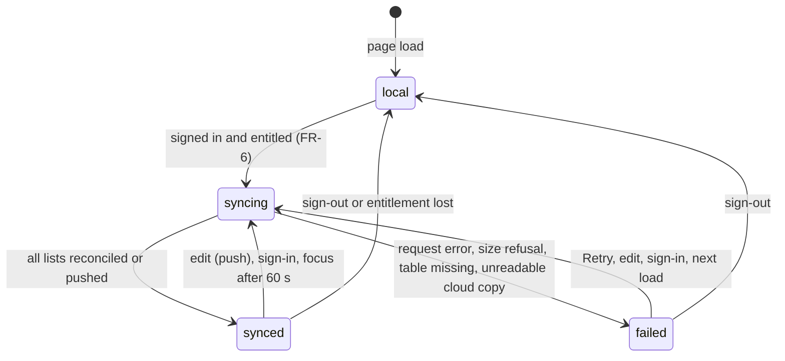
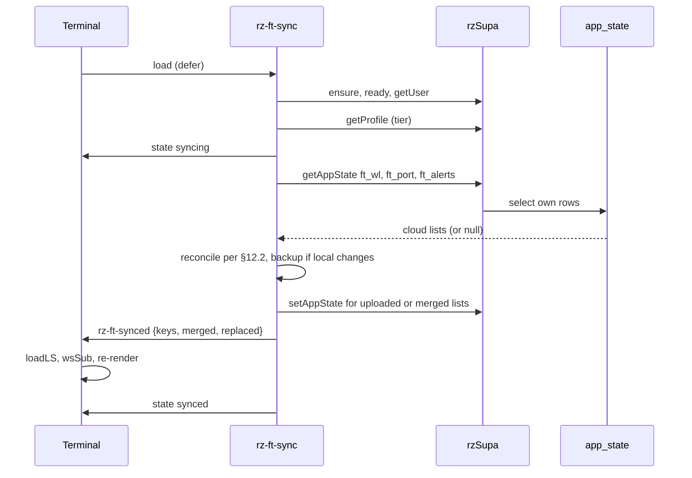

# PRD-Q12 — Finance terminal: watchlist, portfolio and alerts follow the account (option A), or the dead sync path goes (option C)

## 1. Document control

| Field | Value |
|---|---|
| PRD id | PRD-Q12 |
| Feature | The Finance Terminal's watchlist, portfolio and price alerts follow a signed-in account across devices. They are stored in the existing `app_state` table through a repaired `js/rz-ft-sync.js`, with a visible sync state and no silent loss (option A, recommended). If the owner declines sync, the unused module is removed instead (option C, a feature removal) |
| Version | 1.0 |
| Status | Draft |
| Author | Opus 5.5 (Fable quota exhausted) |
| Date | 2026-11-11 |
| Owner requests | R110 (PRD per idea), R111 (24-section structure) |
| Priority | 63.0. Addendum rank 11: I 5, N 3, C 8, E 2, effort 1 week (`documentation/PRODUCT_INNOVATION_ASSESSMENT_2026-11_ADDENDUM.md:86`) |
| Related findings | Q12 (`…_ADDENDUM.md:318-332`); BASELINE §5 row "Finance terminal sync" (`00-audit-baseline/BASELINE.md:60`); X1 (`…_ADDENDUM.md:47`, `BASELINE.md:46`). New findings F1–F13 (§3.1); corrections C1–C4 (§3.3) |
| Dependencies | **Blocking.** X1: the owner rotates the Finnhub key, and PRD-X-DEFECTS removes the hardcoded fallback (REGISTER.md:24, :36; BASELINE.md:76 "Q12 must not start before the key is rotated"). PRD-X-DEFECTS is being written in bundle E; Q12 depends on its X1 item, whatever id it receives. Non-blocking: owner decisions D-1…D-5 (§23) |
| Related modules | `Apps/finance-terminal/index.html` (289 KB, read by grep only), `js/rz-ft-sync.js`, `js/rz-supabase.js`, `js/rz-config.js`, `js/rz-feature-flags.js`, `supabase/schema.sql` (Module 4), `account.html`, new gate `tools/test-ft-sync.mjs`, `tools/ship-gate.sh` |
| Target wave | Addendum roadmap: after X1 ("X1 before Q12, so no feature work is built on an exposed key", `…_ADDENDUM.md:565`) |
| Approval status | Approved by owner R110/R111 2026-11-10 (the PRD set). Register: "removal needs owner approval" (`01-improvement-register/REGISTER.md:19`). Option A starts a new flow of personal data to Supabase, so choosing it in D-1 is the owner's approval of that flow. Option C is a feature removal and needs D-1 as well |

Change history

| Version | Date | Author | Change |
|---|---|---|---|
| 1.0 | 2026-11-11 | Opus 5.5 | First complete draft, 24 sections. Facts verified against `wt-hub3` at `fcaa892df` (branch `hub-r3`). The 289 KB terminal was read with `grep` and `sed` on line ranges only, with long alphanumeric strings masked so that no key value enters this document |

## 2. Executive summary

The Finance Terminal keeps the watchlist, portfolio and price alerts in the browser's `localStorage` only. A user who signs in on a laptop and later opens the terminal on a phone sees empty lists. The account page says so plainly: "stored on this device".

Two cloud paths were built and never connected:
- `js/rz-ft-sync.js` (3,611 B) mirrors the three lists into the generic per-user `app_state` table. No page loads it, and the terminal never calls it. The addendum and baseline say a second-brain page loads it; that page only draws it as a node in a code graph.
- `supabase/schema.sql` also defines purpose-built `watchlists`, `portfolios` and `price_alerts` tables with row-level security, and `js/rz-supabase.js` has twelve methods for them. Nothing calls those either.

Whether the live database has any of these tables is unknown. The schema is run by hand, and no live code path has ever touched them.

This PRD compares the two cloud paths and recommends **option A** (`app_state` plus a repaired `rz-ft-sync.js`):
- The terminal's own data shapes are stored unchanged, so no field is lost in mapping.
- The module and the table already exist with the same row-level security and caps as option B.
- For two of the three lists, option B would also store one blob per list, so it gains nothing there.

Option A still needs real work, because the existing module would lose data. It overwrites local edits on sign-in, never uploads a device's existing lists, swallows every error, and loads its client with a stale cache token.

The PRD adds:
- merge rules
- a dirty flag that survives reloads
- a one-generation backup
- a visible sync state as a word in the terminal header
- a tier rule taken from the existing `portfolio-save` flag
- a gate whose two-device law proves the addendum's acceptance against an in-memory stand-in for Supabase

Q12 does not start before the exposed Finnhub key is rotated and its hardcoded fallback is removed (X1). The terminal also writes that fallback into every visitor's browser storage on load (`:4359`). PRD-X-DEFECTS should clear that copy, and the sync must never carry the key.

If the owner prefers not to sync, **option C** deletes the module and leaves the account page's "stored on this device" true. It drops no table.

## 3. Problem statement

### 3.1 Verified facts (commands run 2026-11-11 on `wt-hub3` at `fcaa892df`; terminal output masked with `sed 's/[A-Za-z0-9_-]\{24,\}/<redacted>/g'`)

| # | Fact | Evidence | Command |
|---|---|---|---|
| F1 | The terminal's storage keys are set in one place: `LS:{KEY:'rz_ft_key',WL:'rz_ft_wl',PORT:'rz_ft_port',THEME:'rz_ft_theme',ALERTS:'rz_ft_alerts'}` (`Apps/finance-terminal/index.html:661`), plus `rz_ft_gw` and `rz_ft_v2` for the gateway (`:677`, `:679`). `saveLS` and `loadLS` (`:1337-1338`) wrap `localStorage` and swallow every error (`catch(e){}`). Init loads the three lists at `:4360-4362` | as cited | `grep -n -o "localStorage\.\(get\|set\|remove\)Item([^)]\{0,60\})"`, masked |
| F2 | The data shapes are:<br>• watchlist: an array of ticker strings (`S.wl.push(sym)`, `:2747`, `:2751`; removal `:2755`)<br>• portfolio: an array of `{tk, price, qty, date}`, where `date` comes from the date input or today's ISO date (`:2790-2797`; removal `:2801`)<br>• alerts: an array of `{sym, dir, price, created, triggered}`, where `dir` is `above` or `below` (`:644`) and `created` is epoch milliseconds (`:3343`). Triggered alerts also carry `triggeredAt` and `curPrice` (`:3363`, `:3388`)<br>• browser notifications: `:4283-4290` | as cited | Python line scan, masked |
| F3 | The terminal loads no account code. Its scripts are `rz-explain-db.js`, `rz-explain.js`, Chart.js 4.4.0, lightweight-charts 4.2.3 and `fin-engine.min.js` (`:11-16`). It has 0 references to `rzFtSync`, `rz-ft-synced`, `rzSupa`, `supabase`, `auth.js` or `_rzAuth`, and 0 access gates (`enforceTierFeatureAccess`, `rootGate`, `locked`). Anyone can open it. It is linked from `account.html:146` and `id/index.html:640`, and embedded in the admin panel (`rz-ops-p7x3k9m.html:2013`) | as cited | `grep -c` on the terminal; `grep -rl 'Apps/finance-terminal' --include=*.html .` |
| F4 | `js/rz-ft-sync.js` (3,611 B) is loaded by no page. The only HTML that names it is `Apps/second brain/codebase-graph.html:118,120`, where it is a node label in a code-graph data blob, not a `<script>`. The module mirrors exactly three keys: `rz_ft_wl` → `ft_wl`, `rz_ft_port` → `ft_port` and `rz_ft_alerts` → `ft_alerts` (`js/rz-ft-sync.js:17`). Its contract asks the terminal to call `rzFtSync.push` from `saveLS` and to reload on `rz-ft-synced` (`:8-11`); the terminal does neither (F3) | as cited | `grep -rln 'rz-ft-sync' --include=*.html --include=*.js .` |
| F5 | The module would lose data if loaded as is:<br>• **D1:** `pull()` writes the cloud copy over `localStorage` whenever one exists (`:58-61`), so local edits made before the pull are lost.<br>• **D2:** when the cloud has no copy, nothing is uploaded until the next local edit.<br>• **D3:** every error is swallowed (`.catch(function () {})`, `:47`, `:60`, `:65`), so the user cannot see a failure.<br>• **D4:** pushes are debounced by 800 ms (`:45-47`) with no flush when the page is hidden, so the last edit before closing may never reach the cloud.<br>• **D5:** it loads `/js/rz-supabase.js?v=2026-07-16` and `/js/rz-config.js?v=2026-07-16` (`:29`, `:35`), while the 9 pages that load the client use `?v=20260920-90bd6417`.<br>• **D6:** it has no tier check (F9) | as cited | `cat js/rz-ft-sync.js` (3.6 KB) |
| F6 | Option A's table, `public.app_state` (`supabase/schema.sql:657-697`), has:<br>• columns `id`, `user_id` (references `auth.users`, on delete cascade), `key`, `state jsonb`, `updated_at`<br>• `unique (user_id, key)` (`:663`)<br>• key length 1–120 (`:667`) and `pg_column_size(state) <= 131072`, 128 KB (`:669`)<br>• RLS enabled (`:671`) with four own-row policies `(select auth.uid()) = user_id` (`:676-679`)<br>• an `updated_at` trigger (`:681-684`) and a cap of 200 keys per user (`:686-697`)<br>Client: `getAppState(key)` returns `{data: state \| null, error}` (`js/rz-supabase.js:394-401`); `setAppState(key, state)` upserts on `(user_id, key)` (`:402-410`). Callers: `js/rz-ft-sync.js` only | as cited | `sed -n 651,697p supabase/schema.sql`; `grep -rln 'setAppState\|getAppState'` |
| F7 | Option B's tables (`supabase/schema.sql`, Module 4 from `:479`):<br>• `watchlists` (`:489`): `name` 1–120, `items jsonb` ≤ 64 KB (`:501`), ≤ 50 rows per user (`:518-529`)<br>• `portfolios` (`:532`): `positions jsonb` ≤ 128 KB (`:545`), `cash numeric`, ≤ 50 rows (`:562-573`)<br>• `price_alerts` (`:576-585`): `symbol` 1–40, `target_price numeric`, `direction` `above`/`below`, `status` `active`/`triggered`/`snoozed`, `created_at`, `triggered_at`, ≤ 200 rows (`:605-616`)<br>All three have RLS with own-row policies (`:508-511`, `:552-555`, `:600-603`). Client: twelve methods at `js/rz-supabase.js:372-384` (list, save, update and delete for each table), with 0 callers | as cited | `sed -n 479,700p supabase/schema.sql \| grep -n …` |
| F8 | The live database state is unknown. `standarization/SUPABASE_INTEGRATION.md:20` and `:72` say the owner runs `supabase/schema.sql` once in the SQL editor. No live page has ever called `app_state` or the Module 4 tables (F6, F7), so nothing shows whether Module 4 was applied. `saved_scenarios` from Module 2 works live (BASELINE §1) | as cited | `grep -rln` callers; BASELINE.md:16 |
| F9 | The tier rule exists but is not enforced here. `RZ_FEATURE_FLAGS['finance-terminal']['portfolio-save']` is `{free:false, demo:false, pro:true, root:true}` (`js/rz-feature-flags.js:271`). Tiers are `free \| demo \| pro \| root` (`:6`). The terminal loads neither the flags file nor `auth.js` (F3), so today every visitor saves locally whatever their tier. The profile tier is readable by the signed-in user through `rzSupa.getProfile()` (`id, email, tier, display_name, created_at`, `js/rz-supabase.js:153-160`) | as cited | `sed -n 265,273p js/rz-feature-flags.js` |
| F10 | X1: init reads the Finnhub key with a hardcoded string literal as fallback (`:4358`) and then writes whatever it holds back to `localStorage` (`:4359`). Every visitor without a key of their own therefore has the fallback stored in their browser under `rz_ft_key`. The user's own key entry writes the same key at `:1382`. The terminal's default data path is the Cloudflare gateway, which holds the key server-side (`:675-679`, V2 on by default) | as cited | `sed -n 4356,4362p`, masked |
| F11 | The account page states the current truth: "Finance Terminal watchlist &amp; portfolio are stored on this device — open the Finance Terminal to manage them." (`account.html:144-146`) | as cited | `sed -n 140,152p account.html` |
| F12 | No gate covers the terminal's storage or sync. `tools/ship-gate.sh` has no finance entry. `tools/probe-finance-terminal.mjs` (tab population) exists and is not wired. A stub pattern for the Supabase client already exists: `tools/_account_probe.mjs:26` replaces `window.rzSupa` in the page | as cited | `grep -n -i 'finance\|supabase' tools/ship-gate.sh` → none |
| F13 | The client's readiness API is `rzSupa.configured` (`js/rz-supabase.js:94`), `rzSupa.ready` (`:488`), the `rz-supa-ready` event (`:489`) and `onChange(cb)` (`:112-118`). Errors pass through `friendly()` (`:81-89`). It returns "Database not set up yet — run supabase/schema.sql …" for a missing table (`:84-85`) and an Indonesian network message beginning "Koneksi ke server" (`:86-87`); any other error passes through as the raw message | as cited | `grep -n 'configured\|ready' js/rz-supabase.js` |

### 3.2 Consequence of leaving it
- A signed-in Pro user's lists exist on one device only, although the flag matrix lists `portfolio-save` as a Pro feature (F9).
- Two dormant data paths (F4, F7) look like a working feature in code review. The baseline and the addendum already misread one of them (C1).
- Loading the module as it is would cost users data (F5 D1).

### 3.3 Corrections to the addendum and baseline

| # | Source says | Verified | Correction |
|---|---|---|---|
| C1 | BASELINE §5: "`rz-ft-sync.js` is loaded only by `Apps/second brain/codebase-graph.html`" (`:60`); addendum: "loads only in a second-brain page" (`:319`) | That page lists the file as a node in graph data (`codebase-graph.html:118,120`); no page loads it (F4) | The module is loaded by no page |
| C2 | Addendum: "One script tag plus auth on the terminal" (`:323`) | The module loses data (F5 D1, D2), hides failures (D3), may drop the last edit (D4), uses stale tokens (D5) and ignores the tier rule (D6). The terminal also needs a hook in `saveLS`, a reload listener and a visible state | Scope in §5; effort ≈ 6.5 days (§19), consistent with the addendum's 1 week |
| C3 | Addendum acceptance: "A watchlist added on device A appears on device B (two browser profiles)" (`:332`) | A live run needs a signed-in Pro account, and the session may not use the owner's credentials | Proved by the gate against an in-memory stand-in for the client (L3). A live run follows if the owner provisions a test account (D-4); otherwise the release states that the live round trip is unverified |
| C4 | Addendum: "Integration points: … Supabase `app_state`" | Correct, but whether `app_state` exists live is unknown (F8) | T-1 confirms it before any release |

## 4. Objectives and success metrics

| # | Objective | Metric | Target | Measurement | Assumption |
|---|---|---|---|---|---|
| O1 | Lists follow the account | Two-device round trip (add on A, see on B; delete on B, gone on A) | Pass (today: fails, nothing syncs) | L3 (stub); live per D-4 | `app_state` exists live (T-1) |
| O2 | No silent loss | Data-loss cases a–e of §12.2 passing | 5 of 5 (today: the module, injected, fails case b) | L4 | — |
| O3 | Key stays on the device | Synced keys outside `{ft_wl, ft_port, ft_alerts}`; payloads containing the API key | 0 / 0 | L2 | — |
| O4 | State is visible | Sync outcomes shown as a word in the header | 4 of 4 states (today 0: no element) | L5, L8 | — |
| O5 | Tier rule honoured | Uploads by free or demo accounts (client side) | 0, with Pro and root syncing (today: no sync for anyone) | L6 | D-2 keeps the flag rule |
| O6 | Users who sync | Signed-in users with `ft_*` rows | UNKNOWN. No analytics exist for the terminal; count rows 30 days after release with a read-only SQL query the owner runs (T-6) | Owner query | — |

## 5. Scope

### 5.1 In scope (option A)
1. **T-1 checks:** the live existence of `app_state` (owner-run read-only SQL), and decisions D-1…D-5.
2. **`js/rz-ft-sync.js` v2:**
   - key allowlist kept
   - merge rules (§12.2)
   - sync metadata with a dirty flag and the last-synced user id
   - one-generation backup
   - initial upload
   - flush when the page is hidden
   - a state event for the header
   - a tier check through `getProfile()` and the flag matrix
   - current cache tokens
3. **Terminal:**
   - load `js/rz-feature-flags.js` and `js/rz-ft-sync.js`
   - one call in `saveLS` (`:1337`)
   - a listener that reloads the three lists and re-renders
   - a status word in `.hdr-right` (`:352-356`)
   - nothing else in the 289 KB file changes
4. **`account.html:144-146` copy,** set by D-2.
5. **Gate `tools/test-ft-sync.mjs`** with an in-memory stand-in for `rzSupa`, and its ship-gate wiring.
6. Standards, changelog, and a live check if D-4 provides an account.

### 5.2 Option C (if D-1 = remove)
Delete `js/rz-ft-sync.js`. Record the removal in `Apps/second brain` (the graph snapshot keeps listing the file until it is regenerated; T-C1 regenerates it if its generator exists, otherwise the CHANGELOG notes the stale node). Keep `account.html` as is. Keep every table and client method (D-3). The gate becomes laws LR1–LR3 (§20.5).

### 5.3 Out of scope

| Item | Why |
|---|---|
| X1 code removal and key rotation | PRD-X-DEFECTS and the owner. Q12 asserts the result as a precondition (L1) |
| Dropping or altering any table | Destructive database operation; needs separate approval. Not needed for A or C |
| Server-side tier enforcement (a policy reading `profiles.tier`) | Changes the auth boundary. The client check (L6) is presentational; RLS already confines every row to its owner |
| Multiple named watchlists or portfolios, cash, alert snoozing | Not terminal features today; option B's columns for them stay unused |
| Sync of theme, gateway settings or the API key | Device settings, not account data; the key must never leave the device (BR-1) |
| Real-time push between open devices | Sync runs on load, on sign-in, after edits and on focus; live channels are new infrastructure |
| Price-alert notifications across devices | Notifications stay per device (`:4283-4290`) |

### 5.4 Existing capabilities reused

| Capability | Where |
|---|---|
| Per-user key/value table with RLS, caps and upsert | `supabase/schema.sql:657-697`; `js/rz-supabase.js:394-410` |
| Lazy client loader in the module | `js/rz-ft-sync.js:22-39` (kept, tokens updated) |
| Supabase client readiness and auth change events | `js/rz-supabase.js:94`, `:112-118`, `:486-489` |
| Profile tier read | `js/rz-supabase.js:153-160` |
| Flag matrix | `js/rz-feature-flags.js:265-273` (`portfolio-save`) |
| Stub technique for `rzSupa` in a headless page | `tools/_account_probe.mjs:26` |
| Terminal save and load seam | `saveLS` and `loadLS` at `:1337-1338` |

### 5.5 Dependencies
- **X1 (blocking):** rotation by the owner, then the code change in PRD-X-DEFECTS.
- **T-1 (blocking for release):** `app_state` exists live.
- The peer session does not own any file touched here. STATE.md still asks for a peer message before and after each push.

### 5.6 Constraints
- The terminal is read and edited only in the named regions. Edits go through `Edit` with exact anchors; no reformatting of the 289 KB file.
- No credential is read, printed or stored by the session. Live checks use only a test account the owner provisions for that purpose (D-4).
- Design rules: a state is a word; one amber accent; no badge or pill; radius ≤ 4 px; no `transition: all`; both themes; 390 and 1440 px.
- ES5 in shared site modules (the module is ES5 today); the client module `rz-supabase.js` stays an ES module.

### 5.7 Assumptions

| # | Assumption | If wrong |
|---|---|---|
| A1 | `app_state` exists live (T-1 confirms) | The owner runs Module 4 of the idempotent `schema.sql`, or Q12 waits. The module shows "Sync failed — saved on this device" with "Database not set up" and never loses local data |
| A2 | The Supabase session is shared across same-origin pages, so a user signed in on the main site is signed in inside `/Apps/finance-terminal/` | The status word says "Saved on this device"; nothing breaks |
| A3 | The three lists stay well under 128 KB. A portfolio row is about 60 bytes, so roughly 2,000 holdings fit; this is an estimate from the JSON shape in F2 | The status shows "Too large to sync" and the device keeps its copy (§17) |

## 6. User personas and use cases

Tiers: `free | demo | pro | root` (`js/rz-feature-flags.js:6`). The terminal itself is public (F3); only sync depends on sign-in and tier.

| Persona | Role | Goal | Outcome |
|---|---|---|---|
| P1 Pro user, two devices | Engineer or investor with a laptop and a phone | Same watchlist, holdings and alerts on both | Lists follow the account; the header shows "Synced" |
| P2 Free or demo user | Signed in on the free tier, or using a demo account | Use the terminal | Lists stay on the device, as today; the header says "Saved on this device" |
| P3 Signed-out visitor | Anyone | Use the terminal | Unchanged behaviour; "Saved on this device" |
| P4 Owner (root) | Uses the terminal inside the admin panel (`rz-ops-p7x3k9m.html:2013`) and on the phone | Same as P1; decides D-1…D-5 | Same as P1 |
| P5 Implementer | Session or agent | Prove the sync without real credentials | A gate with an in-memory client; laws red first |

| UC | Persona | Use case |
|---|---|---|
| UC1 | P1 | Adds NVDA to the watchlist on the laptop; opens the phone; NVDA is there |
| UC2 | P1 | Has a local watchlist from before sign-in; signs in; the lists merge and nothing is lost |
| UC3 | P1 | Edits offline; the push fails; the next visit pushes and shows "Synced" |
| UC4 | P2 | Signs in with a free account; sees "Saved on this device"; nothing is uploaded |
| UC5 | P1 | A second person signs in on the same device; the first user's lists are not merged into the second account |

## 7. Complete user journey

### J1 First sign-in on a device with existing lists (UC2)
1. The user opens the terminal while signed in. The module loads the client (`ensure`), reads `getUser()` and `getProfile()`, and checks the flag for the tier.
2. The header shows "Syncing…". The module reads `ft_wl`, `ft_port` and `ft_alerts`.
3. For each list, the rules of §12.2 apply:
   - no cloud copy: upload local
   - local unchanged since the last sync: take the cloud copy
   - local edited: merge both, after writing a backup
4. The terminal receives `rz-ft-synced`, reloads `S.wl`, `S.port` and `S.alerts` from `localStorage`, subscribes the WebSocket to any new tickers, and re-renders.
5. The header shows "Synced"; its tooltip gives the time.
- Failure: if a request fails, the header shows "Sync failed — saved on this device" with a "Retry" text button. Local data is untouched, and the dirty flags stay set.

### J2 Everyday edit (UC1)
`addToWatchlist` → `saveLS(CFG.LS.WL, S.wl)` → `rzFtSync.push('rz_ft_wl', S.wl)`. The module marks the key dirty, debounces for 800 ms, then upserts and clears the flag: "Syncing…" then "Synced". If the page is hidden before the debounce fires, the module sends at once. If that send cannot finish, the dirty flag persists and the next load pushes (J1, step 3).

### J3 Second device (UC1)
Open on the phone (signed in) → J1 with a clean or empty local copy → cloud lists shown.

### J4 Not entitled or signed out (UC4)
The module reads the tier. If `portfolio-save` is false for it, or nobody is signed in, the module makes no request and the header shows "Saved on this device" (tooltip: "Lists sync across devices when you are signed in with a Pro account.").

### J5 Shared device (UC5)
The metadata records the user id last synced. If another user signs in, the module writes a backup, then replaces the local lists with that user's cloud lists (or empty lists). It never merges one person's lists into another account.

## 8. Functional requirements

**FR-1 Precondition X1**
- Description: no Q12 change ships while the terminal holds a hardcoded key fallback or writes a default key to storage.
- Trigger: every gate run.
- Preconditions: none.
- Inputs: the terminal source.
- Processing: L1 (§20.4), which prints line numbers only.
- Outputs: pass or fail.
- State changes: none.
- Dependencies: PRD-X-DEFECTS (X1).
- Exceptions: none.
- Acceptance: L1.

**FR-2 Key allowlist**
- Description: the module syncs exactly `rz_ft_wl`, `rz_ft_port` and `rz_ft_alerts` (cloud keys `ft_wl`, `ft_port`, `ft_alerts`). `rz_ft_key`, `rz_ft_theme`, `rz_ft_gw` and `rz_ft_v2` never leave the device. Any other key passed to `push` is ignored, and nothing is logged.
- Trigger: `push`.
- Processing: lookup in a frozen map.
- Acceptance: L2.

**FR-3 Sync metadata, backup and merge**
- Description: `localStorage.rz_ft_sync` holds `{v:1, user, keys:{ft_wl:{hash, at, dirty}, …}}`. `localStorage.rz_ft_backup` holds one generation, `{at, user, lists:{ft_wl, ft_port, ft_alerts}}`, written before any change to local lists caused by sync.
- Processing: the rules of §12.2.
  - Hash: FNV-1a 32-bit over `JSON.stringify(value)`. It detects change only and is not a security control.
  - Merge identity: watchlist by ticker; portfolio by `tk|date|price|qty`; alerts by `sym|dir|price|created`.
  - Merge order: cloud entries first, then local-only entries.
  - For alerts present on both sides, `triggered` is true if either is, and `triggeredAt` is the earlier.
- Outputs: local and cloud equal after a successful sync.
- Exceptions: a malformed cloud value (not an array) is not applied. The state becomes "Sync failed", with the reason "Cloud copy unreadable", and local is kept.
- Acceptance: L4.

**FR-4 Push with flush**
- Description: `push(lsKey, value)` marks the key dirty, debounces for 800 ms and upserts. On `visibilitychange` to hidden and on `pagehide` it sends pending keys at once.
- Outputs: a state event for each outcome.
- Exceptions:
  - a failed upsert keeps the key dirty and shows "Sync failed — saved on this device"
  - a size refusal shows the reason "Too large to sync (limit 128 KB per list)"
  - the module maps the client's messages to short English reasons: a message starting "Database not set up" (`js/rz-supabase.js:85`) becomes "Database not set up"; one starting "Koneksi ke server" (`:87`) becomes "Network error"; one naming `app_state_state_chk` becomes "Too large to sync (limit 128 KB per list)"; anything else becomes "Server error"
- Acceptance: L4, L5.

**FR-5 Pull on load, on sign-in and on focus**
- Description: `pull()` runs when the client is ready, on every `onChange(user)` with a user, and on `visibilitychange` to visible if the last pull was more than 60 s ago. It applies §12.2 and dispatches `rz-ft-synced` with `{keys, merged, replaced}`.
- Acceptance: L3, L4.

**FR-6 Tier rule**
- Description: the module calls `getProfile()`. Sync runs only when `RZ_FEATURE_FLAGS['finance-terminal']['portfolio-save'][tier] === true`, with the matrix loaded from `js/rz-feature-flags.js` and no copy in the module. If the profile cannot be read, sync does not run and the state is "Saved on this device".
- Exceptions: the result of D-2 replaces the rule if the owner chooses otherwise.
- Acceptance: L6.

**FR-7 Terminal integration**
- Description:
  - `<script src="../../js/rz-feature-flags.js?v=…" defer>` and `<script src="../../js/rz-ft-sync.js?v=…" defer>` after the existing scripts (`:11-16`).
  - In `saveLS`, after the write: `if(window.rzFtSync)window.rzFtSync.push(key,data)`.
  - A listener `window.addEventListener('rz-ft-synced', …)` that reloads the three lists with `loadLS`, re-subscribes changed tickers (`wsSub` and `wsUnsub`), and calls `renderWatchlist`, `renderPortfolio` and `renderAlerts`.
  - A listener for `rz-ft-sync-state` that writes the status word.
- Exceptions: if the module fails to load, the terminal behaves as today and the status word reads "Saved on this device".
- Acceptance: L2–L5, L8.

**FR-8 Visible state**
- Description: `<span class="hdr-sync" id="syncState" role="status" aria-live="polite">` in `.hdr-right` after `.hdr-status`. Its words are listed in §9.6. It is not a badge. In the failed state it adds `<button type="button" class="hdr-sync-retry">Retry</button>`, which calls `rzFtSync.pull()` and then pushes dirty keys.
- Acceptance: L5, L8.

**FR-9 Cache tokens**
- Description: the module's dynamic loads of `/js/rz-config.js` and `/js/rz-supabase.js` use the same `?v=` tokens as the site's page loaders. The terminal's two new script tags carry tokens that `node tools/test-asset-cache-tokens.mjs` accepts.
- Acceptance: L7.

**FR-10 Account page copy**
- Description: `account.html:144-146` gets the text of §9.6 matching D-2.
- Acceptance: AC-7.

**FR-11 Gate**
- Description: `tools/test-ft-sync.mjs`, laws L1–L8 (§20.4), wired into the ship gate (§20.2). Under option C, laws LR1–LR3 apply instead.
- Acceptance: L1–L8 wired.

### 8.1 FR field matrix

| FR | Trigger | Preconditions | Inputs | Outputs | State change | Dependencies | Exceptions | Acceptance |
|---|---|---|---|---|---|---|---|---|
| FR-1 | Gate | — | Terminal source | Pass/fail | — | X-DEFECTS | — | L1 |
| FR-2 | `push` | — | Key, value | Upsert or ignore | Cloud row | — | Unknown key ignored | L2 |
| FR-3 | `pull`, `push` | Signed in, entitled | Local, cloud | Equal copies | Local, cloud, meta, backup | FR-6 | Unreadable cloud | L4 |
| FR-4 | `push`, hide | Same | Value | Upsert | Cloud, meta | — | Fail, size, table missing | L4, L5 |
| FR-5 | Ready, sign-in, focus | Same | Cloud | Event | Local, meta | — | As FR-4 | L3, L4 |
| FR-6 | Ready | Signed in | Profile tier, flag matrix | Allow or deny | — | Flags file | Profile unreadable | L6 |
| FR-7 | Page load | X1 done | — | Hooks | Terminal file | FR-2…FR-6 | Module load failure | L2–L5, L8 |
| FR-8 | State events | — | State | Word | DOM | — | — | L5, L8 |
| FR-9 | Load | — | Tokens | Current files | — | Token gate | — | L7 |
| FR-10 | Release | D-2 | — | Copy | `account.html` | — | — | AC-7 |
| FR-11 | Ship | — | — | Wiring | `ship-gate.sh` | — | — | all |

## 9. UI/UX specification

### 9.1 Placement
One new element in the terminal header, `.hdr-right` (`:352-356`), after the live-data status. One paragraph changes on `account.html`. No new page, tab, modal or toast.

### 9.2 Layout (ASCII)

1440 px header (existing items unchanged):
```
[RZ Finance Terminal]  … tabs …        Updated 14:02:11   ● Live   Synced   14:02:15   [⚙]
                                                                     └ new: sync state word, muted mono text
```
Failure:
```
… ● Live   Sync failed — saved on this device  Retry   14:02:15 …
```
390 px: `.hdr-right` already wraps (`:320`, `flex-wrap:wrap`). The sync word moves to the next line if needed; it is never hidden.

### 9.3 Component hierarchy
```html
<div class="hdr-right">
  <span class="hdr-updated" id="lastUpdated">…</span>
  <span class="hdr-status"><span class="hdr-dot" id="statusDot"></span><span id="statusText">Live</span></span>
  <span class="hdr-sync" id="syncState" role="status" aria-live="polite" title="…">Saved on this device</span>
  <span class="hdr-time" id="hdrClock">…</span>
  <button class="hdr-btn" …>…</button>
</div>
```
In the failed state: `<span class="hdr-sync" …>Sync failed — saved on this device <button type="button" class="hdr-sync-retry">Retry</button></span>`.

### 9.4 Controls

| Control | Behaviour |
|---|---|
| Retry (failed state only) | Runs `pull()`, then pushes dirty keys. Disabled while syncing. Keyboard: Tab, then Enter or Space |
| Status word | Not interactive. `title` gives the detail: time of the last sync, or the failure reason |

### 9.5 States

| State | Word | Tooltip (`title`) | When |
|---|---|---|---|
| local | Saved on this device | Lists sync across devices when you are signed in with a Pro account. (Text per D-2) | Signed out; not entitled; module or client unavailable |
| syncing | Syncing… | — | Request in flight |
| synced | Synced | Synced to your account at {HH:MM} | Last request succeeded and nothing is dirty |
| failed | Sync failed — saved on this device | {reason}: Database not set up / Network error / Too large to sync (limit 128 KB per list) / Cloud copy unreadable / Server error | Any failure; dirty keys kept |
Empty lists are not a sync state; the terminal's own empty states apply.

### 9.6 Exact copy

| Key | Text |
|---|---|
| local | Saved on this device |
| local tooltip (D-2 = flag rule) | Lists sync across devices when you are signed in with a Pro account. |
| local tooltip (D-2 = all signed-in users) | Lists sync across devices when you are signed in. |
| syncing | Syncing… |
| synced | Synced |
| synced tooltip | Synced to your account at {HH:MM} |
| failed | Sync failed — saved on this device |
| retry button | Retry |
| account page (D-2 = flag rule) | Finance Terminal watchlist, portfolio and price alerts are stored on this device. With a Pro account they also sync to your account when you are signed in. Open the <a href="Apps/finance-terminal/index.html">Finance Terminal</a> to manage them. |
| account page (option C) | unchanged (`account.html:144-146`) |

### 9.7 Styling
- `.hdr-sync { font-family: var(--mono); font-size: .68rem; color: var(--t4); white-space: nowrap; min-width: 9ch; }`. This uses the terminal's existing tokens: `.hdr-updated` uses `--t4` and `--mono` (`:55`).
- In the failed state the word uses the terminal's fault token `--red` (terminal `:18`; the suite file remaps it to `--fs-red` at `css/rz-finance-suite.css:95`, per `standarization/FINANCE_SUITE_STANDARD.md:10`), measured for AA contrast in both themes by L8. No fill, border, pill, radius or glow; `--redbg` is not used.
- `.hdr-sync-retry`: text button, underline on hover and focus, 44 px minimum touch height at 390 px through padding, focus outline on the suite's focus token.

### 9.8 Motion
None. The word changes in place; `min-width` prevents the header from shifting between states.

### 9.9 Accessibility
- `role="status"` and `aria-live="polite"` announce changes without stealing focus.
- Retry is a real `<button>`.
- The failed word is not only a colour change: the text itself says "failed".

## 10. Data model

### 10.1 Cloud (existing table, option A)

| `app_state.key` | `state` (jsonb) | Shape, identical to the terminal's (F2) |
|---|---|---|
| `ft_wl` | array of strings | `["AAPL", "MSFT"]` |
| `ft_port` | array of objects | `[{"tk": "AAPL", "price": 189.5, "qty": 10, "date": "2026-11-01"}]` |
| `ft_alerts` | array of objects | `[{"sym": "NVDA", "dir": "above", "price": 150, "created": 1762800000000, "triggered": false}]` |
(Example values only.) Constraints come from the table: one row per (user, key) (`:663`), ≤ 128 KB per row (`:669`), ≤ 200 keys per user (`:686-697`). Q12 uses 3 keys.

### 10.2 Device (new keys, localStorage)
```json
{"rz_ft_sync": {"v": 1, "user": "<auth user id>",
                "keys": {"ft_wl": {"hash": "9f1c2a7b", "at": "2026-11-12T03:04:05Z", "dirty": false},
                         "ft_port": {"hash": "…", "at": "…", "dirty": true},
                         "ft_alerts": {"hash": "…", "at": "…", "dirty": false}}},
 "rz_ft_backup": {"at": "2026-11-12T03:04:05Z", "user": "<auth user id or empty>",
                  "lists": {"ft_wl": [], "ft_port": [], "ft_alerts": []}}}
```
(Shape only.) `rz_ft_sync.user` is the id of the account the local lists were last synced with. An empty string means the lists were never synced. Both keys are device-only and never synced. The backup holds one generation and is overwritten by the next sync that changes local data.

### 10.3 Option B mapping (for the comparison; not built)

| Terminal field | Option B column | Loss or change |
|---|---|---|
| watchlist array | `watchlists.items` + a required `name` | Needs a conventional name; one row |
| `{tk, price, qty, date}` | `portfolios.positions` + `cash` | `cash` unused; one row |
| `sym` | `price_alerts.symbol` | Rename |
| `price` | `target_price` | Rename |
| `dir` | `direction` | Same values (`above`/`below`, `:591` check) |
| `triggered` (bool) | `status` (`active`/`triggered`/`snoozed`) | Mapping |
| `created` (epoch ms) | `created_at` (timestamptz) | Conversion |
| `triggeredAt` | `triggered_at` | Conversion |
| `curPrice` | — | **Lost**, as no column exists (a new column is a migration) |
| row ids | `id uuid` | The device must store each row id to update or delete |

### 10.4 Migration, compatibility, retention
- No database migration for A or C.
- Existing device data is uploaded on first sign-in (case a) or merged (case b); nothing is converted.
- Retention: rows are deleted with the user (`on delete cascade`, `:659`). The user can empty a list in the terminal, which syncs the empty array.
- Rollback: revert the release; cloud rows stay, unused and harmless. The device keeps its lists.

### 10.5 Option comparison

| Criterion | A: `app_state` + `rz-ft-sync` | B: purpose-built tables | C: remove the dead path |
|---|---|---|---|
| Data shape | Stored as the terminal holds it | Mapped; `curPrice` lost (§10.3) | — |
| Code to write | Fix the existing 3.6 KB module; 4 hooks in the terminal | A new sync layer for 3 tables, id bookkeeping, a one-time migration of local arrays to rows | Delete 1 file |
| Conflict unit | Whole list per key | Whole list for watchlist and portfolio; per alert for alerts | — |
| Requests per edit | 1 upsert (debounced) | 1 update (lists) or 1 insert/delete (alerts) | — |
| Security | RLS own-row, 128 KB, 200 keys (`:671-697`) | RLS own-row, size and row caps (`:501-616`) | — |
| Live table existence | Unknown (T-1) | Unknown (T-1) | Not needed |
| Fits `portfolio-save` flag | Yes (FR-6) | Yes, same rule | Flag stays unused |
| Effort | ≈ 6.5 days (§19) | ≈ 10 days (an estimate for the extra layer and migration; not measured) | ≈ 1.5 days |
| Recommendation | **Recommended if the owner wants sync** | Not recommended | Recommended if the owner does not want sync |

## 11. API and integration contracts

Static site. Supabase is reached only through the existing browser client. There is no new endpoint, table, function or policy.

### 11.1 Existing client contract (verified)

| Member | Contract | Source |
|---|---|---|
| `rzSupa.configured` | Truthy when the client initialised | `js/rz-supabase.js:94` |
| `rzSupa.ready` | Promise resolving to the API | `:488` |
| `rzSupa.getUser()` | `Promise<user \| null>` | `:98-102` |
| `rzSupa.onChange(cb)` | `cb(user \| null)` on auth change; returns unsubscribe | `:112-118` |
| `rzSupa.getProfile()` | `{data: {id, email, tier, display_name, created_at} \| null, error}` | `:153-160` |
| `rzSupa.getAppState(key)` | `{data: state \| null, error}` | `:394-401` |
| `rzSupa.setAppState(key, state)` | `{data: {state, updated_at} \| null, error}`; upsert on `(user_id, key)` | `:402-410` |
| `friendly(error)` | Readable message; missing-table and network cases named, other errors raw | `:81-89` |

### 11.2 Module contract (`js/rz-ft-sync.js` v2; NEW members marked)

| Member | Contract |
|---|---|
| `rzFtSync.push(lsKey, value)` | Existing name. Ignores keys outside the allowlist. Marks dirty, debounces, upserts. Never throws |
| `rzFtSync.pull()` | Existing name. `Promise<boolean>`. Applies §12.2; dispatches `rz-ft-synced` |
| `rzFtSync.ensure()` | Existing. Loads config and client with current tokens |
| `rzFtSync.state()` | NEW. Returns `{state: 'local' \| 'syncing' \| 'synced' \| 'failed', reason?, at?}` |
| `rzFtSync.retry()` | NEW. `pull()`, then push dirty keys |
| Event `rz-ft-synced` | Existing name. NEW detail: `{keys: string[], merged: string[], replaced: string[]}` |
| Event `rz-ft-sync-state` | NEW. Detail as `state()` |

### 11.3 Terminal hooks (the only terminal edits)
1. Script tags after `:16`.
2. `saveLS` (`:1337`): one call after `localStorage.setItem`.
3. A listener block placed after init (`:4356-4366`), reading `loadLS` and calling the existing renderers and `wsSub`/`wsUnsub`.
4. The `#syncState` element in the header (`:352-356`) and its CSS next to `.hdr-updated` (`:55`).

### 11.4 Gate CLI
`node tools/test-ft-sync.mjs [--law L1…L8] [--strict] [--option A|C]`. It serves the worktree on a free port (never a fixed port shared with other sessions, per project memory). It injects an in-memory stand-in for `window.rzSupa` before page scripts run (`Object.defineProperty`, as `tools/_account_probe.mjs:26` does) and records every call. It makes no network request outside the local server; the market-data gateway is stubbed to empty responses.

## 12. Business rules and state machines

### 12.1 Rules
- BR-1: The API key, theme and gateway settings never leave the device.
- BR-2: No sync step deletes or overwrites a local list without first writing the backup.
- BR-3: One person's lists are never merged into another person's account (J5).
- BR-4: Failures are visible. A dirty list stays marked until a push succeeds.
- BR-5: Entitlement follows `portfolio-save` (or D-2). The check is presentational; RLS is the boundary.
- BR-6: Sync never runs before X1 is closed (FR-1).

### 12.2 Reconciliation per list (on pull)

| Case | Condition | Action | Backup | Result state |
|---|---|---|---|---|
| a | Cloud has no row; local non-empty | Upload local | No | synced |
| b | Cloud row; local dirty (edited since last sync); `meta.user` is this user or empty | Merge (identity and order per FR-3); write local and cloud | Yes | synced, `merged` lists the key |
| c | Cloud row; local clean (hash equals last synced) or empty | Replace local with cloud | Yes, if local differs | synced, `replaced` lists the key |
| d | Push or pull fails | Keep local; keep dirty | No | failed, with reason |
| e | Cloud row; `meta.user` is another user | Replace local with cloud (or empty) | Yes | synced |
| — | Equal hashes | Nothing | No | synced |

Accepted limit of case b: an item deleted on another device while this device had unsynced edits returns through the union. The user sees it and deletes it again; this is stated in §17.

### 12.3 State machine (header word)


## 13. Cross-module integration

| Module | Effect | Propagation |
|---|---|---|
| `Apps/finance-terminal/index.html` | 4 hooks (§11.3) | Token gate; L2–L5, L8; `tools/probe-finance-terminal.mjs` still runs |
| `js/rz-ft-sync.js` | v2 | Cache token bumped on the terminal |
| `js/rz-supabase.js`, `js/rz-config.js` | Loaded by the module on the terminal; unchanged | Tokens equal to the site's (L7) |
| `js/rz-feature-flags.js` | Loaded by the terminal (32,842 B, no DOM access) | Matrix is the single source of the tier rule |
| `account.html` | Copy per D-2 | AC-7 |
| `rz-ops-p7x3k9m.html` (iframe at `:2013`) | Same-origin; sync runs inside the admin panel too | None |
| `Apps/second brain/codebase-graph.html` | Unchanged under A. Under C, lists a deleted file until regenerated | CHANGELOG note under C |
| PRD-X-DEFECTS (X1) | Precondition; should also clear the `rz_ft_key` copy written by `:4359` | L1; cross-PRD review |
| PRD-Q10 / Q11 (admin, accounts) | No change; `app_state` rows are per user and not shown in admin views | None |
| Service worker | The terminal's caching is unchanged; the module is a normal static asset with a token | Token gate |

## 14. AI and automation requirements
None at run time. The sync is deterministic code. The gate is deterministic, with an in-memory client stand-in and no model. Human approval points: D-1…D-5, and the owner's read-only SQL in T-1.

## 15. Non-functional requirements

| Area | Requirement | Measurement |
|---|---|---|
| Performance | Extra download on the terminal: `rz-ft-sync.js` (≤ 8 KB after v2) and `rz-feature-flags.js` (32,842 B). The Supabase client loads only when sync can run | `wc -c`; network log in L8 shows no client fetch for a signed-out visitor |
| Requests | Pull: at most 3 reads plus 1 profile read per load. Push: 1 upsert per changed list, after an 800 ms debounce | Stub call log in L3 |
| Payload | ≤ 128 KB per list (table check); estimate in A3 | L4 size case |
| Availability | Offline or database down: the terminal works locally; the state says so | L4 case d |
| Reliability | Dirty flag survives reloads; backup before any change caused by sync | L4 |
| Accessibility | `role="status"`, a real button, AA contrast in both themes | L8 |
| Security | §16 | L1, L2 |
| Maintainability | Module ≤ 300 lines ES5; terminal diff ≤ 40 lines | Review |
| Observability | `rzFtSync.state()`; `console.warn` once per failure with the reason (no data, no key) | L5 |

## 16. Security and access control
- **Authentication:** the existing Supabase session; the terminal adds no login UI.
- **Authorisation:** RLS own-row policies on `app_state` (`:676-679`). The client also filters by `user_id` (`js/rz-supabase.js:399`). Tier gating is presentational (BR-5).
- **Secrets:** the Finnhub key never syncs (FR-2, L2). X1 must be closed first (FR-1). The gate and this PRD print no key value; the gate's L1 reports line numbers only. PRD-X-DEFECTS should remove the stored copy that `:4359` wrote into visitors' browsers. Q12 adds no secret.
- **Input validation:**
  - a cloud value that is not an array, or whose elements do not match the shapes of F2 (types checked per field), is rejected and the state becomes "Cloud copy unreadable"
  - tickers are upper-case strings of 1–40 characters (the same limit as option B's symbol check, `:589`)
  - numbers must be finite
- **Injection:** the terminal's renderers already insert these fields. T-4 checks that the watchlist, portfolio and alert renderers escape ticker text before inserting it. If any uses `innerHTML` with raw text, the escape is added in the same change. The stand-in seeds a ticker `` to prove it (L4 case f).
- **Privacy:** lists are personal finance data, stored under the user's id only and deleted with the account (cascade). The account page states what syncs (FR-10).
- **Audit:** `updated_at` on each row (`:681-684`). No audit-log event; holdings are not logged.

## 17. Edge cases and failure scenarios

| Case | Behaviour |
|---|---|
| `app_state` missing live | "Sync failed — saved on this device" with "Database not set up"; local kept; T-1 prevents a release in this state |
| Signed in on the main site, then the session expires | `getUser()` returns null; state local; dirty flags kept for the next sign-in |
| Two devices edit the same list before syncing | The second device's pull merges (case b); union semantics |
| Item deleted on A while B holds unsynced edits | The item returns via the union on B (accepted limit, §12.2) |
| List over 128 KB | Push refused; "Too large to sync (limit 128 KB per list)"; local kept, dirty |
| Malformed cloud value | Rejected; local kept; "Cloud copy unreadable" |
| Shared device, user changes | Case e; the previous user's lists are backed up, not merged |
| Free user upgrades to Pro | Next load: entitled; case a uploads local |
| Pro user downgrades | Sync stops; lists stay on devices and in the cloud row; no deletion |
| `localStorage` full or blocked | `saveLS` already swallows it (F1); the module surfaces "failed" if its own metadata cannot be written |
| Private browsing | Works per session; nothing persists after the window closes, as today |
| Gateway or Finnhub down | Unrelated to sync; market panels behave as today |
| Module fails to load | Terminal as today; word "Saved on this device" |
| Option C chosen | No module; account page unchanged; any `app_state` rows that might exist stay untouched (there are none from this feature) |

## 18. Technical architecture

```mermaid
flowchart LR
  subgraph Device
    T[Finance Terminal\nsaveLS / loadLS] -- push(key, value) --> M[rz-ft-sync.js v2]
    M -- rz-ft-synced / rz-ft-sync-state --> T
    M <--> L[(localStorage\nrz_ft_wl / rz_ft_port / rz_ft_alerts\nrz_ft_sync, rz_ft_backup)]
    F[rz-feature-flags.js\nportfolio-save matrix] --> M
  end
  M -- ensure() --> C[rz-config.js + rz-supabase.js\n(rzSupa)]
  C -- getProfile / getAppState / setAppState --> S[(Supabase\napp_state, RLS own-row)]
  K[rz_ft_key, theme, gw] -. never synced .-> X((device only))
```

Sequence, first sign-in with local lists:


Alternatives: see §10.5. Option B was rejected for the lossy mapping and the extra layer. A server-side merge function was rejected: it adds a database function, which is new infrastructure, for a single-user, low-conflict list. Real-time channels were rejected as new infrastructure (§5.3).

## 19. Implementation breakdown

| T | Description | Depends | Files | Approach | Effort | Verification | DoD |
|---|---|---|---|---|---|---|---|
| T-0 | Wait for X1: the owner rotates the key; PRD-X-DEFECTS removes the fallback | — | — | — | — | L1 green | X1 closed |
| T-1 | Owner packet D-1…D-5, plus the read-only SQL for the owner: `select to_regclass('public.app_state'), to_regclass('public.watchlists'), to_regclass('public.portfolios'), to_regclass('public.price_alerts');` | — | message | §23 | 0.5 d | Owner's answers and the query result recorded | A1 confirmed or Module 4 applied by the owner |
| T-2 | Gate with in-memory client stand-in; L1–L8 red | — | `tools/test-ft-sync.mjs` | §20 | 1.5 d | Each law prints its §20.4 failure | Red output in `05-test-evidence/Q12/` |
| T-3 | Module v2 | T-2 | `js/rz-ft-sync.js` | FR-2…FR-6, FR-9 | 2 d | L2, L4, L6, L7 green against the stand-in | — |
| T-4 | Terminal hooks, status word, CSS, renderer escape check | T-3, T-0 | `Apps/finance-terminal/index.html` | FR-7, FR-8; exact-anchor edits | 1.5 d | L3, L5, L8 green; `probe-finance-terminal.mjs` still passes | Screenshots at 390 and 1440, both themes, looked at |
| T-5 | Account copy, standards, CHANGELOG, release | T-4, D-2 | `account.html`, docs | FR-10, §22 | 0.5 d | Ship gate green | Live |
| T-6 | Live round trip with the owner-provisioned test account (D-4) in two browser profiles; row count after 30 days by owner SQL | T-5, D-4 | — | Session drives two profiles | 0.5 d | Watchlist added in profile A appears in profile B | Evidence stored, or "live round trip unverified" stated first in the report |
| T-C1 | Option C only: delete the module; CHANGELOG; graph note | D-1 = C | `js/rz-ft-sync.js` | §5.2 | 0.5 d | LR1–LR3 | — |
| T-C2 | Option C only: gate LR1–LR3 red, then green; release | T-C1 | gate | §20.5 | 1 d | Ship gate green | Live |

Totals: option A ≈ 6.5 days after X1 (T-1…T-6). Option C ≈ 1.5 days.

## 20. Test strategy

### 20.1 Levels

| Level | What | Ids |
|---|---|---|
| Unit (Node, module loaded in a JSDOM-free harness via `vm` with a fake `window` and `localStorage`) | U1 allowlist ignores `rz_ft_key`; U2 FNV hash stable; U3 merge identity and order per list; U4 alert merge keeps `triggered` and the earlier `triggeredAt`; U5 backup written before replace and merge; U6 metadata dirty flag survives a simulated reload; U7 unreadable cloud value rejected; U8 user switch replaces without merge | U1–U8 |
| Integration (puppeteer, terminal page plus stand-in client) | Every terminal action calls `push` with the right key; `rz-ft-synced` re-renders; Retry works | L2, L3, L5 |
| E2E two devices | Two incognito browser contexts sharing one stand-in store | L3 |
| Security | Key never in any recorded payload; malicious ticker escaped | L2, L4 (case f) |
| Accessibility | axe at 390 and 1440, both themes, with a planted low-contrast line caught first | L8 |
| Regression | `node tools/probe-finance-terminal.mjs` (tab population), `node tools/test-asset-cache-tokens.mjs`, `node tools/test-auth-surface.mjs` | ship gate and T-4 |
| Failure recovery | Stand-in modes: `missing-table`, `network`, `too-large`, `garbage` | L4, L5 |
| Live | Two browser profiles with the D-4 test account | T-6 |

### 20.2 Wiring in `tools/ship-gate.sh`
After line 279 (`gate "Saved-scenario Open routes — …" …`), the other per-user data gate:
`gate "finance terminal sync — key stays on the device, two devices agree, no silent loss, state visible, tier rule (X1 first)" node tools/test-ft-sync.mjs --strict`
Under option C: `… node tools/test-ft-sync.mjs --strict --option C`.

### 20.3 Test data
- **Stand-in store:** an in-memory map keyed by `user|key`. It enforces 128 KB and 200 keys like the table, and offers the failure modes.
- **Two users:** `u-pro` (tier `pro`) and `u-free` (tier `free`).
- **Fixtures:** lists with 0, 3 and 2,500 holdings (the last over 128 KB), and a ticker containing ``.
- No real account, key or network.

### 20.4 LAWS (option A)

| Law | Claim | Command | How it fails on today's tree |
|---|---|---|---|
| L1 | The terminal holds no hardcoded key fallback: no string literal follows `getItem(CFG.LS.KEY)` with `\|\|`. No code writes the key to storage except the user's own key entry. The gate prints line numbers, never values | `node tools/test-ft-sync.mjs --law L1` | `L1 FAIL Apps/finance-terminal/index.html:4358 string-literal fallback for rz_ft_key; :4359 writes the key to localStorage on every load` |
| L2 | With the stand-in client and a Pro user, every terminal action is exercised: add and remove a ticker, add and remove a holding, add and remove an alert, switch theme, enter an API key. Then:<br>• recorded keys ⊆ `{ft_wl, ft_port, ft_alerts}`, each written at least once<br>• no recorded payload contains the entered key string or the names `rz_ft_key`, `rz_ft_theme`, `rz_ft_gw`, `rz_ft_v2` | `--law L2` | `L2 FAIL sync module not loaded by Apps/finance-terminal/index.html (0 setAppState calls; expected ≥ 1 per list)` |
| L3 | Two contexts share one stand-in store and the same Pro user:<br>• A adds NVDA to the watchlist, a holding and an alert<br>• B loads and shows all three<br>• B deletes the alert<br>• A reloads and shows no alert<br>This is the addendum's acceptance | `--law L3` | `L3 FAIL context B watchlist [] (expected ["NVDA"])` |
| L4 | No silent loss. Cases a–e of §12.2 hold. A failed push keeps the key dirty and the next load pushes it. A backup exists before every replace and merge. Case f: a ticker carrying markup renders as text | `--law L4` | Today's module, injected into today's page, fails case b: `L4 FAIL case b: local ["AAPL","MSFT"] + cloud ["TSLA"] → local ["TSLA"] (2 lost; no backup)`. On the terminal alone: `L4 FAIL module absent` |
| L5 | `#syncState` shows exactly the §9.6 word for each stand-in mode: signed out → "Saved on this device"; success → "Synced"; `missing-table`, `network`, `too-large`, `garbage` → "Sync failed — saved on this device" with the matching reason in `title`. Retry recovers when the mode clears | `--law L5` | `L5 FAIL #syncState not found` |
| L6 | With `u-free` signed in, there are 0 `setAppState` and 0 `getAppState` calls and the word is "Saved on this device". With `u-pro` the lists sync. The rule is read from `RZ_FEATURE_FLAGS['finance-terminal']['portfolio-save']`, not from a copy: flipping the matrix in the stand-in page flips the outcome | `--law L6` | `L6 FAIL u-pro: 0 setAppState calls (expected ≥ 1)` |
| L7 | The terminal loads `js/rz-feature-flags.js` and `js/rz-ft-sync.js` with tokens that `node tools/test-asset-cache-tokens.mjs` accepts. The module's dynamic loads of `rz-config.js` and `rz-supabase.js` use the same tokens as the site's page loaders (`20260920-90bd6417` for `rz-supabase.js` today) | `--law L7` | `L7 FAIL terminal does not load rz-ft-sync.js; rz-ft-sync.js loads rz-supabase.js?v=2026-07-16 (pages: 20260920-90bd6417) and rz-config.js?v=2026-07-16` |
| L8 | At 390 and 1440 px in both themes, in each of the four states:<br>• `#syncState` is visible inside `.hdr-right`, with no horizontal overflow<br>• no layout shift of `.hdr-right` when the state changes<br>• the Retry button is focusable, with a touch target ≥ 44 px tall at 390 px<br>• the computed `transition-property` is never `all`; no background fill, border or radius above 4 px on the word<br>• axe reports 0 serious or critical, after a planted low-contrast line is caught | `--law L8` | `L8 FAIL #syncState not found at 390 (dark)` |

### 20.5 LAWS (option C, replaces L2–L8 if D-1 = remove)

| Law | Claim | Command | Red today |
|---|---|---|---|
| LR1 | `js/rz-ft-sync.js` does not exist, and no HTML or JS file outside `documentation/` and the graph snapshot references it | `--option C --law LR1` | `LR1 FAIL js/rz-ft-sync.js present` |
| LR2 | The terminal still saves and reloads all three lists locally: add, reload, present; remove, reload, absent | `--option C --law LR2` | Passes today. It is a regression guard; its red proof is a mutation that breaks `saveLS`, which the law must catch |
| LR3 | `account.html` still says the lists are stored on this device, and the terminal makes 0 Supabase requests | `--option C --law LR3` | Passes today; red proof by mutation, injecting a fetch to a Supabase URL |
(Under option C, L1 stays in force.)

## 21. Acceptance criteria

| AC | Given | When | Then |
|---|---|---|---|
| AC-1 | X1 closed; Pro user signed in on device A | Adds NVDA to the watchlist | Header shows "Syncing…", then "Synced"; `ft_wl` row holds `["…","NVDA"]` (stand-in in the gate; live per T-6) |
| AC-2 | Same user on device B | Opens the terminal | NVDA is in the watchlist; header "Synced" |
| AC-3 | Device with a local watchlist, never synced | Pro user signs in | Local and cloud lists are merged; a backup exists; nothing is lost |
| AC-4 | Free user signed in | Uses the terminal | No sync request; header "Saved on this device" |
| AC-5 | Network fails during a push | User keeps working | Header "Sync failed — saved on this device", with Retry; the next load pushes |
| AC-6 | Any time | Inspect every sync payload | No API key, theme or gateway setting |
| AC-7 | Release with D-2 = flag rule | Open `account.html` | The paragraph reads as in §9.6 |
| AC-8 | Option C chosen | Search the repo | No page or script references `js/rz-ft-sync.js`; the terminal works locally |

FR → test mapping

| FR | Tests |
|---|---|
| FR-1 | L1 |
| FR-2 | U1, L2, AC-6 |
| FR-3 | U2–U8, L4, AC-3 |
| FR-4 | L4, L5, AC-5 |
| FR-5 | L3, L4, AC-1, AC-2 |
| FR-6 | L6, AC-4 |
| FR-7 | L2–L5, L8 |
| FR-8 | L5, L8 |
| FR-9 | L7 |
| FR-10 | AC-7 |
| FR-11 | all; LR1–LR3 under C |

## 22. Rollout and migration
- **Order:** X1 closed (T-0) → T-1 (decisions; table confirmed) → T-2 red → T-3, T-4 green → T-5 release → T-6 live check.
- **Version:** the next free version, claimed with the peer. MINOR for option A (new behaviour); PATCH for option C. Peer message before and after the push (STATE.md).
- **Release chain:**
  1. `js/rz-version.js` and `CHANGELOG.md`. The changelog names the new device keys `rz_ft_sync` and `rz_ft_backup`, and the account copy.
  2. `python3 tools/build-changelog-html.py --apply`; `python3 tools/sync-sw-version.py`.
  3. `node tools/test-asset-cache-tokens.mjs --fix js/rz-ft-sync.js js/rz-feature-flags.js` for the pages that load them.
  4. `bash tools/ship-gate.sh`; push.
- **Flags:** none new. The tier rule reads the existing `portfolio-save`.
- **Data migration:** none server-side. Device lists upload on first sync (case a).
- **Rollback:** revert the release. Device lists are intact (BR-2); cloud rows stay unused.
- **Standards docs in the same release (R089):**
  - `standarization/SUPABASE_INTEGRATION.md`: the `app_state` keys `ft_wl`, `ft_port` and `ft_alerts`, the reconciliation rules, and that Module 4 must be applied.
  - `standarization/FINANCE_SUITE_STANDARD.md`: the header sync word and its states.
  - `standarization/CONTENT_LINKAGE_PLAYBOOK.md`: a terminal change that adds a list must add it to the module's allowlist and to L2.
  - `standarization/UIUX_AUDIT_LEDGER.md`: a row for "terminal lists device-only", closed with the version and L3.
  - CLAUDE.md audit list: `node tools/test-ft-sync.mjs --strict`.
- **Live validation:**
  - `curl -s https://resistancezero.com/Apps/finance-terminal/index.html | grep -c 'rz-ft-sync.js'` → 1.
  - `curl -s https://resistancezero.com/js/rz-ft-sync.js | grep -c 'rz_ft_key'` → 0.
  - T-6 two-profile run if D-4 provides an account.
  - Compare live `js/rz-version.js`; deploys are not guaranteed (`…_ADDENDUM.md:576`).

## 23. Risks and dependencies

| # | Risk | Likelihood | Impact | Mitigation |
|---|---|---|---|---|
| R1 | Shipped before X1 is closed | Low | Feature built on an exposed key | FR-1/L1 blocks the gate |
| R2 | `app_state` missing live | Unknown | Sync fails for everyone | T-1 owner SQL before release; visible failure state; no loss |
| R3 | Merge resurrects deleted items | Medium (multi-device users) | Minor annoyance | Documented; dirty window short (800 ms debounce, flush on hide) |
| R4 | Data loss from a sync bug | Low | Lost holdings | Backup before every change; L4; dirty flag |
| R5 | Terminal edit breaks the 289 KB page | Low | Terminal down | Anchor edits only; `probe-finance-terminal.mjs` and L8 |
| R6 | No live verification possible | Medium | Claim rests on the stand-in | D-4; otherwise reported first as unverified |
| R7 | Tier mismatch between the `rz_premium_session` tier and the profile tier | Low | Wrong entitlement | FR-6 reads the profile tier, which the database holds |
| R8 | Second session edits the same files | Low | Conflict | Peer messages; no peer-owned file touched |

Decisions for the owner:

| Id | Question | Recommendation |
|---|---|---|
| D-1 | Sync (option A) or remove the dead path (option C)? | A: the flag matrix already sells `portfolio-save` to Pro, and the module exists. Choose C if cross-device lists are not wanted |
| D-2 | Who syncs: Pro and root per `portfolio-save`, or every signed-in user? | Follow the flag (Pro and root) |
| D-3 | Keep the unused option B tables and their 12 client methods? | Keep both. Removing the methods saves nothing material; dropping tables is a destructive operation and needs its own approval |
| D-4 | Provision a dedicated Pro test account whose session the implementer may use for the live two-profile check? | Yes, a dedicated account with no real data, deleted after T-6 |
| D-5 | Run the read-only existence query of T-1 (or apply Module 4 if a table is missing)? | Run the query; apply Module 4 only if `app_state` is missing |

## 24. Definition of done
- [ ] X1 closed; L1 green.
- [ ] D-1…D-5 answered and recorded; `app_state` confirmed live.
- [ ] Option A: L2–L8 green; U1–U8 green; terminal diff limited to the four hooks.
- [ ] Option C: LR1–LR3 green, each proven red by mutation.
- [ ] Header state word in both themes at 390 and 1440, screenshots looked at.
- [ ] `account.html` copy matches the decision.
- [ ] Standards docs, CHANGELOG and CLAUDE.md updated; version claimed with the peer.
- [ ] Live: module served, key absent from it; two-profile round trip passed, or reported first as unverified with the reason.

## Appendix A — Commands behind §3 (run 2026-11-11, `fcaa892df`; terminal output masked)
- `M='s/[A-Za-z0-9_-]\{24,\}/<redacted>/g'; grep -n -o "localStorage\.\(get\|set\|remove\)Item([^)]\{0,60\})" Apps/finance-terminal/index.html | sed "$M"`: storage calls at 677, 679, 1337, 1338, 1345, 1382, 4358, 4359.
- `grep -n -o 'LS *: *{[^}]\{0,400\}}' Apps/finance-terminal/index.html`: line 661 (F1).
- `sed -n 4352,4362p Apps/finance-terminal/index.html | sed "$M"`: init block (F10). The literal is shown as `<redacted>`.
- `grep -n -o '<script[^>]*src="[^"]*"' Apps/finance-terminal/index.html`: lines 11–16 (F3).
- `grep -c 'rzFtSync\|rz-ft-synced\|rzSupa\|supabase\|auth\.js\|_rzAuth' Apps/finance-terminal/index.html` → 0.
- `grep -c 'enforceTierFeatureAccess\|rootGate\|class="locked' Apps/finance-terminal/index.html` → 0.
- `grep -rln 'rz-ft-sync' --include=*.html --include=*.js .` → `js/rz-ft-sync.js` and `Apps/second brain/codebase-graph.html` (graph data, lines 118 and 120).
- `grep -rln 'setAppState\|getAppState\|listWatchlists\|saveWatchlist\|listPortfolios\|listAlerts\|saveAlert' --include=*.html --include=*.js --include=*.ts --include=*.tsx .` → `js/rz-ft-sync.js`, `js/rz-supabase.js`.
- `grep -h -o 'rz-supabase.js?v=[^"]*' *.html | sort | uniq -c` → 9 pages with `20260920-90bd6417` (F5 D5).
- `sed -n 651,697p supabase/schema.sql`: `app_state` (F6). `sed -n 479,700p supabase/schema.sql | grep -n -i -E 'create table|create policy|row level|check|…'`: Module 4 (F7); line numbers in this PRD are absolute (relative + 478).
- `sed -n 265,273p js/rz-feature-flags.js`: the `finance-terminal` block (F9).
