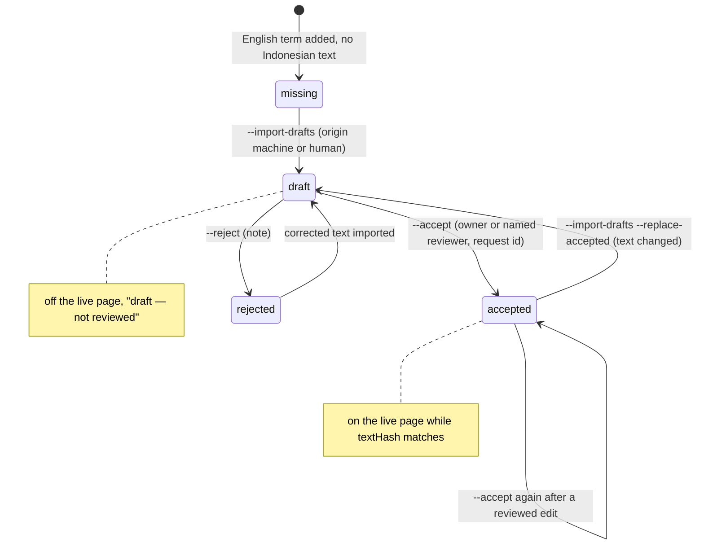
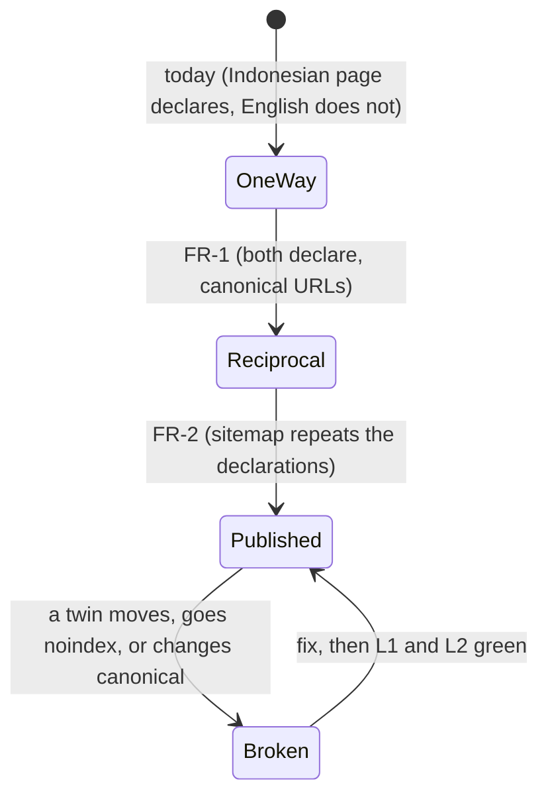

# PRD-Q15 — Indonesian layer: reciprocal hreflang, sitemap alternates, a way in from the English side, and one glossary source with reviewed Indonesian text

## 1. Document control

| Field | Value |
|---|---|
| PRD id | PRD-Q15 |
| Feature | The three Indonesian pages and their English pairs declare each other through reciprocal hreflang, and the sitemap repeats those declarations as `xhtml:link` alternates. English readers get a language link to the Indonesian pages. Both glossary pages are generated from one source that holds an Indonesian field per term. Indonesian text reaches the live page only after the owner accepts it, and a review file records the status of every term. Page counts state what the page holds |
| Version | 1.0 |
| Status | Draft |
| Author | Opus 5.5 (Fable quota exhausted) |
| Date | 2026-11-11 |
| Owner requests | R110 (PRD per idea), R111 (24-section structure) |
| Priority | 60.5. Addendum rank 13: I 5, N 3, C 8, E 3, effort 2 weeks (`documentation/PRODUCT_INNOVATION_ASSESSMENT_2026-11_ADDENDUM.md:88`) |
| Related findings | Q15 (`…_ADDENDUM.md:352-368`); maturity row "Indonesian: 1" (`:39`); BASELINE §2 row "Indonesian" (`00-audit-baseline/BASELINE.md:26`). New findings F1–F14 (§3.1); corrections C1–C4 (§3.3) |
| Dependencies | None blocking. Coordination with the peer session for `id/index.html`, whose meta the peer owns (`STATE.md:46`). Owner decisions D-1…D-7 (§23) |
| Related modules | `glossary.html`, `id/glosarium.html`, `id/index.html`, `id/artikel.html`, `index.html`, `articles.html`, new `data/glossary.json`, new `data/glossary-id-review.json`, new `tools/build-glossary.py`, `tools/build-sitemap.py`, `tools/crawler_inventory.py`, `tools/test-glossary.py`, `tools/test-generator-freshness.py`, new `tools/test-i18n.mjs`, `tools/ship-gate.sh`, `search-index.json`, generated `sitemap.xml` and `llms.txt` |
| Target wave | Addendum roadmap "Foundations, weeks 3–8", noted "Q15 needs translation review" (`…_ADDENDUM.md:556`). Phase A (hreflang, sitemap, links, honest counts) is 5 days of work and Phase B (one source, review file) 5.5 days (§19). Phase C (translation batches) is paced by owner review |
| Approval status | Approved by owner R110/R111 2026-11-10 (the PRD set). Register approval class: "translations need owner review" (`01-improvement-register/REGISTER.md:20`). Owner decisions still needed: D-1…D-7 |

Change history

| Version | Date | Author | Change |
|---|---|---|---|
| 1.0 | 2026-11-11 | Opus 5.5 | First complete draft, 24 sections. Every count verified against `wt-hub3` at `fcaa892df` (branch `hub-r3`) with the commands and the script in Appendix A |

## 2. Executive summary

The site has three Indonesian pages: `/id/`, `/id/artikel.html` and `/id/glosarium.html`. Each declares its English twin through hreflang, but no English page declares the Indonesian twin back. The homepage's own declaration even names `index.html` while its canonical is `/`, so the pair would stay broken after an `id` tag was added. The sitemap carries no alternates. No English page links to `/id/`, so a reader of the English site cannot find the Indonesian pages, and a search engine is told only half of each pair.

The Indonesian glossary is a second hand-made page. It has 89 terms against 449 in English, with no term anchors and no link to the English term ids. Its title, meta tags and lede claim "100+ istilah" (7 times), and its static counter says 105. The Indonesian homepage says "300+ istilah … tersedia dalam Bahasa Indonesia". The glossary gate passes the page without checking any of its terms, because it looks for `<section>` elements and the Indonesian page uses `<div>`.

This PRD delivers:

1. **Reciprocal hreflang on the three pairs** (index, journal, glossary). The homepage's declarations use its canonical `/`. English stays the `x-default`.
2. **Sitemap alternates.** The sitemap builder reads each page's own hreflang declarations and writes them as `xhtml:link` alternates: 18 links on 6 URLs.
3. **A way in.** A language link "ID" next to the theme toggle on `articles.html` and `glossary.html`, and "Bahasa Indonesia" in the homepage footer. The Indonesian pages' existing "EN" links get the language attributes. The language toggle becomes words only: no filled segment, radius ≤ 4 px.
4. **One glossary source.** `data/glossary.json` holds every term, with an English field and an Indonesian field. `tools/build-glossary.py` writes the term blocks of both pages. A lossless-migration proof shows that the English page keeps every term, word for word.
5. **Review discipline.** `data/glossary-id-review.json` records a status per term (`missing`, `draft`, `accepted`, `rejected`), bound to a hash of the exact Indonesian text. Drafts, whether written by an agent or a person, show as "draft — not reviewed" in the review sheet and never reach the live page. Editing accepted text without re-acceptance fails the build.
6. **Honest counts.** Counters and copy are generated from the data or carry no number.
7. **A gate,** `tools/test-i18n.mjs`, with eight laws, each red on today's tree.

Matching counts (449 of 449), the addendum's acceptance, is the end state of Phase C. It needs at most 378 new translations, each accepted by the owner. Phases A and B (≈ 10.5 days) deliver the structure. The pace of Phase C is set by the owner's review time, which is unknown and is measured in the first batch.

## 3. Problem statement

### 3.1 Verified facts (commands run 2026-11-11 on `wt-hub3` at `fcaa892df`; script and commands in Appendix A)

| # | Fact | Evidence | Command |
|---|---|---|---|
| F1 | Three Indonesian pages exist: `id/index.html` (41,889 B), `id/artikel.html` (37,057 B) and `id/glosarium.html` (61,624 B). All three:<br>• are `<html lang="id">`<br>• declare a self canonical<br>• declare hreflang `id` (self), `en` and `x-default` (`id/index.html:68-70`, `id/artikel.html:68-70`, `id/glosarium.html:69-71`)<br>• localise the cookie banner through `RZ_COOKIE_TEXT` (`id/artikel.html:353`, `id/glosarium.html:382`, `id/index.html:436`)<br>• are in `sitemap.xml` (`:69`, `:279`, `:284`), `llms.txt` (`:231-233`) and `search-index.json`<br>• are public, with 0 `locked` or `root-gate` markers<br>• link to their English twin through a `.lang-toggle` (`id/index.html:487-490`, `id/artikel.html:380-383`, `id/glosarium.html:409-412`) | as cited | `ls -la id/`; `grep -n 'hreflang' id/*.html`; `grep -c 'locked\|root-gate' id/*.html` |
| F2 | The English side does not answer. Of 181 root HTML files, 103 declare `hreflang="en"` (one each, self), 102 declare `x-default` (404.html does not), and **0 declare `hreflang="id"`**. The three twins (`index.html`, `articles.html`, `glossary.html`) declare only `en` and `x-default`. No root page links to `/id/` | — | `grep -h -o 'hreflang="[^"]*"' *.html \| sort \| uniq -c`; `grep -l 'href="/id/\|href="id/\|resistancezero.com/id/' *.html` → none |
| F3 | The homepage pair is broken by URL form. `index.html:52-53` declares `en` and `x-default` as `https://resistancezero.com/index.html`. Its canonical (`index.html:49`) and the `en` alternate on `id/index.html:69` are both `https://resistancezero.com/`. Adding an `id` tag alone would still leave the cluster disagreeing on the English URL | as cited | `grep -n 'hreflang\|rel="canonical"' index.html` |
| F4 | The sitemap has no alternates. `sitemap.xml` contains 0 `xhtml:link` and has no `xhtml` namespace. The builder writes loc, lastmod, changefreq and priority only (`tools/build-sitemap.py:110-119`). The head parser it uses, `HeadMetadata` (`tools/crawler_inventory.py:94-149`), reads canonical and robots tags but not hreflang. No tool checks hreflang: the only tools that mention it emit `en` and `x-default` self tags (`tools/build-cx-handbook.py:333-334`, `tools/generate-city-pages.py:139-140, 1029-1030`) | as cited | `grep -c 'xhtml:link' sitemap.xml` → 0; `grep -ln hreflang tools/*.py tools/*.mjs` |
| F5 | Glossary counts.<br>• `glossary.html` has **449** terms: `id="term-*"`, one term per line, 26 `<section class="letter-section">`, 237 with `term-full`, and 185 `term-links` blocks holding 217 internal links (0 external).<br>• `id/glosarium.html` has **89** terms: no `id` attribute on any of them, 22 `<div class="letter-section">`, and 47 showing the English name in `term-en`.<br>• BASELINE's "90" is `grep -c 'class="term'`, which also counts the counter line (`id/glosarium.html:435`). The addendum's 89 is exact | — | Appendix A, script B1; `grep -c 'class="term' id/glosarium.html` → 90 |
| F6 | No glossary source exists apart from the pages. No tool writes either glossary page. `glossary.html` is hand-maintained and called "the … human-maintained glossary (source of truth)" by `tools/build-explain-db.py:3`, whose docstring still says 354 terms. That builder reads the page (`:16`) to generate `js/rz-explain-db.js`, with links of the form `glossary.html#term-<slug>` (`:49`). `id/glosarium.html` is a separate hand-made page that nothing generates or checks against the English list | as cited | `grep -l 'glossary.html\|glosarium' tools/*.py tools/*.mjs` |
| F7 | The two lists barely overlap. Matched by name or acronym (script B1):<br>• 67 Indonesian terms map to exactly one English term.<br>• 4 map to two: CDU, Cross-Connect, Generator (Genset), Whitespace.<br>• 18 map to none (Appendix B).<br>So at most 71 of the 449 English terms have Indonesian text, and at least 378 have none | — | B1 |
| F8 | Count claims are false on the Indonesian side.<br>• `id/glosarium.html` claims "100+" istilah 7 times: title `:60`, description `:61`, og `:82-83`, twitter `:92-93`, lede `:427`.<br>• Its static counter reads "Menampilkan 105 dari 105 istilah" (`:436`). The script recounts `.term` at run time (`:718-722`), so readers with JavaScript see 89, and the HTML says 105.<br>• `id/index.html` says "glosarium 100+ istilah" in `twitter:description` (`:94`, peer-owned meta) and "300+ istilah teknis … tersedia dalam Bahasa Indonesia" in the body (`:605`).<br>• `search-index.json` titles the page "Glosarium Data Center — 100+ Istilah Infrastruktur (Bahasa Indonesia)", and `llms.txt:232` repeats the page title.<br>The English glossary's "300+ Terms" (3 times) is true: it lists 449 | as cited | Appendix A commands B3 |
| F9 | The glossary gate is blind on the Indonesian page. `tools/test-glossary.py:36` splits the page on `<section class="letter-section" id="section-X">`. `id/glosarium.html` uses `<div class="letter-section">`, so check G1 (every term under its own first letter) runs over 0 of its 89 terms. The gate prints "PASS id/glosarium.html: 0 finding(s)" | as cited | `python3 tools/test-glossary.py` → exit 0 |
| F10 | The Indonesian language toggle breaks the register. On all three pages the active language is a block filled with the accent colour (`id/glosarium.html:239`, `id/artikel.html:220`, `id/index.html:248-249`). On `id/glosarium.html` the toggle's radius is 8 px (`:235`; the other two use 4 px). Design rules for this program: a state is a word, not a badge; radius ≤ 4 px | as cited | `grep -n '\.lang-toggle' id/*.html` |
| F11 | `id/artikel.html` lists 10 of the 36 journal entries: article-1, 4, 10, 13, 14, 18, 19, 20, 21 and 22, each marked "EN". The list is hand-made, and no generator keeps it in step with `data/journal.json` | — | `grep -o -E 'href="[^"]*(article-[0-9]+\|FF-[0-9]+\|geopolitics-[0-9]+)\.html"' id/artikel.html \| sort -u` |
| F12 | The homepage header is an owner shape. `index.html:297` carries `data-rz-owner-shape="R079"`. `tools/test-index-r079.mjs` (ship-gate `:338-339`) holds the nav at 64 ± 2 px at 1440 px with exactly one pill CTA (L4), and requires every footer link to resolve (L5). The footer's "Pages" column lists Glossary (`index.html:1167-1176`) | as cited | `grep -n -i 'nav\|footer' tools/test-index-r079.mjs` |
| F13 | The peer owns `id/index.html` meta (`documentation/product-transformation/STATE.md:46`) | as cited | — |
| F14 | Generators and gates that touch these pages:<br>• freshness gate builders: `build-sitemap.py --check` (`tools/test-generator-freshness.py:57`), `build-llms-txt.py` (`:58`), `build-llms-full.py` (`:59`), `build-explain-db.py` (`:61`), and `sweep-site-register.py`, whose globs include `glossary.html` and the three `id/` pages (`tools/sweep-site-register.py:362`)<br>• glossary gate at `tools/ship-gate.sh:313`<br>• audit-coverage gate at `:204` | as cited | `sed -n 56,75p tools/test-generator-freshness.py` |

### 3.2 Consequence of leaving it

- Search engines treat non-reciprocal hreflang as unconfirmed, so the Indonesian pages are not offered as the Indonesian version of their English twins. The addendum names this as the value of Q15: serving the home market.
- A reader on the English site has no route to `/id/`.
- The Indonesian glossary promises more than it holds, and nothing ties its 89 terms to the English list. A term added in English never reaches the Indonesian page.
- A translation could be pasted into the page with no record of who checked it.

### 3.3 Addendum and baseline corrections

| # | Source says | Verified | Correction |
|---|---|---|---|
| C1 | BASELINE §2: "The glossary has 90 term matches" (`BASELINE.md:26`) | `grep -c 'class="term'` counts 89 terms plus the counter line | 89 terms (the addendum's figure) |
| C2 | Addendum acceptance: "Glossary term counts match" (`…_ADDENDUM.md:368`) and effort 2 weeks | Matching needs Indonesian text for at least 378 more terms (F7), each accepted by the owner. 2 weeks covers the structure (Phases A and B, ≈ 10.5 days, §19), not the content | Acceptance is split. Structural acceptance at the end of Phase B (L1–L8 green, counts honest). Content acceptance when 449 of 449 are accepted, at a pace the owner sets (D-4) |
| C3 | Addendum: "The nav links to `/id/`" | The homepage nav is an owner shape under a 27-law gate (F12) | The homepage gets a footer link now; a header link waits for the owner's call (D-3). The two English twins get a header link |
| C4 | Addendum: "hreflang is one-way" | True. In addition, the homepage's English URL disagrees with its canonical (F3) | FR-1 fixes both |

## 4. Objectives and success metrics

| # | Objective | Metric | Target | Measurement | Assumption |
|---|---|---|---|---|---|
| O1 | Pairs confirmed | Pairs whose two pages declare each other with canonical URLs | 3 of 3 (today 0) | L1 | — |
| O2 | Sitemap agrees | `xhtml:link` alternates in `sitemap.xml` equal to the page declarations | 18 on 6 URLs (today 0) | L2 | x-default included in the sitemap (FR-2) |
| O3 | One source | Glossary pages whose term block equals a fresh render of `data/glossary.json` | 2 of 2 (today 0; the source does not exist) | L3 | — |
| O4 | Honest counts | False count claims across the Indonesian pages, `search-index.json` and `llms.txt` | 0 (today 11: 7 "100+" and the "105" counter on `id/glosarium.html`, 2 on `id/index.html`, 1 in `search-index.json`; `llms.txt:232` follows the title) | L4 | Peer applies the `id/index.html:94` meta change |
| O5 | Reviewed text only | Live Indonesian entries without an accepted review record bound to their exact text | 0 (today 89 with no record at all) | L5 | D-1 settles the 89 legacy entries |
| O6 | A way in | English pages linking to their Indonesian twin, plus the homepage footer link | 3 (today 0) | L6 | D-3 for the homepage header |
| O7 | The gate sees the Indonesian page | Indonesian terms checked by glossary rule G1 | all listed (today 0 of 89) | L7 | — |
| O8 | Coverage | Accepted Indonesian entries out of 449 English terms | 449 at the end of Phase C (today at most 71 mapped); pace UNKNOWN until the owner's first review batch is measured in T-12 | `python3 tools/build-glossary.py --stats` | D-4 sets the target and order |
| O9 | Search traffic to `/id/` | Impressions and clicks for the three Indonesian URLs | UNKNOWN. No Search Console baseline is in the repo; measure in T-6 from the owner's Search Console export, before and 8 weeks after Phase A | Owner's Search Console | The owner shares the export |

## 5. Scope

### 5.1 In scope

1. Head declarations: `hreflang="id"` on `index.html`, `articles.html` and `glossary.html`; the homepage's `en` and `x-default` changed to its canonical `https://resistancezero.com/`.
2. Sitemap: `HeadMetadata` collects hreflang alternates; `build_sitemap` writes the `xhtml` namespace and the alternates for every page that declares more than one language.
3. Language links:
   - "ID" on `articles.html` and `glossary.html`, between the search button and the theme toggle.
   - "Bahasa Indonesia" in the homepage footer "Pages" column.
   - `hreflang` and `lang` attributes on the Indonesian pages' "EN" links.
   - Restyling the toggle to words on all five pages that carry one.
4. Count claims on `id/glosarium.html` (head and lede) and in `search-index.json`. The two claims on `id/index.html` are coordinated with the peer.
5. Glossary source:
   - `data/glossary.json`, extracted once from the two pages.
   - `tools/build-glossary.py` with `--extract`, `--apply`, `--check`, `--import-drafts`, `--accept`, `--reject`, `--review-sheet` and `--stats`.
   - Marker-bounded term blocks in both pages.
   - The Indonesian page rendered with the same `section` structure and the same `term-<key>` anchors as the English page.
6. Review file `data/glossary-id-review.json`, with a status per term bound to the text's hash.
7. Legacy import of the 89 Indonesian entries under decisions D-1 and D-2.
8. Gate `tools/test-i18n.mjs` (L1–L8), wired into the ship gate; `build-glossary.py --check` added to the freshness builders.
9. Translation batches (Phase C) under the review rules, as far as the owner takes them (D-4).
10. Standards docs and changelog (§22).

### 5.2 Out of scope

| Item | Why |
|---|---|
| Translating articles, tools or any page other than the glossary | Not part of Q15. `id/artikel.html` keeps its 10 hand-picked entries (F11); generating it from `data/journal.json` is a later option (D-6) |
| Machine translation at build or run time | Forbidden: text reaches the page only after acceptance (BR-2) |
| Changing `id/index.html` meta ourselves | Peer-owned (F13); we send the change, the peer applies it |
| Changing the homepage header | Owner shape R079; D-3 decides |
| New English glossary terms | Only as the outcome of D-2, where an Indonesian-only term needs an English twin, and then through the same review |
| Changing `js/rz-explain-db.js` or the explain engine | `glossary.html` keeps its term ids and text (lossless migration, L3), so the explain builder's output does not change |
| Per-language URLs for other pages, or a language switch on the 178 other English pages | No Indonesian twin exists for them; a link would promise a page that is not there |

### 5.3 Existing capabilities reused

| Capability | Where | Use |
|---|---|---|
| Head parser and inventory | `tools/crawler_inventory.py:94-149`, `:175-193`, `:313-329` | Extended to collect hreflang alternates; the sitemap builder and the gate read the same parser |
| Sitemap builder with `--check` | `tools/build-sitemap.py:110-140` | Writes the alternates |
| Freshness gate | `tools/test-generator-freshness.py:56-73` | Gains `build-glossary.py --check` |
| Glossary gate G1–G4 | `tools/test-glossary.py` | Starts seeing the Indonesian page once that page uses `<section>` (L7) |
| Glossary page scripts | `glossary.html:1615-1690`, `id/glosarium.html:703-750` (alpha bar, search, counter over `.term`) | Kept. The generated markup keeps the class names they read |
| `.lang-toggle` component | `id/glosarium.html:234-241`, `id/artikel.html:216-222`, `id/index.html:243-250` | Restyled to words and reused on the English twins |
| Cookie banner localisation | `RZ_COOKIE_TEXT` (CLAUDE.md, shared modules table) | Unchanged |
| Explain DB builder | `tools/build-explain-db.py` | Unchanged; keeps reading `glossary.html` |

### 5.4 Dependencies

- Peer session: applies the `id/index.html` meta change (`:94`), and agrees to the body change (`:605`) and the toggle change (`:243-250`, `:487-490`). STATE.md requires a peer message before and after each push.
- Owner: D-1…D-7, and every translation batch.
- No server, database or Worker.

### 5.5 Constraints

- Zero-build site: generators write files that are committed. Hand edits inside a generated block are reverted by the next build and caught by `--check`.
- Design rules: IBM Plex Sans and JetBrains Mono; one amber accent; a state is a word; radius ≤ 4 px; no `transition: all`; no hover transform; both themes; 390 and 1440 px; 16 px inputs.
- The R079 homepage laws must stay green.
- `glossary.html` must stay lossless: same 449 ids, names, full names, definitions and links. Only whitespace inside the term block may change, and only once (FR-3).

### 5.6 Assumptions

| # | Assumption | If wrong |
|---|---|---|
| A1 | Google and Bing accept hreflang in both the head and the sitemap when the two agree | Keep the head declarations and drop the sitemap alternates; L2 becomes "absent" instead of "equal" |
| A2 | The owner, a native speaker, is the reviewer of record | D-5 names another reviewer; the review file records the name either way |
| A3 | Definitions keep the small HTML allowlist they use today (`sub` 23, `sup` 6, `em` 5, `a` 3 in English; none in Indonesian) | The allowlist grows by a reviewed change to the generator |
| A4 | The existing page scripts keep working on generated markup with the same class names | The generator emits the old markup byte for byte for English (FR-3 proof) |

## 6. User personas and use cases

The tiers are `free | demo | pro | root` (`js/rz-feature-flags.js:6`). The glossary and all three Indonesian pages are public: 0 `locked` and 0 `root-gate` markers (F1). No persona needs an account.

| Persona | Role | Goal | Pain today | Outcome |
|---|---|---|---|---|
| P1 Indonesian technician or engineer | Facility technician, shift lead or engineer in an Indonesian data centre; reads Indonesian first | Look up a term and read a definition in Indonesian | Search shows the English page; 89 terms; count claims that do not hold | Search offers `/id/glosarium.html`; every listed term carries owner-accepted text; the page says how many it holds |
| P2 English reader | Engineer or student on the English site | Read in English; switch to Indonesian when wanted | No link to the Indonesian pages | "ID" on the journal index and the glossary; footer link on the homepage |
| P3 Owner (reviewer) | Site owner, native Indonesian speaker | Accept or correct translations in batches with little effort | No record of what was checked | A review sheet per batch; one reply accepts or corrects; the review file keeps the record |
| P4 Implementer (session or agent) | Adds terms, drafts translations, ships | Change the glossary in one place; never publish unreviewed text | Two hand-made pages that drift | One JSON source, commands that refuse unsafe changes, gates that name every gap |
| P5 Search crawler (system actor) | Googlebot, Bingbot | Pair language versions | One-way declarations; no sitemap alternates | Reciprocal declarations in the head and in the sitemap |

| UC | Persona | Use case |
|---|---|---|
| UC1 | P1 | Searches in Indonesian, lands on `/id/glosarium.html`, filters to "UPS", reads the definition |
| UC2 | P2 | On `glossary.html`, selects "ID" and lands on the Indonesian glossary |
| UC3 | P2 | On the homepage, follows "Bahasa Indonesia" in the footer to `/id/` |
| UC4 | P3 | Receives 25 drafted terms side by side, answers "terima semua kecuali 7 dan 19; 7 jadi …" |
| UC5 | P4 | Adds an English term; the build lists it as `missing` for Indonesian; the page counts stay honest |
| UC6 | P4 | Fixes a typo in an accepted Indonesian definition; the build fails until the fix is re-accepted |

## 7. Complete user journey

### J1 Indonesian reader (UC1)
- Entry: a search result for an Indonesian query. With reciprocal hreflang the engine can offer `/id/glosarium.html` instead of `glossary.html` to Indonesian-language users; no ranking change is promised.
- Page: title "Glosarium Data Center — Istilah Infrastruktur dalam Bahasa Indonesia". The lede has no number. The counter, rendered in static HTML, reads "Menampilkan {a} dari {a} istilah", where `a` is the number of accepted entries. The coverage line reads "{a} dari 449 istilah sudah tersedia dalam Bahasa Indonesia. Daftar lengkap dalam Bahasa Inggris: Glossary".
- Interaction: the alpha bar and the search filter work as today, over the same `.term` markup. Each term carries `id="term-<key>"`, the same key as in English, so `glossary.html#term-ups` and `/id/glosarium.html#term-ups` point to the same concept.
- Failure states: none at run time (static page). An empty search shows the existing "Tidak ditemukan istilah yang cocok" message.
- Exit: "EN" in the toggle, or the coverage-line link to the English glossary.

### J2 English reader switches (UC2, UC3)
- On `glossary.html` or `articles.html`: the toggle shows "EN" as the current language (plain, weight 600) and "ID" as a link (muted, underlined on hover and focus). Activating "ID" opens the twin.
- On the homepage: the footer "Pages" column lists "Bahasa Indonesia" after "Glossary".
- Keyboard: Tab reaches "ID" after the search button; Enter activates it.

### J3 Owner reviews a batch (UC4)
1. The session runs `python3 tools/build-glossary.py --review-sheet --status draft --limit 25`. This prints a numbered Markdown table: key, English name, English definition, Indonesian name and definition, and the label "draft — not reviewed".
2. The session sends it to the owner (replies in Indonesian per STATE.md), naming the request id.
3. The owner answers: accept all, accept with exceptions, or correct.
4. The session applies corrections to the Indonesian text, then runs `--accept <keys> --reviewer owner --request R<nnn>` and `--reject <keys> --note "<reason>"`. Then `--apply`, the gates and a release.
- Recovery: a wrong acceptance is reverted with `git revert` or with a new `--reject`. The review file keeps its history in git.

### J4 Implementer adds a term (UC5) or edits accepted text (UC6)
- Adds an entry to `data/glossary.json` with `id: null`; the review status defaults to `missing`; `--apply` renders English; the Indonesian page and its counter are unchanged.
- Edits accepted Indonesian text: `--check` fails with "V5 term-ups: accepted text hash differs from the current text; re-accept (R…) or revert". The gate keeps the unreviewed text off the live page by refusing the release.

### J5 Crawler (P5)
- Fetches `glossary.html` and finds `en`, `id` and `x-default`. Fetches `/id/glosarium.html` and finds the same three, with the same URLs. Reads `sitemap.xml` and finds the same alternates under both `<url>` entries.

## 8. Functional requirements

**FR-1 Reciprocal head declarations**
- Description: the three pairs are (`https://resistancezero.com/`, `https://resistancezero.com/id/`), (`…/articles.html`, `…/id/artikel.html`) and (`…/glossary.html`, `…/id/glosarium.html`). Each page of a pair declares exactly three alternates: `en` (the English twin), `id` (the Indonesian twin) and `x-default` (the English twin). Every URL equals the canonical of the page it names.
- Trigger: T-2 (one-time edit of `index.html:52-53`, `articles.html:44-45`, `glossary.html:38-39`; the Indonesian pages already comply and are only verified).
- Preconditions: canonicals as today.
- Inputs: page heads.
- Processing: hand edit; verified by L1.
- Outputs: 3 changed heads.
- State changes: none beyond the files.
- Dependencies: none.
- Exceptions: if a twin becomes `noindex` or changes its canonical, L1 fails, naming both pages.
- Acceptance: L1; AC-1, AC-2.

**FR-2 Sitemap alternates**
- Description: `HeadMetadata` collects `<link rel="alternate" hreflang="…" href="…">` as an ordered list. `build_sitemap` declares `xmlns:xhtml="http://www.w3.org/1999/xhtml"` on `<urlset>`. For every included page that declares at least two distinct languages other than `x-default`, it writes one `<xhtml:link rel="alternate" hreflang="{lang}" href="{url}"/>` per declaration, in the order `en`, `id`, `x-default`, after `<loc>`.
- Trigger: `python3 tools/build-sitemap.py --apply`.
- Inputs: page heads.
- Processing: pure function of the declarations. A declaration whose URL is not the target's canonical fails the build, with "hreflang {lang} on {page} names {url}, canonical is {canon}".
- Outputs: `sitemap.xml` with 18 `xhtml:link` on 6 URLs.
- Exceptions: a malformed or cross-origin `href` fails the build.
- Acceptance: L2; AC-3.

**FR-3 One glossary source and generator**
- Description: `data/glossary.json` (§10.2) holds every term. `tools/build-glossary.py` renders the term block of `glossary.html` and of `id/glosarium.html` between `<!-- rz:glossary-terms:start -->` and `<!-- rz:glossary-terms:end -->`, and writes the static counter numbers.
- Trigger: `--apply`; `--check` in the freshness gate.
- Preconditions: markers present (inserted by `--extract`).
- Inputs: the source; the review file.
- Processing:
  - English: terms in source order, grouped under `<section class="letter-section" id="section-X">` by the first letter of `en.name` (a leading digit files under the first letter after it; the rule of `tools/test-glossary.py` G1), one term per line, with the markup of today.
  - Indonesian: only entries whose review status is `accepted` with a matching hash, sorted by `id.name` (case-folded, non-alphanumerics dropped), grouped by the first letter of `id.name`. Each entry is `<div class="term" id="term-{key}"><h3 class="term-name">{id.name} <span class="term-en">{en.name}</span></h3><p class="term-def">{id.def}</p></div>`. The `term-en` span is omitted for Indonesian-only entries.
- Outputs: two files; exit 0. `--check` exits 1 naming the first differing line.
- Exceptions:
  - an unknown or duplicate key
  - an entry with `en: null` but no `idOnly` decision
  - a tag outside the allowlist (`sub`, `sup`, `em`, `a[href]` relative or `https:`)
  - missing markers
  - Each exits 1 with the key.
- Lossless migration: `--extract` writes the source from today's pages. A one-time proof then shows that the term list parsed from the old `glossary.html` equals the list parsed from the rendered one: key, name, full name, definition and links, in order, with section membership. Only whitespace between lines may differ.
- Acceptance: L3, L7; U1–U6.

**FR-4 Legacy Indonesian entries**
- Description: `--extract` attaches the 89 entries from today's `id/glosarium.html` to English keys.
  - The 67 unique matches of script B1 attach automatically.
  - The 4 ambiguous and 18 unmatched entries attach by the table of decision D-2 (Appendix B), either to an English key or as `idOnly`.
  - Each attached entry gets `origin: "legacy"` and the review status of decision D-1.
- Trigger: T-10.
- Exceptions: an entry without a D-2 decision stops the extraction and names the entry.
- Acceptance: L5; AC-6.

**FR-5 Review file and review commands**
- Description: `data/glossary-id-review.json` (§10.3) holds one record per key with status `missing`, `draft`, `accepted` or `rejected`, the hash of the Indonesian text the status refers to, and the hash of the English text at review time.
- Commands:
  - `--import-drafts <file> --origin machine|human` adds Indonesian text as `draft`. It refuses to overwrite `accepted` text unless `--replace-accepted` is given, which sets the entry back to `draft`.
  - `--accept <keys> --reviewer <name> --request R<nnn>` records `accepted` with both hashes and the date.
  - `--reject <keys> --note <text>` records `rejected`; the text stays in the source for the record and stays off the page.
  - `--review-sheet [--status draft|missing|stale] [--limit N]` prints Markdown. Every draft row carries the words "draft — not reviewed". Rows whose English text changed since acceptance carry "English changed since review".
  - `--stats` prints counts by status.
- Exceptions: `--accept` on an entry without Indonesian text exits 1.
- Acceptance: L5; U7–U10.

**FR-6 Indonesian page content around the terms**
- Description: the generator writes the counter "Menampilkan {a} dari {a} istilah" (`id/glosarium.html:436` today) and a coverage line above the alpha bar (§9.6).
- Head and lede: the seven "100+" claims (`:60`, `:61`, `:82`, `:83`, `:92`, `:93`, `:427`) are rewritten without a number (§9.6), once, by hand. They sit outside the generated block, so L4 keeps them honest.
- `search-index.json`: the page's title is updated to the new title.
- Acceptance: L4; AC-4.

**FR-7 Language links**
- Description:
  - `articles.html` and `glossary.html` get a `.lang-toggle` between `#navSearchBtn` and `#themeToggle`: `<span class="lang-active" aria-current="true">EN</span><a href="id/…" hreflang="id" lang="id" aria-label="Baca halaman ini dalam Bahasa Indonesia">ID</a>`.
  - The homepage footer "Pages" column gets `<li><a href="id/" hreflang="id" lang="id">Bahasa Indonesia</a></li>` after Glossary.
  - The three Indonesian toggles add `hreflang="en" lang="en" aria-label="Read this page in English"` to their "EN" link and `aria-current="true"` to their "ID" span.
  - `.lang-toggle` CSS on all five pages becomes words only (§9.7).
- Trigger: T-4. `id/index.html` changes go through the peer.
- Exceptions: if R079 L5 cannot resolve `id/`, the href becomes `id/index.html` and the canonical stays `/id/`.
- Acceptance: L6, L8; AC-5.

**FR-8 Claims on `id/index.html` (peer-coordinated)**
- Description: `:94` (twitter description, meta) and `:605` (body) lose their numbers (§9.6). The peer applies `:94`; `:605` is applied by whichever session holds the file, after the peer agrees.
- Acceptance: L4.

**FR-9 Translation batches (Phase C)**
- Description: missing entries are drafted in batches of 25, in priority order:
  1. terms with `term-links`, which tie a term to site tools (185 today);
  2. then alphabetical by key.
- The drafting agent follows the rules of §14. Drafts are imported with `--import-drafts --origin machine`, reviewed per J3, accepted or rejected, then released.
- Exceptions: a batch the owner has not answered stays `draft` and off the page indefinitely.
- Acceptance: O8; L5 on every release.

**FR-10 Gate and wiring**
- Description:
  - `tools/test-i18n.mjs` implements L1–L8 (§20.4), with `--law`, `--strict`, `--phase A|B` and `--report`.
  - Phase A wires `node tools/test-i18n.mjs --strict --phase A` (L1, L2, L4, L6, L8) after `tools/ship-gate.sh:313`. Phase B replaces it with `--strict` (all laws).
  - `("glossary pages (EN + ID term blocks)", ["python3", "tools/build-glossary.py", "--check"])` joins `BUILDERS` in `tools/test-generator-freshness.py`.
- Acceptance: L1–L8 wired; AC-8.

### 8.1 FR field matrix

| FR | Trigger | Preconditions | Inputs | Outputs | State change | Dependencies | Exceptions | Acceptance |
|---|---|---|---|---|---|---|---|---|
| FR-1 | T-2 | Canonicals as today | Heads | 3 heads | Files | — | Twin noindex or moved | L1 |
| FR-2 | `--apply` | FR-1 | Heads | `sitemap.xml` | File | Parser | Non-canonical href | L2 |
| FR-3 | `--apply` / `--check` | Markers | Source, review | 2 term blocks | Files | FR-5 | Key, tag, marker errors | L3, L7 |
| FR-4 | T-10 | D-1, D-2 | Old page | Source + review | Files | B1 | Undecided entry | L5 |
| FR-5 | Review commands | Source | Keys, reviewer, request | Review records | File | — | Accept without text | L5 |
| FR-6 | T-5, `--apply` | FR-3 | Counts | Counter, coverage line, head copy | Files | — | — | L4 |
| FR-7 | T-4 | Peer for `id/index.html` | — | Toggles, footer link | Files | Peer | R079 link resolution | L6, L8 |
| FR-8 | T-5 | Peer agrees | — | 2 strings | File | Peer | Peer declines → L4 lists `id/index.html` as open | L4 |
| FR-9 | Phase C | D-4, D-5 | Drafts | Accepted entries | Source, review | Owner | No answer → stays draft | O8, L5 |
| FR-10 | T-1, T-6, T-11 | — | — | Wiring | `ship-gate.sh`, freshness list | — | — | L1–L8 |

## 9. UI/UX specification

### 9.1 Placement and information architecture
No new page. Changes:
- the head of three English pages
- the nav actions of `articles.html` and `glossary.html`
- the homepage footer
- the three Indonesian toggles
- the term block, counter, coverage line and head copy of `id/glosarium.html`

### 9.2 Layout (ASCII)

`glossary.html` header at 1440 px (existing items unchanged):
```
[RZ logo]  Home  DC Solutions  Articles  Glossary …  Contact     [⌕]  EN  ID  [☾]
                                                                  │   │   └ link to id/glosarium.html (muted, underline on hover/focus)
                                                                  │   └ current language, plain text, weight 600
                                                                  └ existing search button
```
At 390 px the nav menu collapses into the hamburger drawer (`js/rz-mobile-nav.js`), as today. The toggle stays in the bar beside the theme button, because it sits outside `.nav-menu`. Its width is about 3.5 rem: two two-letter words and one gap.

`id/glosarium.html` top of content at 390 px:
```
Glosarium Data Center
Istilah teknis infrastruktur data center dalam Bahasa Indonesia dengan padanan Bahasa Inggris.
71 dari 449 istilah sudah tersedia dalam Bahasa Indonesia. Daftar lengkap dalam Bahasa Inggris: Glossary
[ Cari istilah…                      ]   (16 px input, existing)
Menampilkan 71 dari 71 istilah
A B C D …                              (alpha bar, existing)
A
AHU  Air Handling Unit
Unit Penanganan Udara. Perangkat besar yang …
```
(The 71 is the most the legacy import can yield. The real number follows D-1 and D-2, and the page computes it.)

Homepage footer, "Pages" column:
```
Pages
Home
DC Solutions
Articles
Case Studies
Glossary
Bahasa Indonesia      ← new
Manuals
```

### 9.3 Component hierarchy (exact HTML contracts)
English twin, inside `.nav-container` after `#navSearchBtn`:
```html
<div class="lang-toggle" role="group" aria-label="Language / Bahasa">
  <span class="lang-active" aria-current="true">EN</span>
  <a href="id/glosarium.html" hreflang="id" lang="id" aria-label="Baca halaman ini dalam Bahasa Indonesia">ID</a>
</div>
```
Indonesian twin (existing element, attributes added):
```html
<div class="lang-toggle" role="group" aria-label="Bahasa / Language">
  <span class="lang-active" aria-current="true">ID</span>
  <a href="../glossary.html" hreflang="en" lang="en" aria-label="Read this page in English">EN</a>
</div>
```
Indonesian term (generated):
```html
<section class="letter-section" id="section-A">
  <h2 class="letter-heading">A</h2>
  <div class="term" id="term-ahu"><h3 class="term-name">AHU <span class="term-en">Air Handling Unit</span></h3><p class="term-def">Unit Penanganan Udara. …</p></div>
</section>
```
(`term-ahu` is illustrative. Keys come from the English ids; script B1 resolves each legacy entry to its key.)

### 9.4 Controls

| Control | Behaviour |
|---|---|
| "ID" / "EN" link | Navigates to the twin. Focus ring: 2 px amber outline, offset 2 px (the site's focus idiom). No JavaScript |
| "Bahasa Indonesia" footer link | Navigates to `/id/`. Styled as the other footer links |
| Search and alpha bar on `id/glosarium.html` | Unchanged; they read `.term`, `.term-name` and `.term-def` |

### 9.5 States

| State | Presentation |
|---|---|
| Current language | Plain word, `--text` colour, weight 600, `aria-current="true"` |
| Other language | Link, `--muted` colour; underline on hover and focus |
| Indonesian entry accepted | On the page |
| Indonesian entry draft, rejected, missing or stale | Not on the page. Draft appears in the review sheet as "draft — not reviewed" |
| Indonesian glossary at full coverage | Coverage line reads "Semua 449 istilah tersedia dalam Bahasa Indonesia." |
| Search with no match | Existing `#noResults` text |
| No JavaScript | Static counter shows the true count; links work |
Loading, error and permission states do not apply: static, public pages.

### 9.6 Exact copy
English copy is final. Indonesian copy is a draft for the owner to accept in the D-packet (T-9), like any other Indonesian text. Until it is accepted, Phase A ships the Indonesian strings below only if the owner accepts them in the same packet.

| Key | Text |
|---|---|
| English toggle link label | ID |
| English toggle aria-label | Baca halaman ini dalam Bahasa Indonesia |
| Indonesian toggle aria-label (on "EN") | Read this page in English |
| Homepage footer link | Bahasa Indonesia |
| `id/glosarium.html` title (`:60`), og and twitter titles (`:82`, `:92`) | Glosarium Data Center — Istilah Infrastruktur dalam Bahasa Indonesia (title adds " \| ResistanceZero") |
| `id/glosarium.html` description (`:61`) | Glosarium istilah data center dalam Bahasa Indonesia dengan padanan Bahasa Inggris, dari AHU hingga Zero Downtime: daya, pendinginan, redundansi, dan operasi. |
| og and twitter descriptions (`:83`, `:93`) | Istilah data center dalam Bahasa Indonesia dengan padanan Bahasa Inggris: daya, pendinginan, redundansi, dan operasi. |
| Lede (`:427`) | Istilah teknis infrastruktur data center dalam Bahasa Indonesia dengan padanan Bahasa Inggris. |
| Coverage line (generated) | {a} dari {t} istilah sudah tersedia dalam Bahasa Indonesia. Daftar lengkap dalam Bahasa Inggris: <a href="../glossary.html" hreflang="en" lang="en">Glossary</a>. |
| Coverage line at full coverage | Semua {t} istilah tersedia dalam Bahasa Indonesia. |
| Counter (generated, `:436`) | Menampilkan {a} dari {a} istilah |
| `id/index.html:605` (peer-coordinated) | Istilah teknis data center dengan definisi dalam Bahasa Indonesia dan padanan Bahasa Inggris, dari AHU hingga Zero Downtime. |
| `id/index.html:94` (peer applies) | Platform analisis infrastruktur data center: kalkulator PUE, CAPEX & OPEX, jurnal teknik, dan glosarium istilah. |
| Review sheet label for drafts | draft — not reviewed |
| Review sheet label for stale entries | English changed since review |
| `search-index.json` title of the page | Glosarium Data Center — Istilah Infrastruktur dalam Bahasa Indonesia |

### 9.7 Styling (same rule on all five pages, each with the colour tokens it already uses)
Tokens, read from each page today: `glossary.html` `--text-primary`, `--text-muted`, `--gl-accent`; `id/glosarium.html` `--gl-text`, `--gl-text-muted`, `--gl-accent`; `id/artikel.html` and `id/index.html` `--rz-text`, `--rz-text-muted`, `--rz-accent`. `articles.html` takes its nav colours from `css/rz-article-dark.css`; T-4 names the tokens its `.nav-link` computes, measured in the browser rather than guessed. In the block below, `--…-text`, `--…-text-muted` and `--…-accent` stand for these.
```css
.lang-toggle { display:flex; align-items:center; gap:0.6rem; border:0; border-radius:0; background:none;
               font-family:'JetBrains Mono',monospace; font-size:0.75rem; }
.lang-toggle .lang-active { background:none; color:var(--…-text); font-weight:600; padding:0; }
.lang-toggle a { background:none; color:var(--…-text-muted); padding:0.35rem 0; text-decoration:none;
                 transition-property:color; transition-duration:var(--rz-dur-fast,.2s); }
.lang-toggle a:hover, .lang-toggle a:focus-visible { color:var(--…-text); text-decoration:underline; }
.lang-toggle a:focus-visible { outline:2px solid var(--…-accent); outline-offset:2px; }
```
- Touch target: the link's box is padded to at least 44 × 24 px at 390 px, through a `min-height:44px` rule inside the existing mobile block. Exact padding is measured in T-4, because the nav heights differ per page.
- No fill, border, radius, gradient, shadow or transform. Both themes come from the tokens.

### 9.8 Motion
Colour transition on the link only, on the existing duration token; reduced motion keeps it, since it is a colour change and not a movement. Nothing else moves.

### 9.9 Accessibility
- `lang` on every cross-language link, so screen readers switch pronunciation.
- `aria-current` on the current language.
- Contrast of the muted link checked by axe in L8, after a planted low-contrast line has been caught first.
- Every term keeps `<h3>` headings inside `<section>` with an `<h2>` letter heading, so the outline is the same in both languages.

## 10. Data model

### 10.1 Existing (read)
- Page heads: `<link rel="canonical">`, `<link rel="alternate" hreflang>`.
- `glossary.html` term markup: one line per term, `id="term-{slug}"`, `.term-name`, optional `.term-full`, `.term-def`, optional `.term-links`.
- `id/glosarium.html` term markup: `.term-name` with optional `.term-en`, `.term-def`.

### 10.2 `data/glossary.json` (schema `rz-glossary/1`, written once by `--extract`, then edited)
```json
{
 "schema": "rz-glossary/1",
 "terms": [
  {
   "key": "approach-temperature",
   "en": {"name": "Approach Temperature", "full": "(ATD)",
          "def": "The closest temperature difference a CDU heat exchanger …",
          "links": [{"href": "cdu-selection-guide.html", "text": "CDU Selection Guide"}]},
   "id": null
  },
  {
   "key": "ahu",
   "en": {"…": "…"},
   "id": {"name": "AHU", "def": "Unit Penanganan Udara. Perangkat besar yang …", "origin": "legacy"}
  }
 ]
}
```
(The first entry is real: `glossary.html:590`. The second shows the shape. Its key is whatever B1 or D-2 resolves "AHU" to.)

| Field | Type | Rule |
|---|---|---|
| `key` | string | `^[a-z0-9-]+$`, unique. Equals today's `term-*` id without the prefix (449 keys). Indonesian-only entries use `id-only-{slug}` |
| `en` | object or null | null only for Indonesian-only entries with `idOnly` |
| `en.name` | string | Plain text, HTML-escaped on render |
| `en.full` | string, optional | Rendered inside `.term-full` exactly as stored, parentheses included |
| `en.def` | string | HTML; allowlist `sub`, `sup`, `em`, `a[href]` (relative or `https:`) |
| `en.links` | array of `{href, text}` | Relative hrefs (217 today, 0 external) |
| `id` | object or null | null means no Indonesian text exists |
| `id.name` | string | Plain text |
| `id.def` | string | Same allowlist as English (none used today) |
| `id.origin` | enum | `legacy` (live before Q15), `machine` (agent or MT draft), `human` |
| `idOnly` | object, optional | `{"decision": "R…", "reason": "…"}`; required when `en` is null |
| Array order | — | English render order inside each letter. It is kept because the editorial order is not alphabetical: the Z section runs zero-downtime, zone, zinc-whisker, zoning (`glossary.html:1545-1551`) |

Size: about the English term block (217,534 B today) plus the Indonesian text. The exact size is measured in T-7; budget ≤ 600 KB.

### 10.3 `data/glossary-id-review.json` (schema `rz-glossary-review/1`)
```json
{
 "schema": "rz-glossary-review/1",
 "entries": {
  "approach-temperature": {"status": "missing"},
  "ahu": {"status": "accepted", "textHash": "sha256:…", "enHash": "sha256:…", "origin": "legacy",
          "reviewer": "owner", "request": "R1xx", "date": "2026-11-xx", "note": ""}
 },
 "history": [{"date": "2026-11-xx", "request": "R1xx", "action": "accept", "keys": ["ahu", "…"]}]
}
```
(Shape only; the hashes, request and date are placeholders.)

| Field | Rule |
|---|---|
| `status` | `missing` (no `id` text), `draft` (text present, not reviewed; shown as "draft — not reviewed"), `accepted`, `rejected` |
| `textHash` | `sha256` of `id.name + "\n" + id.def` (UTF-8). Required for `draft`, `accepted` and `rejected` |
| `enHash` | `sha256` of `en.name + "\n" + en.def` at the time of review |
| Derived `stale` | `accepted` whose `textHash` differs from the current text: a build error (V5). `accepted` whose `enHash` differs: a report line, not an error |
| `reviewer`, `request`, `date` | Required for `accepted` and `rejected`; `request` matches `^R\d{3,}$` |
| `history` | Append-only log of commands. Never edited by hand |

Every key in the source has exactly one review entry, and every review entry has a source key.

### 10.4 Page markers
`glossary.html` and `id/glosarium.html` each gain `<!-- rz:glossary-terms:start -->` and `<!-- rz:glossary-terms:end -->` around the letter sections (today `glossary.html:581-1552`, `id/glosarium.html:447-644`). The counter lines carry `id="termVisible"` and `id="termTotal"` as today, with generated numbers.

### 10.5 Sitemap (generated)
```xml
<urlset xmlns="http://www.sitemaps.org/schemas/sitemap/0.9" xmlns:xhtml="http://www.w3.org/1999/xhtml">
  <url>
    <loc>https://resistancezero.com/glossary.html</loc>
    <xhtml:link rel="alternate" hreflang="en" href="https://resistancezero.com/glossary.html"/>
    <xhtml:link rel="alternate" hreflang="id" href="https://resistancezero.com/id/glosarium.html"/>
    <xhtml:link rel="alternate" hreflang="x-default" href="https://resistancezero.com/glossary.html"/>
    <changefreq>weekly</changefreq>
    <priority>0.90</priority>
  </url>
```
(Priority and changefreq are the builder's existing values for that page.)

### 10.6 Migration, compatibility, retention
- One-time `--extract`. The lossless proof in FR-3 runs before the extraction is committed.
- `build-explain-db.py` keeps reading `glossary.html`; its `--check` stays green, because ids, names and definitions are unchanged.
- Rollback is `git revert`; the pages return to their hand-made state.
- Retention: the source, the review file and its history are kept in git.

## 11. API and integration contracts

No server endpoint. Every page is static on GitHub Pages. The contracts are the generator CLI, the two JSON files, the head declarations and the sitemap.

### 11.1 `tools/build-glossary.py`

| Command | Effect | Exit |
|---|---|---|
| `--extract [--decisions <file>]` | Reads both pages and the D-2 decision table. Writes `data/glossary.json`, `data/glossary-id-review.json` and the page markers. Refuses if the source exists | 0; 1 on an undecided legacy entry |
| `--apply` | Renders both term blocks, counters and the coverage line | 0; 1 on a source error |
| `--check` | Fresh render equals files; source and review rules V1–V8 (§12.2) | 0; 1 with the first difference or violation |
| `--import-drafts <file> --origin machine\|human [--replace-accepted]` | Input file `[{key, name, def}]` sets the entries to `draft` | 0; 1 on an unknown key, a tag outside the allowlist, or accepted text without the flag |
| `--accept <k1,k2,…> --reviewer <s> --request R<nnn>` | Sets `accepted` with the hashes and the date (UTC) | 0; 1 on an entry without text |
| `--reject <keys> --note <s> --request R<nnn>` | Sets `rejected` | 0 |
| `--review-sheet [--status …] [--limit N]` | Markdown to stdout | 0 |
| `--stats` | `missing n · draft n · accepted n · rejected n · stale-en n` | 0 |

All writes are atomic (temporary file, then rename), JSON with `indent=1, ensure_ascii=False` and a final newline. The tool never calls a network or a model.

### 11.2 Head declaration contract
For each pair `(E, I)`, both pages carry exactly these three tags:
```html
<link rel="alternate" hreflang="en" href="{canonical(E)}">
<link rel="alternate" hreflang="id" href="{canonical(I)}">
<link rel="alternate" hreflang="x-default" href="{canonical(E)}">
```

### 11.3 `crawler_inventory.HeadMetadata` (extended)
New attribute `alternates: list[tuple[str, str]]`, filled for `<link rel="alternate" hreflang=… href=…>`. Existing attributes are unchanged. `read_metadata(path)` returns it. The sitemap builder and the gate are its consumers.

### 11.4 `tools/test-i18n.mjs`

| Flag | Behaviour |
|---|---|
| `--law L1…L8` | One law |
| `--strict` | All laws (or those of `--phase`); exit 1 on any failure |
| `--phase A` | L1, L2, L4, L6, L8 |
| `--report` | Counts per status, pairs, claims; exit 0 |
| `--base <url>` | L1, L2, L4 against a live origin (post-deploy) |

## 12. Business rules and state machines

### 12.1 Rules
- BR-1: A pair exists only where both pages exist, are indexable and say the same thing in two languages. No English page links to `/id/` as its "version" unless it has a twin.
- BR-2: Indonesian text reaches a live page only with status `accepted` and a matching text hash. No machine or agent text is published silently.
- BR-3: Every draft carries its origin, and the review sheet labels it "draft — not reviewed".
- BR-4: Changing accepted Indonesian text requires re-acceptance in the same release; otherwise the build fails.
- BR-5: A count on a page is generated from the data or is not stated.
- BR-6: English is `x-default`.
- BR-7: The glossary pages are edited through the source only; the term block is generated.
- BR-8: A translation keeps the meaning of the English definition. It adds no figure, claim or example that the English text does not carry.

### 12.2 Source checks V1–V8 (`--check` and the gate)

| V | Check |
|---|---|
| V1 | Schema constants; keys unique and well-formed |
| V2 | The 449 English keys equal the `term-*` ids rendered on `glossary.html` |
| V3 | `en: null` only with `idOnly.decision` |
| V4 | HTML allowlist in every `def`; hrefs relative or `https:` |
| V5 | Every `accepted` entry's `textHash` equals the current text |
| V6 | Every key has exactly one review entry, and the reverse |
| V7 | Statuses are consistent: `missing` has no text; `draft`, `accepted` and `rejected` have text |
| V8 | Fresh render equals both pages |

### 12.3 Indonesian entry status



Pair state:


## 13. Cross-module integration

| Module | Effect | Propagation |
|---|---|---|
| `glossary.html` | Head gets `id`; nav gets the toggle; term block becomes generated (content unchanged) | `build-glossary.py --check`; `build-explain-db.py --check` stays green |
| `id/glosarium.html` | Head copy, counter, coverage line, `<section>` markup, anchors, toggle attributes | Generator; L3, L4, L7 |
| `articles.html` | Head `id`; toggle | L1, L6 |
| `index.html` | Head URLs fixed; `id` added; footer link | L1, L6; R079 L5 (footer links resolve) |
| `id/index.html` | Toggle attributes and CSS, body claim (`:605`); peer applies meta `:94` | Peer messages before and after push (STATE.md) |
| `id/artikel.html` | Toggle attributes and CSS only | L6, L8 |
| `sitemap.xml` | Namespace plus 18 alternates | `build-sitemap.py --check` in the freshness gate |
| `llms.txt`, `llms-full.txt` | The `id/glosarium.html` title changes | `build-llms-txt.py --apply`, `build-llms-full.py --apply`; freshness gate |
| `search-index.json` | One title changes (hand edit) | L4 reads it |
| `js/rz-explain-db.js` | None: ids and texts unchanged | `build-explain-db.py --check` |
| `tools/test-glossary.py` | Starts checking the Indonesian terms (G1) once the page uses `<section>` | L7 asserts it |
| `tools/sweep-site-register.py` | Its `--check` covers the same pages; the generated block holds no CSS | Run after `--apply` in T-7; freshness gate |
| `tools/test-audit-coverage.mjs` | Unchanged URL set | ship gate `:204` |
| PRD-Q01 relations (`terms`) | Can link a term in both languages, because keys are shared | Q01 may target `id/glosarium.html#term-{key}` when the entry is accepted |
| Service worker | HTML network-first (as noted in PRD-Q18 §13) | None |
| Account, scenarios, engines, cockpits | None | — |

## 14. AI and automation requirements

- **Deterministic first.** The generator, sitemap, gate and review commands are deterministic code. No model runs at build or page time.
- **Where an agent helps:** drafting Indonesian text in Phase C, in the authoring session only. Agent rules for each batch:
  1. Translate the English definition. Add no figure, example or claim it does not carry (BR-8).
  2. Keep established technical loanwords where the existing accepted entries do (for example "Data Center", "UPS"), with an Indonesian gloss where the legacy entries give one, such as "Pentanahan" for grounding.
  3. Use standard spelling (KBBI) for general words.
  4. Where a term has a legal definition in an Indonesian regulation the English definition cites, quote the Indonesian wording from the regulation's text (peraturan.bpk.go.id, reachable by plain curl per project memory). Do not paraphrase it.
  5. Mark uncertainty in the import file's `note`, never in the text.
  6. Output only the JSON import file.
- **Human approval points:** every Indonesian text, including the UI copy in §9.6 (owner, per batch); D-1…D-7 (owner); the peer's `id/index.html` meta.
- **No auto-accept.** A second agent may pre-review a batch (terminology consistency against accepted entries), but only the reviewer of record can run `--accept`. The review file records who did.

## 15. Non-functional requirements

| Area | Requirement | Measurement |
|---|---|---|
| Performance | `id/glosarium.html` grows with accepted entries. At full coverage its term block is of the order of the English block, 217,534 B today; budget ≤ 320 KB for the whole page. English page size changes by ≤ 1 KB (toggle markup, whitespace) | `wc -c` before and after in T-7 and each Phase C release |
| Render | No new JavaScript; no layout shift from the toggle (static markup) | L8 layout-shift entries inside `.lang-toggle` = 0 |
| Build | `build-glossary.py --check` < 2 s; sitemap build time unchanged ± 1 s | `time` |
| Availability | Static GitHub Pages | — |
| Reliability | The gate (Node) re-implements the reciprocity, hash and count rules independently of the Python generator | Disagreement fails L1, L3 or L5 |
| Accessibility | `lang` and `aria-current` on toggles; axe 0 serious or critical at 390 and 1440 in both themes, after a planted line is caught | L8 |
| SEO | Head and sitemap alternates agree; canonical URLs only | L1, L2; post-deploy `--base` run |
| Maintainability | Generator < 500 lines; gate < 700 lines | Review |
| Observability | `--stats`, `--report` | — |
| Data integrity | Atomic writes; hashes bind statuses to text | U7–U10 |
| Privacy and security | §16 | — |

## 16. Security and access control

- Public pages; no auth change. Tiers are unaffected.
- **Injection.** Definitions are the only HTML that flows from data into pages. The generator parses each `def` with an allowlist: `sub`, `sup` and `em` without attributes, and `a` with `href` only, relative or `https:`. Anything else fails the build, including `on*` attributes, `javascript:` URLs, `<script>`, `<style>` and `<iframe>`. Names and link texts are escaped. U5 plants `` in a draft and expects a refused import.
- **Link safety.** Glossary links stay relative (217 today, 0 external). Hreflang URLs must be same-origin `https://resistancezero.com/…`.
- **Supply chain.** The generator uses the Python standard library only. The gate uses Node built-ins plus puppeteer and axe, which the repo already uses for L8.
- **Secrets.** None.
- **Audit.** The review history records every acceptance and rejection with request id and reviewer; git history keeps the rest.

## 17. Edge cases and failure scenarios

| Case | Behaviour |
|---|---|
| English term removed | Its Indonesian entry would be orphaned. `--check` fails with V6 until the entry is removed or turned into an Indonesian-only entry with a decision |
| English key renamed | Handled as a remove plus an add. The review entry moves only by an explicit `--import-drafts` and `--accept`; acceptance is not carried over silently |
| English definition changed after acceptance | Report line "English changed since review" in the review sheet and `--stats`; the page keeps the accepted text until the owner re-reviews (owner's choice, D-7 default) |
| Indonesian text edited after acceptance | V5 build error until re-accepted or reverted (BR-4) |
| Two Indonesian names identical | Allowed; the anchors differ by key; the review sheet warns |
| Legacy entry that maps to two English terms | Decided in D-2 before `--extract` |
| Indonesian-only term (no English twin) | `idOnly` with a decision. Rendered without `term-en`; counted in the Indonesian total, so the coverage line counts against 449 plus the Indonesian-only entries |
| Draft with disallowed HTML | Import refused |
| Owner does not answer a batch | Entries stay `draft`, off the page |
| Peer declines the `id/index.html` changes | L4 reports `id/index.html` claims as open; Phase A ships the rest with that law item marked open in the CHANGELOG and the ledger |
| R079 L5 cannot resolve `id/` | Use `id/index.html` in the footer link (FR-7 exception) |
| Twin page later set to `noindex` | L1 fails, naming both pages |
| `x-default` debate (Indonesian default for Indonesian visitors) | Not done: language-based defaulting is the engine's job; `x-default` stays English (BR-6) |
| JavaScript off | Static counter correct; toggles are plain links |
| Stale service-worker cache | HTML network-first; no change |

## 18. Technical architecture

```mermaid
flowchart LR
  subgraph Source
    G[(data/glossary.json)]
    R[(data/glossary-id-review.json)]
  end
  D[agent drafts JSON] -- --import-drafts --> G
  D -- status draft --> R
  O[owner review] -- --accept / --reject --> R
  G --> B[tools/build-glossary.py]
  R --> B
  B --> EN[glossary.html term block]
  B --> ID[id/glosarium.html term block + counter + coverage]
  EN --> X[build-explain-db.py reads glossary.html, unchanged output]
  H[page heads: hreflang en/id/x-default] --> P[crawler_inventory.HeadMetadata.alternates]
  P --> S[build-sitemap.py] --> SM[sitemap.xml with xhtml:link]
  T[tools/test-i18n.mjs L1-L8] -.-> H
  T -.-> SM
  T -.-> G
  T -.-> R
  T -.-> ID
```

Alternatives and trade-offs:

| Decision | Chosen | Alternative | Why |
|---|---|---|---|
| Glossary source | One JSON with `en` and `id` per term; both term blocks generated | (a) Keep `glossary.html` as the English source and add an Indonesian sidecar keyed by id; (b) embed Indonesian text in `glossary.html` as data attributes | (a) leaves two sources to keep in step. (b) ships 449 hidden Indonesian definitions inside the English page. One record per term makes "missing" a property of the term |
| Status store | Separate review file bound by hash | Status inside the source | The brief asks for a review file. A hash binds acceptance to exact text, which a status field next to the text cannot do |
| Pair source | The page heads, read by the sitemap builder | A central pairs file that writes the heads | Three pairs; the heads already exist; a second source would need its own sync gate |
| Generated region | Marked term block only | Whole page generated | The page chrome is maintained by sweeps (`sweep-site-register.py`); generating it would fight them |
| Language link scope | Twins and homepage footer | Every page's header | 178 pages have no twin, so a link there would lead readers away from what they were reading |

Deployment: static files; GitHub Pages; no infrastructure.

## 19. Implementation breakdown

| T | Description | Depends | Files | Approach | Effort | Verification | DoD |
|---|---|---|---|---|---|---|---|
| T-1 | Gate skeleton, all laws red on today's tree | — | `tools/test-i18n.mjs` | §20.4; puppeteer under `rz-lane` for L8 | 1.5 d | Each law prints its §20.4 failure | Red output in `05-test-evidence/Q15/` |
| T-2 | Head declarations on 3 English pages | T-1 | `index.html`, `articles.html`, `glossary.html` | FR-1 | 0.5 d | L1 green | — |
| T-3 | Parser alternates + sitemap alternates | T-2 | `tools/crawler_inventory.py`, `tools/build-sitemap.py`, `sitemap.xml` | FR-2; `tools/test-crawler-seo.py` still green | 1 d | L2 green; `build-sitemap.py --check` | — |
| T-4 | Toggles and footer link; toggle CSS on 5 pages | T-1, peer for `id/index.html` | 2 English twins, `index.html` footer, 3 `id/` pages | FR-7, §9.7 | 1 d | L6, L8; R079 gate green | Screenshots at 390 and 1440, both themes, looked at |
| T-5 | Count claims (head and lede of `id/glosarium.html`, `search-index.json`; `id/index.html` via peer) | T-9 (copy accepted) | 3 files | FR-6, FR-8 | 0.5 d | L4 green, or `id/index.html` open per §17 | — |
| T-6 | Phase A release; record the Search Console baseline if the owner shares it | T-2…T-5 | standards, CHANGELOG | §22 | 0.5 d | Ship gate green; live curl checks | Live |
| T-7 | Generator: `--extract`, `--apply`, `--check`; markers; lossless proof | T-1 | `tools/build-glossary.py`, `tools/test-build-glossary.py` | FR-3 | 2 d | U1–U6; proof output stored | — |
| T-8 | Review file and commands | T-7 | same + `data/glossary-id-review.json` | FR-5 | 1.5 d | U7–U10 | — |
| T-9 | Decision packet D-1…D-7, including the Indonesian UI copy of §9.6 and the D-2 mapping table | B1 | message | Appendix B; sent in Indonesian | 0.5 d | Owner answers recorded with request ids | — |
| T-10 | Legacy import per D-1 and D-2; Indonesian page generated | T-7, T-8, T-9 | sources, `id/glosarium.html` | FR-4 | 1 d | L3, L5, L7 green | Counts on the page equal `--stats` |
| T-11 | Phase B release; gate switched to `--strict`; freshness builder added | T-10 | `tools/ship-gate.sh`, `tools/test-generator-freshness.py` | FR-10 | 0.5 d | Ship gate green | Live |
| T-12 | Phase C batch 1 (25 terms); measure owner review time | T-11, D-4, D-5 | sources | FR-9, J3 | 1 d of implementer time plus owner time (UNKNOWN; measured here) | L5 green | Released; O8 updated |
| T-13… | Phase C batches 2…n (≤ 15 more for ≤ 378 terms) | T-12 | sources | Same | 1 d each | Same | Same |

Totals: Phase A (T-1…T-6) 5 days; Phase B (T-7…T-11) 5.5 days; ≈ 10.5 days of implementer time. Phase C is about 1 implementer day per 25 terms, at most 16 batches, plus owner review time measured in T-12.

## 20. Test strategy

### 20.1 Levels

| Level | Tests | Ids |
|---|---|---|
| Unit (Python, `tools/test-build-glossary.py`) | U1 English render of a 3-term fixture equals the expected lines; U2 section filing by first letter, digits skipped; U3 Indonesian sort and filing by `id.name`; U4 allowlist accepts `sub`, `sup`, `em`, `a[href]` and refuses `onerror` and `javascript:`; U5 import of a draft with `` refused; U6 lossless round trip on a fixture page; U7 `--accept` writes both hashes and history; U8 an edit after acceptance fails V5; U9 `--import-drafts` refuses accepted text without `--replace-accepted`; U10 review sheet prints "draft — not reviewed" for every draft | U1–U10 |
| Unit (Python, sitemap) | Alternates emitted only for pages with two or more languages; order `en`, `id`, `x-default`; a non-canonical href fails | in `tools/test-crawler-seo.py`, extended |
| Contract | Head declarations (§11.2); JSON schemas (§10.2, §10.3); sitemap shape (§10.5) | L1–L3, L5 |
| Independent recount (Node) | Reciprocity, counts, hashes recomputed in the gate | L1, L4, L5 |
| E2E (puppeteer, `rz-lane`) | Toggle navigation on both twins; footer link on the homepage; search and alpha bar on the generated Indonesian page | L8 |
| Accessibility | axe at 390 and 1440, both themes, after a planted low-contrast line is caught first | L8 |
| Regression | `python3 tools/test-glossary.py`, `python3 tools/build-explain-db.py --check`, `python3 tools/test-generator-freshness.py`, `node --test tools/test-audit-coverage.mjs`, `env RZ_BASE=… node tools/test-index-r079.mjs`, `python3 tools/test-crawler-seo.py` | ship gate |
| Failure recovery | Planted failures: remove `hreflang="id"` from `glossary.html` (L1 red); edit an accepted Indonesian text without re-accepting (L5 red); add "120+ istilah" to the lede (L4 red); switch one generated `<section>` back to `<div>` (L7 red) | Red proofs |
| Visual | Screenshots of the 5 toggles and the Indonesian glossary at 390 and 1440, both themes, looked at | T-4, T-10 |

### 20.2 Wiring in `tools/ship-gate.sh`
- After line 313 (`gate "glossary — cards on the register, every term filed under its own letter" python3 tools/test-glossary.py`):
  - Phase A: `gate "Indonesian layer — reciprocal hreflang, sitemap alternates, honest counts, language links" node tools/test-i18n.mjs --strict --phase A`
  - Phase B onward: `gate "Indonesian layer — hreflang, sitemap, one glossary source, reviewed text only, honest counts, links" node tools/test-i18n.mjs --strict`
- `tools/test-generator-freshness.py` `BUILDERS`: add `("glossary pages (EN + ID term blocks)", ["python3", "tools/build-glossary.py", "--check"])` (T-11). The unit tests run first inside L3 (the gate invokes `python3 tools/test-build-glossary.py`).

### 20.3 Test data
Fixtures under `tools/fixtures/i18n/`: a 3-term English page, a 2-term Indonesian page, a source and a review file with one entry per status, and a page pair with a deliberate URL mismatch. None is read by the generator outside tests.

### 20.4 LAWS

| Law | Claim | Command | How it fails on today's tree |
|---|---|---|---|
| L1 | Each of the 3 pairs declares exactly `en`, `id` and `x-default` on both pages, every URL equal to the named page's canonical; every `id/*.html` page is in a pair; no other root page declares `hreflang="id"` | `node tools/test-i18n.mjs --law L1` | `L1 FAIL index.html: no hreflang="id"; hreflang en and x-default name https://resistancezero.com/index.html, canonical is https://resistancezero.com/ · articles.html: no hreflang="id" · glossary.html: no hreflang="id"` |
| L2 | `sitemap.xml` declares the `xhtml` namespace, and for each of the 6 paired URLs carries exactly the page's own declarations as `xhtml:link` (18 in all); `python3 tools/build-sitemap.py --check` passes | `--law L2` | `L2 FAIL sitemap.xml: 0 xhtml:link, expected 18; xmlns:xhtml missing` |
| L3 | `data/glossary.json` exists and validates (V1–V4, V6, V7); its 449 English keys equal the `term-*` ids of `glossary.html`; `python3 tools/build-glossary.py --check` passes (both term blocks equal a fresh render); `python3 tools/test-build-glossary.py` passes | `--law L3` | `L3 FAIL data/glossary.json missing` |
| L4 | No count claim exceeds the truth: on `id/glosarium.html` the static counter equals the number of rendered terms; no "N+ istilah", "N+ terms" or "N istilah" claim on the 3 Indonesian pages, `glossary.html`, `search-index.json` or `llms.txt` exceeds the number of terms the named page lists; the coverage line's two numbers equal `--stats` | `--law L4` | `L4 FAIL id/glosarium.html: claims 100+ (7×) and counter 105 with 89 terms · id/index.html: claims 100+ and 300+ istilah for a page with 89 · search-index.json: "100+ Istilah" for 89 · llms.txt: "100+ Istilah" for 89` |
| L5 | `data/glossary-id-review.json` exists; every Indonesian term on the live page has status `accepted` with a `textHash` equal to its current text; no `draft`, `rejected` or `missing` entry is rendered; every `draft` has an origin; the review sheet labels every draft "draft — not reviewed"; a fixture draft planted in a copy of the source is absent from the rendered fixture page | `--law L5` | `L5 FAIL review file missing; 89 Indonesian terms live with no review record` |
| L6 | `articles.html` and `glossary.html` carry a `.lang-toggle` link to their twin with `hreflang="id"` and `lang="id"`; the homepage footer links to `id/` with the same attributes; each Indonesian page's toggle links to its English twin with `hreflang="en"` and `lang="en"`; the active language is `aria-current="true"` | `--law L6` | `L6 FAIL 0 English pages link to an Indonesian twin; homepage footer has no link to id/; id/*.html "EN" links carry no hreflang/lang` |
| L7 | The glossary gate sees every term: splitting each glossary page the way `tools/test-glossary.py:36` does yields as many terms as the page lists (449 and the Indonesian count); both pages use `<section class="letter-section">` | `--law L7` | `L7 FAIL id/glosarium.html: G1 split finds 0 sections and 0 of 89 terms (page uses <div class="letter-section">)` |
| L8 | At 390 and 1440 px in both themes, on `glossary.html`, `articles.html`, the homepage footer, `id/glosarium.html` and `id/artikel.html`:<br>• the toggle (or footer link) is visible and focusable, and Enter navigates to the twin<br>• the active language has no background fill<br>• radius ≤ 4 px; transition-property never `all`; no transform on hover<br>• search input ≥ 16 px; no horizontal overflow<br>• axe 0 serious or critical, after a planted low-contrast line is caught | `--law L8` (puppeteer under `rz-lane`) | `L8 FAIL glossary.html: no .lang-toggle in the header · id/glosarium.html: .lang-toggle radius 8px, active segment filled with the accent` |

## 21. Acceptance criteria

| AC | Given | When | Then |
|---|---|---|---|
| AC-1 | Phase A live | `curl -s https://resistancezero.com/glossary.html \| grep -o 'hreflang="[^"]*" href="[^"]*"'` | Three lines: en → glossary.html, id → id/glosarium.html, x-default → glossary.html |
| AC-2 | Phase A live | Same on `https://resistancezero.com/` | en and x-default name `https://resistancezero.com/`; id names `https://resistancezero.com/id/` |
| AC-3 | Phase A live | `curl -s https://resistancezero.com/sitemap.xml \| grep -c 'xhtml:link'` | 18 |
| AC-4 | Phase A live | Open `/id/glosarium.html` with JavaScript off | Title and lede carry no number; the counter shows the number of terms listed |
| AC-5 | A reader on `glossary.html` at 390 px | Taps "ID" | `/id/glosarium.html` opens; "EN" there returns |
| AC-6 | Phase B live | Owner reads the review sheet | Every entry on the page is `accepted` with its reviewer and request id; legacy entries show origin `legacy` |
| AC-7 | An agent imports 25 drafts | Release built before the owner answers | The page is unchanged; `--stats` shows 25 more `draft` |
| AC-8 | Any release | Ship gate runs | `test-i18n.mjs` and `build-glossary.py --check` both pass |
| AC-9 | Owner accepted batch k | Release built | The page shows exactly the accepted entries; the coverage line reads `{a} dari {t}` with `--stats` numbers |
| AC-10 | Homepage | R079 gate runs | 27 laws green with the new footer link |

FR → test mapping

| FR | Tests |
|---|---|
| FR-1 | L1, AC-1, AC-2 |
| FR-2 | L2, sitemap unit tests, AC-3 |
| FR-3 | U1–U6, L3, L7 |
| FR-4 | L5, AC-6 |
| FR-5 | U7–U10, L5, AC-7 |
| FR-6 | L4, AC-4, AC-9 |
| FR-7 | L6, L8, AC-5, AC-10 |
| FR-8 | L4 |
| FR-9 | L5, AC-7, AC-9 |
| FR-10 | AC-8 |

## 22. Rollout and migration

- **Phase A** (one release, MINOR): T-1…T-6. Gate wired with `--phase A`.
- **Phase B** (one release, MINOR): T-7…T-11. Gate switched to `--strict`; freshness builder added.
- **Phase C**: one PATCH release per accepted batch.
- **Version**: the next free version, claimed with the peer before each push (STATE.md). Peer message before and after each push, naming the `id/index.html` lines touched.
- **Release chain, each release**:
  1. `js/rz-version.js`.
  2. `CHANGELOG.md`, naming the claims removed and the accepted count.
  3. `python3 tools/build-changelog-html.py --apply`; `python3 tools/sync-sw-version.py`.
  4. Generators: `python3 tools/build-sitemap.py --apply`, `python3 tools/build-llms-txt.py --apply`, `python3 tools/build-llms-full.py --apply`, `python3 tools/build-glossary.py --apply` (Phase B onward), `python3 tools/build-explain-db.py --check`.
  5. `node tools/test-asset-cache-tokens.mjs`; `bash tools/ship-gate.sh`; push.
  6. `python3 tools/indexnow-submit.py --since HEAD~1` (these are public pages).
- **Standards docs in the same release (R089)**:
  - `standarization/SEO_OPTIMIZATION_STANDARD.md`: the hreflang contract (§11.2), x-default rule and sitemap alternates.
  - `standarization/CONTENT_LINKAGE_PLAYBOOK.md`: a new glossary term goes through `data/glossary.json`; Indonesian text goes through the review file.
  - `standarization/UIUX_AUDIT_LEDGER.md`: rows for the one-way hreflang, the count claims and the filled toggle, closed with the version and the law.
  - CLAUDE.md: audit-list lines for `test-i18n.mjs` and `build-glossary.py --check`; the Tooling table gains `tools/build-glossary.py`.
- **Live validation after each deploy**:
  - AC-1, AC-2 and AC-3 curls.
  - `node tools/test-i18n.mjs --base https://resistancezero.com --law L1`, and the same for L2 and L4.
  - Compare live `js/rz-version.js` with the release; deploys are not guaranteed (`…_ADDENDUM.md:576`).
- **Rollback**: `git revert` of the release. The glossary pages return to their previous state; the source files can stay unused.

## 23. Risks and dependencies

| # | Risk | Likelihood | Impact | Mitigation |
|---|---|---|---|---|
| R1 | Owner review bandwidth stalls Phase C | High | Coverage stays low | Batches of 25; one-line answers; the page stays honest at any coverage (BR-5); D-4 can narrow the target to linked terms |
| R2 | Draft quality (meaning drift, invented detail) | Medium | Wrong definitions in Indonesian | BR-8; owner review; second-agent consistency pre-check; nothing publishes unaccepted |
| R3 | Extraction changes an English definition by accident | Low | Explain DB and page drift | Lossless proof before commit; `build-explain-db.py --check` |
| R4 | Sweeps edit inside the generated block | Medium | Reverted edits | Marker comments; `--check` in the freshness gate; CLAUDE.md note |
| R5 | Peer conflict on `id/index.html` | Medium | Merge conflict, or the claim stays false | Peer message first; §17 fallback keeps the law item visible |
| R6 | R079 homepage gate fails on the new footer link | Low | Phase A blocked | FR-7 fallback href; run the R079 gate in T-4 |
| R7 | Hreflang mistakes hurt indexing | Low | SEO loss | L1 and L2 plus the live `--base` run; canonical-only URLs |
| R8 | Legacy entries were never reviewed | Unknown | Questionable text stays live | D-1 makes the choice explicit; legacy origin is visible in the review sheet for spot checks |

Decisions for the owner (each with a recommendation):

| Id | Question | Recommendation |
|---|---|---|
| D-1 | The 89 legacy Indonesian entries are live today with no review record. Keep them live as `accepted` with origin `legacy`, or take them off until reviewed? | Keep live as accepted-legacy (removal would shrink the page to 0); spot-check 20 in the first Phase C batch |
| D-2 | Mapping for the 4 ambiguous and 18 unmatched legacy entries (Appendix B) | Ambiguous: map to the general term (`cdu`, `cross-connect`, `generator`, `white-space`). Unmatched: the session proposes an English key by meaning for each; where none exists, keep the entry Indonesian-only rather than write a new English term |
| D-3 | Homepage header language link (changes the R079 owner shape) or footer only | Footer only for now; revisit with the next homepage request |
| D-4 | Target and order of Phase C | All 449, linked terms first (185 with `term-links`), 25 per batch |
| D-5 | Reviewer of record | Owner; a named bilingual reviewer can be added later and is recorded per entry |
| D-6 | `id/artikel.html` lists 10 of 36 journal entries (F11) | Out of Q15; a later PRD can generate it from `data/journal.json` with reviewed Indonesian summaries |
| D-7 | When an English definition changes after its translation was accepted | Keep the accepted Indonesian text live and list it as "English changed since review" until the next batch |

## 24. Definition of done

- [ ] 3 pairs reciprocal, canonical URLs, English `x-default` (L1).
- [ ] Sitemap carries 18 alternates matching the heads; `build-sitemap.py --check` green (L2).
- [ ] `data/glossary.json` is the only source for both term blocks; lossless proof stored; `--check` in the freshness gate (L3).
- [ ] No false count claim on the Indonesian pages, `search-index.json` or `llms.txt` (L4).
- [ ] Every live Indonesian term accepted and hash-bound; drafts off the page and labelled "draft — not reviewed" (L5).
- [ ] Language links on both English twins and the homepage footer; Indonesian links carry `hreflang` and `lang` (L6).
- [ ] Glossary gate checks every Indonesian term (L7).
- [ ] Render, axe and design rules at 390 and 1440 in both themes; screenshots looked at (L8).
- [ ] D-1…D-7 answered and recorded; peer changes to `id/index.html` applied or recorded as open.
- [ ] Standards docs, CHANGELOG and CLAUDE.md updated; versions claimed with the peer; live checks run.
- [ ] Phase C: 449 of 449 accepted, or the owner's D-4 target met.

## Appendix A — Recount script and commands (run 2026-11-11, `fcaa892df`)

### B1 Glossary pages, term by term (stdlib only, read-only)

```python
#!/usr/bin/env python3
"""Q15 B1: the two glossary pages, term by term (stdlib only, read-only).
Run: python3 -I q15_b1_glossary.py /home/baguspermana7/wt-hub3
English terms: <div class="term" id="term-SLUG"><h3 class="term-name">NAME <span class="term-full">(FULL)</span>.
Indonesian terms: <div class="term"><h3 class="term-name">NAME <span class="term-en">ENGLISH</span>.
Keys are compared after lower-casing and dropping non-alphanumerics. English keys: slug, NAME, FULL, and NAME
without its parenthesised part. Indonesian keys: NAME, ENGLISH, NAME without its parenthesised part, and that part.
An Indonesian term matches when its keys hit exactly one English slug."""
import collections, html, re, sys

root = sys.argv[1]
def read(p): return open(f"{root}/{p}", encoding="utf-8").read()
def norm(s): return re.sub(r"[^a-z0-9]", "", html.unescape(s).lower())
en_t, id_t = read("glossary.html"), read("id/glosarium.html")
EN = re.findall(r'<div class="term" id="term-([^"]+)"><h3 class="term-name">([^<]*)(?:<span class="term-full">\(?([^<)]*)\)?</span>)?', en_t)
ID = re.findall(r'<div class="term"><h3 class="term-name">([^<]*)(?:<span class="term-en">([^<]*)</span>)?</h3><p class="term-def">([^<]{0,60})', id_t)
print("english terms:", len(EN), "| unique slugs:", len({s for s, _, _ in EN}), "| with term-full:", sum(1 for e in EN if e[2]))
print("indonesian terms:", len(ID), "| with term-en:", sum(1 for i in ID if i[1]), "| with an id attribute:", len(re.findall(r'<div class="term" id=', id_t)))
keys = collections.defaultdict(set)
for slug, name, full in EN:
    for k in (slug, name, full, re.sub(r"\([^)]*\)", "", name)):
        if k and norm(k): keys[norm(k)].add(slug)
match, amb, miss = [], [], []
for name, en, _ in ID:
    ks = [name, en, re.sub(r"\([^)]*\)", "", name)] + re.findall(r"\(([^)]*)\)", name)
    hits = set().union(*(keys.get(norm(k), set()) for k in ks if k and norm(k)))
    (match if len(hits) == 1 else amb if hits else miss).append((name.strip(), en.strip(), sorted(hits)))
print("indonesian terms matching exactly one english term:", len(match), "| ambiguous:", len(amb), "| unmatched:", len(miss))
for a in amb: print("   ambiguous:", a)
for m in miss: print("   unmatched:", m[:2])
dup = [s for s, n in collections.Counter(m[2][0] for m in match).items() if n > 1]
print("english terms matched by two indonesian terms:", dup)
# letter-section markup the gate splits on
print("section markup: en <section>", len(re.findall(r'<section class="letter-section" id="section-[A-Z]">', en_t)),
      "| id <section>", len(re.findall(r'<section class="letter-section" id="section-[A-Z]">', id_t)),
      "| id <div>", len(re.findall(r'<div class="letter-section" id="section-[A-Z]">', id_t)))
print("count claims:", {p: re.findall(r"\d{2,3}\+\s*(?:[Ii]stilah|[Tt]erms)", read(p)) for p in ("glossary.html", "id/glosarium.html", "id/index.html", "index.html")})
```

Output (verbatim):
```
english terms: 449 | unique slugs: 449 | with term-full: 237
indonesian terms: 89 | with term-en: 47 | with an id attribute: 0
indonesian terms matching exactly one english term: 67 | ambiguous: 4 | unmatched: 18
   ambiguous: ('CDU', 'Coolant Distribution Unit', ['cdu', 'leak-detection-cdu'])
   ambiguous: ('Cross-Connect', 'Cross-Connect', ['cross-connect', 'x-connect'])
   ambiguous: ('Generator (Genset)', '', ['diesel-generator', 'generator'])
   ambiguous: ('Whitespace', '', ['data-hall', 'white-space'])
   unmatched: ('CPO', 'Co-Packaged Optics')
   unmatched: ('Data Center', '')
   unmatched: ('Diesel Rotary UPS', 'DRUPS')
   unmatched: ('Failover', '')
   unmatched: ('GPU Cluster', '')
   unmatched: ('Hot Aisle Containment (HAC)', '')
   unmatched: ('Infrastruktur Kritis', 'Critical Infrastructure')
   unmatched: ('IPLV', 'Integrated Part Load Value')
   unmatched: ('K3 Listrik', 'Electrical Safety')
   unmatched: ('kW per Rack', '')
   unmatched: ('Kapasitas IT', 'IT Capacity')
   unmatched: ('Power Train', '')
   unmatched: ('RPP', 'Remote Power Panel')
   unmatched: ('SMR', 'Small Modular Reactor')
   unmatched: ('Uptime', '')
   unmatched: ('Unit Rack (U)', '')
   unmatched: ('Waterside Economizer', '')
   unmatched: ('Zona Keamanan', 'Security Zone')
english terms matched by two indonesian terms: []
section markup: en <section> 26 | id <section> 0 | id <div> 22
count claims: {'glossary.html': ['300+ Terms', '300+ Terms', '300+ Terms'], 'id/glosarium.html': ['100+ Istilah', '100+ istilah', '100+ Istilah', '100+ istilah', '100+ Istilah', '100+ istilah', '100+ istilah'], 'id/index.html': ['100+ istilah', '300+ istilah'], 'index.html': []}
```

### B2 Hreflang and links
- `grep -n 'hreflang\|rel="canonical"' index.html articles.html glossary.html id/*.html`: the declarations quoted in F1–F3.
- `grep -h -o 'hreflang="[^"]*"' *.html | sort | uniq -c` → `103 hreflang="en"`, `102 hreflang="x-default"`. `changelog.html` mentions the word without a tag, and `404.html` lacks `x-default`.
- `grep -l 'href="/id/\|href="id/\|resistancezero.com/id/' *.html` → no output.
- `grep -c 'xhtml:link' sitemap.xml` → `0`.
- `grep -ln hreflang tools/*.py tools/*.mjs` → `tools/build-cx-handbook.py`, `tools/generate-city-pages.py`.

### B3 Count claims
- `grep -n -E '[0-9]{2,3}\+ ?[Ii]stilah|termTotal">[0-9]' id/glosarium.html` → lines 60, 61, 82, 83, 92, 93, 427 ("100+") and 436 ("105").
- `grep -n -E '[0-9]{2,3}\+ ?istilah' id/index.html` → line 94 ("glosarium 100+ istilah", twitter description) and line 605 ("300+ istilah teknis …").
- `grep -o '"title": *"[^"]*Glosarium[^"]*"' search-index.json` → `"title": "Glosarium Data Center — 100+ Istilah Infrastruktur (Bahasa Indonesia)"`.
- `sed -n 232p llms.txt` → the page title with "100+ Istilah".
- `python3 tools/test-glossary.py` → `PASS glossary.html: 0 finding(s)` and `PASS id/glosarium.html: 0 finding(s)`, exit 0. The second line covers 0 terms (F9).

## Appendix B — Legacy entries needing decision D-2

| # | Indonesian name (as on the page) | `term-en` | Candidates from script B1 | Proposal |
|---|---|---|---|---|
| 1 | CDU | Coolant Distribution Unit | `cdu`, `leak-detection-cdu` | `cdu` |
| 2 | Cross-Connect | Cross-Connect | `cross-connect`, `x-connect` | `cross-connect` |
| 3 | Generator (Genset) | — | `diesel-generator`, `generator` | `generator` |
| 4 | Whitespace | — | `data-hall`, `white-space` | `white-space` |
| 5–22 | CPO; Data Center; Diesel Rotary UPS; Failover; GPU Cluster; Hot Aisle Containment (HAC); Infrastruktur Kritis; IPLV; K3 Listrik; kW per Rack; Kapasitas IT; Power Train; RPP; SMR; Uptime; Unit Rack (U); Waterside Economizer; Zona Keamanan | as on the page | none by name | Session proposes a key by meaning in T-9, read against the English definitions; otherwise Indonesian-only |
