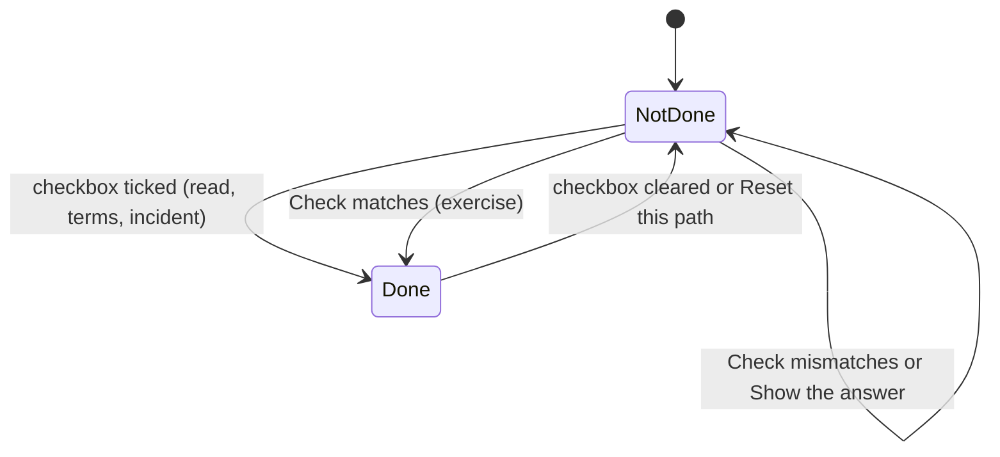
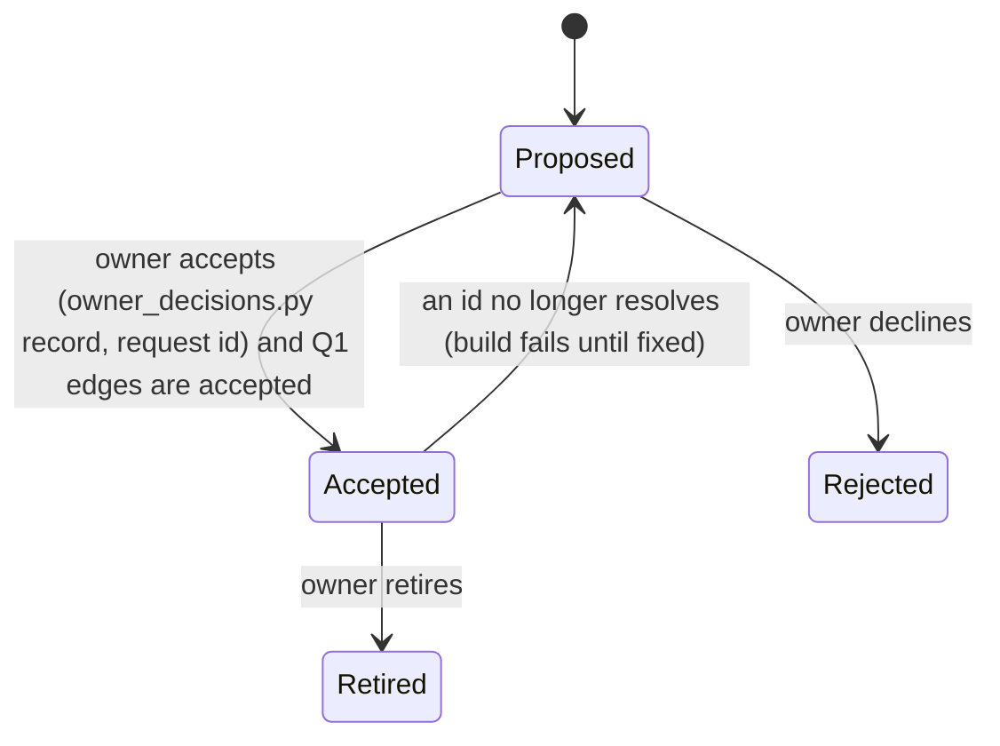
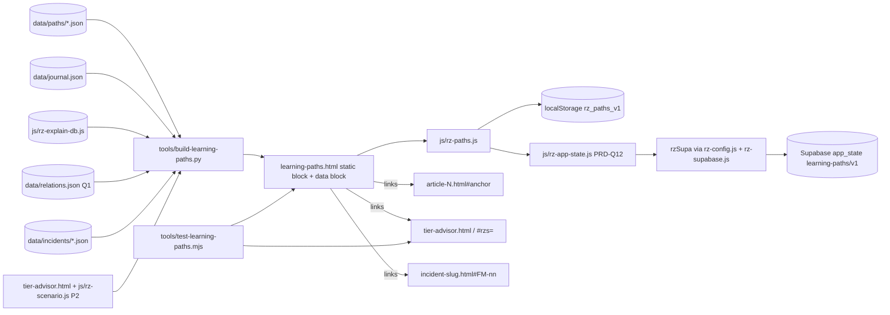

# PRD-Q17 — Learning paths: article → terms → calculator exercise → incident case

## 1. Document control

| Field | Value |
|---|---|
| PRD id | PRD-Q17 |
| Feature | Learning paths on a new public page `learning-paths.html`: each path chains one journal article section, a set of explained terms, a calculator exercise whose answer is stated and proven against the calculator's own code, and an incident dossier case (root access). Progress is kept on the device and, when signed in, in the account. Three paths ship in v1 |
| Version | 1.1 |
| Status | Draft |
| Author | Opus 5.5 (Fable quota exhausted) |
| Date | 2026-11-11 |
| Owner requests | R110 (PRD per idea), R111 (24-section structure) |
| Priority | 65.5 (addendum rank: I 7, N 7, C 6, E 5, effort 4 weeks; `documentation/PRODUCT_INNOVATION_ASSESSMENT_2026-11_ADDENDUM.md:85`) |
| Related findings | Q17 (`…_ADDENDUM.md:300-316`), sequencing "Q1 before Q3 and Q17" (`:562`), maturity row "Accounts and persistence" (`:36`; it lists zero-caller tables, not the educator helpers, which also have none: F7), BASELINE §5 "Learning paths: None. `achievements.html` is orphaned." (`00-audit-baseline/BASELINE.md:56`). New findings: F5 (achievements tracker loaded on 2 pages only), F7 (educator tables hold no learning data), F8 (`app_state` has no page caller), F9 (229 of 1,020 explain-DB titles carry a duplicated parenthetical, and all 229 also sit in the palette's `search-terms.json`), corrections C1–C4 (§3.3) |
| Dependencies | **Q1** relation file `rz-relations/1` (PRD-Q01; accepted article→tool and tool/article→incident edges; consumer contract PRD-Q01 §11.4). **P2** share links `#rzs=` (peer, `PRD-P02`, on the peer branch `feat/p-wave1`, not on main) — soft: the exercise works without it. **Q01 FR-13** (`auth.js` dossier matcher, D-Q01-3) for the incident step's lock, with a stated path if it is rejected (FR-8). **PRD-Q04 FR-9** (blocking for L3): it replaces `tier-advisor.html`'s scoring with `RZEngine.models.tier.advise`; the fixed edit order of that page is P2 → Q04 → Q01 → Q03 → Q17 (coordinator decision D11), and this PRD depends on Q04's output contract. **PRD-Q12** owns the shared `app_state` sync module `js/rz-app-state.js` (its option A sync engine, coordinator decision D16), which this PRD consumes. Supabase is reached the way PRD-Q07 v1.1 §11.5 does: `js/rz-config.js` + module `js/rz-supabase.js`, no `auth.js` change (D10). Reads PRD-Q09's `sourcing.state` (D12) |
| Related modules | `data/journal.json`, `js/rz-explain-db.js` + `tools/build-explain-db.py`, `glossary.html`, `tier-advisor.html`, `data/incidents/*.json` (read), `data/relations.json` (Q1, read), `js/rz-scenario.js` (P2, read), `js/rz-config.js` + `js/rz-supabase.js` (`app_state` wrappers, read), `js/rz-app-state.js` (PRD-Q12, read), `auth.js` (read only: `isRootSession`, `isRootOnlyHref`), `tools/build-journal.py`, `achievements.html`, `rz-gamification.js`, `tools/test-generator-freshness.py`, `tools/ship-gate.sh` |
| Target wave | "Strategic, week 17+" (`…_ADDENDUM.md:558`), after Q1 (`:562`) |
| Approval status | Approved by owner R110/R111 2026-11-10 (the PRD set). Each path file needs the owner's acceptance (`status: accepted`, recorded with `tools/owner_decisions.py record learning-path <id>`; the batch decision is D-Q17-1 in `DECISIONS.md`) and its Q1 edges must be accepted. No `auth.js` change (coordinator decision D10). Retiring `achievements.html` is a feature removal and is only proposed here (D-Q17-2) |

Change history

| Version | Date | Author | Change |
|---|---|---|---|
| 1.0 | 2026-11-11 | Opus 5.5 | First complete draft, 24 sections. Facts verified against `wt-hub3` at `2f458f7c5` (branch `hub-r3`); every exercise answer computed by running `tier-advisor.html`'s own scoring code (Appendix A) |
| 1.1 | 2026-11-11 | Opus 5.5 | QA batch 2 revisions (D9–D16). D10: T-7's `auth.js` edit and every `_rzAuth.ensureSupabase` use withdrawn; account sync reaches Supabase through `js/rz-config.js` + module `js/rz-supabase.js` (`rzSupa.ready` / `rz-supa-ready`, `rzSupa.getUser()`), as PRD-Q07 v1.1 §11.5; `auth.js` is read only (§11.6, §16); a rejected-D-Q01-3 path (FR-8): the incident step stays a plain link the dossier gates itself, non-root learners see 3 steps, the step completes only for root; path files use the D5 decision format (`proposed\|accepted\|rejected\|retired`, `decidedBy`, `decidedOn`, `request ^R[0-9]{3,4}$`). D11: PRD-Q04 is a dependency; tier-advisor edit order P2 → Q04 → Q01 → Q03 → Q17; L3 computes every expected answer at gate time from the scoring live on the page, and path files store no answer numbers (§10.2); missing engine handled (§17). D16: own sync engine dropped for PRD-Q12's `js/rz-app-state.js`; tests use `tools/lib/rz-supa-stub.mjs`. D15: OQ-1…4 → D-Q17-1…4; approvals through `tools/owner_decisions.py`. D9: law-wiring table (§20.3). Cross-module: Q15 and Q09 rows, `ship-gate.sh` insertion by anchor text |

## 2. Executive summary

The site has the parts of a course but no course. Thirty-six journal articles explain design, 1,020 terms are defined in the explain database, eleven calculators compute, and 43 incident dossiers show what failed. Nothing leads a learner from one to the next. The only learning feature, `achievements.html`, awards badges and levels from counters that are written only on two pages, so it cannot measure reading or calculating at all.

This PRD adds learning paths. A path is four steps: read one article section; study five or six terms with their definitions; do an exercise on a calculator, where the question names one input change and the answer is stated and proven against the calculator's own code; then read the incident that shows the same weakness in the field. Each step has a state word (Not done, Done). Progress stays on the device, and in the account's existing `app_state` table when signed in. There are no badges, points, levels, streaks or animations.

Three paths ship in v1, each built from verified ids:
1. **UPS redundancy and the shared single point of failure** — `article-7` §04, terms `ups`, `n-plus-1`, `2n`, `concurrent-maintainability`, `spof`, `tier`; tier advisor with UPS Configuration N instead of N+1 (composite 58 → 56; Tier III no longer reachable) and 2N (60); Equinix LD8 2020, mode FM-02 (A and B feeds behind one UPS output switch).
2. **Lithium-ion batteries, thermal runaway and suppression** — `article-13` §4, terms `lithium-ion`, `thermal-runaway`, `vrla`, `battery-monitoring`, `vesda`, `novec`; tier advisor fire suppression none (physical 56 → 34) and VESDA + clean agent (69); SK C&C Pangyo 2022, FM-03 (the gas system discharged correctly and could not stop the fire).
3. **Cooling redundancy that does not take over** — `article-9` §5, terms `crah`, `chiller`, `n-plus-1`, `free-cooling`, `containment`, `ashrae`; tier advisor cooling redundancy N (cooling 59 → 42, composite 54); Azure South Central US 2018, FM-02 (automatic failover was in manual mode).

Each path uses only links the owner has accepted in the Q1 relation file. The exercise links use the peer's `#rzs=` share links when the calculator supports them. A gate re-runs every exercise in a real browser, signed out and signed in, and fails if a stated answer no longer matches.

## 3. Problem statement

### 3.1 Verified facts (commands run 2026-11-11 on `wt-hub3` at `2f458f7c5`; Appendix B)

| # | Fact | Evidence | Command |
|---|---|---|---|
| F1 | No learning-path feature exists: no `data/paths/`, no `learning-paths.html` | `ls` → "No such file or directory" | B1 |
| F2 | `data/journal.json` lists 36 articles. The three used: `article-7` "From Reliability to Resilience: Why Tier Ratings Stop at Design" (topic reliability; §04 "Limitations of Tier Classification", `article-7.html:1634`, id `limitations`); `article-13` "Data Center Power Distribution Design: Hyperscaler Architecture Deep Dive" (power; §4 "UPS & Battery Technologies", `article-13.html:2817`, id `section-4`, with an LFP/NMC/VRLA table including a "Thermal Runaway Risk" row); `article-9` "The HVAC Shock: No Chillers Doesn't Mean No Cooling" (cooling; §5 "Fault Scenario Analysis: In-Depth", `article-9.html:2455`, id `section-5`) | as cited | B2 |
| F3 | Explain DB (`js/rz-explain-db.js`, generated as `window.RZ_EXPLAIN_DB = {version, counts, entries}`) has 1,020 entries (`{t, d, link, aliases}`); all 17 distinct keys the three paths use exist (`n-plus-1` is in two paths); 3 have no glossary link: `thermal-runaway`, `chiller`, `free-cooling` | B3 output | B3 |
| F4 | The tier advisor (`tier-advisor.html`, `data-rz-calc="tier"` `:96`) scores with fixed maps and weights (`:552-571`), a fuel curve (`:575-580`) and `calculate()` (`:582-650`); the composite is `Math.round` of a weighted sum and is deterministic (the page's `Math.random` calls feed only the premium Monte Carlo bands, `:786`, `:810`, `:1166`). Its selects: `upsConfig` `:242`, `coolRedundancy` `:290`, `fireSuppression` `:358`; outputs `#scoreValue` (static placeholder "72" at `:428`, written at `:622`), `#tierDisplay` (`:618`) and the sub-scores `powerVal`, `coolingVal`, `networkVal`, `physicalVal`, `monitorVal`, written as `b.id+'Val'` (`:636`). Select labels: "UPS Configuration", "Cooling Redundancy", "Fire Suppression". `rz-engine.min.js` is loaded only inside the PDF window (`:1457`); the scoring is page code | as cited | B4 |
| F5 | `achievements.html` (1,319 lines, title "Knowledge Progress — ResistanceZero" `:29`) shows badges and levels ("Novice / Technician / Engineer / Architect / Master", `:948`; CTA "Start earning badges" `:903`) computed from `localStorage` counters `rz_pages_visited`, `rz_calcs_used`, `rz_articles_read` (`:1028-1084`). Those counters are written only by `rz-gamification.js` (252 lines), which only `achievements.html` and `changelog.html` load, so reading an article or using a calculator never moves them. Inbound links: `changelog.html`, `manual/achievements.html`, `manual/index.html`; listed in `sitemap.xml:509` and `llms.txt:11` | as cited | B5 |
| F6 | P2 contract (peer): `#rzs=` base64url UTF-8 JSON `{v:1, calc, inputs:{[id]:{t, v}}}`, `t` one of `text|number|range|select|checkbox|radio|date|textarea|…`, v string or boolean, ≤ 500 entries, ≤ 8,000 chars; filtered restore at 350 ms and 900 ms; T-P02-C adds `js/rz-scenario.js` to tier, tia, spares and rfs, which do not load it today | `PRD-P02/PRD.md:37` and `:82` (8,000), `:86` (500 entries), `:87` (350/900 ms, banner), `:125`, `:131-132`, `:221`, `:227` (peer repo path in §5.4); `grep -c 'rz-scenario.js' tier-advisor.html` → 0; `js/rz-scenario.js` on this branch has no `readLink` (P2 not merged) | B6 |
| F7 | Educator tables: `educator_allowlist` (email, added_by, added_at; root-only RLS, `supabase/schema.sql:389-406`), `is_educator()`, `has_feature()`; wrappers `rzSupa.listEducators/addEducator/removeEducator` (`js/rz-supabase.js:463-482`). Zero callers in any page or script outside their definitions. None of them holds a learner, a class, an assignment or progress | B7 output | B7 |
| F8 | `app_state` (id, user_id → auth.users cascade, key 1–120 chars, state jsonb ≤ 131,072 bytes, updated_at, unique (user_id, key); RLS own rows; 200 keys per user) with wrappers `getAppState`/`setAppState` (upsert on `user_id,key`) (`supabase/schema.sql:656-697`: key length `:667`, size `:669`, RLS `:676-679`, 200-key trigger `:686-697`; `js/rz-supabase.js:394-409`). Its only consumer module, `js/rz-ft-sync.js`, is loaded by no page | as cited | B8 |
| F9 | 229 of 1,020 explain-DB titles carry a duplicated parenthetical: 228 end in "((…))", e.g. "UPS (Uninterruptible Power Supply) ((Uninterruptible Power Supply))", and `tfa` is also cut short: "TFA (Trifluoroacetic Acid, CF 3 ((Trifluoroacetic Acid, CF 3)". Cause: `tools/build-explain-db.py:39-40` capture the `term-name` and `term-full` text only up to the first `</`, so the name keeps the `term-full` text and stops at `</sub>`; `:45-47` then append the full name (already in parentheses) again. All 229 also go into the palette's `search-terms.json` (430 titles; `:100-121`) | B9 output; markup `glossary.html:1462` (UPS), `:1408` (TFA) | B9 |
| F10 | Incident dossiers used (all researched, all with an official postmortem): `equinix-ld8-london-ups-2020` (power; FM-02 "Customer A/B 'diverse' power feeds", D 9); `kakao-sk-cc-pangyo-fire-2022` (fire, power; FM-01 thermal runaway of an aged Li-ion cell, FM-02 battery management system saw nothing, FM-03 clean-agent suppression discharged and could not extinguish); `azure-south-central-us-texas-cooling-2018` (cooling, power; FM-02 redundant cooling failover did not take over, automatic failover was in manual mode). Dossiers are root-only and noindex; `isRootOnlyHref()` does not match dossier URLs today (PRD-Q01 F5, F6) | `data/incidents/<slug>.json` | B10 |
| F11 | No calculator is linked from these three articles to the tier advisor today, and no relation file exists (PRD-Q01 F1–F4) | PRD-Q01 §3.1 | — |

### 3.2 Consequence of leaving it
- A student or junior engineer meets the site through one article and leaves; the calculator that tests the article's claim and the incident that shows its failure stay unfound.
- The one progress feature measures nothing real and teaches the wrong habit (collecting badges).
- 229 tooltip and search-palette titles read badly site-wide (F9).

### 3.3 Addendum and baseline corrections

| # | Source says | Verified | Correction |
|---|---|---|---|
| C1 | Addendum Q17: "It fits the existing educator tables" (`:305`) | The educator tables store who is an educator and nothing else; no caller exists (F7) | Progress uses `app_state` (generic per-user key/value, F8) and the device; educator class features would need new tables (out of scope, D-Q17-3) |
| C2 | BASELINE §5 (`BASELINE.md:56`) and addendum (`:301`): "`achievements.html` is orphaned" | It has three inbound links and is in the sitemap and llms.txt; what is broken is that its tracker runs on two pages only (F5) | Not reused; retirement proposed (D-Q17-2) |
| C3 | Addendum: "learn 5 terms (explain-db)" (`:302`) | Workable; 3 of the 17 terms have no glossary entry (F3) | Paths list 6 terms; a term without a glossary link shows its definition inline and links nothing |
| C4 | Addendum: "An exercise is checked against the engine output" (`:304`) | The tier advisor scores in its own page script (`tier-advisor.html:552-650`); `rz-engine` is loaded only into its PDF window (`:1457`) | Answers are proven against the calculator's own output: shown values in a real browser, raw values by running the page's scoring code (L3) |

## 4. Objectives and success metrics

| Objective | Metric | Target | Measurement | Assumption |
|---|---|---|---|---|
| O1 Real paths | Approved paths with every id resolving | 3 in v1 | L1 | Owner accepts the three files and their Q1 edges |
| O2 Correct answers | Stated exercise answers that differ from the calculator's output (signed out and signed in) | 0 | L3 | Defaults of the calculator unchanged, or the path re-proved |
| O3 End to end | A headless run completes each path and progress survives reload | 3 of 3 | L4 | Root session used for the incident step in the test |
| O4 No gamification | Badge, level, streak, points, confetti or completion animation | 0 | L5 | — |
| O5 Clean titles | Explain-DB titles with a duplicated parenthetical | 0 (today 229) | L6 | Source fix in the generator |
| O6 Use | Paths started and completed per month | UNKNOWN — measure in task T-12 | No cross-visitor channel exists: `rz-tracker.js` keeps events in each visitor's own localStorage (`rz-tracker.js:3`, `:95-101`); the owner picks the channel (D-Q17-4) | No target before a baseline |

## 5. Scope

### 5.1 In scope
1. Path format `rz-learning-path/1`, three path files in `data/paths/`.
2. Builder `tools/build-learning-paths.py` (`--apply`, `--check`), validating ids, Q1 edges and P2 support, writing the static path block into `learning-paths.html`.
3. New public page `learning-paths.html` (hub register shell like `datacenter-solutions.html`, `css/rz-hub.css`).
4. `js/rz-paths.js`: step states, answer check, device progress; account sync by registering key `learning-paths/v1` with PRD-Q12's shared module `js/rz-app-state.js` (D16), no sync engine of its own.
5. Gate `tools/test-learning-paths.mjs`.
6. Source fix of the explain-DB title defect (`tools/build-explain-db.py:37-47`) and regeneration.
7. Entry links: the journal hub (generated by `tools/build-journal.py`) and `glossary.html` intro.
8. SEO: sitemap, llms, search index, OG card for the new page.

### 5.2 Out of scope

| Item | Why |
|---|---|
| Badges, levels, points, streaks, confetti, leaderboards | Excluded by the brief and rejected patterns |
| Reusing `achievements.html` or `rz-gamification.js` | F5; retirement is D-Q17-2 |
| Educator classes, rosters, assignments, progress views | No tables (F7); new infra = owner approval (D-Q17-3) |
| Quizzes beyond the one exercise per path | Keep the path short; extend later |
| Opening dossiers to non-root learners | Access change (D-Q01-1); the incident step shows "Root access" |
| A fault-scenario path on `datahall.html` | After Q7 ships (link `datahall.html#scn=…`, PRD-Q07 FR-14); v2 |
| PUE / efficiency path on `pue-calculator.html` | Candidate v2 (containment none → PUE 1.58 from defaults 1.46, computed in this research, Appendix A2); not resilience-themed like the three incidents |
| Editing `js/rz-scenario.js` | Peer-owned work in flight (P2); read only |

### 5.3 Existing capabilities reused

| Capability | Where | Use |
|---|---|---|
| Article metadata | `data/journal.json` | Titles, URLs, topics |
| Term definitions | `js/rz-explain-db.js` (`t`, `d`, `link`) | Terms step |
| Glossary anchors | `glossary.html#term-<key>` | Term links |
| Calculator | `tier-advisor.html` | Exercise |
| Share links | P2 `#rzs=` (`js/rz-scenario.js` `readLink`, after P2 ships) | "Open with the change applied" |
| Relations | Q1 `data/relations.json` accepted edges | Allowed transitions |
| Dossier anchors | `incident-<slug>.html#FM-nn` (`<details class="fm-row">`) | Incident step |
| Account key/value store | `app_state` + `getAppState`/`setAppState` | Progress sync |
| Supabase loader | `<script src="js/rz-config.js?v=<token>">` + `<script type="module" src="js/rz-supabase.js?v=<token>">`, then `await window.rzSupa.ready` (`js/rz-supabase.js:16`, `:488-489`), as PRD-Q07 v1.1 §11.5 and `opex-calculator.html:3980,3982` | One client per page; no `auth.js` change |
| `app_state` sync | `js/rz-app-state.js` (PRD-Q12, option A sync engine, D16): dirty flag, merge callback per key, debounce, error copy | Progress sync |
| Hub register | `css/rz-hub.css` (`:11-39` tokens); shell of `datacenter-solutions.html` (`<body class="hub pp">`, `:89`, `:188-189`, `:676`) | Page |
| Toast | `js/rz-toast.js` (`RZToast.ok/warn`) | Sync feedback |
| Generator freshness gate | `tools/test-generator-freshness.py:56-73` | `--check` of the builder |

### 5.4 Dependencies
- Q1 shipped with the edges in §10.4 accepted (blocking for listing a path).
- P2 (`/home/baguspermana7/.local/state/rzharness/projects/PRJ-RZ-WEB/work-items/WI-PRODUCT-TRANSFORM-001/repo/documentation/product-transformation/02-prds/PRD-P02/PRD.md`) merged to main for the shortcut link (soft).
- Q01 FR-13 for the dossier lock (L7), decided by D-Q01-3; if rejected, FR-8's rejected path applies and nothing here is blocked.
- **PRD-Q04 FR-9** shipped (blocking for T-6 and L3): the exercise is proven against the engine-backed tier advisor (D11). Order on `tier-advisor.html`: P2 → Q04 → Q01 → Q03 → Q17.
- **PRD-Q12** `js/rz-app-state.js` (blocking for T-7 only; the device-only path ships without it).
- `js/rz-config.js` + `js/rz-supabase.js` exist unchanged (no `auth.js` change, D10).
- PRD-Q15: Q17 T-1 (explain-DB fix) ships before Q15 T-7; Q15 Phase A/B on `glossary.html` and `articles.html` ships before Q17 T-9.

### 5.5 Constraints
- Static page; generated block never hand-edited.
- Hub register design rules; states are words; no motion beyond tokens; 16 px inputs on phones.
- ACCURACY: every number on the page is a stated answer proven against calculator code, with its raw value and rounding stated.
- Peer-owned files untouched; `js/rz-scenario.js` read only.

### 5.6 Assumptions
| # | Assumption | If wrong |
|---|---|---|
| A1 | Q1 term edges are not required for path terms; terms are approved with the path file | Builder also requires article→term edges (one flag) |
| A2 | The tier advisor's defaults stay as today | L3 fails and names the changed value; the owner re-proves the path |
| A3 | P2 restores a partial `inputs` map (only the changed field) | Links carry the full default map (generated by the gate from the page) |
| A4 | One page for all paths reads well up to about 8 paths | Split into per-path pages later |

## 6. User personas and use cases

Tiers: `free | demo | pro | root` (`js/rz-feature-flags.js:6`); `getTier()` returns `free` without a session and `pro` for any signed-in non-demo user (`auth.js:1034-1042`); educators are `pro` with `role: educator`.

| Persona | Role | Goal | Permissions | Outcome |
|---|---|---|---|---|
| P1 Student | Signed-out or free | Learn redundancy concepts in order | Article, terms, exercise; incident step shows "Root access" | Three of four steps; knows where the field case lives |
| P2 Junior DC / facility engineer | Signed in (pro) | Check a design rule against a calculator and a real failure | As P1 plus account sync | Progress on any device |
| P3 Educator | `role: educator` | Point a class at a path | As P2; no class tools in v1 | Shares the page link and section anchor |
| P4 Owner (root) | Curates paths | Approve paths, keep answers true | Full; incident step opens | Paths that stay proven by the gate |
| P5 Visitor from search | Signed out | Finds "learning paths" | As P1 | Starts a path |

| UC | Persona | Use case |
|---|---|---|
| UC1 | P1 | Open path 1, read §04, mark it read, read the six terms, do the UPS exercise, check the answer |
| UC2 | P2 | Same on a phone, then continue on a laptop while signed in |
| UC3 | P4 | Run the gate after a calculator change; re-prove or edit the path |
| UC4 | P1 | Types a wrong answer; gets the stated answer and a hint |
| UC5 | P4 | Opens the incident step and lands on FM-02 in the LD8 dossier |

## 7. Complete user journey

### J1 Find and start (UC1)
- Entry: a "Learning paths" line on the journal hub beside "Case library" (`articles.html:482`, hand-written, outside the generator's `journal:*` markers), a link in the glossary intro (`glossary.html:564`), search, sitemap, direct URL `learning-paths.html#power-ups-redundancy`.
- Initial state: page lists three paths (title, one-line summary, "4 steps · about 40 minutes", state line "0 of 4 steps done" or "0 of 3 steps done · the incident needs root access").
- Action: open a path (`<details>` per path, or the anchor opens it).

### J2 Step 1 — Read
- Shows: article title, section label ("Section 04 · Limitations of Tier Classification"), "Open the article section" (link `article-7.html#limitations`, same tab), and a checkbox "I have read this section".
- Response: ticking sets the step Done (word), saves progress, updates the path line.

### J3 Step 2 — Terms
- Shows six rows: term title (clean, F9 fixed), the definition text `d`, and "Glossary entry" when `link` exists. A checkbox "I have read these terms".
- Validation: none (reading).

### J4 Step 3 — Exercise (UC1, UC4)
(Numbers in this journey are illustrations at `2f458f7c5`; the page shows the values the builder computed from the live tier advisor, §10.2.)
- Shows: the question; "Open the tier advisor" (plain link: defaults); when P2 is live on the calculator, "Open it with UPS Configuration = N" (`#rzs=` link, new tab, `rel="noopener"`); an answer field "Composite score you see" (number, 16 px on phones); **Check**; **Show the answer**.
- Check: the value is normalised (trim, comma → point); compared with the accepted answers.
  - Match → "Matches the calculator: 56." Step Done; the explanation appears (raw value, why it moved, the follow-up 2N result).
  - No match → "The calculator gives 56 for this change. Check that only UPS Configuration changed and every other input is at its default." Step stays Not done; the field keeps the value.
  - Not a number → "Enter a number."
- Show the answer → answer and explanation appear; the step is not marked Done (the learner can still check).
- Failure: calculator fails to load (network) → nothing on the path page breaks; the learner retries the link.

### J5 Step 4 — Incident (UC5)
- Root: "Equinix LD8 Docklands UPS failure, 2020 · FM-02 Customer A/B 'diverse' power feeds" linking `incident-equinix-ld8-london-ups-2020.html#FM-02`, the accepted Q1 edge's `why` line, and a checkbox "I have read this case".
- Non-root: the same title line followed by "Root access", no link target opened for them (the link exists but the dossier shows its root gate; `isRootOnlyHref` makes site-wide link handlers treat it as locked once Q01 FR-13 ships), and the step is left out of their count ("3 of 3 steps done · the incident needs root access").
- If D-Q01-3 is rejected: the incident step stays a plain link to the dossier, which gates itself (`<body class="locked">` and `enforceTierFeatureAccess('dc-incidents')`, `tools/build-incidents.py:424`, `:501`); non-root learners see a path of 3 steps; the step counts as complete only for root (FR-8).

### J6 Progress and sync (UC2)
- Every change writes `localStorage['rz_paths_v1']`.
- Signed in: `js/rz-app-state.js` (PRD-Q12) reads key `learning-paths/v1` on load through `rzSupa.getAppState` once `rzSupa.ready` resolves and `rzSupa.getUser()` returns a user; it calls this PRD's merge callback (latest `at` per step wins) and writes back if the merge changed anything. On each change, its debounced (2 s) `setAppState`. Errors → one toast "Progress is saved on this device; account sync failed." and retry on the next change.
- Reset: per path "Reset this path" → inline confirm "Clear progress for this path?" **Clear** / **Keep**.

### J7 Owner maintenance (UC3)
Edit `data/paths/<id>.json` → `python3 tools/build-learning-paths.py --apply` → `node tools/test-learning-paths.mjs --strict` (re-proves answers in the browser) → ship.

## 8. Functional requirements

**FR-1 Path files**
- Description: `data/paths/<id>.json` per schema §10.2.
- Trigger: authoring.
- Preconditions: owner acceptance for `status: accepted` (D5 format, `tools/owner_decisions.py record`).
- Inputs: ids of article, anchor, terms, tool, calc inputs, incident slug and mode.
- Processing: validated by the builder (FR-2) and the gate.
- Outputs: path data.
- State change: repository.
- Dependencies: Q1, journal, explain DB, incidents.
- Exceptions: any unresolved id → build fails naming file and field.
- Acceptance: L1.

**FR-2 Builder**
- Description: `tools/build-learning-paths.py [--apply|--check]` renders accepted paths into `learning-paths.html` between `<!--rz-paths:start-->` and `<!--rz-paths:end-->`, and writes the JSON data block `<script type="application/json" id="rz-paths-data">` (step ids, accepted answers) inside the same markers.
- Trigger: authoring, release, freshness gate.
- Preconditions: Q1 file present (`schema == "rz-relations/1"`).
- Inputs: path files, `data/journal.json`, `js/rz-explain-db.js` (`entries` of the object `tools/build-explain-db.py:90-97` writes with `json.dumps` after `window.RZ_EXPLAIN_DB = `), `data/relations.json`, `data/incidents/<slug>.json`, the calculator HTML (P2 detection: the page loads `js/rz-scenario.js` and that file defines `readLink`).
- Processing: validate (V1–V12); resolve required Q1 edges (status `accepted` only, PRD-Q01 §11.4); build the share links (`#rzs=` base64url of `{"v":1,"calc":"tier","inputs":{…}}`) only if P2 is detected; render HTML with every string escaped; JSON-LD `ItemList` of `LearningResource` items in the page head block.
- Outputs: page block; `--check` exits 1 if the file differs.
- State change: `learning-paths.html`.
- Dependencies: Python stdlib.
- Exceptions: missing Q1 file → exit 2 "Q1 relation file missing: paths cannot be published"; unaccepted edge → exit 1 naming the edge.
- Acceptance: L1, L2; freshness via `tools/test-generator-freshness.py`.

**FR-3 Page**
- Description: `learning-paths.html`, public, indexable, hub register shell; intro, one `<details class="lp-path" id="<path-id>">` per path, method note.
- Trigger: build.
- Inputs: FR-2 block.
- Processing: static; works without JS (links and text visible; checkboxes disabled with the note "Progress needs JavaScript.").
- Outputs: page.
- Acceptance: L8; SEO gates (`tools/audit-seo.py`, `tools/test-page-metadata.mjs`, `tools/test-meta-description-fit.mjs`).

**FR-4 Step states and progress line**
- Description: each step Not done / Done; path line "{done} of {total} steps done"; for non-root the incident step is excluded from `total` with the suffix "· the incident needs root access".
- Trigger: checkbox, correct answer, reset.
- Inputs: progress record.
- Processing: `js/rz-paths.js` reads the data block; root check via `window._rzAuth.isRootSession()`.
- Outputs: words and line.
- State change: device storage (FR-6).
- Exceptions: data block missing → module does nothing and logs `E_DATA`.
- Acceptance: L4, AC-1..AC-3.

**FR-5 Exercise check**
- Description: compare the learner's answer with `accept[]`.
- Trigger: Check.
- Inputs: field value.
- Processing: `trim`, replace one comma by a point, strip a trailing "%"; parse as number; compare numerically with each accepted value at the stated decimals (`decimals` field; tier composite 0).
- Outputs: copy §9.6; on match the step becomes Done and the explanation shows.
- State change: progress record stores `answer` and `at`.
- Exceptions: NaN → "Enter a number."
- Acceptance: AC-4, AC-5; L4.

**FR-6 Device progress**
- Description: `localStorage['rz_paths_v1']` (§10.3), try/catch on every access.
- Trigger: every state change.
- Processing: write whole record (≤ 8 KB).
- Exceptions: blocked → in-memory only; note "Progress cannot be saved in this browser." once.
- Acceptance: L4 (reload keeps state).

**FR-7 Account sync**
- Description: signed-in users sync the same record to `app_state` key `learning-paths/v1`.
- Trigger: load (read + merge), changes (debounced write 2 s).
- Preconditions: `window.rzSupa` present (the page loads `js/rz-config.js?v=<token>` and `<script type="module" src="js/rz-supabase.js?v=<token>">`), `rzSupa.ready` resolved (or the `rz-supa-ready` event fired, `js/rz-supabase.js:488-489`) and `rzSupa.getUser()` returns a user; `js/rz-app-state.js` (PRD-Q12) loaded. No `auth.js` member is used (D10).
- Processing: `RZAppState.register('learning-paths/v1', {merge, read, write, maxBytes: 131072, debounceMs: 2000, metaKey: 'rz_paths_sync'})` (PRD-Q12 §11.2a); Q12's module owns the dirty flag, debounce, one write in flight and the state events; this PRD supplies the merge callback (per step by `at`), `read`/`write` over `localStorage['rz_paths_v1']`, and renders the state words. `allowed` is left at its default (every signed-in user syncs).
- Outputs: synced record.
- State change: one `app_state` row per user (RLS own row, `supabase/schema.sql:676-679`).
- Exceptions: not signed in → skip silently; error → toast once per session, retry next change; key-limit error (`app_state key limit reached (200).`, `schema.sql:690`) → toast "Account storage is full; progress stays on this device."
- Acceptance: L4 with the shared stub `tools/lib/rz-supa-stub.mjs` (D16): one read, ≤ 1 write per change burst.

**FR-8 Incident step access**
- Description: root sees the link as a normal step; others see "Root access".
- Processing: the builder renders the row through PRD-Q01's renderer contract (the "Root access" word comes from Q01's labels, the only writer of that word, batch 1 rule); `js/rz-paths.js` hides the checkbox for non-root (`window._rzAuth.isRootSession()`, read only) and excludes the step from their count.
- Dependencies: Q01 FR-13 for `isRootOnlyHref` (D-Q01-3).
- **If D-Q01-3 is rejected**: the incident step stays a plain link to `incident-<slug>.html#FM-nn`; the dossier page gates itself (`tools/build-incidents.py:424`, `:501`); non-root users see a path of 3 steps; the step counts as complete only for root (a stored `incident.done` from a non-root session is ignored in the count). L7 then checks the row text and the dossier's own gate instead of the matcher.
- Acceptance: L7, AC-6.

**FR-9 Explain-DB title fix (prerequisite)**
- Description: `tools/build-explain-db.py:39-47`: capture the `term-name` element up to its own closing tag (not the first `</`), drop the nested `term-full` span from the name, take the full name from the whole span (so `CF<sub>3</sub>COOH` survives), strip one pair of surrounding parentheses from it before re-wrapping; regenerate `js/rz-explain-db.js` and `search-terms.json`.
- Trigger: T-1.
- Inputs: `glossary.html`, `tools/explain-extra.json`.
- Outputs: titles like "UPS (Uninterruptible Power Supply)".
- State change: generated DB and `search-terms.json` (`tools/build-explain-db.py:100-121`); cache tokens on every page that loads the DB (`node tools/test-asset-cache-tokens.mjs --fix js/rz-explain-db.js`).
- Dependencies: `tools/test-explain-db.mjs`.
- Exceptions: a curated entry (from `explain-extra.json`) that itself contains "((": reported by the gate, fixed in the curated file.
- Acceptance: L6.

**FR-10 Entry links**
- Description: one `.jrow` line "Learning paths" on `articles.html` beside "Case library" (`:482`; hand-written, since `tools/build-journal.py` rewrites only its `journal:*` markers, `:217-219`), and one link in the `glossary.html` intro paragraph (`:564`).
- Acceptance: AC-8; `tools/test-journal.mjs` stays green.

**FR-11 SEO and discovery**
- Description: title "Learning paths — ResistanceZero", meta description ≤ the display cut, canonical, OG card from `tools/build-og-images.py`, JSON-LD `ItemList` + `BreadcrumbList`, sitemap/llms/search-index regenerated.
- Acceptance: SEO gates in `tools/ship-gate.sh` (`:285-286`), L8 metadata part.

**FR-12 Use measurement (owner decision)**
- Description: v1 sends no events. `rz-tracker.js` cannot count use across visitors: it keeps events in the visitor's own localStorage (`rz-tracker.js:3`, `:95-101`) and adds IP, city, device and browser fields to each one (`:106-123`). D-Q17-4 asks the owner to choose: no metric, or analytics events `path_step_done` `{path, step}` and `path_done` `{path}` sent only after cookie consent (`js/rz-cookie-consent.js`).
- Acceptance: decision recorded in T-12; if events are chosen, none fires before consent (L4 runs with consent declined and accepted).

### 8.1 FR field matrix

| FR | Trigger | Preconditions | Inputs | Outputs | State change | Dependencies | Exceptions | Acceptance |
|---|---|---|---|---|---|---|---|---|
| FR-1 | Authoring | Owner acceptance | Ids | Path data | Repo | Q1, journal, DB, incidents | Unresolved id | L1 |
| FR-2 | Build | Q1 file | Paths + sources | Page block | Page file | stdlib | Missing Q1, unaccepted edge | L1, L2 |
| FR-3 | Build | FR-2 | Block | Page | File | Shell | No JS → read-only | L8 |
| FR-4 | Checkbox, answer, reset | Data block | Record | Words, line | Storage | `_rzAuth` | No data block | L4 |
| FR-5 | Check | Exercise step | Answer | Copy, state | Record | — | NaN | L4, AC-4/5 |
| FR-6 | Any change | — | Record | — | localStorage | — | Blocked storage | L4 |
| FR-7 | Load, change | Signed in, `rzSupa.ready` | Record | Synced row | `app_state` | `js/rz-app-state.js` (Q12), `js/rz-config.js` + `js/rz-supabase.js` | Errors, key limit | L4 |
| FR-8 | Render | Q01 FR-13 or its rejected path | Session | Lock text, count | — | `auth.js` (read only), Q01 renderer | D-Q01-3 rejected → plain link, 3 steps | L7 |
| FR-9 | T-1 | — | Glossary | Clean titles | Generated DB, tokens | DB gate | Curated "((" | L6 |
| FR-10 | Build | — | — | Links | Generated hub, glossary | Journal builder | — | AC-8 |
| FR-11 | Release | — | Page | Metadata | Generated files | SEO tools | — | SEO gates |
| FR-12 | D-Q17-4 decision | Owner choice | Ids | None in v1 | — | Cookie consent | — | T-12 |

## 9. UI/UX specification

### 9.1 IA
- New page `learning-paths.html` (public). Breadcrumb: Home › Journal › Learning paths.
- h1 "Learning paths"; muted second clause "read, define, calculate, then see it fail" (upright, muted; CLAUDE.md rejected pattern 10).
- One `<details>` per path, closed by default except the one named in the URL hash.

### 9.2 Layout (ASCII, 1440)
```
Learning paths  read, define, calculate, then see it fail
Each path takes one idea through four steps: an article section, the terms it uses, a calculator
exercise with a stated answer, and an incident where the idea failed in the field.

▾ UPS redundancy and the shared single point of failure          0 of 4 steps done
  Tier ratings describe a design. This path checks what one UPS decision does to a tier
  score, and then shows a site where two "diverse" feeds shared one UPS switch.

  1  Read      From Reliability to Resilience: Why Tier Ratings Stop at Design
               Section 04 · Limitations of Tier Classification           [Open the article section]
               [ ] I have read this section                                          Not done
  2  Terms     UPS (Uninterruptible Power Supply) — A device providing emergency power …   Glossary entry
               N+1 Redundancy — …                                                          Glossary entry
               …  (6 rows)
               [ ] I have read these terms                                           Not done
  3  Exercise  Tier advisor. With every other input at its default, change UPS Configuration
               from N+1 to N. What composite score does the advisor show?
               [Open the tier advisor]  [Open it with UPS Configuration = N]
               Composite score you see [____]  [Check]  [Show the answer]                Not done
  4  Incident  Equinix LD8 Docklands UPS failure, 2020 · FM-02 Customer A/B "diverse" power feeds
               Both feeds came from the same UPS output switch.   (Q1 edge "why")       Root access
  [Reset this path]
▸ Lithium-ion batteries, thermal runaway and suppression         0 of 4 steps done
▸ Cooling redundancy that does not take over                     0 of 4 steps done

How the answers are checked
Each answer is computed by the calculator's own code with its default inputs and one change.
A test re-runs every exercise in a browser before each release.
```
390 px: step label above content; buttons full width (44 px); answer field 16 px; term rows stack title over definition.

### 9.3 Component hierarchy
```html
<main id="main-content">
  <h1>Learning paths <span>read, define, calculate, then see it fail</span></h1>  <!-- muted by the shell rule ".pp h1 span" copied from datacenter-solutions.html:202 -->
  <p class="lp-intro">…</p>
  <!--rz-paths:start-->
  <script type="application/json" id="rz-paths-data">{…}</script>
  <details class="lp-path" id="power-ups-redundancy" data-path="power-ups-redundancy" data-version="1">
    <summary><h2>…</h2><span class="lp-line" aria-live="polite">0 of 4 steps done</span></summary>
    <p class="lp-sum">…</p>
    <ol class="lp-steps">
      <li class="lp-step" data-step="read" data-kind="article">
        <span class="lp-k">Read</span><div>…<label><input type="checkbox" data-done="read"> I have read this section</label></div>
        <span class="lp-state">Not done</span></li>
      <li class="lp-step" data-step="terms" data-kind="terms"><dl class="lp-terms" data-rz-fact-list>…</dl>…</li>
      <li class="lp-step" data-step="exercise" data-kind="exercise">…
        <form class="lp-ex" novalidate><label for="ans-power-ups-redundancy">Composite score you see</label>
          <input id="ans-power-ups-redundancy" inputmode="decimal" autocomplete="off">
          <button type="submit">Check</button><button type="button" data-reveal>Show the answer</button>
          <p class="lp-result" role="status"></p><div class="lp-explain" hidden>…</div></form></li>
      <li class="lp-step" data-step="incident" data-kind="incident" data-access="root">…</li>
    </ol>
    <button type="button" class="lp-reset">Reset this path</button>
  </details>
  <!--rz-paths:end-->
  <section class="lp-method"><h2>How the answers are checked</h2>…</section>
</main>
```

### 9.4 Controls and behaviour

| Control | Behaviour |
|---|---|
| Path summary | Native open/close; hash `#<path-id>` opens it on load |
| Open the article section | Link to `article-N.html#<anchor>` (same tab) |
| Read checkboxes | Toggle Done/Not done for that step; saved |
| Glossary entry | Link `glossary.html#term-<key>` when `link` exists |
| Open the tier advisor | Plain link (defaults) in a new tab |
| Open it with … applied | `#rzs=` link (only when P2 detected at build time), new tab |
| Check | FR-5 |
| Show the answer | Reveals answer and explanation; does not mark Done |
| Incident link | `incident-<slug>.html#FM-nn` |
| Reset this path | Inline confirm; clears that path's record |
No global keyboard shortcuts. Enter in the answer field submits Check.

### 9.5 States
- No JS: content readable; checkboxes disabled with the note.
- Not done / Done words per step; path line.
- Answer: empty, wrong, right, revealed.
- Sync: silent on success; one toast on failure.
- Storage blocked: one note.

### 9.6 Exact copy strings

| Key | Text |
|---|---|
| title | Learning paths |
| muted clause | read, define, calculate, then see it fail |
| intro | Each path takes one idea through four steps: an article section, the terms it uses, a calculator exercise with a stated answer, and an incident where the idea failed in the field. |
| path line | {done} of {total} steps done |
| non-root suffix | · the incident needs root access |
| step kinds | Read · Terms · Exercise · Incident |
| read box | I have read this section |
| terms box | I have read these terms |
| incident box | I have read this case |
| open article | Open the article section |
| glossary | Glossary entry |
| open calc | Open the tier advisor |
| open applied | Open it with {input label} = {value label} |
| answer label | Composite score you see (path 1, 3) · Physical score you see (path 2) |
| right | Matches the calculator: {answer}. |
| wrong | The calculator gives {answer} for this change. Check that only {input label} changed and every other input is at its default. |
| nan | Enter a number. |
| root access | Root access |
| reset | Reset this path |
| reset confirm | Clear progress for this path? [Clear] [Keep] |
| no js | Progress needs JavaScript. |
| storage blocked | Progress cannot be saved in this browser. |
| sync failed | Progress is saved on this device; account sync failed. |
| storage full | Account storage is full; progress stays on this device. |
| method | Each answer is computed by the calculator's own code with its default inputs and one change. A test re-runs every exercise in a browser before each release. |

### 9.7 Styling (inline `<style>` in the page, ≤ 3,072 B)
- Tokens from `css/rz-hub.css`; graphite panels with one 1 px `--rz-line-tier-2` hairline; radius 2 px; no fills on state words.
- One amber element per view: the focus ring and the Check button border.
- Numbers (answers, scores) in JetBrains Mono; text in IBM Plex Sans.
- Hover: border colour only; `transition-property: border-color` on `--rz-dur-press` / `--rz-ease-out`; no transforms.
- No progress bars, rings or percentage meters; the progress line is text.

### 9.8 Motion
None. `<details>` opens natively. No completion effect (O4).

### 9.9 Accessibility
- Headings in order; `<details>` summary contains the h2.
- Answer field has a visible label; result `role="status"`.
- Checkboxes have labels; state words are text, not colour.
- axe 0 serious/critical at 390 and 1440 in both themes, planted-line method.
- Focus visible on every control; hash-opened path moves focus to its h2.

## 10. Data model

### 10.1 Existing
- `data/journal.json` (36 articles), `js/rz-explain-db.js` (1,020 entries), `data/incidents/*.json`, `data/relations.json` (Q1, not yet on disk), `app_state` table (F8). No learning data exists anywhere (F1, F7).

### 10.2 Path schema (`data/paths/path.schema.json`, `rz-learning-path/1`)

```json
{
  "type": "object",
  "required": ["schema","id","version","status","title","summary","steps","requiresEdges"],
  "additionalProperties": false,
  "properties": {
    "schema": {"const": "rz-learning-path/1"},
    "id": {"type": "string", "pattern": "^[a-z0-9-]{3,48}$"},
    "version": {"type": "integer", "minimum": 1},
    "status": {"enum": ["proposed","accepted","rejected","retired"]},
    "decidedBy": {"const": "owner"}, "decidedOn": {"type": "string", "format": "date"},
    "request": {"type": "string", "pattern": "^R[0-9]{3,4}$"},
    "title": {"type": "string", "minLength": 10, "maxLength": 80},
    "summary": {"type": "string", "minLength": 40, "maxLength": 280},
    "minutes": {"type": "integer", "minimum": 10, "maximum": 120},
    "steps": {"type": "array", "minItems": 4, "maxItems": 4, "prefixItems": [
      {"type": "object", "required": ["id","kind","article","anchor","label"], "properties": {
        "id": {"const": "read"}, "kind": {"const": "article"},
        "article": {"type": "string", "pattern": "^(article|FF|geopolitics)-[0-9]{1,3}$"},
        "anchor": {"type": "string", "pattern": "^[a-z0-9-]{2,40}$"}, "label": {"type": "string", "maxLength": 90}}},
      {"type": "object", "required": ["id","kind","terms"], "properties": {
        "id": {"const": "terms"}, "kind": {"const": "terms"},
        "terms": {"type": "array", "minItems": 3, "maxItems": 8, "items": {"type": "string", "pattern": "^[a-z0-9-]{1,60}$"}}}},
      {"type": "object", "required": ["id","kind","tool","calc","question","change","expect","answer"], "properties": {
        "id": {"const": "exercise"}, "kind": {"const": "exercise"},
        "tool": {"type": "string", "pattern": "^[a-z0-9-]{2,60}$"}, "calc": {"type": "string", "pattern": "^[a-z0-9-]{1,40}$"},
        "question": {"type": "string", "maxLength": 300},
        "change": {"type": "array", "minItems": 1, "maxItems": 3, "items": {"type": "object", "required": ["input","t","from","to","label","toLabel"]}},
        "expect": {"type": "array", "minItems": 1, "items": {"type": "object", "required": ["selector","decimals"], "additionalProperties": false}},
        "answer": {"type": "object", "required": ["label","selector","decimals"]},
        "followUp": {"type": "object"}, "explain": {"type": "string", "maxLength": 400}}},
      {"type": "object", "required": ["id","kind","slug","mode"], "properties": {
        "id": {"const": "incident"}, "kind": {"const": "incident"},
        "slug": {"type": "string", "pattern": "^[a-z0-9-]{3,80}$"}, "mode": {"type": "string", "pattern": "^FM-[0-9]{2}$"}}}
    ]},
    "requiresEdges": {"type": "array", "minItems": 2, "items": {"type": "object", "required": ["from","to","kind"],
      "properties": {"from": {"type": "string"}, "to": {"type": "string"}, "kind": {"enum": ["tool","incident"]}}}}
  }
}
```

Validation rules (builder and gate): V1 schema const; V2 `id` = file name; V3 article id in `data/journal.json` and `id="<anchor>"` present in the article HTML; V4 every term key in the explain DB; V5 tool in the Q1 registry with `access: "public"` and its page has `data-rz-calc="<calc>"`; V6 every `change[].input` is a control id on the page with an `<option value="<to>">` (selects) and `from` equal to the page default; V7 path files store no answer numbers: `expect[]` names selectors and decimals only, and question, explain and followUp text use placeholders `{before}`, `{after}`, `{raw}`, `{beforeRaw}`, `{followUp.<sel>}`; the builder fills them from a browser run of the live page (§11.2) and the gate recomputes them at gate time (L3, coordinator decision D11); V8 the accepted answer is the formatted `after` of `answer.selector`, computed, never typed; V9 incident slug exists, mode id exists in its FMEA; V10 every `requiresEdges` item is an accepted Q1 edge; V11 no literal decimal number appears in `question`, `explain` or `followUp` text outside a placeholder; digits inside names ("N+1", "2N", "Tier III", "FM-03") are ignored; V12 file ≤ 8,192 bytes.

### 10.3 Progress record (`localStorage['rz_paths_v1']` and `app_state` key `learning-paths/v1`)
```json
{"v": 1, "updatedAt": "2026-11-20T08:00:00Z",
 "paths": {"power-ups-redundancy": {"version": 1, "steps": {
   "read": {"done": true, "at": "2026-11-20T07:41:10Z"},
   "terms": {"done": true, "at": "2026-11-20T07:50:02Z"},
   "exercise": {"done": true, "at": "2026-11-20T07:58:40Z", "answer": "56"},
   "incident": {"done": false}}}}}
```
- Merge: per step, the entry with the later `at` wins; a path whose `version` differs from the page keeps steps whose ids still exist.
- Size: ≤ 8 KB for v1; server check 131,072 bytes.
- Retention: device until cleared; account row until the user deletes the account (cascade) — no delete UI in v1 beyond Reset (which writes the cleared record).
- No personal data: no name, no email in the record.

### 10.4 The three v1 paths (complete data; drafts for owner acceptance)

The numbers below are illustrations computed at `2f458f7c5` by Appendix A1 against the page as it was before PRD-Q04 FR-9. They are not stored in the path files (V7): after Q04 ships, the builder fills them from the engine-backed page and L3 re-proves them at every gate run, so they will differ wherever `RZEngine.models.tier` differs from the old page tables.

**Path 1 `power-ups-redundancy`** — "UPS redundancy and the shared single point of failure"
- read: `article-7`, anchor `limitations` (`article-7.html:1634`), label "Section 04 · Limitations of Tier Classification".
- terms: `ups`, `n-plus-1`, `2n`, `concurrent-maintainability`, `spof`, `tier` (all present; glossary links for all six, B3).
- exercise: tool `tier-advisor`, calc `tier`; question "With every other input at its default, change UPS Configuration from N+1 to N. What composite score does the tier advisor show?"; change `[{"input":"upsConfig","t":"select","from":"n1","to":"n","label":"UPS Configuration","toLabel":"N"}]`; expect `[{"selector":"#scoreValue","before":"58","beforeRaw":57.969,"after":"56","raw":55.869,"decimals":0}, {"selector":"#powerVal","before":"57","beforeRaw":56.625,"after":"51","raw":50.625,"decimals":0}]`; answer `{"label":"Composite score you see","accept":["56"],"decimals":0}`; followUp UPS 2N → composite 60 (raw 60.069), power 63 (raw 62.625); explain "Dropping to N lowers the power score from 56.625 to 50.625 and the composite from 57.969 to 55.869, shown as 56. Tier III is no longer reachable: the advisor's Tier III floor (`canT3`, `tier-advisor.html:596`) fails, and its gap list asks to 'Upgrade UPS to N+1 or better' (`:676`). With 2N the composite is 60."
- incident: `equinix-ld8-london-ups-2020`, mode `FM-02`.
- requiresEdges: `article:article-7 → tool:tier-advisor` (tool); `tool:tier-advisor → incident:equinix-ld8-london-ups-2020` (incident).

**Path 2 `battery-room-fire`** — "Lithium-ion batteries, thermal runaway and suppression"
- read: `article-13`, anchor `section-4` (`article-13.html:2817`), label "Section 4 · UPS & Battery Technologies".
- terms: `lithium-ion`, `thermal-runaway` (no glossary link), `vrla`, `battery-monitoring`, `vesda`, `novec`.
- exercise: question "With every other input at its default, set Fire Suppression to None. What Physical score does the tier advisor show in its subsystem breakdown?"; change `fireSuppression` `preaction` → `none` ("Fire Suppression" = "None"); expect `#physicalVal` 56 → 34 (raw 56.25 → 33.5), `#scoreValue` 58 → 56 (raw 57.969 → 55.694); answer accept `["34"]`; followUp VESDA + clean agent (`vesda_clean`) → physical 69 (raw 68.5), composite 59 (raw 59.194); explain "The advisor scores VESDA with a clean agent highest. In the Pangyo fire the clean-agent system discharged as designed and still could not stop a lithium-ion runaway (FM-03): a high score describes the equipment, not the outcome."
- incident: `kakao-sk-cc-pangyo-fire-2022`, mode `FM-03`.
- requiresEdges: `article:article-13 → tool:tier-advisor`; `tool:tier-advisor → incident:kakao-sk-cc-pangyo-fire-2022`.

**Path 3 `cooling-redundancy`** — "Cooling redundancy that does not take over"
- read: `article-9`, anchor `section-5` (`article-9.html:2455`), label "Section 5 · Fault Scenario Analysis".
- terms: `crah`, `chiller` (no glossary link), `n-plus-1`, `free-cooling` (no glossary link), `containment`, `ashrae`.
- exercise: question "With every other input at its default, change cooling redundancy from N+1 to N. What composite score does the tier advisor show?"; change `coolRedundancy` `n1` → `n` ("Cooling Redundancy" = "N (No Redundancy)"); expect `#coolingVal` 59 → 42 (raw 59 → 41.5), `#scoreValue` 58 → 54 (raw 57.969 → 54.469); answer accept `["54"]`; followUp 2N → cooling 79, composite 62 (raw 61.969), tier text "Tier II+"; explain "On paper, N+1 keeps one cooling unit in reserve. In South Central US the automatic failover was in manual mode, so the reserve never took over (FM-02)."
- incident: `azure-south-central-us-texas-cooling-2018`, mode `FM-02`.
- requiresEdges: `article:article-9 → tool:tier-advisor`; `tool:tier-advisor → incident:azure-south-central-us-texas-cooling-2018`.

Share links (built only when P2 is detected; base64url of the exact JSON shown in Appendix A3):
- Path 1: `tier-advisor.html#rzs=eyJ2IjoxLCJjYWxjIjoidGllciIsImlucHV0cyI6eyJ1cHNDb25maWciOnsidCI6InNlbGVjdCIsInYiOiJuIn19fQ`
- Path 2: `tier-advisor.html#rzs=eyJ2IjoxLCJjYWxjIjoidGllciIsImlucHV0cyI6eyJmaXJlU3VwcHJlc3Npb24iOnsidCI6InNlbGVjdCIsInYiOiJub25lIn19fQ`
- Path 3: `tier-advisor.html#rzs=eyJ2IjoxLCJjYWxjIjoidGllciIsImlucHV0cyI6eyJjb29sUmVkdW5kYW5jeSI6eyJ0Ijoic2VsZWN0IiwidiI6Im4ifX19`

### 10.5 Migration and compatibility
- New files; no SQL change (`app_state` exists).
- Path `version` bumps when steps or answers change; stored progress keeps matching step ids.
- `js/rz-explain-db.js` regenerated (titles only change); every consumer reads `t` as text.

## 11. API and integration contracts

### 11.1 `js/rz-paths.js` (ES5, `window.RZPaths`)

| Member | Signature | Contract |
|---|---|---|
| `version` | `'1.0.0'` | — |
| `init()` | → void | Reads `#rz-paths-data`, restores device progress, binds controls; idempotent (guard `window.__rzPaths`) |
| `state()` | → record | Frozen copy of §10.3 |
| `setStep(pathId, stepId, done, extra)` | → bool | Updates, saves, schedules sync |
| `check(pathId, value)` | → `{ok, answer, reason}` | FR-5; `reason` ∈ `match`, `mismatch`, `nan` |
| `reset(pathId)` | → void | Clears one path |
| `sync()` | → Promise | FR-7; resolves `{ok, merged, wrote}` |
Events on `document`: `rz-path-step` `{path, step, done}`, `rz-path-done` `{path}`.

### 11.2 Builder CLI `tools/build-learning-paths.py`

| Command | Effect | Exit |
|---|---|---|
| (none) | Dry run: lists paths and validation | 0 / 1 |
| `--apply` | Writes the block into `learning-paths.html` | 0 / 1 / 2 |
| `--check` | Exit 1 if the page differs from a fresh render | 0 / 1 |
Exit 2: Q1 file missing or unreadable. `--apply` and `--check` also run `node tools/test-learning-paths.mjs --compute --json` (browser, live page) to fill the placeholders of §10.2; `--check` fails when the block's values differ from a fresh run.

### 11.3 Supabase (existing, verified; called by PRD-Q12's `js/rz-app-state.js`, not by this page's code)

| Operation | Call | Auth / RLS | Limits | Errors |
|---|---|---|---|---|
| Read | `rzSupa.getAppState('learning-paths/v1')` (`js/rz-supabase.js:394-401`) | Own row (`schema.sql:676`) | — | `{error: 'not signed in'}` (`:397`) → skip; others → toast once |
| Write | `rzSupa.setAppState('learning-paths/v1', record)` upsert on `user_id,key` (`:402-409`) | Own row (`schema.sql:677-678`) | 128 KB per row (`schema.sql:669`), 200 keys per user (`:686-697`) | Key limit (message passed through unchanged by `friendly()`, `js/rz-supabase.js:81-89`) → storage-full copy; others → sync-failed copy |
Idempotency: upsert by key; repeated writes are harmless. Timeouts: a write pending > 10 s is abandoned; the next change retries. No pagination.

### 11.4 Q1 consumer contract (read only)
Read `data/relations.json`, require `schema == "rz-relations/1"`, use only edges with `status == "accepted"` (PRD-Q01 §11.4). Node refs: `article:<id>`, `tool:<id>`, `incident:<slug>`.

### 11.5 P2 contract (read only)
`#rzs=` payload `{v:1, calc, inputs:{[id]:{t, v}}}` (PRD-P02 `:125`); detection: the calculator page has a `<script src="js/rz-scenario.js…">` and `js/rz-scenario.js` contains `readLink`. Learning paths never call `rzScenario` themselves; they only link.

### 11.6 `auth.js` (read only)
Uses `window._rzAuth.isRootSession()` (`auth.js:309`, exported at `:788`) and, in the gate, `isRootOnlyHref()`. No `auth.js` or `auth.min.js` change and no new export (coordinator decision D10; PRD-Q07 v1.1 §11.5 withdrew `ensureSupabase` as an export). The Supabase client comes from `js/rz-config.js` + `js/rz-supabase.js` (§5.3).

### 11.7 `js/rz-app-state.js` (PRD-Q12, consumed)
One `app_state` sync module for the site, owned by PRD-Q12 (coordinator decision D16). This PRD registers key `learning-paths/v1` with a merge callback and a size limit; Q12 registers its `ft_*` keys. Key registry: `ft_wl`, `ft_port`, `ft_alerts` (Q12), `learning-paths/v1` (Q17), recorded in `standarization/SUPABASE_INTEGRATION.md`; 4 of the 200 keys per user.

### 11.8 PRD-Q04 output contract (consumed)
After Q04 FR-9 the tier advisor scores through `RZEngine.models.tier.advise(input)` and renders the same element ids (`#scoreValue`, `#powerVal`, `#physicalVal`, `#coolingVal`, …). The gate reads the displayed values and, for raw values, calls `RZEngine.models.tier.advise` in the page's own browser context with the input the page built. When the engine is missing, Q04 FR-16 shows "—" with Q06's Fallback line; the path step then reads "The calculator is unavailable right now; try again later." and L3 fails.

## 12. Business rules and state machines

1. A path is listed only when accepted and every required Q1 edge is accepted.
2. An exercise answer is a value the calculator's own code produces from its defaults plus the stated change; the gate proves it before every release.
3. No badges, levels, points, streaks or completion effects; progress is words and one count line.
4. The incident step is counted only for root.
5. Terms come from the explain DB; nothing is typed into the page by hand.

Step state:


Path file:


## 13. Cross-module integration

| Module | Effect |
|---|---|
| Q1 `data/relations.json` | Read; six edges required (§10.4); unaccepted → path not built |
| P2 `js/rz-scenario.js` | Read; links only |
| `tier-advisor.html` | Not edited by this PRD. Edited by P2, PRD-Q04 FR-9, PRD-Q01 and PRD-Q03 in that order; this PRD comes last (D11) and depends on Q04's output contract (§11.8). L3 recomputes answers from the live page at every gate run, so a scoring change moves the answers instead of breaking a frozen contract |
| PRD-Q04 | Dependency (FR-9); Q04 FR-9 (v1.2) notes that Q17 depends on its output contract |
| PRD-Q12 `js/rz-app-state.js` | Consumed; key registry shared (§11.7) |
| PRD-Q15 | Both edit `glossary.html` and `articles.html`; Q17 T-1 regenerates the explain DB Q15 relies on. Order: Q17 T-1 → Q15 (Phase A/B) → Q17 T-9 |
| PRD-Q09 | Incident step may prefer `sourcing.state == "verified"` dossiers; read only |
| `tools/ship-gate.sh` | One gate line by anchor text (§20.3) |
| `js/rz-explain-db.js` + `tools/build-explain-db.py` | Source fix FR-9; regenerated; tokens bumped on every loader page |
| `glossary.html` | Intro link |
| Journal hub `articles.html` | One hand-written `.jrow` line beside "Case library" (`:482`); generator markers untouched; `tools/test-journal.mjs` stays green |
| Incidents | Read only; anchors `#FM-nn` |
| Q3 reproduce | LD8 is one of the three reproducible dossiers in PRD-Q03 Appendix A; path 1 may add "Reproduce on the TIA-942 checklist" once Q3 ships (v2) |
| Q7 training | A v2 alarm path may link `datahall.html#scn=<id>` (PRD-Q07 FR-14) |
| Q18 patterns | Path pages may link `dc-incident-patterns.html#c-<cat>` for root (v2), only through Q01's "Root access" row and only if D-Q01-3 is accepted |
| `achievements.html`, `rz-gamification.js` | Unchanged in v1; retirement proposed (D-Q17-2) |
| Account page | No change (progress lives in `app_state`, not `saved_scenarios`) |
| `auth.js`, `auth.min.js` | Not changed (D10) |
| Sitemap, llms, llms-full, search index, OG | Regenerated for the new page (FR-11) |
| Service worker | HTML network-first; `js/rz-paths.js` cache-first under the versioned cache (`sw.js:5`) |
| Manuals | New `manual/learning-paths.html` is not required; the page's method section explains the check (owner may ask for one later) |

## 14. AI and automation requirements
- No LLM. Paths are authored by the owner (or drafted for owner review) as JSON; answers are computed by the calculator in a browser.
- Automation: the gate re-proves every answer; `--compute <path-id>` prints computed values for authoring (no write).
- Approval points: each path file and each Q1 edge (`tools/owner_decisions.py record`); D-Q17-1…D-Q17-4 in `DECISIONS.md`.

## 15. Non-functional requirements

| Area | Requirement | Measurement |
|---|---|---|
| Performance | Page HTML ≤ 60 KB; `js/rz-paths.js` ≤ 12 KB; no blocking script; first contentful paint unaffected by the module (deferred) | `wc -c`; puppeteer timing reported |
| Availability | Static; works signed out and offline after first load | — |
| Reliability | Answers re-proved per release | L3 |
| Accessibility | §9.9 | L8 |
| Security | §16 | — |
| Privacy | No personal data in the progress record; v1 sends no events (FR-12) | Review + L4 stub |
| Maintainability | Path data separate from code; builder < 400 lines; module < 400 lines | Review |
| Observability | Builder names the failing id; gate names path, step, selector, expected, got | L1–L3 |
| Data integrity | Merge by `at`; size checks | L4 |
| Backup | Paths in the repo; progress best-effort on device, durable in `app_state` | — |

## 16. Security and access control
- Public page; no new endpoint; `app_state` RLS own row; no secrets in client code.
- Inputs: the only user input is the answer field (parsed as a number, never inserted as HTML; result text uses `textContent`).
- Path text is escaped by the builder; JSON data block escapes `</` as `<\/` (PDF/script rule, CLAUDE.md).
- Incident links: root-only content stays behind the dossier gate; the path page shows only the title, mode name and the accepted Q1 `why` line, which PRD-Q01 already shows publicly.
- No change to access rules and no `auth.js` change (D10). Opening dossiers to learners is the owner's decision (PRD-Q01, D-Q01-1). The Supabase anon config is loaded the way the calculators load it (`js/rz-config.js`).

## 17. Edge cases and failure scenarios

| Case | Behaviour |
|---|---|
| Q1 file missing or edge not accepted | Builder exits 2 / 1; page keeps its last committed block; gate fails (L2) |
| P2 not merged | No "Open it with … applied" link; the plain link and instructions remain |
| Calculator defaults change | L3 fails naming selector and values; path must be re-proved |
| Article anchor renamed | V3 fails |
| Term removed from the DB | V4 fails |
| Dossier mode renumbered | V9 fails |
| Answer "56,0", " 56 ", "56%" | Normalised to 56 → match |
| Answer "fifty-six" | "Enter a number." |
| Storage blocked | In-memory progress; note once |
| Two tabs edit progress | Last write wins on device; account merge by `at` resolves |
| Signed in on two devices | Merge by `at` on load |
| Session expires | Sync skipped silently; device progress continues |
| Account key limit | Storage-full toast |
| Stale cached `js/rz-paths.js` | Token bump with the release (`test-asset-cache-tokens.mjs`) |
| JS disabled | Readable page, disabled checkboxes, note |
| Non-root opens the incident link | Dossier root gate (PRD-Q01 F5) |
| D-Q01-3 rejected | Plain dossier link, dossier gates itself, 3-step path for non-root, step completes only for root (FR-8) |
| `rz-engine.min.js` blocked or missing on the tier advisor | Q04 FR-16 "—" + Q06 Fallback line; the exercise step says the calculator is unavailable; L3 fails on the gate run |
| `js/rz-supabase.js` blocked or `rzSupa.configured` false | Account sync skipped; device progress works; no toast |

## 18. Technical architecture



Sequence, exercise check:
```mermaid
sequenceDiagram
  participant L as Learner
  participant P as learning-paths.html
  participant T as tier-advisor.html
  L->>P: Open path 1, step 3
  L->>T: Open it with UPS Configuration = N (#rzs=)
  T->>T: readLink, restore at 350/900 ms, calculate()
  T-->>L: Composite 56
  L->>P: Types 56, Check
  P->>P: RZPaths.check → match
  P-->>L: "Matches the calculator: 56." Step Done
  P->>P: save device record; debounce 2 s; setAppState (signed in)
```

Alternatives:

| Decision | Chosen | Alternative | Why |
|---|---|---|---|
| Progress store | Device + `app_state` | Educator tables | Educator tables hold no learner data (F7) |
| Progress store | Device + `app_state` | `saved_scenarios` | Scenario rows are user-visible saved calculator inputs with a 200-row cap shared by calculators; progress is one small record |
| Gamified tracker | None | Reuse `achievements.html` | Badges excluded; its tracker measures nothing (F5) |
| Page model | One page, static blocks | One page per path | ≤ 8 paths read well on one page; fewer SEO surfaces to maintain |
| Answer proof | Browser run of the live page at gate time, raw values from `RZEngine.models.tier.advise` in that page | Node extraction of the page script; numbers frozen in path files | Q04 FR-9 deletes the code Node extraction sliced (D11); frozen numbers go stale on any scoring change |
| Links | Only accepted Q1 edges | Hand-picked links | Keeps paths inside the owner-reviewed relation graph |

Deployment: static GitHub Pages + existing Supabase table; no Worker.

## 19. Implementation breakdown

| T | Description | Depends | Files | Approach | Effort | Verification | DoD |
|---|---|---|---|---|---|---|---|
| T-1 | Explain-DB title fix and regeneration | — | `tools/build-explain-db.py`, `js/rz-explain-db.js`, `search-terms.json`, tokens | FR-9 | 0.5 d | L6 red → green; `node tools/test-explain-db.mjs` | 0 titles with "((" |
| T-2 | Gate skeleton, red on today's tree | — | `tools/test-learning-paths.mjs` | Laws §20.4; own server on port 0 | 1 d | Each law fails as stated | Red log stored |
| T-3 | Schema + three path files (draft) | — | `data/paths/*` | §10.4 | 0.5 d | V1–V9, V11, V12 | Owner review requested |
| T-4 | Builder | T-3, Q1 | `tools/build-learning-paths.py` | FR-2 | 1.5 d | L1, L2; `--check` | Wired in freshness BUILDERS |
| T-5 | Page shell | — | `learning-paths.html` | Copy the hub shell of `datacenter-solutions.html` (head, nav, footer, scripts) | 1 d | SEO gates | Both themes |
| T-6 | `js/rz-paths.js` (states, check, device) | T-4, T-5, PRD-Q04 FR-9 shipped | `js/rz-paths.js` | FR-4..FR-6 | 1.5 d | L4 device part | — |
| T-7 | Account sync | T-6, PRD-Q12 `js/rz-app-state.js` | `js/rz-paths.js`, `learning-paths.html` (tags `js/rz-config.js`, module `js/rz-supabase.js`, `js/rz-app-state.js`). Not `auth.js` | FR-7 | 0.5 d | L4 stub part with `tools/lib/rz-supa-stub.mjs`; `git diff --stat auth.js auth.min.js` empty | One read, debounced writes |
| T-8 | Incident lock | Q01 FR-13 (D-Q01-3), or its rejected path | page, module | FR-8 | 0.5 d | L7 (matcher, or the rejected-path check) | — |
| T-9 | Entry links | T-5 | `articles.html`, `glossary.html` | FR-10 | 0.5 d | `tools/test-journal.mjs`, AC-8 | — |
| T-10 | SEO and discovery | T-5 | sitemap, llms, search index, OG | FR-11 | 0.5 d | SEO gates | — |
| T-11 | Owner acceptance of paths and Q1 edges | T-3, Q1, D-Q17-1 | path files via `tools/owner_decisions.py record` | Batch review | 0.5 d | L2 green | `status: accepted`, `decidedBy`, `decidedOn`, `request` |
| T-12 | Use-measurement decision | D-Q17-4 | `js/rz-paths.js` only if events are chosen | FR-12 | 0.5 d | Decision recorded; consent check if events | No event before consent |
| T-13 | Release | all | §22 | — | 0.5 d | Live checks | DoD |

Total ≈ 10 days plus review; the addendum's 4 weeks covers Q1 acceptance waits.

## 20. Test strategy

### 20.1 Levels

| Level | What |
|---|---|
| Unit (Node) | `check()` normalisation table (12 inputs); merge by `at` (6 cases incl. version change); size guard |
| Contract | Path schema V1–V12; Q1 consumer (accepted only); P2 payload shape and length ≤ 8,000 |
| Calculator proof (browser) | For each path: open `tier-advisor.html` plain → read `expect[].before`; open the `#rzs=` link (or set the select and dispatch `change` when P2 is absent) → read `after`; repeat with a premium session (`rz_premium_session` seeded, as `tools/probe-calc-tia942.mjs` does); 3 reloads give identical values |
| E2E (puppeteer via `rz-lane`) | Full path run signed out (incident step locked) and as root (incident opens at `#FM-nn`); reload keeps state; sync against the shared stub `tools/lib/rz-supa-stub.mjs` (D16) |
| UI interaction | Every control in §9.4; Enter submits; Reset confirm |
| Accessibility | axe planted-line method at 390 and 1440, both themes |
| Security | Answer field with `` stays text; data block contains no raw `</script` |
| Performance | Byte budgets |
| Regression | `tools/test-explain-db.mjs`, `tools/test-journal.mjs`, `tools/test-page-metadata.mjs`, `tools/test-mobile-forms.mjs`, generator freshness |

Authoring aid (not a gate): `node tools/test-learning-paths.mjs --compute <path-id>` prints the values the browser computes.

### 20.2 Visual check
Screenshots at 1440 and 390, dark and light: closed list, open path 1 with a wrong answer, open path 2 answered right; stored in `documentation/product-transformation/05-test-evidence/Q17/` and looked at.

### 20.3 Gate wiring in `tools/ship-gate.sh`
By anchor text, never by line number: after the line `gate "hub tools render — …"` (today `:261`):
`gate "learning paths — ids resolve, Q1 edges accepted, answers proven on the calculator, end-to-end run, no gamification" node tools/test-learning-paths.mjs --strict`
And in `tools/test-generator-freshness.py` `BUILDERS` (`:56-73`): `("data/paths -> learning-paths.html", ["python3", "tools/build-learning-paths.py", "--check"])` (run by `ship-gate.sh:257`).

Law wiring (coordinator decision D9). Before its "blocking from" point a law runs in report mode inside `--strict`: `REPORT Ln PASS|FAIL …`, never failing the gate.

| Law | Blocking from (phase · task) | Precondition |
|---|---|---|
| L1 ids resolve | release · T-13 | T-3, T-4; PRD-Q15 Phase A/B merged on `glossary.html` |
| L2 Q1 edges accepted, page fresh | release · T-13 | Q1 shipped; the six edges and D-Q17-1 accepted |
| L3 answers proven on the live page | release · T-13 | PRD-Q04 FR-9 shipped (D11); P2 optional |
| L4 end-to-end + sync | device part: T-13; sync part: the release after PRD-Q12 ships `js/rz-app-state.js` | T-6; for sync, PRD-Q12 option A (D-Q12-1) and `tools/lib/rz-supa-stub.mjs` |
| L5 no gamification | T-2 onward (no precondition) | — |
| L6 explain-DB titles | T-1 (ships alone) | — |
| L7 incident lock | the release after Q01 FR-13 ships (matcher form), or T-13 if D-Q01-3 is REJECTED (rejected-path form) | D-Q01-3 not PROPOSED |
| L8 render, axe, SEO | release · T-13 | T-5, T-10 |

### 20.4 LAWS

| Law | Claim | Command | How it fails on today's tree |
|---|---|---|---|
| L1 | Every accepted path validates (V1–V9, V11, V12): article and anchor exist, all terms exist in the explain DB, the tool page carries `data-rz-calc="tier"`, the select options exist and `from` equals the page default, the incident slug and mode exist | `node tools/test-learning-paths.mjs --law L1` | `data/paths/` does not exist → `L1 FAIL no paths`, exit 1 |
| L2 | Every `requiresEdges` item is an accepted edge in `data/relations.json`, and `learning-paths.html` equals a fresh build (`--check`) | `--law L2` | `data/relations.json` and the builder do not exist → `L2 FAIL Q1 relation file missing`, exit 1 |
| L3 | For each path, at gate time, the gate opens the live `tier-advisor.html` in a real browser, reads every `expect[].selector` with defaults and with the change (via `#rzs=` when P2 is present, else by setting the select and dispatching `change`), signed out and with a premium session, identical over 3 reloads, and takes raw values from `RZEngine.models.tier.advise` in the same page; the values it computes must equal the ones the builder wrote into the data block, and the raw values must round to the shown ones. No expected number is stored in the gate or the path files (D11) | `--law L3` | No path files → `L3 FAIL`. Red proof: fixture `l3-stale-block` (a data block built before a planted scoring change: `DATA.tier.scoreMaps` fire `none` raised in a fixture copy of the engine) → `L3 FAIL battery-room-fire #physicalVal block <old> live <new>` |
| L4 | Headless end-to-end: tick read and terms, open the exercise link, type the stated answer, Check → "Matches the calculator: …", reload → all three steps Done; as root the incident link lands on its `<details class="fm-row" id="FM-nn">`; with `tools/lib/rz-supa-stub.mjs` (D16), one `getAppState` on load and one `setAppState` per change burst with key `learning-paths/v1` | `--law L4` | `learning-paths.html` does not exist → `L4 FAIL`, exit 1 |
| L5 | No gamification: the page, `js/rz-paths.js` and their computed DOM contain none of the words badge, level, streak, points, XP, trophy, unlock, confetti, Novice, Master; no progress bar or ring element; no `animation` or `transition` other than border/colour on any element after a step is marked Done | `--law L5` | Page missing → `L5 FAIL`. Red proof: add "Badge unlocked" to a temp copy → `L5 FAIL word 'badge'` |
| L6 | No explain-DB title contains "((" (all 1,020) | `--law L6` | 229 titles do today (F9) → `L6 FAIL 229 titles contain '((', first 'abliteration'`, exit 1 |
| L7 | Every incident link on the page sits in a row containing the text "Root access", and `isRootOnlyHref()` from `auth.js` (loaded in a Node `vm`) returns true for it. If D-Q01-3 is REJECTED: every incident link targets an `incident-<slug>.html` whose page carries `<body class="locked">` and `enforceTierFeatureAccess('dc-incidents')`, and a non-root session counts 3 steps | `--law L7` | Page missing; and `isRootOnlyHref('/incident-equinix-ld8-london-ups-2020.html')` returns false today (PRD-Q01 F6) → `L7 FAIL matcher`, exit 1 |
| L8 | At 390 and 1440 px in both themes: no horizontal overflow; axe 0 serious/critical after the planted line is caught; answer inputs 16 px at 390; radius ≤ 4 px; fonts IBM Plex Sans / JetBrains Mono; the page has title, meta description, canonical, JSON-LD `ItemList`, OG image, and is listed in `sitemap.xml` and `llms.txt` | `--law L8` | Page missing → `L8 FAIL`, exit 1 |

## 21. Acceptance criteria

| AC | Given | When | Then |
|---|---|---|---|
| AC-1 | Signed-out visitor | Opens the page | Three paths, each "0 of 3 steps done · the incident needs root access" |
| AC-2 | Root | Opens the page | Each path "0 of 4 steps done" |
| AC-3 | Path 1 open | Ticks read and terms | Line "2 of 4 steps done" (root) and state words Done |
| AC-4 | Path 1 exercise | Types the composite the live tier advisor shows for UPS Configuration = N (computed at gate time, L3), Check | "Matches the calculator: {after}."; the explanation shows the raw value, the Tier III gap and the 2N follow-up, all filled from the same run. *Illustration at `2f458f7c5`, pre-Q04:* 56; raw 55.869; 2N = 60 |
| AC-5 | Path 3 exercise | Types any number other than the computed `after` (illustration: 58), Check | "The calculator gives {after} for this change (illustration: 54). Check that only Cooling Redundancy changed and every other input is at its default." |
| AC-6 | Signed-out learner | Reaches step 4 | Title line with "Root access"; no checkbox |
| AC-7 | Signed in on two devices | Completes step 1 on A, opens B | Step 1 Done on B after load |
| AC-8 | Journal hub, glossary | Opened | Each shows a "Learning paths" link |
| AC-9 | Explain tooltips site-wide | Hover "UPS" | Title reads "UPS (Uninterruptible Power Supply)" |

FR → test mapping

| FR | Tests |
|---|---|
| FR-1 | L1 |
| FR-2 | L1, L2 |
| FR-3 | L8 |
| FR-4 | L4, AC-1..AC-3 |
| FR-5 | L4, AC-4, AC-5, unit |
| FR-6 | L4 |
| FR-7 | L4 (stub), AC-7 |
| FR-8 | L7, AC-6 |
| FR-9 | L6, AC-9 |
| FR-10 | AC-8 |
| FR-11 | L8, SEO gates |
| FR-12 | T-12 check |

## 22. Rollout and migration
- Sequence: T-1 (can ship alone, it fixes a site-wide defect) → T-2..T-10 behind Q1 acceptance → T-11 acceptance → release.
- Flags: none; a path's `status` and its Q1 edges are the switch.
- Data migration: none.
- Compatibility: explain-DB title change is text only; tooltips keep working.
- Rollback: set a path `retired` and rebuild; or `git revert` the release (the T-1 fix can stay).
- Monitoring: the gate on every release; a use metric only if the owner picks one (D-Q17-4).
- Post-deploy live validation: `curl -s https://resistancezero.com/learning-paths.html | grep -c 'data-path='` → 3; `curl -s https://resistancezero.com/js/rz-explain-db.js | grep -c '))"'` → 0; `node tools/test-learning-paths.mjs --law L3 --base https://resistancezero.com`; compare the live `js/rz-version.js` with the release (deploys are not guaranteed, addendum `:576`).
- Release chain: next free version, claimed with the peer (MINOR: new page); `js/rz-version.js`; `CHANGELOG.md`; `python3 tools/build-changelog-html.py --apply`; `python3 tools/sync-sw-version.py`; generators `python3 tools/build-explain-db.py` (T-1), `python3 tools/build-learning-paths.py --apply`, `python3 tools/build-sitemap.py --apply`, `python3 tools/build-llms-txt.py --apply`, `python3 tools/build-llms-full.py --apply`, `python3 tools/build-search-sections.py --apply`, `python3 tools/build-og-images.py --apply --discover` (new card; the default is a dry run; `tools/test-og-card-freshness.py` proves it); `node tools/test-asset-cache-tokens.mjs --fix js/rz-explain-db.js js/rz-paths.js js/rz-config.js js/rz-supabase.js js/rz-app-state.js` (the last three only to stamp their tags on the new page; no `auth.js`); `bash tools/ship-gate.sh`; push; `python3 tools/indexnow-submit.py --since HEAD~1`.
- Standards docs in the same release (R089): new `standarization/LEARNING_PATHS_STANDARD.md` (path format, proof rule, no gamification, Q1 dependency); `standarization/EXPLAIN_ENGINE_STANDARD.md` (title rule, the "((" defect and its gate); `standarization/CONTENT_LINKAGE_PLAYBOOK.md` (new article or calculator change → check paths; L3 enforces); `standarization/ANTI_VIBECODE_STANDARD.md` (learning features: no badges/levels/streaks, with L5 as its detector); `standarization/KNOWLEDGE_LABS_STANDARD.md` if it lists learning surfaces (check in T-13); CLAUDE.md audit list line for the new gate.
- Peer coordination: version claim; P2 merge timing; tier-advisor edit order P2 → Q04 → Q01 → Q03 → Q17; tell the peer that `js/rz-explain-db.js` and `search-terms.json` regenerate (wide token bump).

## 23. Risks and dependencies

| # | Risk | Likelihood | Impact | Mitigation |
|---|---|---|---|---|
| R1 | Q1 slips | Medium | No path can be listed | Build T-1..T-7 meanwhile; L2 keeps unaccepted paths out |
| R2 | P2 not merged | Medium | No one-click "applied" link | Plain link + instructions; link appears automatically when P2 is detected |
| R3 | Tier advisor scoring changes (PRD-Q04 FR-9 is one such change) | High | Stated answers move | Answers are computed from the live page at build and gate time (D11); the builder refreshes the block, L3 fails only if the block is stale |
| R4 | The tier advisor's scores are themselves unsourced weights | High | Learners treat a score as a standard | Each explanation says what the score is (the page's own composite) and contrasts it with the incident; the method note says answers are the calculator's output, not a rating |
| R5 | Explain-DB regeneration collides with peer edits | Medium | Merge conflict, token churn | T-1 coordinated with the peer, shipped alone |
| R6 | Learners without root never finish | High | Frustration | Count excludes the locked step; title and the accepted `why` line still teach the point |
| R7 | Retiring `achievements.html` | Low | Feature removal without approval | Only proposed (D-Q17-2) |
| R8 | Educators expect class tools | Medium | Scope pressure | D-Q17-3 with the table gap stated (F7) |

Decisions for the owner, recorded in `documentation/product-transformation/DECISIONS.md` (status PROPOSED, recommendation as default; answered with `tools/owner_decisions.py decide`):
- D-Q17-1 (was OQ-1) Accept the three path files and the six Q1 edges in §10.4.
- D-Q17-2 (was OQ-2) Retire `achievements.html` and `rz-gamification.js` (feature removal), redirecting to `learning-paths.html`?
- D-Q17-3 (was OQ-3) Educator class features (roster, assignment, progress view) need new tables: proceed later or not?
- D-Q17-4 (was OQ-4) Measure use: no metric (default), or consent-gated analytics events (FR-12)?

## 24. Definition of done
- [ ] Explain-DB titles clean site-wide (L6).
- [ ] Three accepted paths; every id resolves (L1); every transition is an accepted Q1 edge; page equals a fresh build (L2).
- [ ] Every stated answer proven in a browser, signed out and signed in (L3).
- [ ] End-to-end run passes; progress survives reload; account sync works against the stub and once live with the owner's account (L4).
- [ ] No gamification anywhere in the feature (L5).
- [ ] Incident steps carry "Root access" and the matcher locks them, or, with D-Q01-3 rejected, the dossier gates itself and non-root counts 3 steps (L7).
- [ ] No `auth.js` change: `git diff --stat auth.js auth.min.js` empty for the release.
- [ ] Page passes render, accessibility, design and SEO checks; listed in sitemap and llms (L8); screenshots looked at.
- [ ] Gate wired by anchor text (§20.3); builder in freshness BUILDERS; full ship gate green.
- [ ] Journal hub and glossary link the page.
- [ ] Standards, changelog, version claimed with the peer; live checks pass.

## Appendix A — How the exercise answers were computed (run 2026-11-11, `2f458f7c5`)

### A1 Script: run `tier-advisor.html`'s own scoring code on its own defaults
```js
// node q17_tier_answers.mjs tier-advisor.html  (read-only)
import fs from 'node:fs';
const html = fs.readFileSync(process.argv[2] || 'tier-advisor.html', 'utf8');
const defaults = {};
for (const m of html.matchAll(/<select[^>]*\bid="([A-Za-z]+)"[^>]*>([\s\S]*?)<\/select>/g)) {
  const sel = m[2].match(/<option[^>]*value="([^"]*)"[^>]*\bselected\b/) || m[2].match(/<option[^>]*value="([^"]*)"/);
  if (sel) defaults[m[1]] = sel[1];
}
const fa = html.match(/<input[^>]*\bid="fuelAutonomy"[^>]*\bvalue="([^"]*)"/) || html.match(/<input[^>]*\bvalue="([^"]*)"[^>]*\bid="fuelAutonomy"/);
defaults.fuelAutonomy = fa ? fa[1] : '';
const start = html.indexOf('var WEIGHTS = {');
const calcStart = html.indexOf('function calculate() {', start);
const cut = html.indexOf('// Update DOM', calcStart);
const prelude = html.slice(start, calcStart);
const body = html.slice(calcStart + 'function calculate() {'.length, cut);
function run(over) {
  const vals = Object.assign({}, defaults, over);
  const document = { getElementById: (id) => ({ value: vals[id] }) };
  const f = new Function('document', 'isPremiumUser', 'currentMode', 'calcRegional',
    prelude + body + '; return {powerScore, coolingScore, networkScore, physicalScore, monitoringScore, compositeRaw, composite, tier, canT3, canT4};');
  return f(document, false, 'free', () => 50);
}
console.log('defaults', JSON.stringify(defaults));
for (const [name, over] of [['defaults', {}], ['upsConfig=n', { upsConfig: 'n' }], ['pduRedundancy=single', { pduRedundancy: 'single' }],
  ['fireSuppression=none', { fireSuppression: 'none' }], ['coolRedundancy=n', { coolRedundancy: 'n' }], ['coolRedundancy=2n', { coolRedundancy: '2n' }],
  ['upsConfig=2n', { upsConfig: '2n' }], ['fireSuppression=vesda_clean', { fireSuppression: 'vesda_clean' }]]) {
  const r = run(over); const f = (x) => Math.round(x * 1000) / 1000;
  console.log(name.padEnd(22), 'power', f(r.powerScore), '(shows', Math.round(r.powerScore) + ')', 'cooling', f(r.coolingScore), '(' + Math.round(r.coolingScore) + ')',
    'physical', f(r.physicalScore), '(' + Math.round(r.physicalScore) + ')', 'raw', f(r.compositeRaw), 'composite', r.composite, r.tier, 'canT3', r.canT3);
}
```

Output:
```
defaults {"facilityType":"colocation","numFloors":"2","utilityFeeds":"dual_same","genConfig":"n1","upsConfig":"n1","upsTopo":"double_conversion","atsConfig":"single","pduRedundancy":"dual","coolRedundancy":"n1","coolDistribution":"dual","coolType":"chilled_water","netEntry":"dual_diverse","carrierDiv":"two","meetMeRoom":"single","fireSuppression":"preaction","accessControl":"card","monitoring":"bms","regionSelect":"global","verticalSelect":"general","fuelAutonomy":"48"}
defaults               power 56.625 (shows 57) cooling 59 (59) physical 56.25 (56) raw 57.969 composite 58 Tier II canT3 true
upsConfig=n            power 50.625 (shows 51) cooling 59 (59) physical 56.25 (56) raw 55.869 composite 56 Tier II canT3 false
pduRedundancy=single   power 51.625 (shows 52) cooling 59 (59) physical 56.25 (56) raw 56.219 composite 56 Tier II canT3 true
fireSuppression=none   power 56.625 (shows 57) cooling 59 (59) physical 33.5 (34) raw 55.694 composite 56 Tier II canT3 true
coolRedundancy=n       power 56.625 (shows 57) cooling 41.5 (42) physical 56.25 (56) raw 54.469 composite 54 Tier II canT3 true
coolRedundancy=2n      power 56.625 (shows 57) cooling 79 (79) physical 56.25 (56) raw 61.969 composite 62 Tier II+ canT3 true
upsConfig=2n           power 62.625 (shows 63) cooling 59 (59) physical 56.25 (56) raw 60.069 composite 60 Tier II+ canT3 true
fireSuppression=vesda_clean power 56.625 (shows 57) cooling 59 (59) physical 68.5 (69) raw 59.194 composite 59 Tier II canT3 true
```
Hand check (path 2): physical = fire × 0.35 + access × 0.35 + monitoring × 0.30 (`tier-advisor.html:586`; maps `:554-570`); defaults 65 × 0.35 + 40 × 0.35 + 65 × 0.30 = 56.25; with fire 0: 0 + 14 + 19.5 = 33.5 → shown 34 (`Math.round`, `:636`). Composite moves by (33.5 − 56.25) × 0.10 = −2.275: 57.969 → 55.694 → 56.

The Node run is an authoring aid; the browser run in L3 is the authority (it also covers the premium session and P2 restore).

### A2 PUE calculator (v2 candidate path, recorded for completeness)
Defaults (`pue-calculator.html`): IT 1,000 kW (`:315`), 8 kW/rack (`:321`), CRAH (`:345`), cold-aisle containment (`:357`), subtropical (`:366`), double-conversion UPS (`:386`) at 50 % load (`:395`), N+1 (`:403`), lighting 8 W/m² (`:423`), security 0.5 kW/rack (`:431`), fire 0.1 kW/rack (`:438`). With the tables (`:701-718`) and `calculate()` (`:825`; cooling `:859`, total `:886`): cooling 1,000 × (0.38 × 1.00 − 0.12) = 260 kW; UPS loss 1,000 × (1/0.92 − 1) × 1.1 = 95.652 kW; transformer 15 kW; PDU 15 kW; facility 3 + 62.5 + 12.5 = 78 kW; total 1,463.652 kW, PUE 1.4637. Containment "none" adds 120 kW (PUE 1.5837) and "hot" adds 20 kW (1.4837). The page divides through `RZEngine.models.pue.pueFromInputs` when the engine is loaded (`:887-889`); its displayed format is not checked here. A v2 path proves its answers with L3 first; nothing here is used in v1.

### A3 Share-link payloads (exact JSON before base64url)
- Path 1: `{"v":1,"calc":"tier","inputs":{"upsConfig":{"t":"select","v":"n"}}}` (link length 90)
- Path 2: `{"v":1,"calc":"tier","inputs":{"fireSuppression":{"t":"select","v":"none"}}}` (102)
- Path 3: `{"v":1,"calc":"tier","inputs":{"coolRedundancy":{"t":"select","v":"n"}}}` (96)

## Appendix B — Commands behind §3
- B1 `ls data/paths learning-paths.html` → both missing.
- B2 `python3 -c "import json; …"` over `data/journal.json` for the three ids; section anchors by scanning `<h2 id=…>` in each article (`article-7.html:1634`, `article-13.html:2817`, `article-9.html:2455`).
- B3 `node -e "global.window=global; require('./js/rz-explain-db.js'); …"` printing `t` and `link` for the 17 distinct keys in `RZ_EXPLAIN_DB.entries`.
- B4 `sed -n 548,660p tier-advisor.html`; `grep -n 'id="upsConfig"\|id="fireSuppression"\|id="coolRedundancy"' tier-advisor.html` → `:242`, `:358`, `:290`; `grep -n 'Math.random' tier-advisor.html` → `:786`, `:810`, `:1166`.
- B5 `grep -l 'rz-gamification' *.html */*.html` → `achievements.html`, `changelog.html`; `grep -rln 'rz_pages_visited\|rz_calcs_used'` → `achievements.html`, `rz-gamification.js`; `grep -l 'achievements.html' *.html */*.html` → `achievements.html`, `changelog.html`, `manual/achievements.html`, `manual/index.html`.
- B6 `grep -n 'T-P02-C\|inputs' <PRD-P02 path>`; `grep -c 'rz-scenario.js' tier-advisor.html` → 0.
- B7 `grep -rn 'listEducators\|addEducator\|removeEducator\|is_educator\|has_feature' --include=*.html --include=*.js . | grep -v rz-supabase.js` → no output.
- B8 `sed -n 655,693p supabase/schema.sql`; `grep -rln '<script[^>]*rz-ft-sync' --include=*.html .` → no output.
- B9 `node -e "global.window=global; require('./js/rz-explain-db.js'); const E=window.RZ_EXPLAIN_DB.entries; console.log(Object.keys(E).filter(k=>/\(\(/.test(E[k].t)).length)"` → 229 of 1,020 (228 end in "((…))"; the other is `tfa`); `search-terms.json` titles containing "((" → 229 of 430; `sed -n 37,47p tools/build-explain-db.py`.
- B10 `python3 -c "import json; d=json.load(open('data/incidents/<slug>.json')); …"` for the three dossiers (titles, categories, `sourcing.officialPostmortem`, modes).
