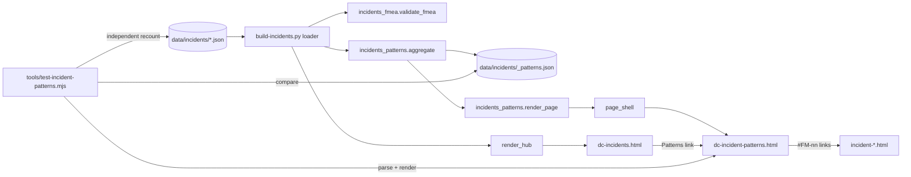
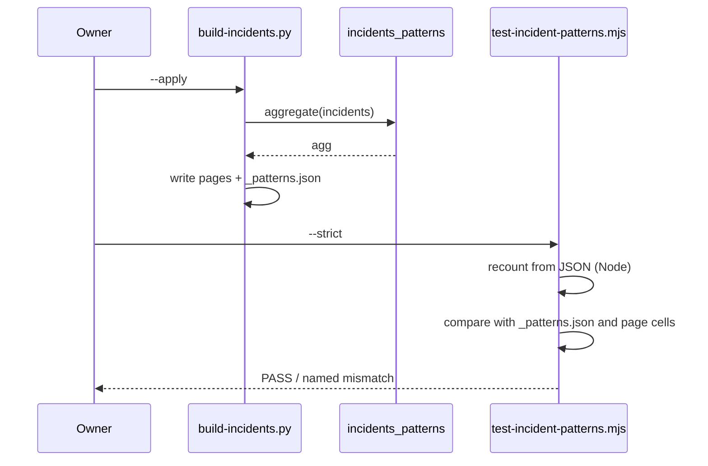

# PRD-Q18 — Incident pattern analytics across the dossier library

## 1. Document control

| Field | Value |
|---|---|
| PRD id | PRD-Q18 |
| Feature | A generated, root-only page `dc-incident-patterns.html` and its data file `data/incidents/_patterns.json`: failure modes by incident category × where detection sat, official-postmortem share by category, recurring operators, categories that occur together, dossiers by year — every count linked to the dossier rows behind it, seed dossiers flagged, sample size stated |
| Version | 1.1 |
| Status | Draft |
| Author | Opus 5.5 (Fable quota exhausted) |
| Date | 2026-11-11 |
| Owner requests | R110 (PRD per idea), R111 (24-section structure) |
| Priority | 70.0 (addendum rank 7: I 7, N 7, C 7, E 4, effort 3 weeks; `documentation/PRODUCT_INNOVATION_ASSESSMENT_2026-11_ADDENDUM.md:82`) |
| Related findings | Q18 (`…_ADDENDUM.md:243-260`), roadmap "Connected reference, weeks 9–16" (`:557`), BASELINE §5 "Incident aggregate view: None". New findings: F3 (an aggregate view already exists on the hub; BASELINE is wrong), F4 (the hub counts each incident under its first category only), F5 (5 of 12 categories have no label), F6 (no subsystem field; keyword assignment fails), corrections C1–C4 (§3.3) |
| Dependencies | **PRD-Q09 Phase A** (blocking for T-2): Q09 owns the dossier state model (`sourcing.state`) and the shared rules module `tools/lib/incident_rules.py` that this PRD consumes (coordinator decision D12); Q09 T-4 also changes `officialPostmortem` on 3 dossiers and its batches move seeds to verified, which is why every expected count here is computed at gate time. Edge Q09 → Q18 only. Uses the root-only decision of PRD-Q01 (F5, F6, §16 of `documentation/product-transformation/02-prds/PRD-Q01/PRD.md`). Phase 2 (subsystem axis) needs owner acceptance of a curated per-mode field (D-Q18-2). Link lock for the new page rides PRD-Q01 FR-13 (D-Q01-3, §16) |
| Related modules | `tools/build-incidents.py`, `tools/incidents_fmea.py`, new `tools/incidents_patterns.py`, `tools/lib/incident_rules.py` (PRD-Q09, read), `data/incidents/*.json` (read), `dc-incidents.html` (generated), `js/rz-feature-flags.js` (read), `tools/ship-gate.sh` |
| Target wave | "Connected reference, weeks 9–16" (`…_ADDENDUM.md:557`), after Q1 |
| Approval status | Approved by owner R110/R111 2026-11-10 (the PRD set). Opening the page beyond root is an access change and needs the owner's explicit yes (D-Q18-1, was OQ-1); the subsystem axis needs acceptance of the curated field (D-Q18-2, was OQ-2). Both in `documentation/product-transformation/DECISIONS.md` |

Change history

| Version | Date | Author | Change |
|---|---|---|---|
| 1.0 | 2026-11-11 | Opus 5.5 | First complete draft, 24 sections. Facts and every count verified against `wt-hub3` at `2f458f7c5` (branch `hub-r3`) with the scripts in Appendix A |
| 1.1 | 2026-11-11 | Opus 5.5 | QA batch 2 revisions (D9–D16). D14: the false claim that the hub shows human error as "2 of 43" is removed; F3 now names the hub's Incident Intelligence "Top categories" bars (`iid_catbars`, `tools/build-incidents.py:1254`), which already count every listed category (Human error 10); the value is restated as the mode × cause matrix, drill-down to dossier rows and the sample-size statement; every kept number re-checked at `644b810d4`. D12: PRD-Q09 added as a dependency; seeds read through Q09's `tools/lib/incident_rules.py` and field `sourcing.state` (A1); L7 and AC-1…AC-5 compute expected values from the data at gate time (formulas, today's numbers only as labelled illustrations). D13: the page joins the root-only link list under PRD-Q01 FR-13 (D-Q01-3); if that is rejected, the page keeps the dossiers' page-level check (`tools/build-incidents.py:424`, `:501`, `:489`) and no public page links it. D9: law-wiring table (§20.3). D15: OQ-1/OQ-2 → D-Q18-1/D-Q18-2. D16: no Supabase; the shared stub is named and not used. `ship-gate.sh` insertion by anchor text |

## 2. Executive summary

The site holds 43 incident dossiers with 284 scored failure modes. Each dossier is a strong single page, but the questions an engineer asks across them — where did detection sit for power failures, how many fire incidents have an official postmortem, which operators recur — have only a partial answer today. The hub `dc-incidents.html` already carries two aggregate views (contrary to the baseline, which says none exists): the Incident Intelligence dashboard, whose "Top categories" bars count every category a dossier lists (Human error 10), and the library-wide FMEA section, whose category table files each incident under its first category only (human 2). The two disagree on the same page with no caption saying why. Neither view crosses failure modes with their cause category and where detection sat, links a count to the dossier rows behind it, or states its sample. Five categories render as raw ids. Seed dossiers, 15 of the 43 at `644b810d4`, are counted as if researched.

This PRD adds one generated page, `dc-incident-patterns.html`, built by `tools/build-incidents.py` from a new data file `data/incidents/_patterns.json`. Its value is three things the hub does not have: the **mode × cause matrix** (failure modes counted by cause category, every category a dossier lists, × detection band from the library's own FMEA rubric), **drill-down** from every count to the dossier rows behind it, and a **sample-size statement**. Each cell shows the count from researched dossiers with seed modes beside it as "+n seed", and links to the list of failure modes behind it, each linking to its row in the dossier. Further views: official-postmortem share by category (at `644b810d4`: "13 of 43 dossiers have no official postmortem"; PRD-Q09 T-4 changes the flag on 3 dossiers), operators with two or more dossiers, categories that occur together, dossiers by year. A sample-size statement says plainly that this is a curated library, not an industry rate.

The addendum asked for an FMEA mode × subsystem matrix. The dossiers have no subsystem field, and a keyword rule assigns exactly one subsystem to only 42.6 % of modes (Appendix A2). v1 therefore uses two fields every mode has; a curated subsystem field is Phase 2, behind owner acceptance.

The page stays root-only and noindex, like the library it summarises (PRD-Q01 F5, F6, §16). A gate recounts every cell independently in Node from the dossier JSON and fails on any mismatch. Seed versus researched is not a rule of this PRD: it reads PRD-Q09's state model (`sourcing.state`, `tools/lib/incident_rules.py`).

## 3. Problem statement

### 3.1 Verified facts (commands run 2026-11-11 on `wt-hub3` at `2f458f7c5`; scripts in Appendix A)

| # | Fact | Evidence | Command |
|---|---|---|---|
| F1 | 43 dossiers (`data/incidents/*.json`, names not starting with `_`): 28 researched, 15 seed (re-checked at `644b810d4`). Today the seed marker is `sourcing.lastVerified` containing "seed" ("(seed — pending deep research)"); PRD-Q09 T-2 turns it into the field `sourcing.state` (D12); seeds also lack `sourcing.confidence`, `sourcing.referenceCount` and `location.region` (each present in 28) | `tools/build-incidents.py:1650` (loader excludes `_` files) | A1 |
| F2 | Every dossier has the same top-level schema (31 keys; `durationEvidence` 33, `id` 4). Each has `fmea.modes` (5–8 per dossier, median 7): 284 modes, 189 researched, 95 seed. Every mode has `id` (FM-nn), `item`, `function`, `failureMode`, `effect`, `cause`, `prevention`, `detection`, `S`, `O`, `D`, `rationale`, `evidence`, `actions`, `short`, `playbook`; `revised` (+ `revisedRationale`) on 87; `symbol` on 67 | A1 output | A1 |
| F3 | Two aggregate views exist on the hub. (a) The Incident Intelligence dashboard's "Top categories" bars (`iid_catbars`, `tools/build-incidents.py:1254-1266`, placed at `:1391`) count **every** category each dossier lists: Human error 10, the same multi-valued count this PRD uses. (b) The hub renders "FMEA across the library" (`tools/incidents_fmea.py:519-615`): mode count, share detected after impact (D ≥ 8), residual share, RPN cut, a detection histogram with each row listing its modes, "By incident category", "Most risk still standing" | `tools/build-incidents.py:636-639` (hub nav and body), `:672` (CSS) | `grep -n corpus_section tools/build-incidents.py` |
| F4 | The hub's FMEA category table (view F3 b) groups each incident under `category[0]` only (`_cat`, `tools/incidents_fmea.py:510-512`; table `:560-573`). By first category: network 11, software 10, power 8, fire 8, cooling 4, human 2. By every listed category: software 20, power 17, network 14, human 10, fire 10, cooling 6, config-error 3, and one each for control-plane, authentication, storage, change-management, supply. 34 of 43 dossiers list two or more categories. The dashboard bars (F3 a) show the every-category numbers; the FMEA table shows the first-category numbers; nothing on the page explains the difference | A1 output; `grep -o 'data-cat="human"><span class="iid-cbl">Human error' dc-incidents.html` | A1 |
| F5 | `CATEGORY_LABEL` (`tools/build-incidents.py:30-33`) has 8 entries (power, cooling, network, software, human, fire, flood, supply); 5 categories in use have none (config-error, control-plane, authentication, storage, change-management) and render raw through `cat_chips` (`:534-535`). The list filter offers 7 category chips (`:650-656`) | as cited | `sed -n 30,33p tools/build-incidents.py` |
| F6 | No subsystem field exists on any mode (F2). A keyword rule over `item` gives exactly one subsystem for 121 of 284 modes (42.6 %), none for 126 (44.4 %), two or more for 37 (13.0 %). Many `item` values are process items ("ebs re-mirroring logic", "911 and priority public-safety calling path") | A2 output | A2 |
| F7 | Official postmortem: 30 of 43 (`sourcing.officialPostmortem` truthy); 22 of 28 researched, 8 of 15 seed. 13 dossiers have none (the addendum's figure is right) | A1 | A1 |
| F8 | Detection scores: D histogram (all) {2: 1, 3: 1, 4: 5, 6: 62, 7: 2, 8: 96, 9: 117} — no 1, 5 or 10. Bands (all / researched): D 1–5: 7 / 4; D 6–7: 64 / 39; D 8: 96 / 65; D 9–10: 117 / 81. The scores are the library's retrospective FMEA scores against the rubric `tools/incidents_fmea.py:57-64`, not operator data | A1 | A1 |
| F9 | Access: the hub and dossiers are root-only by a presentational gate (`<body class="locked">` `tools/build-incidents.py:501`, gate card `:519-528`, `enforceTierFeatureAccess('dc-incidents')` `:424`) and `noindex, nofollow` (`:489`); `'dc-incidents'` page-access is root only (`js/rz-feature-flags.js:233-235`); educators are not admitted (`EDUCATOR_ACCESS_PAGES`, `:495`). PRD-Q01 §16 records that the full dossier content is in the public HTML and JSON | as cited | `sed -n 485,530p tools/build-incidents.py` |
| F10 | `build-incidents.py --check` compares every entry of its `outputs` map with the file on disk (`:1663-1686`) and runs in the ship gate (`tools/ship-gate.sh:67`); adding a file to `outputs` puts it under the freshness gate with no other change | as cited | `sed -n 1643,1690p tools/build-incidents.py` |
| F11 | `tools/build-sitemap.py:70-71` skips noindex pages; `sitemap.xml`, `llms.txt`, `search-index.json` contain 0 references to `dc-incidents` | as cited | `grep -c dc-incidents sitemap.xml llms.txt search-index.json` |
| F12 | Gates that glob `incident-*.html` treat every match as a dossier (`tools/test-fmea-sim.mjs:26`; builder token reuse `tools/build-incidents.py:467`), so the new page must not use that prefix | as cited | `grep -n "incident-\.\*" tools/test-fmea-sim.mjs` |

### 3.2 Consequence of leaving it

- The hub shows two category counts for the same library (dashboard bars: every category, Human error 10; FMEA table: first category, human 2) with no caption, so a reader cannot tell which to trust. Neither view counts failure modes, says where detection sat, or links to the rows behind a number.
- Seed dossiers, written before research, weigh as much as researched ones in every library-wide figure.
- No figure states its sample, so a count of a curated library can be read as an industry rate (the addendum's own risk, `:256`).
- Patterns across dossiers (detection after impact in power and software, postmortem gaps in cooling and fire) stay invisible; the 284 scored modes are only read one dossier at a time.

### 3.3 Addendum and baseline corrections

| # | Source says | Verified | Correction |
|---|---|---|---|
| C1 | BASELINE §5: "Incident aggregate view: None" | The hub has two aggregate views: the dashboard's category bars (all categories) and the FMEA corpus section (first category) (F3) | Q18 adds the mode × cause matrix with drill-down and a sample statement; FR-9 captions the FMEA table so the two hub views no longer appear to contradict each other |
| C2 | Addendum: "One page with an FMEA mode × subsystem matrix" (`:246`) | No subsystem field; keyword assignment works for 42.6 % (F6) | v1 matrix = category × detection band (fields present on every mode); subsystem axis = Phase 2 with a curated, owner-accepted field |
| C3 | Addendum: "43 structured dossiers (cause, FMEA mode, operator, year)" | Correct, and 15 are seeds (F1) | Seeds are flagged everywhere |
| C4 | Addendum: "safe to show because every number is a count of the site's own records" (`:248`) | The records are root-only; showing aggregates more widely is an access decision (F9) | Page stays root-only (§16); widening is D-Q18-1 |

## 4. Objectives and success metrics

| Objective | Metric | Target | Measurement | Assumption |
|---|---|---|---|---|
| O1 Correct counts | Cells differing from an independent recount | 0 | L1, L2 | Recount in Node from the JSON, independent of the Python builder |
| O2 Every count traceable | Non-zero cells without a list of exactly that many mode links that resolve | 0 | L3 | Mode anchors are the dossiers' `<details class="fm-row" id="FM-nn">` |
| O3 Honest sample | Sample statement present; percentages only where the group holds ≥ 10 | Present; 0 violations | L4 | Threshold 10 is a readability rule, stated on the page |
| O4 Seeds flagged | Seed modes inside researched counts | 0 | L5 | Seed = `incident_rules.is_seed` (PRD-Q09 state model) |
| O5 Labels | Raw category ids rendered on the hub, dossiers or patterns page | 0 (today 5 ids raw) | L8 | — |
| O6 Use | Visits by root to the page | UNKNOWN — the tracker does not record root-only pages today; not measured (no target) | — | Owner is the only reader in v1 |

## 5. Scope

### 5.1 In scope
1. `tools/incidents_patterns.py`: aggregation (`aggregate`), page body (`render_page`), CSS, drill-down script.
2. `tools/build-incidents.py`: two new outputs (`dc-incident-patterns.html`, `data/incidents/_patterns.json`), labels for 5 categories, a "Patterns" link on the hub.
3. `tools/incidents_fmea.py`: the hub category table relabelled "Primary category" with a caption and a link to the new page.
4. Gate `tools/test-incident-patterns.mjs`.
5. Standards and changelog per §22.

### 5.2 Out of scope

| Item | Why |
|---|---|
| Subsystem axis | No field (F6); Phase 2 after owner acceptance (D-Q18-2) |
| Public or educator access | Access change (D-Q18-1) |
| Industry rates, trends, forecasts | The library is curated (O3) |
| Re-scoring any FMEA mode | Scores belong to the dossiers and their gate (`tools/test-incidents-fmea.py`) |
| New filter chips for the five small categories on the hub list | Not needed for patterns; 1–3 dossiers each; can follow later |
| Charts other than tables and bar lists | Tables carry exact counts and links; the hub already has SVG charts |
| Q1 relation links (tools per category) | Possible after Q1 ships (§13) |

### 5.3 Existing capabilities reused

| Capability | Where | Use |
|---|---|---|
| Dossier loader and sort | `tools/build-incidents.py:1650-1656` | Same incident list |
| Page shell (root gate, noindex, theme, version stamp, scripts) | `tools/build-incidents.py:481-528`, scripts `:418-428` | New page |
| Freshness check | `:1663-1686` | Covers the two new outputs |
| FMEA rubric, `rpn`, `priority`, `validate_fmea` | `tools/incidents_fmea.py:36-66`, `:96`, `:100-116`, `:175` | Band labels, validity filter |
| Corpus CSS idioms (`.fc-h`, `.fc-list`, `.fc-n`, `.table-wrap`) | `tools/incidents_fmea.py:618-660` | Visual consistency |
| Editorial register tokens of the incident pages | `tools/build-incidents.py:97-105` (`--bg`, `--surface`, `--line`, `--muted`, `--amber`, both themes) | Page styling (this page family's tokens; see §9.7) |
| Mode anchors in dossiers | `<details class="fm-row" id="FM-nn">` (read by `tools/test-fmea-sim.mjs:97`) | Drill-down targets |
| Category labels | `CATEGORY_LABEL` `:30-33` | Extended |

### 5.4 Dependencies
- **PRD-Q09 Phase A** (T-2: `sourcing.state` on every dossier and `tools/lib/incident_rules.py`). This PRD's T-2 starts after it. Q09's later work (T-4 flag corrections, seed batches) changes the counts; nothing here hardcodes them (L7, §21).
- PRD-Q01 decision record on access (read only) and FR-13 (D-Q01-3), which adds this page to the root-only link list (§16).
- Owner for D-Q18-1 and D-Q18-2.
- No peer-owned file is touched.

### 5.5 Constraints
- Generated pages are never hand-edited (CLAUDE.md, `build-incidents.py --check`).
- Static HTML, no runtime fetch; one small inline script to open the drill-down.
- Root-only and noindex, like the hub.
- Page name must not match `incident-*.html` (F12).
- Design rules of the brief (states as words, radius ≤ 4 px, no `transition: all`, no hover transform, 390 and 1440, both themes).

### 5.6 Assumptions
| # | Assumption | If wrong |
|---|---|---|
| A1 | PRD-Q09 owns the dossier state model: the field `sourcing.state` (`seed` \| `legacy` \| `verified`) and the rules module `tools/lib/incident_rules.py` (coordinator decision D12). "Researched" here = `legacy` or `verified` | If Q09 Phase A has not shipped, T-2 waits; this PRD defines no seed rule of its own |
| A2 | Multi-valued category membership is the right reading of `category[]` | If the owner wants a primary category, the matrix gains a toggle; data unchanged |
| A3 | Detection bands follow the rubric anchors (§10.2) | Band edges change in one table; the gate reads them from `_patterns.json` |

## 6. User personas and use cases

Tiers as implemented: `free | demo | pro | root` (`js/rz-feature-flags.js:6`); page access for `'dc-incidents'` is root only (`:233-235`); root accounts are listed in `auth.js:246`.

| Persona | Role | Goal | Access in v1 | Outcome |
|---|---|---|---|---|
| P1 Owner (root, admin) | Engineering operations leader, curates the library | See where detection fails across categories; decide which seeds to research first; spot postmortem gaps | Full | A ranked research and writing agenda from counts that link to rows |
| P2 DC / facility engineer (pro) | Reads dossiers when root shares them | Compare detection across power, cooling, fire | None in v1 (root gate) | Covered if D-Q18-1 opens the page |
| P3 Educator (pro, role educator) | Teaches incident analysis | Use the matrix in class | None in v1 | Covered if D-Q18-1 admits educators |
| P4 Signed-out visitor | — | — | Sees the root gate card | No content shown |

| UC | Persona | Use case |
|---|---|---|
| UC1 | P1 | Open the patterns page from the hub; read the matrix; open "Power · through customers" and follow a mode to its dossier row |
| UC2 | P1 | Find categories with the lowest official-postmortem share to prioritise research |
| UC3 | P1 | See which operators recur and open their dossiers |
| UC4 | P1 | After adding or researching a dossier, rebuild and see counts move (seed → researched) |
| UC5 | P4 | Lands on the URL; sees "Root access required" |

## 7. Complete user journey

### J1 Root opens the page (UC1)
- Entry: hub `dc-incidents.html` → nav "Patterns" (after "FMEA" in the hub nav, `tools/build-incidents.py:636`) or the link in the FMEA section caption; direct URL.
- Initial state: page shell renders with `<body class="locked">`; `enforceTierFeatureAccess('dc-incidents')` unlocks for root (same key as the hub, no flag change).
- Content order: title and sample statement → matrix → drill-down lists (collapsed) → postmortem table → recurring operators → categories together → dossiers by year → method.
- Action: click a matrix cell (a link `#c-<cat>-<band>`). Response: the browser moves to that list; the small script opens the category's `<details>`; focus moves to the list heading; the list shows "n modes in m dossiers" then one row per mode: "AWS 2025 · FM-03 · <failure mode>" linking `incident-<slug>.html#FM-03`; seed rows end "· seed".
- Success: the dossier opens at the mode row (existing anchor).
- Back: browser back returns to the matrix position (`#c-…` in history).
- Failure: none at run time (static page). A missing anchor is caught by the gate (L3) before release.
- Exit: hub link "← Library" at the top; site nav.

### J2 Signed-out or non-root (UC5)
The root gate card shows "Root access required … Sign In / Back to Home" (`:519-528`). The page body is present in HTML but hidden by the presentational gate, exactly as on the hub (F9).
- Arriving from a link: once PRD-Q01 FR-13 ships with this page in the root-only list (D-Q01-3 accepted, §16), site link handlers mark links to it locked and a row that links it shows "Root access" through Q01's renderer. If D-Q01-3 is rejected, no public page links it (§16), so the only entry for a non-root visitor is a typed URL, which shows the gate card.

### J3 Owner updates the library (UC4)
Edit or add a dossier JSON → `python3 tools/build-incidents.py --apply` (writes dossiers, hub, patterns page, `_patterns.json`) → `node tools/test-incident-patterns.mjs --strict` → ship. If the dossier is invalid, `validate_fmea` excludes it from every aggregate and the page's method line says "n dossiers excluded: FMEA did not validate"; the existing FMEA gate fails first in any case.

## 8. Functional requirements

**FR-1 Aggregation**
- Description: `incidents_patterns.aggregate(incidents) → dict` computes every figure on the page.
- Trigger: every `build-incidents.py` run (`--apply`, `--check`, dry run).
- Preconditions: incidents loaded and sorted (`:1650-1656`).
- Inputs: the list of dossier dicts.
- Processing: keep dossiers whose FMEA validates (`not validate_fmea(x)`, as the corpus does, `tools/incidents_fmea.py:526`); seed flag `incident_rules.is_seed(x)` (PRD-Q09, D12); multi-valued categories; bands §10.2; per cell, the ordered list of mode references `"<slug>#<FM-id>"` split researched / seed; postmortem counts by category; operators by `operatorShort` (fallback `operator`) with ≥ 2 dossiers; unordered category pairs with ≥ 2 dossiers; dossiers by year (`date[:4]`); totals with each mode once.
- Outputs: dict per schema §10.3; counts are lengths of the stored lists, so a count can never disagree with its list.
- State change: none.
- Dependencies: `incidents_fmea.validate_fmea`, `RUBRIC`, `tools/lib/incident_rules.is_seed` (PRD-Q09).
- Exceptions: a mode with a D outside 1–10 → `ValueError` naming slug and id (the FMEA gate forbids it already).
- Acceptance: L1.

**FR-2 Data file**
- Description: `data/incidents/_patterns.json` is written by `--apply` and compared by `--check`.
- Trigger: build.
- Preconditions: FR-1.
- Inputs: aggregate.
- Processing: `json.dumps(agg, indent=1, sort_keys=True, ensure_ascii=False) + "\n"`; added to the builder's `outputs` map under its relative path.
- Outputs: file.
- State change: repository file.
- Dependencies: F10.
- Exceptions: none.
- Acceptance: L1, L7.

**FR-3 Patterns page**
- Description: `dc-incident-patterns.html` rendered by `page_shell` from the aggregate.
- Trigger: build.
- Preconditions: FR-1.
- Inputs: aggregate, incidents (titles for list rows).
- Processing: sections §9.2; every number is read from the aggregate; every number element carries `data-count` (and `data-n` for denominators).
- Outputs: HTML file with `noindex, nofollow`, root gate, version stamp, theme toggle.
- State change: repository file.
- Dependencies: `page_shell` (`:481`).
- Exceptions: none.
- Acceptance: L2, L6.

**FR-4 Matrix: category × detection band**
- Description: rows = 12 categories (sorted by researched dossier count, then id); columns = 4 bands + "All modes"; final row "All categories (each mode once)".
- Trigger: FR-3.
- Inputs: aggregate cells.
- Processing: cell shows researched count; when seed count > 0 a second line "+k seed"; zero cells show "0" without a link; each non-zero cell is `<a href="#c-<cat>-<band>">`. Row header shows label and "m dossiers (+s seed)". Row share "after impact" (D ≥ 8 as % of researched modes) only when researched modes ≥ 10.
- Outputs: `<table class="pt-matrix">`.
- Exceptions: none.
- Acceptance: L2, L3, L4.

**FR-5 Drill-down lists**
- Description: one `<details class="pt-cat" id="c-<cat>">` per category; inside, one list per band `id="c-<cat>-<band>"`.
- Processing: list items in dossier magnitude order (the builder's sort), then mode id; text "<operatorShort> <year> · <FM-id> · <failureMode>"; seed items end " · seed"; link `incident-<slug>.html#<FM-id>`.
- Script: on `click` of a matrix link and on load/`hashchange`, open the `<details>` that contains the target and move focus to the list heading (≤ 1 KB inline; no library).
- Acceptance: L3 (counts equal list lengths; links resolve), AC-3.

**FR-6 Official postmortem by category**
- Description: table Category | Dossiers | With an official postmortem | Without; researched first, seed beside; the headline sentence "{without} of {total} dossiers have no official postmortem ({ver_without} of {ver_total} researched)."
- Acceptance: L1, L2, AC-4. Illustration at `644b810d4` (before PRD-Q09 T-4 changes 3 flags): "13 of 43 dossiers have no official postmortem (6 of 28 researched)."

**FR-7 Recurrence and co-occurrence**
- Description: operators with ≥ 2 dossiers (name, counts, links to each dossier); category pairs listed together by ≥ 2 dossiers (pair, counts, links).
- Acceptance: L1, L2, L3 (links resolve).

**FR-8 Dossiers by year**
- Description: a table Year | Researched | Seed (no chart, no trend line, no rate).
- Acceptance: L1, L2.

**FR-9 Hub corrections**
- Description: (a) `CATEGORY_LABEL` gains `config-error: "Configuration error"`, `control-plane: "Control plane"`, `authentication: "Authentication"`, `storage: "Storage"`, `change-management: "Change management"`; (b) the hub FMEA category table header "Category" becomes "Primary category" with the caption "Each incident counted once, under the first category it lists, so these numbers are lower than the Top categories bars above, which count every category. Incident patterns counts every category and links each count to its failure modes." linking to the page (this caption explains why the two hub views differ, F3); (c) hub nav gains `<a href="dc-incident-patterns.html">Patterns</a>` after "FMEA".
- Trigger: build.
- Acceptance: L8 (no raw ids), AC-6; `tools/test-fmea-sim.mjs` stays green (it reads `.fc-tbl` geometry, not header text).

**FR-10 Method section**
- Description: states the rules: what a seed is, multi-valued categories, bands with rubric anchors and a link to the hub FMEA section, the ≥ 10 rule, excluded dossiers (if any), "counts generated by tools/build-incidents.py on <build date of the release>".
- Acceptance: L4.

**FR-11 Phase 2 subsystem axis (behind D-Q18-2)**
- Description: add `subsystem` to each mode from a controlled list (§10.5), proposed by `tools/incidents_patterns.py propose-subsystems` (keyword rule of Appendix A2 as a draft) and written only after owner review; the matrix gains a "Subsystem" view.
- Acceptance: when shipped, `tools/test-incidents-fmea.py` checks the field is from the list; L1–L3 extend to the new view.

### 8.1 FR field matrix

| FR | Trigger | Preconditions | Inputs | Outputs | State change | Dependencies | Exceptions | Acceptance |
|---|---|---|---|---|---|---|---|---|
| FR-1 | Build | Loaded incidents | Dossiers | Aggregate dict | — | `validate_fmea`, `RUBRIC` | D outside 1–10 → error | L1 |
| FR-2 | Build | FR-1 | Aggregate | `_patterns.json` | File | Builder `outputs` | — | L1, L7 |
| FR-3 | Build | FR-1 | Aggregate, incidents | Page | File | `page_shell` | — | L2, L6 |
| FR-4 | FR-3 | Cells | Aggregate | Matrix | — | — | — | L2–L4 |
| FR-5 | FR-3; click | Lists | Aggregate | Lists, opener script | — | — | — | L3, AC-3 |
| FR-6 | FR-3 | — | Aggregate | Table, sentence | — | — | — | L1, L2 |
| FR-7 | FR-3 | — | Aggregate | Lists | — | — | — | L1–L3 |
| FR-8 | FR-3 | — | Aggregate | Table | — | — | — | L1, L2 |
| FR-9 | Build | — | Labels | Hub changes | Files | `incidents_fmea` | — | L8, AC-6 |
| FR-10 | FR-3 | — | Aggregate | Method text | — | — | — | L4 |
| FR-11 | D-Q18-2 | Owner review | Modes | `subsystem` field | Dossier files | `test-incidents-fmea.py` | Unknown value → gate fail | Phase 2 |

## 9. UI/UX specification

### 9.1 Placement and IA
- New generated page `dc-incident-patterns.html` (root-only, noindex), sibling of the hub; reached from the hub nav and the FMEA caption. Not in sitemap, llms or search (F11).
- Title (h1): "Incident patterns across the library". Eyebrow: "Root-only · Generated from the dossiers". Back link "← Library" to `dc-incidents.html`.

### 9.2 Layout (ASCII, 1440)

The numbers in the sketch and in the HTML example of §9.3 are illustrations at `644b810d4`; the page prints the aggregate computed at build time.
```
← Library
Root-only · Generated from the dossiers
Incident patterns across the library
43 dossiers: 28 researched in depth, 15 seed dossiers still waiting for research. 284 failure
modes: 189 from researched dossiers, 95 from seeds. Main figures count researched dossiers only;
seed counts appear beside them as "+n seed". This is a curated library of major, publicly reported
incidents, not a random sample: the counts describe this library, not how often these failures
happen in the industry. Percentages appear only where a group holds at least 10.

Where detection sat, by category
┌──────────────────────┬────────────┬──────────┬──────────────────┬─────────────────────┬──────┐
│ Category             │ D 1–5      │ D 6–7    │ D 8              │ D 9–10              │ All  │
│                      │ before     │ at onset │ after impact,    │ through customers,  │      │
│                      │ impact     │          │ internal monitor │ or not at all       │      │
├──────────────────────┼────────────┼──────────┼──────────────────┼─────────────────────┼──────┤
│ Software             │ 1          │ 16       │ 33               │ 40                  │ 90   │
│ 14 dossiers +6 seed  │            │ +4 seed  │ +17 seed         │ +16 seed            │ +37  │
│ Power  11 +6 seed    │ 1  +3 seed │ 19 +15   │ 22 +9            │ 37 +11              │ 79 +38│
│ …                    │            │          │                  │                     │      │
│ All categories (each mode once) │ 4 +3 │ 39 +25 │ 65 +31        │ 81 +36              │189 +95│
└──────────────────────┴────────────┴──────────┴──────────────────┴─────────────────────┴──────┘
Detection scores are this library's retrospective FMEA scores (rubric in the FMEA section), not
figures published by the operators. A dossier that lists two categories counts in both rows.

▸ Software — 90 modes in 14 dossiers (+37 in 6 seed)     (details, one per category)
   D 9–10 · through customers, or not at all — 40 modes in 12 dossiers
   • AWS 2025 · FM-03 · <failure mode>                     → incident-…html#FM-03
   • …  · seed
…
Official postmortems by category
  13 of 43 dossiers have no official postmortem (6 of 28 researched).
  table: Category | Dossiers | With an official postmortem | Without
Operators with two or more dossiers   (list with links)
Categories listed together            (list with links)
Dossiers by year                      (table)
How these counts are made             (method text)
```
(Numbers in the sketch are today's counts from Appendix A1; the page reads them from `_patterns.json`.)

390 px: the matrix becomes one block per category: label line, then a four-row fact list "Before impact 1 · +3 seed" etc., then "All 79 · +38 seed"; no sideways scroll.

### 9.3 Component hierarchy
```html
<main class="wrap" id="main-content">
  <a class="backlink" href="dc-incidents.html">← Library</a>
  <div class="eyebrow">Root-only · Generated from the dossiers</div>
  <h1>Incident patterns across the library</h1>
  <p class="pt-sample" data-dossiers="43" data-verified="28" data-seed="15" data-modes="284" …>…</p>
  <section id="matrix"><h2>Where detection sat, by category</h2>
    <div class="table-wrap"><table class="pt-matrix"><caption>…</caption>
      <thead>…</thead><tbody><tr data-cat="power"><th scope="row">…</th>
        <td><a href="#c-power-d1-5" data-count="1" data-seed="3">1<small>+3 seed</small></a></td>…</tr></tbody>
      <tfoot><tr data-cat="_all">…</tr></tfoot></table></div>
    <p class="pt-note">…</p></section>
  <section id="lists"><h2>Failure modes behind each count</h2>
    <details class="pt-cat" id="c-power"><summary>…</summary>
      <h3 id="c-power-d9-10" tabindex="-1">…</h3><ol class="pt-list" data-count="37" data-seed="11"><li>…</li></ol>
    </details></section>
  <section id="postmortem">…<table class="pt-pm">…</table></section>
  <section id="operators">…<ul class="pt-ops">…</ul></section>
  <section id="pairs">…</section>
  <section id="years">…<table class="pt-years">…</table></section>
  <section id="method">…</section>
</main>
```

### 9.4 Controls and behaviour

| Control | Behaviour |
|---|---|
| Matrix cell link | Moves to the list; opener script opens its `<details>` and focuses the list heading |
| `<details>` summary | Native open/close; keyboard Enter/Space |
| List item link | Opens the dossier at `#FM-nn` |
| Operator / pair links | Open the dossier |
| "← Library" | Hub |
No filters, no search, no toggles in v1 (static counts; every count has a list).

### 9.5 States
- Root: content.
- Non-root: root gate card (shell).
- Empty: cannot happen with 43 dossiers; if the aggregate is empty the page says "No dossier has a valid FMEA yet." (builder branch).
- Excluded dossiers: method line "{n} dossier(s) excluded: their FMEA did not validate."

### 9.6 Exact copy strings

| Key | Text |
|---|---|
| title | Incident patterns across the library |
| eyebrow | Root-only · Generated from the dossiers |
| sample | {dossiers} dossiers: {verified} researched in depth, {seed} seed dossiers still waiting for research. {modes} failure modes: {modesVerified} from researched dossiers, {modesSeed} from seeds. Main figures count researched dossiers only; seed counts appear beside them as "+n seed". This is a curated library of major, publicly reported incidents, not a random sample: the counts describe this library, not how often these failures happen in the industry. Percentages appear only where a group holds at least 10. |
| matrix heading | Where detection sat, by category |
| band labels | D 1–5 · before impact; D 6–7 · at onset; D 8 · after impact, internal monitoring; D 9–10 · through customers, or not at all |
| matrix note | Detection scores are this library's retrospective FMEA scores (rubric in the FMEA section), not figures published by the operators. A dossier that lists two categories counts in both rows. |
| total row | All categories (each mode once) |
| seed suffix | +{k} seed |
| list heading | {label} · {band label} — {n} modes in {m} dossiers |
| seed item suffix | · seed |
| pm heading | Official postmortems by category |
| pm sentence | {without} of {total} dossiers have no official postmortem ({verWithout} of {verTotal} researched). |
| operators heading | Operators with two or more dossiers |
| pairs heading | Categories listed together |
| years heading | Dossiers by year |
| method heading | How these counts are made |
| hub caption | Each incident counted once, under the first category it lists. Incident patterns counts every category. |
| hub nav | Patterns |

### 9.7 Styling
- Tokens: the incident page family defines its own register in `page_shell` (`tools/build-incidents.py:97-105`), the editorial palette CLAUDE.md names for articles (`#0E0F12` / `#16181D` dark, amber `#e8b563` dark and `#92400e` light). The patterns page is generated by the same shell, so it uses those tokens; it does not load `css/rz-hub.css`, which would bring a second token set into the page.
- Table: 1 px `--line` rules, no zebra fill, numbers in JetBrains Mono with tabular figures, labels in IBM Plex Sans; seed suffix in `--muted`.
- One amber element per view: the focus ring and the currently targeted list heading (`:target` outline); nothing else amber.
- Radius ≤ 4 px; no shadow, gradient, glass; hover on links changes underline colour only (no transform, `transition-property: color`).
- No colour carries meaning alone (bands are named in words).

### 9.8 Motion
None. Opening a `<details>` is native and instant; `scroll-behavior` follows the page shell.

### 9.9 Accessibility
- Table has `<caption>`, `scope="col"` and `scope="row"`; cell links have `aria-label="{n} {category} modes, {band label}, {k} more in seed dossiers"`.
- Focus moves to the list heading after a cell click (tabindex −1).
- axe 0 serious/critical at 390 and 1440 in both themes, proven with a planted low-contrast line first.
- Works without the script (anchors still jump; the user opens the `<details>`).

## 10. Data model

### 10.1 Existing (read only)
Dossier schema F2. Fields used: `slug`, `title`, `operator`, `operatorShort`, `date`, `category[]`, `sourcing.officialPostmortem`, `sourcing.state` (PRD-Q09; read through `tools/lib/incident_rules.py`), `fmea.modes[].{id, failureMode, D, S, O, revised}`, `_score` (builder, magnitude sort).

### 10.2 Detection bands

| Band id | D range | Label | Rubric anchors (`tools/incidents_fmea.py:57-64`) |
|---|---|---|---|
| `d1-5` | 1–5 | before impact | 1 "Certain to be stopped", 2 "Automated interlock almost certainly stops it", 4 "Detected before impact with time to act" |
| `d6-7` | 6–7 | at onset | 6 "Detected at onset, not prevented" |
| `d8` | 8 | after impact, internal monitoring | 8 "Detected after impact by internal monitoring" |
| `d9-10` | 9–10 | through customers, or not at all | 9 "Detected only through customer impact", 10 "No control could detect it" |

In-between scores (3, 5, 7) fall in the band of the anchor below them except 7, which sits with 6 (onset) because 8 is the first "after impact" anchor; the page states this in the method section.

### 10.3 `data/incidents/_patterns.json` schema (`rz-incident-patterns/1`)

```json
{
  "schema": "rz-incident-patterns/1",
  "seedRule": "PRD-Q09 sourcing.state == 'seed' (tools/lib/incident_rules.is_seed)",
  "bands": [{"id": "d1-5", "min": 1, "max": 5, "label": "before impact"}, "…"],
  "sample": {"dossiers": 43, "verified": 28, "seed": 15, "excluded": [],
             "modes": 284, "modesVerified": 189, "modesSeed": 95},
  "categories": [
    {"id": "power", "label": "Power",
     "dossiers": {"verified": ["<slug>", "…"], "seed": ["…"]},
     "cells": {"d1-5": {"verified": ["<slug>#FM-04"], "seed": ["…"]}, "d6-7": {"…": []}, "d8": {}, "d9-10": {}},
     "postmortem": {"verified": ["<slug>"], "seed": ["<slug>"]}}
  ],
  "total": {"cells": {"d1-5": {"verified": ["…"], "seed": ["…"]}, "…": {}}},
  "operators": [{"name": "AWS", "verified": ["…"], "seed": []}],
  "pairs": [{"a": "network", "b": "software", "verified": ["…"], "seed": ["…"]}],
  "years": [{"year": "2011", "verified": ["…"], "seed": []}],
  "postmortem": {"verified": ["…"], "seed": ["…"]}
}
```
Constraints: every list sorted (dossiers by magnitude rank, then mode id); every slug resolves to a dossier; every `<slug>#<FM-id>` resolves to a mode; counts are list lengths (no stored count fields to drift); `categories` sorted by verified dossier count desc, then id; `label` from `CATEGORY_LABEL` (all 12 present after FR-9). Size today ≈ 30 KB (UNKNOWN exactly — measure in T-2; budget ≤ 64 KB).

Example record (power, abridged, illustration at `644b810d4`): researched dossiers 11, seed 6; cells researched / seed: d1-5 1 / 3, d6-7 19 / 15, d8 22 / 9, d9-10 37 / 11; postmortem researched 7 of 11, all 10 of 17.

### 10.4 Validation (in `aggregate` and in the gate)
V1 schema const; V2 band ranges cover 1–10 without overlap; V3 every reference resolves; V4 total researched modes = sum over dossiers (each once); V5 no slug in both `verified` and `seed`; V6 categories have labels; V7 file ≤ 65,536 bytes.

### 10.5 Phase 2 field (behind D-Q18-2)
`fmea.modes[].subsystem` ∈ {`utility-power`, `generator-fuel`, `ups-battery`, `distribution`, `cooling`, `fire`, `network`, `software`, `configuration`, `monitoring`, `people-process`, `building`} (the dry-run vocabulary of Appendix A2), one value per mode, written only after review.

### 10.6 Migration, compatibility, retention
New generated files; no dossier change in v1; the hub keeps its anchors (`#fmea-corpus` etc.). Retention: generated, rebuilt every run. Rollback: remove the outputs and FR-9 lines.

## 11. API and integration contracts

No server endpoint: the feature is generated static HTML and JSON. Contracts:

### 11.1 Python module `tools/incidents_patterns.py`

| Function | Signature | Contract |
|---|---|---|
| `aggregate` | `(incidents: list[dict]) -> dict` | Pure; schema §10.3; raises `ValueError` on a D outside 1–10 |
| `render_page` | `(agg: dict, incidents: list[dict]) -> str` | Body HTML for `page_shell`; escapes every dossier string with `html.escape` |
| `CSS` | `str` | Page CSS (§9.7), ≤ 6 KB |
| `SCRIPT` | `str` | Opener script, ≤ 1 KB, no `</script>` inside strings |
| `propose_subsystems` | `(incidents) -> list[dict]` | Phase 2 CLI only; never writes dossiers |

### 11.2 Builder contract (`tools/build-incidents.py`)
`outputs["dc-incident-patterns.html"] = page_shell("Incident patterns — DC Incidents", "<desc>", "dc-incident-patterns.html", render_page(agg, incidents), head_extra=f"<style>{incidents_patterns.CSS}</style>")` and `outputs["data/incidents/_patterns.json"] = json.dumps(…)`; `--check` reports them like every page (F10). `articles.html` count marker unchanged.

### 11.2a Consumed contract: PRD-Q09 `tools/lib/incident_rules.py`
`aggregate` imports `is_seed(inc)` (and nothing else) from the module PRD-Q09 owns (PRD-Q09 §11.7). The Node gate reads `sourcing.state` directly from each dossier; it does not re-implement a seed rule.

### 11.3 Consumer contract for `_patterns.json`
Readers check `schema == "rz-incident-patterns/1"`, compute counts as list lengths, never write the file. The file is as public as the dossier JSON it is derived from (F9).

### 11.4 Supabase / Workers
Not used. Nearest real contract: the page-access matrix (`js/rz-feature-flags.js:233-235`) through `enforceTierFeatureAccess('dc-incidents')`.

## 12. Business rules and state machines

1. Counts are researched-only; seed counts are shown beside them, never added in.
2. A dossier counts in every category it lists; totals count each mode once.
3. A percentage is printed only for a denominator ≥ 10.
4. Every non-zero count links to a list of exactly that many items.
5. No figure is called a rate, a probability or a trend.
6. The page is generated; hand edits fail `--check`.

Dossier status as seen by the page:

```mermaid
stateDiagram-v2
  [*] --> Seed: dossier added with sourcing.state seed (PRD-Q09)
  Seed --> Researched: PRD-Q09 incident-verification record (state verified); legacy dossiers count as researched
  Seed --> Excluded: FMEA fails validation
  Researched --> Excluded: FMEA fails validation
  Excluded --> Seed: fixed (seed marker kept)
  Excluded --> Researched: fixed
  note right of Seed: counted as "+n seed"
  note right of Researched: counted in main figures
```


## 13. Cross-module integration

| Module | Effect |
|---|---|
| PRD-Q09 (dossier state, `tools/lib/incident_rules.py`, T-4 flag corrections, seed records) | Inputs of every count. Expected values are computed at gate time (L1, L7, §21), so Q09 releases never turn this gate red. Order: Q09 Phase A → Q18 → Q01 phase 2 → Q03 on `build-incidents.py` and the generated pages |
| `tools/build-incidents.py` | Two outputs, labels, hub nav link; `--check` covers them |
| `tools/incidents_fmea.py` | Header "Primary category", caption + link (FR-9b) |
| `dc-incidents.html` | Regenerated (nav, caption, labels in chips) |
| Dossier pages | Three regenerate with new chip labels: `incident-azure-wan-router-global-2023.html`, `incident-aws-ebs-ec2-rds-us-east-1-2011.html`, `incident-alibaba-cloud-global-2023.html` (they carry all 5 unlabeled categories between them; raw chips today: 2, 2, 3; hub: 7) |
| `tools/test-fmea-sim.mjs` | Unaffected (reads `.fc-tbl` geometry and `.fc-list` links); runs as today |
| `tools/test-incidents-fmea.py`, `tools/test-incidents-response.py`, `tools/build-incident-diagrams.mjs --check` | Unaffected (no dossier data change in v1) |
| Sitemap, llms, search index | Unchanged (noindex, F11); gate asserts 0 references |
| Service worker | HTML is network-first (`sw.js:98-105`); no change |
| Q1 relations | Possible later: per-category "Related tools" from accepted Q1 edges; not in v1 |
| Q3 reproduce, Q17 paths | May link to `dc-incident-patterns.html#c-<cat>` only through PRD-Q01's renderer ("Root access" row) and only once D-Q01-3 is accepted and Q01 FR-13 lists this page (§16). If D-Q01-3 is rejected, no public page links it |
| `auth.js`, `auth.min.js` (PRD-Q01 FR-13) | One exact entry `/dc-incident-patterns.html` added to `ROOT_ONLY_PATHS` (`auth.js:333-339`) in the same change and approval as Q01 FR-13 (D-Q01-3). This PRD does not edit `auth.js` itself | L6 (b) |
| `tools/ship-gate.sh` (shared with PRD-Q01, PRD-Q03, PRD-Q09) | One gate line | Inserted by anchor text (§20.3) |
| `articles.html` INC_COUNT marker | Unchanged |
| Explain DB | `fmea`, `rca` keys exist (`js/rz-explain-db.js`); method text may carry `data-explain="fmea"` |

## 14. AI and automation requirements
- Deterministic Python aggregation at build time; no LLM.
- Phase 2 subsystem proposals come from the keyword rule (Appendix A2) as drafts; the owner accepts each value before it is written. No automated write to dossiers.

## 15. Non-functional requirements

| Area | Requirement | Measurement |
|---|---|---|
| Performance | Page HTML ≤ 200 KB (≈ 284 list rows); no external JS beyond the shell's; `_patterns.json` ≤ 64 KB | `wc -c` in the gate |
| Build time | Aggregation adds ≤ 1 s to `build-incidents.py` | `time python3 tools/build-incidents.py --check` before/after (reported) |
| Availability | Static GitHub Pages | — |
| Accessibility | §9.9; axe with planted line | L8 |
| Security | §16 | — |
| Maintainability | One module, pure functions, < 800 lines | Review |
| Observability | `--check` names the stale file | F10 |
| Data integrity | Counts are list lengths; independent recount | L1 |
| Backup/recovery | Regenerated from dossiers at any time | — |

## 16. Security and access control
- Decision: **root-only, noindex**, same shell and page-access key as the hub. Reasons: (1) the owner set the library root-only (`js/rz-feature-flags.js:233-235`); (2) PRD-Q01 F5/F6 and §16 record that the gate is presentational and dossier links are not yet recognised by `isRootOnlyHref` (`auth.js:339-347`); publishing aggregates on a public page would widen access to derived content, an access-boundary change that STATE.md reserves for the owner; (3) every count's value is in its drill-down, whose targets are root-only anyway. Opening the page to educators or the public is D-Q18-1.
- **Link lock (coordinator decision D13).** `/dc-incident-patterns.html` joins the root-only link list under PRD-Q01 FR-13: the same `auth.js` change adds the exact entry `'/dc-incident-patterns.html'` to `ROOT_ONLY_PATHS` (`auth.js:333-339`; the Q01 prefix rule for `/incident-` does not match this name, which starts `/dc-`). **Requires owner approval — auth boundary**: it rides decision D-Q01-3 and is not a separate change (the D-Q01-3 row in `DECISIONS.md` names this page). This PRD does not touch `auth.js`.
- **If D-Q01-3 is rejected.** The page uses the same page-level root check the dossiers use, generated by the same builder: `<meta name="robots" content="noindex, nofollow">` (`tools/build-incidents.py:489`), `<body class="locked">` (`:501`), the gate card (`:519-528`) and the script at `:424` that calls `window._rzAuth.enforceTierFeatureAccess('dc-incidents')`, falling back to the stored session's `role`/`tier` = `root`. No public page links the page (the Q03/Q17 invitation of §13 lapses), so no unlocked link exists; L6 (b) then checks "no public page links `dc-incident-patterns`" instead of the matcher.
- The page adds no new exposure: `_patterns.json` is derived from dossier JSON that is already fetchable (Q01 §16).
- Input: dossier strings escaped (`html.escape`) at render; slugs and mode ids used in `href` come from the JSON and match `^[a-z0-9-]+$` and `^FM-[0-9]{2}$` (V3 checks).
- No secrets, no user data, no write path.

## 17. Edge cases and failure scenarios

| Case | Behaviour |
|---|---|
| Dossier with invalid FMEA | Excluded from every count; method line names the count; FMEA gate fails anyway |
| New category id without a label | `aggregate` raises; build fails with "category '<id>' has no label in CATEGORY_LABEL" |
| Dossier with empty `category` | Counted in the total row only; method line says so (none today) |
| Mode id missing or duplicate | FMEA gate fails; `aggregate` raises on duplicates |
| All modes of a category seed | Row shows 0 researched with "+k seed" (none today; cooling is closest: 2 researched, 4 seed) |
| Seed researched later | Moves from seed to researched on the next build (UC4) |
| Hand edit of the generated page | `--check` fails (F10) |
| Script blocked | Anchors still work; lists stay closed until opened by hand |
| Stale browser cache | HTML network-first (`sw.js`) |
| Non-root visitor | Root gate (J2) |
| Very long failure-mode text | Wraps; no truncation (row text is the dossier's own) |

## 18. Technical architecture



Sequence (owner rebuild):


Alternatives:

| Decision | Chosen | Alternative | Why |
|---|---|---|---|
| Placement | Separate generated page | New section on the hub | The hub already carries a map, a semantic graph, two corpus sections and the list; 284 list rows would add weight to a page that is opened for other reasons; the addendum asks for one page |
| Rendering | Build-time HTML from the JSON | Client-side render from `_patterns.json` | Gate parses static HTML; no runtime fetch; works without JS |
| Axis | Category × detection band | Subsystem (addendum) | Fields exist on every mode; subsystem needs curation (F6) |
| Seeds | Flagged beside | Excluded entirely | The owner keeps sight of seeds (research agenda) without mixing them in |
| Name | `dc-incident-patterns.html` | `incident-patterns.html` | Avoids the dossier glob (F12) |

Deployment: static GitHub Pages; no Supabase, no Worker.

## 19. Implementation breakdown

| T | Description | Depends | Files | Approach | Effort | Verification | DoD |
|---|---|---|---|---|---|---|---|
| T-1 | Gate skeleton with eight laws, `--fixture`, one planted-violation fixture per law (§20.5), red on today's tree | — | `tools/test-incident-patterns.mjs`, `tools/fixtures/incident-patterns/` | Node recount (port of Appendix A1 category and band rules; seed from `sourcing.state`), static HTML parse, puppeteer on a `file://` page like `tools/test-fmea-sim.mjs:37` | 1.5 d | Every fixture exits 1 with its expected line | Red output stored in `05-test-evidence/Q18/` |
| T-2 | `aggregate` + `_patterns.json` | PRD-Q09 T-2 (`sourcing.state`, `tools/lib/incident_rules.py`) | `tools/incidents_patterns.py`, `tools/build-incidents.py` | FR-1, FR-2 | 1.5 d | L1 green; size measured | — |
| T-3 | Page render (matrix, lists, PM, operators, pairs, years, method) | T-2 | same | FR-3..FR-8, FR-10 | 2 d | L2–L5 green | Screenshots looked at |
| T-4 | Opener script and responsive matrix | T-3 | same | FR-5, §9.2 390 layout | 1 d | L8 render part; AC-3 | — |
| T-5 | Hub corrections | — | `tools/build-incidents.py`, `tools/incidents_fmea.py` | FR-9 | 0.5 d | L8 labels; `test-fmea-sim.mjs` green | — |
| T-6 | Full rebuild and gates | T-2..T-5 | generated files | `--apply`; `--check` | 0.5 d | ship gate | — |
| T-7 | Standards, changelog, release | T-6 | §22 | — | 0.5 d | Live checks | DoD |
| T-8 | Phase 2 (after D-Q18-2): subsystem proposals, review, field, view | D-Q18-2 | dossiers, module, FMEA gate | FR-11 | 2 d | Extended L1–L3 | Owner-accepted values |

v1 total ≈ 7 days of build plus review; the addendum's 3 weeks includes Phase 2 and review time.

## 20. Test strategy

### 20.1 Levels

| Level | What |
|---|---|
| Unit (Python) | `aggregate` on a 3-dossier fixture with known counts (one seed, one two-category dossier, one invalid FMEA): expected cells, pairs, exclusion; D = 11 raises; missing label raises |
| Contract | `_patterns.json` schema V1–V7; consumer rule (counts = lengths) |
| Independent recount (Node) | Appendix A1 category, band, operator, pair and year rules re-implemented in the gate; seed read from `sourcing.state` (PRD-Q09 owns that rule); every category × band, PM, operators, pairs, years, totals equal; every expected value computed from the data at gate time, none hardcoded |
| Supabase stub | Not applicable: the page has no Supabase path. The shared stub `tools/lib/rz-supa-stub.mjs` (coordinator decision D16) is not loaded |
| Static HTML | Every `data-count` equals the JSON; every non-zero cell links to an existing list id; every list length equals its count; every `incident-*.html#FM-nn` resolves to `<details class="fm-row" id="FM-nn">` in that file |
| E2E (puppeteer via `rz-lane` locally) | 390 and 1440, both themes: cell click opens the right `<details>` and focuses its heading; no overflow; no page error |
| Accessibility | axe with planted line; table semantics |
| Regression | `tools/test-fmea-sim.mjs --strict`, `python3 tools/build-incidents.py --check`, `python3 tools/test-incidents-fmea.py --strict --require-all` |
| Security | A dossier fixture with `` in `failureMode` renders as text |
| Performance | Byte budgets §15 |

### 20.2 Visual check
Screenshots 1440 and 390, dark and light, of the matrix, an open list and the PM table, stored in `documentation/product-transformation/05-test-evidence/Q18/` and looked at.

### 20.3 Gate wiring in `tools/ship-gate.sh`
Insert by anchor text, never by line number (PRD-Q01, PRD-Q03 and PRD-Q09 insert near the same lines): after the line `gate "incident figures — drawn by the diagram engine, zero warnings, file current" node tools/build-incident-diagrams.mjs --check` (today `:71`) and after PRD-Q09's verification gate line if it is already there:
`gate "incident patterns — every count equals a recount, links to its modes, sample stated, seeds flagged" node tools/test-incident-patterns.mjs --strict`
Freshness of both new outputs is already enforced by the line `gate "incident pages — generated pages match the builder"` (`build-incidents.py --check`, today `:67`).

Law wiring (coordinator decision D9). Before its "blocking from" point, a law runs in report mode inside `--strict`: it prints `REPORT Ln PASS|FAIL …` and never fails the gate.

| Law | Blocking from (phase · task) | Precondition |
|---|---|---|
| L1 recount | v1 release · T-7 | PRD-Q09 T-2 merged (`sourcing.state` on every dossier); T-2 here |
| L2 page numbers, hub caption | v1 release · T-7 | T-3, T-5 |
| L3 drill-down lists and anchors | v1 release · T-7 | T-3, T-4 |
| L4 sample statement, ≥ 10 rule | v1 release · T-7 | T-3 |
| L5 seeds flagged | v1 release · T-7 | PRD-Q09 T-2; T-3 |
| L6 (a) page gating, noindex, absent from sitemap/llms/search | v1 release · T-7 | T-3 |
| L6 (b) link lock | the release after PRD-Q01 FR-13 ships with this page in `ROOT_ONLY_PATHS` | D-Q01-3 ACCEPTED or DEFAULTED and Q01 T-7 shipped. If D-Q01-3 is REJECTED, L6 (b) switches to "no public page links `dc-incident-patterns`" and is blocking from the v1 release |
| L7 output count | v1 release · T-7 | T-2, T-3 |
| L8 labels, render, axe, design | v1 release · T-7 | T-3, T-4, T-5 |

### 20.4 LAWS

| Law | Claim | Command | How it fails on today's tree |
|---|---|---|---|
| L1 | `data/incidents/_patterns.json` equals an independent Node recount from `data/incidents/*.json` in every list (category × band, totals, PM, operators, pairs, years, sample); seed membership read from `sourcing.state` | `node tools/test-incident-patterns.mjs --law L1` | Red proof: fixture `l1-shifted-score` (§20.5), one mode's D moved from 9 to 8 → `L1 FAIL power d9-10 <recount>≠<file>` naming both values. On today's tree the file does not exist |
| L2 | Every number on `dc-incident-patterns.html` (`data-count`, `data-seed`, `data-n`, the sample and PM sentences) equals `_patterns.json`; the hub table header reads "Primary category" with its caption | `--law L2` | Page missing and hub header reads "Category" → `L2 FAIL`, exit 1 |
| L3 | Each non-zero cell links to `#c-<cat>-<band>`; that list holds exactly the cell's researched + seed items; each item links `incident-<slug>.html#FM-nn` that exists as `<details class="fm-row" id="FM-nn">` in that file | `--law L3` | Page missing → `L3 FAIL`. Red proof: drop one `<li>` in a temp copy → `L3 FAIL list c-power-d8 has 21 items, cell says 22` |
| L4 | The sample sentence is present with the four counts equal to the recount and the words "not a random sample"; every `%` in the page sits on an element with `data-n` ≥ 10 | `--law L4` | Page missing → `L4 FAIL` |
| L5 | No seed mode is counted in a researched figure; every seed list item ends "· seed"; every seed count is shown as "+n seed" | `--law L5` | Page missing → `L5 FAIL`. Red proof: count seeds in a temp aggregate → `L5 FAIL seed slug in verified list` |
| L6 | (a) The page carries `noindex, nofollow`, `<body class="locked">`, the root gate card, and `enforceTierFeatureAccess('dc-incidents')`; `sitemap.xml`, `llms.txt`, `llms-full.txt` and `search-index.json` contain no `dc-incident-patterns`. (b) `isRootOnlyHref('/dc-incident-patterns.html')` from `auth.js` (loaded in a Node `vm`) returns true — or, if D-Q01-3 is REJECTED, no `*.html` outside the incident family contains `dc-incident-patterns` | `--law L6` | Fixture `l6-no-gate` (§20.5). (b) on today's tree: `isRootOnlyHref('/dc-incident-patterns.html')` is false (`auth.js:333-347` lists no such entry) → `L6 FAIL link lock: isRootOnlyHref false` (report mode until Q01 FR-13, §20.3) |
| L7 | `python3 tools/build-incidents.py --check` reports N current outputs, where the gate computes N = (number of `data/incidents/*.json` whose name does not start with `_`) + 3 (hub, patterns page, `_patterns.json`); no literal count | `--law L7` (runs the builder) | At `644b810d4`: 43 dossiers, so N = 46, and the builder reports "all 44 generated pages" → `L7 FAIL expected 46 outputs (43 dossiers + 3), builder has 44`. A new dossier raises N and the builder count together |
| L8 | No raw category id appears as a chip or row label on the hub, any dossier or the patterns page (all 12 labelled); at 390 and 1440 px in both themes the patterns page has no horizontal overflow, axe 0 serious/critical after the planted line is caught, computed `transition-property` never `all`, no transform on hover, radius ≤ 4 px, fonts IBM Plex Sans / JetBrains Mono | `--law L8` | Today raw ids render as chips via `cat_chips` (F5): 7 on `dc-incidents.html`, 2 + 2 + 3 on the three dossiers that carry them → `L8 FAIL raw category ids on 4 page(s)`, exit 1 |

### 20.5 Planted-violation fixtures
Each fixture is a small tree under `tools/fixtures/incident-patterns/<name>/` (dossiers named `fixture-*`). `node tools/test-incident-patterns.mjs --fixture <dir> --law <Ln>` must exit 1 with the expected line; the gate's self-test runs them all first. "File missing" is not a red proof.

| Fixture | Law | Plant | Expected failure line |
|---|---|---|---|
| `l1-shifted-score` | L1 | `_patterns.json` built, then one mode's D changed 9 → 8 in the dossier | `L1 FAIL <cat> d9-10 <n>≠<n+1>` |
| `l2-wrong-cell` | L2 | One `data-count` on the page off by one | `L2 FAIL cell c-<cat>-<band> page <n> json <m>` |
| `l3-dropped-item` | L3 | One `<li>` removed from a list | `L3 FAIL list c-<cat>-<band> has <n-1> items, cell says <n>` |
| `l4-small-percent` | L4 | A `%` on a row whose `data-n` is 6 | `L4 FAIL percentage on n=6 (<10)` |
| `l5-seed-counted` | L5 | A seed slug inside a `verified` list | `L5 FAIL seed slug fixture-seed in verified list` |
| `l6-no-gate` | L6 | Page without `noindex` and without `<body class="locked">` | `L6 FAIL dc-incident-patterns.html: noindex missing; body not locked` |
| `l7-missing-output` | L7 | A builder stub whose `outputs` lacks `_patterns.json` | `L7 FAIL expected <N> outputs (<d> dossiers + 3), builder has <N-1>` |
| `l8-raw-chip` | L8 | A dossier with category `fixture-raw` and no label | `L8 FAIL raw category ids on 1 page(s)` |

## 21. Acceptance criteria

Every expected value below is computed by the gate from the data at build time (coordinator decision D12): the AC text states the formula, not the number. Numbers in *Illustration* are today's values at `644b810d4` (before PRD-Q09 T-4 and its seed batches), given only so a reader can picture the page.

| AC | Given | When | Then |
|---|---|---|---|
| AC-1 | Root signed in | Opens the page | The sample sentence reads "{N} dossiers: {R} researched in depth, {S} seed …" with N = dossiers whose FMEA validates, S = those with `sourcing.state == "seed"`, R = N − S; the matrix shows one row per distinct category in the data and a total row. *Illustration:* 43, 28, 15; 12 category rows |
| AC-2 | The matrix | Reads Power | Each researched cell = the number of modes, in non-seed dossiers whose `category` lists `power`, whose D falls in that band; each "+k seed" = the same over seed dossiers; "All" = the row sum. *Illustration:* 1, 19, 22, 37 (All 79) with "+3, +15, +9, +11 seed" (All +38) |
| AC-3 | The matrix | Clicks Power · D 9–10 | The Power list opens at "D 9–10 · through customers, or not at all — {r} modes in …" with r = the cell's researched count; it holds r + k items (k = the cell's seed count), seed items end "· seed"; each opens its dossier row. *Illustration:* 37 + 11 = 48 items |
| AC-4 | The PM section | Reads it | "{without} of {total} dossiers have no official postmortem ({ver_without} of {ver_total} researched).", where without = dossiers with `sourcing.officialPostmortem` falsy, and the researched pair counts non-seed dossiers only. *Illustration:* 13 of 43 (6 of 28); PRD-Q09 T-4 changes the flag on 3 dossiers, so the live sentence will differ |
| AC-5 | Operators section | Reads it | Every operator (`operatorShort`, else `operator`) with ≥ 2 dossiers appears once with its researched count and "+s seed", each linking its dossiers; no operator with fewer appears. *Illustration:* AWS 5, Google Cloud 4, Microsoft Azure 3 (+1 seed), Cloudflare 2 (+1 seed), Digital Realty 0 (+3 seed) |
| AC-6 | The hub | Opens it | FMEA category table header reads "Primary category" with the caption (FR-9 b) that says why its numbers are lower than the Top categories bars, and the link; nav shows "Patterns"; chips read "Configuration error", "Control plane", "Authentication", "Storage", "Change management" |
| AC-7 | A signed-out visitor | Opens the page URL | Root gate card; no content visible. With D-Q01-3 accepted and Q01 FR-13 shipped, a link to the page on any site page carries the lock; with D-Q01-3 rejected, no public page links it (L6 b) |
| AC-8 | Owner edits a dossier's D score | Rebuilds | Cell counts and lists move together; gate green |

FR → test mapping

| FR | Tests |
|---|---|
| FR-1 | L1, unit |
| FR-2 | L1, L7 (formula) |
| FR-3 | L2, L6 |
| FR-4 | L2, L3, L4, AC-1, AC-2 |
| FR-5 | L3, AC-3 |
| FR-6 | L1, L2, AC-4 |
| FR-7 | L1, L2, L3, AC-5 |
| FR-8 | L1, L2 |
| FR-9 | L2, L8, AC-6 |
| FR-10 | L4 |
| FR-11 | Phase 2 extension of L1–L3 |

## 22. Rollout and migration
- Sequence: PRD-Q09 Phase A → T-1 (red) → T-2..T-6 → release; Phase 2 after D-Q18-2.
- Flags: none (root-only page).
- Data migration: none in v1.
- Compatibility: hub anchors unchanged; dossier pages change only in chip labels.
- Rollback: `git revert` the release (generated files revert with it).
- Monitoring: the gate in every ship run.
- Post-deploy live validation: `curl -s https://resistancezero.com/dc-incident-patterns.html | grep -c 'noindex, nofollow'` → 1; `curl -s https://resistancezero.com/data/incidents/_patterns.json | python3 -c "import json,sys; d=json.load(sys.stdin); print(d['schema'], d['sample'])"` → schema and a sample equal to the gate's recount on the release commit; `node tools/test-incident-patterns.mjs --law L1 --base https://resistancezero.com`; compare live `js/rz-version.js` with the release (deploys are not guaranteed, addendum `:576`).
- Release chain: next free version, claimed with the peer (MINOR: new page); `js/rz-version.js`; `CHANGELOG.md`; `python3 tools/build-changelog-html.py --apply`; `python3 tools/sync-sw-version.py`; generator `python3 tools/build-incidents.py --apply` (writes dossiers + 3 outputs); `python3 tools/build-sitemap.py --apply` (confirms exclusion; no change expected); `bash tools/ship-gate.sh`; push.
- Standards docs in the same release (R089): `standarization/DC_INCIDENTS_STANDARD.md` (patterns page: what it shows, seed and sample rules); `standarization/DC_INCIDENTS_QA_STANDARD.md` (aggregates are generated; categories must have labels; percentages need n ≥ 10); `standarization/CONTENT_LINKAGE_PLAYBOOK.md` (new or researched dossier → rebuild updates the patterns page; nothing by hand); `standarization/UIUX_AUDIT_LEDGER.md` (row: hub category table first-category grouping, closed with the version and the gate); CLAUDE.md audit list line for the new gate.
- Peer coordination: version claim only.

## 23. Risks and dependencies

| # | Risk | Likelihood | Impact | Mitigation |
|---|---|---|---|---|
| R1 | Counts read as industry rates | Medium | Misleading | Sample sentence, "not a random sample", no rates or trends, ≥ 10 rule |
| R2 | Detection scores read as operator facts | Medium | Misleading | Matrix note; method links the rubric |
| R3 | Multi-category counting double counts in totals | Low | Wrong totals | Total row counts each mode once (V4, L1) |
| R4 | Seed rule changes silently | Low | Wrong split | One owner (PRD-Q09, `sourcing.state` + `tools/lib/incident_rules.py`); `seedRule` names it in `_patterns.json`; the gate reads the same field |
| R9 | PRD-Q09 work moves the counts (T-4 flags on 3 dossiers, 15 seeds verified in batches) | High (certain) | Stale literal numbers | None are literal: L7 and AC-1…AC-5 are formulas computed at gate time |
| R5 | Page grows past budget as dossiers grow | Low | Weight | Byte budget asserted; lists stay collapsed |
| R6 | Owner wants it public | Medium | Access change | D-Q18-1; the page is built so a public variant can drop the drill-down |
| R7 | Subsystem axis expected in v1 | Medium | Scope dispute | C2 with the dry-run numbers; Phase 2 plan |
| R8 | Hub header change breaks a parser | Low | Red gate | `test-fmea-sim.mjs` reads geometry and links, not header text (verified `:105-118`) |

Decisions for the owner, recorded in `documentation/product-transformation/DECISIONS.md` (status PROPOSED, recommendation as default; answers recorded with `tools/owner_decisions.py decide` and the request id, coordinator decision D15):
- D-Q18-1 (was OQ-1) Keep the page root-only (recommended, same as the library), admit educators, or publish a public summary without drill-down?
- D-Q18-2 (was OQ-2) Accept a curated `subsystem` field per mode (Phase 2)? Recommended: yes, after the owner reviews the proposals.
- The link lock of §16 is not a separate decision: it rides D-Q01-3.

## 24. Definition of done
- [ ] `_patterns.json` and `dc-incident-patterns.html` generated by `build-incidents.py`; `--check` reports dossiers + 3 current outputs (L7, computed).
- [ ] Every count equals the independent recount (L1, L2) and links to exactly its modes (L3).
- [ ] Sample statement and ≥ 10 rule hold (L4); seeds flagged (L5).
- [ ] Root-only, noindex, not in sitemap/llms/search (L6 a); link lock per D-Q01-3, or no public link if rejected (L6 b).
- [ ] Every law's fixture fails with its expected line (§20.5).
- [ ] All 12 categories labelled everywhere; render, axe and design rules pass at 390/1440 in both themes (L8); screenshots looked at.
- [ ] Hub shows "Primary category" caption and the Patterns link; `test-fmea-sim.mjs --strict` green.
- [ ] Gate wired by anchor text (§20.3); full ship gate green.
- [ ] Standards and changelog updated in the same release; version claimed with the peer.
- [ ] Live page and JSON served, live L1 passes.

## Appendix A — Recount scripts and their output (run 2026-11-11, `2f458f7c5`)

### A1 Distribution recount (stdlib only, read-only)

```python
#!/usr/bin/env python3
"""Q18 recount: distributions across data/incidents/*.json (stdlib only, read-only).
Run:  python3 -I q18_patterns_recount.py /home/baguspermana7/wt-hub3
Seed marker: sourcing.lastVerified contains "seed". Priority rule copied from tools/incidents_fmea.py:100-116."""
import collections, glob, json, os, statistics, sys

root = sys.argv[1] if len(sys.argv) > 1 else "."
files = sorted(f for f in glob.glob(os.path.join(root, "data", "incidents", "*.json"))
               if not os.path.basename(f).startswith("_"))
docs = [json.load(open(f, encoding="utf-8")) for f in files]

def is_seed(d): return "seed" in str((d.get("sourcing") or {}).get("lastVerified", "")).lower()
def has_pm(d): return bool((d.get("sourcing") or {}).get("officialPostmortem") or d.get("officialPostmortem"))
def prio(m):
    s, o, dd = int(m["S"]), int(m["O"]), int(m["D"]); r = s * o * dd
    if (s >= 9 and (o >= 4 or dd >= 7)) or r >= 300: return "high"
    if r >= 120 or s >= 7: return "medium"
    return "low"
def band(dv): return "D1-5" if dv <= 5 else "D6-7" if dv <= 7 else "D8" if dv == 8 else "D9-10"

BANDS = ["D1-5", "D6-7", "D8", "D9-10"]
ver = [d for d in docs if not is_seed(d)]; seed = [d for d in docs if is_seed(d)]
print("dossiers", len(docs), "verified", len(ver), "seed", len(seed))
keys = collections.Counter(k for d in docs for k in d)
print("top-level keys (present in n dossiers):", dict(sorted(keys.items())))
print("sourcing keys:", dict(collections.Counter(k for d in docs for k in (d.get("sourcing") or {}))))
print("location.region present:", sum(1 for d in docs if (d.get("location") or {}).get("region")))
print("durationMin types:", dict(collections.Counter(type(d.get("durationMin")).__name__ for d in docs)))
print("official PM all/verified/seed:", sum(map(has_pm, docs)), sum(map(has_pm, ver)), sum(map(has_pm, seed)))
modes = [(d, m) for d in docs for m in (d.get("fmea") or {}).get("modes", [])]
mv = [(d, m) for d, m in modes if not is_seed(d)]
print("modes all/verified/seed:", len(modes), len(mv), len(modes) - len(mv))
per = [len((d.get("fmea") or {}).get("modes", [])) for d in docs]
perv = [len((d.get("fmea") or {}).get("modes", [])) for d in ver]
print("modes per dossier min/median/max all:", min(per), statistics.median(per), max(per), "verified median:", statistics.median(perv))
print("mode keys:", dict(collections.Counter(k for _, m in modes for k in m)))
for name, sel in (("all", modes), ("verified", mv)):
    print(f"D histogram {name}:", dict(sorted(collections.Counter(int(m["D"]) for _, m in sel).items())))
    print(f"D bands {name}:", {b: sum(1 for _, m in sel if band(int(m['D'])) == b) for b in BANDS})
    print(f"priority {name}:", dict(collections.Counter(prio(m) for _, m in sel)))
    print(f"published action (revised) {name}:", sum(1 for _, m in sel if m.get("revised")))
for name, sel in (("all", docs), ("verified", ver), ("seed", seed)):
    print(f"category membership {name}:", dict(collections.Counter(c for d in sel for c in d.get("category", [])).most_common()))
print("category[0] all:", dict(collections.Counter((d.get("category") or ["other"])[0] for d in docs).most_common()))
print("categories per dossier:", dict(sorted(collections.Counter(len(d.get("category", [])) for d in docs).items())))
pairs = collections.Counter()
for d in docs:
    cs = sorted(set(d.get("category", [])))
    for i in range(len(cs)):
        for j in range(i + 1, len(cs)): pairs[cs[i] + "+" + cs[j]] += 1
print("category pairs (>=2):", {k: v for k, v in pairs.most_common() if v >= 2})
print("matrix category x band: verified modes [seed modes] (verified dossiers [seed dossiers])")
cats = sorted({c for d in docs for c in d.get("category", [])})
for c in cats:
    row = []
    for b in BANDS:
        v = sum(1 for d, m in modes if c in d.get("category", []) and not is_seed(d) and band(int(m["D"])) == b)
        s = sum(1 for d, m in modes if c in d.get("category", []) and is_seed(d) and band(int(m["D"])) == b)
        row.append(f"{b}={v}[{s}]")
    nv = sum(1 for d in ver if c in d.get("category", [])); ns = sum(1 for d in seed if c in d.get("category", []))
    tv = sum(1 for d, m in mv if c in d.get("category", [])); ts = sum(1 for d, m in modes if is_seed(d) and c in d.get("category", []))
    print(f"  {c}: " + " ".join(row) + f" | modes {tv}[{ts}] | dossiers {nv}[{ns}]")
print("  TOTAL (each mode once): " + " ".join(
    f"{b}={sum(1 for _, m in mv if band(int(m['D'])) == b)}[{sum(1 for d, m in modes if is_seed(d) and band(int(m['D'])) == b)}]" for b in BANDS))
print("official PM by category all (pm/n) | verified (pm/n):")
for c in cats:
    a = [d for d in docs if c in d.get("category", [])]; v = [d for d in ver if c in d.get("category", [])]
    print(f"  {c}: {sum(map(has_pm, a))}/{len(a)} | {sum(map(has_pm, v))}/{len(v)}")
ops = collections.Counter(d.get("operatorShort") or d.get("operator") for d in docs)
print("operators distinct:", len(ops), "with >=2 dossiers:", {k: v for k, v in ops.most_common() if v >= 2})
print("years all:", dict(sorted(collections.Counter(str(d.get("date", ""))[:4] for d in docs).items())))
print("years verified:", dict(sorted(collections.Counter(str(d.get("date", ""))[:4] for d in ver).items())))
print("symbol present on modes:", sum(1 for _, m in modes if m.get("symbol")), "of", len(modes))
print("lastUpdated range:", min(d.get("lastUpdated", "") for d in docs), max(d.get("lastUpdated", "") for d in docs))
print("references total:", sum(len(d.get("references", [])) for d in docs))
print("seed slugs:", ", ".join(sorted(d["slug"] for d in seed)))
```

Output (verbatim, long dict lines wrapped by key):
```
dossiers 43 verified 28 seed 15
top-level keys (present in n dossiers): brief 43, category 43, coe 43, comprehensiveAnalysis 43, contributingFactors 43,
  date 43, dcName 43, durationBasis 43, durationEvidence 33, durationMin 43, durationStatus 43, fishbone 43, fmea 43, id 4,
  improvements 43, lastUpdated 43, lessonsLearnt 43, location 43, magnitude 43, metrics 43, operator 43, operatorShort 43,
  references 43, response 43, rootCause 43, sequenceOfEvents 43, severity 43, slug 43, sourcing 43, technicalDeepDive 43, title 43
sourcing keys: {'confidence': 28, 'lastVerified': 43, 'officialPostmortem': 43, 'referenceCount': 28}
location.region present: 28
durationMin types: {'int': 33, 'NoneType': 10}
official PM all/verified/seed: 30 22 8
modes all/verified/seed: 284 189 95
modes per dossier min/median/max all: 5 7 8 verified median: 7.0
mode keys: id 284, item 284, function 284, failureMode 284, effect 284, cause 284, prevention 284, detection 284, S 284, O 284,
  D 284, rationale 284, evidence 284, actions 284, short 284, playbook 284, revised 87, revisedRationale 87, symbol 67
D histogram all: {2: 1, 3: 1, 4: 5, 6: 62, 7: 2, 8: 96, 9: 117}
D bands all: {'D1-5': 7, 'D6-7': 64, 'D8': 96, 'D9-10': 117}
priority all: {'high': 149, 'medium': 130, 'low': 5}
published action (revised) all: 87
D histogram verified: {2: 1, 4: 3, 6: 38, 7: 1, 8: 65, 9: 81}
D bands verified: {'D1-5': 4, 'D6-7': 39, 'D8': 65, 'D9-10': 81}
priority verified: {'high': 108, 'medium': 78, 'low': 3}
published action (revised) verified: 70
category membership all: {'software': 20, 'power': 17, 'network': 14, 'human': 10, 'fire': 10, 'cooling': 6, 'config-error': 3,
  'control-plane': 1, 'authentication': 1, 'storage': 1, 'change-management': 1, 'supply': 1}
category membership verified: {'software': 14, 'power': 11, 'network': 8, 'human': 7, 'fire': 6, 'config-error': 3, 'cooling': 2,
  'control-plane': 1, 'authentication': 1, 'storage': 1, 'change-management': 1, 'supply': 1}
category membership seed: {'network': 6, 'software': 6, 'power': 6, 'cooling': 4, 'fire': 4, 'human': 3}
category[0] all: {'network': 11, 'software': 10, 'power': 8, 'fire': 8, 'cooling': 4, 'human': 2}
categories per dossier: {1: 9, 2: 28, 3: 4, 4: 2}
category pairs (>=2): {'network+software': 10, 'fire+power': 9, 'human+software': 6, 'cooling+power': 4, 'human+network': 3,
  'config-error+software': 2, 'config-error+network': 2, 'human+power': 2}
matrix category x band: verified modes [seed modes] (verified dossiers [seed dossiers])
  authentication: D1-5=0[0] D6-7=2[0] D8=1[0] D9-10=3[0] | modes 6[0] | dossiers 1[0]
  change-management: D1-5=0[0] D6-7=0[0] D8=5[0] D9-10=2[0] | modes 7[0] | dossiers 1[0]
  config-error: D1-5=0[0] D6-7=3[0] D8=10[0] D9-10=8[0] | modes 21[0] | dossiers 3[0]
  control-plane: D1-5=0[0] D6-7=2[0] D8=1[0] D9-10=3[0] | modes 6[0] | dossiers 1[0]
  cooling: D1-5=0[0] D6-7=6[8] D8=3[7] D9-10=5[10] | modes 14[25] | dossiers 2[4]
  fire: D1-5=1[1] D6-7=11[9] D8=14[6] D9-10=18[10] | modes 44[26] | dossiers 6[4]
  human: D1-5=2[0] D6-7=3[2] D8=14[6] D9-10=28[11] | modes 47[19] | dossiers 7[3]
  network: D1-5=2[0] D6-7=9[4] D8=23[17] D9-10=20[16] | modes 54[37] | dossiers 8[6]
  power: D1-5=1[3] D6-7=19[15] D8=22[9] D9-10=37[11] | modes 79[38] | dossiers 11[6]
  software: D1-5=1[0] D6-7=16[4] D8=33[17] D9-10=40[16] | modes 90[37] | dossiers 14[6]
  storage: D1-5=0[0] D6-7=1[0] D8=4[0] D9-10=3[0] | modes 8[0] | dossiers 1[0]
  supply: D1-5=1[0] D6-7=3[0] D8=2[0] D9-10=0[0] | modes 6[0] | dossiers 1[0]
  TOTAL (each mode once): D1-5=4[3] D6-7=39[25] D8=65[31] D9-10=81[36]
official PM by category all (pm/n) | verified (pm/n):
  authentication: 0/1 | 0/1
  change-management: 1/1 | 1/1
  config-error: 2/3 | 2/3
  control-plane: 0/1 | 0/1
  cooling: 3/6 | 1/2
  fire: 6/10 | 4/6
  human: 8/10 | 6/7
  network: 11/14 | 7/8
  power: 10/17 | 7/11
  software: 17/20 | 13/14
  storage: 1/1 | 1/1
  supply: 0/1 | 0/1
operators distinct: 29 with >=2 dossiers: {'AWS': 5, 'Microsoft Azure': 4, 'Google Cloud': 4, 'Cloudflare': 3, 'Digital Realty': 3}
years all: {'2011': 1, '2016': 2, '2017': 2, '2018': 1, '2020': 4, '2021': 4, '2022': 6, '2023': 5, '2024': 6, '2025': 8, '2026': 4}
years verified: {'2011': 1, '2016': 2, '2017': 2, '2018': 1, '2020': 4, '2021': 3, '2022': 1, '2023': 3, '2024': 3, '2025': 5, '2026': 3}
symbol present on modes: 67 of 284
lastUpdated range: 2026-07-31 2026-08-08
references total: 228
seed slugs: att-nationwide-outage-2024, azure-china-north3-regional-2024, azure-west-us2-thermal-2026,
  cloudflare-june-2022-config-19dc, cyrusone-cme-chicago-cooling-2025, digital-realty-la-el-segundo-fire-2023,
  digital-realty-singapore-liion-fire-2024, fastly-global-cdn-2021, google-council-bluffs-arcflash-2022,
  london-heatwave-cooling-2022, optus-australia-nationwide-2023, psn-outage-2025, rogers-canada-nationwide-2022,
  virginia-dc-alley-heatdome-2022, x-twitter-oregon-fire-2025
```

Seed split of recurrence (same rules, researched / seed): operators AWS 5 / 0, Microsoft Azure 3 / 1, Google Cloud 4 / 0, Cloudflare 2 / 1, Digital Realty 0 / 3. Pairs: network+software 4 / 6, fire+power 6 / 3, human+software 4 / 2, cooling+power 2 / 2, human+network 1 / 2, config-error+software 2 / 0, config-error+network 2 / 0, human+power 2 / 0. Researched modes with a published action: 70 of 189.

### A2 Subsystem dry run (why the subsystem axis is Phase 2)

```python
#!/usr/bin/env python3
"""Q18 dry run: can a keyword rule assign one subsystem to each FMEA mode from its `item` text?
Read-only. Run: python3 -I q18_subsystem_dryrun.py /home/baguspermana7/wt-hub3"""
import collections, glob, json, os, re, sys
root = sys.argv[1] if len(sys.argv) > 1 else "."
files = sorted(f for f in glob.glob(os.path.join(root, "data", "incidents", "*.json")) if not os.path.basename(f).startswith("_"))
KW = {
    "utility-power": r"utility|grid|substation|mains|incoming feed",
    "generator-fuel": r"generator|genset|diesel|fuel",
    "ups-battery": r"\bups\b|batter|li-ion|lithium|\bess\b",
    "distribution": r"switchgear|breaker|transformer|\bpdu\b|busway|\bats\b|\bsts\b|distribution|cable|arc",
    "cooling": r"chiller|cooling|\bchw\b|cooler|tower|hvac|\bcrah\b|\bcrac\b|thermal",
    "fire": r"fire|sprinkler|suppression|vesda|smoke",
    "network": r"network|router|\bbgp\b|\bdns\b|fib(er|re)|backbone|link",
    "software": r"software|deploy|release|\bcode\b|\bbug\b|control plane|\bapi\b|update",
    "configuration": r"config|change management|\bchange\b",
    "monitoring": r"monitor|alarm|alert|telemetry|\bbms\b|dcim",
    "people-process": r"procedure|training|staff|operator|communicat|review|disclosure|notification|process|escalat|runbook",
    "building": r"building|roof|flood|water|structur",
}
hits, per, none = collections.Counter(), collections.Counter(), []
for f in files:
    d = json.load(open(f, encoding="utf-8"))
    for m in (d.get("fmea") or {}).get("modes", []):
        item = str(m.get("item", "")).lower()
        found = [k for k, rx in KW.items() if re.search(rx, item)]
        per[len(found)] += 1
        if len(found) == 1: hits[found[0]] += 1
        if not found: none.append(item)
total = sum(per.values())
print("modes", total, "subsystems matched per mode:", dict(sorted(per.items())))
print("exactly one subsystem:", per[1], f"({100 * per[1] / total:.1f} %)", "| none:", per[0], f"({100 * per[0] / total:.1f} %)",
      "| two or more:", total - per[0] - per[1], f"({100 * (total - per[0] - per[1]) / total:.1f} %)")
print("single-match counts:", dict(hits.most_common()))
print("first 8 unmatched items:", none[:8])
```

Output:
```
modes 284 subsystems matched per mode: {0: 126, 1: 121, 2: 32, 3: 5}
exactly one subsystem: 121 (42.6 %) | none: 126 (44.4 %) | two or more: 37 (13.0 %)
single-match counts: {'people-process': 28, 'network': 18, 'software': 15, 'cooling': 13, 'ups-battery': 12, 'fire': 9,
  'configuration': 8, 'distribution': 6, 'generator-fuel': 4, 'monitoring': 3, 'building': 3, 'utility-power': 2}
first 8 unmatched items: ['auth bootstrap and recovery path', 'console and openapi management plane', 'lab and post-installation
  testing', "downstream elements' mitigating controls and protection mode", '911 and priority public-safety calling path',
  'ebs re-mirroring logic', 'ebs node replication-request handling', 'ebs recovery and capacity replacement']
```

## Appendix B — Other commands behind §3
- `sed -n 30,33p tools/build-incidents.py` (labels); `sed -n 534,535p tools/build-incidents.py` (`cat_chips`).
- `sed -n 505,615p tools/incidents_fmea.py` (`_cat`, corpus section).
- `sed -n 1643,1690p tools/build-incidents.py` (loader, `--check`).
- `sed -n 485,530p tools/build-incidents.py`; `sed -n 418,428p tools/build-incidents.py` (shell, gate, scripts).
- `sed -n 230,236p js/rz-feature-flags.js`; `sed -n 493,496p js/rz-feature-flags.js`.
- `grep -n 'is_noindex' tools/build-sitemap.py`; `grep -c dc-incidents sitemap.xml llms.txt search-index.json` → 0, 0, 0.
- `grep -n "incident-" tools/test-fmea-sim.mjs | head` (dossier glob at `:26`).
