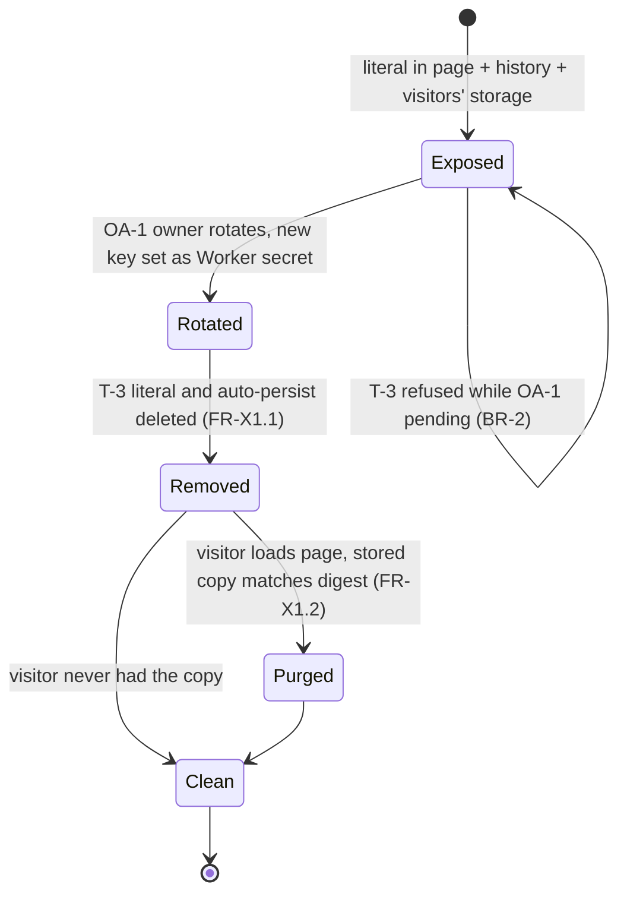
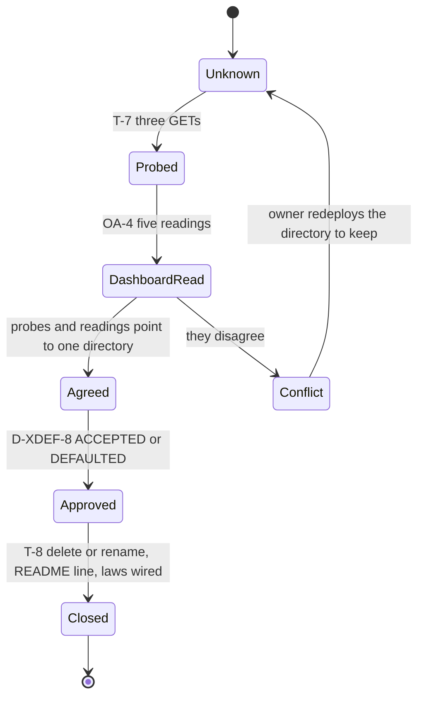
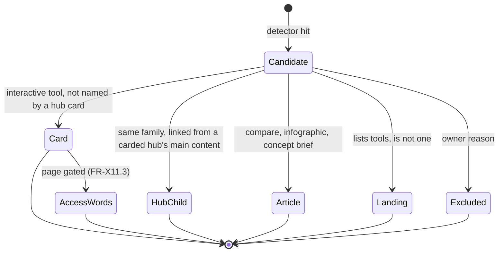
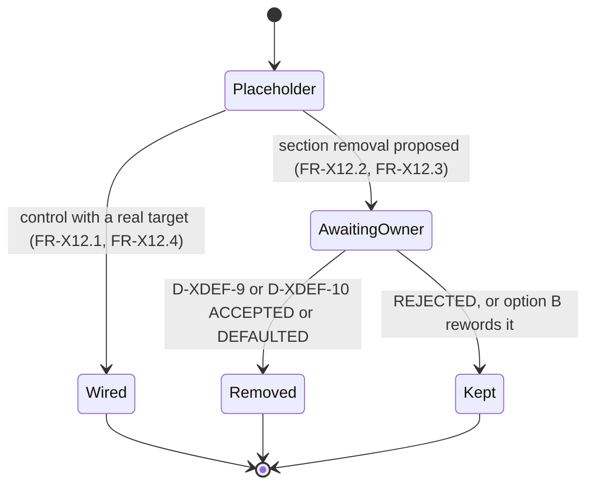
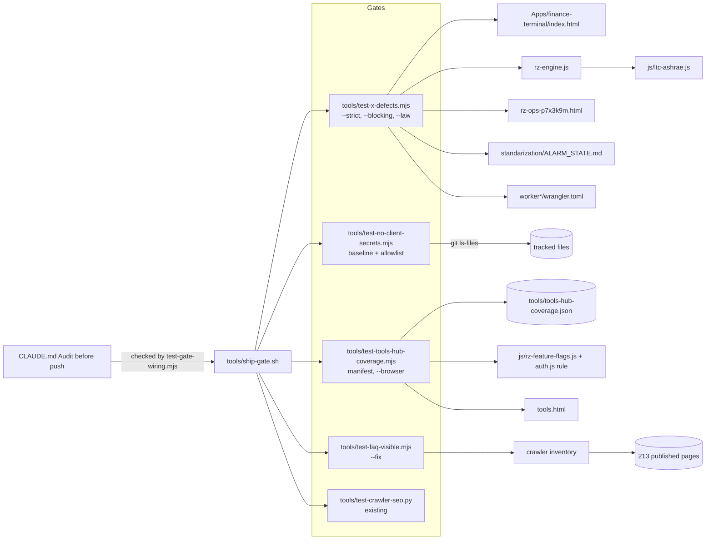
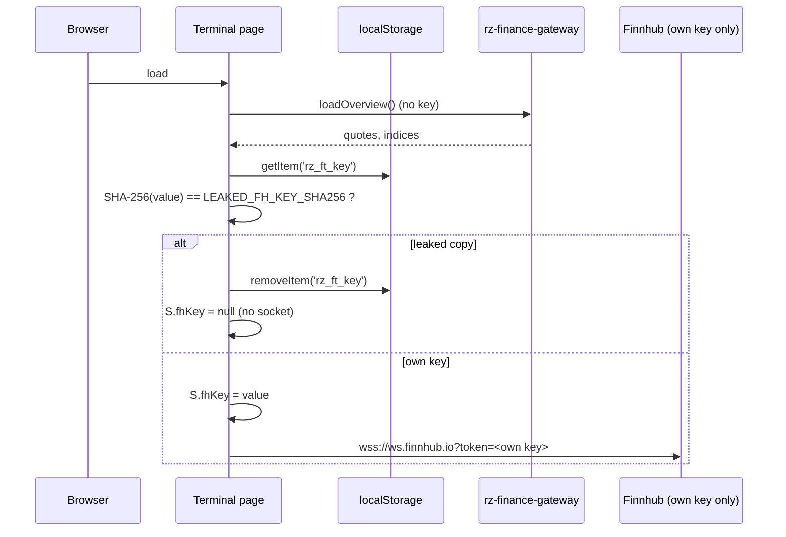
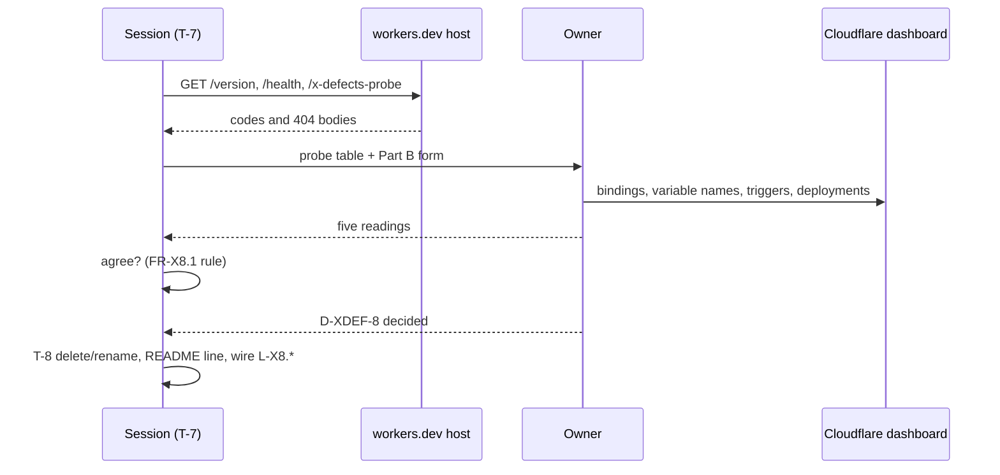

# PRD-X-DEFECTS — Verified defect fixes: secrets in the public tree, the unwired crawler gate, the Worker name clash, admin sample-data labels, the tools hub, placeholders, the engine ASHRAE classes, achievements copy, the alarm-state doc

## 1. Document control

| Field | Value |
|---|---|
| PRD id | PRD-X-DEFECTS |
| Feature | One PRD for every defect fix owned by session E. Each defect is its own FR group with its own laws and tasks. Active groups: X1 (secrets), X7 (corrected: crawler gate and hidden FAQ data), X8 (Worker identity), X10 (admin sample labels), X11 (tools hub coverage), X12 (placeholders), X15 (engine ASHRAE classes), X18 (achievements copy, interim), X19 (alarm-state doc). Pointer groups (owned by another PRD, nothing built here): X4, X6, X13, X14, X16, X17 |
| Version | 1.1 |
| Status | Draft |
| Author | Opus 5.5; Fable quota exhausted |
| Date | 2026-11-11 |
| Owner requests | R110 (a PRD per idea), R111 (24-section structure) |
| Priority | No addendum score: the X items are "quick fixes, not innovation" (`documentation/PRODUCT_INNOVATION_ASSESSMENT_2026-11_ADDENDUM.md:41-58`). X1 is a security item and goes first (`…_ADDENDUM.md:565`, `00-audit-baseline/BASELINE.md:76`) |
| Related findings | X1, X4, X6, X7, X8, X10, X11, X12 (`…_ADDENDUM.md:47-58`); X13–X19 (raised by the other PRD agents, verified here, §3.1). Register row `01-improvement-register/REGISTER.md:24`; tracker row `04-implementation-plan/TRACKER.md:40`. New findings N1–N9 (§3.3) |
| Dependencies | (1) Owner actions OA-1 to OA-5 and owner decisions D-XDEF-1 to D-XDEF-11 (§5.7, written as `DECISIONS.md` rows). X1 code removal waits for OA-1 (key rotation); the X7-B fix waits for D-XDEF-1; X8 waits for OA-4 and D-XDEF-8; the two X12 removals wait for D-XDEF-9 and D-XDEF-10. (2) PRD-Q11 FR-6 (page keys, decided by D-Q11-2) changes the access words of five tools-hub cards (FR-X11.3). (3) PRD-Q10 supersedes the X10 labels. (4) PRD-Q12 starts only after X1 closes (`PRD-Q12/PRD.md:16`, `:617`) |
| Related modules | `Apps/finance-terminal/index.html`; every git-tracked file (secret scan); `tools/test-crawler-seo.py`, `tools/build-llms-full.py`, 77 pages with FAQPage JSON-LD; `worker/`, `cf-worker/`; `rz-ops-p7x3k9m.html`; `tools.html`; `dashboard.html`, `account.html`, `all-in-one-dashboard.html`, `dc-market-tracker.html`; `rz-engine.js` + `rz-engine.min.js`; `achievements.html`; `standarization/ALARM_STATE.md`; `tools/ship-gate.sh`; `CLAUDE.md` "Audit before push" |
| Target wave | Addendum roadmap: "X1 before Q12" (`…_ADDENDUM.md:565`). The other groups have no wave; the main session sets it in `04-implementation-plan/` |
| Approval status | PRD approved by owner R110/R111 2026-11-10. Group X1, the X7-B fix, group X8 and the two X12 removals are BLOCKED until the owner acts or decides (OA-1 to OA-4; D-XDEF-1, D-XDEF-7 to D-XDEF-11). The other groups start on the recommended defaults of §5.7; a law blocks only once its precondition holds (§20.2) |
| Facts verified at | `wt-hub3` commit `b8848af95` (2026-11-11). Site version `3.35.10` (`js/rz-version.js:2`). Engine version `2.5.1` (`rz-engine.js:33`) |

Change history

| Version | Date | Author | Change |
|---|---|---|---|
| 1.0 | 2026-11-11 | Opus 5.5 | First complete draft. Every fact re-verified on `b8848af95` with the commands quoted in §3. Program conventions applied: owner decisions as `D-XDEF-n` rows in the `DECISIONS.md` format (coordinator decision D5), law wiring with report mode before each law's blocking point (D9), owner rule R114 (no paid services or pay-per-use APIs) |
| 1.1 | 2026-11-11 | Opus 5.5 | QA batch 3 fixes: FR-X15.5 adds the engine catalog chain, a DCMOC rebuild and owner action OA-5 (`cf-worker` redeploy) with V-10; the secret scan covers published `dcmoc/_next/` with a planted-chunk self-test (FR-X1.3); `DATA.sources` keys named for `liquidClasses` (FR-X15.3, §10.4); X11 classification script committed in §20.3; §13 and self-score corrected. Facts added in v1.1 verified at `7335fd257` |

Defect index (read this first)

| Id | Defect as filed | Verdict here | Owner of the fix | FR group | Laws | Tasks |
|---|---|---|---|---|---|---|
| X1 | Finnhub token hardcoded in a public page | Real. The literal is also written into every visitor's storage. The same scan finds 5 more secret patterns in 3 other files (N1) | This PRD (code), owner (rotation) | FR-X1.1–X1.4 | L-X1.1, L-X1.2a/b, L-X1.3 | T-2, T-3, T-4 |
| X4 | datahall invents alarms | Real; fully specified elsewhere | PRD-Q06 FR-10 (interim labels), PRD-Q07 FR-1 (removal) | FR-X4 (pointer) | Q06/Q07 laws | — |
| X6 | "Live" over a static snapshot | Real; fully specified elsewhere | PRD-Q06 FR-6, FR-7 | FR-X6 (pointer) | Q06 laws | — |
| X7 | Noindex prototype in the sitemap | **False.** 0 of 213 sitemap URLs are noindex. The real defects next to it: the crawler suite is red and unwired (X7-A), and 77 pages publish FAQ structured data their readers cannot see (X7-B) | This PRD | FR-X7A.1, FR-X7B.1–X7B.3 | L-X7.1, L-X7.2 | T-5, T-6 |
| X8 | Two Workers deploy under one name | Real. The repo cannot say which is live; the evidence leans to `cf-worker/` (§3.1) | Owner decides, this PRD executes | FR-X8.1–X8.4 | L-X8.1, L-X8.2 | T-7, T-8 |
| X10 | Admin KPIs fabricated with no label | Real (interim until PRD-Q10) | This PRD | FR-X10.1–X10.3 | L-X10.1 | T-9 |
| X11 | tools.html omits live tools | Real. 13 tool pages need a card; 9 more are covered by a hub card; 13 are articles; 1 is a landing page. Five existing cards hide an access rule (N3) | This PRD | FR-X11.1–X11.4 | L-X11.1, L-X11.2 | T-10, T-11 |
| X12 | Placeholders on public pages | Real, plus a fourth one (`dc-market-tracker.html:1353`) | This PRD; two removals need approval | FR-X12.1–X12.5 | L-X12.1a/b | T-12 |
| X13 | "((" in 229 explain-DB titles | Real; fully specified in PRD-Q17 | PRD-Q17 FR-9, T-1, L6 | FR-X13 (pointer) | Q17 L6 | — |
| X14 | Incident hub groups by first category; 5 categories unlabelled | Real; fully specified in PRD-Q18 | PRD-Q18 F4, FR-9, L2, L8 | FR-X14 (pointer) | Q18 L2, L8 | — |
| X15 | Engine labels the A1 allowable range "recommended" | Real, and the engine's H1 class is wrong as well (N5) | This PRD | FR-X15.1–X15.5 | L-X15.1, L-X15.2 | T-13 |
| X16 | Reference-parity gate wired nowhere | Real; PRD-Q04 wires it | PRD-Q04 N14, §20.4 | FR-X16 (pointer) | Q04 gate line | — |
| X17 | tco cooling labels print unused PUE values | Real; PRD-Q04 fixes it | PRD-Q04 F13/N13, FR-13 | FR-X17 (pointer) | Q04 laws | — |
| X18 | `rz-gamification.js` loads on 2 pages | Real, but it loads on **1** page (`achievements.html:1007`); `changelog.html` only names it in text. Retirement is D-Q17-2 (PRD-Q17 OQ-2); the interim copy fix is here | This PRD (interim), PRD-Q17 (decision) | FR-X18.1 | L-X18.1 | T-14 |
| X19 | `ALARM_STATE.md:98` stale against `BMS_SHELL.md:536` | Real, and the adoption table also misses `ict.html` | This PRD | FR-X19.1, FR-X19.2 | L-X19.1 | T-15 |

## 2. Executive summary

Fifteen defects were assigned to or found by session E. Six of them (X4, X6, X13, X14, X16, X17) are already
specified in full by another PRD. This PRD records the pointer so nothing is built twice. The other nine are
fixed here.

**X1, secrets.** `Apps/finance-terminal/index.html:4358` falls back to a 40-character Finnhub key literal
when the visitor has none, and `:4359` writes that value into the visitor's `localStorage`. Removing the
literal is a two-line change, but it only helps once the owner has rotated the key (OA-1), because the key
is also in the public git history. A scan of every tracked file finds the same class of defect in three more
files (a Google API key in `tools/Auto Update All/engine/validate-security.py:30`, a database URL with a
password in `standarization/SUPABASE_FIREBASE_SETUP.md:123`, and three more Google-key-shaped strings). The
new gate `tools/test-no-client-secrets.mjs` stops a new secret from being committed today (baseline mode) and
turns strict once the owner has revoked the known ones.

**X7, corrected.** The filed defect is false: the sitemap builder already drops noindex pages, and none of
the 213 sitemap URLs is noindex. What is broken next to it: `tools/test-crawler-seo.py`, the suite that guards
the sitemap and the LLM exports, fails 1 of 36 tests and is wired into no gate. The failing test looks for a
FAQ question on `datacenter-solutions.html` that now exists only in JSON-LD. The same pattern is site-wide:
77 pages publish 263 FAQ questions in structured data that the page never shows.

**X8.** Two Worker directories deploy under the name `rz-finance-gateway`. The repo cannot say which one is
live. This PRD gives the owner a five-minute dashboard check plus three read-only probes, then renames or
deletes the dead one only with the owner's yes.

**X10, X11, X12, X18, X19** are honesty and navigation fixes: label the admin's generated figures as sample
data until PRD-Q10 replaces them; give 13 tool pages a card on `tools.html` and add a coverage gate with a
manifest; wire a dead "Account Settings" button to the account page and remove three placeholders; stop
`achievements.html` promising progress the site cannot record; and bring `ALARM_STATE.md` in line with the
pages.

**X15.** The engine's ASHRAE table (`rz-engine.js:8753-8759`) calls the A1 allowable range "recommended" and
describes H1 as a liquid class with 17–45 °C. The repo's own ASHRAE source (`js/ltc-ashrae.js:18-35`, 5th
edition 2021) has H1 as a high-density **air** class, 5–25 °C allowable, 18–22 °C recommended. The fix
corrects the table, routes liquid cooling to the W classes, and adds a parity law between the two files.

Every group has 1–3 laws, each red on today's tree. Four new gate files carry them:
`tools/test-x-defects.mjs` (group laws, `--law <id>`), `tools/test-no-client-secrets.mjs`,
`tools/test-tools-hub-coverage.mjs` (+ manifest `tools/tools-hub-coverage.json`) and
`tools/test-faq-visible.mjs`. The existing `tools/test-crawler-seo.py` gets wired. Total effort ≈ 14 days
of session work (§19), plus the owner actions.

## 3. Problem statement

### 3.1 Verified facts (run on `wt-hub3` at `b8848af95`, 2026-11-11)

No secret value is reproduced in this document or in any command output it asks for. Commands that touch a
secret print line numbers, lengths and pattern names only.

**X1 — Finnhub key fallback**

| # | Fact | Evidence | Command |
|---|---|---|---|
| X1-a | Init reads the key with a string literal as fallback | `Apps/finance-terminal/index.html:4358` `S.fhKey=localStorage.getItem(CFG.LS.KEY)\|\|'«40-character literal»'` | `grep -n "getItem(CFG.LS.KEY)" Apps/finance-terminal/index.html \| sed -E "s/'([A-Za-z0-9]{4})[A-Za-z0-9]+'/'\1…'/"` |
| X1-b | The literal is 40 characters long | length only | a shell variable holding the match, `echo ${#TOK}` → `40`, never echoed |
| X1-c | The literal is copied into every visitor's browser storage | `:4359` `if(S.fhKey)localStorage.setItem(CFG.LS.KEY,S.fhKey);` with `CFG.LS.KEY = 'rz_ft_key'` (`:661`) | `sed -n 4359p`, `sed -n 661p` |
| X1-d | The key is used from the browser | REST `:721-722` (`token` query parameter on `CFG.FH = 'https://finnhub.io/api/v1'`, `:658`); WebSocket `:1164-1165` | `grep -n "S.fhKey" Apps/finance-terminal/index.html` (mask the output) |
| X1-e | The gateway path exists and is on by default | `CFG.GW` defaults to the `rz-finance-gateway` workers.dev URL (`:677`); "V2 (gateway) is ON by default" (`:678`) | `sed -n 675,678p` |
| X1-f | A user's own key path exists and is the only legitimate writer | `submitApiKey()` validates against `/stock/profile2` and stores the key (`:1374-1386`, write at `:1382`); `skipApiKey()` (`:1387`) | `grep -n "function submitApiKey\|setItem(CFG.LS.KEY" …` |
| X1-g | The repo holds only this one copy of the literal | 1 file | a `grep -rlF` with the value held in a variable, list mode only |
| X1-h | The docs disagree on the key length | `worker/SETUP.md:7-17` §0: rotate first, the token is "~20-character", do not concatenate it with the webhook secret; `cf-worker/DEPLOY.md:13`: "the 40-char key" | `sed -n 7,17p worker/SETUP.md`; `grep -n "40-char" cf-worker/DEPLOY.md` |
| X1-i | Same class of defect elsewhere (scan of every git-tracked file) | storage-fallback literal: 1 (`Apps/finance-terminal/index.html:4358`). Google-API-key shape: 4 (`audit-reports/F-tech-debt.md:105`, `standarization/SUPABASE_FIREBASE_SETUP.md:45`, `:90`, `tools/Auto Update All/engine/validate-security.py:30`). Postgres URL with a password: 1 (`standarization/SUPABASE_FIREBASE_SETUP.md:123`) | the scan in T-2 (patterns in §10.3); location-only output |

The 2026-10-31 read-only security audit (an owner session record, not in the repo) reached the same two
files outside X1 and left them as owner actions. The repo's own `standarization/Audit result/Security_Audit_Report.html`
(2026-09-10) names neither (`grep -c "validate-security\|SUPABASE_FIREBASE_SETUP"` → 0).

**X7 — sitemap, crawler suite, FAQ structured data**

| # | Fact | Evidence | Command |
|---|---|---|---|
| X7-a | The filed claim is false | The two `rz-cockpit-mockup` sitemap matches are `prd/rz-cockpit-mockup.html` (`sitemap.xml:484`) and `manual/rz-cockpit-mockup.html` (`:884`); both are `index, follow`. The root `rz-cockpit-mockup.html` is `noindex, nofollow` and absent | `grep -n rz-cockpit-mockup sitemap.xml`; `grep -o -m1 '<meta name="robots"[^>]*>' <file>` |
| X7-b | No noindex page is in the sitemap | 213 `<loc>`; 0 map to a page with a noindex/none robots meta; 0 missing files | the Python check in T-5 (§20.3) |
| X7-c | The builder already excludes noindex | `tools/build-sitemap.py:95-107` keeps only inventory rows with `status == "included"`; `tools/crawler_inventory.py:313-314` sets `noindex`. Inventory today: 213 included, 73 noindex, 79 excluded-directory, 5 excluded-file | `python3 -c "…collect_inventory…"` (T-5) |
| X7-d | The crawler suite fails | `python3 tools/test-crawler-seo.py` → `Ran 36 tests … FAILED (failures=1)`; failing assertion: `'Do you store my calculation data?' not found` for `datacenter-solutions.html` (`tools/test-crawler-seo.py:150-166`, sentinel at `:157`) | as quoted |
| X7-e | The suite runs in no gate | `grep -c test-crawler-seo tools/ship-gate.sh` → 0; no other caller in `tools/*.sh`, `tools/*.mjs`, `CLAUDE.md` | as quoted |
| X7-f | Why it fails | The question exists only inside FAQPage JSON-LD (`datacenter-solutions.html:141`, `:170`); 6 questions in JSON-LD, 0 visible. The visible FAQ left in `b95060271` (v3.24.0); the sentinel came with `6e3ff3e4d` (v2.16.0) | `git log -S"Do you store my calculation data" --oneline -- <file>` |
| X7-g | The pattern is site-wide | 94 pages carry FAQPage JSON-LD; 77 list at least one question whose text is not visible on the page; 263 questions in total. By family: `manual/` 32, articles 28, geopolitics 3, FF 3, calculators 5 (pue, capex, opex, roi, tco), infographics 3, `datacenter-solutions`, `cdu-selection-guide`, `index` | the visibility scan in T-6a (exact text after tag strip, entity decode and whitespace collapse). Sampled by hand: `article-20.html`, `geopolitics-1.html`, `FF-1.html` have no FAQ section at all; `index.html:955-975` shows some of its 16 JSON-LD questions |
| X7-h | The standard told authors to do this | `standarization/SEO_OPTIMIZATION_STANDARD.md:77-85` "All 18 articles now have FAQPage JSON-LD … Placement: in `<head>`", with no visibility rule. Injectors: `tools/inject-schema-faq-howto.py:4` (5 calculator pages); `tools/assemble-article.py:12`, `:117` builds a visible FAQ together with the JSON-LD; one page-level gate already checks parity (`tools/test-pillar-sustainability.py:7`, `:49-51`) | `grep -rn FAQPage tools/*.py tools/*.mjs` |

**X8 — two Workers, one name**

| # | Fact | Evidence |
|---|---|---|
| X8-a | Same name | `worker/wrangler.toml:1` and `cf-worker/wrangler.toml:1`: `name = "rz-finance-gateway"` |
| X8-b | `worker/` cannot deploy as committed | KV binding `FT_KV` with `id = "PLACEHOLDER_REPLACE_VIA_SETUP_MD"` (`worker/wrangler.toml:5`); cron `*/2 * * * *` (`:12`); routes `/health`, `/q`, `/candles`, `/fx`, `/news`, … (`worker/src/index.js`, `/health` at `:72`); secret `FINNHUB_KEY` |
| X8-c | `cf-worker/` carries real deployment data | `workers_dev = true` (`:4`); KV `QUOTE_CACHE` (`:12`) and `META_CACHE` (`:17`) with real ids; `[vars]` incl. `ALLOWED_ORIGINS` (`:33`); cron commented out (`:24`); routes `/`, `/healthz`, `/version` (`cf-worker/src/index.js:32-33`), `/calc*` (`:36`), the same aggregate routes (`:42-52`); secrets `FINNHUB_TOKEN`, `FINNHUB_WEBHOOK_SECRET`, `SUPABASE_SERVICE_ROLE_KEY` (`cf-worker/src/finnhub.js:8`, `calc.js:60-66`) |
| X8-d | A public page calls a route only `cf-worker/` has | `setup-supabase.html:157-170` curls `/calc/models` and `/calc` on the same workers.dev host |
| X8-e | Unknown routes answer differently | `cf-worker`: `fail(…, 404, "not_found", "unknown path …")` (`cf-worker/src/index.js:91`); `worker/`: `{ status: 404, error: 'not found' }` (`worker/src/index.js:186`) |
| X8-f | History | `worker/wrangler.toml` last changed `428561f35` 2026-05-19 ("cron pre-warm"); `cf-worker/wrangler.toml` last changed `ed0b8656b` 2026-07-17 ("SUPABASE_URL + ANON in [vars] for /calc") |

Inference (not proof): the live script is most likely `cf-worker/`. Whichever directory ran `wrangler deploy`
last replaced the other under the same script name, so only the Cloudflare account can settle it (FR-X8.1).

**X10 — admin**

| # | Fact | Evidence |
|---|---|---|
| X10-a | Generated data at load | `generateUsers` `rz-ops-p7x3k9m.html:2481`, `:2586`, `:6054`; `generateActivities` `:2481`, `:2611`, `:6057`; `seedUADemoData` `:5528`, `:5658`; `Math.random` on 6 lines (`grep -c`) |
| X10-b | Section subtitles claim measurement | `:894` "Real-time platform metrics and analytics"; `:1864` "Real-time tracking — Full access clicks, demo logins, PDF exports, CV downloads, calculator usage" |
| X10-c | Literal figures | `:911` PDF exports `234`; `:921` and `:1970` uptime `99.97%`; `:1975` response time `42ms`; `:1980` error rate `0.02%` |
| X10-d | Sections fed by generated data | `sec-dashboard` `:892`, `sec-revenue` `:949`, `sec-users` `:969`, `sec-audit` `:1569`, `sec-activity` `:1862`, `sec-settings` `:1958` (literals); `sec-subscribers` `:1592` reads a key nothing writes (PRD-Q10 P8); the Per-User Overrides card in `sec-features` (`:3570`, button only shows a message) |
| X10-e | One section is real | `sec-credentials` `:1007`, "Real registered users from Supabase" (`:1034`), via `S.listAllProfiles()` (`:3247`) |

The full inventory (P1–P20) is in `PRD-Q10/PRD.md:76-95`. X10 labels; Q10 replaces.

**X11 — tools hub**

| # | Fact | Evidence |
|---|---|---|
| X11-a | `tools.html` has 23 cards in 4 category blocks | `grep -c 'class="tool-card"' tools.html` → 23; blocks at `:471`, `:526`, `:593`, `:618` |
| X11-b | Candidate tool pages | 181 root `.html` files; 57 are detected as tools (JSON-LD `WebApplication`/`SoftwareApplication`, `class="tool-ref"`, `data-rz-data-mode="simulated"`, or names `*-calculator`, `*-checklist`, `ltc-*`, `pln-*`); 21 of them have a card; 2 cards point at pages the detector misses (`standards-ltc-lab.html`, `dc-conventional.html`) |
| X11-c | 36 candidates have no card | 13 need one (§8 FR-X11.2 table); 9 are linked from a carded family hub's main content (`cdu-hub.html`: 4; `pln-java-grid.html`: 5); 12 are `compare-*`/`infographic-*` articles; `ai-engineering-maintenance.html` is a concept brief with no input control; `datacenter-solutions.html` is a landing page |
| X11-d | The four named pages | `cdu-calculator.html` is linked from `cdu-hub.html` but the hub card names only "a selection & deployment guide, an install/maintenance checklist, an interactive Mini-BMS cockpit … and a deep all-aspect comparison" (`tools.html:535-540`); `chiller-plant.html` and `EPMS_Telemetry.html` are linked from no card's main content; `ltc-system-modelling-lab.html` is linked from `standards-ltc-lab.html` |
| X11-e | Five cards hide an access rule | `datahallAI.html` and `dc-conventional.html` are root-only in the matrix (`js/rz-feature-flags.js:215`, `:239`) and open to educators by `EDUCATOR_ACCESS_PAGES` (`:495`); `standards-ltc-lab.html` is Pro (`:310`); `ltc-ansi-tia-topology-readiness.html` and `ltc-uptime-tier-alignment.html` call `enforceTierFeatureAccess` with keys the matrix does not hold (PRD-Q11 P7), so today only root passes (`auth.js:1062-1100`). No card says so |
| X11-f | A second catalogue exists | `datacenter-solutions.html:470` "Every tool, on one page"; out of scope here (§5.2) |

Command for X11-b/c/e: the classification script in T-10 (`node tools/test-tools-hub-coverage.mjs --report` once built; today the
one-off scan quoted in §20.3).

**X12 — placeholders**

| # | Fact | Evidence |
|---|---|---|
| X12-a | Dead button for paying users | `dashboard.html:1127-1132` renders "Account Settings" for Pro users with a subscription; it calls `handleManageSub()` which only shows "Account settings coming soon." (`:1305-1307`). `handleUpgrade` is an empty function with no caller (`:1303`) |
| X12-b | Section placeholder | `all-in-one-dashboard.html:403` `<h2>Live demo <span class="h2tag">coming soon</span></h2>` and the box `:404-406` "Live demo placeholder …" |
| X12-c | Card of promises | `account.html:158-163` card "Coming to your account" with three `<span class="soon">planned</span>` pills (CSS `:72-75`) — a pill for a state, which the design rules ban |
| X12-d | Fourth placeholder (new) | `dc-market-tracker.html:1348-1356` `buildCardBack()` shows "Detailed profile coming soon." for any market without `MARKET_DETAILS`. How many markets hit it: UNKNOWN — measure in T-12 (`MARKETS` is filled at run time, `:1172`) |

Command: `grep -rn -i "coming soon\|Coming to your account" --include=*.html . | grep -v changelog`.

**X15 — engine ASHRAE classes**

| # | Fact | Evidence |
|---|---|---|
| X15-a | A1 "recommended" on the allowable range | `rz-engine.js:8754` `A1: { minSupplyC: 15, maxSupplyC: 32, maxDeltaTK: 15, label: 'Class A1 (air, recommended)' }` |
| X15-b | The repo's ASHRAE source | `js/ltc-ashrae.js:1-11` cites ASHRAE TC 9.9, Thermal Guidelines, 5th ed. (2021); recommended `REC = { lo: 18, hi: 27 }` (`:18`); A1 15–32, A2 10–35, A3 5–40, A4 5–45 (`:21-24`); H1 5–25 "High-density air-cooled products (2021); recommended 18–22 °C" (`:25`); liquid W17, W27, W32, W40, W45, W+ (`:27-34`). A second repo source agrees on 18–27 °C (`data/cx-handbook/chapters/28_integrated_systems_testing.md:368`, cited by `PRD-Q07/PRD.md:51`) |
| X15-c | Engine H1 is a different thing | `rz-engine.js:8758` `H1: { minSupplyC: 17, maxSupplyC: 45, maxDeltaTK: 12, label: 'Class H1 (liquid)' }`; provenance `:9334` "A1/A2/A3/A4 air + H1 liquid"; `:9333` says "H1-H3 liquid envelopes" though the cited edition has one H class |
| X15-d | Liquid cooling is checked against it | `thermalCheck` (`:13658-13672`) maps `liquid`, `immersion` and `rdhx` to `H1` |
| X15-e | ΔT limits have no source in the repo | `maxDeltaTK` 15/17/20/20/12; `js/ltc-ashrae.js` holds no per-class ΔT limit, and the provenance line cites none |
| X15-f | Consumers | `tools/test-rz-engine.mjs:933-934` (A1 compliant at 24 °C/12 K; over-ΔT flagged); DCMOC `dcmoc/src/state/adapters/arch-adapter.ts:165-166` and `:200-201` read `class`, `compliant`, `flags`; no page reads the labels (`grep -rln "ashraeClasses\|air, recommended"` → engine and its min twin only) |
| X15-g | Version display only | pages print `RZEngine.version` (`fire-calculator.html:280`, `cdu-calculator.html:465`, `spares-readiness-calculator.html:10012`); no page pins `2.5.1` (`grep` → engine, min twin, DCMOC chunks) |

**X18 — achievements**

| # | Fact | Evidence |
|---|---|---|
| X18-a | One loader | `grep -rln 'src="[^"]*rz-gamification' --include=*.html .` → `achievements.html` only (`:1007`). `changelog.html` names the file once in text, with no `<script>` tag |
| X18-b | The page promises progress elsewhere | `achievements.html:903` "Start earning badges: explore the sections below to unlock progress." |
| X18-c | What is actually recorded | `rz-gamification.js:164` records a visit to the page it runs on; `:168-175` records the theme switch. Its counters move only on `achievements.html` |
| X18-d | Retirement is proposed elsewhere | `PRD-Q17/PRD.md:856` OQ-2, now `D-Q17-2`, "Retire `achievements.html` and `rz-gamification.js` …?" |

**X19 — alarm-state doc**

| # | Fact | Evidence |
|---|---|---|
| X19-a | Stale sentence | `standarization/ALARM_STATE.md:98` "EPMS_Telemetry.html untouched per owner mandate." |
| X19-b | The mandate was revoked | `standarization/BMS_SHELL.md:534-536` "The owner has revoked that designation … It now migrates onto the shared shell" |
| X19-c | The adoption table misses a page | table `ALARM_STATE.md:91-96` lists `datahallAI`, `chiller-plant`, `water-system`, `fire-system`; `js/rz-alarm-state.js` loads on those four **and** `ict.html`. `EPMS_Telemetry.html` loads `js/conv-alarm-events.js` and `js/conv-alarm-workspace.js`, not the library |

Command: `for f in datahallAI dc-conventional datahall ict fuel-system chiller-plant water-system fire-system EPMS_Telemetry; do grep -c 'src="js/rz-alarm-state.js' $f.html; done`.

### 3.2 Consequence of leaving it

- **X1:** a third party can use the owner's Finnhub quota, and every visitor's browser keeps a copy. The other
  files expose a Google API key and an old database password to anyone who reads the public repo or the
  live site. Q12 cannot start (`PRD-Q12/PRD.md:617`).
- **X7:** the suite that proves the sitemap and the LLM exports are right fails silently, so a real
  regression there would also pass unnoticed. 263 FAQ answers sit in structured data that readers never see,
  which Google's FAQ guidelines do not allow (the rule as Google states it is to be quoted in T-6b; this PRD
  does not paraphrase an external source it cannot open).
- **X8:** a `wrangler deploy` from the wrong directory replaces the live gateway with code whose KV binding is
  a placeholder, and the terminal's data dies.
- **X10:** the owner reads invented users, revenue, uptime and events as facts.
- **X11:** 13 working tools are unreachable from the tools hub; five cards lead to a sign-in wall nobody is warned about.
- **X12:** a paying user's "Account Settings" button does nothing; three pages advertise things that do not exist.
- **X15:** DCMOC and any engine consumer judge liquid cooling against an envelope that is not ASHRAE's, and
  call the allowable A1 range recommended.
- **X18:** visitors are told to explore the site to earn badges they cannot earn.
- **X19:** the next agent trusts a doc that contradicts the shell standard and misses a page.

### 3.3 Addendum corrections and new findings

| Id | Statement | Correction | Effect here |
|---|---|---|---|
| C1 | X7 "noindex prototype is in the sitemap" (`…_ADDENDUM.md:53`; `BASELINE.md:35`) | False (X7-a, X7-b). The two matches are `index, follow` pages under `prd/` and `manual/` | X7 is replaced by X7-A and X7-B |
| C2 | X11 "agent finding, not re-checked" names four pages (`:57`) | 13 pages need a card, not 4; `cdu-calculator` is reachable via `cdu-hub` but the hub card does not name it | FR-X11.2 |
| C3 | X18 "loads on 2 pages" (caller brief); `PRD-Q17/PRD.md:50` "achievements.html and changelog.html load" it | 1 page (X18-a) | Noted for PRD-Q17 |
| C4 | X12 lists three placeholders (`:58`) | Four (X12-d) | FR-X12.4 |
| C5 | X1 "full value not repeated here" and "rely on the gateway only" (`:47`) | Correct, and the page also persists the literal (`:4359`), which the removal must undo for visitors who already have it (FR-X1.2) | FR-X1.2 |
| C6 | X15 cites `rz-engine.js:8750-8757` | The table is `:8753-8759`; the H1 row is wrong too (X15-c) | FR-X15.1 |
| C7 | X8 "establish which one is live" (`:54`) | Cannot be established from the repo; the evidence (X8-b to X8-e) favours `cf-worker/` | FR-X8.1 |
| N1 | — | The X1 scan finds 5 more secret-pattern hits in 3 files (X1-i) | FR-X1.4, OA-2, OA-3 |
| N2 | — | 77 pages, 263 hidden FAQ questions (X7-g); the SEO standard prescribes FAQ JSON-LD with no visibility rule (X7-h) | FR-X7B.* |
| N3 | — | Five tools-hub cards lead to gated pages without saying so (X11-e); the `datahall-ai` comment says Pro passes (`js/rz-feature-flags.js:211-213`) while the row says `pro: false` (`:215`) | FR-X11.3; comment mismatch reported to PRD-Q11 |
| N4 | — | `worker/SETUP.md` and `cf-worker/DEPLOY.md` disagree on the key length (X1-h) | FR-X8.4 |
| N5 | — | Engine H1 is not ASHRAE's H1 (X15-c); `maxDeltaTK` has no repo source (X15-e) | FR-X15.1, FR-X15.4 |
| N6 | — | `ALARM_STATE.md` misses `ict.html` (X19-c) | FR-X19.1 |
| N7 | — | `ENGINE_UNIFICATION.md:74` says the reference-parity gate "fails CI"; there is no CI workflow (`PRD-Q04/PRD.md:1669`) | Pointer X16: the wording changes in Q04's release |
| N8 | — | `rz-gamification.js:112-118` injects global `.rz-toast` rules that collide with `js/rz-toast.js`; only matters on `achievements.html` | Reported to PRD-Q17 (D-Q17-2) |
| N9 | — | `search-terms.json` is written by `tools/build-explain-db.py:110-121`, not by the peer; the X13 brief said "peer-generated file through P14" | Pointer X13: the builder fix in PRD-Q17 regenerates it |

## 4. Objectives and success metrics

| Id | Objective | Metric | Today | Target | Method | Law |
|---|---|---|---|---|---|---|
| O1 | No hardcoded credential in the public tree | hits of the §10.3 patterns in git-tracked files outside the allowlist | 6 hits in 4 files | 0 new hits from R1 (L-X1.2a); 0 hits after OA-1 to OA-3 and D-XDEF-11 (L-X1.2b) | `node tools/test-no-client-secrets.mjs --law X1.2a`, `--law X1.2b` | L-X1.2a, L-X1.2b |
| O2 | The terminal never holds or persists the leaked key | literal fallbacks after `getItem(CFG.LS.KEY)`; `setItem(CFG.LS.KEY` calls outside `submitApiKey` | 1; 1 | 0; 0 | `--law X1.1` | L-X1.1 |
| O3 | Visitors who already hold the leaked copy lose it | purge unit test | function absent | stored leaked copy removed, a user's own key kept | `--law X1.3` | L-X1.3 |
| O4 | The crawler suite is green and gated | tests passing; wiring | 35/36; 0 | 36/36; 1 | `python3 tools/test-crawler-seo.py`; `grep -c` | L-X7.1 |
| O5 | FAQ data matches what readers see | pages with a hidden FAQ question | 77 (263 questions) | 0 | `node tools/test-faq-visible.mjs` | L-X7.2 |
| O6 | One deployable name per Worker | `wrangler.toml` names shared | 1 name shared by 2 | 0 | `--law X8.1` | L-X8.1 |
| O7 | The live Worker is recorded | README line naming the verified live directory and the date | absent | present | `--law X8.2` | L-X8.2 |
| O8 | Admin never shows a generated figure as measured | required sample notes present; literal figures | 0 of 7; 3 | 7 of 7; 0 (until Q10 removes the generators) | `--law X10.1` | L-X10.1 |
| O9 | Every tool page is reachable from the tools hub | candidates without a manifest status; `card` entries without a card; access-word mismatches | 57; — ; 5 | 0; 0; 0 | `node tools/test-tools-hub-coverage.mjs` | L-X11.1 |
| O10 | The hub renders all cards correctly | cards rendered; horizontal overflow; axe violations | 23; UNKNOWN — measure in T-11; UNKNOWN — measure in T-11 | 36; 0; 0 (planted line flagged first) | `--browser` | L-X11.2 |
| O11 | No placeholder or dead control on the four pages | placeholder strings; dead `handleManageSub` | 4; 1 | 0; 0 | `--law X12.1a`, `--law X12.1b` | L-X12.1a, L-X12.1b |
| O12 | Engine ASHRAE data equals the repo's ASHRAE source | mismatching fields | A1 label, H1 type/min/max (4 fields) | 0 | `--law X15.1` | L-X15.1 |
| O13 | Liquid cooling is classified by W class | `thermalCheck({coolingType:'liquid',supplyTempC:30}).class` | `H1` | `W32` | `--law X15.2` | L-X15.2 |
| O14 | Achievements copy is true | promise sentence present; interim sentence present | 1; 0 | 0; 1 | `--law X18.1` | L-X18.1 |
| O15 | Alarm doc equals the pages | table rows vs loaders; stale sentence | 4 vs 5; 1 | equal; 0 | `--law X19.1` | L-X19.1 |

Assumptions: the targets are the defect definitions, not invented goals. Gate run times are UNKNOWN — measure
in T-1 and T-2 (budget stated in §15).

## 5. Scope

### 5.1 In scope

- **X1:** remove the literal and the auto-persist; purge the leaked copy from visitors' storage; a site-wide
  secret gate with a baseline; redaction of the other hits after the owner revokes them.
- **X7-A:** fix the stale sentinel and wire `tools/test-crawler-seo.py`.
- **X7-B:** a FAQ visibility gate; remove hidden questions from FAQPage JSON-LD (default D-XDEF-1); fix the two
  injectors so regeneration does not bring them back; amend the SEO standard.
- **X8:** owner procedure and read-only probes; a uniqueness law; rename or delete the dead directory after
  approval; one consistent key-length sentence (no length at all).
- **X10:** exact sample-data subtitles on seven admin surfaces; "Not measured" for three literal figures.
- **X11:** manifest `tools/tools-hub-coverage.json`; 13 new cards; access words on gated cards; static and
  browser coverage gate.
- **X12:** link the dashboard button to `account.html`; plain copy on the market tracker card; remove the
  all-in-one "Live demo" block and the account "Coming to your account" card after approval.
- **X15:** correct the engine class table; W-class path for liquid and immersion; A-class path for rdhx;
  provenance; ΔT basis wording; engine version and min twin.
- **X18:** interim copy on `achievements.html`.
- **X19:** `ALARM_STATE.md` table and sentence; parity law.
- The pointer groups X4, X6, X13, X14, X16, X17: record, verify the owning PRD covers them, nothing else.

### 5.2 Out of scope (non-goals)

- Rotating or revoking any credential (owner only, OA-1 to OA-3). Testing whether any found credential works
  (never done).
- Rewriting public git history (D-XDEF-7, default no).
- The `datacenter-solutions.html` catalogue's completeness (X11-f). `CONTENT_LINKAGE_PLAYBOOK.md:50` keeps it
  as a manual step.
- Rendering the hidden FAQ answers as visible sections (D-XDEF-1 alternative; it would put unreviewed numbers on
  screen).
- Fixing the five LTC page keys (PRD-Q11 FR-6, auth boundary).
- Replacing the admin's generated data (PRD-Q10).
- Retiring `achievements.html` (D-Q17-2, PRD-Q17 OQ-2).
- Everything the pointer groups' owners specify.

### 5.3 Existing capabilities reused

| Capability | Where | Used by |
|---|---|---|
| Gate runner `gate "<label>" <cmd>` | `tools/ship-gate.sh:23` | every new law |
| Served tree for browser gates (`$LTC_BASE`) | `tools/ship-gate.sh:318-328` | L-X11.2 |
| Gate-wiring check of the "Audit before push" list | `tools/test-gate-wiring.mjs` (wired `:235`) | the three permanent gates |
| Crawler inventory and LLM exporter | `tools/crawler_inventory.py`, `tools/build-llms-full.py` `extract_page` | X7-A sentinel choice |
| Sitemap builder | `tools/build-sitemap.py` | unchanged; regenerated |
| Visible-FAQ + JSON-LD builder | `tools/assemble-article.py:12`, `:117` | X7-B reference behaviour |
| Matrix and educator rule | `js/rz-feature-flags.js` (`:215`, `:239`, `:310`, `:495`), `auth.js:1062-1100` | X11 access words |
| User key entry | `Apps/finance-terminal/index.html:1372-1387` | X1 (kept) |
| Gateway | `CFG.GW` `:677`, V2 default `:678` | X1 (the keyless path) |
| Engine test suite | `tools/test-rz-engine.mjs` (wired `tools/ship-gate.sh:258`) | X15 regression |
| Engine definition of done | `standarization/ENGINE_UNIFICATION.md:77-80` (terser min, engine tests, version) | X15 release |
| Min twins and cache tokens | `node tools/audit-min-twins.mjs --fix`, `node tools/test-asset-cache-tokens.mjs --fix <asset>` | X15, X11 |
| rz-lane browser lane | owner tool, memory `tool_rz_lane` | L-X11.2 runs |

### 5.4 Dependencies

| Dependency | Kind | Blocks |
|---|---|---|
| OA-1 Finnhub key rotated and set as the live Worker's secret | owner | FR-X1.1, FR-X1.2; L-X1.1, L-X1.3 blocking |
| OA-2, OA-3 and D-XDEF-11: the other credentials revoked, or classified public | owner | FR-X1.4; L-X1.2b blocking |
| OA-4 dashboard check; D-XDEF-8 | owner | FR-X8.3; L-X8.1, L-X8.2 blocking |
| D-XDEF-9, D-XDEF-10 (section removals) | owner | FR-X12.2, FR-X12.3; L-X12.1b blocking |
| PRD-Q11 FR-6 and D-Q11-2 | PRD, owner decision | option A changes five access words (FR-X11.3 recomputes them); option B leaves them |
| PRD-Q10 | PRD | retires L-X10.1 (FR-X10.3) |
| D-Q17-2 (PRD-Q17 OQ-2) | owner decision | may retire `achievements.html`; L-X18.1 then passes as "page retired" |
| D-Q06-2 | owner decision (main session) | option A (default) keeps X4 and X6 as pointers here; option B moves them into this PRD (v1.1 adds two FR groups) |
| D-Q04-5 | owner decision | the form of the tco label fix that closes X17 (PRD-Q04 FR-13) |
| PRD-Q06 | PRD | wording of the cockpit cards ("Simulated") follows Q6's idiom |

### 5.5 Constraints

- Static GitHub Pages site, vanilla ES5 for page code, no build step for pages (`CLAUDE.md`).
- Design rules of the brief: hub tokens, IBM Plex Sans and JetBrains Mono, one amber accent, no stat tiles, no
  badges or pills for state, no glass, no `:hover` transform, no gradient chrome, no `transition: all`, radius
  ≤ 4 px, Font Awesome only, plain copy, both themes, 1440 and 390, 16 px inputs on phones.
- ACCURACY: no figure without a source or a model label (X10, X11 copy, X15).
- Peer-owned files are not touched: none of `js/rz-cx-*.js`, `cx-calculator.html`, `css/rz-cx-analysis.css`,
  `js/rz-cx-ext.js`, `rz-cx-tree-ui.js`, `id/index.html` meta is in this PRD's file list. `cx-calculator.html`
  keeps its card unchanged.
- Never print a secret: gate output, logs, commits and PR text carry file, line, pattern and length only.
- Owner rule R114 (2026-11-11): no paid service or pay-per-use API. This PRD adds none and makes no new API call.
  It touches only what the site already runs on: GitHub Pages; the existing `rz-finance-gateway` Worker on
  `workers.dev` (three read-only probes, FR-X8.1); Finnhub only through the key the Worker already holds
  (`cf-worker/DEPLOY.md:13` says a free key suffices) or a key the user enters; and, optionally for the owner, Google
  Search Console (free). The gates run locally with Node, Python and the existing puppeteer lane.

### 5.6 Assumptions

- A1. The Finnhub key in the literal is (or was) live. Whether it still works is UNKNOWN and is never tested;
  the owner sees it in the Finnhub dashboard.
- A2. Pages that publish FAQ JSON-LD gain nothing in Google from hidden questions; removing them changes no
  rendered pixel. The external guideline is quoted, with its URL and date, in T-6b before the fix runs.
- A3. The tool detector in §10.2 is the definition of "tool page". A page it misses can still be added to the
  manifest by hand; a page it finds must be classified.
- A4. `thermalCheck`'s `supplyTempC` means server-inlet air for air, in-row and rdhx, and facility-water
  supply for liquid and immersion. DCMOC passes one `supplyTempC` field (`arch-adapter.ts:165`); T-13 confirms
  what its Architecture form labels that field.

### 5.7 Owner decisions and owner actions

Owner decisions follow the program format (coordinator decision D5): one row per decision in
`documentation/product-transformation/DECISIONS.md`, id `D-XDEF-n`, status PROPOSED until an owner message names the id.
The rows below use that file's columns so they can be appended unchanged with `tools/owner_decisions.py`; this PRD
does not edit `DECISIONS.md` itself. The "If REJECTED" path is in the Options cell. No option uses a paid service or a
pay-per-use API (owner rule R114).

| Id | Question | Options | Recommended default | Status | Decided by | Date |
|---|---|---|---|---|---|---|
| D-XDEF-1 | PRD-X-DEFECTS FR-X7B.2: 77 pages list 263 FAQ questions in JSON-LD that the page never shows. What happens to them? | A remove each hidden question; drop the FAQPage block when none is left; no rendered change. B render them as visible FAQ sections, page by page, after an accuracy review of every answer. If REJECTED: the pages stay as they are and L-X7.2 stays in report mode | A | PROPOSED | — | — |
| D-XDEF-2 | PRD-X-DEFECTS FR-X11.3: a tools-hub card whose page is gated | A keep the card with one plain access sentence computed from the matrix. B remove the card (content removal) | A | PROPOSED | — | — |
| D-XDEF-3 | PRD-X-DEFECTS FR-X11.2: category of `network-visualization-hub.html` on `tools.html` | A "Compliance & Standards Tools" (BACnet is ASHRAE 135, OPC-UA is IEC 62541). B a new category block | A | PROPOSED | — | — |
| D-XDEF-4 | PRD-X-DEFECTS FR-X15.2: liquid and immersion cooling in `RZEngine.models.architecture.thermalCheck` | A classify the facility-water supply into W17…W+, never an air class. B no class check for liquid; flags from the ΔT band only | A | PROPOSED | — | — |
| D-XDEF-5 | PRD-X-DEFECTS FR-X15.2: rear-door heat exchanger (`rdhx`) in `thermalCheck` | A check the server inlet against A1 (the IT is air-cooled). B keep a liquid class | A | PROPOSED | — | — |
| D-XDEF-6 | PRD-X-DEFECTS FR-X18.1: interim copy on `achievements.html` before D-Q17-2 (retire the page) is decided | A change the CTA sentence now. B leave the page until D-Q17-2 | A | PROPOSED | — | — |
| D-XDEF-7 | PRD-X-DEFECTS §16: rewrite public git history to remove exposed credentials | A no rewrite once every exposed credential is revoked. B `git filter-repo` and force push (every worktree resets; every peer is told first) | A | PROPOSED | — | — |
| D-XDEF-8 | PRD-X-DEFECTS FR-X8.3: the Worker directory that the FR-X8.1 check shows is not deployed (removal of dead code) | A delete it in one commit; port nothing (its cron pre-warm and `/health` stay in history). B rename its `name` to `rz-finance-gateway-legacy` and mark it "Not deployed.". If REJECTED: both directories stay and L-X8.1, L-X8.2 stay in report mode | A | PROPOSED | — | — |
| D-XDEF-9 | PRD-X-DEFECTS FR-X12.2: the "Live demo coming soon" heading and box on `all-in-one-dashboard.html` (section removal) | A remove both. B keep the heading, reword the box to "No live demo is available.". If REJECTED: unchanged; L-X12.1b drops the item | A | PROPOSED | — | — |
| D-XDEF-10 | PRD-X-DEFECTS FR-X12.3: the "Coming to your account" card on `account.html` (section removal) | A remove it and its CSS. B keep it as plain text without the three `planned` pills. If REJECTED: unchanged; L-X12.1b drops the item | A | PROPOSED | — | — |
| D-XDEF-11 | PRD-X-DEFECTS FR-X1.4: the key-shaped strings at `standarization/SUPABASE_FIREBASE_SETUP.md:45`, `:90` and `audit-reports/F-tech-debt.md:105` | A secrets: the owner revokes them (OA-3) and the session redacts them. B public web configuration (for example a referrer-restricted browser key): an allowlist entry with the owner's reason | A, until the owner says otherwise | PROPOSED | — | — |

Which decisions gate a law (§20.2): the ones the program's approval list covers (removals, security, a bulk content
change): D-XDEF-1, D-XDEF-7 to D-XDEF-11. D-XDEF-2 to D-XDEF-6 shape copy or engine behaviour; their tasks build on the
recommended default, and a different owner choice is a follow-up change before or after release.

Owner actions (not decisions; only the owner can do them):

| Id | Owner action | Unblocks | How the session learns it is done |
|---|---|---|---|
| OA-1 | Rotate the Finnhub key in the Finnhub dashboard; store the new key only as the live Worker's secret (`FINNHUB_TOKEN` for `cf-worker/`, `FINNHUB_KEY` for `worker/`) with `npx wrangler secret put` | FR-X1.1–X1.3 | Owner says "rotated" (no value). The session checks nothing with the key |
| OA-2 | Revoke the Google API key at `tools/Auto Update All/engine/validate-security.py:30`; confirm the old database in `standarization/SUPABASE_FIREBASE_SETUP.md:121-123` is gone or its password changed | FR-X1.4 | Owner says "revoked" per file |
| OA-3 | Revoke every string that D-XDEF-11 classifies as a secret | FR-X1.4 | Owner says "revoked" per line |
| OA-4 | Run the Cloudflare dashboard check (FR-X8.1) and report the five readings | FR-X8.2 | The filled table of FR-X8.1 |
| OA-5 | After the R4 engine release is pushed, redeploy `cf-worker/` (`npx wrangler deploy` in `cf-worker/`). `cf-worker/src/calc.js:12` bundles `../../rz-engine.js` at deploy time and exposes the `architecture` namespace (`:19`, `:28`), so live `POST /calc` keeps the old classes until the owner redeploys | V-10 (FR-X15.5) | Owner says "redeployed"; the session runs V-10 |

## 6. User personas and use cases

Tiers and roles as the code has them: signed-out, `free`, `demo`, `pro` (educators are `role=educator` with
tier `pro`), `root` (the owner) (`js/rz-feature-flags.js:8-16`, `:211-213`; `auth.js:1062-1100`).

| Persona | Goal | Permissions that matter here | Expected outcome |
|---|---|---|---|
| Signed-out visitor | Find and use a tool; read an article | free tools; gated pages show the sign-in gate | All 13 missing tools are on `tools.html`; a gated card says who can open it; no "coming soon" |
| DC/facility engineer (free or Pro) | Size a CDU, check an inlet condition | as above; Pro pages per the matrix | The CDU calculator and the four workbenches are one click from the hub; the engine's ASHRAE check matches ASHRAE |
| Operator / student / educator | Practise on the cockpits | educators open `datahall-ai` and `dc-conventional` (`:495`) | Seven conventional cockpits are carded; the two AI cockpits say "Requires an educator account." |
| Finance terminal user | Watch markets | none; own key optional | The terminal works keyless through the gateway; a key the user enters is kept; the leaked copy is gone |
| Pro subscriber | Manage the account | Pro | "Account Settings" opens `account.html` |
| Owner (root) | Run the site, read the admin, keep secrets safe | root | Admin figures say which are samples; one gate stops new secrets; one dashboard check settles the Worker question |
| Maintainer agent | Change a cockpit or the engine safely | repo | `ALARM_STATE.md` is true; the engine table equals its source; gates fail on drift |
| Search and answer engines | Index public pages | robots, sitemap, JSON-LD | Structured data matches the page; the crawler suite guards the sitemap |

Use cases: UC1 visitor opens the terminal (X1); UC2 owner rotates and confirms (X1); UC3 owner reads the admin
(X10); UC4 visitor finds the chiller cockpit from the hub (X11); UC5 signed-out visitor clicks a Pro workbench
card (X11); UC6 Pro user clicks Account Settings (X12); UC7 visitor flips a market card with no profile (X12);
UC8 DCMOC user models liquid cooling at 30 °C (X15); UC9 visitor opens achievements (X18); UC10 agent reads the
alarm doc (X19); UC11 owner checks the Worker (X8); UC12 crawler reads `datacenter-solutions.html` (X7).

## 7. Complete user journey

### J1 Finance terminal after X1 (UC1)
- Entry: `Apps/finance-terminal/index.html` from the hub or a bookmark.
- Initial state, visitor with the leaked copy in `rz_ft_key`: init runs `rzPurgeLeakedKey()` first; the copy
  matches the stored hash and is removed; `S.fhKey` is `null`.
- Initial state, visitor with an own key: the hash differs; the key stays; `S.fhKey` is that key.
- System response: `loadOverview()` runs through the gateway at once (no key needed). `wsConnect()` runs only
  when `S.fhKey` is set, after the purge resolves.
- Validation and failure: if Web Crypto is unavailable (non-secure context), the purge removes nothing and
  logs one console warning; the page still works keyless (the leaked key is dead after OA-1 anyway).
- Exit: no change to the key modal (`:329`), which a user can still open to enter an own key.

### J2 Owner closes X1 (UC2)
1. Owner rotates in Finnhub and runs `npx wrangler secret put FINNHUB_TOKEN` (or `FINNHUB_KEY`) in the live
   directory (FR-X8.1 says which). Says "rotated".
2. The session computes the SHA-256 of the old literal locally without printing it (T-3), commits the hash,
   removes the literal and `:4359`, ships.
3. Live check: `curl -s https://resistancezero.com/Apps/finance-terminal/index.html | node tools/test-x-defects.mjs --law X1.1 --stdin`
   → `X1.1 PASS`.
- Failure: the owner has not rotated → T-3 does not start (FR-X1.1 precondition).

### J3 Owner settles the Worker (UC11)
1. Session runs the three probes (FR-X8.1) and reports the codes.
2. Owner opens the Cloudflare dashboard and fills the five readings.
3. Owner approves D-XDEF-8; session deletes or renames; the README line records the result; L-X8.* go into the
   ship gate.
- Failure: readings contradict the probes (for example KV `FT_KV` bound but `/version` answers 200) → stop;
  the owner redeploys from the directory to keep, then repeat.

### J4 Owner opens the admin (UC3)
- Dashboard subtitle reads "Sample data, generated in this browser. No figure in this section is measured."
- Settings shows Uptime, Response Time, Error Rate as "Not measured".
- Users, Revenue, Audit Log, Subscribers and User Activity each say what their rows are (§9.10).
- Account Credentials (real Supabase rows) is unchanged and is named by the Users note as the real list.

### J5 Visitor browses `tools.html` (UC4, UC5)
- Entry: nav "Tools" or a search result.
- 36 cards in the same four blocks. Each new cockpit card starts with "Simulated".
- Signed-out visitor clicks "ASHRAE Thermal Envelope", whose card says "Site owner access only." until PRD-Q11
  fixes the key, then "Pro account required." (D-Q11-2 option A) The click opens the page, which shows the existing sign-in gate
  (`auth.js:1094-1100`). Nothing is a surprise.
- Keyboard: Tab moves card to card in DOM order; Enter opens; focus ring visible in both themes.

### J6 Pro user, Account Settings (UC6)
- `dashboard.html` subscription panel → "Account Settings" is a link → `account.html` loads (preferences,
  theme). Back returns to the dashboard.

### J7 Market card with no profile (UC7)
- Visitor flips a market card on `dc-market-tracker.html`; the back shows the market name and "No detailed
  profile for this market." and the existing flip-back hint.

### J8 DCMOC liquid cooling (UC8)
- DCMOC Architecture with cooling type `liquid`, supply 30 °C: the thermal note reads `W32 · ΔT <x>K`
  (was `H1 · …`); compliant unless the ΔT is outside the liquid band 8–12 K.

### J9 Achievements (UC9)
- `achievements.html` CTA strip reads "How progress is counted: only what you do on this page is recorded.
  Reading articles and using calculators does not add progress." The links in the strip stay.

### J10 Maintainer reads `ALARM_STATE.md` (UC10)
- The adoption table lists five pages, including `ict.html`; the EPMS paragraph states what it loads and cites
  `BMS_SHELL.md:534-536`.

### J11 Crawler and exporter (UC12)
- `llms-full.txt` keeps the late sections of `datacenter-solutions.html`; the sentinel is a visible heading;
  the page's JSON-LD holds no FAQ block (D-XDEF-1) or only visible questions.

## 8. Functional requirements

Each FR is testable. Law ids (L-…) are defined in §20.2. "Gate" means the file named in §20.1.

### Group X1 — secrets in the public tree

**FR-X1.1 Remove the literal fallback and the automatic persist**
- Description: `Apps/finance-terminal/index.html` init no longer supplies a key of its own. `:4358` becomes
  a read of the visitor's own stored key with `null` as fallback, executed after FR-X1.2; `:4359` (the write
  back to `rz_ft_key`) is deleted. The comment "Always start with key pre-loaded" (`:4367`) becomes
  "Keyless by default: the gateway serves the data; an own key adds the live socket."
- Trigger: page load (the `init` IIFE, `:4356-4371`).
- Preconditions: OA-1 done (the owner said "rotated" and the live Worker holds the new key). Until then T-3
  does not start.
- Inputs: `localStorage['rz_ft_key']` (may be absent).
- Processing: `try { stored = localStorage.getItem(CFG.LS.KEY); } catch (e) { stored = null; }`
  `S.fhKey = stored || null;` No other assignment from a constant.
- Outputs: `S.fhKey` is `null` or the visitor's own key.
- State changes: none to storage at load. `submitApiKey()` (`:1374-1386`) stays the only writer of `rz_ft_key`.
- Dependencies: FR-X1.2 (ordering), OA-1.
- Exceptions: storage throws (private mode, blocked site data) → `null`; the gateway path is unaffected.
- Acceptance: L-X1.1 green. In a browser run with empty storage, the network log of the first 30 s holds no
  request to `finnhub.io` with a `token` parameter and no `wss://ws.finnhub.io` connection (T-3, rz-lane).

**FR-X1.2 Purge the leaked copy that earlier visits stored**
- Description: a pure function `rzPurgeLeakedKey(storage, leakedSha256Hex, subtle)` returns a Promise of
  `true` when it removed `rz_ft_key` because its SHA-256 equals `leakedSha256Hex`, else `false`. A constant
  `LEAKED_FH_KEY_SHA256` holds the 64-hex digest of the old literal.
- Trigger: init, before FR-X1.1's read.
- Preconditions: OA-1. The digest is computed in T-3 from the literal held in a shell variable and never
  printed; only the digest is committed. A SHA-256 of a 40-character random token does not reveal it.
- Inputs: the stored value; the constant; `window.crypto.subtle`.
- Processing: `subtle.digest('SHA-256', utf8(stored))` → lowercase hex → compare → `storage.removeItem('rz_ft_key')` on equality.
  Init order: `loadOverview()` immediately (gateway, no key); then
  `rzPurgeLeakedKey(...).then(function () { S.fhKey = read(); if (S.fhKey) wsConnect(); })`.
- Outputs: boolean.
- State changes: removes one key on match. Nothing else.
- Dependencies: FR-X1.1.
- Exceptions: no `subtle` (not a secure context) → resolve `false` and `console.warn('[ft] key purge skipped: no Web Crypto')`;
  storage throws → resolve `false`. Neither blocks the page.
- Acceptance: L-X1.3: removes a planted value whose digest is supplied; keeps a different value; init calls it
  before reading the key.

**FR-X1.3 Site-wide secret gate**
- Description: NEW `tools/test-no-client-secrets.mjs` scans every git-tracked text file for the patterns in
  §10.3 and fails on any hit that is not in the baseline or the allowlist.
- Trigger: ship gate (every push); manual run.
- Preconditions: none.
- Inputs: `git ls-files -z`; `tools/secret-scan-baseline.json`; `tools/secret-scan-allowlist.json`.
- Processing: skip `node_modules/`, files over 5 MB and files that are not valid UTF-8. `dcmoc/_next/` is
  scanned: it is published output, and Next.js inlines environment values that are not in `dcmoc/src`
  (44 git-tracked files at `7335fd257`; the §10.3 patterns give 0 hits there today, so it needs no baseline
  entry). A later hit in `dcmoc/_next/` is baselined or fixed like any other file. For each pattern hit, compute file, line, pattern name and match
  length. Discard hits listed in the allowlist. Law X1.2a: a hit not covered by a baseline entry (`file` +
  `pattern`, `count` = the most hits allowed) fails. Law X1.2b: every remaining hit fails (the baseline must be
  empty). Under `--strict` a law missing from `--blocking` reports instead of failing (§11.4). `--report`: print
  all, exit 0. `--json`: machine output.
- Outputs: lines `SECRET <file>:<line> <pattern> len=<n> [baseline|new]`, then `test-no-client-secrets: <n> new, <m> baselined, <k> allowlisted`.
  The matched text is never printed, logged or written to a file.
- State changes: none.
- Dependencies: none.
- Exceptions: `git` missing → exit 2 with "git not found"; an unreadable file → reported as `SKIP <file> <reason>`, not a failure.
- Acceptance: L-X1.2a and L-X1.2b red today with 6 hits in 4 files; a second self-test copies one
  `dcmoc/_next/static/chunks/*.js` file to a temporary tree, appends a synthetic `AIza`-shaped string, and
  requires one `google-api-key` hit in that copy (red if the `_next` skip is ever restored); a self-test plants a synthetic
  key-shaped string (built at run time, not a real key) in a temp file and asserts the output contains its
  position but not its text.

**FR-X1.4 The other hits (blocked by OA-2, OA-3 and D-XDEF-11)**
- Description: after the owner has revoked or classified each hit of X1-i:
  - `tools/Auto Update All/engine/validate-security.py:30`: replace the literal with
    `os.environ.get("GEMINI_API_KEY")` and exit with "GEMINI_API_KEY is not set" when it is missing.
  - `standarization/SUPABASE_FIREBASE_SETUP.md:121-123`: replace the password, the URL credentials and the
    key signature with `«redacted <date>: revoked by the owner»`.
  - `standarization/SUPABASE_FIREBASE_SETUP.md:45`, `:90`, `audit-reports/F-tech-debt.md:105`: redact as
    above if D-XDEF-11 is A (secret; OA-3 revokes them first); add an allowlist entry with the owner's reason if
    D-XDEF-11 is B (public web configuration).
- Trigger: owner's message per file.
- Preconditions: OA-2; D-XDEF-11 decided; OA-3 done for every string it calls secret.
- Outputs, state: edited files; allowlist entries; baseline entries removed.
- Exceptions: the owner cannot revoke one (lost account) → it stays in the baseline with `owner_action:"cannot revoke"` and the risk row R2 stays open.
- Acceptance: `node tools/test-no-client-secrets.mjs --law X1.2b` → `0 new, 0 baselined` (L-X1.2b).

### Group X4 — pointer

**FR-X4 No work here.** The rows, the log and the "deterministic" note get their interim label in
PRD-Q06 FR-10 (Q06 C1, `PRD-Q06/PRD.md:273`); the random excursion (`datahall.html:2079-2135`) is removed
by PRD-Q07 FR-1 with law Q07 L1 (`PRD-Q07/PRD.md:229`, `:1076`). X4 closes in the tracker when Q07 L1 is green
live. This follows D-Q06-2 option A (PROPOSED, the recommended default); if D-Q06-2 is decided B, version 1.1 of
this PRD adds FR groups for X4 and X6. Acceptance: tracker row updated with the Q07 release id.

### Group X6 — pointer

**FR-X6 No work here.** PRD-Q06 F4 and C3 (`PRD-Q06/PRD.md:113-115`, `:275`), FR-6 and FR-7 rename
"Live Energy Dashboard" (`pln-java-grid.html:1290`) and put both data versions on the page. Acceptance: tracker
row updated with the Q06 release id.

### Group X7 — corrected: crawler suite (X7-A) and hidden FAQ data (X7-B)

**FR-X7A.1 Green and wired crawler suite**
- Description: the sentinel for `datacenter-solutions.html` in the test
  `test_repository_export_contains_independent_late_section_sentinels` (`tools/test-crawler-seo.py:150-166`,
  sentinel at `:157`) becomes the last visible `<h2>` text inside `<main>` that `extract_page` returns (at `b8848af95` the heading
  at `datacenter-solutions.html:576`). The suite is wired into the ship gate and named in the `CLAUDE.md`
  "Audit before push" list.
- Trigger: T-5.
- Preconditions: D-XDEF-1 decided. With the alternative of D-XDEF-1 (render the FAQ visibly on this page) the old
  sentinel can stay and only the wiring changes.
- Inputs: `tools/build-llms-full.py` `extract_page`.
- Processing: print the export of the page; pick the heading; edit `:157`; run the suite.
- Outputs: `Ran 36 tests … OK`.
- State changes: `tools/test-crawler-seo.py`, `tools/ship-gate.sh`, `CLAUDE.md`.
- Exceptions: the exporter drops the heading (a gated region) → choose the previous visible heading and record why in a code comment.
- Acceptance: L-X7.1.

**FR-X7B.1 FAQ visibility gate**
- Description: NEW `tools/test-faq-visible.mjs`. For every page the crawler inventory marks `included`
  (213 today), every `Question.name` inside an `FAQPage` (top level or inside `@graph`) must appear in the
  page's visible text.
- Trigger: ship gate; manual.
- Inputs: inventory from `python3 tools/crawler_inventory.py --json` (or the same rules re-implemented; T-6a
  picks the existing one if it exposes JSON, else reads `sitemap.xml` `<loc>` → file), the HTML.
- Processing: parse each `<script type="application/ld+json">` with `JSON.parse` (a parse error is a failure:
  "unparseable JSON-LD"); visible text = HTML minus `<script>`, `<style>`, `<template>`, `<noscript>` and comments,
  tags stripped, entities decoded, whitespace collapsed, curly quotes and apostrophes folded to straight ones;
  the question text gets the same normalisation; substring test.
- Outputs: `HIDDEN <file> <n>/<m> first="<question>"`; summary `test-faq-visible: <pages> pages, <q> hidden questions`; exit 1 if any.
  `--fix` (FR-X7B.2) and `--json`.
- Exceptions: a page whose FAQ is built by script at run time would be a false failure. T-6b checks all 77
  current failures in a rendered browser (rz-lane) before `--fix` runs; a page whose rendered text holds the
  question is fixed by moving that markup into the static HTML, not by an exemption.
- Acceptance: L-X7.2.

**FR-X7B.2 Remove the hidden questions (default D-XDEF-1)**
- Description: `node tools/test-faq-visible.mjs --fix` removes each hidden question from its `FAQPage`; when no
  question remains it removes the `FAQPage` object, and the whole `<script>` block when that object was its only
  content. Other JSON-LD objects in the same block are kept. Output is 2-space indented JSON.
- Trigger: T-6b, after the rendered check and after D-XDEF-1 is confirmed.
- Preconditions: FR-X7B.1.
- Processing: idempotent; a second run changes 0 files.
- Outputs: `FIXED <file> removed <n> of <m> questions [block removed]`.
- State changes: 77 HTML files today (32 `manual/`, 28 `article-*`, 3 `geopolitics-*`, 3 `FF-*`, 5 calculators, 3 infographics,
  `datacenter-solutions.html`, `cdu-selection-guide.html`, `index.html`). No visible pixel changes.
- Exceptions: a block that fails to parse is not touched and stays a gate failure for a human.
- Acceptance: L-X7.2 green; `node tools/test-page-metadata.mjs` and the SEO gates in the ship gate stay green;
  `git diff --stat` touches only `<script type="application/ld+json">` blocks (T-6b checks with a diff filter).

**FR-X7B.3 The sources stop re-adding them**
- `tools/inject-schema-faq-howto.py` (FAQ for 5 calculator pages, `:4`; its `WORKDIR` points at another checkout, `:12`):
  delete the FAQ part, keep the HowTo part.
- `tools/Auto Update All/prompts/create-article.md`, `tools/Auto Update All/workflows/ARTICLE-WORKFLOW.md`,
  `tools/Auto Update All/AGENT-GUIDE.md`: where they ask for FAQPage JSON-LD, require a visible FAQ built with
  `tools/assemble-article.py` (which emits both from one list).
- `standarization/SEO_OPTIMIZATION_STANDARD.md:77-85`: replace the coverage note with the rule "FAQPage JSON-LD
  only for questions shown on the page; `tools/test-faq-visible.mjs` enforces it".
- `standarization/Audit result/SEO_AUDIT_LEDGER.md`: a row for the finding, CLOSED with the release id.
- Acceptance: `grep -n FAQPage tools/inject-schema-faq-howto.py` → 0; the three prompt files name
  `assemble-article.py` where they mention FAQ; L-X7.2 still green after re-running every generator listed in §22.5.

### Group X8 — Worker identity

**FR-X8.1 Establish which directory is live (procedure)**
- Description: two independent sources of evidence, recorded in one table in the PR body and in the
  surviving README.
- Part A, read-only probes (the session runs them in T-7; they need no credential):
  ```
  H=https://rz-finance-gateway.resistancezero0us.workers.dev
  curl -s -o /dev/null -w 'version %{http_code}\n' "$H/version"   # cf-worker code answers 200; worker/ code answers 404
  curl -s -o /dev/null -w 'health %{http_code}\n'  "$H/health"    # worker/ code answers 200; cf-worker code answers 404
  curl -s "$H/x-defects-probe" | head -c 160; echo               # cf-worker: "not_found" / "unknown path"; worker/: "not found"
  ```
  If a probe answers 403 (an origin check), the 404 body of the third probe decides.
- Part B, owner in the Cloudflare dashboard (Workers &amp; Pages → `rz-finance-gateway`). Names only; never
  copy a value:

  | Reading | `cf-worker/` expects | `worker/` expects | Observed |
  |---|---|---|---|
  | Settings → Bindings → KV | `QUOTE_CACHE`, `META_CACHE` | `FT_KV` | |
  | Settings → Variables and Secrets (names) | vars `ALLOWED_ORIGINS`, `SUPABASE_URL`, TTLs; secrets `FINNHUB_TOKEN`, `SUPABASE_SERVICE_ROLE_KEY` | secret `FINNHUB_KEY` | |
  | Settings → Triggers → Cron | none | `*/2 * * * *` | |
  | Deployments → active version date and source | after 2026-07-17 | after 2026-05-19 | |
  | Workers list: any other Worker or route serving this gateway | none expected | none expected | |

- Decision rule: Part A and Part B agree → that directory is live. They disagree → stop; the owner
  redeploys the directory to keep (`npx wrangler deploy` in it) and the check is repeated.
- Acceptance: the table is filled and both parts agree; T-8 may start only then.

**FR-X8.2 Record and law**
- The live directory's README gains, as its first line after the title:
  `Deployed as rz-finance-gateway. Verified in the Cloudflare dashboard on <YYYY-MM-DD> (PRD-X-DEFECTS FR-X8.1).`
- L-X8.1 (no two `wrangler.toml` share a `name`) and L-X8.2 (the line exists; any other Worker directory
  says "Not deployed." on its first line) join the ship gate in the release that closes X8.

**FR-X8.3 Delete or rename (after D-XDEF-8)**
- Default D-XDEF-8: `git rm -r` the dead directory, after `grep -rn "<dir>/" --include=*.md --include=*.html --include=*.js --include=*.mjs --include=*.py .`
  shows every reference and each is moved to the live directory's docs (for example `PRD-Q12/PRD.md` cites
  `worker/SETUP.md` §0; `standarization/FINANCE_SUITE_STANDARD.md` if it names the directory).
- Alternative: set its `name = "rz-finance-gateway-legacy"`, first README line "Not deployed.".
- Removing a directory from git deletes nothing in Cloudflare. If Part B shows a second deployed script that
  belongs to the dead code, the owner deletes it in the dashboard (owner action, not the session).
- Acceptance: L-X8.1 green.

**FR-X8.4 One key instruction, no length**
- `worker/SETUP.md:13-17` and `cf-worker/DEPLOY.md:13` stop stating a key length; both read "Copy the API
  key shown in the Finnhub dashboard's API Key panel. Do not use the webhook secret." (Only the surviving file
  remains after FR-X8.3.)
- Acceptance: `grep -n "20-character\|40-char" worker/SETUP.md cf-worker/DEPLOY.md` → 0.

### Group X10 — admin sample-data labels (interim until PRD-Q10)

**FR-X10.1 Seven subtitles say what the rows are**
- Description: the `<p>` under each section `<h1>` in `rz-ops-p7x3k9m.html` is replaced with the exact copy in
  §9.10 for: Dashboard (`:894`), Revenue (`:951`), Users (`:971`), Audit Log (`:1571`), Newsletter Subscribers
  (`:1594`), User Activity (`:1864`); and one line is added at the top of the Per-User Overrides card (rendered
  around `:3560-3575`).
- Trigger: T-9. Preconditions: none (no boundary change). Inputs: none.
- Processing: static text edits; class `rz-sample-note` on each, styled with the existing muted text colour
  (no new colour, no badge).
- Outputs: the copy. State changes: HTML only.
- Exceptions: if PRD-Q10 has shipped first, skip (FR-X10.3).
- Acceptance: L-X10.1.

**FR-X10.2 Three literal figures become "Not measured"**
- Uptime `99.97%` (`:1970`), Response Time `42ms` (`:1975`), Error Rate `0.02%` (`:1980`) in System Settings
  read "Not measured", in the neutral colour already used at `:911` (`#94a3b8`). The dashboard's own literals
  (`:911`, `:921`) are covered by the Dashboard subtitle and replaced by PRD-Q10.
- Acceptance: L-X10.1.

**FR-X10.3 Retirement**
- L-X10.1 checks the notes only while `function generateUsers` exists in the file. When PRD-Q10 removes the
  generators, the law prints `X10.1 PASS superseded by PRD-Q10 L1` and the notes go with the sections Q10
  rebuilds (`PRD-Q10/PRD.md:1717`).

### Group X11 — tools hub coverage

**FR-X11.1 Manifest**
- Description: NEW `tools/tools-hub-coverage.json` (schema §10.2) holds one entry per tool page: 59 entries
  today (the 57 detected candidates plus `standards-ltc-lab.html` and `dc-conventional.html`). Status is one of
  `card`, `hub-child` (with `hub`), `article`, `landing`, `excluded` (with `reason`).
- Default classification (owner may edit; the gate holds whatever the manifest says to its rules):
  - `card` (36): the 23 existing cards plus the 13 of FR-X11.2.
  - `hub-child` (9): `cdu-checklist`, `cdu-comparison`, `cdu-mini-bms`, `cdu-selection-guide` → `cdu-hub.html`
    (the hub card names all four, `tools.html:538`); `pln-java-grid-historical`, `-jabar`, `-jakarta-banten`,
    `-jateng`, `-jatim` → `pln-java-grid.html`.
  - `article` (13): nine `compare-*` pages without a card, three `infographic-*`, `ai-engineering-maintenance`
    (concept brief, no input control: `grep -c "<input\|<select"` → 0).
  - `landing` (1): `datacenter-solutions.html`.
- Acceptance: L-X11.1.

**FR-X11.2 Thirteen new cards**
- Markup: the existing card pattern (`tools.html:474-479`): `<a class="tool-card" href>` with `tool-icon`
  (Font Awesome), `tool-name`, `tool-desc`, optional `tool-access` (FR-X11.3), `tool-cta`. Copy in §9.10.
- Placement: Category 1 "Cost &amp; Capacity Calculators": `cdu-calculator.html` (after `carbon-footprint.html`).
  Category 2 "Compliance &amp; Standards Tools": after `ltc-uptime-tier-alignment.html`, in order
  `ltc-ashrae-thermal-control.html`, `ltc-iso-energy-governance.html`, `ltc-nfpa-fire-risk.html`,
  `ltc-system-modelling-lab.html`; then `network-visualization-hub.html` (D-XDEF-3) after `fire-checklist.html`.
  Category 4 "Operator-Grade Simulations": after `dc-conventional.html`, in order `datahall.html`,
  `chiller-plant.html`, `EPMS_Telemetry.html`, `fuel-system.html`, `water-system.html`, `fire-system.html`, `ict.html`.
- Every number in a card has a source on the target page: "25 parameter-driven labs" is re-counted in T-11
  (`ls network/**` protocol pages; the SEO ledger counts 25, `standarization/Audit result/SEO_AUDIT_LEDGER.md:56`).
- Acceptance: L-X11.1, L-X11.2.

**FR-X11.3 Access words on gated cards**
- Rule: for a card whose page calls `enforceTierFeatureAccess('<key>')`, resolve the key as
  `auth.js:1062-1100` and `js/rz-feature-flags.js` do today: key in `EDUCATOR_ACCESS_PAGES` (`:495`) →
  "Requires an educator account."; matrix `page-access` free `true` → no sentence; `pro: true` →
  "Pro account required."; key absent from the matrix or only `root: true` → "Site owner access only."
- Today that gives: `datahallAI.html`, `dc-conventional.html` → educator; `standards-ltc-lab.html`,
  `ltc-system-modelling-lab.html` → Pro; `ltc-ansi-tia-topology-readiness.html`, `ltc-uptime-tier-alignment.html`,
  `ltc-ashrae-thermal-control.html`, `ltc-iso-energy-governance.html`, `ltc-nfpa-fire-risk.html` → site owner
  (PRD-Q11 P7). When PRD-Q11 FR-6 lands with D-Q11-2 option A, the last five become "Pro account required."
  and the gate forces the change in the same release; option B keeps "Site owner access only.".
- Markup: `<div class="tool-access">…</div>` between `tool-desc` and `tool-cta`; muted text colour; a word, not a pill.
- Acceptance: L-X11.1 (the gate computes the expected sentence from the same rule and compares).

**FR-X11.4 Coverage gate**
- NEW `tools/test-tools-hub-coverage.mjs`:
  - static (default): detector (§10.2) → candidates; every candidate has a manifest entry; every `card` entry
    has exactly one `<a class="tool-card" href="<file>">`; every card's href has an entry; every `hub-child`
    is linked from its hub's main content (HTML minus `nav`, `header`, `footer`, `script`) and its hub is a
    `card`; `article`, `landing`, `excluded` carry a non-empty `reason`; access sentences match FR-X11.3; the
    target file exists. `--report` prints the classification table.
  - `--browser` (with `RZ_BASE`): `tools.html` at 1440×900 and 390×844, light and dark: card count equals the
    manifest's `card` count; `scrollWidth <= clientWidth`; axe-core 0 violations after first proving a planted
    low-contrast line is flagged; every card href answers 200 on the served tree.
- Acceptance: L-X11.1, L-X11.2.

### Group X12 — placeholders

**FR-X12.1 Account Settings opens the account page**
- `dashboard.html:1129-1132`: the `<button … onclick="handleManageSub()">` becomes
  `<a class="db-btn db-btn-outline" href="account.html"><i class="fas fa-cog"></i> Account Settings</a>`.
  `window.handleManageSub` (`:1305-1307`) and the empty `window.handleUpgrade` (`:1303`, no caller) are deleted.
- Acceptance: L-X12.1a/b; a Pro session in the browser run clicks it and lands on `account.html` (T-12).

**FR-X12.2 Remove the all-in-one "Live demo" block (after D-XDEF-9)**
- `all-in-one-dashboard.html:403-406` (the `<h2>` and the `.aio-demo` box) is removed. If `.aio-demo` CSS has
  no other user, it goes too.
- Until D-XDEF-9 is decided the block stays and L-X12.1b reports. Option B keeps the heading and rewords the box to
  "No live demo is available."; REJECTED leaves the block and drops it from L-X12.1b.

**FR-X12.3 Remove the account "Coming to your account" card (after D-XDEF-10)**
- `account.html:158-163` (`#futureCard`) is removed with its now-unused CSS `.future`, `.future .soon` (`:72-75`).
  Option B keeps the three items as plain text without the `planned` pills; REJECTED leaves the card and drops it
  from L-X12.1b.

**FR-X12.4 Market cards without a profile say so plainly**
- `dc-market-tracker.html:1353`: "Detailed profile coming soon." → "No detailed profile for this market."
  The number of markets that show it is counted in T-12 (UNKNOWN today).

**FR-X12.5 Placeholder law**
- L-X12.1a scans `dashboard.html` and `dc-market-tracker.html` for `coming soon` (any case), `handleManageSub` and an
  `onclick` on the Account Settings control. L-X12.1b scans `all-in-one-dashboard.html` and `account.html` for
  `coming soon`, `Coming to your account` and `class="soon"`, or for the option-B wording when that option is chosen.

### Group X13 — pointer

**FR-X13 No work here.** PRD-Q17 F9, FR-9, T-1 and L6 (`PRD-Q17/PRD.md:54`, `:279`, `:743`, `:794`) fix
`tools/build-explain-db.py:37-47` (the nested `term-full` span is captured with the name, and the full form
already carries its parentheses: `glossary.html:590` `<h3 class="term-name">Approach Temperature <span class="term-full">(ATD)</span></h3>`).
229 of 1,020 titles are affected today, and the same 229 strings are in `search-terms.json`, which the same
builder writes (`:110-121`; N9). Acceptance: tracker row updated with the Q17 release id.

### Group X14 — pointer

**FR-X14 No work here.** PRD-Q18 F4 (`PRD-Q18/PRD.md:46`), FR-9 "Hub corrections", L2 (header "Primary
category") and L8 (all 12 categories labelled) cover the first-category grouping (`tools/incidents_fmea.py:510-512`)
and the five unlabelled categories. Acceptance: tracker row updated with the Q18 release id.

### Group X15 — engine ASHRAE classes

**FR-X15.1 The class table equals the repo's ASHRAE source**
- Description: `rz-engine.js:8753-8759` becomes (values from `js/ltc-ashrae.js:18-25`, 5th ed. 2021):

  | Class | `minSupplyC` | `maxSupplyC` | `recLoC` | `recHiC` | `medium` | `label` |
  |---|---|---|---|---|---|---|
  | A1 | 15 | 32 | 18 | 27 | `air` | `Class A1 (air, allowable 15–32 °C; recommended 18–27 °C)` |
  | A2 | 10 | 35 | 18 | 27 | `air` | `Class A2 (air, allowable 10–35 °C; recommended 18–27 °C)` |
  | A3 | 5 | 40 | 18 | 27 | `air` | `Class A3 (air, allowable 5–40 °C; recommended 18–27 °C)` |
  | A4 | 5 | 45 | 18 | 27 | `air` | `Class A4 (air, allowable 5–45 °C; recommended 18–27 °C)` |
  | H1 | 5 | 25 | 18 | 22 | `air` | `Class H1 (high-density air, allowable 5–25 °C; recommended 18–22 °C)` |

  `maxDeltaTK` keeps its values with the basis wording of FR-X15.4.
- New `liquidClasses` (from `js/ltc-ashrae.js:27-34`): `W17` 17, `W27` 27, `W32` 32, `W40` 40, `W45` 45, `W+`
  `Infinity` (max facility-water supply, °C), each `{ maxSupplyC, label: 'Class W32 (liquid, facility water ≤ 32 °C)' }`
  (`W+`: `'Class W+ (liquid, facility water above 45 °C)'`).
- Acceptance: L-X15.1.

**FR-X15.2 `thermalCheck` routes by cooling medium**
- `air`, `inrow`, `rdhx` (D-XDEF-5) → A class (`inp.class` if it names an A or H class, else `A1`); unchanged checks
  against `minSupplyC`/`maxSupplyC` and `maxDeltaTK`; new field `withinRecommended` (supply between
  `recLoC` and `recHiC`), advisory only: it never changes `compliant`.
- `liquid`, `immersion` (D-XDEF-4) → W class: if `inp.class` names a W class, flag `Supply <s>°C above Class <W> maximum <m>°C`
  when `s > max`; else `class` = the first W class whose `maxSupplyC >= s`, no class flag. The ΔT band check
  (`coolingDeltaT`) stays.
- Return shape keeps every existing key (`class`, `label`, `supplyTempC`, `deltaTK`, `deltaTBand`,
  `compliant`, `flags`) and adds `medium` and `withinRecommended` (`null` for W classes).
- Acceptance: L-X15.2; `tools/test-rz-engine.mjs:933-934` still pass; new cases in that file (T-13).

**FR-X15.3 Provenance says what the table is**
- `:9334` `architecture.ashraeClasses` source: "ASHRAE TC 9.9, Thermal Guidelines for Data Processing
  Environments, 5th ed. (2021): A1–A4 and H1 allowable and recommended inlet envelopes; values mirror
  js/ltc-ashrae.js. maxDeltaTK: screening values, no ASHRAE table" (same key, `asOf: '2021'` unchanged);
  new `DATA.sources['architecture.liquidClasses']` = `{ source: 'ASHRAE TC 9.9, Water-Cooled Servers
  (liquid cooling classes W17–W45 and W+, facility water supply temperature); values mirror js/ltc-ashrae.js
  LIQUID', asOf: '2021', unit: '°C facility water supply max' }` next to the existing
  `'architecture.ashraeClasses'` entry (`rz-engine.js:9334`);
  `:9333` "H1-H3 liquid envelopes" → "H1 high-density air class".

**FR-X15.4 ΔT wording**
- The flag text changes from "exceeds <label> max <n>K" to "exceeds the <class> screening limit <n>K
  (hotspot risk; not an ASHRAE limit)". Sourcing real per-class ΔT values is out of scope; if a source is found
  later it replaces the word "screening".

**FR-X15.5 Engine release**
- `RZEngine.version` (`rz-engine.js:33`, `2.5.1`): next engine PATCH version, claimed with the peer.
  `terser rz-engine.js -c -m -o rz-engine.min.js` (`ENGINE_UNIFICATION.md:78`); `node tools/test-rz-engine.mjs`;
  `node tools/test-reference-parity.mjs`; cache tokens on the 71 HTML files that load the engine
  (`node tools/test-asset-cache-tokens.mjs --fix rz-engine.js` and `--fix rz-engine.min.js`); `node tools/audit-min-twins.mjs --strict`.
- Engine catalog chain (owner mandate, `CLAUDE.md:92`): `node tools/build-engine-catalog.mjs` (regenerates
  `dcmoc/src/lib/engine-catalog.json`, today `"dataVersion": "2.5.1"` at `:4`), then
  `node tools/test-value-bindings.mjs` green. Note: `tools/ship-gate.sh` has no `test-value-bindings` line today
  (`grep -n test-value-bindings tools/ship-gate.sh` → no output), so T-13 runs it by hand and records the
  output; wiring it is left to the main session (same class as FR-X7A).
- DCMOC rebuild: the catalog is a build-time import (`dcmoc/src/components/modules/FaqDashboard.tsx:4`,
  `PlatformDashboards.tsx:24`), so `liquidClasses` and the version change reach the published `dcmoc/_next/`
  only after `next build` (`dcmoc/package.json` `"build"`), following the DCMOC build traps in the owner's
  notes (`--webpack`, clean build id). The Architecture page also reads the engine at run time (`rzModels()`,
  `arch-adapter.ts:161`). T-13 confirms on the served tree that the Architecture page shows `W32 · ΔT …` for
  liquid at 30 °C and that the rebuilt chunk carries the new `dataVersion`.
- `cf-worker` (`/calc`): bundles the engine at deploy time (`cf-worker/src/calc.js:12`). Redeploy is owner
  action OA-5; V-10 checks it live.

### Group X16 — pointer

**FR-X16 No work here.** PRD-Q04 N14 and §20.4 wire `tools/test-reference-parity.mjs` next to the RZEngine gate
(`PRD-Q04/PRD.md:329`, `:1665-1668`). The wording at `standarization/ENGINE_UNIFICATION.md:74` ("fails CI")
must change to "fails the ship gate" in the same release (N7); Q04's standards list must include it.

### Group X17 — pointer

**FR-X17 No work here.** PRD-Q04 F13/N13 and FR-13 (shape set by D-Q04-5) (`PRD-Q04/PRD.md:276`, `:328`, `:764`; PRD-Q04 is under revision, so cite its ids, not its lines) remove the
unused tco PUE tables and the PUE values printed in the cooling option labels (`tco-calculator.html:399-402`).

### Group X18 — achievements copy (interim)

**FR-X18.1 The page says what it records**
- `achievements.html:903` becomes
  `<p class="ach-cta-text"><strong>How progress is counted:</strong> only what you do on this page is recorded. Reading articles and using calculators does not add progress.</p>`.
  The links in the strip stay. No other change; D-Q17-2 (PRD-Q17 OQ-2) decides the page's future.
- Preconditions: none beyond T-1; built on the D-XDEF-6 default. If D-Q17-2 retires the page first, skip.
- Acceptance: L-X18.1.

### Group X19 — alarm-state doc

**FR-X19.1 The doc matches the pages**
- `standarization/ALARM_STATE.md:91-96`: add the `ict.html` row. Its ship id comes from
  `git log --format=%s -S'rz-alarm-state.js' -- ict.html | tail -1`; its "Inspector Alarms tab" cell from
  `grep -n "RZAlarmState\|chipHtml" ict.html` (T-15 fills both; UNKNOWN today).
- `:98` becomes: "`EPMS_Telemetry.html`: the byte-untouched designation was revoked (`BMS_SHELL.md:534-536`). It does
  not load `js/rz-alarm-state.js`; its alarms come from `js/conv-alarm-events.js` and `js/conv-alarm-workspace.js`."

**FR-X19.2 Parity law**
- L-X19.1 parses the adoption table and compares its page set with the set of root pages that load
  `js/rz-alarm-state.js`; it also fails on the phrase "untouched per owner mandate".

## 9. UI/UX specification

### 9.1 Surfaces and what changes on screen

| Surface | Change | Visible to |
|---|---|---|
| `Apps/finance-terminal/index.html` | None on screen. The key modal (`:329`) stays; the page starts keyless | everyone |
| `rz-ops-p7x3k9m.html` | Six section subtitles, one card line, three "Not measured" values | owner |
| `tools.html` | 13 new cards; an access sentence on 9 cards (5 existing, 4 new) | everyone |
| `dashboard.html` | "Account Settings" becomes a link | Pro with a subscription |
| `account.html` | "Coming to your account" card removed (D-XDEF-10) | signed-in users |
| `all-in-one-dashboard.html` | "Live demo" heading and box removed (D-XDEF-9) | everyone |
| `dc-market-tracker.html` | Card back copy for markets without a profile | everyone |
| `achievements.html` | One CTA sentence | everyone |
| 77 pages with hidden FAQ JSON-LD | None on screen (D-XDEF-1) | crawlers only |
| DCMOC Architecture | Thermal note shows a W class for liquid and immersion | DCMOC users |
| `standarization/ALARM_STATE.md` | Table row and paragraph | maintainers |

### 9.2 Layouts

`tools.html` at 1440 (grid `repeat(auto-fill, minmax(280px, 1fr))`, `tools.html:190-192`), Category 4 after the change:

```
Operator-Grade Simulations
┌──────────────────────┐ ┌──────────────────────┐ ┌──────────────────────┐ ┌──────────────────────┐
│ [robot]              │ │ [building]           │ │ [server]             │ │ [snowflake]          │
│ Datahall AI BMS      │ │ DC Conventional Sim  │ │ Data Hall SCADA      │ │ Chiller Plant SCADA  │
│ Hands-on AI/HPC …    │ │ Twin to the AI BMS … │ │ Simulated data hall  │ │ Simulated chiller …  │
│ Requires an educator │ │ Requires an educator │ │ console: halls A …   │ │                      │
│ account.             │ │ account.             │ │                      │ │                      │
│ Launch simulation →  │ │ Launch simulation →  │ │ Launch simulation →  │ │ Launch simulation →  │
└──────────────────────┘ └──────────────────────┘ └──────────────────────┘ └──────────────────────┘
┌ EPMS Telemetry ┐ ┌ Fuel System SCADA ┐ ┌ Water Treatment System ┐ ┌ Fire System and N2 Purge ┐
┌ ICT Command Node ┐
```

At 390 the grid is one column (`tools.html:255` `.tools-grid { grid-template-columns: 1fr; }` in the existing
phone media query); every card is full width inside the page shell's gutters. No new breakpoint.

Admin section header (unchanged layout, new text):

```
┌──────────────────────────────────────────────────────────────── sec-dashboard ─┐
│ Dashboard Overview                                         [CSV] [PDF] …       │
│ Sample data, generated in this browser. No figure in this section is measured. │
└────────────────────────────────────────────────────────────────────────────────┘
```

`dashboard.html` subscription actions (Pro): `[⚙ Account Settings]` rendered as a link with the same
`db-btn db-btn-outline` look.

### 9.3 Component hierarchy

```
tools.html
└─ .tool-categories
   └─ section.category-block ×4
      ├─ .category-title
      └─ .tools-grid
         └─ a.tool-card[href]
            ├─ .tool-icon > i.fas
            ├─ .tool-name
            ├─ .tool-desc
            ├─ .tool-access        (NEW, only on gated cards)
            └─ .tool-cta
rz-ops-p7x3k9m.html
└─ div.section#sec-*
   └─ .section-header > div > h1 + p   (p text replaced; FR-X10.1)
```

### 9.4 Controls and exact behaviour

| Control | Behaviour |
|---|---|
| Each new tool card | The whole card is one link to the page; Enter or click opens it in the same tab; no JavaScript |
| "Account Settings" (`dashboard.html`) | A link to `account.html`; same tab; middle-click opens a new tab (it is a real link now) |
| Market card flip (`dc-market-tracker.html`) | Unchanged; the back face text changes only |
| Achievements CTA links | Unchanged |
| Finance terminal key modal | Unchanged: Connect validates and stores the user's key (`:1374-1386`); Skip continues keyless (`:1387`) |

No control is added without a working action; two dead ones go (`handleManageSub`, `handleUpgrade`).

### 9.5 States

- Finance terminal: keyless (default; gateway data, no socket) → own key (socket on) → purge skipped (no Web
  Crypto; console warning only). No new visible state.
- `tools.html`: static; no loading, empty or error state. A card whose target is gated shows the access
  sentence; the target page owns the gate state (`auth.js:1091-1100`).
- Market card back: "profile" or "No detailed profile for this market."
- Admin: no state change; text only.

### 9.6 Notifications (RZToast)

None added. FR-X12.1 removes a control whose only behaviour was a toast. No other toast changes.

### 9.7 Loading, empty and error copy

Only the market card back gains an empty-state sentence ("No detailed profile for this market."). Nothing else
in this PRD has a loading, empty or error state.

### 9.8 Styling and design-register compliance

- `.tool-access`: `font-size: 0.78rem; color: var(--text-muted, #94a3b8); margin-top: 0.4rem;` light theme
  inherits `--text-muted` from the page tokens. Plain text; no border, background, pill or icon.
- New cards reuse `.tool-card` (radius 4 px, `tools.html:201`), hover changes the border colour only
  (`:215-216`); no transform, no shadow, no gradient, no transition change.
- Admin subtitles reuse `.section-header p` (`rz-ops-p7x3k9m.html:68`, light `:523`); the Per-User Overrides
  line uses the same tokens under class `rz-sample-note`.
- Icons: Font Awesome classes already loaded by each page (`fa-calculator`, `fa-temperature-half`, `fa-gauge`,
  `fa-fire-extinguisher`, `fa-diagram-project`, `fa-network-wired`, `fa-server`, `fa-snowflake`, `fa-bolt`,
  `fa-gas-pump`, `fa-water`, `fa-fire`, `fa-sitemap`); T-11 confirms each renders in the Font Awesome version
  `tools.html` loads (a missing glyph renders empty: the browser law checks each `.tool-icon i` has a non-zero width).
- One amber accent: the CTA colour stays `#E8B563` / `#92400e` (`:227-237`); nothing else becomes amber.
- Copy: plain sentences, no rhetorical headings, no hire or contact copy.

### 9.9 Responsive, keyboard, focus, motion

- 1440 and 390, both themes, checked by L-X11.2 for `tools.html`. The other surfaces change text only; T-9 and
  T-12 take one screenshot per theme at 390 and 1440 of the changed region and look at it.
- Keyboard: cards and the Account Settings link are native links; focus ring is the existing
  `.tool-card:focus-visible` border (`:215`).
- Motion: none added. MOTION_STANDARD tokens are not needed.
- Inputs: none added (the 16 px phone rule is not touched).

### 9.10 Exact copy strings

| Where | Today | After |
|---|---|---|
| `rz-ops` `:894` Dashboard | Real-time platform metrics and analytics | Sample data, generated in this browser. No figure in this section is measured. |
| `rz-ops` `:951` Revenue | Subscription revenue, LTV, churn, and financial metrics | Sample data, computed from the generated users. These are not payment records. |
| `rz-ops` `:971` Users | Manage accounts, tiers, status, and access | Generated sample users plus the accounts added on this page. Real accounts are listed under Account Credentials. |
| `rz-ops` `:1571` Audit Log | Complete system event timeline with filters | Sample events, generated in this browser. This is not the server audit log. |
| `rz-ops` `:1594` Newsletter Subscribers | Manage email subscribers from article newsletter forms | No page on the site collects newsletter sign-ups, so this list has no source. |
| `rz-ops` `:1864` User Activity | Real-time tracking — Full access clicks, demo logins, PDF exports, CV downloads, calculator usage | Events stored in this browser only. When fewer than 50 exist, sample events are added. No visitor data reaches this page. |
| `rz-ops` Per-User Overrides card | (none) | Sample users. The Override button only shows a message. |
| `rz-ops` `:1970`, `:1975`, `:1980` | 99.97% · 42ms · 0.02% | Not measured · Not measured · Not measured |
| `tools.html` new card `cdu-calculator.html` | — | **CDU Sizing Calculator** · Size a coolant distribution unit: secondary flow, pressure drop, pipe velocity, heat-exchanger approach (ε-NTU), NPSH margin, dew point and pump power. · Open calculator |
| `ltc-ashrae-thermal-control.html` | — | **ASHRAE Thermal Envelope** · Check a server-inlet condition against ASHRAE TC 9.9 classes A1–A4 and H1 with altitude derating, and classify facility water W17–W+. · *access sentence* · Open workbench |
| `ltc-iso-energy-governance.html` | — | **Energy KPI Workbench** · ISO/IEC 30134 PUE by category, REF, ERF, WUE and CUE from metered totals, and an ISO 50006 energy baseline. · *access sentence* · Open workbench |
| `ltc-nfpa-fire-risk.html` | — | **Fire Protection Workbench** · NFPA 2001 clean-agent flooding equations with a NOAEL check, and smoke detector counts against air changes per hour. · *access sentence* · Open workbench |
| `ltc-system-modelling-lab.html` | — | **LTC System Modelling Lab** · Liquid-to-chip system model: input, processing and output flow, calibration mode and control logic. · Pro account required. · Open lab |
| `network-visualization-hub.html` | — | **Network Visualization Hub** · 25 parameter-driven labs for industrial and IT protocols, including Modbus, BACnet, OPC-UA, TLS, OAuth, gRPC and MCP. · Open labs |
| `datahall.html` | — | **Data Hall SCADA** · Simulated data hall console: halls A to D, rack power, rack-inlet and hot-aisle temperatures, CRAH status. · Launch simulation |
| `chiller-plant.html` | — | **Chiller Plant SCADA** · Simulated chiller plant mimic: ISA-style P&amp;ID, primary and secondary loop drill-down, lead-lag sequencing and setpoints. · Launch simulation |
| `EPMS_Telemetry.html` | — | **EPMS Telemetry** · Simulated electrical power monitoring: voltage, current and power distribution. · Launch simulation |
| `fuel-system.html` | — | **Fuel System SCADA** · Simulated fuel system: diesel tank levels, generator fuel use and transfer pump status. · Launch simulation |
| `water-system.html` | — | **Water Treatment System** · Simulated water treatment room: water quality, pumps and filtration. · Launch simulation |
| `fire-system.html` | — | **Fire System and N2 Purge** · Simulated fire protection cockpit: VESDA detection, FM-200 status and zone protection. · Launch simulation |
| `ict.html` | — | **ICT Command Node** · Simulated network operations view: switch status, bandwidth use and connectivity map. · Launch simulation |
| access sentences | — | "Requires an educator account." · "Pro account required." · "Site owner access only." (rule FR-X11.3) |
| `dashboard.html:1131` | Account Settings (button, toast "Account settings coming soon.") | Account Settings (link to `account.html`) |
| `dc-market-tracker.html:1353` | Detailed profile coming soon. | No detailed profile for this market. |
| `achievements.html:903` | **Start earning badges:** explore the sections below to unlock progress. | **How progress is counted:** only what you do on this page is recorded. Reading articles and using calculators does not add progress. |

Card descriptions come from each page's own meta description with "real-time", "live" and "animated"
removed, because the cockpits are simulations (PRD-Q06's idiom puts "Simulated" first). T-11 re-reads each
target page and corrects any clause the page does not support.

## 10. Data model

No SQL, no server table, no new browser storage key. The data contracts are three repository JSON files, one
engine data shape and one existing storage key.

### 10.1 Existing data touched

| Data | Where | Change |
|---|---|---|
| `localStorage['rz_ft_key']` | finance terminal (`:661`) | No longer written at load; removed when it holds the leaked value (FR-X1.2). Retention: until the user replaces it |
| `DATA.architecture.ashraeClasses` | `rz-engine.js:8753-8759` | Corrected values, new fields `recLoC`, `recHiC`, `medium` (FR-X15.1) |
| `DATA.architecture.liquidClasses` | `rz-engine.js` (NEW, next to `ashraeClasses`) | W17…W+ |
| Provenance entries | `rz-engine.js:9333-9334` | Wording (FR-X15.3) |
| FAQPage JSON-LD | 77 HTML files | Hidden questions removed (FR-X7B.2) |

### 10.2 NEW `tools/tools-hub-coverage.json`

```json
{
  "version": 1,
  "detector": "jsonld-webapp | tool-ref | simulated-mode | name:*-calculator,*-checklist,ltc-*,pln-*",
  "pages": [
    { "file": "cdu-calculator.html", "status": "card", "category": "cost-capacity" },
    { "file": "cdu-checklist.html", "status": "hub-child", "hub": "cdu-hub.html" },
    { "file": "compare-n1-vs-2n.html", "status": "article", "reason": "comparison article with an embedded tool reference" },
    { "file": "datacenter-solutions.html", "status": "landing", "reason": "product page that lists tools; not a tool" },
    { "file": "ltc-ashrae-thermal-control.html", "status": "card", "category": "compliance-standards" }
  ]
}
```

| Field | Type | Rule |
|---|---|---|
| `version` | integer | `1` |
| `detector` | string | documents the detection rule; informational |
| `pages[].file` | string | root-relative `.html` that exists; unique |
| `pages[].status` | enum | `card` \| `hub-child` \| `article` \| `landing` \| `excluded` |
| `pages[].category` | enum, `card` only | `cost-capacity` \| `compliance-standards` \| `market-grid` \| `simulations` (the four `category-block`s) |
| `pages[].hub` | string, `hub-child` only | a `card` entry's file |
| `pages[].reason` | string, non-`card`/non-`hub-child` | non-empty |

Access words are not stored: the gate derives them (FR-X11.3), so the manifest cannot drift from the matrix.
Validation: the gate rejects unknown keys, duplicate files and missing files. Migration: none (new file).
Example record above; 59 records at release.

### 10.3 NEW `tools/secret-scan-baseline.json` and `tools/secret-scan-allowlist.json`

Patterns (in the gate; names are what the output prints):

| Name | Pattern (JavaScript regex) |
|---|---|
| `storage-fallback-literal` | `getItem\([^)]*\)\s*\|\|\s*['"][A-Za-z0-9_\-]{16,}['"]` |
| `google-api-key` | `AIza[0-9A-Za-z_\-]{35}` |
| `stripe-secret` | `sk_(live\|test)_[0-9A-Za-z]{16,}` |
| `github-token` | `ghp_[0-9A-Za-z]{36}\|github_pat_[0-9A-Za-z_]{40,}` |
| `aws-access-key` | `AKIA[0-9A-Z]{16}` |
| `slack-token` | `xox[baprs]-[0-9A-Za-z\-]{10,}` |
| `supabase-secret-key` | `sb_secret_[0-9A-Za-z_\-]{10,}` |
| `service-role-jwt` | `eyJ[A-Za-z0-9_\-]{10,}\.eyJ[A-Za-z0-9_\-]*cm9sZSI6InNlcnZpY2Vfcm9sZ` (a JWT whose payload says `"role":"service_role"`) |
| `db-url-with-password` | `postgres(?:ql)?://[^:\s/]+:[^@\s]{6,}@` |
| `private-key-block` | `-----BEGIN (?:RSA \|EC \|OPENSSH )?PRIVATE KEY-----` |
| `generic-secret-assignment` | `(?i)(api[_-]?key\|secret\|password\|passwd\|token)\s*[:=]\s*['"][A-Za-z0-9_\-]{24,}['"]` |

Not secrets by design and never matched: the Supabase publishable key prefix `sb_publishable_`, the GA
measurement id, public URLs.

Baseline (today's six open hits, by file and pattern, never by value):

```json
{
  "version": 1,
  "entries": [
    { "file": "Apps/finance-terminal/index.html", "pattern": "storage-fallback-literal", "count": 1, "owner_action": "OA-1", "opened": "2026-11-11" },
    { "file": "tools/Auto Update All/engine/validate-security.py", "pattern": "google-api-key", "count": 1, "owner_action": "OA-2", "opened": "2026-11-11" },
    { "file": "standarization/SUPABASE_FIREBASE_SETUP.md", "pattern": "db-url-with-password", "count": 1, "owner_action": "OA-2", "opened": "2026-11-11" },
    { "file": "standarization/SUPABASE_FIREBASE_SETUP.md", "pattern": "google-api-key", "count": 2, "owner_action": "D-XDEF-11, then OA-3", "opened": "2026-11-11" },
    { "file": "standarization/SUPABASE_FIREBASE_SETUP.md", "pattern": "generic-secret-assignment", "count": 1, "owner_action": "D-XDEF-11, then OA-3", "opened": "2026-11-11" },
    { "file": "audit-reports/F-tech-debt.md", "pattern": "google-api-key", "count": 1, "owner_action": "D-XDEF-11, then OA-3", "opened": "2026-11-11" }
  ]
}
```

(The `generic-secret-assignment` hit at `SUPABASE_FIREBASE_SETUP.md:90` is the same line as one
`google-api-key` hit; T-2 confirms the final counts by running the gate in `--report` mode.)

Allowlist entry (only for a value that D-XDEF-11 option B classifies as public by design):
`{ "file": "...", "pattern": "google-api-key", "line_text_sha256": "<sha256 of the whole line>", "reason": "Firebase web config, public by design, HTTP-referrer restricted (owner, <date>)" }`.
Hashing the whole line (not the key) ties the entry to that exact line; a change re-opens it.

### 10.4 Engine data shape (after FR-X15.1)

```js
ashraeClasses: {
  A1: { minSupplyC: 15, maxSupplyC: 32, recLoC: 18, recHiC: 27, maxDeltaTK: 15, medium: 'air',
        label: 'Class A1 (air, allowable 15–32 °C; recommended 18–27 °C)' },
  /* A2, A3, A4 as §8 FR-X15.1 */
  H1: { minSupplyC: 5, maxSupplyC: 25, recLoC: 18, recHiC: 22, maxDeltaTK: 12, medium: 'air',
        label: 'Class H1 (high-density air, allowable 5–25 °C; recommended 18–22 °C)' }
},
liquidClasses: {
  W17: { maxSupplyC: 17, label: 'Class W17 (liquid, facility water ≤ 17 °C)' },
  /* W27, W32, W40, W45 */
  'W+': { maxSupplyC: Infinity, label: 'Class W+ (liquid, facility water above 45 °C)' }
}
```

Provenance (engine rule, CLAUDE.md "Every `DATA` value must carry a `DATA.sources` entry"): `DATA.sources['architecture.ashraeClasses']`
(existing, `rz-engine.js:9334`, text changed by FR-X15.3) and NEW `DATA.sources['architecture.liquidClasses']`
(`source` + `asOf` + `unit`, text in FR-X15.3). `tools/test-rz-engine.mjs` provenance checks both keys.

Backward compatibility: every existing key stays; `H1.maxDeltaTK` keeps its number with "screening" wording.
A caller that asked for class `H1` for liquid now gets an air check; the only caller that does so implicitly is
`thermalCheck` itself (X15-d), changed by FR-X15.2. Example record: `thermalCheck({ coolingType: 'liquid', supplyTempC: 30, deltaTK: 10 })`
→ `{ class: 'W32', medium: 'liquid', label: 'Class W32 (liquid, facility water ≤ 32 °C)', supplyTempC: 30, deltaTK: 10, deltaTBand: [8, 12], compliant: true, withinRecommended: null, flags: [] }`.

### 10.5 Retention, audit fields, migration

- Manifest, baseline, allowlist: versioned in git; every change is a reviewed commit. The baseline only shrinks
  (the gate fails if an entry's `count` rises).
- `rz_ft_key` migration: FR-X1.2, client-side, no server.
- FAQ migration: one `--fix` run; reversible by `git revert`.

## 11. API and integration contracts

### 11.1 Existing endpoints used (verified)

| Endpoint | Method | Auth | Used for | Evidence |
|---|---|---|---|---|
| `https://rz-finance-gateway.resistancezero0us.workers.dev/version` | GET | none | X8 probe | `cf-worker/src/index.js:33` |
| `…/healthz`, `…/` | GET | none | X8 probe (cf-worker) | `:32` |
| `…/health` | GET | none | X8 probe (worker/) | `worker/src/index.js:72` |
| `…/<unknown>` | GET | none | X8 404 body | `cf-worker/src/index.js:91`; `worker/src/index.js:186` |
| Finnhub REST `https://finnhub.io/api/v1/...?token=` | GET | user's own key | terminal with an own key only | `Apps/finance-terminal/index.html:658`, `:721-722` |
| Finnhub WebSocket `wss://ws.finnhub.io?token=` | WS | user's own key | live socket with an own key only | `:1164-1165` |

No new network endpoint. No Supabase table, RPC or Edge Function is touched.

### 11.2 Probe contract (FR-X8.1)

| Probe | `cf-worker/` code | `worker/` code | Timeout | Retry |
|---|---|---|---|---|
| `GET /version` | 200, JSON envelope with `version` | 404 `{"error":"not found"}` | `curl --max-time 10` | once after 5 s |
| `GET /health` | 404 `not_found` envelope | 200 | 10 s | once |
| `GET /x-defects-probe` | 404 body contains `unknown path` | 404 body contains `not found` | 10 s | once |

Idempotent GETs; no credential; rate: three requests per run.

### 11.3 JS module API

**Finance terminal (page-local, ES5):**
`rzPurgeLeakedKey(storage: Storage, leakedSha256Hex: string, subtle: SubtleCrypto|undefined) → Promise<boolean>`;
never rejects. `LEAKED_FH_KEY_SHA256: string` (64 lowercase hex).

**Engine (`RZEngine.models.architecture`):**
`thermalCheck(inp: { coolingType?: 'air'|'inrow'|'rdhx'|'liquid'|'immersion', supplyTempC?: number, deltaTK?: number, class?: string })`
→ `{ class, medium: 'air'|'liquid', label, supplyTempC, deltaTK, deltaTBand, compliant, withinRecommended: boolean|null, flags: string[] }`.
Unknown `coolingType` → treated as `air` (today's default band `[10, 15]`). Unknown `class` → default for the medium.

### 11.4 Gate CLI contracts

| Gate | Arguments | Exit | Output |
|---|---|---|---|
| `tools/test-x-defects.mjs` | `--strict` (every law), `--blocking <ids>` (comma list, for example `X10.1,X12.1a`), `--law <id>` (one law, always blocking), `--stdin` (X1.1 on piped HTML), `--json` | 0 no blocking law fails; 1 a blocking law fails; 2 usage error | `X1.1 PASS …` or `X1.1 FAIL <reason>` for blocking laws; `REPORT X8.1 FAIL <reason>` for the others; summary `test-x-defects: <p> pass, <f> fail, <r> report` |
| `tools/test-no-client-secrets.mjs` | `--strict`, `--blocking X1.2a[,X1.2b]`, `--law X1.2a\|X1.2b`, `--report`, `--json` | 0 / 1 / 2 | §8 FR-X1.3 |
| `tools/test-tools-hub-coverage.mjs` | `--strict`, `--blocking X11.1`, `--browser` (needs `RZ_BASE`; law X11.2), `--law X11.1\|X11.2`, `--report`, `--json` | 0 / 1 / 2 | `UNCLASSIFIED <file>`, `MISSING-CARD <file>`, `ORPHAN-CARD <href>`, `HUB-LINK <file>`, `ACCESS <file> expected "<s>" found "<s>"`; browser: `CARDS <n>/<m> <theme> <width>`, `OVERFLOW …`, `AXE <rule> <n>`; each line starts with `REPORT` while its law is not blocking |
| `tools/test-faq-visible.mjs` | `--strict`, `--blocking X7.2`, `--law X7.2`, `--fix`, `--url <URL>` (one live page over HTTP), `--json` | 0 / 1 / 2 | §8 FR-X7B.1 |
| `tools/test-crawler-seo.py` (existing) | none | unittest | `Ran 36 tests … OK` |

Report mode (coordinator decision D9): under `--strict`, a law that is not in the `--blocking` list prints
`REPORT <law> PASS|FAIL <reason>` and never changes the exit code. The `--blocking` list sits on the ship-gate line
itself (§20.1), so `tools/ship-gate.sh` is the one place that says which laws block; the release that meets a law's
precondition adds its id there (§20.2). `--law <id>` always runs that one law as blocking; the red-first commands in
§20.2 use it.

## 12. Business rules and state machines

Business rules:
- BR-1 No credential is printed, logged, committed or tested by the session. Only names, lines and lengths.
- BR-2 Code that removes an exposed credential ships only after the owner has revoked or rotated it (X1, X1-B).
- BR-3 The secret baseline only shrinks; a new hit fails the ship gate from the day the gate is wired.
- BR-4 A Worker directory is renamed or deleted only after the dashboard check agrees with the probes and D-XDEF-8 is ACCEPTED or DEFAULTED.
- BR-5 A section is removed from a public page only when its decision (D-XDEF-9, D-XDEF-10) is ACCEPTED or DEFAULTED.
- BR-6 Every tool page has exactly one manifest status; every `card` status has exactly one card.
- BR-7 An access sentence is computed from the matrix and the educator rule, never typed by hand.
- BR-8 The engine's ASHRAE values equal `js/ltc-ashrae.js`; the label never says "recommended" for an allowable range.
- BR-9 FAQ structured data lists only questions the page shows.
- BR-10 A pointer group never gets code here; it closes when its owner PRD's law is green live.

X1 key lifecycle:



X8 Worker identity:



X11 page classification:



X12 removal approval:



## 13. Cross-module integration

| Module | Affected by | How the change propagates | Check |
|---|---|---|---|
| PRD-Q12 finance sync | X1 | Q12 T-0 waits for X1; Q12 L1 re-asserts FR-X1.1 (`PRD-Q12/PRD.md:659`). Q12 also asked for the stored copy to be cleared (`:523`, `:547`): FR-X1.2 | Q12 L1 green after R5 |
| PRD-Q10 admin | X10 | Q10 FR-8 deletes the labelled sections; L-X10.1 turns to "superseded" (FR-X10.3) | L-X10.1 output after Q10 ships |
| PRD-Q11 flags | X11 | Q11 FR-6 fixes five page keys (D-Q11-2); the coverage gate recomputes five access sentences and fails until `tools.html` follows | L-X11.1 in Q11's release |
| PRD-Q06 honesty | X11 copy, X4, X6 | New cockpit cards start with "Simulated", matching Q6's idiom | review in T-11 |
| PRD-Q07 fault scenarios | X4 | Owns the removal | tracker |
| PRD-Q04 engine paths | X16, X17, X15 | Q04 wires reference parity and fixes tco labels. X15 edits the same `rz-engine.js`: the two releases are serialised; whoever ships second rebases and re-runs `tools/test-rz-engine.mjs` | engine version claimed per release |
| PRD-Q17 learning paths | X13, X18 | Q17 fixes the explain-DB builder; D-Q17-2 may retire `achievements.html` (then L-X18.1 passes as "page retired") | tracker |
| PRD-Q18 incident analytics | X14 | Owns the hub corrections | tracker |
| Sitemap, `llms.txt`, `llms-full.txt`, search sections, indexing list | X7, X11, X12 | Bodies change on `tools.html`, `achievements.html`, `dc-market-tracker.html`, `all-in-one-dashboard.html`; FAQ JSON-LD is not part of the exports | `python3 tools/test-generator-freshness.py` (ship gate `:257`) |
| Search palette (`search-terms.json`, `search-sections.json`) | X11 | New cards add no palette term; `build-search-sections.py` re-run picks up the new `tools.html` text | freshness gate |
| Service worker `sw.js` | X11, X15 | `/tools.html` (`:29`) and `/rz-engine.js` (`:35`) are precached; `CACHE_NAME` follows the site version (`:5`, `tools/sync-sw-version.py`) | release chain step |
| Cache tokens and min twins | X15 | 71 HTML files load the engine; tokens and `rz-engine.min.js` regenerate | `tools/test-asset-cache-tokens.mjs`, `tools/audit-min-twins.mjs --strict` |
| DCMOC | X15 | `arch-adapter.ts:161-166`, `:198-201` read `class`, `compliant`, `flags` at run time; the engine catalog is a build-time import (`FaqDashboard.tsx:4`, `PlatformDashboards.tsx:24`), so R4 regenerates it (`node tools/build-engine-catalog.mjs`) and rebuilds DCMOC | `node tools/test-value-bindings.mjs` green; T-13 served check |
| `cf-worker` `/calc` | X15 | `cf-worker/src/calc.js:12` bundles `rz-engine.js` at deploy time; live `/calc` changes only after the owner redeploys (OA-5) | V-10 |
| Manuals (`manual/`) | X7-B | 32 manual pages lose hidden FAQ JSON-LD; no visible change. No manual describes `thermalCheck` (`grep -rln "thermalCheck\|ashraeClasses" manual/` → none) | L-X7.2 |
| Engine manual / standards | X15 | `standarization/ENGINE_UNIFICATION.md` gains the ASHRAE parity rule | R089 list §22.5 |
| Feature-flag standard | X11 | `standarization/FEATURE_FLAGS_STANDARD.md`: the access sentence rule for catalogue cards | R089 list |
| Account page, dashboard | X12 | Link replaces toast; card removal after D-XDEF-10 | L-X12.1a, L-X12.1b |
| Incidents, journal, explain-DB | — | Not affected (X13 and X14 are pointers) | — |
| Workers | X8 | No code change to the live Worker; the dead directory leaves the repo | L-X8.1 |

## 14. AI and automation requirements

No LLM anywhere in this PRD, at run time or in the tools. Everything is deterministic:

- Gates: four new files, one newly wired file (§20.1).
- Generators re-run in each release (§22.5).
- One scripted bulk edit: `node tools/test-faq-visible.mjs --fix` (77 files), idempotent, reviewed by diff
  filter before commit (FR-X7B.2).
- Human approval points: OA-1 to OA-5 and D-XDEF-1 to D-XDEF-11 (§5.7), and the owner's look at the screenshots of
  `tools.html` (T-11) before push.
- The session never runs a probe or a command that sends a credential anywhere; the X8 probes carry none.

## 15. Non-functional requirements

| Area | Requirement | Measurement | Assumption / basis |
|---|---|---|---|
| Performance, page | `tools.html` (43,871 bytes today) grows by 13 cards; budget ≤ 8 KB added | `wc -c tools.html` before and after | the PUE card (`tools.html:474-479`) is 514 bytes; 13 cards with an access line on 4 stay under 8 KB |
| Performance, terminal | First data paint unchanged (the purge runs after `loadOverview()` starts); the purge adds one SHA-256 of a short string | `console.time` around the digest in T-3 | duration UNKNOWN — measure in T-3 |
| Performance, engine | `thermalCheck` stays O(1); `rz-engine.js` (1,109,509 bytes) and `rz-engine.min.js` (535,843 bytes) grow by the W-class table and wording, budget ≤ 2 KB each | `wc -c` before/after | six short objects and four label strings |
| Performance, gates | Static gates ≤ 5 s each on the dev laptop; the browser law ≤ 120 s | `time` in T-1, T-2, T-10, T-11 | UNKNOWN until measured |
| Availability | Static GitHub Pages; no new runtime dependency; the terminal keeps working keyless through the gateway | live checks §22.6 | — |
| Reliability | A law whose precondition is missing runs in report mode and never turns the ship gate red; a law past its blocking point always blocks (D9) | the `--blocking` lists on the ship-gate lines | — |
| Accessibility | `tools.html` axe 0 violations, light and dark, 1440 and 390, after a planted low-contrast line is flagged; native links; visible focus | L-X11.2 | planted-line method per the brief |
| Accessibility, others | The changed text on admin, dashboard, account, market tracker, achievements keeps the existing contrast tokens | screenshots T-9, T-12, T-14 | text-only edits |
| Security | §16 | L-X1.* | — |
| Privacy | No new data collected; the purge deletes a value; FAQ fix removes nothing personal | review | — |
| Maintainability | Permanent gates are named by property (secrets, tools hub, FAQ visibility); the one-off laws live in one file; which laws block is visible on the ship-gate lines | code review | — |
| Observability | Every gate prints one line per finding and a summary line; `--json` for tooling | §11.4 | — |
| Data integrity | Manifest, baseline, allowlist are schema-checked by their gates; baseline only shrinks | gate self-checks | — |
| Backup/recovery | All changes are git commits; `git revert <sha>` restores any group; the FAQ fix is reversible the same way | §22.4 | — |

## 16. Security and access control

- **Secrets.** BR-1 and BR-2. The gates print file, line, pattern name and length only; their self-test
  proves a planted value is not echoed. Commits, PR bodies, the CHANGELOG and this PRD hold no secret value.
  The Finnhub digest is committed (FR-X1.2); the leaked value is not.
- **Rotation order.** OA-1 first, then the code. Rotating also means updating the live Worker's secret, else the
  gateway breaks (the secret name depends on X8: `FINNHUB_TOKEN` or `FINNHUB_KEY`).
- **History.** The literal stays in git history after the fix. Once the key is rotated it is worthless; a
  history rewrite (D-XDEF-7) is offered, not done.
- **Roles.** Signed-out, free, demo, Pro (with educators), root (`js/rz-feature-flags.js`, `auth.js`). This PRD
  changes no permission. The access sentences describe the gate; they do not change it. The five LTC key
  fixes stay in PRD-Q11 (auth boundary).
- **AuthN/AuthZ.** Unchanged. The admin remains root-only; X10 edits text only.
- **Input validation.** The gates validate their JSON files (unknown keys, duplicates, missing files). The
  terminal's key entry keeps its existing validation call (`:1376-1381`).
- **Audit logging.** Every owner action is recorded in the PR body and the tracker (who, when, which file),
  never with a value.
- **Abuse prevention.** The secret gate stops a new secret from reaching `main` from the day it is wired (BR-3).
  The X8 probes are three GETs; no load.
- **Sensitive data.** None added. The old database URL and the Google key are redacted only after revocation;
  until then they stay where they are (moving them would not unpublish them).
- **Approval requirements.** OA-1 to OA-5; D-XDEF-7 to D-XDEF-11 (§5.7).

## 17. Edge cases and failure scenarios

| # | Scenario | Behaviour |
|---|---|---|
| E1 | Owner rotates but forgets the Worker secret | Gateway answers errors; live check §22.6 V-3 fails; owner runs `wrangler secret put`; nothing in the page changes |
| E2 | Visitor in a private window (storage throws) | Purge resolves `false`; `S.fhKey = null`; keyless page works |
| E3 | Visitor on plain http (no Web Crypto) | Purge skipped with one console warning; page works; the leaked copy, now dead, stays in that browser until the user replaces it |
| E4 | User's own key equals nothing known | Kept (digest differs) |
| E5 | A future commit adds a secret | L-X1.2a (blocking from R1) fails; ship gate red |
| E6 | Secret gate false positive (e.g. a 24-character id named `token` in test data) | Owner-approved allowlist entry with reason, tied to the line hash |
| E7 | A FAQ question is visible only after JavaScript runs | The rendered check in T-6b finds it; the markup moves into static HTML; no exemption list |
| E8 | A JSON-LD block does not parse | Gate failure "unparseable JSON-LD"; `--fix` leaves it for a human |
| E9 | `--fix` would empty a block that also holds BreadcrumbList | Only the FAQPage object goes; the block stays |
| E10 | X8 probes answer 403 or time out | Retry once after 5 s; use the 404-body probe; if all fail, rely on Part B only and record "probe unavailable" |
| E11 | Dashboard and probes disagree | Stop; owner redeploys the directory to keep; repeat (FR-X8.1) |
| E12 | A new tool page lands without a card | L-X11.1 fails `UNCLASSIFIED <file>`; the author adds a manifest entry and, if `card`, the card |
| E13 | A card points at a deleted page | `ORPHAN-CARD` / missing file failure |
| E14 | PRD-Q11 changes a key | Five `ACCESS` failures until the sentences are updated in the same release |
| E15 | Owner rejects a removal (D-XDEF-9 or D-XDEF-10 REJECTED) | The block stays; L-X12.1b drops that item and the gate names the decision id in its exception list |
| E16 | Markets without a profile: none | The copy change is harmless; T-12 records the count (may be 0) |
| E17 | DCMOC sends `coolingType` it does not document | Treated as `air` (unchanged default) |
| E18 | An engine consumer relied on `H1` meaning liquid | Only `thermalCheck` did (X15-f); `tools/test-rz-engine.mjs` gains a case that fails if any engine path maps a liquid type to an A or H class |
| E19 | Peer ships an engine change at the same time | Serialise (§13); the second release rebases, re-runs terser and the engine tests, claims the next engine version |
| E20 | Stale service worker serves the old `tools.html` or engine | `CACHE_NAME` changes with the site version (`sw.js:5`); live check fetches with `cache: 'no-store'` and compares bytes |
| E21 | Q17 retires `achievements.html` before T-14 | T-14 skipped; L-X18.1 passes as "page retired" when the file is absent or redirects |
| E22 | `ict.html` stops loading the library later | L-X19.1 fails until the table drops the row |
| E23 | A pointer group's owner PRD is cancelled | The defect returns to this PRD as a new FR group in v1.1 |
| E24 | Partial completion of a release | Each law is independent; a `--blocking` list names only laws whose preconditions hold (§20.2); the rest report |

## 18. Technical architecture

### 18.1 Components



### 18.2 Sequence: terminal start after X1



### 18.3 Sequence: X8 identity



### 18.4 Technology decisions

| Decision | Choice | Why |
|---|---|---|
| Gate language | Node ESM for the new gates (the site's gate convention), Python suite stays Python | consistency with `tools/` |
| HTML parsing in gates | Regex and string scanning, like the existing static gates | no dependency; the inputs are the repo's own pages |
| JSON-LD edit | `JSON.parse` / `JSON.stringify(…, null, 2)` on the block only | exact, reversible |
| Leaked-copy detection | SHA-256 digest compare | removes only the leaked value; keeps users' own keys; testable offline |
| Access words | computed from the matrix | cannot drift (BR-7) |
| Browser law | puppeteer on `$LTC_BASE`, through rz-lane when another session holds the main lane | the site's established pattern (`tools/ship-gate.sh:318-328`) |

### 18.5 Alternatives and trade-offs

| Alternative | Rejected because |
|---|---|
| Keep the literal until Q12 rebuilds the terminal | Exposure continues; Q12 is blocked on X1 anyway |
| Clear `rz_ft_key` for everyone on load | Deletes every user's own key |
| Clear the key on the first Finnhub 401 | Needs a failing request first and edits every Finnhub call path; the digest is deterministic |
| Render all 263 hidden FAQ answers on screen | Puts unreviewed numbers on 77 pages (ACCURACY); a design change on 77 pages without review |
| Only fix the sentinel (X7-A) | Leaves 77 pages with mismatched structured data and the standard that caused it |
| One umbrella gate for everything | Permanent properties (secrets, tools coverage, FAQ) deserve their own named gates that outlive this PRD |
| Exempt gated pages from the tools hub | Hides tools from the people who can use them; the access sentence states the rule instead |
| Copy the ASHRAE values into the engine without a parity law | The next edit drifts again; L-X15.1 holds the two files together |
| Load `js/ltc-ashrae.js` from the engine | Couples a 71-page engine to a workbench file; parity is cheaper |

### 18.6 Deployment

GitHub Pages serves the static tree (push by the main session, `git push origin hub-r3:main`). No Supabase
change. No Worker deploy by the session; the owner's Worker secret update (OA-1) and any dashboard deletion
(FR-X8.3) are owner actions.

## 19. Implementation breakdown

| Task | Description | Depends on | Files | Approach | Effort | Verification | Definition of done |
|---|---|---|---|---|---|---|---|
| T-1 | Law runner | — | NEW `tools/test-x-defects.mjs` | CLI per §11.4 (`--strict`, `--blocking`, `--law`, `--stdin`, `--json`), one function per law; measure run time | 0.5 d | `--law <id>` red for every law with the §20.2 message | wired in R1: `--strict --blocking X10.1,X12.1a,X18.1,X19.1` |
| T-2 | Secret gate | — | NEW `tools/test-no-client-secrets.mjs`, `tools/secret-scan-baseline.json`, `tools/secret-scan-allowlist.json` (empty) | §8 FR-X1.3, §10.3; self-test with a synthetic string | 1 d | `--law X1.2a` red before the baseline exists and green after; `--law X1.2b` → 6 hits in 4 files; no value printed | wired R1 `--strict --blocking X1.2a`; `CLAUDE.md` list; `FINANCE_SUITE_STANDARD.md` line |
| T-3 | X1 code | OA-1, T-1 | `Apps/finance-terminal/index.html` | digest computed from the literal in a shell variable (`printf %s "$OLD" \| sha256sum`, value never echoed); FR-X1.1, FR-X1.2 | 1 d | L-X1.1, L-X1.3 green; rz-lane run with empty storage: no `token=` request and no socket in the first 30 s; rz-lane run with a synthetic own key planted: key kept, socket attempted | `X1.1,X1.3` added to `--blocking`; the claim of Q12 L1 holds |
| T-4 | X1-B redaction | OA-2, OA-3, D-XDEF-11, T-2 | `tools/Auto Update All/engine/validate-security.py`, `standarization/SUPABASE_FIREBASE_SETUP.md`, `audit-reports/F-tech-debt.md`, allowlist, baseline | FR-X1.4 | 0.5 d | `--law X1.2b` → 0 hits | `X1.2b` added to `--blocking`; baseline empty |
| T-5 | X7-A | — | `tools/test-crawler-seo.py`, `tools/ship-gate.sh`, `CLAUDE.md` | print `extract_page` of `datacenter-solutions.html`, pick the heading, edit `:157`, wire after `:286` | 0.5 d | L-X7.1 | 36/36, wired blocking |
| T-6a | X7-B gate | — | NEW `tools/test-faq-visible.mjs` | FR-X7B.1; fixtures for entities, curly quotes, `@graph`, an unparseable block | 0.5 d | `--law X7.2` reproduces 77 pages and 263 questions | wired R1 `--strict` (report mode) |
| T-6b | X7-B fix | D-XDEF-1, T-6a | 77 HTML files; `tools/inject-schema-faq-howto.py`; three `tools/Auto Update All/` docs; `standarization/SEO_OPTIMIZATION_STANDARD.md`; `standarization/Audit result/SEO_AUDIT_LEDGER.md` | quote Google's FAQ guideline with URL and date in the PR; rendered check of the 77 pages (rz-lane); `--fix`; a diff filter shows only JSON-LD blocks changed | 1.5 d | L-X7.2; page-metadata and freshness gates green | `X7.2` added to `--blocking`; ledger row CLOSED |
| T-7 | X8 probes | — | none (read-only) | three GETs; table in the PR draft; send Part B to the owner | 0.5 d | probe table filled | owner has the form |
| T-8 | X8 close | OA-4, D-XDEF-8, T-1 | dead directory, references, live README, `standarization/FINANCE_SUITE_STANDARD.md` | FR-X8.2–X8.4 | 0.5 d | L-X8.1, L-X8.2 | `X8.1,X8.2` added to `--blocking` |
| T-9 | X10 labels | T-1 | `rz-ops-p7x3k9m.html` | §9.10 strings | 0.5 d | L-X10.1; screenshots light/dark, 1440/390 of three sections | `X10.1` in `--blocking` (R1) |
| T-10 | X11 manifest and static gate | — | NEW `tools/tools-hub-coverage.json`, NEW `tools/test-tools-hub-coverage.mjs` | FR-X11.1, FR-X11.4 static part | 1 d | `--law X11.1` red: 13 `MISSING-CARD`, 5 `ACCESS` | wired R1 `--strict` (report mode); report prints 59 rows |
| T-11 | X11 cards | T-10 | `tools.html` | FR-X11.2, FR-X11.3, §9.10 on the D-XDEF-2 and D-XDEF-3 defaults; re-read each target page; count the network labs; generators | 1.5 d | L-X11.1, L-X11.2 green; owner looks at the screenshots | `X11.1` and `X11.2` blocking (R2) |
| T-12 | X12 | T-1; the removals: D-XDEF-9, D-XDEF-10 | `dashboard.html`, `dc-market-tracker.html`, `all-in-one-dashboard.html`, `account.html` | FR-X12.1–X12.5; count markets without a profile on the served page | 0.5 d | L-X12.1a; a Pro session click lands on `account.html`; later L-X12.1b | `X12.1a` blocking (R1); `X12.1b` after the two decisions |
| T-13 | X15 | T-1 | `rz-engine.js`, `rz-engine.min.js`, `tools/test-rz-engine.mjs`, 71 HTML token updates, `dcmoc/src/lib/engine-catalog.json` (regenerated), rebuilt `dcmoc/_next/`, `standarization/ENGINE_UNIFICATION.md` | FR-X15.1–X15.5 on the D-XDEF-4 and D-XDEF-5 defaults; engine DoD (`ENGINE_UNIFICATION.md:77-80`) | 1.5 d | L-X15.1, L-X15.2; engine suite green; DCMOC served check | engine version claimed; `X15.1,X15.2` blocking (R4) |
| T-14 | X18 | T-1 | `achievements.html` | FR-X18.1 on the D-XDEF-6 default | 0.5 d | L-X18.1; screenshot both themes | `X18.1` blocking (R1) |
| T-15 | X19 | T-1 | `standarization/ALARM_STATE.md` | FR-X19.1 with the two `git`/`grep` lookups | 0.5 d | L-X19.1 | `X19.1` blocking (R1) |
| T-16 | Releases and live checks | each release's tasks | `js/rz-version.js`, `CHANGELOG.md`, `changelog.html`, `sw.js`, tokens, generators, tracker, register | §22 | 1.5 d (≈ 0.25 d per release unit) | §22.6 live checks | tracker rows closed |

Total ≈ 14 days of session work, plus owner time for OA-1 to OA-5 and the decisions (UNKNOWN; the dashboard check is
designed to take minutes).

## 20. Test strategy

### 20.1 Gate files and wiring in `tools/ship-gate.sh`

Line numbers are at `b8848af95`; insert after the named existing gate, not at a fixed number. Every new gate is wired
with `--strict` and a `--blocking` list that grows release by release (report mode, coordinator decision D9; §20.2).

| Gate | New/existing | Wire after | Ship-gate line when first wired | Later releases |
|---|---|---|---|---|
| `tools/test-no-client-secrets.mjs` | NEW | `audit-mobile-responsive --strict` (`:41`) | R1: `gate "no client secrets — no new key, password or token literal; open owner-action hits reported (X1)" node tools/test-no-client-secrets.mjs --strict --blocking X1.2a` | R5: `--blocking X1.2a,X1.2b` |
| `tools/test-tools-hub-coverage.mjs` | NEW | `audit coverage — sitemap/robots vs audit scope` (`:204`) | R1: `gate "tools hub coverage — every tool page carded, hub-linked or excused; access words follow the matrix (X11)" node tools/test-tools-hub-coverage.mjs --strict` | R2: `--strict --blocking X11.1` |
| `tools/test-x-defects.mjs` | NEW | `RZEngine — worked examples …` (`:258`) | R1: `gate "X defects — group laws, report mode before each law's blocking point" node tools/test-x-defects.mjs --strict --blocking X10.1,X12.1a,X18.1,X19.1` | R4 adds `X15.1,X15.2`; R5 adds `X1.1,X1.3`; R6 adds `X8.1,X8.2`; `X12.1b` after D-XDEF-9 and D-XDEF-10 |
| `tools/test-crawler-seo.py` | existing, unwired | `page metadata — every published page …` (`:286`) | R1: `gate "crawler SEO suite — sitemap, robots, noindex and LLM exports (36 tests)" python3 tools/test-crawler-seo.py` | — (a unittest suite has no report mode; it is green when wired, blocking from R1) |
| `tools/test-faq-visible.mjs` | NEW | the crawler suite line above | R1: `gate "FAQ structured data — every FAQPage question is visible on its page (X7)" node tools/test-faq-visible.mjs --strict` | R3: `--strict --blocking X7.2` |
| `tools/test-tools-hub-coverage.mjs --browser` | NEW mode | `served tree is this tree` (`:325-326`) | R2: `gate "tools hub render — every card, both themes, 1440 and 390, axe clean (X11)" env RZ_BASE=$LTC_BASE timeout 600 node tools/test-tools-hub-coverage.mjs --browser --strict --blocking X11.2` | — (not wired before the cards it counts exist) |

`CLAUDE.md` "Audit before push" gains the four permanent gates (secrets, tools hub, crawler suite, FAQ), so
`tools/test-gate-wiring.mjs` (`:235`) fails if any of them is ever unwired. `tools/test-x-defects.mjs` is a
release-scoped runner and is not added to that list.

### 20.2 Laws

The brief asks for 3–8 laws per PRD. This file holds nine independent defect fixes at the caller's request
("give each defect its own FR group, laws and tasks"), so the range is applied per group instead: each active
group has 1–3 laws, 17 claims under 15 law ids (L-X1.2a/b and L-X12.1a/b are split into (a) and (b) because their halves
become blocking at different times). The program has accepted more than eight laws for a PRD before, with a reason
(Q01 has 9 laws, `STATE.md:75`). Four groups have one law because the defect is one claim; a second law there would restate the
first. Every law below fails on today's tree, with the failure stated.

| Law | Claim | Command | Red today (how it fails) |
|---|---|---|---|
| L-X1.1 | The terminal has no string literal after `getItem(CFG.LS.KEY)\|\|`, and exactly one `localStorage.setItem(CFG.LS.KEY`, inside `submitApiKey` | `node tools/test-x-defects.mjs --law X1.1` | `X1.1 FAIL literal fallback at :4358 (len 40, value not printed); setItem(CFG.LS.KEY) at :1382 and :4359, expected 1 inside submitApiKey` |
| L-X1.2a | No secret-pattern hit outside the baseline file, so a new leak fails from the day the gate is wired | `node tools/test-no-client-secrets.mjs --law X1.2a` | The baseline file does not exist yet, so all six hits are outside it: `X1.2a FAIL 6 hits in 4 files (no baseline)` |
| L-X1.2b | No secret-pattern hit in any git-tracked file outside the allowlist (the baseline is empty) | `node tools/test-no-client-secrets.mjs --law X1.2b` | 6 hits in 4 files (X1-i): `storage-fallback-literal` ×1, `google-api-key` ×4, `db-url-with-password` ×1 (plus the overlapping `generic-secret-assignment` on the same line as one of them) |
| L-X1.3 | `rzPurgeLeakedKey` removes a stored value whose SHA-256 equals the supplied digest, keeps any other value, never rejects, and init calls it before the key read | `node tools/test-x-defects.mjs --law X1.3` (extracts the function from the page and runs it in Node with a stub storage, a synthetic value and its digest) | `X1.3 FAIL rzPurgeLeakedKey not found in Apps/finance-terminal/index.html` |
| L-X7.1 | The crawler suite passes 36/36 and the ship gate runs it | `python3 tools/test-crawler-seo.py && grep -q "python3 tools/test-crawler-seo.py" tools/ship-gate.sh` | `FAILED (failures=1)` (`'Do you store my calculation data?' not found`), and `grep` exits 1 |
| L-X7.2 | Every FAQPage question on every published page is visible on that page | `node tools/test-faq-visible.mjs` | The file does not exist yet; its logic, run as the one-off scan in §20.3, reports 77 pages and 263 hidden questions. T-6a commits the gate and shows that red output before any page changes |
| L-X8.1 | No two `wrangler.toml` files declare the same `name` | `node tools/test-x-defects.mjs --law X8.1` | `X8.1 FAIL "rz-finance-gateway" in worker/wrangler.toml:1 and cf-worker/wrangler.toml:1` |
| L-X8.2 | The live Worker directory's README records the dashboard verification; any other Worker directory says "Not deployed." | `node tools/test-x-defects.mjs --law X8.2` | `X8.2 FAIL no "Deployed as rz-finance-gateway" line in cf-worker/README.md or worker/SETUP.md` |
| L-X10.1 | While the admin still generates data, the seven sample notes carry the exact §9.10 text, the three settings values read "Not measured", and no section subtitle says "Real-time" | `node tools/test-x-defects.mjs --law X10.1` | `X10.1 FAIL 0/7 notes; literals at :1970, :1975, :1980; "Real-time" at :894, :1864` |
| L-X11.1 | Every detected tool page has a manifest status; every `card` has exactly one card and every card an entry; every `hub-child` is linked from its carded hub's main content; access sentences equal the computed rule | `node tools/test-tools-hub-coverage.mjs` | Gate and manifest do not exist yet. With the planned manifest against today's `tools.html` the logic reports 13 `MISSING-CARD` and 5 `ACCESS` failures (`datahallAI`, `dc-conventional`, `standards-ltc-lab`, `ltc-ansi-tia-topology-readiness`, `ltc-uptime-tier-alignment`) |
| L-X11.2 | `tools.html` renders every manifest card at 1440 and 390 in light and dark, with no horizontal overflow and 0 axe violations after a planted low-contrast line is flagged; every card href answers 200 | `env RZ_BASE=$LTC_BASE node tools/test-tools-hub-coverage.mjs --browser` | `CARDS 23/36` in each of the four runs |
| L-X12.1a | `dashboard.html` and `dc-market-tracker.html` hold no "coming soon"; "Account Settings" is a link to `account.html`; `handleManageSub` is gone | `node tools/test-x-defects.mjs --law X12.1a` | `X12.1a FAIL dashboard.html:1306 "coming soon" via handleManageSub; dc-market-tracker.html:1353` |
| L-X12.1b | `all-in-one-dashboard.html` and `account.html` hold no "coming soon", "Coming to your account" or `class="soon"` (option A), or exactly the option-B wording of D-XDEF-9 and D-XDEF-10 | `node tools/test-x-defects.mjs --law X12.1b` | `X12.1b FAIL all-in-one-dashboard.html:403; account.html:159 and 3× class="soon"` |
| L-X15.1 | `ashraeClasses` A1–A4 and H1 equal `js/ltc-ashrae.js` (allowable and recommended limits, medium); no label says "recommended" for an allowable range; `liquidClasses` equals `LIQUID` | `node tools/test-x-defects.mjs --law X15.1` (loads both files in a VM context) | `X15.1 FAIL A1 label "recommended" on 15–32; H1 min 17≠5, max 45≠25, medium liquid≠air; recLoC/recHiC missing; liquidClasses missing` |
| L-X15.2 | `thermalCheck` classifies `liquid` and `immersion` into W classes and `air`, `inrow`, `rdhx` into A/H classes | `node tools/test-x-defects.mjs --law X15.2` | `X15.2 FAIL liquid 30 °C → "H1", expected "W32"; rdhx 24 °C → "H1", expected "A1"` |
| L-X18.1 | `achievements.html` holds the interim sentence and no instruction to earn badges elsewhere, unless the page is retired | `node tools/test-x-defects.mjs --law X18.1` | `X18.1 FAIL :903 "Start earning badges"; interim sentence absent` |
| L-X19.1 | The `ALARM_STATE.md` adoption table lists exactly the root pages that load `js/rz-alarm-state.js`, and the doc has no "untouched per owner mandate" | `node tools/test-x-defects.mjs --law X19.1` | `X19.1 FAIL table 4 pages, loaders 5 (missing ict.html); stale sentence at :98` |

Law wiring (coordinator decision D9). Before its blocking point a law runs in report mode inside `--strict`: it
prints `REPORT <law> PASS|FAIL <reason>` and never fails the gate. Only D-XDEF-1 and D-XDEF-7 to D-XDEF-11 are
preconditions (§5.7); the other decisions shape copy or engine behaviour and their tasks build on the default.

| Law | Blocking from (release · task) | Precondition (all must hold) |
|---|---|---|
| L-X1.1 | R5 · T-3 | OA-1 (key rotated and set as the live Worker's secret); T-3 |
| L-X1.2a | R1 · T-2 | T-2 (baseline file holding today's six hits with their owner actions) |
| L-X1.2b | R5 · T-4 | OA-1, OA-2, OA-3 done; D-XDEF-11 not PROPOSED; T-4 |
| L-X1.3 | R5 · T-3 | OA-1; T-3 |
| L-X7.1 | R1 · T-5 | T-5 (the sentinel names a visible heading; true under either option of D-XDEF-1) |
| L-X7.2 | R3 · T-6b | D-XDEF-1 ACCEPTED or DEFAULTED; T-6a, T-6b. If D-XDEF-1 is REJECTED the law stays in report mode |
| L-X8.1 | R6 · T-8 | OA-4 readings agree with the T-7 probes; D-XDEF-8 ACCEPTED or DEFAULTED (option A or B). If REJECTED: report mode |
| L-X8.2 | R6 · T-8 | as L-X8.1 |
| L-X10.1 | R1 · T-9 | T-9. After PRD-Q10 ships it passes as superseded (FR-X10.3) |
| L-X11.1 | R2 · T-11 | T-10 (gate in report mode from R1), T-11 |
| L-X11.2 | R2 · T-11 | T-11 |
| L-X12.1a | R1 · T-12 | T-12 (dashboard link, market copy) |
| L-X12.1b | the release after both decisions · T-12 | D-XDEF-9 and D-XDEF-10 not PROPOSED; a REJECTED item leaves the law |
| L-X15.1 | R4 · T-13 | T-13; no PRD-Q04 engine release in flight (§13) |
| L-X15.2 | R4 · T-13 | T-13 |
| L-X18.1 | R1 · T-14 | T-14. If D-Q17-2 retires the page first, the law passes as "page retired" |
| L-X19.1 | R1 · T-15 | T-15 |

Mutation proofs (red after green, run once per law in its task and quoted in the PR): put the literal back in a
temp copy (L-X1.1); plant a synthetic key-shaped string in a temp tracked file (L-X1.2a); delete the
`removeItem` call (L-X1.3); restore the old sentinel (L-X7.1); add a hidden question to one page (L-X7.2);
copy one `name` line (L-X8.1); delete the README line (L-X8.2); restore one "Real-time" subtitle (L-X10.1);
delete one card (L-X11.1); set a card's width to 500 px (L-X11.2); restore the toast (L-X12.1a); set A1's label
back (L-X15.1); map `liquid` to `H1` (L-X15.2); restore the old CTA (L-X18.1); delete the `ict.html` row (L-X19.1).

### 20.3 Red-first evidence commands (today's tree)

```bash
# X1 (masked; prints line, never the value)
grep -n "getItem(CFG.LS.KEY)" Apps/finance-terminal/index.html | sed -E "s/'([A-Za-z0-9]{4})[A-Za-z0-9]+'/'\1…'/"
grep -n "setItem(CFG.LS.KEY" Apps/finance-terminal/index.html | cut -d: -f1          # 1382, 4359
# X7
python3 tools/test-crawler-seo.py 2>&1 | tail -3                                      # FAILED (failures=1)
grep -c test-crawler-seo tools/ship-gate.sh                                            # 0
python3 - <<'EOF'
import re,os
locs=re.findall(r'<loc>https://resistancezero\.com/([^<]*)</loc>',open('sitemap.xml').read())
bad=[l for l in locs if os.path.exists(l) and re.search(r'<meta[^>]+name=["\']robots["\'][^>]*(noindex|none)',open(l,errors='replace').read(),re.I)]
print(len(locs),'locs,',len(bad),'noindex')                                            # 213 locs, 0 noindex
EOF
# X8
grep -n '^name' worker/wrangler.toml cf-worker/wrangler.toml                         # both rz-finance-gateway
# X10
grep -n "Real-time\|99\.97%\|>42ms<\|>0\.02%<" rz-ops-p7x3k9m.html | cut -c1-80
# X11
grep -c 'class="tool-card"' tools.html                                                 # 23
# X12
grep -rn -i "coming soon\|Coming to your account" dashboard.html all-in-one-dashboard.html account.html dc-market-tracker.html | cut -c1-90
# X15
sed -n 8754p rz-engine.js; sed -n 8758p rz-engine.js; sed -n 25p js/ltc-ashrae.js
# X18
grep -rln 'src="[^"]*rz-gamification' --include=*.html .; grep -n "Start earning badges" achievements.html
# X19
sed -n 98p standarization/ALARM_STATE.md
for f in datahallAI ict chiller-plant water-system fire-system EPMS_Telemetry; do printf "%s %s\n" $f $(grep -c 'src="js/rz-alarm-state.js' $f.html); done
```

The FAQ scan (X7-g) and the tools classification (X11-b/c/e) were run as one-off scripts while writing this PRD;
T-6a and T-10 turn them into the gates and must reproduce 77/263 and 13/5 before changing any page.

X11 classification script (v1.1; run from the repository root with `python3 -I x11.py`). At `7335fd257` it
prints `root html 188 detected 57 with card 21 cards missed by detector ['dc-conventional.html',
'standards-ltc-lab.html']`, `hub-child 9 article 13 landing 1`, `MISSING-CARD 13 [...]` (the 13 pages of
FR-X11.2) and `ACCESS 5` (`datahallAI`, `dc-conventional`, `ltc-ansi-tia-topology-readiness`,
`ltc-uptime-tier-alignment`, `standards-ltc-lab`). The root-file count is 188, not 181, because 7
`incident-*.html` pages were added after `b8848af95`; none is detected as a tool.

```python
import re, glob, os, subprocess, json
tracked = set(x for x in subprocess.run(['git', 'ls-files', '-z', '*.html'], capture_output=True, text=True).stdout.split('\0') if x)
pages = sorted(f for f in tracked if '/' not in f)
def txt(f): return open(f, encoding='utf-8', errors='replace').read()
NAME = re.compile(r'(-calculator|-checklist)\.html$|^(ltc|pln)-')
def is_tool(f):
    t = txt(f)
    return bool(NAME.search(f) or re.search(r'"@type"\s*:\s*"(WebApplication|SoftwareApplication)"', t)
                or 'class="tool-ref"' in t or 'data-rz-data-mode="simulated"' in t)
det = [f for f in pages if f != 'tools.html' and is_tool(f)]
tools = txt('tools.html')
cards = re.findall(r'<a[^>]*class="tool-card"[^>]*href="([^"#?]+)', tools) + \
        re.findall(r'<a[^>]*href="([^"#?]+)"[^>]*class="tool-card"', tools)
cards = sorted(set(c.lstrip('/') for c in cards))
def main_links(hub):
    t = txt(hub); m = re.search(r'<main[\s\S]*?</main>', t); t = m.group(0) if m else t
    return set(h.lstrip('/') for h in re.findall(r'href="([^"#?]+\.html)', t))
hub_child = {f for f in det if f.startswith('cdu-') and f != 'cdu-calculator.html' and f in main_links('cdu-hub.html')} | \
            {f for f in det if f.startswith('pln-java-grid-') and f in main_links('pln-java-grid.html')}
article = {f for f in det if f not in cards and (f.startswith(('compare-', 'infographic-')) or f == 'ai-engineering-maintenance.html')}
landing = {'datacenter-solutions.html'} & set(det)
missing = [f for f in det if f not in cards and f not in hub_child and f not in article and f not in landing]
print('root html', len(pages), 'detected', len(det), 'with card', len([f for f in det if f in cards]),
      'cards missed by detector', [c for c in cards if c not in det])
print('hub-child', len(hub_child), 'article', len(article), 'landing', len(landing))
print('MISSING-CARD', len(missing), missing)
# access: carded page gated by a key whose free page-access is not granted
ff = txt('js/rz-feature-flags.js')
acc = []
for c in cards:
    if not os.path.exists(c): continue
    m = re.search(r"enforceTierFeatureAccess\(\s*'([^']+)'", txt(c))
    if not m: continue
    key = m.group(1)
    blk = re.search(r"'" + re.escape(key) + r"'\s*:\s*\{[\s\S]*?'page-access'\s*:\s*\{([^}]*)\}", ff)
    free = blk and re.search(r"free\s*:\s*true", blk.group(1))
    card = re.search(r'<a[^>]*href="/?' + re.escape(c) + r'[^"]*"[\s\S]*?</a>', tools)
    if not free and card and 'tool-access' not in card.group(0):
        acc.append((c, key, 'matrix' if blk else 'key missing'))
print('ACCESS', len(acc), acc)
```

### 20.4 Test types

| Type | What | Where |
|---|---|---|
| Unit | purge function (match, no match, storage throws, no `subtle`); `thermalCheck` W/A routing, `withinRecommended`, unknown type; FAQ normaliser (entities, curly quotes, `@graph`, unparseable block); manifest schema; secret patterns on synthetic strings | `tools/test-x-defects.mjs`, `tools/test-rz-engine.mjs` (new cases), self-tests in each new gate |
| Integration | each gate over the real tree | ship gate |
| Contract | `thermalCheck` return keys; gate CLI exit codes and output lines (§11.4); X8 probe table | `--law X15.2`; gate self-tests; T-7 |
| E2E (rz-lane) | terminal network log keyless and with a synthetic own key; `tools.html` render; Pro session (planted client session object, UI test only) clicks Account Settings; market card back; achievements and admin screenshots | T-3, T-11, T-12, T-9, T-14 |
| UI interaction | Tab through `tools.html` cards in DOM order, Enter opens the focused card | `--browser` |
| Accessibility | axe with the planted-line proof on `tools.html`; contrast of `.tool-access` in both themes | `--browser` |
| Security | the secret gate's no-echo self-test; L-X1.*; `git diff` of each release scanned by the secret gate before commit | T-2, T-3, T-4 |
| Performance | file sizes before/after (§15); gate run times | T-1, T-2, T-10, T-11, T-13 |
| Regression | full ship gate; `tools/test-rz-engine.mjs`; `tools/test-page-metadata.mjs`; `tools/test-generator-freshness.py`; `tools/audit-dark-coverage.mjs --strict` (covers `tools.html`) | every release |
| Failure recovery | E2, E3, E8, E10, E12, E14 as fixtures | the gates' self-tests |

## 21. Acceptance criteria

| AC | Given | When | Then | Test |
|---|---|---|---|---|
| AC-1 | OA-1 done; a browser whose `rz_ft_key` holds the leaked value | the terminal loads | the value is removed, no request carries a token, data loads through the gateway | L-X1.3, T-3 rz-lane |
| AC-2 | A user's own key is stored | the terminal loads | the key stays and the socket connects | T-3 rz-lane |
| AC-3 | Any commit adds a key-shaped literal | the ship gate runs | it fails with file:line and pattern, without the value | L-X1.2a, self-test |
| AC-4 | OA-2 and OA-3 done, D-XDEF-11 decided | `--law X1.2b` runs | 0 hits | L-X1.2b |
| AC-5 | The tree after R1 | `python3 tools/test-crawler-seo.py` | 36/36, and the ship gate runs it | L-X7.1 |
| AC-6 | The tree after R3 | `node tools/test-faq-visible.mjs` | 0 hidden questions; no visible pixel changed on the 77 pages | L-X7.2, diff filter |
| AC-7 | OA-4 readings agree with the probes and D-XDEF-8 is ACCEPTED or DEFAULTED | T-8 runs | one Worker directory remains, its README records the check | L-X8.1, L-X8.2 |
| AC-8 | Q10 not shipped | the owner opens the admin | every generated figure sits under a sample note; settings read "Not measured" | L-X10.1, T-9 screenshots |
| AC-9 | A new tool page is added without a manifest entry | the ship gate runs | `UNCLASSIFIED <file>` | L-X11.1 |
| AC-10 | Signed-out visitor on `tools.html` at 390 in dark | scrolls the page | 36 cards, no overflow, every gated card states who can open it | L-X11.2 |
| AC-11 | Pro user with a subscription on the dashboard | clicks Account Settings | `account.html` opens | L-X12.1a, T-12 |
| AC-12 | D-XDEF-9 and D-XDEF-10 ACCEPTED or DEFAULTED (option A) | the account and all-in-one pages load | no "Coming to your account" card and no "Live demo" block | L-X12.1b |
| AC-13 | DCMOC Architecture, liquid, 30 °C | the validation runs | the note reads `W32 · ΔT …` | L-X15.2, T-13 |
| AC-14 | The engine table | `--law X15.1` | equals `js/ltc-ashrae.js` | L-X15.1 |
| AC-15 | Visitor on `achievements.html` | reads the CTA strip | the interim sentence; no promise of progress elsewhere | L-X18.1 |
| AC-16 | Maintainer edits a cockpit's alarm loader | the ship gate runs | the doc table must match | L-X19.1 |
| AC-17 | Pointer groups | their owner PRD's law is green live | the tracker row closes with that release id | tracker review |

FR → test mapping

| FR | Tests |
|---|---|
| FR-X1.1 | L-X1.1, AC-1, AC-2 |
| FR-X1.2 | L-X1.3, AC-1 |
| FR-X1.3 | L-X1.2a, L-X1.2b, AC-3 |
| FR-X1.4 | L-X1.2b, AC-4 |
| FR-X4, FR-X6, FR-X13, FR-X14, FR-X16, FR-X17 | AC-17 (owner PRDs' laws) |
| FR-X7A.1 | L-X7.1, AC-5 |
| FR-X7B.1, FR-X7B.2 | L-X7.2, AC-6 |
| FR-X7B.3 | `grep` checks in FR-X7B.3, L-X7.2 after regeneration |
| FR-X8.1 | T-7 probe table, OA-4 table |
| FR-X8.2, FR-X8.3 | L-X8.1, L-X8.2, AC-7 |
| FR-X8.4 | `grep` check in FR-X8.4 |
| FR-X10.1–X10.3 | L-X10.1, AC-8 |
| FR-X11.1, FR-X11.4 | L-X11.1, AC-9 |
| FR-X11.2, FR-X11.3 | L-X11.1, L-X11.2, AC-10 |
| FR-X12.1–X12.5 | L-X12.1a, L-X12.1b, AC-11, AC-12 |
| FR-X15.1, FR-X15.3, FR-X15.4 | L-X15.1, AC-14 |
| FR-X15.2 | L-X15.2, AC-13, `tools/test-rz-engine.mjs` |
| FR-X15.5 | engine suite, min-twin and token gates, V-6 |
| FR-X18.1 | L-X18.1, AC-15 |
| FR-X19.1, FR-X19.2 | L-X19.1, AC-16 |

## 22. Rollout and migration

### 22.1 Sequence

```
Now ─┬─ R1  gates + copy: T-1, T-2, T-5, T-6a, T-9, T-10, T-12 (link, market copy), T-14, T-15
     ├─ R2  tools hub: T-11
     ├─ R3  FAQ data: T-6b (after D-XDEF-1)
     ├─ R4  engine: T-13 (serialised with PRD-Q04's engine releases)
     ├─ T-7 probes (read-only, any time) → OA-4 + D-XDEF-8 → R6 Worker: T-8
     ├─ OA-1 → R5 X1: T-3; OA-2, OA-3, D-XDEF-11 → T-4, L-X1.2b blocking
     └─ D-XDEF-9, D-XDEF-10 decided → the two X12 changes ride the next release
```

The main session may merge R1–R4 into fewer releases; each law stays independent and joins its gate's
`--blocking` list only in the release that meets its precondition (§20.2).

### 22.2 Flags, migrations, compatibility

- No runtime flag. The `--blocking` lists on the ship-gate lines and the secret baseline file are the switches.
- Data migrations: FR-X1.2 (client-side purge); FR-X7B.2 (JSON-LD edit). Nothing on a server.
- Compatibility: `thermalCheck` keeps every key (§10.4); no page reads the engine labels; DCMOC reads `class`,
  `compliant`, `flags` only.

### 22.3 Rollback

| Group | Rollback | Never |
|---|---|---|
| X1 | revert the purge commit only | restore the literal or `:4359` |
| X7-A | revert the wiring if the suite flakes; open a defect | leave it unwired without a tracker row |
| X7-B | `git revert` the `--fix` commit and drop `X7.2` from `--blocking` in the same commit (it reports again) | — |
| X8 | restore the directory from git (no Cloudflare effect) | redeploy from the restored directory without the owner |
| X10, X12, X18, X19 | `git revert` | — |
| X11 | `git revert` cards; the manifest and gate stay (they would then report the missing cards) | — |
| X15 | revert, and claim a new engine version for the revert | reuse an engine version number |

### 22.4 Monitoring

No runtime monitoring is added. The gates run on every push. After R5 the owner may glance at the Finnhub
dashboard's usage for the new key (optional). After R3 the owner may compare Search Console's FAQ
enhancement report before and after (optional, owner's account).

### 22.5 Release chain (each release unit)

1. Version: next free version, claimed with the peer, in `js/rz-version.js` (PATCH: these are fixes). R4 also
   claims the next engine PATCH version in `rz-engine.js:33`.
2. `CHANGELOG.md` entry; `python3 tools/build-changelog-html.py --apply`.
3. `python3 tools/sync-sw-version.py` (`sw.js:5`).
4. Cache tokens: `node tools/test-asset-cache-tokens.mjs --fix <asset>` for every changed asset
   (R4: `rz-engine.js`, `rz-engine.min.js`); `node tools/audit-min-twins.mjs --fix` then `--strict`.
   R4 only: `node tools/build-engine-catalog.mjs`, `node tools/test-value-bindings.mjs` (green), DCMOC
   rebuild (FR-X15.5); after the push, owner action OA-5 and V-10.
5. Generators: `python3 tools/build-sitemap.py`, `python3 tools/build-llms-txt.py`, `python3 tools/build-llms-full.py`,
   `python3 tools/build-search-sections.py`, `python3 tools/build-indexing-list.py`; then
   `python3 tools/test-generator-freshness.py`.
6. Standards docs in the same release (R089):

   | Release | Docs |
   |---|---|
   | R1 | `CLAUDE.md` "Audit before push" (secrets, crawler suite); `standarization/FINANCE_SUITE_STANDARD.md` (no key literal; keyless default); `standarization/ACCURACY_VALIDATION.md` (admin sample-data label rule); `standarization/UIUX_AUDIT_LEDGER.md` (placeholders, dead control, achievements copy); `standarization/ALARM_STATE.md` (the fix itself) |
   | R2 | `CLAUDE.md` (tools hub gate); `standarization/CONTENT_LINKAGE_PLAYBOOK.md:50` (a new tool needs a manifest entry; the gate enforces `tools.html`); `standarization/FEATURE_FLAGS_STANDARD.md` (access sentence rule); `standarization/UIUX_AUDIT_LEDGER.md` |
   | R3 | `CLAUDE.md` (FAQ gate); `standarization/SEO_OPTIMIZATION_STANDARD.md:77-85`; `standarization/Audit result/SEO_AUDIT_LEDGER.md` |
   | R4 | `standarization/ENGINE_UNIFICATION.md` (ASHRAE parity rule, W classes, engine version) |
   | R5 | `standarization/FINANCE_SUITE_STANDARD.md` (purge, rotation record without values) |
   | R6 | `standarization/FINANCE_SUITE_STANDARD.md` (which directory is live); the live README |

7. `bash tools/ship-gate.sh` green (browser laws on rz-lane when another session holds the main lane).
8. Push by the main session (`git push origin hub-r3:main`); IndexNow for changed public URLs.
9. Tracker `04-implementation-plan/TRACKER.md:40` and register `01-improvement-register/REGISTER.md:24` updated.

### 22.6 Post-deploy live validation

| Id | Release | Command | Pass |
|---|---|---|---|
| V-1 | all | `curl -s https://resistancezero.com/js/rz-version.js` | the release version |
| V-2 | all | `curl -s https://resistancezero.com/sw.js \| grep -o "rz-cache-v[0-9.]*"` | `rz-cache-v<version>` |
| V-3 | R1 | `curl -s https://resistancezero.com/achievements.html \| grep -c "Start earning badges"`; same for `dashboard.html` and `handleManageSub` | 0; 0 |
| V-4 | R2 | `curl -s https://resistancezero.com/tools.html \| grep -c 'class="tool-card"'` | 36 |
| V-5 | R3 | `curl -s https://resistancezero.com/datacenter-solutions.html \| grep -c '"FAQPage"'` | 0 (D-XDEF-1) |
| V-6 | R4 | `curl -s https://resistancezero.com/rz-engine.js \| grep -c "air, recommended"`; `grep -c liquidClasses` | 0; ≥ 1 |
| V-7 | R5 | `curl -s https://resistancezero.com/Apps/finance-terminal/index.html \| node tools/test-x-defects.mjs --law X1.1 --stdin` | `X1.1 PASS` |
| V-8 | R5 | `curl -s -o /dev/null -w '%{http_code}' -H 'Origin: https://resistancezero.com' "https://rz-finance-gateway.resistancezero0us.workers.dev/q?syms=AAPL"` | 200 (the gateway works with the rotated server-side key; no credential in the request) |
| V-9 | R6 | the three probes of FR-X8.1 | unchanged from T-7 (a repo deletion changes nothing live) |
| V-10 | R4, after OA-5 | `curl -s -X POST https://rz-finance-gateway.resistancezero0us.workers.dev/calc -H 'Content-Type: application/json' -d '{"model":"architecture.thermalCheck","args":[{"coolingType":"liquid","supplyTempC":30,"deltaTK":10}]}'` (host as V-8; body `{ model, args }` per `cf-worker/src/calc.js:3-7`; add `Authorization: Bearer <root session>` if the Worker has `REQUIRE_AUTH` set, `:44-47`) | `"class":"W32"` |

## 23. Risks and dependencies

| Id | Risk | Likelihood | Impact | Mitigation |
|---|---|---|---|---|
| R1 | Owner does not rotate the Finnhub key | Medium | Exposure continues; Q12 blocked | Baseline mode blocks new leaks now; X1 stays the first tracker item |
| R2 | A credential cannot be revoked (lost account) | Low | Permanent exposure | Baseline entry with `cannot revoke`; owner decides D-XDEF-7 |
| R3 | A gate or a command prints a secret | Low | Spreads the value | No-echo self-test; every command in this PRD masks; review of each PR body by the secret gate |
| R4 | Rotation without the Worker secret update | Medium | Gateway down | OA-1 includes the secret; V-8 |
| R5 | A rendered FAQ is removed by mistake | Low | Loses a visible-FAQ match | Rendered check of all 77 pages before `--fix` (T-6b) |
| R6 | FAQ removal changes search appearance | Low | SEO | Google shows FAQ rich results for few sites (to be quoted in T-6b); revert path; optional Search Console check |
| R7 | "Site owner access only." on five cards confuses visitors | Medium | Clicks into a gate | D-XDEF-2 alternative; PRD-Q11 FR-6 with D-Q11-2 option A turns them into "Pro account required." |
| R8 | Engine change breaks DCMOC or a calculator | Low | Wrong output | Engine suite, served DCMOC check, serialised with PRD-Q04 |
| R9 | Wrong Worker directory deleted | Low | Future deploy from dead code | Two-source agreement + owner yes; a repo deletion changes nothing live |
| R10 | Peer edits `tools.html` or the engine at the same time | Medium | Merge conflict | Coordinate through the tracker; gates catch drift |
| R11 | Q10 or Q17 ships first | Medium | Wasted interim work | L-X10.1 and L-X18.1 pass as superseded; T-9, T-14 skipped |
| R12 | Tool detector misses a future page | Medium | Page without a card | Manifest accepts manual entries; detector rule documented in the playbook |
| R13 | Gate run time grows the ship gate | Low | Slower pushes | Budgets in §15, measured in T-1/T-2/T-10/T-11 |

## 24. Definition of done

- [ ] Every law is green on the release tree and is named in its gate's `--blocking` list once its precondition holds (§20.2); no law blocks before that.
- [ ] L-X1.2a blocking from R1 (no hit outside the baseline); L-X1.2b blocking after OA-1 to OA-3 and D-XDEF-11 (no hit at all).
- [ ] `python3 tools/test-crawler-seo.py` 36/36 and wired; `tools/test-faq-visible.mjs` 0 hidden and wired.
- [ ] Worker identity recorded from both sources; one directory left; L-X8.1, L-X8.2 blocking (after OA-4 and D-XDEF-8).
- [ ] Admin sample notes present until PRD-Q10 replaces the sections.
- [ ] `tools.html` has 36 cards, the manifest has 59 entries, both coverage laws wired; screenshots at 1440 and 390 in both themes looked at by the owner.
- [ ] No placeholder or dead control on the four pages (accepted exceptions recorded with the owner's date).
- [ ] Engine ASHRAE table equals `js/ltc-ashrae.js`; liquid cooling classified by W class; engine version claimed; min twin and tokens current; engine catalog regenerated and `test-value-bindings.mjs` green; DCMOC rebuilt; OA-5 done and V-10 returns `W32`.
- [ ] `achievements.html` copy true (or the page retired by PRD-Q17).
- [ ] `ALARM_STATE.md` equals the pages.
- [ ] Pointer groups X4, X6, X13, X14, X16, X17 closed in the tracker with their owner PRD's release id.
- [ ] Each release: version claimed with the peer, CHANGELOG, changelog page, SW cache name, tokens, min twins, generators, standards docs (§22.5), ship gate green, live checks V-1 to V-9 passed for that release.
- [ ] No secret value in any commit, PR body, CHANGELOG entry or document.
- [ ] Rendering is not done: each fix functions on the live site, persists where it must (the purge), handles its errors (E1–E24) and passes its acceptance tests live.

## Appendix — Self-score against the brief (12 dimensions, 0–5)

| Dimension | Score | Evidence |
|---|---|---|
| Completeness | 5 | 24 sections; 9 active groups and 6 pointer groups, each with its FR group, laws and tasks (defect index in §1) |
| Feasibility | 4 | Every fix names its files and measured sizes (§15); X8 cannot be settled from the repo (OA-4) and X1 waits on the owner's rotation (OA-1) |
| Functional clarity | 5 | Each FR states description, trigger, preconditions, processing, outputs, exceptions and acceptance (§8) |
| User journey | 4 | J1–J11 cover visitor, Pro user, owner and maintainer flows (§7); most fixes are copy or data, so journeys are short |
| UI/UX depth | 4 | §9.1–§9.10 with exact strings for 13 cards and the access sentences, both themes, 1440 and 390; no visual mock before T-11's screenshots |
| Data model | 5 | Manifest of 59 entries (§10.2), baseline and line-hash allowlist (§10.3), engine W-class shape (§10.4) |
| API contracts | 4 | Probe contract (§11.2), `rzPurgeLeakedKey` signature (§11.3), five gate CLIs with exit codes and report mode (§11.4); the live Worker identity stays an owner reading |
| Cross-module | 4 | §5.4 and §13 tie each pointer group to its owning PRD and decision (D-Q04-5, D-Q06-2, D-Q11-2, D-Q17-2). v1.1 adds the three engine consumers v1.0 missed: catalog chain, DCMOC rebuild, `cf-worker` redeploy (OA-5) |
| Error handling | 4 | E1–E24 (§17), including partial release, a rejected decision, a script-built FAQ and a credential that cannot be revoked |
| Security | 5 | No gate prints a value; rotation and revocation are owner-only (OA-1 to OA-3); history rewrite is D-XDEF-7; R114 stated (§5.5) |
| Testability | 5 | 17 laws, each red today with its failure line, mutation proofs, and the D9 table of blocking point and precondition (§20.2) |
| Implementation readiness | 4 | T-1 to T-16 with files, effort (≈ 14 d), verification and DoD (§19); six tasks wait on owner actions or decisions |
