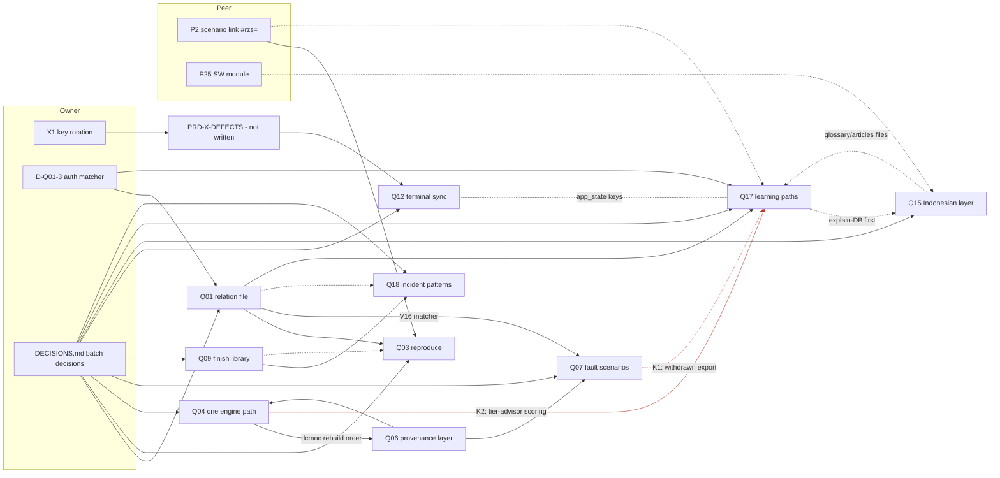

# QA review, batch 2: PRD-Q09, Q12, Q15, Q17, Q18, plus the batch 1 re-check and the cross-PRD review

Reviewer: independent QA agent (did not write these PRDs). Date 2026-11-11. Tree: `wt-hub3` at `dc48ed51b`
("docs: PRD v1.1 revisions after QA batch 1 (D1-D8) + DECISIONS.md").
Rule applied: every one of the 12 dimensions must score at least 4. A critical deficiency fails the PRD even when the
average is high. Scores are 0–5. Every code check below was run on this tree with the command shown. Nothing in the
repo was changed except this file. The Finnhub key literal was masked in every command that touched the terminal.

## Summary

| PRD | Compl. | Feas. | Func. clarity | Journey | UI/UX | Data model | API | Cross-module | Errors | Security | Testability | Impl. ready | Result |
|---|---|---|---|---|---|---|---|---|---|---|---|---|---|
| Q09 finish the incident library | 5 | 4 | 4 | 5 | 4 | 5 | 4 | 4 | 5 | 4 | **3** | 4 | **FAIL** (testability) |
| Q12 finance terminal sync | 5 | 4 | 5 | 4 | 4 | 5 | 5 | 4 | 5 | 4 | 5 | 4 | PASS |
| Q15 Indonesian layer | 5 | 4 | 5 | 5 | 5 | 5 | 5 | 4 | 4 | 4 | 4 | 4 | PASS |
| Q17 learning paths | 5 | 4 | 4 | 5 | 5 | 4 | **3** | **3** | 4 | **3** | 4 | **3** | **FAIL** (API, cross-module, security, impl. readiness) |
| Q18 incident pattern analytics | 4 | 5 | 5 | 4 | 5 | 5 | 4 | **3** | 5 | 4 | 4 | 4 | **FAIL** (cross-module) |

Claim checks: 33 claims checked across the five PRDs. **4 are FALSE or STALE**: 1 FALSE in Q18, 2 STALE in Q17, 1 STALE
in Q12. Every red-today law claim checked (15) fails on today's tree the way the PRD says it does. The code facts are
accurate; the failures are cross-PRD facts that went stale after the batch 1 revisions, plus one missed aggregate view.

Batch 1 confirmation (Part B): D1–D8 are applied as described. Q01 testability 4, Q03 API 4, Q07 security 4: agree.
Q04 cross-module: agree it passes, but at 4, not the self-scored 5 (a new conflict with Q17, §C).

---

## Part A

### Conventions check (binding since batch 1), all five PRDs

| Convention | Q09 | Q12 | Q15 | Q17 | Q18 |
|---|---|---|---|---|---|
| Owner decisions as `D-<PRD>-n` in `DECISIONS.md` | No (D-1…D-12, OQ-1…OQ-4) | No (D-1…D-5) | No (D-1…D-7) | No (OQ-1…OQ-4) | No (OQ-1, OQ-2) |
| No `auth.js` change without "requires owner approval — auth boundary" | Holds (no change) | Holds (terminal loads no auth code; no change) | Holds | **Violated**: T-7 edits `auth.js` "if first" to add a `_rzAuth.ensureSupabase` export; §22 bumps `auth.js auth.min.js` tokens; no approval mark | Holds (read only) |
| No `rz-tracker.js` as a metric | Holds | Holds | Holds | Holds (FR-12 rejects it explicitly) | Holds (O6 "not measured") |
| Q06 owns provenance labels and cockpit styling | Holds (no cockpit; the dossier state line is a verification state, not a provenance label) | Holds (finance suite, not a cockpit) | Holds | Holds (v2 datahall link only) | Holds |
| P2 hash `#rzs=`, `origin` string ≤ 80 | n/a | n/a | n/a | Holds (`#rzs=` with `{v:1, calc, inputs}`, no `origin`; may add `origin: "path:<id>"`, 23 characters) | n/a |

Decision migration list (34 decisions; proposed ids, status PROPOSED with the PRD's recommendation as default):

| PRD | Local id → proposed id |
|---|---|
| Q09 | D-1…D-12 → **D-Q09-1…D-Q09-12** (same order: NIRS, Kakao, Equinix LD8, UniSuper, Red Sea, Facebook, X/Oregon impactUsd, PSN location, `referenceCount`, "Official record" wording, LD8 LINX retype, NorthC log); OQ-1 build-order rule → **D-Q09-13**; OQ-2 library size → **D-Q09-14**; OQ-3 legacy state → **D-Q09-15**; OQ-4 `primarySearch` exception → **D-Q09-16** |
| Q12 | D-1 option A/C → **D-Q12-1** (this one is also the feature-removal approval); D-2 who syncs → **D-Q12-2**; D-3 keep option B tables → **D-Q12-3**; D-4 test account → **D-Q12-4**; D-5 owner SQL → **D-Q12-5** |
| Q15 | D-1…D-7 → **D-Q15-1…D-Q15-7** (legacy 89 entries, mapping table, homepage header, Phase C target, reviewer, `id/artikel.html`, stale-English rule) |
| Q17 | OQ-1 accept paths + 6 edges → **D-Q17-1**; OQ-2 retire `achievements.html` (feature removal) → **D-Q17-2**; OQ-3 educator class features → **D-Q17-3**; OQ-4 use metric → **D-Q17-4** |
| Q18 | OQ-1 access beyond root → **D-Q18-1**; OQ-2 curated `subsystem` field → **D-Q18-2** |

---

### PRD-Q09: finish the incident library

#### Scores

| Dimension | Score | Evidence |
|---|---|---|
| Completeness | 5 | All 24 sections; Appendix A recount scripts, Appendix C (36 reference corrections), §3.4 re-checks each of the 10 queue items in today's data |
| Technical feasibility | 4 | Builder helpers, two CLIs, a registry and a Node gate are ordinary work. The content program (15 seeds in 5 batches, ≈ 38 working days with Phase D) depends on research reachability, stated as A3/A4 |
| Functional clarity | 4 | FR-1…FR-15 with an FR matrix; exact state model (FR-1 regexes). AC-5 expects a row to read "Press-sourced", a string that appears in no FR and not in §9.6 |
| User journey | 5 | J1–J5 cover reader, hub, implementer verify loop (brief → check → stamp), queue decisions and new-candidate build, with recovery |
| UI/UX depth | 4 | Exact HTML contract (§9.3), copy table (§9.6), CSS budget and tokens (§9.7), 390 px behaviour. The "Press-sourced" word of AC-5 has no spec; D-10's conditional rename touches four places without a layout check for the longer word |
| Data model | 5 | Field table §10.2, registry schema + 33 v1 entries §10.3, `_build-order.json` §10.5, V1–V14 §10.6, byte format F15 |
| API contracts | 4 | CLI tables with exit codes (§11.1–11.5). `stamp --request R\d{3,}` and V9 `^R\d{3,}$` diverge from the aligned `^R[0-9]{2,4}$` of Q01/Q03/Q07 |
| Cross-module | 4 | §13 names Q18, Q03, Q01, Q17, vectors and diagrams, and R9 predicts that Q18's numbers go stale. Not stated: the `tools/ship-gate.sh` insertion after `:71` collides with Q18 and Q01; A1's future field `sourcing.state` disagrees with Q18 A1 `sourcing.status` |
| Error handling | 5 | §17 has 18 cases incl. paywalled primaries, archive fallback, quote breakage (V10), ollama down |
| Security | 4 | Escaping, prefix-only registry matching, slug regex, fixed argv for sub-gates (§16). Research guardrails are policy, not a check |
| Testability | **3** | L1–L8 are concrete, and every red claim checked holds. But the Phase A release (T-16) wires `test-incident-verification.mjs --strict`, which runs all eight laws, while L3 "still fails on 5 until T-14" (Phase C, behind OQ-4) and L4 fails until the owner answers D-1…D-12 and T-13 lands. The gate would turn the ship gate red the day it is wired. This is the defect class that failed Q01 in batch 1 (D1). L2 and L5 red proofs are "file missing", which proves nothing about the check |
| Implementation readiness | 4 | T-1…T-24 with effort, DoD and verification. Phase ordering is clear; the wiring/phase conflict above is the one blocker |

#### Claim checks

| # | Claim | Command | Result | Verdict |
|---|---|---|---|---|
| 1 | L7 red (F13): the corpus gate passes but is not wired | `node tools/test-incidents-corpus.mjs \| tail -1`; `grep -c test-incidents-corpus tools/ship-gate.sh` | "43 incident(s) checked, all provenance + structure OK"; 0 | TRUE |
| 2 | L1 red (F3): the hub says "seed" 0 times and carries the "post-incident report" claims | `grep -ci seed dc-incidents.html`; `grep -c 'post-incident report' dc-incidents.html` | 0; 4 | TRUE |
| 3 | L4 red (F11): `referenceCount` on 28 dossiers, no reader | Python count over `data/incidents/*.json`; `grep -rln referenceCount --include=*.py --include=*.mjs --include=*.js --include=*.html .` | 28; no file | TRUE |
| 4 | L6 red (F12): 3 dossiers lack coordinates | slugs not present in the `INCIDENT_COORDS` block of `tools/build-incidents.py` | azure-wan-router-global-2023, aws-ebs-ec2-rds-us-east-1-2011, alibaba-cloud-global-2023 | TRUE |
| 5 | Numeric: 228 references; master list 113 entries, `withPostmortem` 60 | Python over the dossiers and `_master-list.json` | 228; 113; 60 | TRUE |
| 6 | F4: X/Oregon is `officialPostmortem: true` on an idcnova.com news item typed `vendor-status` | `python3 -c` print of `sourcing` and `references` | `True [('vendor-status', 'https://www.idcnova.com/news/fire-breaks…'), ('press', crn.com), ('press', techgolly.com)]` | TRUE |

#### Critical deficiencies

- **Q09-D1 (testability): the gate is wired red.** §20.2 and T-16 wire `--strict` (all of L1–L8) in Phase A; L3 and L4 cannot
  pass until Phase C tasks that wait on the owner. No `--phase` switch exists (Q15 has one; Q09 does not).
- **Q09-D2: undefined copy.** AC-5 "Press-sourced" has no FR, no §9.6 string and no render rule.
- **Q09-D3: convention drift.** 16 decisions in local ids; request regex `^R\d{3,}$`.

#### Revisions required (testability below 4)

1. §11.5, §20.2, §22: add `--phase A|B|C` to `tools/test-incident-verification.mjs`, as Q15 does. Phase A wires L1, L5,
   L6, L7, L8 and L2 (L2 after T-4, with the two flags that wait on D-Q09-11/12 listed in a dated, owner-visible pending
   file the gate reads). L3 runs as a ratchet in Phase A and B: the set of non-seed dossiers without a confirmed primary
   may only shrink from its post-T-4 baseline (5), and any new one fails. L4 runs as `--report` until T-13 ships.
   State in one table which law joins `--strict` in which release.
2. §20.5 (new): one planted-violation fixture per law under `tools/fixtures/incident-verification/`, with the expected
   failure line, as the red proof. "Registry missing" and "file missing" are not red proofs.
3. §9.6 + FR-5: either add the AC-5 word ("Press-sourced", where it renders, when) or rewrite AC-5 to the state line
   ("0 primary").
4. FR-7, §10.6 V9, §11.1: request pattern `^R[0-9]{2,4}$`. Move D-1…D-12 and OQ-1…OQ-4 to `DECISIONS.md` as D-Q09-1…16.

---

### PRD-Q12: finance terminal sync, or removal of the dead path

#### Scores

| Dimension | Score | Evidence |
|---|---|---|
| Completeness | 5 | 24 sections; F1–F13 with masked commands; option A/B/C comparison (§10.5); Appendix A |
| Technical feasibility | 4 | Repairing a 3.6 KB module and four anchored hooks in a 289 KB file is feasible; the live table is UNKNOWN until T-1, stated |
| Functional clarity | 5 | FR-1…FR-11 with field matrix; reconciliation cases a–e (§12.2) with backup rules; error-message mapping in FR-4 matches `friendly()` |
| User journey | 4 | J1–J5 incl. shared device and offline. The journey from `account.html` (the page that tells users where the lists live) to the terminal is only a copy change |
| UI/UX depth | 4 | One element, four states, exact copy, tooltip text, 44 px Retry at 390 px, `min-width` to stop layout shift. Light-theme contrast of `--t4` is left to L8 rather than measured now |
| Data model | 5 | Cloud keys with real shapes (§10.1), device metadata/backup (§10.2), option B loss table (§10.3), retention and rollback |
| API contracts | 5 | Verified client contract with line numbers (§11.1), module v2 contract with NEW members (§11.2), terminal hooks, gate CLI |
| Cross-module | 4 | §13 covers terminal, admin iframe, flags, account page, graph snapshot. Gaps: the blocking PRD-X-DEFECTS does not exist (see claim 8); §13 says `rz-ft-sync` is the only `app_state` consumer, while Q17 adds `learning-paths/v1` to the same 200-key table |
| Error handling | 5 | §17 has 14 cases; every failure keeps local data and the dirty flag |
| Security | 4 | Allowlist (FR-2) keeps the key on the device; RLS own-row; tier check stated as presentational; XSS seed in L4 case f. The existing key copy written by `:4359` is delegated with "should" to a PRD that is not written |
| Testability | 5 | L1–L8 with exact red output; option C laws LR2/LR3 honestly say "passes today, red by mutation"; in-memory stand-in; U1–U8 |
| Implementation readiness | 4 | T-0…T-6 and T-C1/T-C2; blocked by X1 (owner) and D-1…D-5, both stated. Option C is also tied to L1 (X1) although deleting a dead file does not need the key rotated |

#### Claim checks

| # | Claim | Command | Result | Verdict |
|---|---|---|---|---|
| 1 | L7 red (F5 D5): the module loads `?v=2026-07-16` while 9 pages load `20260920-90bd6417` | `grep -n 'v=2026-07-16' js/rz-ft-sync.js`; `grep -h -o 'rz-supabase.js?v=[^"]*' *.html \| sort \| uniq -c` | `:29`, `:35`; `9 rz-supabase.js?v=20260920-90bd6417` | TRUE |
| 2 | L2 red (F4): no page loads `rz-ft-sync.js` | `grep -rln 'rz-ft-sync' --include=*.html --include=*.js .` | `Apps/second brain/codebase-graph.html` (graph data), `js/rz-ft-sync.js` | TRUE |
| 3 | L1 red (F10): string-literal fallback at `:4358`, write-back at `:4359` | `sed -n 4358,4359p Apps/finance-terminal/index.html \| sed 's/[A-Za-z0-9_-]\{20,\}/<R>/g'` | `localStorage.getItem(CFG.LS.KEY)\|\|'<R>'`; `if(S.fhKey)localStorage.setItem(…)` | TRUE |
| 4 | Numeric: module 3,611 B; `app_state` 128 KB check at `schema.sql:669` | `wc -c js/rz-ft-sync.js`; `grep -n 131072 supabase/schema.sql` | 3611; `669: … app_state_state_chk check (pg_column_size(state) <= 131072)` | TRUE |
| 5 | F9: `portfolio-save` is Pro/root only at `rz-feature-flags.js:271` | `grep -n portfolio-save js/rz-feature-flags.js` | `271: 'portfolio-save': { free: false, demo: false, pro: true, root: true }` | TRUE |
| 6 | §20.2 anchor: `ship-gate.sh:279` is the saved-scenario routes gate | `sed -n 279p tools/ship-gate.sh` | `gate "Saved-scenario Open routes — …" node tools/test-scenario-open-routes.mjs` | TRUE |
| 7 | FR-4: `friendly()` returns "Database not set up…" and "Koneksi ke server…" (`:81-89`) | `sed -n 81,89p js/rz-supabase.js` | both strings present at `:85`, `:87` | TRUE |
| 8 | §1: "PRD-X-DEFECTS is being written in bundle E" | `ls documentation/product-transformation/02-prds \| grep -i defect` | no output; bundle E produced PRD-Q10 and PRD-Q11 only | **STALE** |

#### Critical deficiencies

None below 4. Items to fix in the next revision:
- The blocking dependency (X1 code removal, and clearing the `rz_ft_key` copy that `:4359` wrote into every visitor's
  browser) points at a PRD that does not exist. Either PRD-X-DEFECTS is written before Q12 is scheduled, or Q12 takes
  the two X1 code items into its own T-0 behind the owner's rotation.
- Option C (delete a dead file) is held behind L1 (key rotated). Run L1 only under option A.
- §13: add Q17 as a second `app_state` consumer and a one-line key registry (`ft_*` here, `learning-paths/v1` in Q17).
- Migrate D-1…D-5 to D-Q12-1…5.

---

### PRD-Q15: Indonesian layer

#### Scores

| Dimension | Score | Evidence |
|---|---|---|
| Completeness | 5 | 24 sections; F1–F14; corrections C1–C4; Appendix A script; Appendix B legacy mapping table |
| Technical feasibility | 4 | Head tags, sitemap alternates and a marker-bounded generator are low risk; the lossless extraction of a 217 KB term block is the hard part and has a proof step (FR-3) |
| Functional clarity | 5 | FR-1…FR-10, exact pair list, exact sitemap shape, generator rules for both languages |
| User journey | 5 | J1–J5: Indonesian reader, English switcher, owner review loop, implementer, crawler |
| UI/UX depth | 5 | Exact HTML for both toggles, ASCII at 1440/390, token mapping per page, the R079 homepage constraint, full copy table incl. Indonesian drafts for owner acceptance |
| Data model | 5 | `rz-glossary/1` and `rz-glossary-review/1` with hash binding, field rules, V1–V8, example record taken from the page |
| API contracts | 5 | Generator CLI with exit codes, head contract §11.2, parser extension §11.3, gate CLI with `--phase` |
| Cross-module | 4 | §13 lists 15 modules. Not stated: Q17 FR-9 changes `tools/build-explain-db.py` and regenerates `js/rz-explain-db.js` (titles), while §5.2/§13 assert the DB "does not change"; Q17 also edits `glossary.html:564` and `articles.html:482`, files this PRD edits in the same regions' neighbourhood |
| Error handling | 4 | §17 covers orphaned keys, stale English, peer refusal, R079. But the peer-refusal fallback ("Phase A ships the rest with that law item marked open") contradicts the Phase A wiring `--strict --phase A`, which includes L4 and would fail |
| Security | 4 | Allowlist parser, same-origin hreflang, no network in the generator, U5 XSS seed |
| Testability | 4 | L1–L8 red as stated (checks below); phase flag; planted-failure proofs in §20.1. L4 depends on another session's edit to a peer-owned file |
| Implementation readiness | 4 | T-1…T-13 with effort. T-5 (Phase A) depends on T-9 (the owner packet, numbered in Phase B), so Phase A also waits on the owner |

#### Claim checks

| # | Claim | Command | Result | Verdict |
|---|---|---|---|---|
| 1 | L1 red (F2, F3): 0 root pages declare `hreflang="id"`; homepage alternates name `/index.html` while canonical is `/` | `grep -l 'hreflang="id"' *.html \| wc -l`; `sed -n 49p;52,53p index.html` | 0; canonical `https://resistancezero.com/`, alternates `…/index.html` | TRUE |
| 2 | L2 red (F4): `sitemap.xml` has 0 `xhtml:link` | `grep -c xhtml:link sitemap.xml` | 0 | TRUE |
| 3 | L7 red (F9): the glossary gate checks 0 Indonesian terms | `python3 tools/test-glossary.py \| grep glosarium` | `PASS id/glosarium.html: 0 finding(s)` | TRUE |
| 4 | Numeric (F5): 449 English terms, 89 Indonesian; `grep -c 'class="term'` gives 90 | `grep -o 'id="term-[^"]*"' glossary.html \| wc -l`; `grep -o 'class="term"' id/glosarium.html \| wc -l`; `grep -c 'class="term' id/glosarium.html` | 449; 89; 90 | TRUE |
| 5 | L4 red (F8): "100+" 7 times, static counter 105 | `grep -o '100+' id/glosarium.html \| wc -l`; `grep -n Menampilkan id/glosarium.html` | 7; `:436 … 105 … 105` | TRUE |
| 6 | §20.2 anchor `ship-gate.sh:313` | `sed -n 313p tools/ship-gate.sh` | the glossary gate line | TRUE |

#### Critical deficiencies

None below 4. Items to fix:
- Phase A gate vs the peer: make L4's `id/index.html` items a listed, dated exception the gate reads (or move them to
  Phase B), so the §17 fallback and the `--strict --phase A` wiring say the same thing.
- Reorder T-9 into Phase A, or ship Phase A English-only and the Indonesian copy in Phase B.
- §13: add Q17 (explain-DB title fix, `glossary.html` intro link, `articles.html` journal row) with an order: Q17 T-1
  before Q15 T-7, so the lossless proof is taken against the fixed explain DB.
- Review records use `^R\d{3,}$`; align to `^R[0-9]{2,4}$`. Migrate D-1…D-7.

---

### PRD-Q17: learning paths

#### Scores

| Dimension | Score | Evidence |
|---|---|---|
| Completeness | 5 | 24 sections; three complete path drafts with every id; Appendix A runnable scoring script with output |
| Technical feasibility | 4 | Static page + small module + builder; the exercise answers reproduce exactly (claim 3). Depends on three unbuilt things (Q01 edges, P2, Q01 FR-13) |
| Functional clarity | 4 | FR-1…FR-12 with matrix. FR-7's precondition ("`window._rzAuth.ensureSupabase` available") can never hold (claim 6) |
| User journey | 5 | J1–J7 incl. wrong answer, show-answer, non-root incident step, two devices, reset, owner maintenance |
| UI/UX depth | 5 | ASCII at 1440, 390 rules, exact HTML, control table, full copy table, no-gamification rules |
| Data model | 4 | Path schema with V1–V12, progress record with merge rule. Path status/approval fields reuse the format batch 1 retired: `draft/approved/retired`, `approvedBy/approvedOn`, `request ^R[0-9]{3,4}$` (batch 1 X4) |
| API contracts | **3** | §11.6 names `window._rzAuth.ensureSupabase` "export added by the first of Q7/Q17 to ship, PRD-Q07 §11.5". Q07 v1.1 withdrew that export (D4, `PRD-Q07:813`), and `auth.js` exports only `isRootOnlyHref`, `isRootSession`, … (`ensureSupabase` stays internal at `auth.js:432`). The sync contract therefore rests on a member that does not exist and will not |
| Cross-module | **3** | (a) The Q07 dependency is stale (above). (b) §13 says `tier-advisor.html` is "Unchanged", but PRD-Q04 FR-9 switches its scoring to `RZEngine` calls (`PRD-Q04:60`, `:72`); L3's Node half slices the page's own code between `var WEIGHTS = {` and `// Update DOM`, which Q04 removes; Q17 never mentions Q04. With Q04 FR-16, a missing engine shows "—", so an exercise cannot be answered. (c) The "Root access" word is rendered by this page, against the batch 1 rule that Q01's renderer is its only writer. (d) Q12 also uses `app_state` (two sync engines on one table, no key registry). (e) Q15 edits the same `glossary.html` and `articles.html` and reads the explain DB this PRD regenerates |
| Error handling | 4 | §17 has 16 cases. No path if D-Q01-3 (auth matcher) is rejected: L7 then can never pass and no path can ship |
| Security | **3** | T-7 edits `auth.js` "if first" and §22 bumps `auth.js auth.min.js` tokens: an auth-surface change with no "requires owner approval — auth boundary" mark, re-introducing exactly what batch 1 removed from Q07 (D4). The rest is sound (answer field as text, `</` escaping, no events before consent) |
| Testability | 4 | L1–L8 with red output; L3 proves answers in a browser, signed out and in. L3's Node half breaks after Q04 FR-9 (see cross-module) |
| Implementation readiness | **3** | T-7 depends on a withdrawn export; T-8 depends on D-Q01-3 with no rejected path; Q04 ordering absent |

#### Claim checks

| # | Claim | Command | Result | Verdict |
|---|---|---|---|---|
| 1 | L6 red (F9), numeric: 229 of 1,020 explain-DB titles contain "((" | `node -e` load of `js/rz-explain-db.js`, filter `t.includes("((")` | `1020 229` | TRUE |
| 2 | L7 red: `isRootOnlyHref` does not match dossier URLs | `sed -n 332,347p auth.js` | `ROOT_ONLY_PATHS` = `/dc-market`, `/dc-market-tracker.html`, `/dcmoc`, `/dc-incidents.html`, …; exact or `p + '/'` prefix only | TRUE |
| 3 | Numeric (Appendix A1): defaults raw 57.969 → UPS N 55.869 (56), fire none physical 33.5 (34), cooling N 54.469 (54) | ran the Appendix A1 script verbatim on `tier-advisor.html` | identical output, incl. `canT3 false` for UPS N | TRUE |
| 4 | FR-10: `articles.html:482` is the hand-written "Case library" `.jrow` | `sed -n 482p articles.html` | `
Case library…` | TRUE |
| 5 | V6: `upsConfig` default is `n1` | `grep -n 'id="upsConfig"' -A4 tier-advisor.html` | `<option value="n1" selected>N+1</option>` | TRUE |
| 6 | §1, §5.4, §11.6: `_rzAuth.ensureSupabase` is "added by the first of Q7/Q17 to ship, PRD-Q07 §11.5" | `grep -n ensureSupabase auth.js`; `grep -n ensureSupabase PRD-Q07/PRD.md` | `auth.js:432` internal function only; Q07 `:813` "Version 1.0 proposed exporting `ensureSupabase` … That is withdrawn (coordinator decision D4)" | **STALE** |
| 7 | §13: `tier-advisor.html` "Unchanged; its defaults become a tested contract" | `sed -n 58,62p PRD-Q04/PRD.md`; `grep -c Q04 PRD-Q17/PRD.md` (Q04 mentions) | Q04 "Switches `tier-advisor` … to engine calls"; Q17 never names Q04 | **STALE** |

#### Critical deficiencies

- **Q17-D1 (security, API): an unapproved auth-surface change resting on a withdrawn contract.**
- **Q17-D2 (cross-module): blind to Q04 FR-9**, which rewrites the code this PRD's proof slices.
- **Q17-D3: no rejected path for D-Q01-3**, so the PRD can be blocked forever by an auth-boundary decision.
- **Q17-D4: decision and approval formats** are the ones batch 1 retired.

#### Revisions required

1. Security and API (Q17-D1). Replace every `ensureSupabase` use with the Q07 v1.1 path: `learning-paths.html` loads
   `js/rz-config.js?v=<token>` and `<script type="module" src="js/rz-supabase.js?v=<token>">`; FR-7's precondition becomes
   "`window.rzSupa` present and `rzSupa.ready` resolved (or the `rz-supa-ready` event fired) with a user from
   `rzSupa.getUser()`". Remove `auth.js` and `auth.min.js` from T-7's files and from the §22 token list. §11.6 becomes
   read-only (`isRootSession`, `isRootOnlyHref`). §16 gains "no `auth.js` change". If any `auth.js` change remains, mark it
   "requires owner approval — auth boundary" and give it a `D-Q17-n` id.
2. Cross-module (Q17-D2). Add PRD-Q04 to §1 Dependencies and §13: after Q04 FR-9 the tier advisor scores through
   `RZEngine.models.tier`; L3 then computes raw values by loading `rz-engine.js` in Node and calling the engine, or
   takes raw values from the browser only. Order: Q04 FR-9 first, then Q17 L3's baseline. State what the path shows
   when the engine is missing (Q06's Fallback line; the exercise step says the calculator is unavailable).
3. Q17-D3. Add the rejected path: if D-Q01-3 is rejected, the incident step renders title and the Q01 `why` line with
   "Root access" and no link, and L7 checks "no `incident-*` href on the page" instead of the matcher. Render the
   "Root access" row through Q01's renderer contract, or state why this page differs.
4. Data model (Q17-D4). Path files: `status: proposed|accepted|rejected|retired`, `decidedBy`, `decidedOn`,
   `request ^R[0-9]{2,4}$`; the batch decision is D-Q17-1 in `DECISIONS.md`. Move OQ-1…OQ-4 to D-Q17-1…4.
5. §13: one `app_state` key registry shared with Q12, and the Q15 ordering for `glossary.html`, `articles.html` and the
   explain DB (Q17 T-1 first).

---

### PRD-Q18: incident pattern analytics

#### Scores

| Dimension | Score | Evidence |
|---|---|---|
| Completeness | 4 | 24 sections and two recount appendices. The problem statement misses an existing aggregate view (claim 5) |
| Technical feasibility | 5 | One pure aggregation module inside the existing builder; outputs join the existing freshness check; name avoids the dossier glob (F12) |
| Functional clarity | 5 | FR-1…FR-11; counts are list lengths by construction; exact band rules; exact copy |
| User journey | 4 | J1–J3 complete for root. Non-root journey is the shell's gate only; nothing says what a public page linking here (Q17 v2, Q03) shows |
| UI/UX depth | 5 | ASCII matrix with real numbers, 390 px fact-list fallback, component tree, aria-labels, one-amber rule |
| Data model | 5 | `rz-incident-patterns/1` schema with V1–V7, band table with rubric anchors, example record from today's data |
| API contracts | 4 | Python module signatures, builder contract, consumer rule, no Supabase. No `--base` contract detail for the live L1 run beyond one line |
| Cross-module | **3** | §13 does not list PRD-Q09, the PRD that changes this page's inputs: Q09 T-4 changes `officialPostmortem` on 3 dossiers (hub 30 → 29 or 28) and its batches stamp seeds, yet L7 hardcodes 46 outputs and AC-1…AC-5 hardcode today's counts ("13 of 43", "28 researched", AWS 5 …). Q09's own R9 flags this; Q18 does not. The future seed field is `sourcing.status` here (A1) and `sourcing.state` in Q09 (A1). `/dc-incident-patterns.html` is outside `isRootOnlyHref` today and outside Q01 FR-13's `/incident-` prefix, while §13 invites Q03 and Q17 to link to it. The `ship-gate.sh:71` insertion collides with Q09 and Q01 |
| Error handling | 5 | §17 has 11 cases incl. unlabeled category (build fails), duplicate ids, script blocked |
| Security | 4 | Stays root-only and noindex; `html.escape`; slug and id regexes. The gate is presentational (stated, inherited) |
| Testability | 4 | L1 is an independent Node recount; red proofs by mutation for L1, L3, L5. L7's literal 46 will fail on the first new dossier |
| Implementation readiness | 4 | T-1…T-8 with effort and verification; ≈ 7 days v1 |

#### Claim checks

| # | Claim | Command | Result | Verdict |
|---|---|---|---|---|
| 1 | L7 red: the builder reports 44 outputs today | `python3 tools/build-incidents.py --check \| tail -1` | `CURRENT — all 44 generated pages match the builder` | TRUE |
| 2 | L8 red (F5): 5 categories have no label; 7 raw chips on the hub | `sed -n 30,33p tools/build-incidents.py`; `grep -o '<[^<]*>config-error<' dc-incidents.html` (and the other four ids) | 8 labels; chips: config-error 3, control-plane 1, authentication 1, storage 1, change-management 1 = 7. Also 5 raw `iid-cbl` bar labels the PRD does not count (`build-incidents.py:1264`), fixed by the same FR-9 | TRUE (undercounted) |
| 3 | Numeric (F1, F2, F7): 43 dossiers, 15 seed, 284 modes, 30 with official postmortem; 6 of 28 researched without one | Python over `data/incidents/*.json` | 43, 15, 284, 30; 28 / 6 | TRUE |
| 4 | Numeric (AC-2): Power researched 1/19/22/37, seed 3/15/9/11 | Python band recount, `category` contains power | `{'d1-5':1,'d6-7':19,'d8':22,'d9-10':37}` / `{3,15,9,11}` | TRUE |
| 5 | §2/§3.2 (F3, F4): the hub shows "human error" as 2 incidents, so "an engineer reading the hub concludes human error drove 2 of 43" | `grep -o 'data-cat="human">…data-to="[0-9]*"' dc-incidents.html`; `sed -n 1254,1266p tools/build-incidents.py` | The hub's "Incident Intelligence" dashboard (`iid_catbars`) counts **every** listed category and shows Human error = **10**. Only the FMEA corpus table uses `category[0]` | **FALSE** (an existing all-category aggregate is missed; the consequence is overstated) |
| 6 | §20.3 anchors `ship-gate.sh:67` and `:71` | `sed -n 67p;71p tools/ship-gate.sh` | incident pages freshness; incident figures | TRUE |

#### Critical deficiencies

- **Q18-D1 (cross-module): Q09 is absent**, and the acceptance numbers will be wrong by the time this ships.
- **Q18-D2: the baseline misses the Incident Intelligence dashboard**, which already answers part of the stated problem.
- **Q18-D3: the new root-only page is not covered by any link lock.**

#### Revisions required (cross-module below 4)

1. §1 Dependencies, §5.4, §13: add PRD-Q09 (T-4 reference corrections, seed stamps). Order: Q09 Phase A before Q18,
   or Q18 first with ACs written as formulas.
2. L7: expected outputs = number of dossiers + 3, computed by the gate, not 46. AC-1…AC-5: state "values equal the
   gate's recount at build time"; keep today's numbers only as an illustration labelled with the commit.
3. §3.1 F3, §2, §3.2: add the `iid_catbars` dashboard (`tools/build-incidents.py:1254-1266`, all categories, Human
   error 10) and decide whether FR-9's "Primary category" caption also explains why the two hub views disagree.
4. A1: use the field name Q09 owns (`sourcing.state`), and say Q09 owns the dossier state model.
5. §16: either add `/dc-incident-patterns.html` to the Q01 FR-13 matcher scope (an auth-boundary change, marked
   "requires owner approval — auth boundary", with a D-Q01-n or D-Q18-n id), or state that no public page links it
   and remove the Q03/Q17 link invitation from §13.
6. §20.3: order the `:71` insertion with Q09 and Q01 (insert by anchor text, not line number). Migrate OQ-1/OQ-2.

---

## Part B: batch 1 revisions confirmed

### D1–D8 applied (text found)

Command: `grep -c -- '<marker>' PRD-<id>/PRD.md` per marker, then the lines read in context.

| Decision | What it required | Evidence found | Verdict |
|---|---|---|---|
| D1 (Q01) | L8 green in phase 0 via `pending-review`; planted fixtures; `rz-related` class and markers; idempotence law | `pendingReview` 11, `V15` 11, `rz-related:start` 11, `` class `rz-related` `` 2, `\| L9 \|` 3, `render-fixture` 5 | Applied |
| D2 (Q03) | `origin` string ≤ 80; mirror inputs; 64 inputs | `RV17` 17, `incident:<slug>:<entry>` present, `tiaTier` 14, `64 inputs` 5. The old object `{kind, slug, entry, set[]}` survives only in the §11.3 withdrawal note (`:678`); `set[]` at `:518` is the reproduce entry's own field, not `origin` | Applied |
| D3 (Q04, Q06) | L7 behavioural; rebuild order Q04 → Q06; total 61 | Q04: `ltc-legacy-golden.json` 4, `= 61` 3, `local=60` 0; "normalis" remains only as a statement that no normaliser is used (`:871`). Q06: `computeModelLegacy` 9 (placement in the wrapper), rebuild order at `:1261` | Applied |
| D4 (Q07) | No `auth.js` change; no tracker metric | `ensureSupabase` only in the withdrawal (`:813`), the one-client note (`:815`) and a read-only row (`:882`); `rz-tracker` 6, all negative (`:892`, `:922`, `:1039`); `fault_run_start` 0 | Applied |
| D5 (all five) | Decisions in `DECISIONS.md` | `D-Q01-` 8, `D-Q03-` 6, `D-Q04-` 86, `D-Q06-` 4, `D-Q07-` 22; `DECISIONS.md` holds 22 rows. Q01 `:19` still names "OQ1" once in the approval line next to D-Q01 ids (cosmetic) | Applied |
| D6 (Q04) | Missing engine = Q06 `kind=fallback`, F-CALC-ENGINE-MISSING | Q04: code 12, `aria-describedby` 12; Q06: the code appears once (`:1262`, the Q04 row), registered by Q04 T-9 into Q06's registry | Applied |
| D7 (Q07) | Q06's `.rz-prov` and token chain; cockpits do not load `rz-hub.css` | `.rz-prov` 12; `rz-hub.css` 5 (each as "not loaded" or a fallback value) | Applied |
| D8 (Q01, Q03) | Q03 → Q01 only | Q01 "Q3 reads" 0 | Applied |

Still open from batch 1: the Q06 carry-over. `js/rz-telemetry-quality.js:79` still carries the demo-state light
background `#FFF8D6!important`, and Q06 FR-3 does not remove it (`grep -c FFF8D6 PRD-Q06/PRD.md` → 0).
Q01 marks FR-13 as "Owner approval (auth boundary)" (`:135`, `:945`), not the exact phrase "requires owner approval —
auth boundary"; harmless, but the phrase should be uniform so a grep finds every instance.

### Re-score of the dimensions that were below 4

| PRD · dimension | Batch 1 | Reviser | This review | Verdict and evidence |
|---|---|---|---|---|
| Q01 · Testability | 3 | 4 | **4** | Agree. Phase 0 no longer reds the ship gate (L8 accepts `pending-review`), and §20.5 lists one planted fixture per law. Not 5: the fixtures are specified, not built; L8 can be satisfied by bookkeeping; 9 laws exceed the brief's 3–8 |
| Q03 · API contracts | 3 | 4 | **4** | Agree. The agreed string contract is used everywhere, with RV17; the mirror inputs are in the baseline. Not 5: the mirror element type stays "as captured" until P2 lands on main |
| Q04 · Cross-module | 3 | 5 | **4** | Agree that it passes; disagree with 5. The batch 1 conflicts (Q06 FR-13, DCMOC rebuild, engine-missing idiom) are closed. A new one opened in batch 2: Q04 FR-9 replaces the `tier-advisor.html` scoring code that Q17 L3 slices and that Q17 treats as an unchanged contract, and Q01 also inserts its `rz-related` block into the same page. Q04 §13 should name Q17 and the tier-advisor edit order |
| Q07 · Security | 3 | 4 | **4** | Agree. No `auth.js` change, no tracker metric, drafts "not listed". The residual `ensureSupabase` race is existing behaviour, stated. Q17 still depends on the export Q07 withdrew; that is a Q17 defect |

---

## Part C: cross-PRD review across all 10 PRDs (Q01, Q03, Q04, Q06, Q07, Q09, Q12, Q15, Q17, Q18)

### C1. Duplicate requirements

| Duplicate | Where | Proposal |
|---|---|---|
| Owner acceptance with request id, atomic write, refusal leaves the file unchanged | Q01 `build-relations.py decide`, Q03 `incidents_reproduce.py decide`, Q07 scenario approval, Q09 `incidents_verify.py stamp`, Q15 `build-glossary.py --accept/--reject`, Q17 path files (hand-edited `approved`) | One `tools/owner_decisions.py`: status machine `proposed\|accepted\|rejected\|retired`, `decidedBy`, `decidedOn`, `request ^R[0-9]{2,4}$`, atomic write. Each CLI imports it |
| Verbatim evidence and claim-to-source checks | Q01 FR-8, Q03 RV10, Q09 V7/V10/BR-3 | Q09's `refs` pointers and Q01/Q03's `resolve_evidence` should share one resolver over the dossier JSON |
| axe planted-line proof | Q01 L8, Q03 L6, Q04 §15, Q06 L8, Q07 L8, Q09 L8, Q12 L8, Q15 L8, Q17 L8, Q18 L8 (10 of 10) | `tools/lib/axe-planted.mjs`, one planted colour, one assertion (batch 1 proposal, still open) |
| Design-register computed-style checks | Q01, Q03, Q06, Q07, Q09, Q12, Q15, Q17, Q18 | `assertRegister(page, selector)` |
| Browser harness | port-0 own servers (Q01, Q03, Q07, Q12, Q17), `file://` (Q09, Q18), `$LTC_BASE` (Q04, Q06), `rz-lane` puppeteer (Q15) | One rule: inside `ship-gate.sh` use the served tree; standalone runs use one shared port-0 helper |
| In-memory `rzSupa` stand-in | Q07, Q12 (`app_state` with caps and failure modes), Q17 | `tools/lib/rzsupa-stub.mjs` built once from Q12's spec (it is the most complete) |
| `app_state` sync logic (dirty flag, merge, debounce, error copy) | Q12 `rz-ft-sync.js` v2, Q17 `rz-paths.js` FR-7 | One small `js/rz-app-state-sync.js` with per-key merge callbacks, or a written reason why two engines are kept |
| "Root access" row for dossier links | Q01 FR-13/BR6, Q07 V16, Q17 FR-8 | Q01's renderer is the only writer (batch 1 rule); Q17 must use it |
| Independent Node recount of dossier rules (seed rule, official flag) | Q09 gate (L2, L3), Q18 gate (L1), Q03 RV11/RV12 | `tools/lib/incident-rules.mjs` owned by Q09, read by Q18 and Q03 gates |
| Generated-block markers | `<!-- rz-related:start -->` (Q01), `<!-- rz:glossary-terms:start -->` (Q15), `<!--rz-paths:start-->` (Q17), `journal:*` (existing) | One marker grammar, e.g. `<!-- rz:<name>:start -->` / `<!-- rz:<name>:end -->`, written into `CONTENT_LINKAGE_PLAYBOOK.md` |

### C2. Conflicting contracts or terminology

| Id | PRDs | Conflict | Resolution |
|---|---|---|---|
| K1 | Q17 vs Q07 v1.1 | Q17 depends on `_rzAuth.ensureSupabase`, which Q07 withdrew (D4) | Q17 revision 1 above |
| K2 | Q17 vs Q04 | Q17 freezes `tier-advisor.html` scoring as a contract; Q04 FR-9 replaces it with engine calls | Q17 revision 2; Q04 §13 names Q17 |
| K3 | Q09 vs Q18 | Future seed field `sourcing.state` (Q09 A1) vs `sourcing.status` (Q18 A1); Q09 says it "reads the seed rule of PRD-Q18" while it is the PRD that changes dossier state | Q09 owns the state model and the field name; Q18 and Q03 consume it |
| K4 | Q09, Q15, Q17 vs Q01, Q03, Q07 | Request pattern `^R\d{3,}$` (Q09, Q15), `^R[0-9]{3,4}$` + `draft/approved/retired` + `approvedBy/approvedOn` (Q17) vs `^R[0-9]{2,4}$` + `proposed/accepted/rejected/retired` + `decidedBy/decidedOn` (Q01, Q03, Q07) | Use the batch 1 record format everywhere |
| K5 | Q09, Q12, Q15, Q17, Q18 vs `DECISIONS.md` | 34 decisions in local ids | Migration list in Part A |
| K6 | Q18 vs hub | Two category counts on one hub: the Incident Intelligence bars (all categories, human 10) and the FMEA table (first category, human 2) | Q18 FR-9 caption covers both views |
| K7 | Q15 vs Q17 | Q15 asserts the explain DB "does not change"; Q17 FR-9 regenerates it (titles) | Order Q17 T-1 → Q15 T-7; Q15 §5.2 reworded |
| K8 | Q12 vs Q17 | Q12 says `rz-ft-sync` is the only `app_state` consumer; Q17 adds `learning-paths/v1` | Key registry in `SUPABASE_INTEGRATION.md` |
| K9 | Q09 (and Q15) gate wiring | Laws that wait on owner or peer input are wired under `--strict` in the first release | Phase-aware laws (Q09 revision 1; Q15 item 1) |
| K10 | Terminology | "Verified / Last verified / Seed" (Q09), "researched / seed" (Q18), "Root access" (Q01, Q17), provenance kinds (Q06) | Write one glossary of state words in `CONTENT_LINKAGE_PLAYBOOK.md`; Q18 adopts Q09's three states once Q09 Phase A ships |

### C3. Shared components that should be one module

The batch 1 list stands and is still unbuilt: decide CLI (`tools/owner_decisions.py`), evidence check (one resolver),
planted-line a11y proof (`tools/lib/axe-planted.mjs`), browser gate harness (one served-tree rule + one port-0 helper),
register style checks (`assertRegister`). Batch 2 adds four: `tools/lib/rzsupa-stub.mjs` (Q07, Q12, Q17),
`js/rz-app-state-sync.js` (Q12, Q17), `tools/lib/incident-rules.mjs` (Q03, Q09, Q18), and one generated-block marker
grammar (Q01, Q15, Q17). Build the shared helpers in the first wave, before the first PRD that needs them.

### C4. Shared data entities

| Entity | Writers | Readers | Note |
|---|---|---|---|
| `data/incidents/<slug>.json` dossiers | Q09 (types, flags, `refs`, `verification`, removes `referenceCount`), Q09 Phase D (new) | Q01, Q03, Q07 (V16), Q17, Q18, builder, vectors | Q09 changes `officialPostmortem` on 3 dossiers and the seed count; every reader's literal numbers go stale |
| Seed / verification state | Q09 (`stamp`) | Q01 BR7, Q03 RV12, Q18 | One owner (Q09) |
| `data/incidents/_master-list.json`, `_build-order.json`, `_publishers.json` | Q09 | Q09 tools | — |
| `data/relations.json` (`rz-relations/1`) | Q01 (decide), Q03 (R2I proposals) | Q07 (V16), Q17 (required edges), Q18 (v2) | Q17 needs 6 accepted edges |
| `app_state` (Supabase) | Q12 (`ft_wl`, `ft_port`, `ft_alerts`), Q17 (`learning-paths/v1`) | same | 200 keys and 128 KB per row per user |
| `saved_scenarios` (Supabase) | P2, Q03 (via P2), Q07 | `account.html` | — |
| `js/rz-explain-db.js` + `search-terms.json` | Q17 (title fix) | Q01 (term rows), Q15 (asserts unchanged), every explain consumer | Wide token bump |
| `glossary.html` term ids / `data/glossary.json` | Q15 (generator) | Q01, Q17, explain builder | Keys stay `term-*` |
| `RZ_FEATURE_FLAGS` | none edit | Q12 (`portfolio-save`), Q09/Q18 (`dc-incidents`), Q01, Q04, Q07 | Read-only everywhere |
| `DECISIONS.md` | all 10 (proposals), owner (status) | all | 22 rows today, 34 pending migration |
| `RZProvenance` registry (Q06) | Q06, Q04 (F-CALC-ENGINE-MISSING) | Q07 | — |

### C5. Dependency cycles

No hard cycle. Three soft ones, all ordering-only:
- **Q09 ↔ Q18:** Q09 says it reads Q18's seed rule; Q18's counts are Q09's output. Fix: Q09 owns the state (K3); the
  edge runs Q09 → Q18 only.
- **Q09 ↔ Q03:** Q09 C-17 asks for a Q03 verdict on a verified facility seed once Q03 has shipped; Q03 RV12 reads Q09's
  state. Conditional on shipping order; no deadlock. Keep the edge Q09 → Q03, with C-17 as a post-condition.
- **Q15 ↔ Q17 (files, not logic):** both edit `glossary.html` and `articles.html`, and Q17 regenerates the DB Q15 says is
  unchanged. Order Q17 T-1 → Q15 → Q17 page work.

The batch 1 cycle Q01 ↔ Q03 is closed (D8, confirmed).

### C6. Files edited by more than one PRD, and the order they need

| File | PRDs | Order |
|---|---|---|
| `auth.js`, `auth.min.js` | Q01 FR-13 (behind D-Q01-3); Q17 T-7 (must be dropped) | Q01 only. If Q18's page joins the matcher, it rides the same change and approval |
| `tools/build-incidents.py`, `dc-incidents.html`, 43 `incident-*.html` (generated) | Q09 (state line, markers, hub copy, meta on 44 pages), Q18 (two outputs, labels, hub nav), Q01 (dossier rows, phase 2), Q03 (reproduce section) | Q09 Phase A → Q18 → Q01 phase 2 → Q03; one `--apply` per release; each rebases on the last |
| `tools/incidents_fmea.py` | Q18 (hub table caption), Q03 (resolver reuse) | Q18 → Q03 |
| `tools/ship-gate.sh` | all 10. Near `:67–:71`: Q01, Q03, Q09 (`:67` and `:71`), Q18 (`:71`). Elsewhere: Q17 `:261`, Q12 `:279`, Q15 `:313`, Q07 `:160`, Q04/Q06 served-tree block | Insert by anchor text, never by line number; one owner per release |
| `tier-advisor.html` | P2 (T-P02-C), Q04 FR-9, Q01 (`rz-related` block), Q03 T-6b; Q17 treats it as a contract | P2 → Q04 → Q01 → Q03 → Q17 (re-prove L3 last) |
| `tia-942-checklist.html` | P2, Q03 | P2 → Q03 |
| `glossary.html` | Q15 (head, nav toggle, generated term block), Q17 (intro link `:564`) | Q15 Phase A/B → Q17 |
| `articles.html` | Q15 (head, toggle), Q17 (`.jrow` at `:482`) | Q15 → Q17 |
| `tools/build-explain-db.py`, `js/rz-explain-db.js`, `search-terms.json` | Q17 (fix + regen); Q15 relies on it unchanged | Q17 T-1 first |
| `tools/test-generator-freshness.py` `BUILDERS` | Q01, Q03, Q15, Q17 | Append-only; one per release |
| `index.html` | Q15 (head alternates, footer link), STATE task for P25 (SW tag), R079 owner shape | Coordinate in one release window; run `test-index-r079.mjs` |
| `datahall.html` | Q06, Q07 | Q06 → Q07 (batch 1) |
| `js/ltc-system-modelling-lab.js`, `dcmoc/` export | Q04, Q06 | Q04 → Q06, one rebuild (batch 1, confirmed) |
| `js/rz-supabase.js` | none edit (Q07, Q12, Q17 read) | — |
| `CLAUDE.md` audit list, `CONTENT_LINKAGE_PLAYBOOK.md`, `UIUX_AUDIT_LEDGER.md`, `DC_INCIDENTS_STANDARD.md` (Q09, Q18), `SUPABASE_INTEGRATION.md` (Q12, Q17) | most PRDs | Serialise per release (R089) |

### C7. Master dependency graph

Arrows run from prerequisite to dependent. Dashed arrows are soft or ordering-only; red-labelled edges are open
conflicts from this review.

(The `Q04 → Q06` edge is the rebuild order only; the contract edge is `Q06 → Q04`. The two do not form a cycle,
because one is a release-sequencing rule for a shared export and the other a code dependency.)

### C8. Top cross-PRD issues, in order

1. **Q17 plans an unapproved `auth.js` change on a contract Q07 withdrew** (K1), and Q17, Q07 V16 and Q18's link lock
   all hang on D-Q01-3 with no rejected path in Q17.
2. **The incident data chain has no owner.** Q09 rewrites dossier state and the official flag (30 → 29 or 28) and
   stamps seeds; Q18 hardcodes today's counts (L7 = 46, AC-1…AC-5) and does not list Q09; Q03 and Q01 read the same
   rules; the future state field has two names (K3). Q09 should own the state model and a shared `incident-rules` module.
3. **`tier-advisor.html` is edited by four parties and frozen by a fifth** (P2, Q04 FR-9, Q01, Q03; Q17 L3). Q17's proof
   slices code Q04 deletes (K2).
4. **Owner-decision and approval formats still diverge**: 34 decisions outside `DECISIONS.md`, three request regexes,
   two status vocabularies, six approval CLIs (K4, K5). One `tools/owner_decisions.py`.
5. **Shared-file sequencing and duplicate infrastructure**: `build-incidents.py` + generated pages (Q01, Q03, Q09, Q18),
   `ship-gate.sh :67–:71` (Q01, Q03, Q09, Q18), `glossary.html`/`articles.html`/explain DB (Q15, Q17), two `app_state`
   sync engines and three `rzSupa` stubs (Q07, Q12, Q17), and the five unbuilt shared helpers from batch 1. Laws wired
   before their owner or peer inputs exist (Q09 L3/L4, Q15 L4) repeat the batch 1 Q01 defect.
