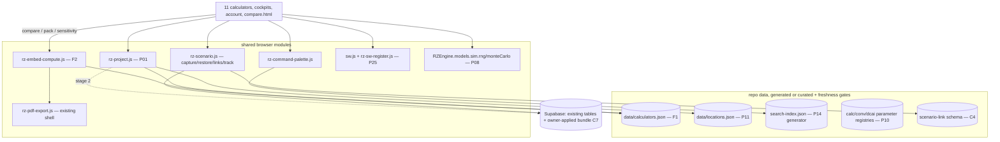
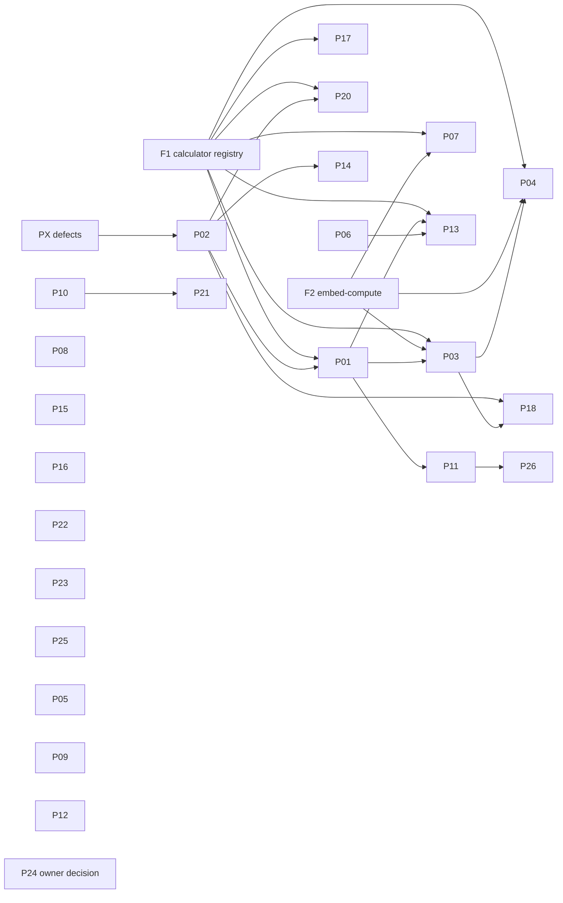

# Cross-PRD architecture review and target architecture (P-series), 2026-11-10

This document reviews the 27 P-series PRDs together. They were also checked against the LTC Q-series wherever the two sets touch.

The established conventions are kept as they are:
- zero-build ES5 modules on `window`;
- generated data files kept fresh by a freshness gate;
- the ship gate;
- `?v=` cache tokens derived from file hashes.

## 1. Conflicts found and their resolutions

| # | Conflict | PRDs | Resolution |
|---|---|---|---|
| C1 | **Seven per-calculator maps** in seven files. Each PRD invented its own: project fields (P01), compare result selectors (P03), PDF sections (P04, as markup attributes), sensitivity factors (P07), manual links (P17), embed keep-list (P20), hand-off contract (P13). Seven maps describing the same 11 pages would drift apart. | P01, P03, P04, P07, P13, P17, P20 | **One calculator registry, `data/calculators.json`.** It has one entry per calculator: `{calc, page, fields:{id:{key,unit,factor,transform}}, results:[{key,selector,unit,better}], sections:[...], factors:[...], manual:[...], embed_keep:[...], handoff:{...}}`. One gate, `test-calculator-registry.mjs`, checks every selector and field against the rendered page, so all seven PRDs are guarded by one check. P04 still marks its sections in the HTML, and the registry lists them. **Built first, as task F1.** |
| C2 | **Three iframe compute loops.** Compare, pack and sensitivity each specified "load the page in a hidden iframe, restore inputs, settle, read". | P03, P04, P07 | **`js/rz-embed-compute.js`, one module (F2).** The `?embed=<mode>` flag uses the values compare, pack, sensitivity and article. Every mode suppresses the account pill, cookie banner and palette. |
| C3 | **Two Cx issue systems.** Tier 1 `RZCxIssues` (localStorage key `rz-cx-issues`, A/B/C, drives gate readiness in the UI) and Tier 3 `RZCxRecords` `issues` table (R8 law). P06 writes Tier 3 issues; P13 was about to write Tier 1. | P06, P13 | **Rule:** new issues go to the **active tier**. With no Tier 3 record set active (the default), intake writes Tier 1. With a Tier 3 set active, intake writes Tier 3, and the Tier 1 register shows "planning register (read-only while a record set is active)". P06 adds `RZCxRecords.issueFromTier1(item)`, so a Tier 1 item converts explicitly. Issues are never mirrored silently. Written into P06 and P13 as an integration rule. |
| C4 | **Link payload versions.** P02 v1 `{v,calc,inputs}`. P01 extends it to v2 with `project`. P03 and P18 consume links. | P01, P02, P03, P18 | One schema file, `data/scenario-link.schema.json`. The readers accept v1 and v2. A new field means a version bump plus a reader update in the same release, enforced by a gate. |
| C5 | **Event allowlist growth.** P15 defines 5 actions; P01, P03, P13 and P14 each add one. | P15 + 4 | The allowlist lives in one constant in `rz-scenario.js`. Server-side Part B uses the same list in SQL. A gate compares the two lists. |
| C6 | **"Project" means three things.** Facility project (P01), `dcmoc_projects` (DCMOC app), `project_id` in Cx records (P06). | P01, P06 | UI terms: **Facility project** (P01) and **DCMOC model** (DCMOC). In Cx records, `project_id` refers to the Facility project id. DCMOC is not merged. |
| C7 | **Four Supabase changes** need the owner: P01 stage 2, P06 stage 2, P15 part B, P18. | — | **One migration bundle**, `supabase/migrations/2026-11-product-transformation.sql`, with tests, handed to the owner once. Nothing is applied by me. |
| C8 | **Mode labels.** SIMULATED (existing), REPLAY (P05), scripted fault (LTC Q7), "Live" claims (LTC X6). | P05, Q6, Q7, X6 | LTC's Q6 honesty layer owns the label component. P05 calls it with mode `replay`. If Q6 is not shipped when P05 lands, P05 writes the existing strip, and Q6 replaces it. A message is sent before either edit. |
| C9 | **Chart.js.** P25 vendors 4.4.1 for 9 calculators. Articles stay on the CDN (4.4.0 on 29 pages). | P25 | Accepted split, recorded in the tracker. Articles can move later without a design change. |
| C10 | **Location data vs P01 country.** P11 owns the values; P01 owns the selection. | P01, P11 | P01 stores only the ISO-2 code. Prices and grid factors always come from P11 at apply time, never stored in the project, so a data refresh (P26) reaches existing projects. |
| C11 | **Theme toggle duplicated** inline on 7 calculators. X3 adds an eighth copy to fix tia. | PX | Accepted for the defect fix (smallest change). Consolidating into one module is recorded as a refactor candidate. It is not done silently. |
| C12 | **Search index and noindex rule.** P14's generator and LTC's X7 sitemap fix both need "is this page indexable". | P14, X7 | One helper, `tools/lib/indexable.py`, used by both generators. Whichever session lands first creates it; the other imports it. |

**Dependency-cycle check.** The graph in §3 is acyclic. The only candidate loop was the PUE result feeding the project PUE. It is broken by P01's rule that the PUE feed is explicit and never automatic.

## 2. Target architecture

**Technology decisions:**
- No framework and no build step.
- New modules follow the `rz-scenario.js` pattern.
- New data files get generators, or JSON schemas plus gates.
- New pages: `compare.html` only.

## 3. Master dependency graph (P-series)

Foundations (must land before their dependants): **PX, F1, F2, P02, P01**.

## 4. Shared UI components
- **Provenance tag** (field-level text tag): P01, P11, P13, P26. One CSS class, `.rz-prov`.
- **Mode strip:** P05 + LTC Q6.
- **Message line** `#rzScenarioMsg`: P02, P14, P15.
- **Popover / bottom sheet:** P01, P04. Reuses the tool-register dialog styles.

All of them follow design.md:
- 1 px hairlines;
- 4 px radius;
- mono 11–12 px meta text;
- no gradients, glass or shadows;
- semantic colour plus a word, never colour alone.

## 5. Security consistency
- Every untrusted input (links, imports, query params, replay files) uses the same rules:
  - schema validation with size caps;
  - values assigned through `.value` or `textContent`, never `innerHTML`;
  - no navigation from data.
- Server changes are all in bundle C7, which the owner reviews and applies.
