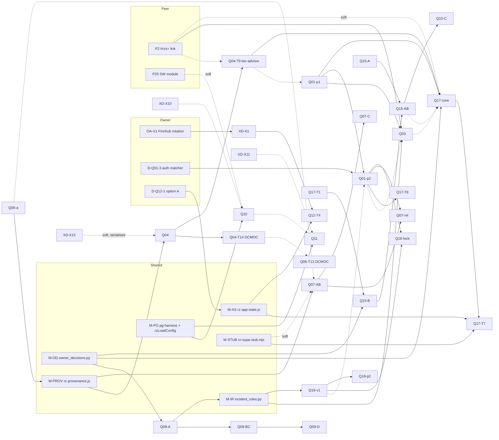

# Target architecture and cross-PRD contracts

Written 2026-11-11 by the homepage/LTC session (Opus 5.5, worktree `~/wt-hub3`, branch `hub-r3`). Inputs: `../STATE.md`,
`../DECISIONS.md` (86 rows at commit `ed815502e`), `../01-improvement-register/REGISTER.md`, `../00-audit-baseline/BASELINE.md`,
`../02-prds/QA_REVIEW_BATCH1.md`, `../02-prds/QA_REVIEW_BATCH2.md`, and all 13 PRDs under `../02-prds/PRD-*/PRD.md`
(Q01 1.1, Q03 1.2, Q04 1.2, Q06 1.2, Q07 1.1, Q09 1.1, Q10 1.0, Q11 1.1, Q12 1.1, Q15 1.1, Q17 1.1, Q18 1.1,
X-DEFECTS 1.0). Q11 1.1 and X-DEFECTS 1.0 were read at commit `ed815502e` (final per the coordinator, 2026-11-11); no PRD was edited.

Citation form: `Qnn:line` means `02-prds/PRD-Qnn/PRD.md:line`; `XD:line` means `02-prds/PRD-X-DEFECTS/PRD.md:line`;
`QA1:` / `QA2:` are the two QA review files; `DEC:` is `DECISIONS.md`; `STATE:` is `STATE.md`.

Status of every module below: **specified, not built.** On 2026-11-11, `ls tools/owner_decisions.py js/rz-app-state.js
js/rz-provenance.js` returned "No such file or directory" for all three, and `tools/lib/` holds none of the new files.

---

## 1. Shared modules

A module is listed when two or more PRDs name it, or when `DECISIONS.md` or the brief names it as shared.

### 1.1 `tools/owner_decisions.py`: the single approval CLI

| Item | Content |
|---|---|
| Owner PRD | None. `DEC:17` assigns the specification to this file; Q09 says "Exit codes and flags are the shared CLI's (D15; specified in `03-architecture`)" (`Q09:710`). Build owner: the main session, in Wave 1 (`../04-implementation-plan/PROGRAM.md`) |
| File | `tools/owner_decisions.py` (Python 3, stdlib only, like `tools/lib/incident_rules.py`, `Q09:736`) |
| Consumers | Q09 (`record incident-verification`, `Q09:710`; `decide`, `Q09:1003`), Q15 (`record glossary-review`, `Q15:571`; `decide`, `Q15:780`), Q17 (`record learning-path <id>`, `Q17:19`; `decide`, `Q17:893`), Q18 (`decide`, `Q18:748`), Q12 (`decide`, `Q12:763`), X-DEFECTS (rows "appended unchanged with `tools/owner_decisions.py`", `XD:375`) |
| Data written | `documentation/product-transformation/DECISIONS.md` rows (`decide`); per-record decision fields inside feature data files (`record`) |
| Data read | `DECISIONS.md`; the target data file of the record kind; the kind's precondition |

Public API (the parts the PRDs fix are cited; everything else is this file's specification):

| Member | Contract | Source |
|---|---|---|
| `decide <D-id> --status ACCEPTED\|REJECTED\|DEFAULTED --request R<nnn> [--chosen <option>]` | Rewrites one row of `DECISIONS.md`: Status, "Decided by" = `owner (R<nnn>)`, Date = today (UTC). `--chosen` writes "chosen" into "Recommended default" when the option differs. Refuses a row that is not PROPOSED | Status words and columns `DEC:7-13`; one CLI writes the file `DEC:17` |
| `record <kind> <ids…> --request R<nnn> [kind flags]` | Looks up `RECORD_KINDS[kind]`, runs `precondition(id) -> list[str]`; on an empty list calls `apply(record_dict, args) -> dict` and writes the result | `RECORD_KINDS` shape `Q09:748` |
| Record kinds registered by PRDs | `incident-verification` (Q09, flags `--reviewer --checked --corrected --struck --date --primary-refs --restamp`, `Q09:710`); `glossary-review` (Q15, flags `--status accepted\|rejected --note`, `Q15:571`); `learning-path` (Q17, `Q17:19`) | as cited |
| Request id | `^R[0-9]{3,4}$`; anything else is exit 2 | `DEC:17` |
| Per-record fields | `status: proposed\|accepted\|rejected\|retired`, `decidedBy: "owner"`, `decidedOn`, `request` | `QA1:455`, `Q17` data model (`QA2` re-score row "Q17 · Data model") |
| Exit codes | 0 written; 1 refused (prints the failed checks); 2 bad input | `Q09:710` |
| Write discipline | Write to a temporary file in the same directory, then rename; on refusal the target file is byte-identical | `QA2:341`, `QA1` X2 table |

Must NOT: decide on the owner's behalf (a row changes only from an owner message that names the id, `DEC:14`); mutate
the record dict in place (`apply` returns a new dict, `Q09:748`); accept any other request pattern; touch files outside
`DECISIONS.md` and the record kind's data file; print secrets.

### 1.2 `tools/lib/incident_rules.py`: dossier state and sourcing rules

| Item | Content |
|---|---|
| Owner PRD | PRD-Q09 (`Q09:735`, coordinator decision D12), built in Q09 T-2 (`Q09:998`) and extended in T-5 (`Q09:1001`) |
| Public API | `STATES = ("seed","legacy","verified")`; `state(inc) -> str` (raises `ValueError` naming the slug); `is_seed(inc) -> bool`; `load_registry(path)`; `resolve_publisher(url, ref, registry)`; `primary_refs`/`primary_count`; `official_ok(inc, registry)`; `checks(inc, registry, *, slugs_ctx) -> list[str]`; `RECORD_KINDS["incident-verification"]`; CLI `python3 tools/lib/incident_rules.py dump [--fixture <dir>]` (`Q09:740-749`) |
| Reads | `data/incidents/*.json` (field `sourcing.state`), `data/incidents/_publishers.json` |
| Writes | Nothing (the record kind's `apply` returns a dict; `owner_decisions.py` writes it) |
| Consumers | Q18 `aggregate` imports `is_seed` only (`Q18:470-471`); Q03 RV12 (`Q03:525`); Q09 Node gate reads `dump` (`Q09:997`); Q17 reads `sourcing.state` read-only (`Q17:648`) |
| Must NOT | Define a second seed rule anywhere else (`Q03:525`, `Q18:471`); depend on anything outside stdlib (`Q09:736`); mutate a dossier dict |

### 1.3 `js/rz-app-state.js`: shared `app_state` sync engine

| Item | Content |
|---|---|
| Owner PRD | PRD-Q12 §11.2a (`Q12:468-485`), built in Q12 T-3 (`Q12:641`). Exists only under D-Q12-1 option A; "Under option C the module is not written" (`Q12:485`) |
| Public API | ES5, `window.RZAppState`, guard `window.__rzAppState`. `register(cloudKey, opts)` with `opts = {merge, read, write, maxBytes ≤ 131072, debounceMs = 800, allowed, metaKey}`; `push(cloudKey)`; `pull(cloudKey?) -> Promise<boolean>`; `state(cloudKey)`; `retry()`; `ensure()`; event `rz-app-state` with `{key, state, reason?}` (`Q12:473-479`) |
| Reads/writes | Device: the consumer's keys through its `read`/`write`, plus the `metaKey` record `{v:1, user, keys:{…}}`. Cloud: one `public.app_state` row per key via `rzSupa.getAppState`/`setAppState` (`Q12:481`) |
| Key registry | `ft_wl`, `ft_port`, `ft_alerts` (Q12), `learning-paths/v1` (Q17), recorded in `standarization/SUPABASE_INTEGRATION.md` (`Q12:481`) |
| Consumers | `js/rz-ft-sync.js` v2 (adapter, `metaKey: 'rz_ft_sync'`, `Q12:470`, `:481`); Q17 `js/rz-paths.js` (`metaKey: 'rz_paths_sync'`, `debounceMs: 2000`, `Q17:273`) |
| Must NOT | Keep its own allowlist, make an entitlement decision, keep backups, change `auth.js` or need an auth export, render UI or copy, decide a merge policy, call any network path other than the two `rzSupa` wrappers, use a paid service (`Q12:483`) |

### 1.4 `tools/lib/rz-supa-stub.mjs`: in-memory `rzSupa` test stub

| Item | Content |
|---|---|
| Owner | Not assigned by any PRD. QA batch 2 proposed it "built once from Q12's spec" (`QA2:346`); Q09, Q15, Q17 and Q18 name it as the shared stub of coordinator decision D16 (`Q09:1027`, `Q15:794`, `Q17:277`, `Q18:634`). Build owner: main session, Wave 2 (first consumer Q07 L6) |
| Behaviour required by PRDs | Injected as `window.rzSupa` before page scripts run (`Object.defineProperty`, `Q12:494`); records every call (`Q12:494`); an in-memory store keyed by `user\|key` that enforces 128 KB per value and 200 keys per user (`Q12:671`); two users `u-pro` (tier `pro`) and `u-free` (tier `free`) (`Q12:672`); failure modes `missing-table`, `network`, `too-large`, `garbage` (`Q12:684`); two browser contexts may share one store (`Q12:658`, `:682`); makes no network request outside the local server (`Q12:494`) |
| Consumers | Q17 L4 (`Q17:277`, `:775`, `:818`); Q12 L2–L6 (today written as a private stand-in inside `tools/test-ft-sync.mjs`, see conflict K5); Q07 L6 "stubbed `rzSupa`" (`Q07:1081`), not named as the shared file |
| Not consumers | Q09, Q15, Q18 (`Q09:1027`, `Q15:794`, `Q18:634`: "not loaded") |
| Must NOT | Be loaded by any shipped page; reach the network; hold real credentials or real user data |

### 1.5 `js/rz-provenance.js`: provenance lines (`RZProvenance`)

| Item | Content |
|---|---|
| Owner PRD | PRD-Q06, T-2 (`Q06:1461`) |
| Public API used by others | `RZProvenance.mark(el, {kind, basis, …})` / `clear`; `kind=fallback` with an F-code is the only "engine missing" idiom (`Q04:1403`, coordinator decision D6); `kind:'simulated', basis:'scenario <id>'` (`Q06:1268`); `.rz-prov` classes and the token fallback chain (`Q06:1268`, D7) |
| Data | `tools/provenance-registry.json`; Q04 adds code `F-CALC-ENGINE-MISSING` through Q06 T-9 (`Q04:1403`) |
| Consumers | Q04 FR-16 (`Q04:16`), Q07 (`Q07:16`, `:879`) |
| Must NOT | Load `css/rz-hub.css` on cockpit pages (`Q06:1268`, D7); edit the engine (`Q06:1254`) |

### 1.6 `tools/lib/pg-harness.mjs` and `rzLoadConfig()`

| Item | Content |
|---|---|
| Owner PRD | Shared by Q10 and Q11; "whichever ships first creates them" (`Q10:16`, `Q11:16`, `Q11:172`). Q10 T-1 specifies the harness (`Q10:1941`); Q11 T-1 creates it "if PRD-Q10 has not" (`Q11:995`) |
| `pg-harness.mjs` | PGlite dev dependency (`npm i -D @electric-sql/pglite`) or Docker `postgres:16` fallback; Supabase role and `auth` schema shims (`Q10:238`, `:1941`). Used by `tools/test-usage-events-sql.mjs` (`Q10:2000`) and `tools/test-feature-overrides-sql.mjs` (`Q11:995`) |
| `rzLoadConfig()` | Verbatim text in `rz-tracker.js` and `js/rz-feature-flags.js`; a twin check in `tools/test-usage-consent.mjs --static` asserts the two texts are identical (`Q10:1539-1553`) |
| Must NOT | Run against the live database; hold credentials (`Q10:16`, owner actions only) |

### 1.7 Other shared surfaces (not modules, but written by two or more PRDs)

| Surface | Writers | Order or rule | Source |
|---|---|---|---|
| `tools/ship-gate.sh` | all 13 | Insert by anchor text, never by line number; one owner per release | `QA2:409`, `Q09:853` |
| `tier-advisor.html` | P2, Q04 FR-9, Q01, Q03; Q17 re-proves L3 last | P2 → Q04 → Q01 → Q03 → Q17 | `Q17:16`, `Q04:28`, `QA2:411` |
| `tools/build-incidents.py` + generated incident pages | Q09, Q18, Q01 phase 2, Q03 | Q09 Phase A → Q18 → Q01 phase 2 → Q03 | `Q18:505`, `Q09:853` |
| `dcmoc/` export | Q04, Q06 | Q04 engine and DCMOC source first, then Q06 T-13; one rebuild if same release | `Q04:16`, `Q06:1266` |
| `datahall.html` | Q06, Q07 | Q06 → Q07 | `QA2:418` |
| `glossary.html`, `articles.html`, explain DB | Q17 T-1, Q15, Q17 T-9 | Q17 T-1 → Q15 Phase A/B → Q17 T-9 | `Q15:663`, `Q17:647` |
| `auth.js` + `auth.min.js` | Q01 T-7 (`Q01:945`), Q11 T-3 (`Q11:997`) | Both behind owner approval; serialise; same min twin and tokens | see K13 |
| `js/rz-supabase.js` | Q10 T-3 (`Q10:1943`), Q11 T-5 (`Q11:999`); read by Q07, Q12, Q17 | Serialise; additions only; Q12 §11.1 members (`Q12:443-454`) must keep their contracts | see K13 |
| `rz-ops-p7x3k9m.html` | X-DEFECTS T-9 (`XD:1527`), Q10 T-9/T-10a/T-10b (`Q10:1949-1951`), Q11 T-6/T-7 (`Q11:1000-1001`) | X10 interim first, Q10 supersedes (`XD:1313`) | — |
| `supabase/schema.sql` | Q10 Module 10 (`Q10:395`), Q11 Module 11 (`Q11:298`); Q12 Module 4 only if missing (`Q12:771`) | See K11 | — |
| `rz-engine.js` / `.min.js` | Q04, X-DEFECTS X15 | Serialised, order not fixed; second rebases (`XD:1317`) | Gap G7 |
| `privacy.html` | Q10 T-8 (`Q10:1948`), Q11 (`Q11:847`) | Coordinate in one table rewrite | — |
| `js/rz-feature-flags.js` | Q11 T-2/T-4 (`Q11:996-998`); read by Q01, Q04, Q07, Q09, Q12, Q18, X-DEFECTS | Q11 is the only writer | see K13 |
| `DECISIONS.md` | all PRDs (proposals) through 1.1 | Owner messages only change status (`DEC:14`) | — |

### 1.8 Proposed by QA, named by no PRD

`tools/lib/axe-planted.mjs`, `assertRegister(page, selector)`, a shared port-0 server helper, one evidence resolver and
one generated-block marker grammar (`QA2:341-350`, `QA2:367-372`). A grep of all 13 PRDs for `axe-planted` and
`assertRegister` returns 0 lines. They have no owner and no wave; see Gap G5.

---

## 2. Conflicts between PRDs (not resolved here)

Each row quotes both sides. None is resolved in this file; the "needs" column says who must decide.

| Id | Topic | Side A | Side B | Needs |
|---|---|---|---|---|
| K1 | Request-id pattern | `Q01:621`, `Q01:634`, `Q03:499`, `Q07:662`: `"pattern": "^R[0-9]{2,4}$"` (QA batch 1 recommended `{2,4}`, `QA1:318`) | `DEC:17`: "Request ids everywhere … match `^R[0-9]{3,4}$` (coordinator decision D15)"; `Q09:345`, `Q15:530`, `Q17:482` use `{3,4}` | Main session: revise Q01, Q03, Q07 schemas to `{3,4}` before they are built |
| K2 | One approval CLI | `DEC:17`: "One approval CLI, `tools/owner_decisions.py`, writes this file (`decide`) and per-record acceptances (`record`)" | `Q01:284`: "`decide --accept <ids> --reject <ids> --by owner --request R<nnn>`" on `build-relations.py`; `Q03:194`: "`decide --accept ovhcloud-sbg2-fire-2021:rp-tia,… --by owner --request R1nn`" on `incidents_reproduce.py`; `Q07:223`: set `status: "approved"` by hand | Main session: Q01, Q03, Q07 register record kinds with `owner_decisions.py`, or the rule in `DEC:17` is narrowed |
| K3 | How Node gates read dossier state | `Q09:749`: "the Node gates of this PRD, PRD-Q18 and PRD-Q03 read it [`dump`] instead of re-implementing the rules" | `Q18:471`: "The Node gate reads `sourcing.state` directly from each dossier; it does not re-implement a seed rule" | Q09 and Q18 owners: pick `dump` or the raw field for the Q18 gate |
| K4 | Patterns page in the auth change | `DEC:25` and `Q18:516`: add the exact entry `/dc-incident-patterns.html` to `ROOT_ONLY_PATHS` "in the same change and approval as Q01 FR-13" | `Q01:945` (T-7 "N1 matcher fix + twin + tokens"): `grep -c dc-incident-patterns PRD-Q01/PRD.md` = 0; Q01 does not list the entry | Q01 revision; the owner's D-Q01-3 answer covers both per `DEC:25` |
| K5 | Test stub location and mechanism | `Q17:277`: "L4 with the shared stub `tools/lib/rz-supa-stub.mjs` (D16)" | `Q12:494`: `tools/test-ft-sync.mjs` "injects an in-memory stand-in for `window.rzSupa`" (private to the gate); `Q10:1954`: "a stub `js/rz-supabase.js` served by request interception"; `Q11:1019`: same mechanism; `QA2:371` spells the file `tools/lib/rzsupa-stub.mjs` | Main session: one file name (`rz-supa-stub.mjs`, used by four PRDs) and one injection mechanism, or a written reason for two |
| K6 | Who writes sync error copy | `Q17:122`: `js/rz-app-state.js` provides "dirty flag, merge callback per key, debounce, error copy" | `Q12:483`: "no UI and no copy (it emits states, consumers render them)" | Q17 revision (Q17 already renders its own toast, `Q17:202`) |
| K7 | Loading `js/rz-config.js` | `Q12:478`: `ensure()` "adds `js/rz-config.js` and module `js/rz-supabase.js` with the site's current tokens only when the page has not loaded them" | `Q10:1543-1550`: `rzLoadConfig()` appends `s.src = '/js/rz-config.js'` (no token, absolute path, own guard `window.__rzConfigP`) | Main session: one loader, or proof that both guards see each other on a page that loads both |
| K8 | Usage event names | `Q10:240`, `Q10:1716`: PRD-Q07 adds `fault_run_start`, PRD-Q17 adds `path_start`, `path_complete` | `Q07:1039`: events `rz-fault-run-start` / `rz-fault-run-end`, "call no tracker or analytics"; `Q17:305` and `DEC:76`: `path_step_done` `{path, step}` and `path_done` `{path}` | Q10 revision; Q17 names wait on D-Q17-4 (default A: no metric) |
| K9 | Role of `rz-tracker.js` | `Q07:892`: "`rz-tracker.js` … Not called by the panel and not a metric source"; the brief's privacy rule says the same | `Q10:8`: "A consent-gated, rate-limited, aggregate-only usage counter replaces the localStorage tracker"; `Q10:1944` T-4 "Tracker v2" at the same URL | Owner (D-Q10-1) and main session: after Q10 the rule has to name which tracker version it means |
| K10 | Peer-owned files in Q10's GA sweep | `Q10:253`: "`cx-calculator.html` loads `rz-tracker.js` with a bare tag. This PRD does not edit that tag"; `STATE:46` peer-owned files | `Q10:537-538` FR-6 inputs: "every `.html` under the repo root except `node_modules/`, `dcmoc/` and `.git/` that contains `G-GED7FX8RTV`". Measured 2026-11-11: `grep -c G-GED7FX8RTV cx-calculator.html id/index.html` → 4 and 2 | Q10 revision: exclude both files and hand the peer the template, or the peer agrees in writing |
| K11 | SQL module order Q10 / Q11 | `Q11:16`, `Q11:172`: harness "created by whichever ships first" | `Q11:1031` L4: "On a real Postgres engine with Modules 0–11"; Module 10 is Q10's (`Q10:395`) and Q11 appends Module 11 (`Q11:298`). If Q11 ships first, its own law needs a module that does not exist | Q11 revision: either state Q10 first, or L4 runs on Modules 0–9 + 11 |
| K12 | P2 before Q04 FR-9 | `Q04:28`, `Q17:16`: fixed `tier-advisor.html` edit order "P2 → Q04 → Q01 → Q03 → Q17" (D11) | `Q04:1600` T-9 depends on "T-6, D-Q04-8, PRD-Q06 shipped", P2 not listed | Q04 revision: add P2 to T-9 |
| K13 | QA batch 2 file-ownership table is stale for Q10/Q11 | `QA2:407` `auth.js`: "Q01 FR-13 … Q17 T-7 (must be dropped)"; `QA2:420` `js/rz-supabase.js`: "none edit"; `QA2:387` `RZ_FEATURE_FLAGS`: "none edit" | `Q11:997` T-3 edits `auth.js`, `auth.min.js`; `Q10:1943` and `Q11:999` edit `js/rz-supabase.js`; `Q11:996-998` edit `js/rz-feature-flags.js` | Recorded here (§1.7). QA reviewed ten PRDs, not Q10/Q11 (`QA2:335`) |
| K14 | Decision id format | `DEC:6`: "Id: `D-<PRD>-<n>`" | `DEC:98-108` and `XD:374`: `D-XDEF-n` (the PRD id is `PRD-X-DEFECTS`). The Q10 and Q11 rows were migrated to `D-Q10-1`…`D-Q10-11` and `D-Q11-1`…`D-Q11-8` (`DEC:79-97`); only the X-DEFECTS prefix still differs | Main session: accept `D-XDEF` as the prefix for PRD-X-DEFECTS in `DEC:6`, or rename |

Resolved naming, recorded so nobody builds the superseded name: QA proposed `tools/lib/incident-rules.mjs` and
`js/rz-app-state-sync.js` (`QA2:372`); the PRDs adopted `tools/lib/incident_rules.py` (`Q09:735`, D12) and
`js/rz-app-state.js` (`Q12:468`, D16).

---

## 3. Master dependency graph

### 3.1 Nodes

Nodes are PRD parts, not whole PRDs, because three PRD pairs depend on each other in both directions at PRD level (see
§3.4). Node names:

| Node | Meaning | Source |
|---|---|---|
| `M-OD`, `M-IR`, `M-AS`, `M-STUB`, `M-PROV`, `M-PG` | Modules of §1.1–§1.6 | §1 |
| `P2`, `P25` | Peer: scenario link `#rzs=` (schema `data/scenario-link.schema.json` v1) and SW module `js/rz-sw-register.js` | `STATE:56-68` |
| `OA-X1`, `D-Q01-3`, `D-Q12-1` | Owner action / decisions that gate a node | `XD:396`, `DEC:25`, `DEC:61` |
| `Q06-a` / `Q06-T13` | Q06 without / with the DCMOC task T-13 | `Q06:1472` |
| `Q04`, `Q04-T9`, `Q04-T14` | Q04 engine and pages / tier-advisor switch / DCMOC PUE + rebuild | `Q04:1600`, `:1605` |
| `Q07-AB`, `Q07-rel`, `Q07-C` | Q07 phases A and B / scenarios with `relatedIncidents` (V16) / Phase C | `Q07:16`, `:887`, `:1041` |
| `Q09-A`, `Q09-BC`, `Q09-D` | Q09 Phase A (T-1…T-7, T-15, T-16) / seed batches and legacy fixes / new dossiers | `Q09:1015` |
| `Q18-v1`, `Q18-lock`, `Q18-p2` | Q18 page / link lock via FR-13 / subsystem axis | `Q18:516`, `:621` |
| `Q01-p1`, `Q01-p2` | Q01 tool and term rows / dossier rows and FR-13 | `DEC:25` |
| `Q03` | Q03 whole | `Q03:16` |
| `Q17-T1`, `Q17-core`, `Q17-T7`, `Q17-T8` | explain-DB fix / page, builder, checks / account sync / incident lock | `Q17:769-776` |
| `Q15-A`, `Q15-B`, `Q15-AB`, `Q15-C` | Phase A / Phase B / both released / Phase C batches | `Q15:777`, `:782`, `:783` |
| `Q12-T4` | Q12 terminal hooks and release (T-4…T-6) | `Q12:642` |
| `Q10`, `Q11` | whole PRDs | `Q10:19`, `Q11:19` |
| `XD-X1`, `XD-X10`, `XD-X11`, `XD-X15` | X-DEFECTS release units R5, R1 (X10), R2, R4 | `XD:1721-1726` |

### 3.2 Mermaid graph

Solid arrows: hard dependency. Dashed: order on a shared file or release sequence. Dotted with "soft": works without it.
Arrows run from prerequisite to dependent.



### 3.3 Adjacency table

Kind: H hard, O order on a shared file or release, S soft. 54 edges, 43 nodes.

| From | To | Kind | Source |
|---|---|---|---|
| OA-X1 | XD-X1 | H | `XD:1726` |
| XD-X1 | Q12-T4 | H | `Q12:642` (T-4 depends on T-0, X1) |
| D-Q12-1 | M-AS | H | `Q12:485` |
| M-AS | Q12-T4 | H | `Q12:642` |
| M-OD | Q09-A | H | `Q09:1001` |
| M-OD | Q15-B | H | `Q15:780` |
| M-OD | Q17-core | H | `Q17:19` |
| Q09-A | M-IR | H | `Q09:998` (T-2 creates the module) |
| M-IR | Q18-v1 | H | `Q18:615` |
| M-IR | Q03 | H | `Q03:16` |
| Q09-A | Q09-BC | H | `Q09:1004` |
| Q09-BC | Q09-D | H | `Q09:1013` |
| Q06-a | M-PROV | H | `Q06:1461` |
| M-PROV | Q04 | H | `Q04:16` |
| M-PROV | Q07-AB | H | `Q07:16` |
| Q04-T14 | Q06-T13 | O | `Q04:16`, `Q06:1266` |
| Q04 | Q04-T14 | H | `Q04:1605` |
| Q04 | Q04-T9 | H | `Q04:1600` |
| P2 | Q04-T9 | O | `Q17:16` (D11); see K12 |
| Q04-T9 | Q01-p1 | O | `Q17:16` (D11) |
| Q01-p1 | Q03 | H | `Q03:854` (T-10 "Q1 shipped"), D11 |
| P2 | Q03 | H | `Q03:16`, `:849`, `:853` |
| Q03 | Q17-core | O | `Q17:644` |
| Q04-T9 | Q17-core | H | `Q17:774` |
| Q01-p1 | Q17-core | H | `Q17:16`, `:779` |
| P2 | Q17-core | S | `Q17:16` |
| Q17-T1 | Q15-B | H | `Q15:16` |
| Q15-AB | Q17-core | O | `Q15:663` (Q17 T-9 last) |
| Q15-A | Q15-AB | H | `Q15:777` |
| Q15-B | Q15-AB | H | `Q15:782` |
| Q15-AB | Q15-C | H | `Q15:783` |
| Q17-core | Q17-T7 | H | `Q17:775` |
| M-AS | Q17-T7 | H | `Q17:775` |
| M-STUB | Q17-T7 | H | `Q17:818` |
| M-STUB | Q07-AB | S | `QA2:346` |
| D-Q01-3 | Q01-p2 | H | `Q01:945` |
| Q01-p1 | Q01-p2 | H | `DEC:25` |
| Q18-v1 | Q01-p2 | O | `Q18:505` |
| Q01-p2 | Q03 | O | `Q18:505` (only when Q01-p2 ships) |
| Q01-p2 | Q17-T8 | H | `Q17:776` |
| Q01-p2 | Q07-rel | H | `Q07:16` |
| Q07-AB | Q07-rel | H | `Q07:887` |
| Q01-p2 | Q18-lock | H | `Q18:516` |
| Q18-v1 | Q18-lock | H | `Q18:516` |
| Q07-AB | Q07-C | H | `Q07:1041` |
| Q18-v1 | Q18-p2 | H | `Q18:621` |
| Q06-a | Q07-AB | O | `QA2:418` (`datahall.html`) |
| XD-X11 | Q11 | O | `XD:1314` |
| M-PG | Q10 | H | `Q10:1941` |
| M-PG | Q11 | H | `Q11:995` |
| Q10 | Q11 | O | `Q11:1031`, `Q10:395` (implied; K11) |
| XD-X10 | Q10 | O | `XD:1313` |
| P25 | Q10 | S | `Q10:241` |
| XD-X15 | Q04 | S | `XD:1317` (serialised, either order) |

### 3.4 Acyclicity check

Method: the 54 edges of §3.3 were typed into a Python script (scratchpad, not committed) that runs Kahn's topological
sort and Tarjan's strongly-connected-components on (a) the task-level graph above and (b) the same graph collapsed to
one node per PRD. Output, 2026-11-11:

```
nodes 43 edges 54 sorted 43 ACYCLIC
with X15<->Q04 both ways: CYCLE (expected; order not fixed)
PRD-level collapse: CYCLE among M-PROV,Q01,Q03,Q04,Q06,Q07,Q15,Q17,Q18
task-level SCCs >1: []
PRD-level SCCs >1: [['Q15', 'Q17'], ['Q01', 'Q18'], ['M-PROV', 'Q04', 'Q06']]
```

Reading:
- The task-level graph is acyclic: all 43 nodes sort, and no strongly connected component has more than one node.
- Collapsed to whole PRDs, three pairs become cycles: Q15 ↔ Q17 (explain DB and two pages, `Q15:663`), Q01 ↔ Q18
  (`build-incidents.py` order and the FR-13 link lock, `Q18:505`, `:516`), Q04 ↔ Q06 (provenance module vs DCMOC rebuild
  order, `Q04:16`). The program must schedule these PRDs by part, as `PROGRAM.md` does. This is why the PRD-level graph in
  `QA2` §C7 reports "no hard cycle": it treats the reverse edges as ordering notes.
- `XD-X15` and `Q04` are only serialised; adding both directions makes a cycle, so one direction must be chosen per
  release (Gap G7).

---

## 4. Cross-cutting rules

### 4.1 Auth and access boundary: owner approval required

`STATE:9-10`: approval is required for "destructive DB operations, auth or security boundary changes, feature removal,
major migrations, new infrastructure cost". Items in the PRDs that fall under that list:

| Item | Change | PRD source | Decision |
|---|---|---|---|
| `auth.js` matcher and `ROOT_ONLY_PATHS` | `isRootOnlyHref` matches `/incident-*.html`; exact entry `/dc-incident-patterns.html` | `Q01:945`, `Q18:516` | D-Q01-3 (`DEC:25`) |
| Patterns page beyond root | Admit educators or publish a summary | `Q18:19` | D-Q18-1 (`DEC:77`) |
| Q10 whole PRD | New anonymous write path `record_usage_event` (D-Q10-1), retention (D-Q10-2), GPC (D-Q10-3), GA after Accept (D-Q10-4), Mayar key as secret (D-Q10-5), panel deletions (D-Q10-6, D-Q10-7), privacy text (D-Q10-10), revoke `log_event` from PUBLIC (D-Q10-11) | `Q10:19`, `Q10:273-283` | D-Q10-1…D-Q10-11 (`DEC:79-89`) |
| Q11 whole PRD | Module 11 CHECKs, forced writer, audit trigger, column privileges (D-Q11-1); who opens 5 LTC pages (D-Q11-2, D-Q11-3); deletion of legacy flags (D-Q11-6); `auth.js`/`auth.min.js` listener on `rz-features-changed` (D-Q11-8, FR-3) | `Q11:19`, `Q11:209-216`, `Q11:997` | D-Q11-1…D-Q11-8 (`DEC:90-97`) |
| Q12 option A or C | A starts a new flow of personal data to Supabase; C is a feature removal | `Q12:19` | D-Q12-1 (`DEC:61`) |
| Dropping option B tables | Destructive | `DEC:63` | D-Q12-3 (default keeps them) |
| Feature removals | Five silent fallbacks (D-Q04-8), `achievements.html` retirement (D-Q17-2), dead Worker directory (D-XDEF-8), two X12 sections (D-XDEF-9, D-XDEF-10) | `DEC:37`, `DEC:74`, `XD:386-388` | as named |
| Git history rewrite | `git filter-repo` and force push | `XD:385` | D-XDEF-7 |

Rule for the program: no item above enters a release before its decision row is ACCEPTED or DEFAULTED with a request id.
Q17 does not change `auth.js` (`Q17:19`, D10); Q07 does not change `auth.js` (`Q07:882`).

### 4.2 Owner rule R114: no paid services or pay-per-use APIs

Search: `grep -niE 'R114|paid|pay-per-use|pricing|free tier|billing|Edge Function'` over the 13 PRDs. No PRD text adds a
paid service. Statements of compliance: `XD:353`, `XD:376-377`, `Q12:483`, `QA2` final paragraph. Items that need the
owner to confirm cost, because the PRD does not say:

| Text | Why it needs confirmation | Source |
|---|---|---|
| Q10 `mayar-proxy` Supabase Edge Function calling Mayar's API (balance, transactions, unpaid invoices) | The PRD does not state whether these API calls or the function invocations are billed. T-11 says "read Mayar's API docs for limits" | `Q10:375`, `Q10:1952` |
| Supabase plan | "Plan and DB size are UNKNOWN; T-1 measures them through OA-1" | `Q10:250-252` |
| Q11 D-Q11-4 cache TTL | Bounds the new GET at 1 per browser per 10 minutes on module pages; the request cost against the Supabase plan is not quantified | `Q11:181-183`, `Q11:212` |
| Q04 `/calc` Worker | Redeploy by the owner after the engine change; existing Worker | `Q04:1389` |

Q11 states R114 compliance and bounds its new read through D-Q11-4 (`Q11:181-183`, `Q11:212`). Q10 does not mention R114 (`grep -c R114 PRD-Q10/PRD.md` = 0); see Gap G8. Dev-only additions (PGlite, Docker
`postgres:16`, `Q10:238`) are local tools, not services.

### 4.3 Privacy

- No IP or city capture. Q10 removes the `ipapi.co` call and the stored `ip`, `city`, `ua` and `email` fields
  (`Q10:86`, `Q10:155`); its L2 forbids requests to `ipapi.co` before consent (`Q10:1987`) and L3 forbids e-mail, IP and
  user-agent values in any payload (`Q10:1988`). Q07 and Q17 send no events (`Q07:1039`, `Q17:305`).
- `rz-tracker.js` is not a metric source for Q07 and Q17 (`Q07:892`, `Q17:305`). Q10 replaces the file at the same URL
  with a consent-gated counter (`Q10:8`, `:1944`). Conflict K9 stays open until the owner answers D-Q10-1.
- Q17 analytics only under D-Q17-4 option B (default A, no metric, `DEC:76`).
- Q12 BR-1: the API key, theme and gateway settings never leave the device (`Q12:500`).

### 4.4 Peer-owned files

Peer-owned and not to be edited by this session: `js/rz-cx-*.js`, `cx-calculator.html`, `css/rz-cx-analysis.css`,
`js/rz-cx-ext.js`, `rz-cx-tree-ui.js`, `id/index.html` meta (`STATE:46`, `Q06:378-379`, `XD:349-350`).

Measured 2026-11-11 (grep of local `src`/`href` in the two files): `cx-calculator.html` loads `auth.js`,
`rz-engine.min.js`, `js/rz-explain-db.js`, `js/rz-supabase.js`, `js/rz-config.js`, `js/rz-cookie-consent.js`,
`js/rz-scenario.js` and `rz-tracker.js`; `id/index.html` loads `../auth.js` and `../js/rz-cookie-consent.js`.
`node tools/test-asset-cache-tokens.mjs --fix <asset>` rewrites the token in every page that loads the asset, so these
PRD tasks would write into a peer-owned file unless the peer does it:

| Task | Asset | Peer file hit | Source |
|---|---|---|---|
| Q01 T-7 | `auth.js`, `auth.min.js` | `cx-calculator.html`, `id/index.html` | `Q01:817` |
| Q11 T-3 | `auth.js`, `auth.min.js` | both | `Q11:842` |
| Q11 T-2 | `js/rz-feature-flags.js` | `cx-calculator.html` (Q11 says it is a loader) | `Q11:179`, `:841` |
| Q04 | `rz-engine.min.js` | `cx-calculator.html` | `Q04:1387` |
| X-DEFECTS X15 | `rz-engine.js` / `.min.js` | `cx-calculator.html` | `XD:1325` |
| Q17 T-1 | `js/rz-explain-db.js` | `cx-calculator.html` | `Q17:650` |
| Q10 T-3, T-5 | `js/rz-supabase.js`, `js/rz-cookie-consent.js` | `cx-calculator.html`; `id/index.html` (cookie consent) | `Q10:1943`, `:1708` |
| Q10 FR-6 | GA loader block rewritten in place | `cx-calculator.html` (4 matches), `id/index.html` (2) | `Q10:537-538` (K10) |
| Q15 T-4 | `id/index.html` body (toggle, claim `:605`); the peer applies the meta `:94` | `id/index.html` (body, not meta) | `Q15:657`, `Q15:775` |

Rule: every release that changes one of these assets sends the peer the token change before the push (`STATE:38-39`,
"peer message before and after each push") and stages the peer files only with the peer's agreement.

---

## 5. Gaps

| Id | Gap | Evidence |
|---|---|---|
| G1 | No PRD specifies `tools/lib/rz-supa-stub.mjs`; §1.4 is assembled from Q12's private stand-in. Its file owner is unassigned | `Q12:494`, `:671`; `QA2:346` |
| G2 | The shared CLI has no subcommand to append a new PROPOSED row, yet X-DEFECTS expects its rows "appended unchanged with `tools/owner_decisions.py`" | `XD:375` |
| G3 | Closed by the coordinator at `ed815502e`: Q10, Q11 and X-DEFECTS decisions are now `DEC:79-108` (86 rows). `DEC:19` still describes only the first 56 rows | `DEC:19`, `DEC:79-108` |
| G4 | Coordinator decisions D1–D16 are cited by PRDs and QA but recorded in no file | `STATE:71`; `grep -rln 'D11' documentation/product-transformation` finds only QA2, Q04, Q17 |
| G5 | QA's proposed shared test helpers (§1.8) have no owner, no PRD and no wave | `QA2:341-350` |
| G6 | The P2 schema `data/scenario-link.schema.json` v1 and `js/rz-scenario.js` reader exist only on the peer's branch `feat/p-wave1`; four PRD parts wait on it | `STATE:56-62` |
| G7 | No fixed order between Q04 and X-DEFECTS X15 on `rz-engine.js` | `XD:1317` |
| G8 | Q10 carries no R114 statement; Mayar API cost and the Supabase plan are unknown | §4.2, `Q10:250-252` |
| G9 | X7 is false (coordinator note, 2026-11-11). `BASELINE.md:35` lists X7 as "noindex prototype listed in the sitemap"; X-DEFECTS found the claim false (0 of 213 sitemap URLs are noindex). The baseline row is not corrected | `XD:35` |
| G10 | `tools/lib/pg-harness.mjs` and `rzLoadConfig()` have two conditional owners and no single specification of the shim schema | `Q10:1941`, `Q11:995` |
